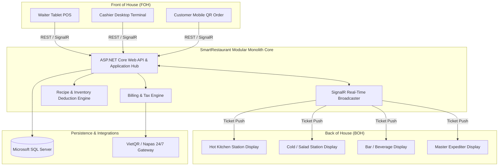

# Product Requirements Document (PRD) — SmartRestaurant

- **Document Version**: 1.0.0
- **Document Status**: `PROPOSED` (Pending user review & sign-off)
- **Lifecycle Stage**: Stage 1 — Product Requirements & Business Domain Analysis
- **Author**: Technical Lead & Senior Software Architect

---

## 1. Executive Summary & Vision

### 1.1. Product Vision
**SmartRestaurant** is an enterprise-grade Restaurant Management & Digital Operations Platform built to unify front-of-house (FOH), back-of-house (BOH), and administrative workflows into a resilient, low-latency, real-time ecosystem.

The system addresses the operational friction found in traditional restaurant setups: order bottlenecks, kitchen-waiter miscommunication, inaccurate inventory deductions, and slow checkout reconciliation. It is designed to scale seamlessly from boutique single-location bistros and high-volume cafés to multi-branch casual and fine-dining franchises.

### 1.2. Core Value Propositions
- **Real-Time Orchestration**: Sub-second synchronization across Waiter Tablets, Kitchen Display Systems (KDS), Cashier Stations, and Floor Managers using SignalR.
- **Intelligent Kitchen Routing**: Automatic routing and ticket splitting of order line items to designated prep stations (Hot Kitchen, Cold Salad/Appetizer, Bar, Bakery).
- **Interactive Floor Plan Designer**: Visual drag-and-drop 2D floor plan canvas with live table status reflections.
- **Dynamic Billing & Multi-Channel Settlement**: Seamless bill splitting, table merging, item-level discounts, automated tax calculation, and automated dynamic VietQR (Napas 24/7) reconciliation.
- **Inventory & BOM Formulation**: Real-time raw ingredient deduction linked directly to dish completion at kitchen stations.

---

## 2. Target Personas & User Journeys

| Persona | Role | Primary Goals & Responsibilities | Key Surface |
| :--- | :--- | :--- | :--- |
| **System Admin** | System / Franchise Admin | Manages multi-branch organization configuration, global master catalog, and global user permissions. | Web Admin Portal |
| **Restaurant Manager** | Operations & Shift Lead | Oversees daily operations, floor layouts, shift openings/closings, table reservations, and real-time sales reports. | Web Admin & POS Dashboard |
| **Waiter / Server** | Front-of-House (FOH) | Manages assigned table zones, takes touch orders with modifiers, fires orders to kitchen, tracks prep status, and prints pre-bills. | Mobile/Tablet Responsive POS |
| **Chef / Kitchen Staff** | Back-of-House (BOH) | Monitors incoming tickets on KDS, acknowledges prep stages (`Cooking` -> `ReadyToServe`), and alerts runners. | Kitchen Display System (KDS) |
| **Bartender / Barista** | Beverage Station | Manages beverage queue, drink recipes, and marks drinks ready. | Bar Station KDS |
| **Cashier** | Checkout & Settlement | Handles table checkout, bill splitting/merging, voucher redemption, payment processing (Cash, Card, VietQR), and cash drawer balancing. | Cashier Terminal |
| **Inventory Controller**| Warehouse & Stockkeeper | Manages raw ingredient catalogs, purchase receipts, stock audits, supplier records, and waste write-offs. | Inventory Portal |
| **Dine-in Customer** | Guest | Scans table QR code, browses digital menu, places orders (Phase 2), and requests service or bill. | Customer QR Web App |

---

## 3. High-Level System Architecture & Context

---

## 4. Functional Requirements by Module

### 4.1. Module 01: Organization & Multi-Branch Management
- **Status**: `CONFIRMED` (Architectural direction)
- **Scope & Capabilities**:
  - **FR-ORG-01**: Support hierarchical organization models: `Organization` (Tenant) $\rightarrow$ `Branch` (Restaurant Location).
  - **FR-ORG-02**: Branch-level configurations: Operating hours, tax code, currency, default service charge, default VAT rate (e.g., 8%, 10%), address, and receipt header/footer.
  - **FR-ORG-03**: Strict multi-tenant data isolation: All transactional tables (`Orders`, `Tables`, `Inventory`, `Shifts`) must carry `OrganizationId` and `BranchId`.

### 4.2. Module 02: Table & Visual Floor Plan Management
- **Status**: `CONFIRMED`
- **Scope & Capabilities**:
  - **FR-TBL-01 (Area/Zone Management)**: Support multiple dining zones per branch (e.g., *Indoor - Ground Floor*, *Outdoor Terrace*, *VIP Rooms*, *Rooftop Lounge*).
  - **FR-TBL-02 (Interactive Visual Designer)**:
    - 2D Canvas designer (Konva.js) for managers to draw floor layouts.
    - Configurable grid snapping, zoom, pan, table shapes (round, rectangle, booth), capacities (2, 4, 6, 8, 12+ seats), and custom obstacles (pillars, walls, counters).
    - Save canvas state as normalized relative coordinates (`X`, `Y`, `Width`, `Height`, `Rotation`).
  - **FR-TBL-03 (Table Lifecycle & Real-Time Statuses)**:
    - States: `Available` (Trống), `Reserved` (Đã đặt trước), `Occupied` (Có khách), `BillingRequested` (Đang thanh toán), `CleaningNeeded` (Cần dọn dẹp), `OutOfService` (Ngừng sử dụng).
    - Real-time status visual overlay: Color-coded table nodes updated across all devices instantly via SignalR.
  - **FR-TBL-04 (Table Operations)**:
    - **Move Table (Chuyển bàn)**: Transfer an active order ticket from Table A to Table B with full audit trail.
    - **Merge Tables (Gộp bàn)**: Combine multiple physical tables into a single dining session.
    - **Split Table (Tách bàn)**: Split guests or order items into separate tables/sessions.

### 4.3. Module 03: Digital Menu, Catalog & Recipe BOM
- **Status**: `CONFIRMED`
- **Scope & Capabilities**:
  - **FR-CAT-01 (Hierarchical Catalog)**: Categories $\rightarrow$ Subcategories $\rightarrow$ Menu Items.
  - **FR-CAT-02 (Variants & Modifiers)**:
    - **Size Variants**: e.g., Regular, Large, Pitcher.
    - **Modifier Groups**: Minimum/maximum selection constraints (e.g., "Choose 1 dressing", "Choose up to 3 toppings").
    - **Custom Preferences**: Free-text cooking instructions, spicy levels (0-5), ice levels (0%, 50%, 100%), sugar levels.
  - **FR-CAT-03 (Kitchen Prep Station Routing)**:
    - Each menu item or modifier is assigned to one or more prep stations (`HotKitchen`, `ColdKitchen`, `BarStation`, `BakeryStation`).
  - **FR-CAT-04 (Recipe Formulation - BOM)**:
    - Map each dish/variant to exact raw materials (e.g., 1 Burger = 150g Beef Patty, 1 Brioche Bun, 20g Cheddar Cheese, 10g Sauce).
    - Automatic deduction of stock upon dish preparation completion.
  - **FR-CAT-05 (Dynamic Pricing & Surcharges)**:
    - Support scheduled pricing (Happy Hour discounts, weekend/holiday surcharges).

### 4.4. Module 04: Order Capture & Table Service (FOH / POS)
- **Status**: `CONFIRMED`
- **Scope & Capabilities**:
  - **FR-ORD-01 (Rapid Order Entry)**:
    - Touch-optimized order grid designed for high throughput.
    - Quick search by dish code (SKU), name, or category browsing.
  - **FR-ORD-02 (Order Types)**: Support `DineIn`, `Takeaway`, and `Delivery`.
  - **FR-ORD-03 (Item Action Stages)**:
    - Item lifecycle: `Draft` (in cart) $\rightarrow$ `SentToKitchen` $\rightarrow$ `Cooking` $\rightarrow$ `ReadyToServe` $\rightarrow$ `Served` $\rightarrow$ `Cancelled`.
  - **FR-ORD-04 (Order Amendments & Void Control)**:
    - Strict security authorization: Cancelling already sent items requires Manager PIN and a mandatory cancellation reason (e.g., "Guest changed mind", "Kitchen out of stock", "Spilled").
  - **FR-ORD-05 (Pre-Bill & Ticket Printing)**:
    - Print temporary pre-bill for customer review.
    - Print physical order tickets on ESC/POS thermal printers as a hardware fallback to KDS.

### 4.5. Module 05: Kitchen Display System (KDS) & Bar Station (BOH)
- **Status**: `CONFIRMED`
- **Scope & Capabilities**:
  - **FR-KDS-01 (Station-Specific Ticket Routing)**:
    - When an order is placed, items are segregated: drinks appear on Bar KDS, grilled items appear on Hot Kitchen KDS.
    - Master Expediter KDS shows the consolidated table order to coordinate table delivery.
  - **FR-KDS-02 (Queue & Staging Workflow)**:
    - Orders displayed as FIFO visual ticket cards.
    - Action transitions: Single-click/tap transitions item from `Pending` $\rightarrow$ `Cooking` $\rightarrow$ `ReadyToServe`.
  - **FR-KDS-03 (Color-Coded SLA Timers)**:
    - Real-time elapsed timer on each card:
      - **Green**: Elapsed time < 10 minutes.
      - **Yellow**: Elapsed time 10 – 20 minutes.
      - **Red (Flashing)**: Elapsed time > 20 minutes (Overdue alert).
  - **FR-KDS-04 (Real-Time Service Alerts)**:
    - When a dish is marked `ReadyToServe`, a SignalR broadcast alerts the assigned waiter via audio chime and tablet notification.

### 4.6. Module 06: Cashier, Billing & Multi-Channel Payments
- **Status**: `CONFIRMED`
- **Scope & Capabilities**:
  - **FR-BIL-01 (Calculation Engine)**:
    - Subtotal calculation with item-level discounts, order-level vouchers, configurable service charge (e.g., 5%), and standard VAT tax (e.g., 8% or 10%).
  - **FR-BIL-02 (Bill Splitting & Merging)**:
    - **Split by Item**: Assign specific dishes to Guest A, Guest B, Guest C.
    - **Split Equally (Split Evenly)**: Divide total amount evenly into $N$ equal bills.
  - **FR-BIL-03 (Multi-Tender Payments)**:
    - Allow paying a single invoice with multiple tenders (e.g., 50% Cash + 50% VietQR).
  - **FR-BIL-04 (Automated VietQR Dynamic Payment)**:
    - Generate on-screen dynamic VietQR (Napas 24/7) containing Bank Bin, Account Number, Exact Total Amount, and unique Payment Reference Code.
    - Automatic webhook/polling reconciliation: Once payment is verified, invoice auto-closes and updates table state to `CleaningNeeded` or `Available`.
  - **FR-BIL-05 (Cash Drawer & Shift Operations)**:
    - Shift opening float entry, cash drops during shift, shift closing reconciliation, discrepancy calculation (`Actual` vs `Calculated System Cash`), and printed Z-Report.

### 4.7. Module 07: Raw Material Inventory & Spoilage Tracking
- **Status**: `CONFIRMED`
- **Scope & Capabilities**:
  - **FR-INV-01 (Ingredients & Units)**: Raw material catalog with base units and conversion factors (e.g., purchase in kg/box, consume in grams/ml).
  - **FR-INV-02 (Real-Time Deduction)**: Automatic inventory balance reduction based on Recipe BOM when dish is marked prepared.
  - **FR-INV-03 (Stock Inward & Purchasing)**: Purchase order receipts, supplier management, and cost-per-unit averaging.
  - **FR-INV-04 (Waste & Spoilage Logging)**: Record spoiled ingredients or discarded dishes with mandatory root-cause categories (Expired, Damaged, Cooking Mistake).
  - **FR-INV-05 (Low Stock Alerts)**: Automated warning triggers when ingredient inventory drops below threshold.

### 4.8. Module 08: Staff Roles & Granular RBAC
- **Status**: `CONFIRMED`
- **Role Hierarchy**:
  1. `SystemAdmin`: Full system configuration and global tenant management.
  2. `RestaurantManager`: Floor layout, menu pricing, discount authority, shift approvals, and inventory audits.
  3. `Cashier`: Order checkout, bill settlement, split/merge bills, cash drawer.
  4. `Waiter`: Table ordering, transfer table, customer service, pre-bill request.
  5. `Chef / KitchenStaff`: KDS order execution, dish readiness, ingredient deficiency notification.
  6. `InventoryStaff`: Inward shipments, inventory counting, stock adjustments.

### 4.9. Module 09: Reporting & Real-Time Business Intelligence
- **Status**: `CONFIRMED`
- **Scope & Capabilities**:
  - **FR-RPT-01 (Real-Time Live Dashboard)**: Gross revenue, active open tables, average ticket size, and kitchen throughput.
  - **FR-RPT-02 (Sales Analytics)**: Sales by day/week/month, category contribution, and top/bottom selling items (Pareto analysis).
  - **FR-RPT-03 (Operational Metrics)**: Average table turnaround time, kitchen prep time SLA adherence, and peak-hour heatmaps.
  - **FR-RPT-04 (Loss & Audit Reports)**: Void/cancelled item analysis by reason and manager authorization audit logs.

### 4.10. Module 10: Customer Self-Service QR Ordering (Phase 2 Readiness)
- **Status**: `PROPOSED` (Designed for Phase 2 implementation)
- **Scope & Capabilities**:
  - Unique encrypted table QR code directing customer mobile browser to the responsive guest menu.
  - Guest cart creation, direct ordering with optional prepayment via VietQR, and waiter call button.

---

## 5. Non-Functional Requirements (NFRs)

### 5.1. Performance & Latency
- **NFR-PERF-01**: Touchscreen POS UI response time for item selection and quantity changes must be under **100ms**.
- **NFR-PERF-02**: SignalR event broadcast (order placed $\rightarrow$ KDS ticket appearance) must execute within **< 500ms** under local network conditions.
- **NFR-PERF-03**: Bill calculation engine must compute subtotal, discounts, service charges, and taxes in **< 50ms**.

### 5.2. Concurrency & Data Integrity
- **NFR-CONC-01 (Optimistic Concurrency Control)**: All orders and table records must feature concurrency stamps (`RowVersion`) to prevent race conditions during simultaneous waiter updates and cashier checkouts.
- **NFR-CONC-02 (Transaction Boundaries)**: Order submission, bill splitting, table merging, and inventory deductions must be wrapped inside atomic database transactions (`IDbContextTransaction`).

### 5.3. High Availability & Operational Resilience
- **NFR-RES-01**: The KDS and POS must gracefully recover from temporary network dropouts via SignalR auto-reconnect and state re-synchronization.
- **NFR-RES-02**: Crash recovery: Incomplete kitchen tickets and active tables must immediately restore to their exact prior state upon server restart.

### 5.4. Security & Compliance
- **NFR-SEC-01**: Mandatory CSRF protection (`[ValidateAntiForgeryToken]`) across all mutative web endpoints.
- **NFR-SEC-02**: Zero raw SQL concatenation; strictly parameterized LINQ queries through Entity Framework Core.
- **NFR-SEC-03**: Strict password hashing and security stamp validation via ASP.NET Core Identity.
- **NFR-SEC-04**: Role-based access control (RBAC) enforced on both API controller actions and UI element rendering.

---

## 6. Architectural Decision Classification

| Decision ID | Title | Status | Summary of Scope |
| :--- | :--- | :--- | :--- |
| **ADR-001** | Modular Monolith Architecture | `CONFIRMED` | Package all functional restaurant modules inside a single deployable unit with strict layer and domain boundaries. |
| **ADR-002** | ASP.NET Core & EF Core Tech Stack | `CONFIRMED` | Use C# .NET LTS, ASP.NET Core Web API, Razor MVC for Admin, and EF Core with MS SQL Server. |
| **ADR-003** | Real-Time SignalR Notification Mesh | `CONFIRMED` | Centralize state propagation via SignalR hubs (`TableHub`, `OrderHub`, `KitchenHub`). |
| **ADR-004** | Konva.js Floor Plan Canvas | `CONFIRMED` | Use HTML5 2D canvas library (Konva.js) for interactive floor plan rendering and table node positioning. |
| **ADR-005** | Inventory BOM Deduction Trigger | `PROPOSED` | Trigger raw inventory deduction at the moment the kitchen marks a dish as `ReadyToServe` (rather than order placement) to avoid discrepancies from cancelled orders. |
| **ADR-006** | VietQR Dynamic Payment Engine | `PROPOSED` | Integrate VietQR API standard for instant QR generation with automated webhook reconciliation. |

---

## 7. Open Questions & Domain Inquiries

- **OQ-01**: Should bill splitting allow uneven percentage splits (e.g., 60/40) in addition to item-based and equal splits?
- **OQ-02**: In multi-branch operations, do branches share a centralized ingredient warehouse, or does each branch maintain completely isolated inventory stocktakes?
- **OQ-03**: Should kitchen tickets automatically print to physical thermal printers simultaneously when pushed to KDS, or only on manual reprint?
