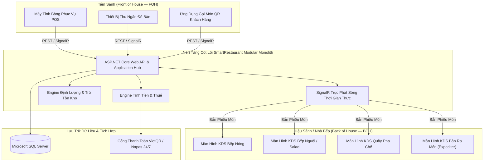

# Tài Liệu Yêu Cầu Sản Phẩm (PRD) — SmartRestaurant
## (Product Requirements Document — PRD)

- **Phiên Bản Tài Liệu**: 1.0.0
- **Trạng Thái Tài Liệu**: `PROPOSED` (Chờ người dùng thẩm định và phê duyệt)
- **Giai Đoạn Vòng Đời**: Stage 1 — Yêu Cầu Sản Phẩm & Phân Tích Miền Nghiệp Vụ
- **Tác Giả**: Trưởng Nhóm Kỹ Thuật & Kiến Trúc Sư Phần Mềm Cao Cấp (Technical Lead & Senior Software Architect)

---

## 1. Tóm Tắt Tổng Quan & Tầm Nhìn (Executive Summary & Vision)

### 1.1. Tầm Nhìn Sản Phẩm (Product Vision)
**SmartRestaurant** là nền tảng quản lý và vận hành số nhà hàng cấp doanh nghiệp, được xây dựng nhằm hợp nhất các luồng công việc tiền sảnh (Front-of-House — FOH), hậu sảnh/nhà bếp (Back-of-House — BOH) và quản trị thành một hệ sinh thái thời gian thực, độ trễ thấp và bền bỉ.

Hệ thống giải quyết các trở ngại vận hành thường gặp trong mô hình nhà hàng truyền thống: tắc nghẽn đơn gọi món, sai lệch giao tiếp giữa bếp và phục vụ, tính toán trừ tồn kho thiếu chính xác và đối soát thanh toán chậm. Sản phẩm được thiết kế để mở rộng mượt mà từ các quán bistro nhỏ lẻ, quán cà phê công suất cao đến chuỗi nhà hàng ẩm thực cao cấp nhiều chi nhánh.

### 1.2. Giá Trị Cốt Lõi (Core Value Propositions)
- **Điều Phối Thời Gian Thực (Real-Time Orchestration)**: Đồng bộ dưới một giây giữa Máy tính bảng Phục vụ, Màn hình Bếp (KDS), Quầy Thu ngân và Quản lý Mặt bằng sử dụng SignalR.
- **Phân Tuyến Bếp Thông Minh (Intelligent Kitchen Routing)**: Tự động phân tuyến và tách phiếu món trong đơn về các bộ phận chế biến chuyên trách (Bếp Nóng, Bếp Nguội/Salad, Quầy Bar, Bếp Bánh).
- **Thiết Kế Sơ Đồ Bàn Trực Quan (Interactive Floor Plan Designer)**: Canvas 2D kéo thả trực quan phản ánh trạng thái ăn uống của từng bàn theo thời gian thực.
- **Thanh Toán Linh Hoạt & Đa Kênh (Dynamic Billing & Multi-Channel Settlement)**: Tách hóa đơn mượt mà, gộp bàn, chiết khấu theo món, tự động tính thuế GTGT và đối soát thanh toán chuyển khoản VietQR (Napas 24/7) tức thì.
- **Quản Lý Định Lượng Tồn Kho (Inventory & BOM Formulation)**: Khấu trừ tồn kho nguyên vật liệu thời gian thực gắn liền với tiến độ hoàn thành món tại trạm bếp.

---

## 2. Chân Dung Người Dùng & Hành Trình Nghiệp Vụ (Target Personas & User Journeys)

| Chân Dung | Vai Trò | Mục Tiêu Chính & Trách Nhiệm Vận Hành | Giao Diện Chính |
| :--- | :--- | :--- | :--- |
| **Quản Trị Hệ Thống (System Admin)** | Quản trị Hệ thống / Chuỗi | Quản lý cấu hình tổ chức đa chi nhánh, danh mục thực đơn mẫu toàn hệ thống và phân quyền người dùng. | Cổng Quản Trị Web (Admin Portal) |
| **Quản Lý Nhà Hàng (Restaurant Manager)**| Điều hành & Trưởng ca | Giám sát vận hành hàng ngày, sơ đồ mặt bằng, mở/chốt ca, đặt bàn trước và báo cáo doanh thu thời gian thực. | Cổng Web Admin & POS Dashboard |
| **Nhân Viên Phục Vụ (Waiter / Server)** | Tiền sảnh (FOH) | Quản lý khu vực bàn phụ trách, tạo đơn gọi món cảm ứng kèm tùy chọn, bắn đơn xuống bếp, theo dõi trạng thái món và in phiếu tạm tính. | Ứng dụng POS Cảm Ứng Di Động / Tablet |
| **Đầu Bếp / Nhân Viên Bếp (Chef / Kitchen Staff)** | Hậu sảnh (BOH) | Theo dõi thẻ món nhận được trên KDS, xác nhận các bước chế biến (`Đang nấu` -> `Đã xong (Chờ bưng)`), và thông báo cho nhân viên bưng món. | Màn Hình Bếp Số (KDS) |
| **Nhân Viên Pha Chế (Bartender / Barista)** | Trạm Đồ Uống | Quản lý hàng đợi pha chế, công thức đồ uống và đánh dấu đồ uống đã sẵn sàng. | Màn Hình KDS Quầy Bar |
| **Thu Ngân (Cashier)** | Thanh toán & Quyết toán | Xử lý thanh toán bàn, tách/gộp hóa đơn, áp dụng voucher, thu tiền (Tiền mặt, Thẻ, VietQR) và cân đối két tiền mặt. | Thiết Bị Thu Ngân Để Bàn |
| **Thủ Kho (Inventory Controller)** | Kho hàng nhà hàng | Quản lý danh mục nguyên vật liệu, phiếu nhập kho, kiểm kê định kỳ, hồ sơ nhà cung cấp và ghi nhận hao phí hỏng hóc. | Cổng Quản Trị Kho |
| **Khách Hàng Ăn Tại Chỗ (Dine-in Customer)** | Khách hàng | Quét mã QR tại bàn, xem thực đơn số, đặt món (Giai đoạn 2) và yêu cầu phục vụ hoặc hóa đơn. | Ứng Dụng Web QR Khách Hàng |

---

## 3. Kiến Trúc Hệ Thống Tổng Quan & Bối Cảnh (High-Level System Architecture & Context)

---

## 4. Yêu Cầu Chức Năng Theo Phân Hệ (Functional Requirements by Module)

### 4.1. Phân Hệ 01: Quản Trị Tổ Chức & Đa Chi Nhánh (Organization & Multi-Branch Management)
- **Trạng Thái**: `CONFIRMED` (Định hướng kiến trúc)
- **Phạm Vi & Năng Lực**:
  - **FR-ORG-01**: Hỗ trợ mô hình phân cấp tổ chức: `Doanh nghiệp` (Tổ chức / Tenant) $\rightarrow$ `Chi nhánh` (Địa điểm nhà hàng cụ thể).
  - **FR-ORG-02**: Cấu hình theo cấp chi nhánh: Giờ hoạt động, mã số thuế, loại tiền tệ, phí dịch vụ mặc định, thuế suất GTGT mặc định (ví dụ: 8%, 10%), địa chỉ và tiêu đề/chân trang hóa đơn in nhiệt.
  - **FR-ORG-03**: Phân lập dữ liệu nghiêm ngặt giữa các bên thuê: Mọi bảng giao dịch (`Orders`, `Tables`, `Inventory`, `Shifts`) phải mang khóa `OrganizationId` và `BranchId`.

### 4.2. Phân Hệ 02: Quản Lý Bàn Ăn & Sơ Đồ Mặt Bằng Trực Quan (Table & Visual Floor Plan Management)
- **Trạng Thái**: `CONFIRMED`
- **Phạm Vi & Năng Lực**:
  - **FR-TBL-01 (Quản lý Khu vực/Phân vùng)**: Hỗ trợ nhiều khu vực ăn uống trên mỗi chi nhánh (ví dụ: *Trong nhà - Tầng 1*, *Sân vườn ngoài trời*, *Phòng VIP*, *Khu vực Tầng thượng*).
  - **FR-TBL-02 (Trình Thiết Kế Trực Quan Tương Tác)**:
    - Trình thiết kế Canvas 2D (Konva.js) để quản lý tự vẽ sơ đồ mặt bằng.
    - Hỗ trợ bắt dính lưới (grid snapping), thu phóng, xoay, các hình dạng bàn (tròn, chữ nhật, sofa), số chỗ ngồi (2, 4, 6, 8, 12+ chỗ) và các vật cản kiến trúc (cột nhà, tường ngăn, quầy thu ngân).
    - Lưu trữ trạng thái canvas dưới dạng tọa độ tương đối chuẩn hóa (`X`, `Y`, `Width`, `Height`, `Rotation`).
  - **FR-TBL-03 (Vòng Đời & Trạng Thái Bàn Thời Gian Thực)**:
    - 6 trạng thái bàn chuẩn: `Available` (Trống), `Reserved` (Đã đặt trước), `Occupied` (Có khách), `BillingRequested` (Đang thanh toán), `CleaningNeeded` (Cần dọn dẹp), `OutOfService` (Ngừng phục vụ).
    - Lớp phủ trạng thái trực quan thời gian thực: Điểm bàn được tô màu tương ứng và cập nhật tức thì trên mọi thiết bị qua SignalR.
  - **FR-TBL-04 (Thao Tác Nghiệp Vụ Bàn)**:
    - **Chuyển bàn (Move Table)**: Chuyển toàn bộ đơn món đang phục vụ từ Bàn A sang Bàn B kèm nhật ký kiểm toán.
    - **Gộp bàn (Merge Tables)**: Kết hợp nhiều bàn vật lý thành một đơn phục vụ duy nhất cho đoàn khách đông.
    - **Tách bàn (Split Table)**: Tách nhóm khách hoặc một số món ăn ra bàn riêng độc lập.

### 4.3. Phân Hệ 03: Thực Đơn Số, Danh Mục & Định Lượng Món BOM (Digital Menu, Catalog & Recipe BOM)
- **Trạng Thái**: `CONFIRMED`
- **Phạm Vi & Năng Lực**:
  - **FR-CAT-01 (Danh Mục Phân Cấp)**: Danh mục lớn $\rightarrow$ Danh mục con $\rightarrow$ Món ăn / Đồ uống.
  - **FR-CAT-02 (Biến Thể & Nhóm Tùy Chọn)**:
    - **Kích cỡ (Size)**: Ví dụ: Tiêu chuẩn, Lớn, Cỡ gia đình.
    - **Nhóm tùy chọn (Modifier Groups)**: Ràng buộc số lượng chọn tối thiểu/tối đa (ví dụ: "Chọn 1 loại nước xốt", "Chọn tối đa 3 món ăn kèm").
    - **Yêu cầu riêng của khách**: Ghi chú chế biến bằng văn bản tự do, mức độ cay (0-5), mức đá (0%, 50%, 100%), lượng đường.
  - **FR-CAT-03 (Phân Tuyến Trạm Chế Biến)**:
    - Mỗi món ăn hoặc tùy chọn được gán cho một hoặc nhiều trạm bếp phụ trách (`HotKitchen`, `ColdKitchen`, `BarStation`, `BakeryStation`).
  - **FR-CAT-04 (Định Lượng Món Ăn - BOM)**:
    - Ánh xạ từng món/biến thể với định lượng nguyên vật liệu chính xác (ví dụ: 1 suất Bò bít tết = 200g Thăn bò, 50g Bơ lạt, 30ml Nước sốt tiêu).
    - Tự động trừ tồn kho khi món ăn được xác nhận chế biến xong. *(Lưu ý: BOM chi tiết gram/ml hoãn sang v1.1; MVP theo dõi hàng thành phẩm đếm được)*.
  - **FR-CAT-05 (Giá Bán Linh Hoạt & Phụ Thu)**:
    - Hỗ trợ giá bán theo lịch (giảm giá Giờ Vàng - Happy Hour, phụ thu cuối tuần / ngày lễ).

### 4.4. Phân Hệ 04: Tiếp Nhận Đơn & Dịch Vụ Tại Bàn POS (Order Capture & Table Service - FOH / POS)
- **Trạng Thái**: `CONFIRMED`
- **Phạm Vi & Năng Lực**:
  - **FR-ORD-01 (Nhập Món Cảm Ứng Nhanh)**:
    - Giao diện lưới chọn món tối ưu cho màn hình cảm ứng, phục vụ thao tác tốc độ cao.
    - Tìm kiếm nhanh theo mã món (SKU), tên món hoặc duyệt theo danh mục.
  - **FR-ORD-02 (Loại Hình Đơn Hàng)**: Hỗ trợ `Ăn tại chỗ` (DineIn), `Mang đi` (Takeaway) và `Giao hàng` (Delivery).
  - **FR-ORD-03 (Các Bước Xử Lý Món)**:
    - Vòng đời món: `Nháp trong giỏ` (Draft) $\rightarrow$ `Bắn đơn xuống bếp` (SentToKitchen) $\rightarrow$ `Đang nấu` (Cooking) $\rightarrow$ `Đã xong (Chờ bưng)` (ReadyToServe) $\rightarrow$ `Đã phục vụ` (Served) $\rightarrow$ `Hủy món` (Cancelled).
  - **FR-ORD-04 (Điều Chỉnh Đơn & Kiểm Soát Hủy Món)**:
    - Cơ chế ủy quyền an toàn nghiêm ngặt: Hủy món đã bắn xuống bếp bắt buộc phải có mã PIN Quản lý và lý do hủy bắt buộc (ví dụ: "Khách đổi ý", "Bếp hết nguyên liệu", "Món bị đổ vỡ").
  - **FR-ORD-05 (In Phiếu Tạm Tính & Phiếu Nhiệt)**:
    - In phiếu tạm tính để khách kiểm tra danh sách món trước khi trả tiền.
    - In phiếu chế biến ra máy in nhiệt ESC/POS làm phương án dự phòng cho màn hình KDS.

### 4.5. Phân Hệ 05: Màn Hình Bếp KDS & Quầy Pha Chế (Kitchen Display System & Bar Station - BOH)
- **Trạng Thái**: `CONFIRMED`
- **Phạm Vi & Năng Lực**:
  - **FR-KDS-01 (Phân Tuyến Thẻ Món Theo Trạm)**:
    - Khi đơn được xác nhận, các món ăn được bóc tách tự động: đồ uống hiển thị trên KDS Bar, món nướng hiển thị trên KDS Bếp Nóng.
    - Màn hình KDS Điều Phối (Master Expediter) hiển thị toàn bộ món của bàn để điều phối ra món đồng bộ.
  - **FR-KDS-02 (Quy Trình Hàng Đợi & Xử Lý Thẻ Món)**:
    - Các đơn gọi hiển thị dưới dạng thẻ trực quan theo thứ tự đến trước làm trước (FIFO).
    - Thao tác 1 chạm/chạm chuyển trạng thái món: `Chờ chế biến` $\rightarrow$ `Đang nấu` $\rightarrow$ `Đã xong (Chờ bưng)`.
  - **FR-KDS-03 (Đồng Hồ Cảnh Báo SLA Theo Màu Sắc)**:
    - Đồng hồ đếm thời gian trôi qua hiển thị theo thời gian thực trên từng thẻ:
      - **Màu Xanh Lá**: Thời gian chờ < 10 phút.
      - **Màu Vàng**: Thời gian chờ 10 – 20 phút.
      - **Màu Đỏ (Nhấp nháy)**: Thời gian chờ > 20 phút (Cảnh báo vượt chuẩn cam kết SLA).
  - **FR-KDS-04 (Cảnh Báo Ra Món Thời Gian Thực)**:
    - Khi món được bấm `Đã xong (Chờ bưng)`, SignalR phát thông báo âm thanh và tin nhắn đẩy đến tablet của phục vụ phụ trách bàn.

### 4.6. Phân Hệ 06: Thu Ngân, Tính Tiền & Thanh Toán Đa Kênh (Cashier, Billing & Multi-Channel Payments)
- **Trạng Thái**: `CONFIRMED`
- **Phạm Vi & Năng Lực**:
  - **FR-BIL-01 (Engine Tính Tiền)**:
    - Tính tiền tạm tính kèm chiết khấu theo món, voucher cấp hóa đơn, phí dịch vụ linh hoạt (ví dụ: 5%) và thuế GTGT tiêu chuẩn (8% hoặc 10%).
  - **FR-BIL-02 (Tách & Gộp Hóa Đơn)**:
    - **Tách theo món**: Gán từng món ăn cụ thể cho từng khách thanh toán riêng.
    - **Chia đều (1/N)**: Chia đều tổng số tiền cho $N$ người trong bàn.
  - **FR-BIL-03 (Thanh Toán Kết Hợp Nhiều Hình Thức - Multi-Tender)**:
    - Cho phép thanh toán một hóa đơn bằng nhiều phương thức (ví dụ: 50% Tiền mặt + 50% Chuyển khoản VietQR).
  - **FR-BIL-04 (Tích Hợp Tự Động Mã QR Động VietQR)**:
    - Sinh mã VietQR động (chuẩn Napas 24/7) trên màn hình gồm Mã ngân hàng, Số tài khoản, Số tiền chính xác và Mã tham chiếu thanh toán duy nhất.
    - Tự động đối soát qua webhook/polling: Khi phát hiện giao dịch thành công, hóa đơn tự động đóng và cập nhật trạng thái bàn sang `Cần dọn dẹp` hoặc `Trống`.
  - **FR-BIL-05 (Quản Lý Ca Kíp & Két Tiền Mặt)**:
    - Nhập số tiền mặt đầu ca khi mở ca, ghi nhận rút tiền nộp két giữa ca, chốt ca đối soát tiền mặt (kiểm tiền mù), tính chênh lệch (`Tiền thực đếm` vs `Hệ thống tính`) và in phiếu Z-Report.

### 4.7. Phân Hệ 07: Quản Lý Tồn Kho Hàng Hóa & Hao Hụt (Raw Material Inventory & Spoilage Tracking)
- **Trạng Thái**: `CONFIRMED`
- **Phạm Vi & Năng Lực**:
  - **FR-INV-01 (Nguyên Vật Liệu & Đơn Vị Tính)**: Danh mục hàng hóa với đơn vị cơ bản và hệ số quy đổi (ví dụ: mua theo thùng/kg, xuất dùng theo lon/chai/phần ăn).
  - **FR-INV-02 (Khấu Trừ Tồn Kho Thực Tế)**: Tự động giảm số lượng tồn kho theo đơn vị đếm được khi món ăn hoàn thành.
  - **FR-INV-03 (Nhập Kho & Quản Lý Nhà Cung Cấp)**: Phiếu nhập hàng mua sắm, quản lý nhà cung cấp và giá vốn bình quân gia quyền.
  - **FR-INV-04 (Ghi Nhận Hao Hụt & Hủy Hàng)**: Ghi sổ nguyên liệu hỏng hoặc món ăn bị hủy kèm phân loại lý do bắt buộc (Hết hạn, Hư hỏng, Lỗi chế biến).
  - **FR-INV-05 (Cảnh Báo Chạm Ngưỡng Tồn Thấp)**: Tự động cảnh báo khi tồn kho hàng hóa giảm xuống dưới định mức an toàn.

### 4.8. Phân Hệ 08: Phân Quyền Người Dùng & Quản Trị Vai Trò RBAC (Staff Roles & Granular RBAC)
- **Trạng Thái**: `CONFIRMED`
- **Phân Cấp 6 Vai Trò Chuẩn**:
  1. `Quản trị hệ thống (SystemAdmin)`: Toàn quyền cấu hình hệ thống và quản trị tổ chức.
  2. `Quản lý nhà hàng (RestaurantManager)`: Thiết kế sơ đồ mặt bằng, quản lý giá thực đơn, phê duyệt chiết khấu, duyệt ca và kiểm kê kho.
  3. `Thu ngân (Cashier)`: Tính tiền, quyết toán hóa đơn, tách/gộp bill và quản lý két tiền ca làm việc.
  4. `Nhân viên phục vụ (Waiter)`: Gọi món tại bàn, chuyển bàn, chăm sóc khách và yêu cầu in phiếu tạm tính.
  5. `Đầu bếp / Pha chế (Chef / KitchenStaff)`: Tiếp nhận chế biến thẻ KDS, báo món sẵn sàng và cảnh báo hết món.
  6. `Thủ kho (InventoryStaff)`: Nhận hàng nhập kho, kiểm đếm tồn kho thực tế và ghi nhận hao phí.

### 4.9. Phân Hệ 09: Báo Cáo Doanh Thu & Trí Tuệ Kinh Doanh (Reporting & Real-Time Business Intelligence)
- **Trạng Thái**: `CONFIRMED`
- **Phạm Vi & Năng Lực**:
  - **FR-RPT-01 (Bảng Điều Khiển Trực Quan Thời Gian Thực)**: Doanh thu gộp trong ngày, số bàn đang có khách, quy mô hóa đơn trung bình và tốc độ ra món của bếp.
  - **FR-RPT-02 (Phân Tích Bán Hàng)**: Doanh số theo ngày/tuần/tháng, tỷ trọng đóng góp của từng danh mục và danh sách món bán chạy/bán chậm (phân tích Pareto).
  - **FR-RPT-03 (Chỉ Số Vận Hành)**: Thời gian quay vòng bàn trung bình, tỷ lệ tuân thủ cam kết thời gian SLA của bếp và biểu đồ nhiệt theo khung giờ cao điểm.
  - **FR-RPT-04 (Báo Cáo Hao Phí & Kiểm Toán)**: Phân tích món bị hủy theo lý do và nhật ký ủy quyền can thiệp của Quản lý.

### 4.10. Phân Hệ 10: Khách Hàng Tự Quét QR Gọi Món (Customer Self-Service QR Ordering - Phase 2 Readiness)
- **Trạng Thái**: `PROPOSED` (Thiết kế kiến trúc sẵn sàng cho Giai đoạn 2)
- **Phạm Vi & Năng Lực**:
  - Mã QR bảo mật riêng biệt tại từng bàn điều hướng trình duyệt di động của khách vào thực đơn số tương thích.
  - Khách tự tạo giỏ hàng, gửi đơn gọi món trực tiếp kèm tùy chọn thanh toán trước qua VietQR và nút bấm gọi nhân viên phục vụ.

---

## 5. Yêu Cầu Phi Chức Năng (Non-Functional Requirements — NFRs)

### 5.1. Hiệu Năng & Độ Trễ (Performance & Latency)
- **NFR-PERF-01**: Thời gian phản hồi giao diện POS cảm ứng khi chọn món và thay đổi số lượng phải dưới **100ms**.
- **NFR-PERF-02**: Phát sóng sự kiện SignalR (từ lúc bấm Báo bếp đến khi thẻ món xuất hiện trên KDS) phải hoàn tất trong vòng **< 500ms** trong điều kiện mạng nội bộ.
- **NFR-PERF-03**: Engine tính tiền phải tính toán xong tiền tạm tính, chiết khấu, phí dịch vụ và thuế GTGT trong vòng **< 50ms**.

### 5.2. Đồng Thời & Toàn Vẹn Dữ Liệu (Concurrency & Data Integrity)
- **NFR-CONC-01 (Kiểm Soát Đồng Thời Lạc Quan)**: Toàn bộ đơn hàng và bản ghi bàn ăn phải mang dấu ấn đồng thời (`RowVersion`) để ngăn chặn tranh chấp ghi đè khi nhiều phục vụ cùng thao tác hoặc thu ngân đang tính tiền.
- **NFR-CONC-02 (Ranh Giới Giao Dịch)**: Thao tác gửi đơn gọi món, tách hóa đơn, gộp bàn và khấu trừ kho phải được bọc trong các giao dịch CSDL nguyên tử (`IDbContextTransaction`).

### 5.3. Độ Sẵn Sàng Cao & Khả Năng Khôi Phục (High Availability & Operational Resilience)
- **NFR-RES-01**: KDS và POS phải tự động phục hồi mượt mà sau sự cố ngắt kết nối mạng tạm thời thông qua cơ chế tự động kết nối lại của SignalR và tái đồng bộ trạng thái.
- **NFR-RES-02**: Khôi phục sau sự cố máy chủ: Các thẻ món đang nấu dở và các bàn đang có khách phải được khôi phục chính xác trạng thái trước đó ngay khi máy chủ khởi động lại.

### 5.4. Bảo Mật & Tuân Thủ (Security & Compliance)
- **NFR-SEC-01**: Bắt buộc áp dụng cơ chế chống giả mạo yêu cầu chéo CSRF (`[ValidateAntiForgeryToken]`) trên toàn bộ các endpoint ghi dữ liệu.
- **NFR-SEC-02**: Tuyệt đối không nối chuỗi SQL thô; sử dụng 100% truy vấn LINQ được tham số hóa thông qua Entity Framework Core.
- **NFR-SEC-03**: Băm mật khẩu an toàn và kiểm tra dấu ấn bảo mật thông qua thư viện ASP.NET Core Identity.
- **NFR-SEC-04**: Kiểm soát quyền truy cập theo vai trò (RBAC) được thực thi nghiêm ngặt trên cả các hành động Controller API và giao diện hiển thị.

---

## 6. Phân Loại Quyết Định Kiến Trúc (Architectural Decision Classification)

| Mã Quyết Định | Tiêu Đề Kiến Trúc | Trạng Thái | Tóm Tắt Phạm Vi & Đánh Đổi |
| :--- | :--- | :--- | :--- |
| **ADR-001** | Kiến Trúc Modular Monolith | `CONFIRMED` | Đóng gói toàn bộ các phân hệ nhà hàng trong một đơn vị triển khai duy nhất với ranh giới tầng và miền nghiệp vụ nghiêm ngặt. |
| **ADR-002** | Nền Tảng Kỹ Thuật ASP.NET Core & EF Core | `CONFIRMED` | Sử dụng C# .NET LTS, ASP.NET Core Web API, Razor MVC cho Quản trị và EF Core kết nối Microsoft SQL Server. |
| **ADR-003** | Trục Thông Điệp Thời Gian Thực SignalR | `CONFIRMED` | Tập trung hóa việc truyền phát trạng thái qua các Hub SignalR (`TableHub`, `OrderHub`, `KitchenHub`). |
| **ADR-004** | Canvas Sơ Đồ Mặt Bằng Konva.js | `CONFIRMED` | Sử dụng thư viện đồ họa HTML5 2D Canvas (Konva.js) để dựng sơ đồ mặt bằng kéo thả và định vị điểm bàn. |
| **ADR-005** | Thời Điểm Trừ Tồn Kho BOM | `PROPOSED` | Kích hoạt trừ tồn kho nguyên vật liệu tại thời điểm bếp bấm `ReadyToServe` (thay vì khi bắn đơn) để tránh sai lệch do đơn bị hủy. *(Được tái đối soát trong PDR-004: Khóa giữ kho khi bắn đơn, trừ kho thực tế theo chính sách trạm)*. |
| **ADR-006** | Engine Thanh Toán Tự Động VietQR | `PROPOSED` | Tích hợp chuẩn API VietQR sinh mã QR tức thì kèm đối soát tự động qua webhook ngân hàng. |

---

## 7. Các Câu Hỏi Mở & Khảo Sát Nghiệp Vụ (Open Questions & Domain Inquiries)

- **OQ-01**: Việc tách hóa đơn có cần hỗ trợ tách theo tỷ lệ phần trăm tùy biến (ví dụ: 60/40) bên cạnh việc tách theo món và chia đều hay không?
- **OQ-02**: Trong mô hình chuỗi đa chi nhánh, các chi nhánh dùng chung một kho tổng trung tâm hay mỗi chi nhánh quản lý sổ kho độc lập hoàn toàn?
- **OQ-03**: Phiếu chế biến bếp có cần tự động in nhiệt song song khi bắn đơn xuống KDS hay chỉ in thủ công khi có yêu cầu in lại?
