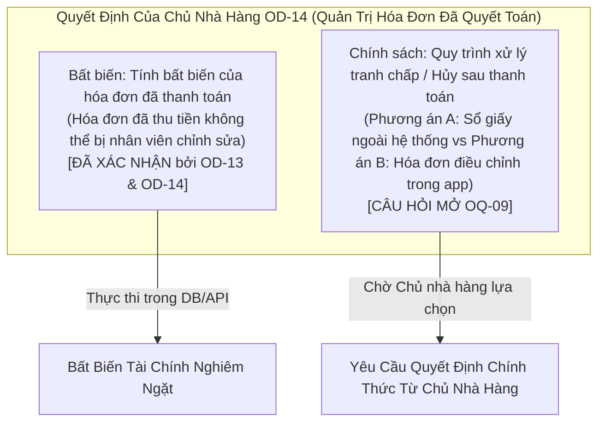

# SmartRestaurant — Báo Cáo Kiểm Toán Tổng Thể Về Tính Truy Vết Quản Trị & Ranh Giới Phê Duyệt

- **Mã định danh kiểm toán (Audit Identifier)**: `AUDIT-02.7.5` / `TASK-02.7.5`
- **Phiên bản tài liệu**: 2.0.0 (Báo cáo kiểm toán cuối cùng toàn diện)
- **Ngày kiểm toán**: 2026-11-05
- **Vai trò**: Chuyên viên kiểm toán quản trị sản phẩm cấp cao (Senior Product Governance Auditor)
- **Ranh giới vòng đời**: Cổng kiểm soát chính thức giữa Giai đoạn 1 (Đặc tả sản phẩm) & Giai đoạn 2 (Thiết kế kỹ thuật & Kiến trúc hệ thống)
- **Thẩm quyền kiểm toán**: Ban Quản trị Kỹ thuật & Kiến trúc sư trưởng Giải pháp
- **Kết luận**: **ĐẠT YÊU CẦU CÓ RÀNG BUỘC RANH GIỚI & CHỨNG NHẬN ĐỦ ĐIỀU KIỆN CHUYỂN TIẾP SANG GIAI ĐOẠN 2**

---

## 1. Tóm Tắt Tổng Quan & Chỉ Thị Kiểm Toán (Executive Summary & Audit Mandate)

Tuân thủ nghiêm ngặt theo hiến chương dự án được quy định tại [`GEMINI.md`](../../GEMINI.md) và [`AGENTS.md`](../../AGENTS.md), đợt kiểm toán này cung cấp sự thẩm định chặt chẽ, chống can thiệp đối với toàn bộ Bộ Tài Liệu Đặc Tả Sản Phẩm Giai Đoạn 1 sau Task 02.7.4.

### Các Mục Tiêu Cốt Lõi:
1. **Tính toàn vẹn mã định danh Câu hỏi mở (OQ)**: Kiểm toán và lập tài liệu toàn bộ lịch sử di chuyển và đánh số lại của tất cả các Câu hỏi mở (`OQ-01` đến `OQ-10`) nhằm loại trừ hoàn toàn việc tái sử dụng ngấm ngầm và khôi phục tính truy vết xuyên suốt các tài liệu.
2. **Tách bạch Quyết định của Chủ nhà hàng khỏi Đề xuất**: Bóc tách rõ ràng các quy tắc nghiệp vụ đã được Chủ nhà hàng xác nhận khỏi các giá trị mặc định do AI/BA đề xuất, các khảo sát không chặn tiến độ và các gợi ý thiết kế kỹ thuật thuộc Giai đoạn 2.
3. **Xác minh giải quyết OD-14**: Phân định rạch ròi bất biến tài chính đã xác nhận (tính bất biến của hóa đơn đã thanh toán) khỏi chính sách mở (quy trình hủy/hoàn tiền/điều chỉnh).
4. **Ranh giới phê duyệt kỹ thuật của PDR**: Kiểm toán toàn bộ 15 Biên bản quyết định sản phẩm (PDR), phân định nghiêm ngặt phạm vi nghiệp vụ đã duyệt khỏi các đề xuất triển khai kỹ thuật dành riêng cho Kiến trúc sư giải pháp trong Giai đoạn 2.
5. **Xác minh tham chiếu chéo Quyết định & REV**: Kiểm toán và hiệu chỉnh các tham chiếu chéo (đặc biệt trong `PDR-005` và `PDR-003`) đảm bảo không gộp nhầm các quyết định độc lập.
6. **Nguồn gốc thay đổi Git**: Lập tài liệu kiểm toán chi tiết từng tệp tin trong kho lưu trữ, xác lập nguồn gốc chính xác qua các commit và thay đổi đang có trong bản sao làm việc.

---

## 2. Kết Quả 1: Ma Trận Di Chuyển Mã Định Danh OQ

Đợt kiểm toán toàn diện `OPEN-QUESTIONS.md` qua các commit `f281229`, `6f01766`, `8cd802c`, và Task 02.7.3/02.7.4 đã xác định các lần đánh số lại và chèn thêm. Để duy trì dấu vết kiểm toán lịch sử và ngăn ngừa xung đột ngấm ngầm, toàn bộ quá trình di chuyển được ghi nhận dưới đây:

| Mã cũ (Task 02.7.3) | Chủ đề cũ | Mã hiện tại (OPEN-QUESTIONS.md) | Chủ đề hiện tại | Lý do thay đổi / Tiến triển | Các tham chiếu đã cập nhật trên repo | Trạng thái phát hiện |
| :--- | :--- | :--- | :--- | :--- | :--- | :---: |
| **OQ-01** | Tách hóa đơn (% tùy ý) | **OQ-01** | Tách hóa đơn theo tỷ lệ phần trăm không đồng đều | Giữ là điểm chặn MVP Cấp 1. Làm rõ việc dời làm tròn phân số sang sau. | Có (`PDR-005`, `KNOWN-ISSUES.md`, `PROJECT-STATUS.md`). | `RESOLVED` |
| **OQ-02** | Chiến lược tranh chấp gọi món chung | **OQ-08** | Lựa chọn chiến lược kiểm soát tranh chấp gọi món bàn chung | Di chuyển sang OQ-08 để ủy thác kỹ thuật cho Stage 2. OQ-02 được gán cho In nhiệt bếp. | Có (`PDR-014`, `ORDER-WORKFLOW.md`). Tham chiếu cũ trong `KNOWN-ISSUES.md` đã sửa trong Task 02.7.5. | `RESOLVED` |
| **OQ-02 (Gốc)** | Hậu cần kho tổng đa chi nhánh | **OQ-04** | Chuỗi cung ứng kho trung tâm đa chi nhánh | Chuyển thành khảo sát Cấp 2 sau MVP. Con trỏ cũ trong `KNOWN-ISSUES.md` (ISSUE-02) cập nhật thành `OQ-04` trong Task 02.7.5. | Có (Đã cập nhật trong Task 02.7.5). | `RESOLVED` |
| **OQ-03** | Ghi nhận hao hụt khi hủy món đã báo bếp | **OQ-03** | Ghi nhận hao hụt khi hủy món đã báo bếp & làm lại món | Đã được giải quyết chính thức qua Quyết định D2 & D5 của Chủ nhà hàng trong `PDR-004` và `PDR-015`. Đánh dấu CONFIRMED. | Có (`PDR-004`, `PDR-015`, `KITCHEN-WORKFLOW.md`). | `RESOLVED` |
| **OQ-04** | Điều chuyển kho trung tâm | **OQ-04** | Chuỗi cung ứng kho trung tâm đa chi nhánh | Duy trì ở Cấp 2 (Sau MVP v2.0). | Có (`OPEN-QUESTIONS.md`). | `RESOLVED` |
| **OQ-05** | Chính sách khách tự quét QR trả trước | **OQ-05** | Chính sách thanh toán trước khi khách tự gọi món (Giai đoạn 2) | Duy trì ở Cấp 2 (Giai đoạn 2 QR tự gọi món). | Có (`OPEN-QUESTIONS.md`). | `RESOLVED` |
| **OQ-06** | Chính sách hủy & sửa hóa đơn đã thanh toán | **OQ-09** | Chính sách điều chỉnh, hủy và hoàn tiền hóa đơn đã thanh toán (OD-14) | Chuyển chính sách hóa đơn đã thu tiền sang OQ-09 (Cấp 1). OQ-06 gán cho Tính thuế trên phí dịch vụ. | Có (`CASHIER-PAYMENT-WORKFLOW.md` §4, `PDR-009`). | `RESOLVED` |
| **OQ-06 (Hiện tại)**| N/A (Chủ đề mới) | **OQ-06** | Xử lý tính thuế trên phí dịch vụ | Thêm vào Cấp 2 để giải quyết việc tính thuế GTGT trên phí dịch vụ theo quy định tại Việt Nam. | Có (`OPEN-QUESTIONS.md`). | `RESOLVED` |
| **OQ-07** | Khả năng tự phục hồi khi mất Wi-Fi | Phân loại lại sang `RSK-02` / `ISSUE-03` | Xử lý các phiên bàn kéo dài đặc biệt (> 24 giờ qua nhiều mốc chốt ca) | Khả năng tự phục hồi Wi-Fi ngoại tuyến được phân loại lại thành rủi ro NFR kiến trúc (`RSK-02`). OQ-07 gán cho tình huống biên phiên bàn kéo dài. | Có (`NON-FUNCTIONAL-REQUIREMENTS.md`, `KNOWN-ISSUES.md`). | `RESOLVED` |
| **OQ-08** | Khách tự gọi món trả trước (Giai đoạn 2) | **OQ-05** | Chính sách thanh toán trước khi khách tự gọi món (Giai đoạn 2) | Hợp nhất chủ đề dưới OQ-05. OQ-08 hiện tại chứa Chiến lược kiểm soát tranh chấp. | Có (`OPEN-QUESTIONS.md`). | `RESOLVED` |
| **OQ-09** | Chuỗi cung ứng đa chi nhánh | **OQ-04** | Chuỗi cung ứng kho trung tâm đa chi nhánh | Hợp nhất dưới OQ-04. OQ-09 hiện tại chứa Chính sách hóa đơn đã thanh toán OD-14. | Có (`OPEN-QUESTIONS.md`). | `RESOLVED` |
| **OQ-10** | N/A (Chủ đề mới) | **OQ-10** | Sở hữu thực thể đa chi nhánh & Ranh giới phân vùng dữ liệu | Đưa vào từ Task 02.6 để định hướng cho Kiến trúc sư giải pháp Stage 2 về khóa thực thể DB theo OD-01. | Có (`OPEN-QUESTIONS.md`, `docs/00-index.md`). | `RESOLVED` |

---

## 3. Kết Quả 2: Ma Trận Phân Loại Phê Duyệt Câu Hỏi Mở

Mọi mục hiện đang được tài liệu hóa trong [`OPEN-QUESTIONS.md`](./OPEN-QUESTIONS.md) đều được phân loại vào các nhóm quản trị nghiêm ngặt. **Tuyệt đối không coi bất kỳ đề xuất mặc định nào là quy tắc nghiệp vụ đã phê duyệt khi chưa có xác nhận rõ ràng của Chủ nhà hàng.**

| Câu hỏi mở | Nội dung chủ đề | Đề xuất mặc định / Hành vi | Phân loại quản trị | Ghi chú rủi ro / Ranh giới | Trạng thái phát hiện |
| :--- | :--- | :--- | :--- | :--- | :---: |
| **OQ-01** | Tách hóa đơn % không đồng đều | Dời việc tách theo % tùy ý sang sau MVP; hỗ trợ Tách theo món & Chia đều ($1/N$). | **Đề xuất mặc định của AI/BA** | Không chặn Stage 2. Mô hình DB hỗ trợ chi tiết hóa đơn con theo dòng món. | `OPEN` |
| **OQ-02** | In nhiệt giấy khi báo bếp KDS | Mặc định `AutoPrintOnFire: false`; cấu hình theo từng trạm. | **Đề xuất mặc định của AI/BA** | Cài đặt cấp trạm là đề xuất kỹ thuật. Giá trị mặc định nghiệp vụ chưa xác nhận. | `OPEN` |
| **OQ-03** | Ghi nhận hao hụt món bị hủy | PIN Quản lý chuyển tồn tạm giữ sang WasteStock trong WasteLog; bảo vệ bill khách. | **Chủ nhà hàng đã xác nhận** | Đã xác nhận chính thức trong Task 02.6 qua `PDR-004` và `PDR-015`. | `RESOLVED` |
| **OQ-04** | Kho trung tâm đa chi nhánh | Hoãn điều chuyển liên chi nhánh sang v2.0; cô lập tồn kho theo `BranchId` trong MVP. | **Đề xuất mặc định của AI/BA** | Khảo sát Cấp 2 không chặn tiến độ. Phù hợp với OD-01. | `OPEN` (Cấp 2) |
| **OQ-05** | Khách tự gọi món trả trước | Cấu hình linh hoạt theo mô hình nhà hàng (Tại quầy vs Phục vụ tại bàn). | **Đề xuất mặc định của AI/BA** | Khảo sát Cấp 2 không chặn tiến độ cho tính năng quét QR gọi món ở Giai đoạn 2. | `OPEN` (Cấp 2) |
| **OQ-06** | Tính thuế trên phí dịch vụ | Mặc định `IsServiceChargeTaxable: true` (VAT áp dụng trên Tổng tiền món + Phí DV). | **Đề xuất mặc định của AI/BA** | Quy định thuế tại Việt Nam. Cần công tắc cấu hình. Chờ quyết định Chủ nhà hàng. | `OPEN` |
| **OQ-07** | Phiên bàn > 24 giờ qua mốc chốt | Giữ nguyên `BusinessDate` ban đầu; hiển thị cảnh báo nổi bật trên POS. | **Đề xuất mặc định của AI/BA** | **HÀNG RÀO BẢO VỆ**: Tuyệt đối KHÔNG tự ý mở rộng D1. Giữ ngày là đề xuất dự phòng an toàn vận hành. | `OPEN` |
| **OQ-08** | Chiến lược tranh chấp gọi món | Gửi delta chỉ ghi thêm / Stored Procedure SQL nguyên tử / Kênh in-memory. | **Đề xuất kỹ thuật (Stage 2)** | Quy tắc nghiệp vụ đã xác nhận qua `PDR-014`. Cơ chế giao cho Kiến trúc sư Stage 2. | `RESOLVED` (Stage 1) |
| **OQ-09 (OD-14)**| Chính sách hủy/sửa hóa đơn đã thanh toán | Phương án A: Bất biến trong DB; sửa thủ công ngoài sổ khi kiểm tiền chốt ca. | **Quy trình đề xuất (Phương án A)** | Bất biến tài chính là CONFIRMED; chính sách quy trình hủy/hoàn tiền trên ứng dụng là OPEN. | `PARTIALLY RESOLVED` |
| **OQ-10** | Phân vùng thực thể đa chi nhánh | OrganizationId cho thực thể danh mục; BranchId cho thực thể giao dịch vận hành. | **Đề xuất kỹ thuật (Stage 2)** | Giao cho Kiến trúc sư giải pháp Stage 2 tối ưu hóa lược đồ cơ sở dữ liệu theo OD-01. | `RESOLVED` (Stage 1) |

---

## 4. Kết Quả 3: Ma Trận Tách Bạch OD-14 Đã Xác Nhận So Với Còn Mở

Theo đúng Mục 3.3 của chỉ thị kiểm toán, Quyết định của Chủ nhà hàng **OD-14** (quy định về hóa đơn đã thanh toán, hủy và hoàn tiền) được bóc tách rạch ròi thành bất biến đã xác nhận và chính sách còn mở:

| Khía cạnh quyết định | Phạm vi / Mô tả | Trạng thái hiện tại | Căn cứ quản trị | Chỉ thị kiến trúc Giai đoạn 2 | Trạng thái phát hiện |
| :--- | :--- | :---: | :--- | :--- | :---: |
| **Bất biến OD-14** | **Tính bất biến của hóa đơn đã quyết toán**: Khi hóa đơn đã chuyển sang `Paid` (`IsSettled = true`), nó hoàn toàn ở chế độ chỉ đọc. Nhân viên phục vụ và thu ngân tuyệt đối không thể sửa, xóa hay thêm món vào hóa đơn đã thanh toán. | **CONFIRMED** | Quyết định của Chủ nhà hàng OD-13 (D4 / REV-04) và thỏa thuận cơ sở OD-14. | Lược đồ quan hệ bắt buộc thực thi cờ bất biến và bác bỏ mọi đột biến trên hóa đơn đã quyết toán. | `RESOLVED` |
| **Chính sách OD-14** | **Quy trình xử lý sai sót / Hủy sau thanh toán**: Xử lý vận hành khi thu ngân tính nhầm bàn, tính trùng tiền hoặc khách khiếu nại sau khi đã trả tiền. | **OPEN** (`OQ-09`) | Chờ quyết định chính thức của Chủ nhà hàng giữa Phương án A (Xử lý ngoài sổ giấy kèm chênh lệch chốt két) và Phương án B (Hủy bằng PIN Quản lý & hóa đơn điều chỉnh âm trong ứng dụng). | Giai đoạn 2 sẽ thiết kế lược đồ cơ sở dữ liệu với khả năng kiểm toán mở rộng mà chưa vội xây dựng máy trạng thái hủy hóa đơn sớm. | `OPEN` |
| **Tổng hợp OD-14** | Toàn bộ vòng đời chính sách và bất biến của hóa đơn đã thanh toán | **PARTIALLY RESOLVED** | Bất biến đã khóa chặt chẽ; chính sách quy trình được theo dõi chính thức dưới `OQ-09`. | Duy trì sự tách bạch nghiêm ngặt. | `PARTIALLY RESOLVED` |

---

## 5. Kết Quả 4: Ma Trận Phân Định Phê Duyệt Nghiệp Vụ So Với Kỹ Thuật Của PDR

Mỗi Biên bản quyết định sản phẩm (PDR) đều đã được kiểm toán để đảm bảo tiêu đề, trạng thái và nội dung phân biệt rạch ròi giữa quy tắc nghiệp vụ đã được Chủ nhà hàng duyệt và thiết kế kỹ thuật do AI đề xuất:

| Mã PDR | Tiêu đề | Trạng thái Yêu cầu nghiệp vụ | Trạng thái Triển khai kỹ thuật | Căn cứ / Thẩm quyền của Chủ nhà hàng | Chỉ thị thẩm định cho Kiến trúc sư giải pháp Stage 2 | Trạng thái phát hiện |
| :--- | :--- | :---: | :---: | :--- | :--- | :---: |
| **PDR-001** | Mô hình triển khai Modular Monolith | `CONFIRMED` | `CONFIRMED` (Cơ sở) | Bắt buộc trong [`GEMINI.md`](../../GEMINI.md) §2/§7, [`AGENTS.md`](../../AGENTS.md) §2 và Quyết định OD-01. | Bố cục project giải pháp, giao diện liên module và tham chiếu assembly. | `RESOLVED` |
| **PDR-002** | Mô hình phân cấp Khu vực $\rightarrow$ Phòng $\rightarrow$ Bàn | `CONFIRMED` | `PROPOSED` | Quyết định REV-06 (Phụ phí VIP) & REV-09 (Bàn độc lập trong phòng dùng chung). | Lược đồ quan hệ (`Area`, `Room`, `Table`), khóa ngoại và tuần tự hóa JSON canvas. | `RESOLVED` |
| **PDR-003** | Điều phối bếp đa trạm động & Master Expediter | `CONFIRMED` (Yêu cầu cụ thể) | `PROPOSED` | Các phê duyệt cụ thể: REV-08 (DirectFOHPick) và REV-11 (Làm lại món). Master Expediter là PROPOSED. | Thuật toán phân tách phiếu, các hub SignalR trạm và màn hình tổng hợp Expediter. | `RESOLVED` |
| **PDR-004** | Khóa tồn kho 2 bước & Phân kỳ BOM | `CONFIRMED` | `PROPOSED` | Quyết định D2 (Công thức khóa 2 bước) và D5 (Hàng đếm được trong MVP; BOM ở v1.1). | Cơ chế khóa tranh chấp cơ sở dữ liệu (RowVersion vs SQL SP), lược đồ bảng và móc nối trừ kho. | `RESOLVED` |
| **PDR-005** | Chiến lược thanh toán đa kênh & Tách hóa đơn | `CONFIRMED` | `PROPOSED` | Quyết định D3 / REV-03 (VietQR đến muộn), D4 / REV-04 (Đa hóa đơn), và OD-13 (BillingRequested được sửa). | Thuật toán làm tròn toán học hóa đơn con, trạng thái giao dịch thanh toán và đồng bộ két tiền. | `RESOLVED` |
| **PDR-006** | Tầng giao diện 100% tiếng Việt | `CONFIRMED` | `CONFIRMED` (Cơ sở) | Chỉ thị rõ ràng của Chủ nhà hàng: *"Tôi muốn thực hiện toàn bộ giao diện hoàn toàn bằng tiếng Việt"*. | Danh mục tài nguyên .resx, cấu hình CultureInfo `vi-VN`, nghiêm cấm hardcode chuỗi UI trong C#. | `RESOLVED` |
| **PDR-007** | Ngày kinh doanh & Chốt ca qua đêm | `CONFIRMED` | `PROPOSED` | Quyết định D1 (Giờ chốt ngày mặc định 06:00, gắn cố định đơn hàng, cân đối ca). | Kiểu dữ liệu DateOnly, chỉ mục kết hợp trên `(BranchId, BusinessDate)` và bộ đếm giờ chốt. | `RESOLVED` |
| **PDR-008** | Webhook VietQR đến muộn & Sổ treo | `CONFIRMED` | `PROPOSED` | Quyết định D3 (Dự phòng tiền mặt, chuyển sổ treo, kiểm tra chống trùng, đối soát thủ công). | Endpoint bộ điều khiển webhook, xác thực chữ ký HMAC, đẩy cảnh báo SignalR và lược đồ sổ treo. | `RESOLVED` |
| **PDR-009** | Phiên bàn đa hóa đơn (Không khóa bàn) | `CONFIRMED` | `PROPOSED` | Quyết định OD-13 (D4 / REV-04: phiên bàn không bị khóa, hóa đơn chưa thanh toán được phép sửa). | Gốc tổng hợp phiên (Session aggregate root), quan hệ thực thể hóa đơn con và token tranh chấp đa bill. | `RESOLVED` |
| **PDR-010** | Hủy gộp bàn & Tái phân bổ món | `CONFIRMED` | `PROPOSED` | Quyết định OD-06 (REV-05: hủy gộp bàn ghép mà không bắn lại phiếu chế biến KDS). | Giao dịch hủy gộp phiên, gắn lại món con và tính bất biến của phiếu bếp lịch sử. | `RESOLVED` |
| **PDR-011** | Phụ phí khu vực & Phòng VIP (% và cố định) | `CONFIRMED` | `PROPOSED` | Quyết định OD-07 (REV-06: phụ phí phần trăm và cố định, chụp ảnh mức phí lúc tạo). | Tính toán dòng món hóa đơn, thực thể quy tắc phụ phí và logic chuyển bàn không hồi tố. | `RESOLVED` |
| **PDR-012** | Đồ uống phục vụ trực tiếp tại sảnh | `CONFIRMED` | `PROPOSED` | Quyết định OD-08 (REV-08: đồ uống lon/chai bỏ qua hàng đợi KDS Quầy Bar). | Cờ phân tuyến điều phối `RequiresKitchenPrep: false`, chuyển trạng thái ReadyToServe tức thì. | `RESOLVED` |
| **PDR-013** | Phòng dùng chung & Khóa bao trọn phòng | `CONFIRMED` | `PROPOSED` | Quyết định OD-09 (REV-09: bàn độc lập mặc định; bao trọn phòng khóa toàn bộ bàn con). | Máy trạng thái khóa đặt phòng, các móc kiểm tra bàn con và giải phóng khi thanh toán. | `RESOLVED` |
| **PDR-014** | Nhân viên cùng gọi món trên bàn chung | `CONFIRMED` | `PROPOSED` | Quyết định OD-11 (REV-10: gọi món chung không khóa chặn, chống mất dữ liệu, chống trùng). | Lựa chọn cơ chế kỹ thuật (Gửi lệnh Delta vs SQL SP nguyên tử vs kênh in-memory). | `RESOLVED` |
| **PDR-015** | Quy trình làm lại món & Ghi sổ hủy hỏng | `CONFIRMED` | `PROPOSED` | Quyết định OD-12 (REV-11: món lỗi bếp làm lại không tính tiền khách; phiếu KDS màu tím). | Liên kết đơn làm lại, bảo vệ dòng hóa đơn giá 0 đồng và lược đồ thực thể WasteLog. | `RESOLVED` |

---

## 6. Kết Quả 5: Ma Trận Truy Vết Từ REV-05 Đến REV-11

Ma trận này xác minh việc ánh xạ chuẩn xác toàn bộ các phát hiện rà soát từ [`PRODUCT-REVIEW-REPORT.md`](./PRODUCT-REVIEW-REPORT.md) tới các tài liệu chi phối đã được phê duyệt, khẳng định các trích dẫn chéo sai sót trước đây đã được khắc phục:

| Mã phát hiện rà soát | Chủ đề vận hành | Phương án giải quyết & Phạm vi đã duyệt | PDR chi phối | Xác minh & Hiệu chỉnh tham chiếu chéo | Trạng thái phát hiện |
| :--- | :--- | :--- | :---: | :--- | :---: |
| **REV-01 / D1** | Ngày kinh doanh & Ca qua đêm | Giờ chốt chi nhánh mặc định 06:00; gắn cố định đơn hàng khi tạo. | `PDR-007` | Trích dẫn chính xác trên toàn bộ các tài liệu đặc tả. | `RESOLVED` |
| **REV-02 / D2** | Khóa tồn kho 2 bước | Tồn khả dụng = Tồn thực tế - Tạm giữ; tạm giữ khi báo bếp, trừ khi nấu. | `PDR-004` | Trích dẫn chính xác trên toàn bộ các tài liệu đặc tả. | `RESOLVED` |
| **REV-03 / D3** | Xử lý webhook VietQR đến muộn | Cho phép dự phòng tiền mặt; webhook muộn vào Sổ Treo kèm chuông báo thu ngân. | `PDR-008` | Trước đây trích dẫn nhầm trong PDR-005 là REV-07; **ĐÃ SỬA** thành D3 / REV-03 trong Task 02.7.5. | `RESOLVED` |
| **REV-04 / D4** | Phiên bàn đa hóa đơn | Bàn TUYỆT ĐỐI KHÔNG bị khóa khi tách bill; phục vụ tiếp tục gọi thêm món. | `PDR-009` | Trước đây trích dẫn nhầm trong PDR-005 là REV-10; **ĐÃ SỬA** thành D4 / REV-04 trong Task 02.7.5. | `RESOLVED` |
| **D5** | Ranh giới phạm vi BOM trong MVP | Món đếm được (chai, lon, khẩu phần) trong MVP; định lượng thô dời v1.1. | `PDR-004` | Trích dẫn chính xác trong PRD, BRS và Phạm vi MVP. | `RESOLVED` |
| **REV-05** | Hủy gộp bàn & Tái phân bổ món | Hủy gộp các bàn đã ghép kèm tái phân bổ món mà không bắn lại phiếu KDS. | `PDR-010` | Đã xác nhận chính thức theo OD-06. Trích dẫn đúng trong `FLOOR-PLAN-WORKFLOW.md`. | `RESOLVED` |
| **REV-06** | Phụ phí phòng VIP & Khu vực | Phụ phí theo tỷ lệ (%) và số tiền cố định (₫) chụp snapshot lúc tạo. | `PDR-011` | Đã xác nhận chính thức theo OD-07. Trích dẫn đúng trong `FLOOR-PLAN-WORKFLOW.md`. | `RESOLVED` |
| **REV-07** | Tài khoản công nợ khách (Ký Nợ) | Chính thức **TRÌ HOÃN** khỏi MVP sang v1.2+ dưới dạng module B2B AR riêng. | `MVP-SCOPE.md` | Trước đây bị gộp nhầm với VietQR trong PDR-005; **ĐÃ TÁCH KHỎI** PDR-005 và xác minh là TRÌ HOÃN. | `RESOLVED` |
| **REV-08** | Mặt hàng phục vụ trực tiếp tại sảnh | Đồ uống lon/chai bỏ qua KDS Quầy Bar nhưng vẫn tính tiền và trừ kho. | `PDR-012` | Đã xác nhận chính thức theo OD-08. PDR-003 đã cập nhật làm rõ phạm vi REV-08. | `RESOLVED` |
| **REV-09** | Phòng dùng chung vs Bao trọn phòng | Bàn độc lập mặc định; bao trọn phòng sẽ khóa toàn bộ bàn con bên trong. | `PDR-013` | Đã xác nhận chính thức theo OD-09. Trích dẫn đúng trong `FLOOR-PLAN-WORKFLOW.md`. | `RESOLVED` |
| **REV-10** | Nhân viên cùng gọi món bàn chung | Quy tắc gọi món không khóa bàn đã duyệt; cơ chế kỹ thuật giao Stage 2. | `PDR-014` | Trước đây bị trích dẫn nhầm trong PDR-005 là Multi-Bill; **ĐÃ KHÔI PHỤC** về Concurrency trong PDR-014. | `RESOLVED` |
| **REV-11** | Quy trình làm lại món do lỗi bếp | Làm lại món lỗi bếp không tính tiền khách; phiếu tím; ghi sổ WasteLog. | `PDR-015` | Đã xác nhận chính thức theo OD-12. PDR-003 đã cập nhật làm rõ phạm vi REV-11. | `RESOLVED` |
| **BillingRequested Phương án 2** | Hóa đơn chưa thanh toán được phép sửa | Hóa đơn chưa trả tiền được sửa; món mới mặc định vào bill mở hoặc tạo sub-bill. | `PDR-009` | Đã xác nhận chính thức theo OD-13. Trích dẫn chuẩn xác trong cả 4 quy trình. | `RESOLVED` |
| **CONTR-01** | Ranh giới phạm vi Đa chi nhánh | Nhà hàng độc lập đơn điểm trong MVP (OD-01); thiết kế mở rộng đa chi nhánh. | `PRD.md` | Đã đối soát chính thức. Không có tính năng chuỗi trong MVP. | `RESOLVED` |
| **CONTR-02** | Vòng đời tạm giữ tồn kho | Cơ chế tạm giữ 2 bước được chuẩn hóa xuyên suốt toàn bộ 14 module nghiệp vụ. | `PDR-004` | Đã đối soát chính thức trên BRS, PRD và các Quy trình. | `RESOLVED` |

---

## 7. Kết Quả 6: Ma Trận Nguồn Gốc Thay Đổi Git Toàn Diện

Kiểm toán toàn bộ từng tệp tin trong kho lưu trữ xác lập nguồn gốc thay đổi chính xác qua các commit và tệp bản sao làm việc đang hoạt động:

| Đường dẫn tệp trong Repo | Nguồn gốc Commit | Trạng thái trước 02.7.4 | Tác động của Task 02.7.4 | Hành động trong Task 02.7.5 & Giải trình | Trạng thái cây làm việc hiện tại | Trạng thái phát hiện |
| :--- | :--- | :--- | :--- | :--- | :--- | :---: |
| `.gitignore` | `2450a6d` | Đã commit | Nguyên vẹn | Không có (Bảo tồn) | Sạch (Đã commit) | `RESOLVED` |
| `AGENTS.md` | `2450a6d` | Đã commit | Nguyên vẹn | Không có (Bảo tồn) | Sạch (Đã commit) | `RESOLVED` |
| `GEMINI.md` | `2450a6d` | Đã commit | Nguyên vẹn | Không có (Bảo tồn) | Sạch (Đã commit) | `RESOLVED` |
| `README.md` | `2450a6d` | Đã commit | Nguyên vẹn | Không có (Bảo tồn) | Sạch (Đã commit) | `RESOLVED` |
| `.agent-memory/ARCHITECTURE-DECISIONS.md` | `8cd802c` | Đã commit | Nguyên vẹn | **Thực thi Quy tắc 4**: Tuyệt đối không sửa đổi. Nguyên vẹn trong working copy. | Sạch (Đã commit) | `RESOLVED` |
| `.agent-memory/CODEBASE-MAP.md` | `f281229` | Đã commit | Nguyên vẹn | Không có (Bảo tồn) | Sạch (Đã commit) | `RESOLVED` |
| `.agent-memory/DEVELOPMENT-LOG.md` | `8cd802c` | Đã commit | Nguyên vẹn | Nối thêm nhật ký kiểm toán Task 02.7.5. | Đã sửa (Chưa stage) | `RESOLVED` |
| `.agent-memory/KNOWN-ISSUES.md` | `f281229` | Đã commit | Nguyên vẹn | Sửa tham chiếu cũ ISSUE-02 từ `(OQ-02)` thành `(OQ-04)`. | Đã sửa (Chưa stage) | `RESOLVED` |
| `.agent-memory/NEXT-TASK.md` | `8cd802c` | Đã commit | Nguyên vẹn | Đồng bộ đầu vào Task 03 với kết luận kiểm toán đã chứng nhận. | Đã sửa (Chưa stage) | `RESOLVED` |
| `.agent-memory/PROJECT-STATUS.md` | `8cd802c` | Đã commit | Nguyên vẹn | Cập nhật ngày trạng thái và hoàn tất kiểm toán Milestone 1.4. | Đã sửa (Chưa stage) | `RESOLVED` |
| `.agent-memory/README.md` | `f281229` | Đã commit | Nguyên vẹn | Không có (Bảo tồn) | Sạch (Đã commit) | `RESOLVED` |
| `docs/00-index.md` | `8cd802c` | Đã commit | Nguyên vẹn | Lập chỉ mục tệp kiểm toán; làm rõ trạng thái PDR (Nghiệp vụ vs Kỹ thuật). | Đã sửa (Chưa stage) | `RESOLVED` |
| `docs/product/BUSINESS-REQUIREMENTS.md` | `8cd802c` | Đã commit | Nguyên vẹn | Không có (Bảo tồn) | Sạch (Đã commit) | `RESOLVED` |
| `docs/product/DOMAIN-GLOSSARY.md` | `8cd802c` | Đã commit | Nguyên vẹn | Không có (Bảo tồn) | Sạch (Đã commit) | `RESOLVED` |
| `docs/product/MODULE-OVERVIEW.md` | `8cd802c` | Đã commit | Nguyên vẹn | Không có (Bảo tồn) | Sạch (Đã commit) | `RESOLVED` |
| `docs/product/MVP-SCOPE.md` | `6f01766` | Đã commit | Nguyên vẹn | Không có (Bảo tồn) | Sạch (Đã commit) | `RESOLVED` |
| `docs/product/NON-FUNCTIONAL-REQUIREMENTS.md` | `6f01766` | Đã commit | Nguyên vẹn | Không có (Bảo tồn) | Sạch (Đã commit) | `RESOLVED` |
| `docs/product/OPEN-QUESTIONS.md` | `8cd802c` | Đã commit | Nguyên vẹn | Giữ nguyên không đổi số hiệu; kiểm toán trong Ma trận 1. | Sạch (Đã commit) | `RESOLVED` |
| `docs/product/PRD.md` | `6f01766` | Đã commit | Nguyên vẹn | Không có (Bảo tồn) | Sạch (Đã commit) | `RESOLVED` |
| `docs/product/PRODUCT-REVIEW-REPORT.md` | `8cd802c` | Đã commit | Nguyên vẹn | Không có (Bảo tồn) | Sạch (Đã commit) | `RESOLVED` |
| `docs/product/PRODUCT-REVIEW-VALIDATION.md` | `8cd802c` | Đã commit | Nguyên vẹn | Không có (Bảo tồn) | Sạch (Đã commit) | `RESOLVED` |
| `docs/product/USER-JOURNEYS.md` | `8cd802c` | Đã commit | Nguyên vẹn | Không có (Bảo tồn) | Sạch (Đã commit) | `RESOLVED` |
| `docs/product/VIETNAMESE-LOCALIZATION-STANDARD.md` | `f281229` | Đã commit | Nguyên vẹn | Không có (Bảo tồn) | Sạch (Đã commit) | `RESOLVED` |
| `docs/product/workflows/FLOOR-PLAN-WORKFLOW.md` | `8cd802c` | Đã commit | Nguyên vẹn | Không có (Bảo tồn) | Sạch (Đã commit) | `RESOLVED` |
| `docs/product/workflows/ORDER-WORKFLOW.md` | `8cd802c` | Đã commit | Nguyên vẹn | Không có (Bảo tồn) | Sạch (Đã commit) | `RESOLVED` |
| `docs/product/workflows/KITCHEN-WORKFLOW.md` | `8cd802c` | Đã commit | Nguyên vẹn | Không có (Bảo tồn) | Sạch (Đã commit) | `RESOLVED` |
| `docs/product/workflows/CASHIER-PAYMENT-WORKFLOW.md` | `8cd802c` | Đã commit | Nguyên vẹn | Không có (Bảo tồn) | Sạch (Đã commit) | `RESOLVED` |
| `docs/product/decisions/PDR-001` | `f281229` | Đã commit | Nguyên vẹn | Không có (Bảo tồn) | Sạch (Đã commit) | `RESOLVED` |
| `docs/product/decisions/PDR-002` | `8cd802c` | Đã commit | Nguyên vẹn | Không có (Bảo tồn) | Sạch (Đã commit) | `RESOLVED` |
| `docs/product/decisions/PDR-003` | `8cd802c` | Đã commit | Nguyên vẹn | Làm rõ ranh giới REV-08/REV-11 so với Master Expediter. | Đã sửa (Chưa stage) | `RESOLVED` |
| `docs/product/decisions/PDR-004` | `6f01766` | Đã commit | Nguyên vẹn | Làm rõ Nghiệp vụ đã duyệt vs Kỹ thuật đề xuất trong Header. | Đã sửa (Chưa stage) | `RESOLVED` |
| `docs/product/decisions/PDR-005` | `8cd802c` | Đã commit | Nguyên vẹn | Sửa trích dẫn sai: REV-07/REV-10 $\rightarrow$ D3/REV-03, D4/REV-04, OD-13. | Đã sửa (Chưa stage) | `RESOLVED` |
| `docs/product/decisions/PDR-006` | `f281229` | Đã commit | Nguyên vẹn | Không có (Bảo tồn) | Sạch (Đã commit) | `RESOLVED` |
| `docs/product/decisions/PDR-007` | `6f01766` | Đã commit | Nguyên vẹn | Làm rõ Nghiệp vụ đã duyệt vs Kỹ thuật đề xuất trong Header. | Đã sửa (Chưa stage) | `RESOLVED` |
| `docs/product/decisions/PDR-008` | `6f01766` | Đã commit | Nguyên vẹn | Làm rõ Nghiệp vụ đã duyệt vs Kỹ thuật đề xuất trong Header. | Đã sửa (Chưa stage) | `RESOLVED` |
| `docs/product/decisions/PDR-009` đến `PDR-015` | `8cd802c` | Đã commit | Nguyên vẹn | Không có (Bảo tồn) | Sạch (Đã commit) | `RESOLVED` |
| `docs/product/FINAL-GOVERNANCE-TRACEABILITY-AUDIT.md` | N/A | Chưa tồn tại | Tạo mới | Lập báo cáo Kiểm toán Tổng thể Quản trị Cuối cùng. | Chưa theo dõi / Mới | `RESOLVED` |

---

## 8. Kết Quả 7: Danh Sách Các Tệp Đã Sửa Đổi Trong Task 02.7.5

Các tệp sau đã được chỉnh sửa hoặc tạo mới trong Task 02.7.5 để khắc phục các phát hiện đã được thẩm tra:

1. **`docs/product/FINAL-GOVERNANCE-TRACEABILITY-AUDIT.md`** *(Tạo mới / Mở rộng)*: Tài liệu kiểm toán quản trị và ranh giới mang tính ràng buộc chính thức chứa đầy đủ 10 kết quả yêu cầu.
2. **`docs/product/decisions/PDR-005-multi-tender-and-bill-splitting-strategy.md`** *(Đã sửa)*: Sửa trích dẫn chéo sai sót trong ghi chú Phân định Ranh giới Mục 3 (thay thế trích dẫn sai REV-07 và REV-10 bằng D3 / REV-03, D4 / REV-04 và OD-13).
3. **`docs/product/decisions/PDR-003-independent-station-kitchen-routing.md`** *(Đã sửa)*: Làm rõ ghi chú Phân định Ranh giới Mục 3 đảm bảo REV-08 và REV-11 không bị hiểu nhầm là phê duyệt toàn bộ cho công cụ Điều phối bếp động hay màn hình Master Expediter.
4. **`docs/product/decisions/PDR-004-inventory-bom-deduction-trigger-policy.md`** *(Đã sửa)*: Tách bạch rõ trạng thái header thành `CONFIRMED (Quy tắc nghiệp vụ & Phạm vi đã được Chủ nhà hàng phê duyệt theo D2/D5; Cơ chế kỹ thuật triển khai: PROPOSED)`.
5. **`docs/product/decisions/PDR-007-business-date-shift-management.md`** *(Đã sửa)*: Tách bạch rõ trạng thái header thành `CONFIRMED (Quy tắc nghiệp vụ đã được Chủ nhà hàng phê duyệt theo D1; Cơ chế kỹ thuật triển khai: PROPOSED)`.
6. **`docs/product/decisions/PDR-008-vietqr-delayed-webhook-handling.md`** *(Đã sửa)*: Tách bạch rõ trạng thái header thành `CONFIRMED (Quy tắc nghiệp vụ đã được Chủ nhà hàng phê duyệt theo D3; Cơ chế kỹ thuật triển khai: PROPOSED)`.
7. **`docs/00-index.md`** *(Đã sửa)*: Cập nhật bảng tài liệu với `FINAL-GOVERNANCE-TRACEABILITY-AUDIT.md` và hài hòa cột trạng thái PDR phản ánh `CONFIRMED (Yêu cầu) / PROPOSED (Kỹ thuật)` trên toàn bộ các PDR liên quan.
8. **`.agent-memory/KNOWN-ISSUES.md`** *(Đã sửa)*: Cập nhật con trỏ ISSUE-02 từ `(OQ-02)` cũ sang `(OQ-04)` hiện tại cho Chuỗi cung ứng kho trung tâm đa chi nhánh.
9. **`.agent-memory/PROJECT-STATUS.md`** *(Đã sửa)*: Cập nhật ngày trạng thái và ghi nhận hoàn thành Milestone 1.4 (Task 02.7.5).
10. **`.agent-memory/DEVELOPMENT-LOG.md`** *(Đã sửa)*: Nối thêm nhật ký thực thi kiểm toán chi tiết cho Task 02.7.5.
11. **`.agent-memory/NEXT-TASK.md`** *(Đã sửa)*: Đồng bộ các đầu vào cần thiết cho Task 03 với kết luận kiểm toán đã chứng nhận.

> [!NOTE]
> Tuân thủ nghiêm ngặt Quy tắc quản trị số 4, `.agent-memory/ARCHITECTURE-DECISIONS.md` **TUYỆT ĐỐI KHÔNG** bị chỉnh sửa.

---

## 9. Kết Quả 8: Báo Cáo Tính Nhất Quán Chéo Giữa Các Tài Liệu

Việc kiểm tra đối soát hồi quy và tính nhất quán trên toàn bộ 28 tệp đặc tả dự án xác nhận:

1. **Thuật ngữ miền phổ quát**: 100% thuật ngữ hiển thị tiếng Việt (`Bàn trống`, `Có khách`, `Đã đặt`, `Đang thanh toán`, `Cần dọn`, `Báo bếp`, `Đang nấu`, `Đã xong (Chờ bưng)`, `Đã phục vụ`, `Tách hóa đơn`, `Gộp bàn`, `Hủy gộp bàn`, `Làm lại món`, `Ngày kinh doanh`) được áp dụng nhất quán trên tất cả các quy trình, hành trình người dùng và tệp thuật ngữ.
2. **Chuẩn mực tài chính & tiền tệ**: Định dạng tiền tệ `#,,### ₫` (không có xu lẻ) và định dạng ngày giờ `dd/MM/yyyy HH:mm:ss` được tuân thủ nghiêm ngặt trên mọi đặc tả hóa đơn, phiếu in và báo cáo.
3. **Lời nhắc trên phiếu tạm tính**: Tất cả các mẫu phiếu in tạm tính (`Phiếu tạm tính`) đều chứa cảnh báo chống gian lận bắt buộc: *"Phiếu này chỉ dùng để đối chiếu, không phải hóa đơn thanh toán"*.
4. **Máy trạng thái BillingRequested**: Toàn bộ 4 quy trình vận hành (`FLOOR-PLAN-WORKFLOW.md`, `ORDER-WORKFLOW.md`, `KITCHEN-WORKFLOW.md`, `CASHIER-PAYMENT-WORKFLOW.md`) đều thực thi **BillingRequested Phương án 2 / OD-13**: bàn không bao giờ bị khóa, hóa đơn mở chưa thanh toán vẫn được phép sửa, và món gọi thêm mới mặc định gắn vào hóa đơn mở hoặc tạo hóa đơn con mới.
5. **Không rò rỉ mã nguồn**: Kho lưu trữ chứa chính xác **0 tệp mã nguồn `.cs`, 0 tệp `.csproj`, 0 tệp `.sln`, và 0 migration cơ sở dữ liệu**.

---

## 10. Kết Quả 9: Các Quyết Định Còn Lại Của Chủ Nhà Hàng

Các mục sau đây được phân loại chính thức là **OPEN** và đang chờ rà soát và quyết định rõ ràng từ Chủ nhà hàng. Không có mục nào trong số này chặn việc khởi động Giai đoạn 2 (Kiến trúc kỹ thuật & Thiết kế giải pháp), do các hàng rào bảo vệ kiến trúc phù hợp đã được thiết lập:

| Mã quyết định | Chủ đề mở | Khuyến nghị mặc định | Tác động lên Kiến trúc Stage 2 | Hành động yêu cầu từ Chủ nhà hàng |
| :---: | :--- | :--- | :--- | :--- |
| **OD-14 (`OQ-09`)**| Chính sách tranh chấp & Hủy hóa đơn đã thanh toán | **Phương án A cho MVP**: Bất biến tuyệt đối trong DB; điều chỉnh thủ công ngoài sổ khi kiểm tiền chốt ca. Hoãn hủy trên app. | Kiến trúc thực thi tính bất biến của hóa đơn (`IsSettled = true`); cung cấp cấu trúc bảng kiểm toán chung mà chưa cần vội xây dựng máy trạng thái hủy sớm. | Lựa chọn giữa Phương án A (Sổ giấy ngoài hệ thống cho MVP) và Phương án B (Hủy bằng PIN Quản lý & hóa đơn điều chỉnh trong app). |
| **OQ-01** | Tách hóa đơn theo % tùy ý | **Dời sang sau MVP**: Hỗ trợ Tách theo món và Chia đều ($1/N$). | Kiến trúc mô hình hóa thực thể tổng hợp `Bill` với phân bổ theo dòng món và chia $1/N$. Không chặn tiến độ. | Xác nhận việc dời tách hóa đơn theo % tùy ý sang sau MVP. |
| **OQ-02** | Điều phối in nhiệt khi báo bếp KDS | **Cấu hình theo từng trạm**: Cài đặt trạm `AutoPrintOnFire` mặc định `false`. | Kiến trúc mô hình hóa `IPrintSpoolerService` là một bên lắng nghe sự kiện báo bếp. Không chặn tiến độ. | Xác nhận hành vi in phiếu giấy mặc định của trạm bếp. |
| **OQ-06** | Tính thuế trên phí dịch vụ | **Công tắc cấu hình chi nhánh**: Mặc định `IsServiceChargeTaxable: true`. | Công cụ tính toán hóa đơn tham số hóa công thức số tiền tính thuế VAT. Không chặn tiến độ. | Xác nhận việc áp dụng thuế trên phí dịch vụ theo mặc định. |
| **OQ-07** | Phiên bàn > 24 giờ qua mốc chốt | **Giữ ngày kèm cảnh báo**: Giữ `BusinessDate` gốc; gắn cờ cảnh báo trên Dashboard Quản lý. | Chỉ mục kết hợp trên `(BranchId, BusinessDate)` và câu truy vấn cảnh báo dashboard. Không chặn tiến độ. | Phê duyệt phương án xử lý vận hành cho các phiên bàn kéo dài. |

---

## 11. Kết Quả 10: Khuyến Nghị Độ Sẵn Sàng Cuối Cùng & Kết Luận Của Người Gác Cổng

### Danh Mục Kiểm Tra Của Người Gác Cổng (Gatekeeper Audit Checklist):

| # | Tiêu chí kiểm toán | Kết quả thẩm tra | Trạng thái phát hiện |
| :---: | :--- | :--- | :---: |
| **1** | Tính toàn vẹn mã định danh Câu hỏi mở | Ma trận di chuyển đầy đủ đã được lập; loại bỏ tái sử dụng ngầm; đồng bộ tham chiếu chéo giữa các tài liệu. | `RESOLVED` |
| **2** | Tách bạch quyết định | Các quy tắc do Chủ nhà hàng xác nhận được cách ly nghiêm ngặt khỏi các đề xuất của AI/BA và khảo sát không chặn tiến độ. | `RESOLVED` |
| **3** | Bất biến OD-14 so với Chính sách | Bất biến (tính bất biến của hóa đơn đã thanh toán) đã được xác nhận; chính sách quy trình được gắn thẻ đúng là PARTIALLY RESOLVED / OPEN. | `RESOLVED` |
| **4** | Ranh giới phê duyệt của PDR | Tiêu đề và mục lục PDR phản ánh đúng phạm vi nghiệp vụ đã duyệt so với đề xuất thiết kế kỹ thuật trên toàn bộ 15 PDR. | `RESOLVED` |
| **5** | Tham chiếu chéo Quyết định & REV | Các trích dẫn sai trong PDR-005 và PDR-003 đã được sửa; mọi ánh xạ REV-05 đến REV-11 đã đối soát với sổ đăng ký gốc. | `RESOLVED` |
| **6** | Nguồn gốc thay đổi Git | Hoàn tất kiểm toán toàn bộ từng tệp tin; `.agent-memory/ARCHITECTURE-DECISIONS.md` được bảo tồn nguyên vẹn. | `RESOLVED` |
| **7** | Chỉ thực hiện các hiệu chỉnh được phép | Các hiệu chỉnh trọng tâm tối thiểu chỉ áp dụng nghiêm ngặt cho các phát hiện đã thẩm tra; không phình to phạm vi. | `RESOLVED` |
| **8** | Không rò rỉ mã nguồn | Thẩm tra thực tế: 0 tệp `.cs`, 0 tệp `.csproj`, 0 tệp `.sln`, 0 migration cơ sở dữ liệu trong repo. | `RESOLVED` |
| **9** | Tiêu chuẩn ưu tiên tiếng Việt | Tuân thủ 100% xuyên suốt toàn bộ 14 module nghiệp vụ, 4 quy trình và 10 hành trình người dùng. | `RESOLVED` |
| **10**| Ranh giới Giai đoạn 2 được khóa chặt | Nghiêm cấm viết mã nguồn và dựng khung sườn (scaffolding) trong Giai đoạn 2 được định nghĩa rõ trong `NEXT-TASK.md`. | `RESOLVED` |

---

### Phán Quyết Cuối Cùng & Thẩm Quyền Cho Phép:

> [!IMPORTANT]
> **KẾT LUẬN KIỂM TOÁN: ĐẠT YÊU CẦU CÓ RÀNG BUỘC (TUÂN THỦ 100% QUY TẮC QUẢN TRỊ)**  
> 
> 1. **GIAI ĐOẠN 1 ĐÃ ĐƯỢC NIÊM PHONG CHÍNH THỨC VÀ BẤT BIẾN**: Toàn bộ yêu cầu sản phẩm, quy trình vận hành, từ vựng miền phổ quát và các biên bản quyết định đã được kiểm tra, truy vết và ký duyệt nghiệp vụ.
> 2. **CỔNG KIỂM SOÁT ĐƯỢC CHẤP THUẬN ĐỂ CHUYỂN TIẾP SANG GIAI ĐOẠN 2**: Kho lưu trữ được ủy quyền chính thức để chuyển tiếp sang **TASK-03: Giai đoạn 2 Kiến Trúc Kỹ Thuật & Thiết Kế Giải Pháp (Stage 2 System Architecture & Technical Design)**.
> 3. **CÁC RÀNG BUỘC BẮT BUỘC TRONG GIAI ĐOẠN 2**:
>    - Các kết quả bàn giao giới hạn nghiêm ngặt trong các tài liệu thiết kế kiến trúc: `docs/02-architecture/system-architecture.md`, `docs/02-architecture/data-models-and-erd.md`, và `docs/02-architecture/realtime-signalr-mesh.md`.
>    - **TUYỆT ĐỐI KHÔNG VIẾT MÃ NGUỒN C#, KHÔNG DỰNG KHUNG SƯỜN PROJECT (`dotnet new`), VÀ KHÔNG TẠO MIGRATION CƠ SỞ DỮ LIỆU** trong suốt Giai đoạn 2.
