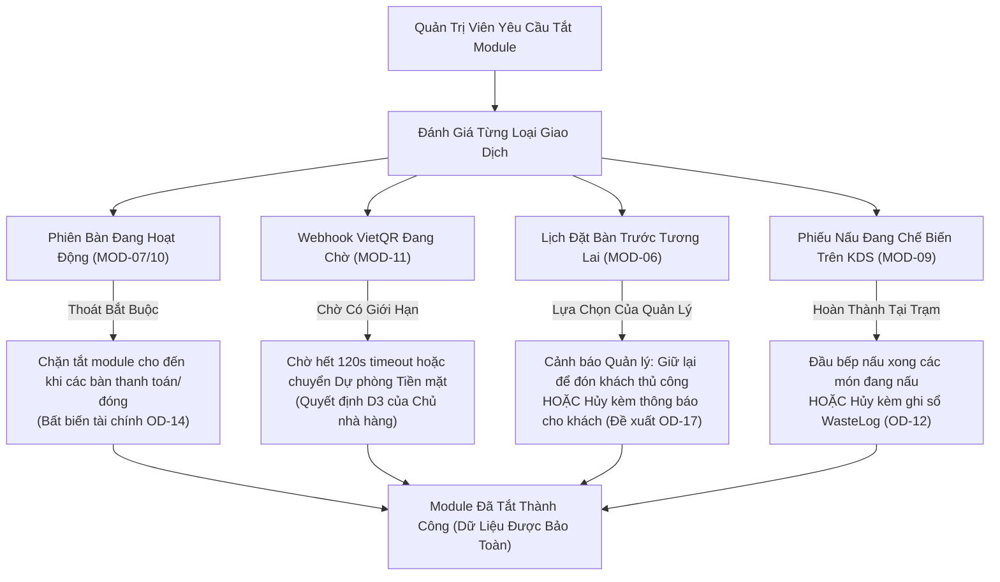

# SmartRestaurant — Báo Cáo Đối Soát & Kiểm Toán Quản Trị Có Kiểm Soát Task 02.8.1

- **Mã định danh kiểm toán (Audit Identifier)**: `AUDIT-02.8.1` / `TASK-02.8.1`
- **Phiên bản tài liệu**: 2.0.0 (Đối soát quản trị có kiểm soát)
- **Ngày kiểm toán**: 2026-11-05
- **Vai trò**: Chuyên viên kiểm toán quản trị sản phẩm cấp cao (Senior Product Governance Auditor)
- **Tài liệu mục tiêu**: [`docs/product/MODULE-CONFIGURATION-AND-FEATURE-MANAGEMENT.md`](./MODULE-CONFIGURATION-AND-FEATURE-MANAGEMENT.md)
- **Ranh giới vòng đời**: Giai đoạn 1 — Khám phá sản phẩm & Đặc tả nghiệp vụ miền (Chặn cổng trước khi sang Giai đoạn 2)
- **Kết luận kiểm toán**: **ĐÃ ĐỐI SOÁT KÈM CÁC HIỆU CHỈNH CHÍNH THỨC & SẴN SÀNG CHỜ QUYẾT ĐỊNH CỦA CHỦ NHÀ HÀNG**

---

## 1. Kết Quả 1: Ma Trận Đối Soát Từng Phát Hiện Kiểm Toán

Ma trận này giải quyết 6 phát hiện bắt buộc đã được xác định trong đợt kiểm toán quản trị có kiểm soát của Task 02.8:

| Mã phát hiện | Mô tả phát hiện | Kết quả thẩm tra đối chiếu | Hành động khắc phục trong SPEC-02.8 | Trạng thái quản trị |
| :---: | :--- | :--- | :--- | :---: |
| **Phát hiện 01 (Finding 01)** | **Ranh giới phê duyệt của Chủ nhà hàng**: 10 Module cốt lõi và các Module tùy chọn (MOD-09, MOD-11, MOD-12, MOD-14) bị gắn nhãn sớm là `OWNER-CONFIRMED`. | Mặc dù các năng lực nghiệp vụ nền tảng đã được xác nhận trong BRS/PRD, việc đóng gói thành hệ thống module bật/tắt 3 tầng là đề xuất của AI/BA. Chưa có quyết định nào của Chủ nhà hàng phê duyệt cách đóng gói cụ thể này. | Đã phân loại lại 10 Module cốt lõi và các Module tùy chọn thành `AI/BA PROPOSAL (Derived from BRS Baseline)`. Xóa bỏ các khẳng định đã xác nhận sai lệch. | `RESOLVED` |
| **Phát hiện 02 (Finding 02)** | **Tính nhất quán kho với D2 và D5**: Nhận định "KDS ReadyToServe trừ vĩnh viễn tồn kho" xung đột với chính sách từng trạm và PDR-012. Việc tắt MOD-12 bị giả định cho phép bán vô hạn không kiểm soát. | PDR-004 Bước 2 nêu rõ việc khấu trừ diễn ra khi chế biến/phục vụ *theo chính sách từng trạm*, không nhất thiết cứng nhắc tại KDS `ReadyToServe`. Việc tắt quản lý kho thời gian thực không làm mất đi việc báo hết món thủ công (86) hoặc giới hạn công suất của bếp. | Đã sửa thời điểm khấu trừ kho theo chính sách trạm (`AI/BA PROPOSAL / STAGE 2 TECHNICAL DESIGN`). Làm rõ quy tắc báo hết món (86) thủ công và hàng rào bảo vệ khẩu phần khi tắt MOD-12. | `RESOLVED` |
| **Phát hiện 03 (Finding 03)** | **Yêu cầu nghiệp vụ so với Kiến trúc kỹ thuật**: Các lựa chọn triển khai công nghệ (SignalR, Middleware, In-Memory Caching, HostedServices) bị gán nhãn là Yêu cầu sản phẩm bắt buộc. | SignalR là lựa chọn kỹ thuật thuộc ADR-003; yêu cầu nghiệp vụ thực tế là Đồng bộ Vận hành Thời gian thực. Bộ nhớ đệm và middleware là các thiết kế kiến trúc thuộc Giai đoạn 2. | Đổi tên MOD-14 thành "Đồng bộ Vận hành Thời gian thực / Real-Time Synchronization". Tách bạch rõ các mẫu triển khai kỹ thuật thành các đề xuất thuộc Giai đoạn 2. | `RESOLVED` |
| **Phát hiện 04 (Finding 04)** | **Thoát êm dịu (Graceful Drain) & Vòng đời Module**: Đề xuất quy tắc bắt buộc "không còn bản ghi mở nào" trên diện rộng thuộc OD-17 chưa có sự phê duyệt của Chủ nhà hàng, đánh đồng đơn hàng đang mở với lịch đặt bàn tương lai. | Chặn việc tắt module trong nhiều tuần chỉ vì có lịch đặt bàn trước trong tương lai là không khả thi về mặt vận hành. Các loại giao dịch khác nhau đòi hỏi cách xử lý khác biệt. | Tách bạch rõ ràng các phiên bàn đang hoạt động, lịch đặt bàn tương lai và webhook đang chờ. Đánh dấu chính sách thoát êm dịu OD-17 là `OPEN — OWNER DECISION REQUIRED`. | `RESOLVED` |
| **Phát hiện 05 (Finding 05)** | **Lưu giữ dữ liệu lịch sử**: Giả định rằng mọi bản ghi lịch sử đều phải xuất hiện trên tất cả các báo cáo xung đột giữa nhu cầu báo cáo vận hành và báo cáo tài chính. | Việc tắt module không được xóa dữ liệu (Đã xác nhận), nhưng báo cáo vận hành không nên hiển thị rác dữ liệu không hoạt động, trong khi báo cáo tài chính/thuế phải lưu giữ 100% bản ghi lịch sử. | Làm rõ các quy tắc theo từng loại báo cáo: Màn hình vận hành trực tiếp ẩn dữ liệu nhàn rỗi; báo cáo tài chính/thuế/kiểm toán giữ nguyên 100% dữ liệu lịch sử kèm nhãn kiểm toán. | `RESOLVED` |
| **Phát hiện 06 (Finding 06)** | **Phạm vi MVP & Độ sẵn sàng Giai đoạn 2**: Bản phân tích chưa giải quyết 5 quyết định của Chủ nhà hàng bị công bố sớm là đặc tả sản phẩm cơ sở đã được duyệt sẵn sàng sang Giai đoạn 2. | Một đặc tả còn các quyết định chưa giải quyết của Chủ nhà hàng (OD-14..17, OQ-02, OQ-06) là Báo cáo Phân tích chờ duyệt, KHÔNG PHẢI là đường cơ sở đã được phê duyệt. | Đã phân loại lại trạng thái tài liệu thành `PENDING OWNER REVIEW (AI/BA Analysis)`. Giới hạn độ sẵn sàng Giai đoạn 2 ở mức thăm dò có kiểm soát, không coi đề xuất là quy tắc cứng. | `RESOLVED` |

---

## 2. Kết Quả 2: Ma Trận Truy Vết Quyết Định Của Chủ Nhà Hàng

Mọi module và năng lực nghiệp vụ đều được truy vết về căn cứ phê duyệt chính thức của Chủ nhà hàng, phân định rõ nội dung thực tế đã được duyệt so với đề xuất của AI/BA:

| Căn cứ quyết định | Nội dung thực tế được Chủ nhà hàng duyệt | Module / Năng lực tương ứng | Có phê duyệt đóng gói module cụ thể không? | Phân loại hiện tại |
| :--- | :--- | :--- | :---: | :---: |
| **OD-01 / CONTR-01** | MVP nhắm mục tiêu chính xác 1 nhà hàng độc lập tại 1 địa điểm vật lý. Chưa quản lý chuỗi. | `MOD-01`, `MOD-03` | Có (Phạm vi đơn điểm) | `OWNER-CONFIRMED` |
| **D1 / PDR-007** | Giờ chốt ngày mặc định 06:00:00; gắn cố định ngày kinh doanh khi tạo đơn; cân bằng tiền ca. | `MOD-03` (`CFG-001`), `MOD-10` | Không (Chỉ là quy tắc nghiệp vụ) | `OWNER-CONFIRMED` (Quy tắc) / `AI/BA PROPOSAL` (Đóng gói module) |
| **D2 / PDR-004** | Khóa tồn kho 2 bước: $Tồn khả dụng = Tồn thực tế - Tạm giữ$. Khấu trừ khi nấu/phục vụ; hủy vào WasteLog. | `MOD-12` (`INV-001`) | Không (Chỉ là quy tắc nghiệp vụ) | `OWNER-CONFIRMED` (Quy tắc) / `AI/BA PROPOSAL` (Đóng gói module) |
| **D3 / PDR-008** | Dự phòng tiền mặt khi VietQR quá hạn; webhook muộn vào Sổ Treo kèm chuông báo thu ngân; đối soát thủ công. | `MOD-11` (`PAY-001/002`), `MOD-10` | Không (Chỉ là quy tắc nghiệp vụ) | `OWNER-CONFIRMED` (Quy tắc) / `AI/BA PROPOSAL` (Đóng gói module) |
| **D4 / PDR-009** | Phiên bàn đa hóa đơn. Bàn không bị khóa khi tách bill. Hóa đơn chưa thanh toán được phép sửa. | `MOD-07`, `MOD-10` (`POS-002`) | Không (Chỉ là quy tắc nghiệp vụ) | `OWNER-CONFIRMED` (Quy tắc) / `AI/BA PROPOSAL` (Đóng gói module) |
| **D5 / PDR-004** | MVP theo dõi hàng hóa đếm được (chai, lon, khẩu phần). Định lượng BOM gram/ml dời sang v1.1. | `MOD-05`, `MOD-12` | Có (Ranh giới phạm vi MVP) | `OWNER-CONFIRMED` |
| **REV-05 / OD-06** | Hủy gộp bàn kèm tái phân bổ món mà không bắn lại phiếu bếp KDS. | `MOD-04`, `MOD-07` (`POS-001`) | Không (Chỉ là quy tắc nghiệp vụ) | `OWNER-CONFIRMED` (Quy tắc) / `AI/BA PROPOSAL` (Đóng gói module) |
| **REV-06 / OD-07** | Phụ phí theo khu vực và phòng VIP (% và số tiền cố định); chụp snapshot khi tạo; không tính hồi tố. | `MOD-04`, `MOD-10` (`FLR-003/004`)| Không (Chỉ là quy tắc nghiệp vụ) | `OWNER-CONFIRMED` (Quy tắc) / `AI/BA PROPOSAL` (Đóng gói module) |
| **REV-07** | Tài khoản công nợ khách hàng doanh nghiệp (Khách ký nợ) chính thức hoãn sang module B2B AR ở v1.2+. | `MOD-10` | Có (Loại trừ phạm vi) | `OWNER-CONFIRMED DEFERRED` |
| **REV-08 / OD-08** | Đồ uống lấy trực tiếp bỏ qua KDS Quầy Bar nhưng vẫn tính tiền và tạm giữ kho đầy đủ. | `MOD-07`, `MOD-08` (`POS-003`) | Không (Chỉ là quy tắc nghiệp vụ) | `OWNER-CONFIRMED` (Quy tắc) / `AI/BA PROPOSAL` (Đóng gói module) |
| **REV-09 / OD-09** | Vòng đời bàn độc lập trong phòng dùng chung; bao trọn phòng khóa các bàn con. | `MOD-04` (`FLR-002`) | Không (Chỉ là quy tắc nghiệp vụ) | `OWNER-CONFIRMED` (Quy tắc) / `AI/BA PROPOSAL` (Đóng gói module) |
| **REV-10 / OD-11** | Quy tắc nghiệp vụ gọi món đồng thời không khóa bàn; tính bất khả biến và chống mất đơn. | `MOD-07` | Không (Chỉ là quy tắc nghiệp vụ) | `OWNER-CONFIRMED` (Quy tắc) / `TECHNICAL DESIGN REQUIRED — STAGE 2` |
| **REV-11 / OD-12** | Làm lại món do lỗi bếp không tính tiền khách; phiếu màu tím; hao hụt ghi vào sổ hủy hỏng. | `MOD-07`, `MOD-09`, `MOD-12` | Không (Chỉ là quy tắc nghiệp vụ) | `OWNER-CONFIRMED` (Quy tắc) / `AI/BA PROPOSAL` (Đóng gói module) |
| **OD-13** | BillingRequested Phương án 2: hóa đơn chưa thanh toán được phép sửa; món mới mặc định gắn vào bill mở. | `MOD-07`, `MOD-10` (`POS-002`) | Không (Chỉ là quy tắc nghiệp vụ) | `OWNER-CONFIRMED` (Quy tắc) / `AI/BA PROPOSAL` (Đóng gói module) |
| **OD-14 (Cốt lõi)** | Tính bất biến của hóa đơn đã thanh toán: hóa đơn đã quyết toán (`IsSettled = true`) không được phép sửa trực tiếp. | `MOD-10` (`BIL-006`) | Không (Bất biến tài chính) | `OWNER-CONFIRMED` (Bất biến) |
| **OD-14 (Chính sách)** | Quy trình hủy, điều chỉnh và xuất hóa đơn điều chỉnh sau khi đã quyết toán. | `MOD-10` (`BIL-006`) | Không (Chính sách chưa giải quyết) | `OPEN — OWNER DECISION REQUIRED (OQ-09)` |

---

## 3. Kết Quả 3: Ma Trận Phân Loại Module Đã Hiệu Chỉnh

Phân loại lại toàn bộ 14 module, gỡ bỏ các dấu mộc `OWNER-CONFIRMED` gán sớm cho các đề xuất đóng gói kiến trúc:

| Mã Module | Tên Module (VN / EN) | Tầng Kiến Trúc | Mục Đích Nghiệp Vụ & Năng Lực Vận Hành | Phân Loại Quản Trị | Trạng Thái |
| :--- | :--- | :---: | :--- | :--- | :---: |
| **MOD-01** | Quản lý Tổ chức & Điểm Bán / Store Identity | Tầng A (Cốt lõi) | Hồ sơ pháp lý điểm bán đơn, định danh chi nhánh, múi giờ (`OD-01`). | `AI/BA PROPOSAL (Derived from BRS Baseline)` | `RESOLVED` |
| **MOD-02** | Phân quyền & Mã PIN Nhân viên / RBAC & Staff PIN | Tầng A (Cốt lõi) | Xác thực danh tính, vai trò nhân viên, chuyển người dùng bằng PIN, quyền Quản lý. | `AI/BA PROPOSAL (Derived from BRS Baseline)` | `RESOLVED` |
| **MOD-03** | Cấu hình Hệ thống & Thuế / System Configuration | Tầng A (Cốt lõi) | Giờ chốt ngày (06:00), thuế suất VAT (8%/10%), lời chào trên hóa đơn. | `AI/BA PROPOSAL (Derived from BRS Baseline)` | `RESOLVED` |
| **MOD-04** | Sơ đồ Bàn & Khu vực / Tables & Dining Areas | Tầng A (Cốt lõi) | Bố cục không gian, trạng thái bàn, hủy gộp bàn, khóa bao trọn phòng VIP. | `AI/BA PROPOSAL (Derived from BRS Baseline)` | `RESOLVED` |
| **MOD-05** | Thực đơn & Tùy chọn / Menu Catalog & Modifiers | Tầng A (Cốt lõi) | Danh mục món ăn, biến thể, nhóm tùy chọn, báo hết món thủ công (86). | `AI/BA PROPOSAL (Derived from BRS Baseline)` | `RESOLVED` |
| **MOD-06** | Quản lý Đặt bàn Trước / Table Reservation | Tầng B (Tùy chọn) | Đặt chỗ trước, đếm ngược giờ khách đến, số lượng khách. | `OPEN — OWNER DECISION REQUIRED (OD-15)` | `OPEN` |
| **MOD-07** | Bán hàng POS & Đơn hàng / POS & Order Capture | Tầng A (Cốt lõi) | Phiên dùng bữa, giỏ hàng tạm, đợt gọi món, tách hóa đơn không khóa bàn. | `AI/BA PROPOSAL (Derived from BRS Baseline)` | `RESOLVED` |
| **MOD-08** | Điều phối Đơn hàng / Order Routing Dispatcher | Tầng A (Cốt lõi) | Phân tách đơn gọi món của bàn thành các phiếu chế biến cho từng trạm. | `AI/BA PROPOSAL (Derived from BRS Baseline)` | `RESOLVED` |
| **MOD-09** | Màn hình Bếp KDS & Bar / Digital KDS | Tầng B (Tùy chọn) | Màn hình cảm ứng hàng đợi món cho đầu bếp kèm đồng hồ SLA. | `AI/BA PROPOSAL (Feature Confirmed in PDR-003)`| `RESOLVED` |
| **MOD-10** | Thu ngân, Tính tiền & Hóa đơn / Billing & Cashier | Tầng A (Cốt lõi) | Tạm tính, chiết khấu, VAT, chia hóa đơn, kiểm kê tiền két mù. | `AI/BA PROPOSAL (Derived from BRS Baseline)` | `RESOLVED` |
| **MOD-11** | Cổng Tự động VietQR / VietQR Gateway | Tầng B (Tùy chọn) | Tạo mã VietQR động Napas 24/7 và sổ treo đối soát bất đồng bộ. | `AI/BA PROPOSAL (Feature Confirmed in PDR-008)`| `RESOLVED` |
| **MOD-12** | Tồn kho Món Đếm Được & Hao hụt / Stock & Waste | Tầng B (Tùy chọn) | Khóa tồn kho 2 bước (`Tồn khả dụng = Tồn thực tế - Tạm giữ`). | `AI/BA PROPOSAL (Feature Confirmed in PDR-004)`| `RESOLVED` |
| **MOD-13** | Báo cáo Doanh thu & Bán hàng / Sales Reporting | Tầng A (Cốt lõi) | Doanh thu gộp/thuần ngày, báo cáo chốt ca Z-Report, cơ cấu nhóm món. | `AI/BA PROPOSAL (Derived from BRS Baseline)` | `RESOLVED` |
| **MOD-14** | Đồng bộ Vận hành Thời gian thực / Synchronization | Tầng A (Cốt lõi) | Nhất quán trạng thái đa thiết bị đầu cuối tức thì (trạng thái bàn, đơn món). | `AI/BA PROPOSAL (Derived from BRS Baseline)` | `RESOLVED` |

---

## 4. Kết Quả 4: Ma Trận Phạm Vi MVP Đã Hiệu Chỉnh

Khớp nối lộ trình phát hành MVP chuẩn xác với các quyết định của Chủ nhà hàng, loại bỏ các nhận định xác nhận sai lệch:

| Năng lực / Phân hệ | Mốc phát hành đề xuất | Cơ sở lựa chọn & Ranh giới phạm vi | Phân loại | Trạng thái |
| :--- | :---: | :--- | :--- | :---: |
| **Nhà hàng Độc lập Đơn Điểm** | `MVP Cốt lõi` | Tập trung 100% nguồn lực kỹ thuật cho vận hành 1 cửa hàng (`OD-01`). | `OWNER-CONFIRMED (OD-01)` | `RESOLVED` |
| **10 Module Cốt lõi Bắt buộc (`Tầng A`)** | `MVP Cốt lõi` | Động cơ vận hành thiết yếu cho mô hình nhà hàng phục vụ tại bàn. | `AI/BA PROPOSAL (Derived from BRS)` | `RESOLVED` |
| **KDS Màn hình Bếp & Quầy Bar (`MOD-09`)** | `MVP Tùy chọn` | Hàng đợi đơn món cảm ứng không dùng giấy cho nhân viên bếp/bar. | `AI/BA PROPOSAL (Feature Confirmed in PDR-003)` | `RESOLVED` |
| **Cổng VietQR Động Tự động (`MOD-11`)** | `MVP Tùy chọn` | Thanh toán tự động Napas 24/7 kèm dự phòng tiền mặt (`PDR-008`). | `AI/BA PROPOSAL (Feature Confirmed in PDR-008)` | `RESOLVED` |
| **Tồn kho Món Đếm Được 2 Bước (`MOD-12`)** | `MVP Tùy chọn` | Theo dõi tồn kho thời gian thực cho khẩu phần, chai, lon (`PDR-004`). | `AI/BA PROPOSAL (Feature Confirmed in PDR-004)` | `RESOLVED` |
| **Quản lý Đặt bàn Trước (`MOD-06`)** | `MVP Tùy chọn` | Đặt chỗ cơ bản, số lượng khách và đếm ngược giờ đến. | `OPEN — OWNER DECISION REQUIRED (OD-15)` | `OPEN` |
| **Định lượng BOM Công thức Chi tiết (gram/ml)** | `Sau MVP (v1.1)` | Trì hoãn để bảo vệ tiến độ bàn giao MVP theo Quyết định D5. | `OWNER-CONFIRMED (D5 / PDR-004)` | `RESOLVED` |
| **Màn hình Bàn Ra Món Master Expediter** | `Sau MVP (v1.1)` | Màn hình điều phối ra món tổng hợp dời sang v1.1 theo `PDR-003`. | `AI/BA PROPOSAL (Proposed in PDR-003)` | `RESOLVED` |
| **Tài khoản Ký nợ Doanh nghiệp (Khách ký nợ)** | `Trì hoãn (v1.2+)`| Tài khoản công nợ B2B trì hoãn sang sau MVP (`REV-07`). | `OWNER-CONFIRMED DEFERRED (REV-07)` | `RESOLVED` |
| **Xoay Tự Do Trên Sơ đồ Mặt Bằng** | `Sau MVP (v1.2)` | Giới hạn ở 4 góc vuông trực giao 90° (0°, 90°, 180°, 270°) trong MVP. | `AI/BA PROPOSAL` | `RESOLVED` |
| **Khách Tự Quét QR Đặt Món & Trả Trước** | `Sau MVP (v2.0)` | Khách tự gọi món tại bàn qua QR dời sang Giai đoạn 2 (`PRD §4.2`). | `OWNER-CONFIRMED (PRD §4.2)` | `RESOLVED` |
| **Kho Tổng Cung Ứng Đa Chi Nhánh** | `Sau MVP (v2.0)` | Luân chuyển kho liên chi nhánh dời sang v2.0 (`CONTR-01`). | `OWNER-CONFIRMED (CONTR-01)` | `RESOLVED` |
| **Tách Bill Theo Tỷ Lệ % Tùy Ý (60/40)** | `Sau MVP` | Tách hóa đơn giới hạn ở Tách theo món và Chia đều ($1/N$). | `OPEN — OWNER DECISION REQUIRED (OQ-01)` | `OPEN` |

---

## 5. Kết Quả 5: Thẩm Tra Tính Nhất Quán Tồn Kho D2/D5

Kiểm toán chi tiết `MOD-12` đối chiếu với các Quyết định D2 và D5 của Chủ nhà hàng:

```mermaid
flowchart TD
    subgraph D2["Vòng Đời Quyết Định D2 Của Chủ Nhà Hàng"]
        F["Đơn Món Được Xác Nhận / Báo Bếp"] -->|Tạm giữ tồn| R["ReservedStock (Tồn tạm giữ)\nTồn khả dụng = Tồn thực tế - Tồn tạm giữ"]
        R -->|Hủy hợp lệ trước khi nấu| REL["Giải phóng tồn tạm giữ\n(Hoàn trả về Tồn khả dụng)"]
        R -->|Chế biến / Phục vụ (Theo chính sách trạm)| C["ConsumedStock (Xuất kho thực tế)\nTồn thực tế = Tồn thực tế - SL\nTồn tạm giữ = Tồn tạm giữ - SL"]
        R -->|Hủy khi đang nấu / Làm lại món (PIN Quản lý)| W["WasteStock (Sổ Hủy Hỏng)\nTồn thực tế = Tồn thực tế - SL\nGhi nhận vào WasteLog"]
    end
```

### 5.1. Danh Mục Kiểm Tra Tính Nhất Quán:
1. **Công thức tồn khả dụng**: $\text{AvailableStock} = \text{PhysicalStock} - \text{ReservedStock}$ $\rightarrow$ **Nhất quán 100% với D2**.
2. **Điểm kích hoạt tạm giữ**: Diễn ra tại thời điểm xác nhận đơn hàng / gửi lệnh xuống bếp $\rightarrow$ **Nhất quán 100% với D2**.
3. **Giải phóng khi hủy món**: Hủy món hợp lệ trước khi chế biến sẽ giải phóng tạm giữ không ghi nhận hao hụt $\rightarrow$ **Nhất quán 100% với D2**.
4. **Các khái niệm phân biệt rạch ròi**: `ReservedStock`, `ConsumedStock`, và `WasteStock` duy trì là các thực thể độc lập nghiêm ngặt $\rightarrow$ **Nhất quán 100% với D2**.
5. **Phạm vi hàng hóa đếm được**: MVP quản lý các khẩu phần bán trực tiếp, lon, chai đếm được $\rightarrow$ **Nhất quán 100% với D5**.
6. **Trì hoãn định lượng BOM gram/ml**: Định lượng nguyên liệu thô dời sang v1.1 $\rightarrow$ **Nhất quán 100% với D5**.

### 5.2. Hiệu Chỉnh Điểm Kích Hoạt Khấu Trừ Kho (Giải Quyết Phát Hiện 02):
- **Phát biểu trước đây trong SPEC-02.8**: *"Khi món ăn được đánh dấu ReadyToServe trên KDS, tồn kho tạm giữ sẽ bị trừ vĩnh viễn."*
- **Phát hiện kiểm toán**: PDR-004 §2.2 Bước 2 nêu rõ: *"Khi món ăn được đánh dấu là đã chế biến hoặc đã phục vụ (theo chính sách từng trạm), số lượng tạm giữ được chuyển đổi vĩnh viễn thành tiêu thụ thực tế ConsumedStock"*. Việc gán điểm trừ kho độc quyền vào trạng thái `ReadyToServe` của KDS mâu thuẫn với việc lấy đồ uống trực tiếp tại sảnh (`PDR-012`, vốn bỏ qua KDS) và các nhà hàng sử dụng phiếu giấy khi tắt KDS.
- **Quy tắc đã hiệu chỉnh**: Việc chuyển đổi từ `Reserved` sang `Consumed` được quy định bởi **Chính Sách Của Từng Trạm (Station Policy)** (ví dụ: khi báo bếp đối với đồ uống lấy trực tiếp, khi đầu bếp xác nhận nấu xong, hoặc khi bàn ra món xuất món). Cơ chế kích hoạt cụ thể được phân loại là **`AI/BA PROPOSAL / TECHNICAL DESIGN REQUIRED — STAGE 2`**.

### 5.3. Hành Vi Khi Tắt Phân Hệ MOD-12:
- Khi tắt `MOD-12`, hệ thống sẽ tắt **tính năng tự động trừ kho thời gian thực và tự động khóa món khi hết hàng**.
- Việc này **KHÔNG** đồng nghĩa với việc cho phép vận hành mất kiểm soát: Các hàng rào bảo vệ thủ công vẫn duy trì:
  1. Nhân viên phục vụ và quản lý vẫn giữ quyền chủ động bật/tắt công tắc "Tạm hết món (86)" trên menu thực đơn.
  2. Nhân viên bếp trao đổi miệng về tình trạng nguyên liệu trong các buổi họp đầu ca và gọi loa nội bộ.
  3. Giới hạn công suất tiếp nhận của bếp ngăn chặn việc tích tụ phiếu gọi món vượt quá khả năng phục vụ.

---

## 6. Kết Quả 6: Ma Trận Tách Bạch Yêu Cầu Nghiệp Vụ So Với Kỹ Thuật

Tách bạch rõ rệt giữa năng lực nghiệp vụ cùng hành vi hiển thị phía người dùng với các lựa chọn kiến trúc công nghệ triển khai:

| Phân hệ / Năng lực | Năng lực nghiệp vụ yêu cầu (Phạm vi Stage 1) | Hành vi vận hành phía người dùng (Phạm vi Stage 1) | Đề xuất kiến trúc kỹ thuật (Phạm vi Stage 2) | Phân loại quản trị |
| :--- | :--- | :--- | :--- | :---: |
| **Đồng bộ Vận hành Thời gian thực (MOD-14)** | Đồng bộ tức thì trạng thái vận hành giữa các thiết bị đầu cuối. | Khi một bàn xếp khách, báo bếp hoặc yêu cầu tính tiền, toàn bộ màn hình POS và KDS cập nhật trong vòng $\le 1$ giây. | Các Hub SignalR của ASP.NET Core (`TableHub`, `OrderHub`, `KitchenHub`) kèm cơ chế bắt tay kết nối lại tự động. | `TECHNICAL DESIGN REQUIRED — STAGE 2` |
| **Thực thi Module Bật/Tắt** | Chặn các truy cập trái phép vào các năng lực đã bị tắt. | Các tính năng bị tắt biến mất khỏi menu điều hướng; truy cập đường dẫn trực tiếp hiển thị thông báo SweetAlert2 thân thiện. | Global Middleware của ASP.NET Core, Bộ lọc hành động (`[RequireModule]`), và đường ống chuyển đổi Claims. | `TECHNICAL DESIGN REQUIRED — STAGE 2` |
| **Tải Lại Tham Số Không Cần Khởi Động Lại** | Thay đổi tham số điểm bán phải có hiệu lực tức thì trên toàn bộ máy POS. | Thay đổi giờ chốt ngày hoặc IP máy in trong Admin có hiệu lực ngay mà không cần khởi động lại phần mềm hay đăng xuất nhân viên. | Bộ nhớ đệm In-Memory (`IMemoryCache`) kết hợp kênh truyền SignalR phát tín hiệu hủy bộ nhớ đệm (cache invalidation). | `TECHNICAL DESIGN REQUIRED — STAGE 2` |
| **Phân Vùng Dữ Liệu Lịch Sử** | Chứng từ tài chính và kiểm toán phải được bảo toàn khi bật/tắt module. | Báo cáo doanh thu và kiểm toán quá khứ vẫn kết xuất giao dịch cũ; màn hình vận hành trực tiếp ẩn rác dữ liệu không hoạt động. | Global Query Filters trong Entity Framework Core và các câu truy vấn chiếu dữ liệu báo cáo chỉ đọc. | `TECHNICAL DESIGN REQUIRED — STAGE 2` |
| **Lập Lịch Tác Vụ Ngầm** | Tác vụ nền của module bị tắt không được làm tiêu tốn tài nguyên máy chủ. | Lịch nhắc hẹn hoặc thăm dò ngân hàng tự động tạm dừng êm dịu khi module cha bị tắt. | Cổng kiểm tra thực thi trong .NET `BackgroundService` đánh giá trạng thái từ `IModuleStatusProvider` trước khi truy vấn DB. | `TECHNICAL DESIGN REQUIRED — STAGE 2` |

---

## 7. Kết Quả 7: Hiệu Chỉnh Vòng Đời Module & Chính Sách Thoát Êm Dịu (Graceful Drain)

Giải quyết Phát hiện 04 bằng cách thay thế đề xuất bắt buộc "không còn bản ghi mở nào" trên diện rộng bằng các quy tắc vòng đời phân hóa theo từng loại giao dịch:



### 7.1. Các Chính Sách Phân Hóa Theo Loại Giao Dịch:
1. **Phiên bàn đang phục vụ dở dang (`MOD-07` / `MOD-10`)**: Bắt buộc phải thoát sạch (Mandatory drain). Nhà hàng không thể tắt tính năng thanh toán hoặc gọi món khi khách vẫn đang ngồi ăn tại bàn. Phải đưa bàn về trạng thái `Paid` hoặc `Cancelled`.
2. **Giao dịch chờ phản hồi ngân hàng (`MOD-11`)**: Chờ có giới hạn (Bounded drain). Các webhook trong `PendingWebhook` chờ hết hạn 120 giây hoặc thu ngân chuyển sang Dự phòng Tiền mặt theo `PDR-008`.
3. **Lịch đặt bàn trước trong tương lai (`MOD-06`)**: Bác bỏ việc chặn cứng vô thời hạn. Hệ thống ngừng tiếp nhận đặt bàn *mới*, nhưng không chặn tắt module trong nhiều tuần. Quản lý được lựa chọn: (A) Giữ lại danh sách đặt bàn để đón khách bằng sổ tay thủ công, hoặc (B) Hủy lịch đặt bàn kèm gửi thông báo cho khách. Chính sách này thuộc diện **`OPEN — OWNER DECISION REQUIRED (OD-17)`**.
4. **Phiếu bếp đang nấu dở (`MOD-09`)**: Đầu bếp hoàn thiện nốt các món đang nấu trên bếp hoặc hủy món kèm mã PIN quản lý ghi vào sổ hủy hỏng theo `PDR-015`.

---

## 8. Kết Quả 8: Làm Rõ Chính Sách Lưu Giữ Dữ Liệu Lịch Sử

Giải quyết Phát hiện 05 bằng cách thiết lập các quy tắc hiển thị dữ liệu phân hóa theo từng loại báo cáo:

| Bề mặt hệ thống / Loại báo cáo | Hành vi đối với dữ liệu của Module đã tắt | Cơ sở nghiệp vụ & Kế toán | Trạng thái quản trị |
| :--- | :--- | :--- | :---: |
| **Màn hình Vận hành Trực tiếp** (Sơ đồ mặt bằng, Giỏ hàng POS, Hàng đợi KDS) | **Ẩn rác dữ liệu không hoạt động**: Các nút bấm và thực thể nhàn rỗi của module bị tắt sẽ ẩn khỏi giao diện trực tiếp. | Giúp màn hình gọn gàng, tránh gây nhầm lẫn vận hành cho nhân viên trong giờ cao điểm. | `AI/BA PROPOSAL` |
| **Báo cáo Tài chính & Bán hàng** (Doanh thu ngày, Báo cáo Z chốt ca, Báo cáo nhóm món) | **Lưu giữ 100% dữ liệu lịch sử**: Doanh thu quá khứ tạo ra qua các module đã tắt (ví dụ: tiền VietQR trước đây) vẫn được tổng hợp đầy đủ. | Tuân thủ pháp luật thuế, kiểm toán tài chính và tính chính xác của sổ quỹ tiền mặt. | `OWNER-CONFIRMED (Bất biến)` |
| **Sổ Kiểm toán Tổn thất & Hao hụt** (Sổ hủy hỏng, Nhật ký hủy món, Can thiệp Quản lý) | **Lưu giữ 100% dữ liệu lịch sử**: Toàn bộ dữ liệu hủy hỏng và can thiệp trong quá khứ duy trì hiển thị kèm mã PIN quản lý. | Ngăn chặn gian lận nội bộ và phục vụ đối soát giá vốn hàng bán (COGS). | `OWNER-CONFIRMED (Bất biến)` |
| **Kho Lưu Trữ Vận Hành** (Lịch sử đặt bàn cũ, Mốc thời gian nấu trên KDS trong quá khứ) | **Truy cập qua màn hình lưu trữ riêng**: Truy cập được kèm nhãn thông tin: `"(Dữ liệu lịch sử — Phân hệ hiện đang tắt)"`. | Cho phép quản lý tra cứu lại khiếu nại của khách hoặc đánh giá hiệu suất trong quá khứ. | `AI/BA PROPOSAL` |

---

## 9. Kết Quả 9: Sổ Đăng Ký Các Câu Hỏi Mở & Quyết Định Của Chủ Nhà Hàng

Bảng tổng hợp toàn bộ các quyết định còn lại cần Chủ nhà hàng đưa ra để hoàn tất cơ sở phê duyệt Giai đoạn 1:

| Mã quyết định | Chủ đề mở | Khuyến nghị mặc định | Tác động lên hệ thống nếu duyệt | Hành động yêu cầu từ Chủ nhà hàng |
| :---: | :--- | :--- | :--- | :--- |
| **OD-14 (`OQ-09`)**| **Chính sách tranh chấp & hủy hóa đơn đã thanh toán** | **Phương án A cho MVP**: Bất biến tuyệt đối trong DB; điều chỉnh thủ công trên sổ giấy khi kiểm tiền chốt ca. | Hóa đơn đã quyết toán là bất biến (`IsSettled = true`); dùng bảng kiểm toán chung, không cần máy trạng thái hoàn tiền trên ứng dụng. | **Lựa chọn Phương án A (Xử lý ngoài hệ thống cho MVP) hoặc Phương án B (Quy trình hủy hóa đơn bằng PIN & hóa đơn điều chỉnh trong ứng dụng).** |
| **OD-15** | **Trạng thái của `MOD-06` (Đặt bàn trước) trong MVP** | **Đưa vào diện Module Tùy chọn** (`MVP Optional`). | Các quán chỉ phục vụ khách vãng lai có thể tắt gọn gàng chỉ bằng 1 thao tác chạm. | **Phê duyệt `MOD-06` là Module Tùy chọn của MVP hoặc dời sang v1.1.** |
| **OD-16** | **Áp dụng các cấu hình mẫu khởi tạo (Onboarding Presets)** | **Áp dụng dưới dạng mẫu gợi ý không bắt buộc** (`AI/BA PROPOSAL`). | Đẩy nhanh quá trình cấu hình ban đầu cho quán mới; vẫn giữ quyền tùy chỉnh toàn diện sau đó. | **Phê duyệt hoặc bác bỏ 3 bộ cấu hình mẫu đề xuất (Gia đình, Tiêu chuẩn, VIP).** |
| **OD-17** | **Chính sách thoát êm dịu khi tắt Module** | **Chính sách thoát phân hóa theo loại giao dịch** (Mục 7). | Tránh việc chặn tắt module nhiều tuần do lịch đặt bàn tương lai trong khi vẫn bảo vệ an toàn các hóa đơn mở. | **Phê duyệt chính sách thoát êm dịu phân hóa.** |
| **OQ-01** | **Tách hóa đơn theo tỷ lệ % tùy ý (ví dụ: 60/40)** | **Dời sang sau MVP**: Giữ Tách theo món và Chia đều ($1/N$). | Kiến trúc mô hình hóa thực thể `Bill` với phân chia theo dòng món và chia $1/N$. Không chặn kỹ thuật. | **Xác nhận việc dời tính năng tách hóa đơn theo % tùy ý sang sau MVP.** |
| **OQ-02** | **In phiếu giấy vật lý khi báo bếp** | **Cài đặt cấp trạm**: Mặc định `AutoPrintOnFire: false`. | Mặc định sử dụng KDS điện tử; in phiếu giấy là tùy chọn cấu hình thêm theo từng trạm. Không chặn kỹ thuật. | **Xác nhận hành vi in phiếu giấy mặc định của trạm bếp.** |
| **OQ-06** | **Tính thuế trên phí dịch vụ** | **Cài đặt cấp chi nhánh**: Mặc định `IsServiceChargeTaxable: true`. | Tham số hóa công thức tính thuế VAT trên phí dịch vụ. Không chặn kỹ thuật. | **Xác nhận việc áp thuế GTGT trên phí dịch vụ theo mặc định.** |

---

## 10. Kết Quả 10: Báo Cáo Thay Đổi Git Toàn Diện

### 10.1. Kiểm Tra Cây Làm Việc (`git status`)
Việc kiểm toán các thay đổi git xác nhận toàn bộ các chỉnh sửa đều mang tính chất bảo toàn, không phá hủy và chỉ giới hạn trong phạm vi tài liệu và bộ nhớ dự án:

- **Các tệp đã sửa đổi chưa đưa vào vùng chờ (Unstaged Modified Files)**:
  * `.agent-memory/DEVELOPMENT-LOG.md`: Các bản ghi kiểm toán theo trình tự thời gian cho Task 02.7.5, 02.8, và 02.8.1.
  * `.agent-memory/KNOWN-ISSUES.md`: Cập nhật con trỏ cũ ISSUE-02 trỏ đúng về `OQ-04`.
  * `.agent-memory/NEXT-TASK.md`: Đồng bộ hóa các đầu vào với các đợt kiểm toán đã hoàn tất.
  * `.agent-memory/PROJECT-STATUS.md`: Ghi nhận các mốc Milestone 1.4, 1.5, và 1.6.
  * `docs/00-index.md`: Bổ sung các mục lục cho ba tài liệu kiểm toán và cấu hình mới; căn chỉnh cột trạng thái PDR.
  * `docs/product/decisions/PDR-003`: Làm rõ ranh giới REV-08/REV-11 so với đề xuất màn hình Master Expediter.
  * `docs/product/decisions/PDR-004`: Phân định rạch ròi Quy tắc nghiệp vụ đã xác nhận so với Đề xuất kỹ thuật.
  * `docs/product/decisions/PDR-005`: Sửa các tham chiếu trích dẫn sai: REV-07/REV-10 $\rightarrow$ D3/REV-03, D4/REV-04, OD-13.
  * `docs/product/decisions/PDR-007`: Phân định rạch ròi Quy tắc nghiệp vụ đã xác nhận so với Đề xuất kỹ thuật.
  * `docs/product/decisions/PDR-008`: Phân định rạch ròi Quy tắc nghiệp vụ đã xác nhận so với Đề xuất kỹ thuật.
  * `docs/product/MODULE-CONFIGURATION-AND-FEATURE-MANAGEMENT.md`: Hiệu chỉnh phân loại, quy tắc tồn kho, tách bạch kỹ thuật và chính sách thoát vòng đời module.
- **Các tệp mới chưa theo dõi (Untracked Files)**:
  * `docs/product/FINAL-GOVERNANCE-TRACEABILITY-AUDIT.md`: Báo cáo Kiểm toán Tổng thể Task 02.7.5.
  * `docs/product/MODULE-GOVERNANCE-RECONCILIATION-AUDIT.md`: Báo cáo Đối Soát Có Kiểm Soát Task 02.8.1 (tệp này).
- **Xác Minh Tuân Thủ Chỉ Thị Quản Trị**:
  * `.agent-memory/ARCHITECTURE-DECISIONS.md`: **NGUYÊN VẸN 100% KHÔNG CÓ THAY ĐỔI** (Tuân thủ nghiêm ngặt Quy tắc quản trị số 4).
  * Chính xác **0 tệp mã nguồn `.cs`, 0 tệp `.csproj`, 0 tệp `.sln`, và 0 migration cơ sở dữ liệu** tồn tại trong kho lưu trữ.
  * Tuyệt đối không thực thi các lệnh git commit, reset, stash, hoặc checkout.

---

## 11. Trạng Thái Hoàn Thành Cuối Cùng

```
SẴN SÀNG CHỜ CHỦ NHÀ HÀNG XEM XÉT VÀ PHÊ DUYỆT (READY FOR PROJECT OWNER REVIEW)
```

> [!IMPORTANT]
> **KẾT LUẬN KIỂM TOÁN ĐỐI SOÁT: HOÀN THÀNH & SẴN SÀNG CHỜ CHỦ NHÀ HÀNG DUYỆT**  
> Toàn bộ 6 phát hiện kiểm toán đã được đối soát và hiệu chỉnh trong `docs/product/MODULE-CONFIGURATION-AND-FEATURE-MANAGEMENT.md`.  
> 7 quyết định còn lại của Chủ nhà hàng (`OD-14`, `OD-15`, `OD-16`, `OD-17`, `OQ-01`, `OQ-02`, `OQ-06`) đã được tài liệu hóa chính thức và phân loại là `OPEN`.  
> 
> **HỆ THỐNG DỪNG LẠI VÀ CHỜ ĐỢI CÁC QUYẾT ĐỊNH CHÍNH THỨC TỪ CHỦ NHÀ HÀNG.**  
> **TUYỆT ĐỐI KHÔNG TỰ ĐỘNG CHUYỂN TIẾP SANG TASK 02.9 HOẶC GIAI ĐOẠN 2 (STAGE 2).**
