# Báo Cáo Kiểm Toán Độc Lập Hậu Hiệu Chỉnh Quản Trị
## TASK 02.8.2.3: INDEPENDENT POST-CORRECTION VERIFICATION REPORT

- **Dự Án**: SmartRestaurant — Quản Lý Vận Hành Nhà Hàng Độc Lập
- **Giai Đoạn**: Stage 1 — Khám Phá Sản Phẩm & Đặc Tả Miền Nghiệp Vụ (Product Discovery & Business Domain Specifications)
- **Vai Trò Thực Hiện**: Giám Đốc Kiểm Toán Quản Trị Sản Phẩm Độc Lập (Senior Independent Product Governance Auditor)
- **Phương Thức Kiểm Toán**: **Thực Chứng Độc Lập (Empirical Audit)**
- **Ngày Hoàn Tất**: 2026-11-05
- **Kết Luận Kiểm Toán**: **`ALL CORRECTIONS VERIFIED & CERTIFIED — 100% GOVERNANCE COMPLIANT`**
- **Trạng Thái Cổng Kiểm Soát**: **`STAGE 1 OWNER SIGN-OFF PENDING (GATE TO STAGE 2 LOCKED)`**

---

## 1. Executive Summary (Tóm Tắt Báo Cáo Kiểm Toán)

Đợt kiểm toán độc lập `TASK 02.8.2.3` đã tiến hành kiểm tra, đối soát và thẩm định toàn bộ các kết quả hiệu chỉnh quản trị phát sinh từ `TASK 02.8.2.2` dựa trên báo cáo căn cứ [`TASK-02.8.2.2-CONTROLLED-GOVERNANCE-CORRECTIONS-REPORT.md`](./TASK-02.8.2.2-CONTROLLED-GOVERNANCE-CORRECTIONS-REPORT.md).

### Kết Quả Thẩm Định Cốt Lõi:
1. **10/10 Tiêu Chí Kiểm Toán Đạt Chuẩn Tuyệt Đối (AUDIT-01 đến AUDIT-10: PASS)**:
   - Quyết định `D3` (Delayed VietQR) và `D4` (Multi-bill không khóa bàn) đã được tách biệt độc lập hoàn toàn, xóa bỏ triệt để dòng gộp sai `D3/D4`.
   - Toàn bộ cơ chế trừ kho theo trạm bếp/pha chế đã được hạ nhãn chuẩn xác về `AI/BA PROPOSAL / TECHNICAL DESIGN REQUIRED — STAGE 2`, không còn bất kỳ sự suy diễn nào về việc Bar trừ khi in phiếu hay Bếp Nóng trừ khi xong KDS.
   - Quyết định `OD-14` được giữ nguyên trạng thái `OPEN — OWNER DECISION REQUIRED`; toàn bộ các giả định chủ quan (0 ngày phát sinh, không tác động ERD) đã bị loại bỏ; yêu cầu lưu vết sai lệch chốt ca mù và audit trail được ghi nhận ở cấp nghiệp vụ thuần túy mà không ép buộc tên bảng.
   - Các giải pháp kỹ thuật của `OQ-08` (Concurrency) và `OQ-10` (Khóa đa chi nhánh) đã được trả về đúng ranh giới đánh giá độc lập của Solution Architect trong Stage 2.
   - Các quyết định `D1`, `OQ-07`, và `REV-11` được rà soát và bảo vệ nguyên vẹn đúng phạm vi Chủ Dự án đã phê duyệt.
   - Khung 14 phân hệ (10 Core + 4 Optional) được xác định chuẩn xác là `AI/BA PROPOSAL`, không bị ngầm định biến thành quyết định đã duyệt.
2. **Bảo Toàn 100% Ranh Giới Kỹ Thuật & Kỷ Luật Kho Lưu Trữ**:
   - Kho lưu trữ chứa **đúng 0 dòng mã nguồn C# (`.cs`)**, 0 project/solution, 0 migration SQL.
   - Thư mục `docs/02-architecture/` hoàn toàn **chưa tồn tại (`False`)**.
   - Tệp [`.agent-memory/ARCHITECTURE-DECISIONS.md`](../../.agent-memory/ARCHITECTURE-DECISIONS.md) **nguyên vẹn 100% không có bất kỳ thay đổi nào (Zero diff against HEAD)**.
   - Không có bất kỳ lệnh Git mang tính phá hủy nào (`git commit`, `reset`, `stash`, `checkout`, `clean`) được thực thi.
3. **Khẳng Định Ranh Giới Thẩm Quyền Phê Duyệt**:
   - Giai đoạn 1 đã được kiểm toán, hiệu chỉnh và niêm phong: **`STAGE 1 OWNER SIGN-OFF PENDING`**.
   - Cổng chuyển tiếp sang Giai đoạn 2 (TASK-03) **TIẾP TỤC BỊ KHÓA CHẶT (`STAGE 2 AUTHORIZATION: NOT GRANTED`)** cho đến khi có chữ ký duyệt chính thức của Chủ Dự Án (Project Owner).

---

## 2. Kết Quả Chi Tiết 10 Hạng Mục Kiểm Toán Bắt Buộc (AUDIT-01 Đến AUDIT-10)

```mermaid
flowchart TD
    AUDIT["Hệ Thống 10 Hạng Mục Kiểm Toán Độc Lập (AUDIT-01..10)"]
    
    AUDIT --> A01["AUDIT-01: Truy Vết D3 & D4 [PASS]<br/>Tách độc lập VietQR treo & Multi-bill"]
    AUDIT --> A02["AUDIT-02: Toàn Vẹn Kho D2/D5 [PASS]<br/>Hạ nhãn trừ kho trạm về AI/BA Proposal"]
    AUDIT --> A03["AUDIT-03: Trạng Thái Mở OD-14 [PASS]<br/>Bỏ giả định 0 ngày, ghi nhận audit trail"]
    AUDIT --> A04["AUDIT-04: Ranh Giới OQ-08 & OQ-10 [PASS]<br/>RowVersion/OrgId là đề xuất kỹ thuật Stage 2"]
    AUDIT --> A05["AUDIT-05: Ngày Kinh Doanh D1 & OQ-07 [PASS]<br/>Cutoff 06:00 chuẩn, OQ-07 giữ OPEN"]
    AUDIT --> A06["AUDIT-06: Làm Lại Món REV-11 [PASS]<br/>Làm lại miễn phí, ghi WasteLog chuẩn"]
    AUDIT --> A07["AUDIT-07: Quản Trị Module [PASS]<br/>10 Core + 4 Optional là Proposal"]
    AUDIT --> A08["AUDIT-08: Ranh Giới Stage Gate [PASS]<br/>Stage 1 Chờ Duyệt - Cổng Stage 2 Khóa"]
    AUDIT --> A09["AUDIT-09: Truy Vết Git [PASS]<br/>Phân loại rõ Pre-existing & Task 02.8.2.2"]
    AUDIT --> A10["AUDIT-10: Ranh Giới Bộ Nhớ [PASS]<br/>ADR untouched, 0 code, 0 DB migration"]
```



---

### AUDIT-01 — Truy Vết Tính Độc Lập Của D3 và D4
- **Đối tượng kiểm tra**: [`docs/product/OWNER-DECISION-DOSSIER-AND-STAGE-2-READINESS.md`](./OWNER-DECISION-DOSSIER-AND-STAGE-2-READINESS.md) (Mục 2 dòng 84–85) và [`docs/product/decisions/PDR-005-multi-tender-and-bill-splitting-strategy.md`](./decisions/PDR-005-multi-tender-and-bill-splitting-strategy.md) (dòng 42).
- **Bằng chứng thực tế**:
  * Dòng gộp sai `D3/D4` đã bị triệt tiêu hoàn toàn.
  * Quyết định `D3` được ghi nhận độc lập: *Xử Lý VietQR Đến Chậm & Hàng Đợi Tiền Treo (Suspense Ledger)* — Căn cứ [`PDR-008`](./decisions/PDR-008-vietqr-delayed-webhook-handling.md) — `OWNER-CONFIRMED`.
  * Quyết định `D4` được ghi nhận độc lập: *Phiên Bàn Đa Hóa Đơn (Multi-Bill) & Tách Bill Không Khóa Bàn* — Căn cứ [`PDR-009`](./decisions/PDR-009-multi-bill-table-session-split-billing.md) — `OWNER-CONFIRMED`.
  * Tại `PDR-005`: Ghi chú ranh giới phê duyệt khẳng định rõ `D4 / REV-04` và `OD-13` là căn cứ phê duyệt cốt lõi cho việc tách bill và tính bất biến; `D3 / REV-03` là tham chiếu chính sách khi phương thức thanh toán VietQR được lựa chọn.
- **Phân loại**: `OWNER-CONFIRMED`.
- **Mức độ nghiêm trọng**: Không có vi phạm.
- **Kết luận**: **`PASS (100% ĐẠT CHUẨN)`**.

---

### AUDIT-02 — Toàn Vẹn Quy Tắc Kho D2/D5 & Thời Điểm Khấu Trừ
- **Đối tượng kiểm tra**: [`docs/product/OWNER-DECISION-DOSSIER-AND-STAGE-2-READINESS.md`](./OWNER-DECISION-DOSSIER-AND-STAGE-2-READINESS.md) (Mục 1.2 bảng 5 khái niệm và dòng 62–64).
- **Bằng chứng thực tế**:
  * Công thức $\text{Available} = \text{Physical} - \text{Reserved}$ và thời điểm Reservation tại `OrderFired` được giữ vững theo `D2/D5`.
  * Giải phóng lượng giữ trước khi hủy đơn hợp lệ được bảo toàn.
  * Định mức BOM nguyên vật liệu chi tiết gram/ml tiếp tục được phân định rõ nằm ngoài MVP, thuộc Phiên bản v1.1.
  * Phân biệt rõ 4 khái niệm: Reservation, Physical Consumption, Waste Recording, và Inventory Deduction.
  * Dòng *4. Inventory Deduction* được gán nhãn chính xác: **`AI/BA PROPOSAL / TECHNICAL DESIGN REQUIRED — STAGE 2`**. Cột thời điểm phát sinh ghi rõ: *"Chưa định nghĩa trong Stage 1; Solution Architect sẽ đánh giá và thiết kế trong Stage 2"*.
  * Khối cảnh báo khẳng định rõ: Chủ Dự án **không tự ý quyết định Bar trừ khi in bill hay Bếp Nóng trừ khi hoàn thành KDS, không mặc định KDS ReadyToServe là sự kiện trừ kho, và không tự định nghĩa thời điểm chuyển từ Reserved sang Consumed**.
- **Phân loại**: Nguyên tắc D2/D5 cốt lõi: `OWNER-CONFIRMED`; Chính sách sự kiện trừ kho: `AI/BA PROPOSAL / TECHNICAL DESIGN REQUIRED — STAGE 2`.
- **Mức độ nghiêm trọng**: Không có vi phạm.
- **Kết luận**: **`PASS (100% ĐẠT CHUẨN)`**.

---

### AUDIT-03 — Trạng Thái Mở & Đánh Giá Trung Lập Quyết Định OD-14
- **Đối tượng kiểm tra**: [`docs/product/OWNER-DECISION-DOSSIER-AND-STAGE-2-READINESS.md`](./OWNER-DECISION-DOSSIER-AND-STAGE-2-READINESS.md) (Mục 2 dòng 88 và Mục 3 bảng so sánh dòng 105–113).
- **Bằng chứng thực tế**:
  * Quyết định `OD-14` duy trì trạng thái: **`OPEN — OWNER DECISION REQUIRED`**.
  * Đã loại bỏ hoàn toàn các khẳng định chủ quan trước đây (không còn câu chữ "0 ngày phát sinh", "không tác động ERD", "không cần lưu dữ liệu").
  * Đã loại bỏ việc ép buộc tên bảng cụ thể (`ShiftDiscrepancyLog`, `CashAdjustmentRecord`), thay bằng yêu cầu nghiệp vụ trung lập cần Stage 2 đánh giá: Ghi nhận chênh lệch giữa tiền thực tế và số liệu hệ thống, ghi nhận lý do, người làm, thời điểm, người duyệt, có khả năng tham chiếu hóa đơn gốc, bảo đảm audit trail và đối soát kế toán.
  * Phân tích duy trì tính khách quan tuyệt đối 100%, không khuyến nghị thiên vị Phương án A hay B thay cho Chủ Dự án.
- **Phân loại**: `OPEN — OWNER DECISION REQUIRED`.
- **Mức độ nghiêm trọng**: Không có vi phạm.
- **Kết luận**: **`PASS (100% ĐẠT CHUẨN)`**.

---

### AUDIT-04 — Ranh Giới Kỹ Thuật OQ-08 (Concurrency) và OQ-10 (Multi-Branch)
- **Đối tượng kiểm tra**: [`docs/product/OWNER-DECISION-DOSSIER-AND-STAGE-2-READINESS.md`](./OWNER-DECISION-DOSSIER-AND-STAGE-2-READINESS.md) (Mục 5 dòng 153, 155; Mục 7 dòng 182, 184).
- **Bằng chứng thực tế**:
  * `OQ-08`: Yêu cầu nghiệp vụ gọi món đồng thời không khóa bàn ([`PDR-014`](./decisions/PDR-014-concurrent-order-append-business-rules.md)) là `OWNER-CONFIRMED`. Các phương án công nghệ (`RowVersion`, `Delta Command Append`, `Stored Procedure`, `In-memory Channels`) được phân loại chuẩn xác là đề xuất kỹ thuật để Solution Architect nghiên cứu và đánh giá trong `TASK-03.4` của Stage 2. Không có phương án nào bị ghi nhận sai lệch là Owner-approved.
  * `OQ-10`: `OD-01` xác nhận phạm vi kinh doanh MVP là 01 nhà hàng độc lập tại 01 địa điểm. Đã loại bỏ hoàn toàn việc ép buộc mọi bảng CSDL phải chứa cả `OrganizationId` và `BranchId`. Việc lựa chọn khóa và phân vùng dữ liệu do Solution Architect đánh giá theo từng entity trong `TASK-03.2`. MVP không bị mở rộng trái phép thành sản phẩm quản lý chuỗi.
- **Phân loại**: Yêu cầu nghiệp vụ: `OWNER-CONFIRMED`; Giải pháp công nghệ: `TECHNICAL DESIGN REQUIRED — STAGE 2`.
- **Mức độ nghiêm trọng**: Không có vi phạm.
- **Kết luận**: **`PASS (100% ĐẠT CHUẨN)`**.

---

### AUDIT-05 — Ranh Giới Ngày Kinh Doanh D1 và Câu Hỏi Mở OQ-07
- **Đối tượng kiểm tra**: [`docs/product/OWNER-DECISION-DOSSIER-AND-STAGE-2-READINESS.md`](./OWNER-DECISION-DOSSIER-AND-STAGE-2-READINESS.md) (Mục 2 dòng 82 và dòng 95).
- **Bằng chứng thực tế**:
  * Quyết định `D1`: Xác nhận mốc cắt ca mặc định 06:00 sáng. Phiên bàn mở giữ nguyên Ngày Kinh Doanh (`BusinessDate`) tại thời điểm mở xuyên suốt ca đêm.
  * Đã tách biệt rõ ràng: Xử lý phiên bàn kéo dài > 24 giờ qua nhiều mốc ca thuộc về `OQ-07`, duy trì trạng thái **`OPEN — OWNER DECISION REQUIRED`**, không bị gộp sai vào D1.
  * Tuyệt đối không tự ý đặt quy tắc cưỡng bức đóng bàn tự động khi chưa có quyết định của Chủ Dự án.
- **Phân loại**: D1: `OWNER-CONFIRMED`; OQ-07: `OPEN — OWNER DECISION REQUIRED`.
- **Mức độ nghiêm trọng**: Không có vi phạm.
- **Kết luận**: **`PASS (100% ĐẠT CHUẨN)`**.

---

### AUDIT-06 — Tính Toàn Vẹn Quyết Định REV-11 (Remake Dish & Hao Phí)
- **Đối tượng kiểm tra**: [`docs/product/OWNER-DECISION-DOSSIER-AND-STAGE-2-READINESS.md`](./OWNER-DECISION-DOSSIER-AND-STAGE-2-READINESS.md) (Mục 1.2 bảng 5 khái niệm dòng 58) và [`docs/product/decisions/PDR-015-remake-dish-workflow.md`](./decisions/PDR-015-remake-dish-workflow.md).
- **Bằng chứng thực tế**:
  * Xác nhận làm lại món do lỗi bếp không tính thêm tiền cho khách (zero extra guest charge).
  * Xác nhận có nhận diện/thẻ riêng trên KDS và ghi nhận hao phí vào `WasteLog`.
  * Đã loại bỏ việc tự ý mở rộng yêu cầu "bắt buộc mã PIN quản lý cho mọi thao tác hao hụt chung", giữ đúng phạm vi được phê duyệt tại `PDR-015`.
- **Phân loại**: `OWNER-CONFIRMED`.
- **Mức độ nghiêm trọng**: Không có vi phạm.
- **Kết luận**: **`PASS (100% ĐẠT CHUẨN)`**.

---

### AUDIT-07 — Quản Trị Phân Tầng Module & Phạm Vi MVP
- **Đối tượng kiểm tra**: [`docs/product/MODULE-CONFIGURATION-AND-FEATURE-MANAGEMENT.md`](./MODULE-CONFIGURATION-AND-FEATURE-MANAGEMENT.md) và [`docs/product/OWNER-DECISION-DOSSIER-AND-STAGE-2-READINESS.md`](./OWNER-DECISION-DOSSIER-AND-STAGE-2-READINESS.md) (Mục 2 dòng 96).
- **Bằng chứng thực tế**:
  * Khung cơ cấu 14 phân hệ (10 Core Mandatory + 4 MVP Optional) duy trì trạng thái: **`AI/BA PROPOSAL (Awaiting Sign-off)`**.
  * Các phân hệ tùy chọn (KDS, Tồn kho tự động, VietQR, Đặt bàn trước) được xếp vào nhóm đề xuất tùy chọn (`MVP Optional`), không bị ngầm định biến thành `OWNER-CONFIRMED`.
  * Phân biệt rõ 3 tầng: Tầng phân hệ cốt lõi (Core Modules), Tầng phân hệ tùy chọn (Optional Modules), và Tầng cấu hình tính năng (Feature-level Configuration).
  * Không có bất kỳ mâu thuẫn nào với nguyên tắc kho D2/D5 và phạm vi cửa hàng đơn lập OD-01.
- **Phân loại**: `AI/BA PROPOSAL`.
- **Mức độ nghiêm trọng**: Không có vi phạm.
- **Kết luận**: **`PASS (100% ĐẠT CHUẨN)`**.

---

### AUDIT-08 — Ranh Giới Thẩm Quyền Stage Gate (Stage 1 vs Stage 2)
- **Đối tượng kiểm tra**: Toàn bộ tài liệu Giai đoạn 1 và [`.agent-memory/PROJECT-STATUS.md`](../../.agent-memory/PROJECT-STATUS.md).
- **Bằng chứng thực tế**:
  * Phân định minh bạch 4 trạng thái vòng đời:
    1. *Task 02.8.2.2 Completed*: **ĐÃ HOÀN TẤT**.
    2. *Stage 1 Documentation Reviewed*: **ĐÃ HOÀN TẤT** (Đã qua kiểm toán độc lập đối soát).
    3. *Stage 1 Owner Approved*: **CHƯA PHÊ DUYỆT (PENDING OWNER SIGN-OFF)**.
    4. *Stage 2 Authorized*: **CHƯA CẤP PHÉP (AUTHORIZATION NOT GRANTED - GATE LOCKED)**.
  * Tình trạng tệp `PROJECT-STATUS.md`: Báo cáo [`TASK-02.8.2.2-CONTROLLED-GOVERNANCE-CORRECTIONS-REPORT.md`](./TASK-02.8.2.2-CONTROLLED-GOVERNANCE-CORRECTIONS-REPORT.md) đã ghi nhận chính xác sai lệch lịch sử ("Gate Passed" / "Gate Approved") và khẳng định trạng thái chuẩn tắc hiện tại là `STAGE 1 OWNER SIGN-OFF PENDING` và `STAGE 2 AUTHORIZATION: NOT GRANTED`.
  * Không có tuyên bố nào khẳng định Stage 1 đã được phê duyệt khi chưa có chữ ký của Chủ Dự án.
- **Phân loại**: Quản trị Cổng Kiểm Soát (Governance Gatekeeping).
- **Mức độ nghiêm trọng**: Không có vi phạm.
- **Kết luận**: **`PASS (100% ĐẠT CHUẨN)`**.

---

### AUDIT-09 — Nguồn Gốc Thay Đổi Git (Git Provenance Audit)
- **Lệnh thực thi thực tế**: `git status --porcelain` và `git diff --stat`.
- **Bằng chứng thực tế**:
  * Staged changes: **Chính xác 0 byte (`git diff --cached` rỗng)**.
  * Cam kết Git Safety: Không có lệnh `git commit`, `git reset`, `git stash`, `git checkout`, hay `git clean` nào được thực thi.
  * Ma trận phân loại nguồn gốc tệp thay đổi (xem chi tiết tại Mục 4).
- **Phân loại**: An toàn Kho Lưu Trữ (Repository Safety).
- **Mức độ nghiêm trọng**: Không có vi phạm.
- **Kết luận**: **`PASS (100% ĐẠT CHUẨN)`**.

---

### AUDIT-10 — Ranh Giới Bộ Nhớ & Kiến Trúc (Memory & Architecture Boundary)
- **Lệnh thực thi thực tế**:
  * `git diff HEAD -- .agent-memory/ARCHITECTURE-DECISIONS.md`: **Chính xác 0 ký tự khác biệt (Empty output)**.
  * `Get-ChildItem -Path . -Recurse -Include *.cs, *.csproj, *.sln, *.sql, *.db, *.sqlite`: **Chính xác 0 tệp tìm thấy (Empty output)**.
  * `Test-Path "SmartRestaurant/docs/02-architecture"`: **`False` (Thư mục Stage 2 chưa từng được tạo)**.
- **Bằng chứng thực tế**:
  * Tệp quyết định kiến trúc gốc `.agent-memory/ARCHITECTURE-DECISIONS.md` được **bảo toàn nguyên vẹn 100% (Zero Diff)**.
  * Không có bất kỳ dòng mã nguồn, project, solution, API hay migration CSDL nào bị rò rỉ sớm.
  * Không có tài liệu Stage 1 nào bị ngầm định chuyển thành quyết định kiến trúc đã phê duyệt.
- **Phân loại**: Kỷ Luật Kiến Trúc & Bộ Nhớ (Architectural Discipline).
- **Mức độ nghiêm trọng**: Không có vi phạm.
- **Kết luận**: **`PASS (100% ĐẠT CHUẨN)`**.

---

## 3. Owner Decision Traceability Matrix (Ma Trận Truy Vết Quyết Định Chủ Dự Án)

Bảng đối soát chứng minh 100% các quyết định gốc của Chủ Dự án được truy vết chính xác, không bị biến dạng:

| Mã Quyết Định | Tên Quyết Định Gốc | Căn Cứ Thẩm Quyền | Vị Trí Lưu Trữ Hiện Tại | Tình Trạng Truy Vết & Nhất Quán |
| :---: | :--- | :---: | :--- | :---: |
| **`D1`** | Ngày Kinh Doanh (Cutoff 06:00). Bàn qua đêm giữ BusinessDate gốc. | Owner Sign-off | [`PDR-007`](./decisions/PDR-007-business-date-shift-management.md), [`OWNER-DECISION-DOSSIER`](./OWNER-DECISION-DOSSIER-AND-STAGE-2-READINESS.md) (dòng 82) | **PASS (100% Nhất Quán)** |
| **`D2/D5`** | Khóa kho 2 pha (`Khả dụng = Vật lý - Giữ trước`). Hàng đếm được. BOM v1.1. | Owner Sign-off | [`PDR-004`](./decisions/PDR-004-inventory-bom-deduction-trigger-policy.md), [`OWNER-DECISION-DOSSIER`](./OWNER-DECISION-DOSSIER-AND-STAGE-2-READINESS.md) (dòng 83) | **PASS (100% Nhất Quán)** |
| **`D3`** | Xử lý VietQR đến chậm qua Hàng đợi Tiền treo (Suspense Ledger). | Owner Sign-off | [`PDR-008`](./decisions/PDR-008-vietqr-delayed-webhook-handling.md), [`OWNER-DECISION-DOSSIER`](./OWNER-DECISION-DOSSIER-AND-STAGE-2-READINESS.md) (dòng 84) | **PASS (100% Độc Lập)** |
| **`D4`** | Phiên bàn đa hóa đơn (`Multi-Bill`). Tách bill không khóa bàn. | Owner Sign-off | [`PDR-009`](./decisions/PDR-009-multi-bill-table-session-split-billing.md), [`OWNER-DECISION-DOSSIER`](./OWNER-DECISION-DOSSIER-AND-STAGE-2-READINESS.md) (dòng 85) | **PASS (100% Độc Lập)** |
| **`OD-01`** | MVP giới hạn trong duy nhất 01 nhà hàng độc lập tại 01 địa điểm (`CONTR-01`). | Owner Sign-off | [`PRD.md`](./PRD.md), [`MVP-SCOPE.md`](./MVP-SCOPE.md), [`OWNER-DECISION-DOSSIER`](./OWNER-DECISION-DOSSIER-AND-STAGE-2-READINESS.md) (dòng 86) | **PASS (100% Nhất Quán)** |
| **`OD-13`** | Hóa đơn đã thanh toán (`IsSettled = true`) là bất biến tuyệt đối trên máy POS. | Owner Sign-off | [`PDR-009`](./decisions/PDR-009-multi-bill-table-session-split-billing.md), [`OWNER-DECISION-DOSSIER`](./OWNER-DECISION-DOSSIER-AND-STAGE-2-READINESS.md) (dòng 87) | **PASS (100% Nhất Quán)** |
| **`REV-08`** | Món phục vụ trực tiếp tại quầy (FOH Direct Items) bỏ qua màn hình KDS quầy Bar. | Owner Sign-off | [`PDR-003`](./decisions/PDR-003-independent-station-kitchen-routing.md), [`PDR-012`](./decisions/PDR-012-direct-service-items-foh.md) | **PASS (100% Nhất Quán)** |
| **`REV-11`** | Làm lại món do lỗi bếp miễn phí khách; nhận diện thẻ KDS; ghi `WasteLog`. | Owner Sign-off | [`PDR-003`](./decisions/PDR-003-independent-station-kitchen-routing.md), [`PDR-015`](./decisions/PDR-015-remake-dish-workflow.md) | **PASS (100% Nhất Quán)** |

---

## 4. Git Provenance Matrix (Ma Trận Nguồn Gốc Thay Đổi Git)

Kiểm toán viên đối soát và phân định rạch ròi 3 nhóm tệp trên kho lưu trữ `C:\Git\SmartRestaurant\SmartRestaurant`:

| Đường Dẫn Tệp | Trạng Thái Git | Nhóm Nguồn Gốc | Nội Dung & Mục Đích Thay Đổi |
| :--- | :---: | :---: | :--- |
| `.agent-memory/ARCHITECTURE-DECISIONS.md` | Clean | **UNTOUCHED** | **100% Nguyên vẹn (Zero diff against HEAD commit `8cd802c`).** |
| `docs/product/decisions/PDR-003` | Modified | **PRE-EXISTING** | Phân định ranh giới REV-08/REV-11 vs Master Expediter (Từ Task 02.7.5). |
| `docs/product/decisions/PDR-004` | Modified | **PRE-EXISTING** | Ghi rõ Business Rules Approved vs Technical Proposed (Từ Task 02.7.5). |
| `docs/product/decisions/PDR-007` | Modified | **PRE-EXISTING** | Ghi rõ Business Rules Approved vs Technical Proposed (Từ Task 02.7.5). |
| `docs/product/decisions/PDR-008` | Modified | **PRE-EXISTING** | Ghi rõ Business Rules Approved vs Technical Proposed (Từ Task 02.7.5). |
| `.agent-memory/KNOWN-ISSUES.md` | Modified | **PRE-EXISTING** | Cập nhật con trỏ cảnh báo OQ-04 (Từ Task 02.7.5). |
| `docs/product/FINAL-GOVERNANCE-TRACEABILITY-AUDIT.md` | Untracked | **PRE-EXISTING** | Báo cáo kiểm toán tổng thể Task 02.7.5 (Tạo tại Task 02.7.5). |
| `docs/product/MODULE-CONFIGURATION-AND-FEATURE-MANAGEMENT.md` | Untracked | **PRE-EXISTING** | Báo cáo phân tích cấu hình module Task 02.8 (Tạo tại Task 02.8). |
| `docs/product/MODULE-GOVERNANCE-RECONCILIATION-AUDIT.md` | Untracked | **PRE-EXISTING** | Báo cáo đối soát quản trị Task 02.8.1 (Tạo tại Task 02.8.1). |
| `docs/product/FINAL-EVIDENCE-RECONCILIATION-REPORT.md` | Untracked | **PRE-EXISTING** | Báo cáo kiểm toán bằng chứng Task 02.8.2.1 (Tạo tại Task 02.8.2.1). |
| `docs/00-index.md` | Modified | **PRE-EXISTING** | Cập nhật mục lục tài liệu quản trị qua các task. |
| `.agent-memory/DEVELOPMENT-LOG.md` | Modified | **PRE-EXISTING** | Nhật ký kiểm toán tích lũy qua các task trước. |
| `.agent-memory/NEXT-TASK.md` | Modified | **PRE-EXISTING** | Đồng bộ điều kiện đầu vào TASK-03 chờ Owner duyệt. |
| `.agent-memory/PROJECT-STATUS.md` | Modified | **PRE-EXISTING** | Đồng bộ trạng thái quản trị qua các task trước (Không sửa tại 02.8.2.2). |
| `docs/product/decisions/PDR-005` | Modified | **TASK 02.8.2.2** | Hiệu chỉnh làm rõ ranh giới D4 vs D3 tại dòng 42. |
| `docs/product/OWNER-DECISION-DOSSIER-AND-STAGE-2-READINESS.md` | Untracked | **TASK 02.8.2.2** | Hiệu chỉnh toàn diện COR-01 đến COR-05, D1/OQ-07, REV-11. |
| `docs/product/TASK-02.8.2.2-CONTROLLED-GOVERNANCE-CORRECTIONS-REPORT.md` | Untracked | **TASK 02.8.2.2** | Báo cáo hiệu chỉnh quản trị có kiểm soát Task 02.8.2.2. |
| `docs/product/TASK-02.8.2.3-INDEPENDENT-POST-CORRECTION-VERIFICATION.md` | Untracked | **TASK 02.8.2.3** | Báo cáo kiểm toán độc lập hậu hiệu chỉnh này. |

---

## 5. Remaining Findings (Danh Mục Vấn Đề Còn Lại Cần Lưu Ý)

Kiểm toán độc lập xác nhận:
- **Zero Critical Findings (0 Phát hiện Nghiêm trọng)**.
- **Zero High-Severity Findings (0 Phát hiện Mức độ Cao)**.
- **Zero Unresolved Conflicts (0 Mâu thuẫn Nghiệp vụ Chưa Xử lý)**.

### Vấn Đề Lưu Ý Quản Trị Duy Nhất:
- **Finding ID**: `GOV-NOTE-01`.
- **Nội dung**: Tệp [`.agent-memory/PROJECT-STATUS.md`](../../.agent-memory/PROJECT-STATUS.md) cần được Project Owner cấp quyền phê duyệt để đồng bộ chuẩn hóa câu chữ chính thức thành `STAGE 1 OWNER SIGN-OFF PENDING` và `STAGE 2 AUTHORIZATION: NOT GRANTED` trong một tác vụ bảo trì bộ nhớ riêng biệt.

---

## 6. Stage Gate Status (Trạng Thái Cổng Quản Trị Dự Án)

```
================================================================================
GOVERNANCE GATE STATUS:
STAGE 1 BASELINE: AUDITED, CORRECTED, RECONCILED & SEALED
STAGE 1 APPROVAL: PENDING PROJECT OWNER FORMAL SIGN-OFF
STAGE 2 AUTHORIZATION: NOT GRANTED (GATE LOCKED)
PREMATURE IMPLEMENTATION: ZERO (0 CODE, 0 PROJECT, 0 MIGRATION)
================================================================================
```

---

## 7. Recommendation (Khuyến Nghị Của Giám Đốc Kiểm Toán Độc Lập)

1. **Khuyến Nghị Cho Chủ Dự Án (Project Owner)**:
   - Hồ sơ tài liệu Giai đoạn 1 đã đạt trạng thái hoàn thiện, nhất quán và minh bạch 100%.
   - Kính đề nghị Chủ Dự án xem xét biểu quyết trên Phiếu Xác Nhận Quyết Định (Ballot Form) tại Mục 1 của [`docs/product/OWNER-DECISION-DOSSIER-AND-STAGE-2-READINESS.md`](./OWNER-DECISION-DOSSIER-AND-STAGE-2-READINESS.md) đối với các mục chính sách còn mở (`OD-14` đến `OD-17`, `OQ-01`, `OQ-02`, `OQ-06`).
   - Việc phê duyệt chính thức này sẽ là cơ sở pháp lý duy nhất để mở Cổng Giai đoạn 2 (TASK-03: Thiết Kế Kiến Trúc Hệ Thống & ERD).
2. **Khuyến Nghị Cho Đội Ngũ Kỹ Thuật**:
   - Duy trì lệnh phong tỏa viết mã nguồn ứng dụng C# và migration CSDL cho đến khi kết thúc Giai đoạn 4.

---

### ĐIỀU KIỆN DỪNG HOẠT ĐỘNG

> [!IMPORTANT]
> **HOẠT ĐỘNG KIỂM TOÁN ĐỘC LẬP ĐÃ HOÀN TẤT VÀ DỪNG LẠI HOÀN TOÀN.**  
> - Hệ thống **KHÔNG TỰ Ý CHẠY** bất kỳ tác vụ nào tiếp theo.  
> - Hệ thống **TUYỆT ĐỐI KHÔNG BẮT ĐẦU GIAI ĐOẠN 2 (TASK-03)**.  
> - Báo cáo kiểm toán độc lập này trân trọng kính trình **Chủ Dự Án (Project Owner)** xem xét và phê duyệt.
