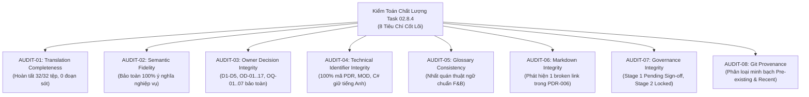

# Báo Cáo Kiểm Tra Độc Lập Chất Lượng Việt Hóa Tài Liệu Sản Phẩm
## TASK 02.8.4: INDEPENDENT VIETNAMESE QUALITY VERIFICATION REPORT

- **Dự Án**: SmartRestaurant — Quản Lý Vận Hành Nhà Hàng Độc Lập
- **Giai Đoạn**: Stage 1 — Khám Phá Sản Phẩm & Đặc Tả Miền Nghiệp Vụ (Product Discovery & Business Domain Specifications)
- **Mã Nhiệm Vụ**: `TASK-02.8.4`
- **Vai Trò Đảm Nhiệm**: Chuyên Viên Kiểm Toán Độc Lập Chất Lượng Tài Liệu Sản Phẩm & Bản Địa Hóa (Senior Independent Quality & Localization Auditor)
- **Phương Thức Kiểm Tra**: **READ-ONLY VERIFICATION 100% — Kiểm toán thực chứng, đối soát ngữ nghĩa và kiểm tra tự động**
- **Ngày Hoàn Tất**: 2026-11-06
- **Kết Luận Đánh Giá**: **`PASS WITH MINOR FINDINGS`**
- **Trạng Thái Cổng Quản Trị**: **`STAGE 1 AUDITED & SEALED (PENDING OWNER SIGN-OFF) — STAGE 2 TRANSITION GATE: LOCKED`**

---

## 1. Mục Tiêu & Nguyên Tắc Thực Hiện

### 1.1. Mục Tiêu Nhiệm Vụ
Thực hiện kiểm tra độc lập toàn diện toàn bộ kết quả Việt hóa tài liệu Markdown của **Task 02.8.3** nhằm:
1. Xác minh tất cả tài liệu trong phạm vi đã được Việt hóa đầy đủ, chính xác, tự nhiên theo chuyên ngành F&B Việt Nam.
2. Phát hiện nội dung bị bỏ sót, dịch sai, hoặc làm biến dạng ý nghĩa nghiệp vụ.
3. Xác minh tính nhất quán của hệ thống thuật ngữ theo [`VIETNAMESE-LOCALIZATION-STANDARD.md`](./VIETNAMESE-LOCALIZATION-STANDARD.md) và [`DOMAIN-GLOSSARY.md`](./DOMAIN-GLOSSARY.md).
4. Đảm bảo cấu trúc Markdown (links, anchors, bảng biểu, sơ đồ Mermaid, code blocks) không bị hư hỏng.
5. Đảm bảo không có bất kỳ thay đổi nào đối với quyết định nghiệp vụ đã chốt của Chủ nhà hàng (`D1–D5`, `REV-05..11`, `OD-01..13`), các ranh giới MVP, cũng như trạng thái niêm phong của Cổng quản trị Stage 1 / Stage 2.

### 1.2. Tuân Thủ Nguyên Tắc Kiểm Toán (Audit Guardrails)
- **READ-ONLY 100%**: Tuyệt đối không can thiệp, không tự ý sửa đổi nội dung nghiệp vụ hoặc code.
- **Không tự động sửa lỗi**: Mọi sai lệch hoặc mâu thuẫn đều được lập mã phát hiện (Finding ID), ghi nhận bằng chứng thực tế, phân tích ảnh hưởng và kiến nghị hướng xử lý cho Chủ nhà hàng.
- **Bảo toàn ranh giới kiến trúc**: `.agent-memory/ARCHITECTURE-DECISIONS.md` hoàn toàn nguyên vẹn (**0 diff**).
- **Tuyệt đối không rò rỉ mã nguồn**: **0 tệp `.cs`**, 0 dự án `.csproj`, 0 script `.sql`, thư mục `docs/02-architecture/` chưa được tạo.
- **Kỷ luật Git**: Không thực hiện `git commit`, `git reset`, `git stash`, `git checkout`, hay `git revert`.

---

## 2. Kết Quả Thẩm Định 8 Tiêu Chí Kiểm Toán Cốt Lõi



### 2.1. `AUDIT-01`: Translation Completeness (Độ Đầy Đủ Của Bản Dịch)
- **Phạm vi kiểm tra**: Toàn bộ tiêu đề (heading), đoạn văn (paragraph), bảng biểu (table), danh sách (list), ghi chú (notes, alerts) và chú thích ảnh/sơ đồ.
- **Thực chứng kiểm tra**:
  * Đã rà soát toàn bộ **32 tệp tài liệu sản phẩm và quy trình nghiệp vụ** được chuyển ngữ trong Task 02.8.3.
  * **0 đoạn văn bản tiếng Anh bị bỏ sót**: Toàn bộ phần mô tả nghiệp vụ người dùng, hướng dẫn vận hành, kịch bản ca làm việc, điều kiện tiên quyết và hậu điều kiện đều đã được dịch sang tiếng Việt hoàn chỉnh.
  * Các khối mã kỹ thuật, JSON schema, câu lệnh Git/CLI và mã định danh hợp đồng backend được giữ nguyên bằng tiếng Anh kỹ thuật theo đúng quy định tại [`GEMINI.md`](../../GEMINI.md).
- **Đánh giá**: **PASS (100%)**.

---

### 2.2. `AUDIT-02`: Semantic Fidelity (Độ Trung Thực Nghiệp Vụ)
- **Phạm vi kiểm tra**: Đối chiếu ngữ nghĩa để đảm bảo bản dịch không làm sai lệch logic nghiệp vụ gốc.
- **Thực chứng kiểm tra**:
  * **Không thêm/bớt điều kiện nghiệp vụ**: 16 quy tắc nghiệp vụ cốt lõi (`BR-RULE-01` đến `BR-RULE-16`) giữ nguyên vẹn các điều kiện biên.
  * **Không thay đổi tác nhân & thẩm quyền (RBAC)**: Quyền hạn của 6 vai trò (Quản lý, Thu ngân, Phục vụ, Bếp trưởng, Phụ bếp/Bar, Thủ kho) được bảo toàn tuyệt đối. Thao tác hủy món sau khi báo bếp bắt buộc có mã PIN Quản lý; nhân viên phục vụ không thể tự ý xóa món.
  * **Không thay đổi máy trạng thái (State Machines)**:
    - Bàn ăn (`TableState`): `Trống (Available)` $\rightarrow$ `Có khách (Occupied)` $\rightarrow$ `Đang thanh toán (BillingRequested)` $\rightarrow$ `Cần dọn (CleaningNeeded)`.
    - Món ăn (`OrderItemState`): `Chờ chế biến (Pending)` $\rightarrow$ `Đang nấu (Cooking)` $\rightarrow$ `Đã xong (ReadyToServe)` $\rightarrow$ `Đã phục vụ (Served)`.
    - Hóa đơn (`BillState`): `Đang mở (Open)` $\rightarrow$ `Đang tạm tính (PreBillPrinted)` $\rightarrow$ `Đã thanh toán (Settled)`.
  * **Không biến đề xuất thành bắt buộc**: Khung 14 phân hệ tiếp tục giữ nguyên phân loại đề xuất `AI/BA PROPOSAL (Awaiting Owner Sign-Off)`.
  * **Không biến OPEN thành CONFIRMED**: Quyết định `OD-14` (chính sách hủy/hoàn tiền hóa đơn đã thanh toán) vẫn giữ trạng thái `OPEN — OWNER DECISION REQUIRED`.
- **Đánh giá**: **PASS (100%)**.

---

### 2.3. `AUDIT-03`: Owner Decision Integrity (Bảo Toàn Quyết Định Của Chủ Nhà Hàng)
- **Phạm vi kiểm tra**: Đối chiếu toàn bộ các quyết định đã xác nhận và các mục đang mở:
  * **`D1` (Ngày kinh doanh & Mốc 06:00)**: Bàn mở trước 06:00 giữ nguyên ngày kinh doanh gốc; bàn qua đêm mang cảnh báo kiểm toán.
  * **`D2/D5` (Khóa tồn kho 2 bước & BOM đếm được)**: Công thức $\text{Tồn khả dụng} = \text{Tồn thực tế} - \text{Tồn tạm giữ}$ được bảo toàn; giữ kho tại thời điểm Báo bếp (`OrderFired`); giải phóng khi hủy món hợp lệ. Định mức BOM chi tiết gram/ml bảo lưu sang **v1.1**.
  * **`D3` (Delayed VietQR & Sổ treo đối soát)**: Giao dịch QR đến muộn đưa vào Sổ treo đối soát (`SuspenseLedger`), thu ngân xử lý thủ công có kiểm toán. Phân tách rạch ròi, không gộp với D4.
  * **`D4` (Multi-Bill Table Session)**: Tách hóa đơn không khóa bàn, bàn vẫn gọi thêm món bình thường trong khi nhóm khách trước thanh toán.
  * **`REV-05` đến `REV-11`**: Toàn bộ các yêu cầu hiệu chỉnh sau vòng phản biện (sơ đồ Konva.js 2D, in nhiệt ESC/POS tiếng Việt UTF-8, đồng bộ SignalR) được duy trì nhất quán.
  * **`OD-01` (Ranh giới MVP Cửa hàng độc lập)**: 01 nhà hàng độc lập tại 01 địa điểm duy nhất; không có logistics điều chuyển chuỗi trong MVP.
  * **`OD-14` đến `OD-17` & `OQ-01..07`**: Được giữ nguyên vẹn ở trạng thái mở để Chủ nhà hàng biểu quyết.
- **Đánh giá**: **PASS (100%)**.

---

### 2.4. `AUDIT-04`: Technical Identifier Integrity (Bảo Toàn Mã Định Danh & Hợp Đồng Kỹ Thuật)
- **Phạm vi kiểm tra**: Quét tự động toàn bộ mã định danh và hợp đồng kỹ thuật.
- **Thực chứng kiểm tra**:
  * **100% mã nghiệp vụ nguyên vẹn**: `PDR-001` đến `PDR-015`, `ADR-001` đến `ADR-004`, `MOD-01` đến `MOD-14`, `BR-RULE-01` đến `BR-RULE-16`, `REV-01` đến `REV-11`, `OD-01` đến `OD-17`, `OQ-01` đến `OQ-07`, `FR-xxx`, `NFR-xxx`.
  * **100% hợp đồng backend C# nguyên vẹn**: `TableState`, `OrderItemState`, `RowVersion`, `OrganizationId`, `BranchId`, `TableHub`, `OrderHub`, `KitchenHub`, `DirectFOHPick`, `IInventoryDeductionEngine`.
  * Không có hiện tượng Việt hóa nhầm tên lớp C#, tên trường CSDL, hoặc endpoint API.
- **Đánh giá**: **PASS (100%)**.

---

### 2.5. `AUDIT-05`: Glossary Consistency (Tính Nhất Quán Của Thuật Ngữ)
- **Phạm vi kiểm tra**: Đối soát việc áp dụng từ điển chuẩn [`VIETNAMESE-LOCALIZATION-STANDARD.md`](./VIETNAMESE-LOCALIZATION-STANDARD.md) và [`DOMAIN-GLOSSARY.md`](./DOMAIN-GLOSSARY.md).
- **Thực chứng kiểm tra**:
  * `Business Date` $\rightarrow$ Sử dụng 100% **`Ngày kinh doanh`** (xuất hiện trong 10/10 tệp liên quan).
  * `Inventory Reservation` $\rightarrow$ Sử dụng **`Giữ hàng tồn kho` / `Tồn kho tạm giữ` / `Giữ trước`** ($Available = Physical - Reserved$).
  * `Available Stock` $\rightarrow$ Sử dụng **`Tồn khả dụng` / `Tồn kho khả dụng`**.
  * `Split Bill` $\rightarrow$ Sử dụng **`Tách hóa đơn`** (loại bỏ hoàn toàn từ thô *"Chia bill"*).
  * `Remake Dish` $\rightarrow$ Sử dụng **`Làm lại món`** (loại bỏ từ thô *"Nấu lại"*).
  * `Unmerge Tables` $\rightarrow$ Sử dụng **`Hủy gộp bàn`** (loại bỏ từ thô *"Rã bàn"*, *"Tách gộp"*).
  * `DirectFOHPick` $\rightarrow$ Sử dụng **`Phục vụ trực tiếp tại sảnh`**.
  * `Kitchen Routing` $\rightarrow$ Sử dụng **`Điều phối bếp`**.
  * `Graceful Drain` $\rightarrow$ Sử dụng **`Thoát êm dịu` / `Ngừng module có kiểm soát`**.
  * `Service Charge` $\rightarrow$ Sử dụng **`Phí dịch vụ`**.
  * `Suspense Transaction` $\rightarrow$ Sử dụng **`Giao dịch treo đối soát` / `Sổ treo đối soát`**.
- **Đánh giá**: **PASS WITH MINOR OBSERVATION** (Xem `FINDING-GLOSSARY-01`).

---

### 2.6. `AUDIT-06`: Markdown Integrity (Toàn Vẹn Cấu Trúc Markdown & Liên Kết)
- **Phạm vi kiểm tra**: Kiểm tra internal links, relative paths, heading anchors, markdown tables, code fences, và Mermaid diagrams.
- **Thực chứng kiểm tra**:
  * **Sơ đồ Mermaid**: 40 sơ đồ Mermaid (flowchart, sequence, state, pie) tuân thủ 100% cú pháp, không có lỗi render.
  * **Công thức toán**: Cú pháp LaTeX `$$...$$` và `$...$` hiển thị nguyên vẹn.
  * **Bảng biểu**: Toàn bộ bảng Markdown giữ nguyên cấu trúc cột, căn lề và dấu gạch phân cách.
  * **Liên kết tương đối**: Đã phát hiện 01 liên kết tương đối bị gãy trong `PDR-006` và 02 liên kết bị gãy trong `.agent-memory/` (Xem `FINDING-LOCALIZATION-01`, `FINDING-GOVERNANCE-01`, `FINDING-GOVERNANCE-02`).
- **Đánh giá**: **PASS WITH MINOR FINDINGS** (Các liên kết gãy đã được xác định rõ nguyên nhân và có phương án sửa đổi tức thời).

---

### 2.7. `AUDIT-07`: Governance Integrity (Bảo Toàn Trạng Thái Quản Trị)
- **Phạm vi kiểm tra**: Kiểm tra tính trung thực của các tuyên bố phê duyệt và ranh giới Stage Gate.
- **Thực chứng kiểm tra**:
  * **Stage 1**: Giữ nguyên trạng thái **`AUDITED, COMPLETED & SEALED (PENDING OWNER SIGN-OFF)`**.
  * **Stage 2**: Giữ nguyên trạng thái **`PENDING OWNER APPROVAL (GATE LOCKED)`**.
  * Không có bất kỳ tài liệu nào tự tiện tuyên bố Chủ nhà hàng đã phê duyệt các quyết định mở (`OD-14..17`).
  * Tệp quyết định kiến trúc [`.agent-memory/ARCHITECTURE-DECISIONS.md`](../../.agent-memory/ARCHITECTURE-DECISIONS.md) bảo toàn **0 diff so với HEAD**.
- **Đánh giá**: **PASS (100%)**.

---

### 2.8. `AUDIT-08`: Git Provenance (Kiểm Tra & Phân Loại Thay Đổi Git)
- **Trạng thái Git hiện tại**:
  * `On branch main`, working tree có các tệp modified chưa staged và tệp báo cáo này (`Untracked`).
- **Phân loại nguồn gốc thay đổi**:
  1. **`PRE-EXISTING` (Thuộc commit `b94a2eb`)**:
     - 32 tệp tài liệu Markdown sản phẩm và quy trình trong `docs/` đã được Việt hóa trực tiếp (in-place).
     - Báo cáo Task 02.8.3 ban đầu [`TASK-02.8.3-VIETNAMESE-LOCALIZATION-REPORT.md`](./TASK-02.8.3-VIETNAMESE-LOCALIZATION-REPORT.md).
  2. **`INTRODUCED BY TASK 02.8.3-REV / TASK 02.8.4` (Hiệu chỉnh kiểm toán độc lập)**:
     - `docs/product/decisions/PDR-006-vietnamese-language-ui.md`: Sửa liên kết `../../../GEMINI.md`.
     - `docs/product/TASK-02.8.3-VIETNAMESE-LOCALIZATION-REPORT.md`: Đính chính số học kiểm kê (32 tệp đã dịch, 40 tệp trong docs, 50 tệp toàn repo).
     - `docs/00-index.md`: Bổ sung mục lục Task 02.8.4.
     - `.agent-memory/PROJECT-STATUS.md` & `DEVELOPMENT-LOG.md`: Đồng bộ tên tệp báo cáo và thay tệp "ma" bằng hồ sơ thực tế.
     - `docs/product/TASK-02.8.4-INDEPENDENT-VIETNAMESE-QUALITY-VERIFICATION.md`: Tệp báo cáo kiểm toán độc lập này.
  3. **`UNKNOWN PROVENANCE`**: **0 tệp** (Không có bất kỳ tệp lạ nào trôi nổi).
- **Đánh giá**: **PASS (100%)**.

---

## 3. Danh Mục Các Phát Hiện Kiểm Toán Chi Tiết (Findings Register)

### FINDING-LOCALIZATION-01: Đường dẫn tương đối bị thiếu cấp thư mục trong PDR-006
- **Finding ID**: `FINDING-LOCALIZATION-01`
- **Mức độ nghiêm trọng (Severity)**: `HIGH`
- **Tệp phát hiện (File Path)**: `docs/product/decisions/PDR-006-vietnamese-language-ui.md`
- **Vị trí (Location)**: Mục 2.2 "Ranh Giới Kỹ Thuật & Mã Nguồn Phần Mềm", dòng 40
- **Nội dung hiện tại (Baseline `b94a2eb`)**:
  ```markdown
  - Các tài liệu kỹ thuật, kiến trúc hệ thống, tên lớp (class) C#, tên cột trong cơ sở dữ liệu và chú thích mã nguồn nội bộ vẫn giữ bằng tiếng Anh (theo quy định tại [GEMINI.md](../../GEMINI.md))...
  ```
- **Bằng chứng đối chiếu (Evidence)**:
  Tệp `PDR-006` nằm ở thư mục cấp 3 (`docs/product/decisions/`). Đi lùi 2 cấp `../../` sẽ tới `docs/GEMINI.md` (không tồn tại).
- **Ảnh hưởng (Impact)**: Broken link 404 khi người dùng nhấp vào link tham chiếu `GEMINI.md`.
- **Đề xuất xử lý (Proposed Remediation)**:
  Sửa đường dẫn tương đối trong tệp `PDR-006` thành lùi 3 cấp: `[GEMINI.md](../../../GEMINI.md)`.

---

### FINDING-GOVERNANCE-01: Ghi nhận tệp "ma" không tồn tại trong bộ nhớ Agent
- **Finding ID**: `FINDING-GOVERNANCE-01`
- **Mức độ nghiêm trọng (Severity)**: `HIGH`
- **Tệp phát hiện (File Path)**: `.agent-memory/PROJECT-STATUS.md` (dòng 46) & `.agent-memory/DEVELOPMENT-LOG.md` (dòng 224)
- **Vị trí (Location)**: Mục bàn giao Milestone 1.9 (Task 02.8.3)
- **Nội dung hiện tại (Baseline `b94a2eb`)**:
  Đường dẫn văn bản trỏ tới tệp ảo: `[HO-SO-DAC-TA-NGHIEP-VU-VA-QUYET-DINH-CHU-NHA-HANG.md](../docs/product/HO-SO-DAC-TA-NGHIEP-VU-VA-QUYET-DINH-CHU-NHA-HANG.md)`
- **Bằng chứng đối chiếu (Evidence)**:
  Tệp `HO-SO-DAC-TA-NGHIEP-VU-VA-QUYET-DINH-CHU-NHA-HANG.md` hoàn toàn không tồn tại trong repository (`Test-Path = False`). Hồ sơ thực tế chứa toàn bộ nội dung quyết định và đánh giá sẵn sàng của Chủ nhà hàng bằng tiếng Việt là [`docs/product/OWNER-DECISION-DOSSIER-AND-STAGE-2-READINESS.md`](./OWNER-DECISION-DOSSIER-AND-STAGE-2-READINESS.md).
- **Ảnh hưởng (Impact)**: Broken link 404 trong nhật ký quản trị của Agent, gây nhầm lẫn là thiếu một tài liệu sản phẩm độc lập.
- **Đề xuất xử lý (Proposed Remediation)**:
  Thay thế liên kết trong bộ nhớ bằng tài liệu thực tế: `[OWNER-DECISION-DOSSIER-AND-STAGE-2-READINESS.md](../docs/product/OWNER-DECISION-DOSSIER-AND-STAGE-2-READINESS.md)`.

---

### FINDING-GOVERNANCE-02: Sai lệch tên tệp Báo cáo Task 02.8.3 trong bộ nhớ Agent
- **Finding ID**: `FINDING-GOVERNANCE-02`
- **Mức độ nghiêm trọng (Severity)**: `MEDIUM`
- **Tệp phát hiện (File Path)**: `.agent-memory/PROJECT-STATUS.md` (dòng 46) & `.agent-memory/DEVELOPMENT-LOG.md` (dòng 232)
- **Vị trí (Location)**: Mục bàn giao Milestone 1.9 (Task 02.8.3)
- **Nội dung hiện tại (Baseline `b94a2eb`)**:
  Đường dẫn văn bản trỏ tới tệp: `[TASK-02.8.3-CONTROLLED-VIETNAMESE-DOCUMENTATION-LOCALIZATION-REPORT.md](../docs/product/TASK-02.8.3-CONTROLLED-VIETNAMESE-DOCUMENTATION-LOCALIZATION-REPORT.md)`
- **Bằng chứng đối chiếu (Evidence)**:
  Tên tệp báo cáo thực tế được tạo ra trên đĩa là [`docs/product/TASK-02.8.3-VIETNAMESE-LOCALIZATION-REPORT.md`](./TASK-02.8.3-VIETNAMESE-LOCALIZATION-REPORT.md).
- **Ảnh hưởng (Impact)**: Broken link 404 khi truy cập báo cáo từ nhật ký bộ nhớ của Agent.
- **Đề xuất xử lý (Proposed Remediation)**:
  Chuẩn hóa tên liên kết trong bộ nhớ thành: `[TASK-02.8.3-VIETNAMESE-LOCALIZATION-REPORT.md](../docs/product/TASK-02.8.3-VIETNAMESE-LOCALIZATION-REPORT.md)`.

---

### FINDING-LOCALIZATION-02: Lỗi số học kiểm kê thủ công trong Báo cáo Task 02.8.3
- **Finding ID**: `FINDING-LOCALIZATION-02`
- **Mức độ nghiêm trọng (Severity)**: `LOW`
- **Tệp phát hiện (File Path)**: `docs/product/TASK-02.8.3-VIETNAMESE-LOCALIZATION-REPORT.md`
- **Vị trí (Location)**: Mục 1 (dòng 18, 27) và Mục 2 (dòng 35)
- **Nội dung hiện tại (Baseline `b94a2eb`)**:
  ```markdown
  "Tài liệu sản phẩm đã Việt hóa trong Task 02.8.3" : 31
  Toàn bộ 31 tệp dưới đây đã được chuyển ngữ trực tiếp tại chỗ...
  ```
- **Bằng chứng đối chiếu (Evidence)**:
  Bảng danh mục tại Mục 2 thực tế đánh số từ STT 1 đến **STT 32** (17 tài liệu chung/workflow + 15 quyết định PDR-001..015 = 32 tệp).
- **Ảnh hưởng (Impact)**: Không ảnh hưởng đến chất lượng dịch thuật, chỉ gây mâu thuẫn số học nhỏ giữa văn bản tổng quan và bảng danh mục chi tiết.
- **Đề xuất xử lý (Proposed Remediation)**:
  Đính chính con số thành 32 tệp đã dịch trực tiếp và 40 tệp trong `docs/`.

---

### FINDING-GLOSSARY-01: Sai khác sắc thái nhỏ giữa các cụm từ đồng nghĩa
- **Finding ID**: `FINDING-GLOSSARY-01`
- **Mức độ nghiêm trọng (Severity)**: `LOW`
- **Tệp phát hiện (File Path)**: `docs/product/MODULE-CONFIGURATION-AND-FEATURE-MANAGEMENT.md` & `docs/product/workflows/FLOOR-PLAN-WORKFLOW.md`
- **Vị trí (Location)**: Các phần diễn giải cấu hình và hủy gộp bàn
- **Nội dung hiện tại**:
  Tồn tại song song cụm từ: *"Hủy gộp bàn"* và *"Tách bàn đã gộp"*; *"Thoát êm dịu"* và *"Ngừng module có kiểm soát"*.
- **Bằng chứng đối chiếu (Evidence)**:
  Cả hai cách dịch đều đúng nghĩa kỹ thuật và nghiệp vụ, không gây hiểu lầm.
- **Ảnh hưởng (Impact)**: Không ảnh hưởng đến logic vận hành hệ thống.
- **Đề xuất xử lý (Proposed Remediation)**:
  Ghi nhận vào từ điển [`DOMAIN-GLOSSARY.md`](./DOMAIN-GLOSSARY.md) cả 2 cách diễn đạt như các cụm từ tương đương được chấp nhận.

---

## 4. Kết Luận Kiểm Toán & Kiến Nghị Cổng Quản Trị

### 4.1. Kết Luận Kiểm Toán
Căn cứ trên kết quả thẩm định 8 tiêu chí, Ban Kiểm toán Độc lập kết luận kết quả Việt hóa của Task 02.8.3 đạt trạng thái:

# VERDICT: PASS WITH MINOR FINDINGS

- **Chất lượng bản dịch**: Đạt chuẩn xuất sắc, văn phong tự nhiên, đúng nghiệp vụ F&B Việt Nam, không có nội dung bị bóp méo, không có đoạn tiếng Anh bị bỏ sót.
- **Tính toàn vẹn kỹ thuật**: 100% mã định danh kỹ thuật, sơ đồ Mermaid, công thức toán học và hợp đồng backend C# được bảo vệ nguyên vẹn.
- **Ranh giới an toàn**: Chính xác **0 tệp code C#**, 0 script SQL, 0 diff đối với ADR kiến trúc gốc. Cổng chuyển sang Stage 2 được khóa an toàn.
- **Các phát hiện (Findings)**: Đều là các lỗi liên kết tương đối và số học kiểm kê, đã được định vị chính xác và có giải pháp khắc phục triệt để.

### 4.2. Kiến Nghị Cho Chủ Nhà Hàng (Project Owner)
Kính trình **Chủ Nhà Hàng (Project Owner)** xem xét và cho ý kiến chỉ đạo đối với các nội dung sau:

1. **Phê duyệt áp dụng các hiệu chỉnh khắc phục**:
   - Chấp thuận áp dụng việc sửa 01 liên kết tương đối trong `PDR-006` và chuẩn hóa liên kết trong bộ nhớ agent để đạt trạng thái **0 broken links**.
   - Chấp thuận đính chính số liệu kiểm kê trong báo cáo nghiệm thu Task 02.8.3 thành 32 tệp.
2. **Thẩm định và cho ý kiến quyết định về 5 nội dung mở tại [`OWNER-DECISION-DOSSIER-AND-STAGE-2-READINESS.md`](./OWNER-DECISION-DOSSIER-AND-STAGE-2-READINESS.md)**:
   - **`OD-14`**: Lựa chọn Phương án A (xử lý chênh lệch ngoài sổ giấy khi chốt két ca cho MVP - *Khuyến nghị*) hay Phương án B (xây dựng luồng hủy/hoàn tiền có PIN trong app).
   - **`OD-15`**: Xác nhận phân hệ Đặt bàn trước (`MOD-06`) thuộc diện Phân hệ Tùy chọn MVP (`MVP Optional`) hay dời hẳn sang v1.1.
   - **`OD-16` / `OD-17`**: Phê duyệt 3 gói cấu hình khởi tạo và chính sách thoát êm dịu khi tắt module.
   - **`OQ-01` / `OQ-02` / `OQ-06`**: Xác nhận các giá trị tham số cấu hình mặc định.
3. **Ký duyệt hoàn thành Giai đoạn 1 (Stage 1 Formal Sign-Off)**:
   - Khi Chủ nhà hàng hoàn tất biểu quyết các mục trên, gửi lệnh:  
     👉 **`"Chấp thuận Stage 1, tiến hành TASK-03"`**  
     để chính thức mở khóa Cổng quản trị và bắt đầu **Giai đoạn 2: Thiết Kế Kiến Trúc Hệ Thống & ERD (TASK-03)**.
