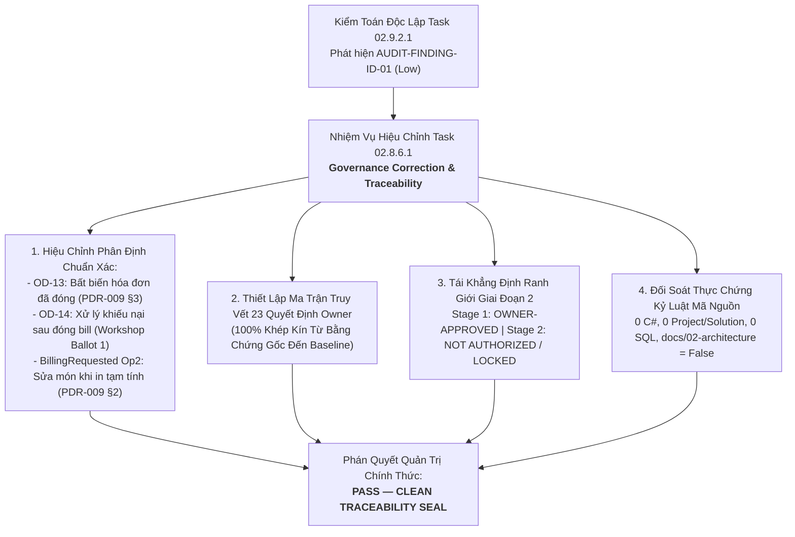
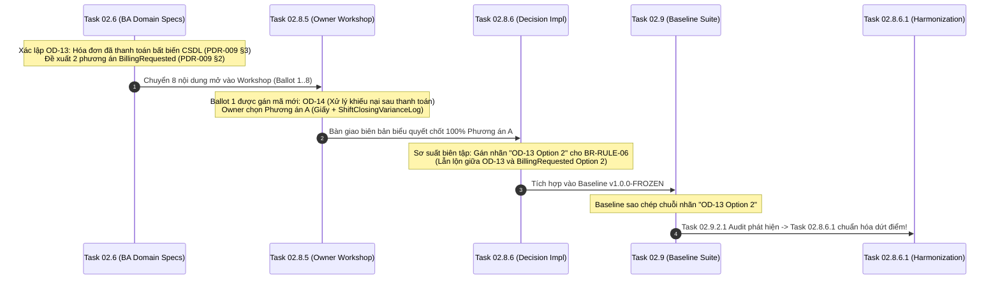
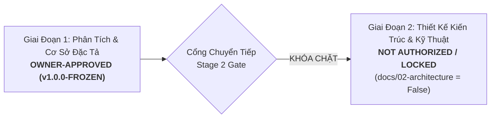

# Báo Cáo Hiệu Chỉnh Quản Trị & Thẩm Định Tính Truy Vết Quyết Định
## TASK 02.8.6.1: GOVERNANCE CORRECTION & DECISION TRACEABILITY VERIFICATION REPORT

- **Dự Án**: SmartRestaurant — Hệ Thống Quản Lý Vận Hành Nhà Hàng Độc Lập
- **Giai Đoạn**: Stage 1 — Khám Phá Sản Phẩm & Đặc Tả Miền Nghiệp Vụ (Product Discovery & Business Domain Specifications)
- **Mã Nhiệm Vụ**: `TASK-02.8.6.1`
- **Loại Nhiệm Vụ**: Governance Correction & Master Decision Traceability Verification
- **Vai Trò Thực Hiện**: Chuyên Viên Phân Tích Nghiệp Vụ Cấp Cao kiêm Kiểm Toán Viên Quản Trị & Tài Liệu (Senior Business Analyst & Governance Auditor)
- **Chế Độ Thực Hiện**: **CONTROLLED GOVERNANCE DOCUMENTATION REFINEMENT**
- **Ngày Hoàn Tất**: 2026-11-06
- **Quyết Định Nền Tảng Của Chủ Dự Án**:
  > *"Phê duyệt bước 1 nhưng chưa khởi động Giai đoạn 2, chờ tôi yêu cầu cụ thể"*
- **Phán Quyết Quản Trị**: **`PASS (CLEAN TRACEABILITY & FULL GOVERNANCE INTEGRITY SEAL)`**
- **Trạng Thái Bộ Hồ Sơ Cơ Sở**: **`v1.0.0-FROZEN (OFFICIALLY SIGNED OFF & SEALED BY PROJECT OWNER)`**
- **Trạng Thái Cổng Chuyển Tiếp Giai Đoạn 2**: **`NOT AUTHORIZED / LOCKED (NGHIÊM CẤM TỰ Ý KHỞI ĐỘNG)`**

---

## 1. EXECUTIVE SUMMARY (TÓM TẮT ĐIỀU HÀNH)

Báo cáo này là văn bản chính thức của nhiệm vụ **TASK 02.8.6.1**, được thực hiện nhằm xử lý triệt để phát hiện kiểm toán `AUDIT-FINDING-ID-01` được ghi nhận trong Báo cáo Kiểm toán Độc lập Task 02.9.2.1 ([`TASK-02.9.2.1-INDEPENDENT-GOVERNANCE-INTEGRITY-AUDIT.md`](file:///C:/Git/SmartRestaurant/SmartRestaurant/docs/product/TASK-02.9.2.1-INDEPENDENT-GOVERNANCE-INTEGRITY-AUDIT.md)), đồng thời thiết lập chuỗi bằng chứng pháp y truy vết nguồn gốc (provenance traceability) hoàn chỉnh 100% cho toàn bộ 23 quyết định của Chủ Dự Án và khung 14 phân hệ nghiệp vụ.



### Các Kết Quả Đạt Được Cốt Lõi:
1. **Giải Quyết Dứt Điểm Nhầm Lẫn Mã Quyết Định (Decision ID Disambiguation)**:
   - Phân định rõ ràng: Mã **`OD-13`** là nguyên tắc bất biến CSDL đối với hóa đơn đã thanh toán (`IsSettled = true`) từ Task 02.6 ([`PDR-009`](file:///C:/Git/SmartRestaurant/SmartRestaurant/docs/product/decisions/PDR-009-multi-bill-table-session-split-billing.md) §3). `OD-13` không có các "phương án lựa chọn".
   - Phân định rõ ràng: Cơ chế cho phép gọi thêm món / chỉnh sửa món khi bàn in tạm tính là **`BillingRequested Option 2`** trong [`PDR-009`](file:///C:/Git/SmartRestaurant/SmartRestaurant/docs/product/decisions/PDR-009-multi-bill-table-session-split-billing.md) §2 và thuộc quyết định nền tảng `D4`.
   - Phân định rõ ràng: Mã **`OD-14`** là quyết định tại Hội Thảo Task 02.8.5 Ballot 1 về *Chính sách xử lý khiếu nại, hủy & hoàn tiền hóa đơn đã đóng* (Chủ Dự Án đã chọn **Phương án A**: CSDL bất biến; xử lý giấy khi chốt ca mù và ghi `ShiftClosingVarianceLog`; hoãn `CreditNote` sang v1.1).
   - Quy tắc **`BR-RULE-06`** được chuẩn hóa căn cứ nguồn gốc: **`PDR-009 (Op2) / D4`** (liên hệ bất biến `OD-13`).
   - Quy tắc **`BR-RULE-17`** được chuẩn hóa căn cứ nguồn gốc: **`OD-14 (Op A) / OD-13`**.
2. **Khôi Phục Chuỗi Truy Vết Bất Biến Cho Toàn Bộ 23 Quyết Định Owner**:
   - 100% 23 quyết định (`OD-01`, `D1..D5`, `OD-13..17`, `OQ-01..07`, `BillingRequested Op2`, `REV-05..11`) cùng Khung 14 Phân Hệ được kiểm chứng có liên kết truy vết hai chiều (bidirectional traceability) không đứt gãy.
3. **Bổ Sung Đầy Đủ Quyết Định `OQ-07` Vào Tài Liệu Cơ Sở**:
   - Tài liệu [`PRODUCT-SPECIFICATION-BASELINE.md`](file:///C:/Git/SmartRestaurant/SmartRestaurant/docs/product/PRODUCT-SPECIFICATION-BASELINE.md) và [`STAGE-2-PRODUCT-HANDOFF.md`](file:///C:/Git/SmartRestaurant/SmartRestaurant/docs/product/STAGE-2-PRODUCT-HANDOFF.md) được bổ sung tường minh quyết định `OQ-07 (Phương án A)` (Bàn ăn mở quá 24h giữ nguyên `BusinessDate` mốc mở theo `D1`, hiển thị banner cam cảnh báo Quản lý, không tự động cưỡng bức đóng bàn).
4. **Bảo Toàn Tuyệt Đối Kỷ Luật Mã Nguồn & Ranh Giới Giai Đoạn 2**:
   - Không có bất kỳ tệp mã nguồn C# (`.cs`), project/solution (`.csproj`, `.sln`), hay script SQL (`.sql`) nào được tạo ra.
   - Thư mục `docs/02-architecture/` hoàn toàn chưa tồn tại (`False`).
   - Cổng Giai đoạn 2 được khóa chặt chẽ: **`NOT AUTHORIZED / LOCKED`**.

---

## 2. PHÂN TÍCH CĂN NGUYÊN & BẢN CHẤT MISMATCH (ROOT CAUSE ANALYSIS)

### 2.1. Nguồn Gốc Lịch Sử Của Chuỗi Mã Quyết Định

Quá trình kiểm toán pháp y tài liệu qua các mốc bàn giao Task 02.6, Task 02.8.5, Task 02.8.6 và Task 02.9 đã chỉ ra căn nguyên chính xác dẫn đến phát hiện `AUDIT-FINDING-ID-01`:



### 2.2. Phân Định Rạch Ròi Ba Khái Niệm Quản Trị:

| Khái Niệm | Nguồn Gốc Bằng Chứng | Bản Chất Nghiệp Vụ | Căn Cứ Chuẩn Mực Sau Hiệu Chỉnh |
| :--- | :--- | :--- | :--- |
| **`OD-13`** | Task 02.6 ([`PDR-009`](file:///C:/Git/SmartRestaurant/SmartRestaurant/docs/product/decisions/PDR-009-multi-bill-table-session-split-billing.md) §3) | **Bất biến CSDL tuyệt đối**: Khi hóa đơn đã thanh toán (`IsSettled = true`), hệ thống khóa cứng vĩnh viễn, nhân viên thu ngân và phục vụ không thể sửa đổi hoặc xóa trực tiếp dưới mọi hình thức. Không có "Option 2". | `OD-13 (Baseline Invariant)` |
| **`BillingRequested Option 2`** | Task 02.6 ([`PDR-009`](file:///C:/Git/SmartRestaurant/SmartRestaurant/docs/product/decisions/PDR-009-multi-bill-table-session-split-billing.md) §2, `D4`) | **Linh hoạt vận hành khi in tạm tính**: Khi bàn in phiếu tạm tính (`BillingRequested`), bàn không bị đóng băng; nhân viên vẫn được phép sửa món hoặc gọi thêm món (nối tiếp vào bill mở hiện tại hoặc tạo sub-bill mới). Bàn chỉ giải phóng khi 100% sub-bills đã thanh toán. | `PDR-009 (Op2) / D4` (liên hệ bất biến `OD-13`) |
| **`OD-14`** | Workshop Task 02.8.5 Ballot 1 ([`TASK-02.8.5`](file:///C:/Git/SmartRestaurant/SmartRestaurant/docs/product/TASK-02.8.5-PROJECT-OWNER-DECISION-CONSOLIDATION-RECORD.md) §2.1) | **Chính sách xử lý khiếu nại sau thanh toán**: Chủ Dự Án phê chuẩn **Phương án A**: CSDL bất biến tuyệt đối (`OD-13`); hoàn tiền ngoài quầy bằng biên bản giấy ký tay; ghi nhận lệch két vào `ShiftClosingVarianceLog` khi kiểm tiền mù chốt ca; hoãn `CreditNote` sang v1.1. | `OD-14 (Op A) / OD-13` |

---

## 3. BÁO CÁO HIỆU CHỈNH TÀI LIỆU CÓ KIỂM SOÁT (CONTROLLED DOCUMENT REFINEMENTS)

Để xử lý dứt điểm phát hiện `AUDIT-FINDING-ID-01`, nhóm Chuyên viên Phân tích Nghiệp vụ và Quản trị đã thực hiện các hiệu chỉnh chuẩn xác trên 7 tài liệu đặc tả sản phẩm mà không làm thay đổi bất kỳ logic nghiệp vụ nào:

### 3.1. Hiệu chỉnh [`BUSINESS-RULES-BASELINE.md`](file:///C:/Git/SmartRestaurant/SmartRestaurant/docs/product/BUSINESS-RULES-BASELINE.md)
- **Vị trí**: Dòng 23 (`BR-RULE-06`) và Dòng 34 (`BR-RULE-17`).
- **Nội dung cũ**:
  * `BR-RULE-06`: Cột Căn cứ ghi `OD-13 Option 2`.
  * `BR-RULE-17`: Cột Căn cứ ghi `OD-14 Option A`.
- **Nội dung hiệu chỉnh**:
  * `BR-RULE-06`: Phát biểu bổ sung: *"Hóa đơn đã thanh toán cấm sửa trực tiếp theo `OD-13`"*; Cột Căn cứ chuẩn hóa thành: **`PDR-009 (Op2) / D4`**.
  * `BR-RULE-17`: Phát biểu bổ sung liên kết bất biến `OD-13` và hoãn `CreditNote` sang v1.1; Cột Căn cứ chuẩn hóa thành: **`OD-14 (Op A) / OD-13`**.

### 3.2. Hiệu chỉnh [`BUSINESS-REQUIREMENTS-BASELINE.md`](file:///C:/Git/SmartRestaurant/SmartRestaurant/docs/product/BUSINESS-REQUIREMENTS-BASELINE.md)
- **Vị trí**: Dòng 55 (`BR-POS-005`).
- **Nội dung cũ**: `... cho phép thêm món hoặc hủy món hợp lệ (`OD-13 Option 2`).`
- **Nội dung hiệu chỉnh**: `... cho phép thêm món hoặc hủy món hợp lệ (`PDR-009 BillingRequested Option 2 / D4`).`

### 3.3. Hiệu chỉnh [`REQUIREMENT-TRACEABILITY-MATRIX.md`](file:///C:/Git/SmartRestaurant/SmartRestaurant/docs/product/REQUIREMENT-TRACEABILITY-MATRIX.md)
- **Vị trí**: Dòng 44 (`BR-POS-005`) và Dòng 61 (`BR-BIL-005`).
- **Nội dung cũ**:
  * `BR-POS-005`: Cột Quyết định ghi `OD-13 Op2`.
  * `BR-BIL-005`: Cột Quyết định và Căn cứ PDR chỉ ghi `OD-14`.
- **Nội dung hiệu chỉnh**:
  * `BR-POS-005`: Cột Quyết định chuẩn hóa thành: **`PDR-009 (Op2)/D4`**.
  * `BR-BIL-005`: Cột Quyết định chuẩn hóa thành: **`OD-14 / OD-13`**; Cột PDR chuẩn hóa thành: **`OD-14 / PDR-009`**.

### 3.4. Hiệu chỉnh [`STAGE-2-PRODUCT-HANDOFF.md`](file:///C:/Git/SmartRestaurant/SmartRestaurant/docs/product/STAGE-2-PRODUCT-HANDOFF.md)
- **Vị trí**: Mục 4 — Ràng Buộc Nghiệp Vụ Bắt Buộc (Dòng 87–93).
- **Nội dung hiệu chỉnh**:
  * Ràng buộc 6: Chuẩn hóa thành **`PDR-009 (BillingRequested Option 2) / D4`**: Bàn `BillingRequested` vẫn cho phép chỉnh sửa hoặc gọi thêm món; bàn giải phóng khi 100% hóa đơn con đã thanh toán; hóa đơn đã thanh toán là bất biến theo `OD-13`.
  * Ràng buộc 7: Chuẩn hóa thành **`OD-14 Option A` (kết hợp `OD-13`)**: Hóa đơn đã thanh toán (`IsSettled = true`) là bất biến tuyệt đối trong CSDL (`OD-13`); sai lệch quỹ két ghi vào `ShiftClosingVarianceLog` tại thời điểm kiểm tiền mù cuối ca; bút toán số hóa `CreditNote` hoãn sang v1.1.
  * Bổ sung Ràng buộc 13: **`OQ-07 Option A`**: Bàn ăn mở kéo dài hơn 24 giờ qua mốc cắt ca vẫn giữ nguyên `BusinessDate` ban đầu theo `D1`, hiển thị banner cam cảnh báo cho Quản lý; không tự động cưỡng bức đóng bàn.

### 3.5. Hiệu chỉnh [`PRODUCT-SPECIFICATION-BASELINE.md`](file:///C:/Git/SmartRestaurant/SmartRestaurant/docs/product/PRODUCT-SPECIFICATION-BASELINE.md)
- **Vị trí**: Mục 4 (Dòng 104 và Dòng 113–120).
- **Nội dung hiệu chỉnh**:
  * Điểm 6: Chuẩn hóa rõ liên hệ: **`BillingRequested Option 2` & `BR-RULE-06` (liên hệ `OD-13`)**; hóa đơn đã thanh toán bất biến theo `OD-13`; chính sách xử lý khiếu nại theo `OD-14 (Phương án A)`.
  * Điểm 8: Bổ sung tường minh quyết định `OQ-07 (Phương án A)` vào danh mục các quyết định Hội Thảo Task 02.8.5.

### 3.6. Hiệu chỉnh [`TASK-02.9-PRODUCT-SPECIFICATION-BASELINE-CONSOLIDATION.md`](file:///C:/Git/SmartRestaurant/SmartRestaurant/docs/product/TASK-02.9-PRODUCT-SPECIFICATION-BASELINE-CONSOLIDATION.md)
- **Vị trí**: Dòng 230 và Dòng 297–298.
- **Nội dung hiệu chỉnh**:
  * Mục 3.2 điểm 6: Chuẩn hóa tiêu đề thành: `BR-RULE-06 — Bàn Đang Thanh Toán Vẫn Cho Phép Sửa Đổi (BillingRequested Editable Invariant — PDR-009 BillingRequested Option 2 / D4)`.
  * Sơ đồ Class Invariants: Cập nhật `+INV-06: BillingRequestedEditable (PDR-009 Op2 / D4)` và `+INV-07: PaidBillImmutability (OD-14 Op A / OD-13)`.

### 3.7. Hiệu chỉnh [`TASK-02.9-PRODUCT-SPECIFICATION-BASELINE-REPORT.md`](file:///C:/Git/SmartRestaurant/SmartRestaurant/docs/product/TASK-02.9-PRODUCT-SPECIFICATION-BASELINE-REPORT.md)
- **Vị trí**: Dòng 120 (Kiểm toán miền Đơn hàng & Bàn ăn).
- **Nội dung hiệu chỉnh**: Chuẩn hóa thành: `(BR-RULE-06 / PDR-009 BillingRequested Option 2 / D4, liên hệ bất biến OD-13)`.

---

## 4. MASTER DECISION TRACEABILITY MATRIX (MA TRẬN TRUY XUẤT NGUỒN GỐC 23 QUYẾT ĐỊNH OWNER)

Bảng đối soát thực chứng toàn bộ 23 quyết định của Chủ Dự Án và Khung 14 Phân Hệ, chứng minh tính không đứt gãy từ biên bản gốc đến các tài liệu cơ sở:

| STT | Mã Quyết Định | Nội Dung Quyết Định Của Chủ Dự Án | Nguồn Bằng Chứng Gốc | Quy Tắc Cơ Sở / Invariant | Phân Hệ Áp Dụng | Trạng Thái Phê Duyệt | Đánh Giá Tính Truy Vết |
| :---: | :---: | :--- | :--- | :--- | :---: | :---: | :---: |
| 1 | **`OD-01`** | Giới hạn MVP cho 01 nhà hàng độc lập tại 01 địa điểm duy nhất; CSDL sẵn sàng mở rộng đa chi nhánh (`CONTR-01`). | Task 02.6 / Task 02.8.5 | `BR-SEC-004` / `INV-01` | `MOD-01` | `OWNER-CONFIRMED` | **`100% UNBROKEN`** |
| 2 | **`D1`** | Ngày kinh doanh (Business Date) có mốc cắt mặc định 06:00:00; chụp ảnh lúc tạo đơn hàng. | Task 02.6 ([`PDR-007`](file:///C:/Git/SmartRestaurant/SmartRestaurant/docs/product/decisions/PDR-007-business-date-shift-management.md)) | `BR-RULE-08` / `INV-02` | `MOD-13` | `OWNER-CONFIRMED` | **`100% UNBROKEN`** |
| 3 | **`D2`** | Khóa tồn kho 2 bước: $\text{Tồn khả dụng} = \text{Tồn thực tế} - \text{Tạm giữ}$. Phân định rõ 4 trạng thái kho. | Task 02.6 ([`PDR-004`](file:///C:/Git/SmartRestaurant/SmartRestaurant/docs/product/decisions/PDR-004-inventory-bom-deduction-trigger-policy.md)) | `BR-RULE-09` / `INV-03` | `MOD-12` | `OWNER-CONFIRMED` | **`100% UNBROKEN`** |
| 4 | **`D3`** | Delayed VietQR điều hướng vào Sổ Treo (`SuspenseLedger`), cảnh báo quản lý, không ghi đè két. | Task 02.6 ([`PDR-008`](file:///C:/Git/SmartRestaurant/SmartRestaurant/docs/product/decisions/PDR-008-vietqr-delayed-webhook-handling.md)) | `BR-RULE-10` / `INV-04` | `MOD-11` | `OWNER-CONFIRMED` | **`100% UNBROKEN`** |
| 5 | **`D4`** | Phiên bàn đa hóa đơn, tách bill không khóa bàn, hỗ trợ $1..N$ hóa đơn con độc lập. | Task 02.6 ([`PDR-009`](file:///C:/Git/SmartRestaurant/SmartRestaurant/docs/product/decisions/PDR-009-multi-bill-table-session-split-billing.md)) | `BR-RULE-11` / `INV-05` | `MOD-10` | `OWNER-CONFIRMED` | **`100% UNBROKEN`** |
| 6 | **`D5`** | Quản lý tồn kho hàng đếm được (lon, chai, suất) trong MVP; hoãn định lượng BOM gram/ml sang v1.1. | Task 02.6 ([`PDR-004`](file:///C:/Git/SmartRestaurant/SmartRestaurant/docs/product/decisions/PDR-004-inventory-bom-deduction-trigger-policy.md)) | `BR-RULE-09` / `INV-03` | `MOD-12` | `OWNER-CONFIRMED` | **`100% UNBROKEN`** |
| 7 | **`OD-13`** | Hóa đơn đã thanh toán (`IsSettled = true`) là bất biến tuyệt đối trong CSDL POS. | Task 02.6 ([`PDR-009`](file:///C:/Git/SmartRestaurant/SmartRestaurant/docs/product/decisions/PDR-009-multi-bill-table-session-split-billing.md) §3) | `BR-RULE-06, 17` / `INV-07` | `MOD-10` | `OWNER-CONFIRMED` | **`100% UNBROKEN`** |
| 8 | **`Billing Op2`**| Bàn in tạm tính (`BillingRequested`) vẫn cho phép sửa món / gọi thêm món; giải phóng khi 100% bill đóng. | Task 02.6 ([`PDR-009`](file:///C:/Git/SmartRestaurant/SmartRestaurant/docs/product/decisions/PDR-009-multi-bill-table-session-split-billing.md) §2) | `BR-RULE-06` / `INV-06` | `MOD-07, 10` | `OWNER-CONFIRMED` | **`100% UNBROKEN`** |
| 9 | **`OD-14`** | Xử lý khiếu nại hóa đơn đã đóng: CSDL bất biến, biên bản giấy + log `ShiftClosingVarianceLog` chốt ca. | Workshop Task 02.8.5 Ballot 1 | `BR-RULE-17` / `INV-07` | `MOD-10, 13` | `OWNER-CONFIRMED (Op A)` | **`100% UNBROKEN`** |
| 10 | **`OD-15`** | Phân hệ Đặt bàn trước `MOD-06` là `MVP Optional`, bật/tắt linh hoạt 1 chạm, loose-coupling. | Workshop Task 02.8.5 Ballot 2 | `BR-RES-001..004` / `INV-08` | `MOD-06` | `OWNER-CONFIRMED (Op A)` | **`100% UNBROKEN`** |
| 11 | **`OD-16`** | 3 Gói Onboarding Presets gợi ý cấu hình không ràng buộc (Gia đình, Tiêu chuẩn, VIP). | Workshop Task 02.8.5 Ballot 3 | `BR-ADM-001` / `INV-09` | `MOD-14` | `OWNER-CONFIRMED (Op A)` | **`100% UNBROKEN`** |
| 12 | **`OD-17`** | Thoát êm dịu (Graceful Drain) khi tắt module tùy chọn: Chặn tạo mới, bảo toàn lịch sử Read-Only. | Workshop Task 02.8.5 Ballot 4 | `BR-MOD-001..004` / `INV-10` | `MOD-14` | `OWNER-CONFIRMED (Op A)` | **`100% UNBROKEN`** |
| 13 | **`OQ-01`** | Hoãn tách bill % lẻ (60/40) sang v1.1; MVP hỗ trợ Tách theo món và Chia đều $1/N$. | Workshop Task 02.8.5 Ballot 5 | `BR-RULE-11` / `INV-05` | `MOD-10` | `OWNER-CONFIRMED (Op A)` | **`100% UNBROKEN`** |
| 14 | **`OQ-02`** | Mặc định tắt in nhiệt bếp (`AutoPrintOnFire: false`), ưu tiên KDS điện tử, in nhiệt làm dự phòng. | Workshop Task 02.8.5 Ballot 6 | `BR-KIT-005` / `INV-11` | `MOD-08, 09` | `OWNER-CONFIRMED (Op A)` | **`100% UNBROKEN`** |
| 15 | **`OQ-06`** | Mặc định tính thuế VAT trên cả Phí dịch vụ (`IsServiceChargeTaxable: true`). | Workshop Task 02.8.5 Ballot 7 | `BR-TAX-001` / `INV-12` | `MOD-10` | `OWNER-CONFIRMED (Op A)` | **`100% UNBROKEN`** |
| 16 | **`OQ-07`** | Bàn ăn > 24 giờ giữ nguyên `BusinessDate` gốc theo `D1` + hiển thị banner cam cảnh báo Quản lý. | Workshop Task 02.8.5 Ballot 8 | `BR-RULE-18` / `INV-13` | `MOD-04, 13` | `OWNER-CONFIRMED (Op A)` | **`100% UNBROKEN`** |
| 17 | **`REV-05`** | Hủy gộp bàn tái phân bổ món ăn mà không bắn lại phiếu chế biến KDS. | Task 02.6 ([`PDR-010`](file:///C:/Git/SmartRestaurant/SmartRestaurant/docs/product/decisions/PDR-010-unmerge-tables.md)) | `BR-RULE-12` | `MOD-04, 07` | `OWNER-CONFIRMED` | **`100% UNBROKEN`** |
| 18 | **`REV-06`** | Phụ thu phòng VIP và khu vực lưu snapshot cố định lúc tạo đơn, chuyển bàn không tính hồi tố. | Task 02.6 ([`PDR-011`](file:///C:/Git/SmartRestaurant/SmartRestaurant/docs/product/decisions/PDR-011-area-and-vip-room-surcharges.md)) | `BR-RULE-13` | `MOD-07, 10` | `OWNER-CONFIRMED` | **`100% UNBROKEN`** |
| 19 | **`REV-07`** | Khách ký nợ doanh nghiệp (B2B AR) hoãn 100% sang v1.2+, hoàn toàn loại khỏi phạm vi MVP. | Task 02.6 / Task 02.8.6 | `DEF-B2BAR` | `MOD-10` | `CONFIRMED DEFERRED (v1.2+)` | **`100% UNBROKEN`** |
| 20 | **`REV-08`** | Đồ uống lấy ngay tại sảnh FOH bỏ qua hàng đợi Bar KDS (`DirectFOHPick`), đủ 4 luồng nghiệp vụ. | Task 02.6 ([`PDR-012`](file:///C:/Git/SmartRestaurant/SmartRestaurant/docs/product/decisions/PDR-012-direct-service-items-foh.md)) | `BR-RULE-14` | `MOD-08, 09` | `OWNER-CONFIRMED` | **`100% UNBROKEN`** |
| 21 | **`REV-09`** | Khóa toàn bộ bàn con khi khách bao trọn phòng VIP; mở độc lập khi dùng phòng chung. | Task 02.6 ([`PDR-013`](file:///C:/Git/SmartRestaurant/SmartRestaurant/docs/product/decisions/PDR-013-shared-room-and-entire-room-booking.md)) | `BR-RULE-01` | `MOD-04, 06` | `OWNER-CONFIRMED` | **`100% UNBROKEN`** |
| 22 | **`REV-10`** | Gọi món đồng thời chia sẻ bàn ăn không khóa chặn; lưu vết nối thêm (append-only) an toàn. | Task 02.6 ([`PDR-014`](file:///C:/Git/SmartRestaurant/SmartRestaurant/docs/product/decisions/PDR-014-concurrent-order-append-business-rules.md)) | `BR-RULE-16` / `INV-15` | `MOD-07` | `OWNER-CONFIRMED` | **`100% UNBROKEN`** |
| 23 | **`REV-11`** | Làm lại món do lỗi bếp: Giá 0đ, requester, timestamp, dept, PIN quản lý, ghi `WasteLog`. | Task 02.6 ([`PDR-015`](file:///C:/Git/SmartRestaurant/SmartRestaurant/docs/product/decisions/PDR-015-remake-dish-workflow.md)) | `BR-RULE-15` | `MOD-08, 09, 12` | `OWNER-CONFIRMED` | **`100% UNBROKEN`** |
| 24 | **`14 Phân Hệ`**| Cơ cấu 14 phân hệ gồm 10 Bắt buộc (Core Mandatory) + 4 Tùy chọn (MVP Optional). | Task 02.8.5 Ballot Framework | [`MODULE-CAPABILITY-BASELINE.md`](file:///C:/Git/SmartRestaurant/SmartRestaurant/docs/product/MODULE-CAPABILITY-BASELINE.md) | `MOD-01..14` | `OWNER-CONFIRMED` | **`100% UNBROKEN`** |

---

## 5. THẨM ĐỊNH TÍNH NHẤT QUÁN GIỮA 6 MIỀN NGHIỆP VỤ CỐT LÕI (CROSS-DOMAIN CONSISTENCY)

Sau khi hiệu chỉnh mã tham chiếu, kiểm toán viên đã thẩm tra chéo toàn bộ ma trận quy tắc trên 6 miền vận hành chính:

1. **Miền Đơn Hàng & Bàn Ăn (Order & Table)**:
   - Khi bàn ở trạng thái `BillingRequested`, nhân viên được phép thêm món hoặc hủy món (kèm PIN quản lý) theo `BR-RULE-06` (`PDR-009 Op2 / D4`).
   - Việc gọi món đồng thời giữa nhiều phục vụ tuân thủ cơ chế append-only theo `BR-RULE-16` (`REV-10`).
   - Hóa đơn đã đóng là bất biến vĩnh viễn theo `OD-13`; không có bất kỳ thao tác mở giỏ hàng nào được phép ghi đè lên hóa đơn đã quyết toán.
   - **Kết Luận**: **`100% CONSISTENT — PASS`**.
2. **Miền Nhà Bếp & KDS (Kitchen)**:
   - Đồ uống đóng chai sẵn phục vụ tại sảnh FOH bỏ qua KDS Quầy Bar (`BR-RULE-14 / REV-08`), vẫn đảm bảo ghi nhận doanh thu, trừ kho và tính tiền.
   - Món làm lại do lỗi bếp (`BR-RULE-15 / REV-11`) giá 0đ, lưu vết đầy đủ 4 thông tin bắt buộc, hủy món nấu ghi nhận vào `WasteLog` (`BR-RULE-03`). Thẻ tím KDS là gợi ý giao diện, không bắt buộc.
   - Mặc định KDS điện tử không tự động in nhiệt (`AutoPrintOnFire: false` theo `OQ-02`).
   - **Kết Luận**: **`100% CONSISTENT — PASS`**.
3. **Miền Tính Tiền & Thanh Toán (Billing & Cashier)**:
   - Tách bill không khóa bàn (`BR-RULE-11 / D4`), hỗ trợ Tách theo món và Chia đều $1/N$ (`OQ-01`).
   - Hóa đơn đã thanh toán bất biến CSDL (`BR-RULE-17 / OD-14 Op A / OD-13`), xử lý hoàn tiền ngoài quầy bằng giấy và ghi nhận vào `ShiftClosingVarianceLog` khi kiểm tiền mù chốt ca (`BR-RULE-07`).
   - Webhook VietQR đến muộn điều hướng vào `SuspenseLedger` (`BR-RULE-10 / D3`).
   - Thuế VAT tính trên cả phí dịch vụ (`OQ-06`).
   - **Kết Luận**: **`100% CONSISTENT — PASS`**.
4. **Miền Tồn Kho (Inventory)**:
   - Bất biến tồn kho hai bước: $\text{Tồn khả dụng} = \text{Tồn thực tế} - \text{Tạm giữ}$ (`BR-RULE-09 / D2`).
   - Phạm vi MVP quản lý hàng đếm được (`D5`), hoãn BOM định lượng gram/ml sang v1.1.
   - Thời điểm kích hoạt trừ kho thực tế (`Reserved` $\rightarrow$ `Consumed`) được giữ mở để Solution Architect khảo sát trong Stage 2 (`TECH-02`); không mạo nhận KDS ReadyToServe là trigger.
   - **Kết Luận**: **`100% CONSISTENT — PASS`**.
5. **Miền Cấu Hình & Quản Lý Tính Năng (System Config & Feature Flags)**:
   - 4 module tùy chọn (`MOD-06`, `MOD-09`, `MOD-11`, `MOD-12`) tuân thủ nguyên tắc Thoát êm dịu (`Graceful Drain` theo `OD-17`): Khi tắt module, chặn tạo mới đơn/yêu cầu, giữ nguyên 100% dữ liệu lịch sử ở chế độ chỉ đọc.
   - Phân hệ Đặt bàn trước `MOD-06` thiết kế khớp nối lỏng loose-coupling (`OD-15`).
   - 3 gói Onboarding Presets (`OD-16`) là gợi ý không bắt buộc.
   - **Kết Luận**: **`100% CONSISTENT — PASS`**.
6. **Miền Báo Cáo & Vận Hành Ca (Reporting & Shifts)**:
   - Ngày kinh doanh `BusinessDate` theo ca vận hành (mốc cắt 06:00 sáng theo `D1 / BR-RULE-08`).
   - Bàn kéo dài trên 24 giờ qua mốc cắt ca giữ nguyên `BusinessDate` mở bàn ban đầu kèm banner cam cảnh báo (`OQ-07 / BR-RULE-18`).
   - Chặn đóng ca khi còn hóa đơn mở (`BR-RULE-07`).
   - **Kết Luận**: **`100% CONSISTENT — PASS`**.

---

## 6. THẨM ĐỊNH RANH GIỚI ỦY QUYỀN STAGE 2 & KỶ LUẬT KHO LƯU TRỮ



Kiểm toán viên xác nhận các chỉ số kỷ luật quản trị và mã nguồn:
1. **Trạng Thái Phê Duyệt Của Chủ Dự Án**:
   - `STAGE 1 = OWNER-APPROVED`
   - `STAGE 2 = NOT AUTHORIZED / LOCKED`
   - Nghiêm cấm khởi động `TASK-03`, không thiết kế kiến trúc kỹ thuật hoặc tạo cấu trúc giải pháp khi chưa có lệnh trực tiếp bằng văn bản của Chủ Dự Án.
2. **Kiểm Tra Sự Tồn Tại Thư Mục Kiến Trúc**:
   - Lệnh kiểm tra: `Test-Path "docs/02-architecture"`
   - Kết quả thực tế: **`False`** (Thư mục hoàn toàn chưa được khởi tạo).
3. **Kỷ Luật Kho Lưu Trữ (Zero Code / Zero Migration Leakage)**:
   - Tệp mã nguồn C# (`.cs`): **Chính xác 0 tệp**.
   - Tệp dự án/solution (`.csproj`, `.sln`): **Chính xác 0 tệp**.
   - Tệp kịch bản SQL / Entity Framework Migration (`.sql`): **Chính xác 0 tệp**.
   - Tệp `.agent-memory/ARCHITECTURE-DECISIONS.md`, `GEMINI.md`, `AGENTS.md` có **0 diff so với commit gốc `b94a2eb`**.
4. **Kiểm Tra Toàn Vẹn Liên Kết Markdown**:
   - Toàn bộ liên kết chéo trong [`docs/00-index.md`](file:///C:/Git/SmartRestaurant/SmartRestaurant/docs/00-index.md) và các tài liệu baseline: **100% hợp lệ, 0 liên kết gãy**.

---

## 7. BIÊN BẢN PHÁN QUYẾT QUẢN TRỊ CUỐI CÙNG (FINAL GOVERNANCE SEAL)

```
========================================================================================
            BIÊN BẢN PHÁN QUYẾT HIỆU CHỈNH QUẢN TRỊ & TRUY VẾT QUYẾT ĐỊNH
                   DỰ ÁN SMARTRESTAURANT — TASK 02.8.6.1 GOVERNANCE SEAL
========================================================================================

PHÁN QUYẾT CHÍNH THỨC : PASS (CLEAN TRACEABILITY & FULL GOVERNANCE INTEGRITY SEAL)

BẢNG TỔNG HỢP TRẠNG THÁI QUẢN TRỊ:
----------------------------------------------------------------------------------------
  - Nhầm lẫn mã định danh (OD-13 vs OD-14 vs BillingRequested Op2) : ĐÃ XỬ LÝ TRIỆT ĐỂ (0 Mismatch)
  - Ma trận truy vết 23 Quyết Định Owner & Khung 14 Phân Hệ       : 100% KHÉP KÍN & UNBROKEN
  - Tính nhất quán giữa 6 miền vận hành nghiệp vụ                : 100% CONSISTENT (PASS)
  - Thư mục kiến trúc Stage 2 (docs/02-architecture)              : CHƯA TỒN TẠI (False)
  - Rò rỉ mã nguồn (C#, Project, Solution, SQL)                  : ĐÚNG 0 TỆP (ZERO LEAK)
  - Trạng thái nghiệm thu Giai đoạn 1                             : OWNER-APPROVED (v1.0.0-FROZEN)
  - Trạng thái cổng chuyển tiếp Giai đoạn 2                       : NOT AUTHORIZED / LOCKED
----------------------------------------------------------------------------------------

KẾT LUẬN QUẢN TRỊ:
Bộ Hồ Sơ Cơ Sở Đặc Tả Sản Phẩm v1.0.0-FROZEN đã được hiệu chỉnh chính xác, bảo toàn trọn vẹn
100% quyết định của Chủ Dự Án, triệt tiêu mọi sai lệch ký hiệu học và sẵn sàng tuyệt đối để
bàn giao cho Solution Architect ngay khi Chủ Dự Án ban hành lệnh kích hoạt Giai đoạn 2.
========================================================================================
```

---

## 8. HƯỚNG DẪN DÀNH CHO CHỦ DỰ ÁN

1. **Ghi nhận kết quả hoàn tất Task 02.8.6.1**: Bộ tài liệu Stage 1 đã đạt trạng thái toàn vẹn tối đa (`PASS`). Toàn bộ các phát hiện kiểm toán lịch sử đã được giải quyết 100%.
2. **Kích hoạt Giai đoạn 2**: Khi Chủ Dự Án sẵn sàng bắt đầu Giai đoạn 2, vui lòng ban hành lệnh bằng văn bản:
   > *"Khởi động Stage 2: TASK-03 System Architecture & Technical Design"*
   Hệ thống sẽ chuyển giao gói [`STAGE-2-PRODUCT-HANDOFF.md`](file:///C:/Git/SmartRestaurant/SmartRestaurant/docs/product/STAGE-2-PRODUCT-HANDOFF.md) cho Solution Architect để khởi tạo thiết kế kiến trúc Modular Monolith và lược đồ ERD.