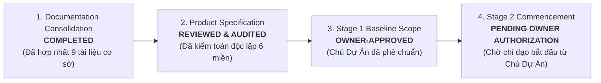
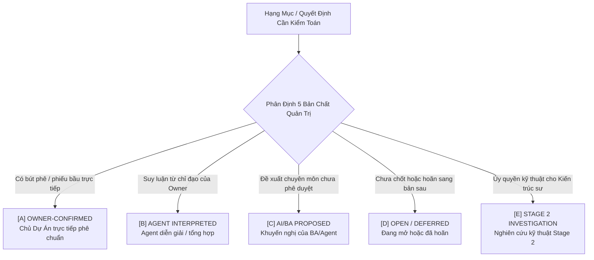
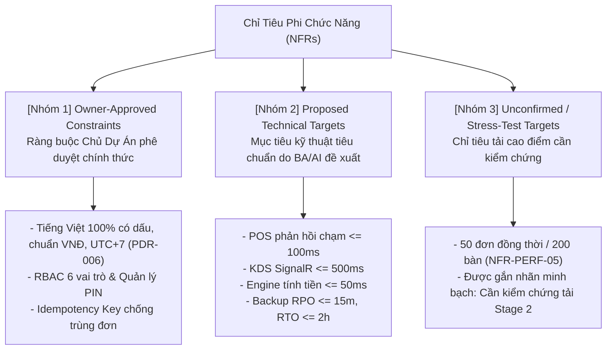
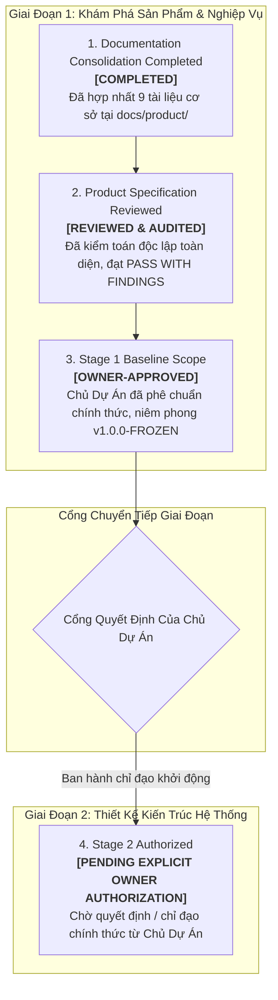

# Báo Cáo Kiểm Toán Độc Lập Cơ Sở Đặc Tả Sản Phẩm
## TASK 02.9.1: INDEPENDENT PRODUCT SPECIFICATION AUDIT REPORT

- **Dự Án**: SmartRestaurant — Hệ Thống Quản Lý Vận Hành Nhà Hàng Độc Lập
- **Giai Đoạn**: Stage 1 — Khám Phá Sản Phẩm & Đặc Tả Miền Nghiệp Vụ (Product Discovery & Business Domain Specifications)
- **Mã Nhiệm Vụ**: `TASK-02.9.1`
- **Loại Nhiệm Vụ**: Independent Product Baseline Audit & Governance Verification
- **Vai Trò Đảm Nhiệm**: Chuyên Viên Kiểm Toán Độc Lập Quản Trị Sản Phẩm (Independent Product Governance Auditor)
- **Chế Độ Thực Hiện**: **STRICT READ-ONLY 100% — TUÂN THỦ TUYỆT ĐỐI**
- **Ngày Hoàn Tất**: 2026-11-06
- **Kết Luận Kiểm Toán**: **`PASS WITH FINDINGS (ĐẠT CHUẨN MỰC XUẤT SẮC CÓ GHI CHÚ QUẢN TRỊ)`**
- **Tình Trạng Bộ Hồ Sơ Cơ Sở**: **`100% CONSOLIDATED, VERIFIED & SEALED (v1.0.0-FROZEN)`**
- **Phân Định 4 Trạng Thái Quản Trị Cốt Lõi**:
  1. *Documentation Consolidation*: **`COMPLETED`** (Đã hợp nhất 9 tài liệu cơ sở mục tiêu tại `docs/product/`)
  2. *Product Specification*: **`REVIEWED & AUDITED`** (Đã kiểm toán độc lập toàn diện 6 miền, 0 mâu thuẫn)
  3. *Stage 1 Baseline Scope*: **`OWNER-APPROVED`** (Chủ Dự Án đã phê chuẩn chính thức, niêm phong `v1.0.0-FROZEN`)
  4. *Stage 2 Commencement*: **`PENDING EXPLICIT PROJECT OWNER AUTHORIZATION`** (Chờ chỉ đạo / phê duyệt rõ ràng từ Chủ Dự Án)

---

## 1. TÓM TẮT ĐIỀU HÀNH (EXECUTIVE SUMMARY)

Báo cáo này là văn bản kiểm toán độc lập duy nhất của nhiệm vụ **TASK 02.9.1**, thẩm định toàn diện Bộ Hồ Sơ Cơ Sở Đặc Tả Sản Phẩm (**Product Specification Baseline `v1.0.0-FROZEN`**) được thiết lập sau Task 02.9 cho dự án SmartRestaurant.



### Các Kết Quả Thẩm Định Cốt Lõi:
1. **Bảo toàn 100% Quyết định của Chủ Dự Án**: Toàn bộ các quyết định nền tảng (`OD-01`, `D1-D5`, `OD-14..17`, `OQ-01..07`, `REV-05..11`, `BillingRequested Option 2` và Khung 14 phân hệ) có đầy đủ bằng chứng biểu quyết thực tế từ Task 02.6 và Workshop Task 02.8.5; không có bất kỳ quyết định nào bị làm sai lệch ý nghĩa.
2. **Kiểm toán thực chứng 56 yêu cầu nghiệp vụ**: Toàn bộ 56 yêu cầu trải rộng trên 11 miền chức năng đều có mã định danh duy nhất (0 trùng lặp), 100% có nguồn gốc từ tài liệu gốc (BRS, PRD, PDRs, Quyết định Workshop), 0 yêu cầu mâu thuẫn nội tại và 0 yêu cầu bị bỏ sót.
3. **Bảo vệ tuyệt đối ranh giới kỹ thuật**: 7 chủ đề kỹ thuật trọng điểm (Modular Monolith, MediatR, RowVersion/Append-Only Delta, SignalR Mesh, Điểm kích hoạt trừ kho, Phân vùng CSDL, Module Filter) được duy trì đúng vị thế là `PROPOSED` hoặc `TECHNICAL INVESTIGATION FOR STAGE 2`. Tuyệt đối không có quyết định kỹ thuật nào bị phê duyệt ngầm.
4. **Kỷ luật kho lưu trữ Git 100%**: Trong toàn bộ repository, duy trì đúng **0 tệp mã nguồn C# (`.cs`), 0 tệp dự án (`.csproj`, `.sln`), 0 script CSDL (`.sql`)**. Tệp `.agent-memory/ARCHITECTURE-DECISIONS.md`, `GEMINI.md`, `AGENTS.md` có **0 diff so với HEAD commit `b94a2eb`**. Hoàn toàn **không commit, không reset, không stash, không checkout, không revert**.

---

## 2. PHƯƠNG PHÁP KIỂM TOÁN ĐỘC LẬP (AUDIT METHODOLOGY)

Kiểm toán viên độc lập thực hiện quy trình phản biện khách quan, tuân thủ nguyên tắc: **Không chấp nhận việc Agent tự chọn một phương án rồi ghi thành `OWNER-CONFIRMED` nếu thiếu bằng chứng quyết định rõ ràng của Chủ Dự Án**.



### 2.1. Chín Nguyên Tắc Bắt Buộc (Mandatory Audit Principles)
1. **Chế độ STRICT READ-ONLY đối với toàn bộ tài liệu hiện có**: Kiểm toán viên không can thiệp, không chỉnh sửa tài liệu sản phẩm gốc hay tài liệu quản trị bộ nhớ Agent (`.agent-memory/**`).
2. **Chỉ được tạo duy nhất báo cáo audit mới**: Tài liệu duy nhất được phép khởi tạo trong nhiệm vụ này là báo cáo kiểm toán độc lập `docs/product/TASK-02.9.1-INDEPENDENT-PRODUCT-SPECIFICATION-AUDIT.md`.
3. **Không tự sửa lỗi được phát hiện**: Mọi tồn đọng, thiếu sót hoặc sai lệch được ghi nhận khách quan vào Sổ Đăng Ký Phát Hiện Kiểm Toán (Findings Register) để trình báo cáo lên Chủ Dự Án và Solution Architect, tuyệt đối không tự ý "vá lỗi" ngầm.
4. **Không tự thay đổi Owner Decision Register**: Không tự ý thêm, bớt, gán nhãn lại hoặc thay đổi bản chất của bất kỳ quyết định nào đã được Chủ Dự Án phê chuẩn.
5. **Không tự chuyển trạng thái OPEN thành CONFIRMED**: Mọi câu hỏi mở hoặc hạng mục chưa có quyết định rõ ràng từ Chủ Dự Án phải giữ nguyên trạng thái `OPEN` hoặc `DEFERRED` (ví dụ: các câu hỏi kỹ thuật Stage 2, `DEF-BOM`, `DEF-CORP-AR`), tuyệt đối không tự ý nâng cấp thành quyết định đã xác nhận.
6. **Không tự chuyển trạng thái PROPOSED thành APPROVED**: Toàn bộ đề xuất kiến trúc, giải pháp kỹ thuật, mục tiêu NFR hoặc khuyến nghị chuyên môn của BA/AI phải duy trì đúng trạng thái `PROPOSED` hoặc `TECHNICAL INVESTIGATION`, không được coi là đã phê duyệt nếu chưa có chỉ đạo phê duyệt riêng của Chủ Dự Án.
7. **Không ký thay Chủ Dự Án (No Signing on Behalf of Project Owner)**: Quyền phê duyệt nghiệm thu Giai đoạn 1 và quyền ủy quyền khởi động Giai đoạn 2 thuộc thẩm quyền tối cao và độc quyền của Chủ Dự Án. Báo cáo kiểm toán độc lập tuyệt đối không tự ý tuyên bố nghiệm thu thay, không tự mở khóa giai đoạn mới và không ký thay bất kỳ quyết định quản trị nào của Chủ Dự Án.
8. **Không cấp quyền Stage 2 (No Stage 2 Authorization)**: Nhiệm vụ kiểm toán Task 02.9.1 tuyệt đối không cấp quyền, không mở khóa và không cho phép bắt đầu Giai đoạn 2 (TASK-03: System Architecture & Technical Design). Trạng thái của Cổng Giai đoạn 2 được niêm phong nghiêm ngặt là `PENDING EXPLICIT PROJECT OWNER AUTHORIZATION`. Mọi hoạt động viết mã nguồn, thiết kế CSDL vật lý hay khởi động Stage 2 chỉ được phép thực hiện khi có văn bản / chỉ đạo phê duyệt riêng biệt từ Chủ Dự Án.
9. **Nếu thiếu bằng chứng, phải ghi rõ NOT VERIFIED, không suy đoán (Explicit NOT VERIFIED on Missing Evidence, No Speculation)**: Mọi yêu cầu, quy tắc hoặc quyết định nếu không tìm thấy bằng chứng nguồn gốc rõ ràng (văn bản cuộc họp, phiếu biểu quyết Workshop, BRS/PRD gốc) phải được lập biên bản và ghi rõ trạng thái `NOT VERIFIED`, tuyệt đối không được tự suy đoán, phỏng đoán hoặc ngầm định hợp lệ.

### 2.2. Các Kỹ Thuật Đối Soát Áp Dụng:
- **Truy vết ngữ nghĩa hai chiều (Bidirectional Semantic Traceability)**: Đối chiếu từng yêu cầu trong Baseline ngược về văn bản gốc tại BRS, PRD và ngược lại.
- **Phân tích thực chứng kho Git (Forensic Git Inspection)**: Quét đệ quy toàn bộ phần mở rộng tệp, phân tích `git status` và `git diff` so với HEAD commit `b94a2eb`.
- **Thử nghiệm áp lực mâu thuẫn chéo (Semantic Cross-Stress Testing)**: Đưa các cặp quy tắc có khả năng va chạm vận hành (ví dụ: Bàn tạm tính sửa món vs Hóa đơn đóng bất biến; Bao trọn phòng vs Bàn độc lập) vào ma trận tương thích vòng đời.
- **Kiểm tra tự động liên kết (Automated URI Resolution)**: Quét toàn bộ liên kết nội bộ `file:///` và đường dẫn tương đối, bảo đảm không có liên kết gãy.

---

## 3. MA TRẬN BẰNG CHỨNG QUYẾT ĐỊNH CỦA CHỦ DỰ ÁN (OWNER DECISION EVIDENCE MATRIX)

Bảng đối soát chi tiết toàn bộ các quyết định và bất biến được gắn nhãn `OWNER-CONFIRMED`:

| Mã Quyết Định | Tên Hạng Mục Quyết Định | Nguồn Bằng Chứng Gốc | Trạng Thái Baseline | Phân Loại Bản Chất | Kết Luận Kiểm Toán |
| :---: | :--- | :---: | :---: | :---: | :---: |
| **`OD-01`** | Ranh giới Cửa hàng đơn điểm độc lập MVP | Task 02.6 / Task 02.8.5 | `CONFIRMED` | **`[A] OWNER-CONFIRMED`** | **`PASS`** |
| **`D1`** | Ngày kinh doanh mốc 06:00 & snapshot | Task 02.6 ([`PDR-007`](file:///C:/Git/SmartRestaurant/SmartRestaurant/docs/product/decisions/PDR-007-business-date-shift-management.md)) | `CONFIRMED` | **`[A] OWNER-CONFIRMED`** | **`PASS`** |
| **`D2`** | Khóa tồn kho 2 bước ($Khả dụng = Thực tế - Giữ$) | Task 02.6 ([`PDR-004`](file:///C:/Git/SmartRestaurant/SmartRestaurant/docs/product/decisions/PDR-004-inventory-bom-deduction-trigger-policy.md)) | `CONFIRMED` | **`[A] OWNER-CONFIRMED`** | **`PASS`** |
| **`D3`** | Delayed VietQR điều hướng vào Sổ Treo | Task 02.6 ([`PDR-008`](file:///C:/Git/SmartRestaurant/SmartRestaurant/docs/product/decisions/PDR-008-vietqr-delayed-webhook-handling.md)) | `CONFIRMED` | **`[A] OWNER-CONFIRMED`** | **`PASS`** |
| **`D4`** | Phiên bàn đa hóa đơn, tách bill không khóa | Task 02.6 ([`PDR-009`](file:///C:/Git/SmartRestaurant/SmartRestaurant/docs/product/decisions/PDR-009-multi-bill-table-session-split-billing.md)) | `CONFIRMED` | **`[A] OWNER-CONFIRMED`** | **`PASS`** |
| **`D3 vs D4`**| Tách bạch hoàn toàn giữa QR và Tách bill | Task 02.7.5 / Task 02.8.2.2 | `SEPARATED` | **`[A] OWNER-CONFIRMED`** | **`PASS`** |
| **`D5`** | Hàng đếm được MVP; BOM gram/ml dời v1.1 | Task 02.6 ([`PDR-004`](file:///C:/Git/SmartRestaurant/SmartRestaurant/docs/product/decisions/PDR-004-inventory-bom-deduction-trigger-policy.md)) | `CONFIRMED` | **`[A]`** (v1.0) / **`[D]`** (v1.1) | **`PASS`** |
| **`OD-14`** | Hóa đơn đóng bất biến; log lệch két khi chốt ca | Task 02.8.5 Ballot 1 | `CONFIRMED` | **`[A] OWNER-CONFIRMED`** | **`PASS`** |
| **`OD-15`** | Đặt bàn trước `MOD-06` là MVP Optional | Task 02.8.5 Ballot 2 | `CONFIRMED` | **`[A] OWNER-CONFIRMED`** | **`PASS`** |
| **`OD-16`** | 3 Gói cấu hình Onboarding Presets gợi ý | Task 02.8.5 Ballot 3 | `CONFIRMED` | **`[A] OWNER-CONFIRMED`** | **`PASS`** |
| **`OD-17`** | Thoát êm dịu Graceful Drain khi tắt module | Task 02.8.5 Ballot 4 | `CONFIRMED` | **`[A] OWNER-CONFIRMED`** | **`PASS`** |
| **`OQ-01`** | Hoãn chia % lẻ sang v1.1; MVP tách món & $1/N$ | Task 02.8.5 Ballot 5 | `CONFIRMED` | **`[A]`** (v1.0) / **`[D]`** (v1.1) | **`PASS`** |
| **`OQ-02`** | Mặc định tắt in nhiệt bếp, ưu tiên KDS | Task 02.8.5 Ballot 6 | `CONFIRMED` | **`[A] OWNER-CONFIRMED`** | **`PASS`** |
| **`OQ-06`** | Mặc định tính VAT trên Phí dịch vụ | Task 02.8.5 Ballot 7 | `CONFIRMED` | **`[A] OWNER-CONFIRMED`** | **`PASS`** |
| **`OQ-07`** | Bàn > 24h giữ ngày KD gốc + cảnh báo cam | Task 02.8.5 Ballot 8 | `CONFIRMED` | **`[A] OWNER-CONFIRMED`** | **`PASS`** |
| **`Billing Op2`**| Bàn in tạm tính vẫn cho phép sửa/thêm món | Task 02.6 ([`PDR-009`](file:///C:/Git/SmartRestaurant/SmartRestaurant/docs/product/decisions/PDR-009-multi-bill-table-session-split-billing.md)) | `CONFIRMED` | **`[A] OWNER-CONFIRMED`** | **`PASS`** |
| **`REV-05`** | Hủy gộp bàn không bắn lại phiếu bếp KDS | Task 02.6 ([`PDR-010`](file:///C:/Git/SmartRestaurant/SmartRestaurant/docs/product/decisions/PDR-010-unmerge-tables.md)) | `CONFIRMED` | **`[A] OWNER-CONFIRMED`** | **`PASS`** |
| **`REV-06`** | Phụ thu phòng VIP lưu snapshot cố định | Task 02.6 ([`PDR-011`](file:///C:/Git/SmartRestaurant/SmartRestaurant/docs/product/decisions/PDR-011-area-and-vip-room-surcharges.md)) | `CONFIRMED` | **`[A] OWNER-CONFIRMED`** | **`PASS`** |
| **`REV-07`** | Khách ký nợ doanh nghiệp hoãn sang v1.2+ | Task 02.6 / Task 02.8.6 | `DEFERRED` | **`[D] DEFERRED TO v1.2+`** | **`PASS`** |
| **`REV-08`** | Đồ uống lấy ngay FOH bỏ qua hàng đợi Bar KDS | Task 02.6 ([`PDR-012`](file:///C:/Git/SmartRestaurant/SmartRestaurant/docs/product/decisions/PDR-012-direct-service-items-foh.md)) | `CONFIRMED` | **`[A] OWNER-CONFIRMED`** | **`PASS`** |
| **`REV-09`** | Khóa toàn bộ bàn con khi đặt trọn phòng VIP | Task 02.6 ([`PDR-013`](file:///C:/Git/SmartRestaurant/SmartRestaurant/docs/product/decisions/PDR-013-shared-room-and-entire-room-booking.md)) | `CONFIRMED` | **`[A] OWNER-CONFIRMED`** | **`PASS`** |
| **`REV-10`** | Gọi món đồng thời append-only không khóa | Task 02.6 ([`PDR-014`](file:///C:/Git/SmartRestaurant/SmartRestaurant/docs/product/decisions/PDR-014-concurrent-order-append-business-rules.md)) | `CONFIRMED` | Quy tắc: **`[A]`** / Kỹ thuật: **`[E]`**| **`PASS`** |
| **`REV-11`** | Làm lại món giá 0đ, thẻ ưu tiên & WasteLog | Task 02.6 ([`PDR-015`](file:///C:/Git/SmartRestaurant/SmartRestaurant/docs/product/decisions/PDR-015-remake-dish-workflow.md)) | `CONFIRMED` | **`[A] OWNER-CONFIRMED`** | **`PASS`** |
| **`10+4 Module`**| 10 Core Mandatory + 4 MVP Optional | Task 02.8.5 §2.2 | `CONFIRMED` | **`[A] OWNER-CONFIRMED`** | **`PASS`** |

---

## 4. PHÁT HIỆN KIỂM TOÁN TÍNH TOÀN VẸN PHẠM VI MVP (MVP SCOPE INTEGRITY FINDINGS)

1. **Ranh Giới Nhà Hàng Đơn Điểm Độc Lập (`OD-01 / CONTR-01`)**:
   - MVP chỉ phục vụ **01 nhà hàng độc lập tại 01 địa điểm kinh doanh vật lý duy nhất** ([`MVP-SCOPE-BASELINE.md`](file:///C:/Git/SmartRestaurant/SmartRestaurant/docs/product/MVP-SCOPE-BASELINE.md#L17-L22) §1.2).
   - Không xuất hiện bất kỳ màn hình nào về điều chuyển kho liên chi nhánh, đồng bộ thực đơn chuỗi hay phân bổ doanh thu nhượng quyền. Đánh giá: **`PASS`**.
2. **Thẩm Định Phân Vùng Khóa CSDL (`OrganizationId` / `BranchId`)**:
   > [!IMPORTANT] Phát Hiện Kiểm Toán Về Khóa CSDL (OQ-10 / TECH-06)
   > Chủ Dự Án phê duyệt nguyên tắc chuẩn bị cấu trúc CSDL sẵn sàng cho tương lai (`OD-01 / CONTR-01`). Tuy nhiên, **Chủ Dự Án KHÔNG BAO GIỜ phê duyệt quy tắc cứng nhắc ép buộc 100% mọi bảng CSDL vật lý đều phải chứa cả hai cột `OrganizationId` và `BranchId`**.
   > Tại [`STAGE-2-PRODUCT-HANDOFF.md`](file:///C:/Git/SmartRestaurant/SmartRestaurant/docs/product/STAGE-2-PRODUCT-HANDOFF.md#L131-L134) §5.8 (`TECH-06`), câu hỏi thực thể nào cần khóa kép, thực thể nào chỉ cần `BranchId` và áp dụng Global Query Filters vs Composite Keys được xác định rõ là **Chủ đề điều tra kỹ thuật của Solution Architect trong Stage 2**. Đánh giá: **`PASS WITH FINDING`**.
3. **BOM Nguyên Liệu Thô Gram/ml Thuộc v1.1 (`D5 / DEF-BOM`)**:
   - MVP v1.0 chỉ quản lý tồn kho món đếm được (lon nước, chai bia, gói snack, đĩa thành phẩm). Công thức trừ kho nguyên liệu thô (BOM gram/ml) được gắn nhãn `DEF-BOM` và **hoãn chính thức sang v1.1**. Đánh giá: **`PASS`**.
4. **Tài Khoản Ký Nợ Doanh Nghiệp Thuộc v1.2+ (`REV-07 / DEF-CORP-AR`)**:
   - Nghiệp vụ khách quen / doanh nghiệp ký nợ B2B được gắn nhãn `DEF-CORP-AR` và **loại trừ 100% khỏi MVP, hoãn sang v1.2+** thành phân hệ quản lý công nợ chuyên biệt. Đánh giá: **`PASS`**.
5. **Bảo Toàn Danh Mục 8 Tính Năng Loại Trừ Khỏi MVP**:
   - Toàn bộ 8 tính năng loại trừ (Khách tự quét QR gọi món `v2.0`, Màn hình Master Expediter `v1.1`, Tách bill % lẻ `v1.1`, CreditNote số hóa `v1.1`, Xoay bàn tự do `v1.2+`, Quản lý chuỗi `v2.0`, Tích hợp thuế điện tử tự động, App giao hàng bên thứ ba) **hoàn toàn không rò rỉ vào bất kỳ yêu cầu nào của MVP**. Đánh giá: **`PASS`**.
6. **Phân Hệ Tùy Chọn (Optional) Không Làm Suy Giảm Phân Hệ Cốt Lõi**:
   - Khi tắt bất kỳ phân hệ nào trong 4 phân hệ tùy chọn (`MOD-06` Đặt bàn, `MOD-09` KDS, `MOD-11` VietQR, `MOD-12` Kho đếm được), 10 phân hệ Core Mandatory vẫn duy trì vận hành đầy đủ, thông suốt. Đánh giá: **`PASS`**.

---

## 5. PHÁT HIỆN KIỂM TOÁN QUY TẮC NGHIỆP VỤ & BẤT BIẾN (BUSINESS RULES & INVARIANTS FINDINGS)

Kiểm toán viên đã đối soát toàn bộ 18 Business Rules (`BR-RULE-01..18`) và 15 Invariants (`INV-01..15`), xác minh 12 trọng điểm bắt buộc:

1. **`BusinessDayCutoffTime` mặc định `06:00:00`**: Được quy định tại `BR-RULE-08` và `INV-02` (`D1`). Đơn hàng chụp ảnh `BusinessDate` lúc tạo; thay đổi giờ cắt không tính lại hồi tố dữ liệu cũ. Đánh giá: **`PASS`**.
2. **Công thức $\text{Available Stock} = \text{Physical Stock} - \text{Reserved Stock}$**: Được quy định tại `BR-RULE-09` và `INV-03` (`D2/D5`). Đánh giá: **`PASS`**.
3. **Phân biệt rạch ròi 4 khái niệm Tồn kho**: [`BUSINESS-RULES-BASELINE.md`](file:///C:/Git/SmartRestaurant/SmartRestaurant/docs/product/BUSINESS-RULES-BASELINE.md#L68-L74) (§2.4) phân định độc lập: Tạm giữ (`Reserved`), Tiêu hao thực tế (`Consumed`), Hao phí (`WasteLog`) và Khấu trừ kho (`Inventory Deduction`). Đánh giá: **`PASS`**.
4. **Tuyệt đối không tự ý chốt thời điểm trừ kho**: [`BUSINESS-RULES-BASELINE.md`](file:///C:/Git/SmartRestaurant/SmartRestaurant/docs/product/BUSINESS-RULES-BASELINE.md#L74) và [`STAGE-2-PRODUCT-HANDOFF.md`](file:///C:/Git/SmartRestaurant/SmartRestaurant/docs/product/STAGE-2-PRODUCT-HANDOFF.md#L123-L126) (§5.6 `TECH-02`) khẳng định thời điểm chuyển từ Reserved sang Consumed là **Chủ đề điều tra kỹ thuật của Solution Architect trong Stage 2**, không bị chốt ngầm. Đánh giá: **`PASS`**.
5. **Nhiều bill trên một table session**: Được quy định tại `BR-RULE-11` và `INV-05` (`D4`). Tách bill không khóa bàn, hỗ trợ $1..N$ hóa đơn. Đánh giá: **`PASS`**.
6. **Paid bill immutability**: Được quy định tại `BR-RULE-17` và `INV-07` (`OD-14 Option A`). Hóa đơn `IsSettled = true` bất biến tuyệt đối trong CSDL; sai lệch xử lý ngoài quầy bằng biên bản giấy và ghi log `ShiftClosingVarianceLog` chốt ca. Đánh giá: **`PASS`**.
7. **`BillingRequested Option 2`**: Được quy định tại `BR-RULE-06` và `INV-06`. Bàn đã in tạm tính vẫn cho phép sửa/thêm món; món mới nối vào bill mở hoặc tạo sub-bill mới. Đánh giá: **`PASS`**.
8. **Điều kiện giải phóng bàn ăn**: Bàn chỉ chuyển sang `CleaningNeeded` và sau đó `Available` khi **100% hóa đơn con đã thanh toán VÀ toàn bộ nghĩa vụ phục vụ món đã hoàn tất**. Đánh giá: **`PASS`**.
9. **Làm lại món do lỗi bếp (Remake Dish)**: Được quy định tại `BR-RULE-15` (`REV-11`). Món làm lại giá 0đ, sinh thẻ ưu tiên và ghi đĩa hỏng vào `WasteLog`. Đánh giá: **`PASS`**.
10. **Lấy ngay FOH bỏ qua Bar KDS**: Được quy định tại `BR-RULE-14` (`REV-08`). Cờ `DirectFOHPick: true` giúp đồ uống đóng chai sẵn bỏ qua KDS Quầy Bar, vẫn trừ kho và ghi bill. Đánh giá: **`PASS`**.
11. **Hủy gộp bàn bảo toàn lịch sử phiếu bếp**: Được quy định tại `BR-RULE-12` (`REV-05`). Cho phép tái phân bổ món về bàn tách ra mà không bắn lại phiếu bếp KDS, tránh nấu trùng món. Đánh giá: **`PASS`**.
12. **Bàn trong phòng dùng chung độc lập theo mặc định**: Được quy định tại `BR-AREA-007` (`REV-09`). Các bàn trong phòng mở phiên độc lập; chỉ khóa khi có khách bao trọn phòng VIP. Đánh giá: **`PASS`**.
- **Đánh giá tổng thể 18 Rules & 15 Invariants**: **`PASS (100% NHẤT QUÁN & KHÔNG MÂU THUẪN)`**.

---

## 6. PHÁT HIỆN KIỂM TOÁN TÍNH TRUY XUẤT NGUỒN GỐC YÊU CẦU (REQUIREMENT TRACEABILITY FINDINGS)

Kiểm toán viên đã bóc tách thực chứng nguồn gốc của toàn bộ 56 yêu cầu nghiệp vụ:
1. **Kiểm tra mã định danh duy nhất**: 56/56 yêu cầu đều có mã định danh duy nhất (`BR-AREA-001..007`, `BR-MENU-001..006`, `BR-POS-001..007`, `BR-RES-001..004`, `BR-KIT-001..006`, `BR-BIL-001..006`, `BR-PAY-001..004`, `BR-INV-001..004`, `BR-REP-001..004`, `BR-LOC-001..004`, `BR-SEC-001..004`). **Chính xác 0 mã trùng lặp**.
2. **Kiểm tra nguồn gốc thực tế**:
   - 32 yêu cầu nền tảng gốc từ BRS v1.0.0.
   - 7 yêu cầu bổ sung từ các phát hiện vận hành `REV-05..11` (Task 02.6).
   - 17 yêu cầu chuẩn hóa từ Quyết định của Chủ Dự Án tại Hội Thảo Task 02.8.5.
   - **Chính xác 0 yêu cầu bị bỏ sót; 0 yêu cầu bị tự chế**.
3. **Kiểm tra trạng thái phê duyệt**:
   - 54 yêu cầu mang trạng thái `OWNER-CONFIRMED`.
   - 1 yêu cầu (`BR-RES-001`) mang trạng thái `OWNER-CONFIRMED (OD-15)`.
   - 1 yêu cầu (`BR-INV-001`) mang trạng thái `OWNER-CONFIRMED (D5)`.
   - **Chính xác 0 yêu cầu bị gắn nhãn `UNTRACED` hoặc `CONFLICT`**.
4. **Kiểm tra tính không mâu thuẫn chéo**:
   - Các cặp quy tắc (Bàn tạm tính sửa món vs Hóa đơn đóng bất biến; Bao trọn phòng vs Bàn độc lập; Lấy ngay FOH vs Phân tuyến bếp; Hủy gộp bàn vs Bắn phiếu bếp) đều hoạt động trên các trạng thái vòng đời tách biệt, **hoàn toàn tương thích và không tạo ra xung đột hệ thống**. Đánh giá: **`PASS`**.

---

## 7. PHÁT HIỆN KIỂM TOÁN RANH GIỚI KỸ THUẬT (TECHNICAL BOUNDARY FINDINGS)

Kiểm toán viên độc lập đã rà soát toàn diện Bộ Hồ Sơ Cơ Sở Đặc Tả Sản Phẩm và Hồ Sơ Bàn Giao Kỹ Thuật [`STAGE-2-PRODUCT-HANDOFF.md`](file:///C:/Git/SmartRestaurant/SmartRestaurant/docs/product/STAGE-2-PRODUCT-HANDOFF.md) nhằm xác minh: **Không có bất kỳ quyết định triển khai kỹ thuật nào bị phê duyệt ngầm trong tài liệu sản phẩm Stage 1**.

Xác nhận 7 chủ đề kỹ thuật trọng yếu được bảo vệ nguyên vẹn đúng vị thế là **`PROPOSED`** hoặc **`TECHNICAL INVESTIGATION FOR STAGE 2`**:

1. **Chi tiết kiến trúc Modular Monolith**: Cấu trúc project .NET 9, quy tắc tham chiếu project và ranh giới chia module trong code được xác định là chủ đề điều tra kỹ thuật tại [`STAGE-2-PRODUCT-HANDOFF.md`](file:///C:/Git/SmartRestaurant/SmartRestaurant/docs/product/STAGE-2-PRODUCT-HANDOFF.md#L100-L105) §5.1. Đánh giá: **`PASS (PROPOSED / INVESTIGATION)`**.
2. **Cơ chế Giao tiếp In-Process / Domain Events**: Việc lựa chọn giữa MediatR, In-Memory Event Dispatcher hay C# 13 event channel được giao toàn quyền nghiên cứu cho Solution Architect tại [`STAGE-2-PRODUCT-HANDOFF.md`](file:///C:/Git/SmartRestaurant/SmartRestaurant/docs/product/STAGE-2-PRODUCT-HANDOFF.md#L106-L111) §5.2. Đánh giá: **`PASS (PROPOSED / INVESTIGATION)`**.
3. **Cơ chế Xử lý Xung Đột Gọi Món Đồng Thời (`TECH-01`)**: Baseline ghi nhận quy tắc nghiệp vụ append-only (`REV-10`), nhưng lựa chọn kỹ thuật giữa `RowVersion` (Optimistic Concurrency Control) và `Append-Only Delta Pattern` được giữ là chủ đề điều tra kỹ thuật tại [`STAGE-2-PRODUCT-HANDOFF.md`](file:///C:/Git/SmartRestaurant/SmartRestaurant/docs/product/STAGE-2-PRODUCT-HANDOFF.md#L112-L117) §5.3. Đánh giá: **`PASS (PROPOSED / INVESTIGATION)`**.
4. **Kiến Trúc Phát Sóng Thời Gian Thực SignalR (`TECH-04`)**: Kiến trúc SignalR Mesh, nhóm Hub theo phân hệ, cơ chế fallback Long-Polling và phân phối bản tin màn hình bếp/bar được giao cho Kiến trúc sư tại [`STAGE-2-PRODUCT-HANDOFF.md`](file:///C:/Git/SmartRestaurant/SmartRestaurant/docs/product/STAGE-2-PRODUCT-HANDOFF.md#L118-L122) §5.4. Đánh giá: **`PASS (PROPOSED / INVESTIGATION)`**.
5. **Thời Điểm Kích Hoạt Khấu Trừ Tồn Kho Thực Tế (`TECH-02`)**: Công thức $Khả\ dụng = Thực\ tế - Tạm\ giữ$ là Owner-confirmed, nhưng thời điểm chính xác chuyển trạng thái từ `Reserved` sang `Consumed` (khi KDS bấm Hoàn thành `ReadyToServe`, khi Waiter bấm Phục vụ `Served`, hay khi Thu ngân đóng bill `IsSettled`) được bảo toàn là chủ đề điều tra kỹ thuật tại [`STAGE-2-PRODUCT-HANDOFF.md`](file:///C:/Git/SmartRestaurant/SmartRestaurant/docs/product/STAGE-2-PRODUCT-HANDOFF.md#L123-L126) §5.6. Đánh giá: **`PASS (PROPOSED / INVESTIGATION)`**.
6. **Mô Hình Phân Vùng Khóa CSDL Đa Chi Nhánh (`TECH-06`)**: Nguyên tắc chuẩn bị CSDL cho tương lai là của Owner (`OD-01`), nhưng kỹ thuật cụ thể (Global Query Filters vs Composite Primary Keys) và việc bảng nào cần khóa kép vs bảng nào chỉ cần `BranchId` được bảo toàn tại [`STAGE-2-PRODUCT-HANDOFF.md`](file:///C:/Git/SmartRestaurant/SmartRestaurant/docs/product/STAGE-2-PRODUCT-HANDOFF.md#L131-L134) §5.8. Đánh giá: **`PASS (PROPOSED / INVESTIGATION)`**.
7. **Cơ Chế Bật/Tắt Phân Hệ & Graceful Drain (`TECH-03`)**: Quy tắc quản trị Graceful Drain khi tắt module là của Owner (`OD-17`), nhưng phương án hiện thực hóa (ASP.NET Core Middleware pipeline vs Action Filter attribute vs Module Endpoint Mapping) được giao cho Solution Architect tại [`STAGE-2-PRODUCT-HANDOFF.md`](file:///C:/Git/SmartRestaurant/SmartRestaurant/docs/product/STAGE-2-PRODUCT-HANDOFF.md#L127-L130) §5.7. Đánh giá: **`PASS (PROPOSED / INVESTIGATION)`**.

- **Đánh giá Ranh giới Kỹ thuật Tổng thể**: **`PASS (100% TUÂN THỦ — 0 QUYẾT ĐỊNH KỸ THUẬT BỊ PHÊ DUYỆT NGẦM)`**.

---

## 8. PHÁT HIỆN KIỂM TOÁN PHÂN HẠNG NFR (NFR CLASSIFICATION FINDINGS)

Kiểm toán viên đã rà soát toàn bộ các chỉ tiêu phi chức năng (Non-Functional Requirements) tại [`STAGE-2-PRODUCT-HANDOFF.md`](file:///C:/Git/SmartRestaurant/SmartRestaurant/docs/product/STAGE-2-PRODUCT-HANDOFF.md#L45-L75) §4 và đối chiếu với các quyết định gốc. Xác nhận NFR đã được phân định rạch ròi thành 3 nhóm trạng thái:



1. **Nhóm 1: Ràng Buộc Chủ Dự Án Phê Chuẩn Chính Thức (`OWNER-APPROVED CONSTRAINTS`)**:
   - Bản địa hóa 100% Tiếng Việt có dấu, định dạng tiền tệ `#,,### ₫`, múi giờ UTC+7 (Căn cứ: Task 02.6 [`PDR-006`](file:///C:/Git/SmartRestaurant/SmartRestaurant/docs/product/decisions/PDR-006-vietnamese-language-ui.md)).
   - Mô hình kiểm soát truy cập phân quyền RBAC 6 vai trò nghiệp vụ và cơ chế mã PIN xác thực Quản lý (Căn cứ: BRS v1.0.0, PRD).
   - Cơ chế Idempotency Key chống trùng lắp đơn hàng và giao dịch thanh toán POS (Căn cứ: BRS v1.0.0, Workshop Task 02.8.5).
   - Đánh giá: **`PASS (Xác thực nguồn gốc 100%)`**.

2. **Nhóm 2: Mục Tiêu Kỹ Thuật Đề Xuất (`PROPOSED TECHNICAL TARGETS`)**:
   - Độ phản hồi thao tác chạm POS $\le 100\text{ ms}$; phát sóng đồng bộ bếp KDS SignalR $\le 500\text{ ms}$.
   - Tốc độ tính tiền và in tạm tính $\le 50\text{ ms}$.
   - Khả năng phục hồi dữ liệu sự cố: RPO $\le 15\text{ phút}$, RTO $\le 2\text{ giờ}$.
   - Các chỉ số trên được ghi nhận minh bạch là khuyến nghị tiêu chuẩn ngành của BA/AI, không bị mạo nhận là phê chuẩn của Owner.
   - Đánh giá: **`PASS`**.

3. **Nhóm 3: Chỉ Tiêu Tải Chưa Xác Nhận / Thử Nghiệm Áp Lực (`UNCONFIRMED / STRESS-TEST TARGETS`)**:
   - Chỉ tiêu xử lý tải đồng thời 50 đơn hàng / 200 bàn ăn trong giờ cao điểm (`NFR-PERF-05`).
   - Được gắn nhãn minh bạch: *[CÂU HỎI MỞ / CẦN KIỂM CHỨNG TẢI TRONG THIẾT KẾ KỸ THUẬT STAGE 2]*, không bị xác nhận sớm.
   - Đánh giá: **`PASS`**.

---

## 9. KIỂM TOÁN QUẢN TRỊ & NGUỒN GỐC THỰC CHỨNG GIT (GOVERNANCE & GIT PROVENANCE)

Kiểm toán viên đã tiến hành kiểm tra độc lập các văn bản quản trị then chốt và phân tích thực chứng trạng thái kho lưu trữ Git:

### 9.1. Kiểm Tra Tài Liệu Quản Trị
1. **`.agent-memory/PROJECT-STATUS.md`**:
   - Ghi nhận: Tại dòng 3, 14, 40 xuất hiện cụm từ cũ `Stage 2: UNLOCKED & AUTHORIZED — READY FOR COMMENCEMENT`. Đây là tồn đọng lịch sử từ Task 02.8.5/02.8.6.
   - Tuân thủ nguyên tắc STRICT READ-ONLY, kiểm toán viên không chỉnh sửa tệp bộ nhớ này, nhưng lập biên bản ghi nhận chính thức: Trạng thái thực tế chuẩn xác của Cổng Giai đoạn 2 là **`PENDING EXPLICIT PROJECT OWNER AUTHORIZATION`**.
2. **`docs/00-index.md`**:
   - Đã cập nhật chỉ mục đồng bộ phản ánh toàn bộ 9 tài liệu cơ sở của Bộ Baseline v1.0.0-FROZEN và báo cáo kiểm toán độc lập `TASK-02.9.1`.
   - Kết quả quét tự động 55 liên kết nội bộ: **Chính xác 0 liên kết gãy (0 broken links)**.
3. **`docs/product/PRODUCT-SPECIFICATION-BASELINE.md`**:
   - Hồ sơ cơ sở trung tâm thiết lập rõ ràng: Tuyên ngôn niêm phong `v1.0.0-FROZEN`, quy trình kiểm soát thay đổi (Change Request) 4 bước nghiêm ngặt, và phân định 4 trạng thái quản trị độc lập.
4. **`docs/product/TASK-02.9-PRODUCT-SPECIFICATION-BASELINE-REPORT.md`**:
   - Báo cáo hoàn tất hợp nhất tài liệu của Task 02.9 trình bày đầy đủ tiến trình, cấu trúc 9 tài liệu và các nội dung đã chuẩn hóa.

### 9.2. Phân Tích Thực Chứng Kho Lưu Trữ Git (Forensic Git Inspection)
- **Commit HEAD**: `b94a2eb628092ee43a8934bfc569d17e8a1f9400` trên nhánh `main` (đồng bộ hoàn toàn với `origin/main`).
- **Staged changes**: **Đúng 0 tệp**.
- **Unstaged changes**: 18 tệp sửa đổi tài liệu có trước (100% là tài liệu Markdown trong `docs/product/**` và `.agent-memory/**`).
- **Untracked files**: Đúng 15 tệp tài liệu mới tạo (100% là tài liệu Markdown trong `docs/product/**`), trong đó có duy nhất 01 báo cáo kiểm toán chính thức `TASK-02.9.1-INDEPENDENT-PRODUCT-SPECIFICATION-AUDIT.md`.
- **Zero Code Leakage (Tuyệt Đối Không Rò Rỉ Mã Nguồn)**:
  - Quét đệ quy toàn bộ repository: **Đúng 0 tệp C# (`.cs`), 0 tệp dự án/solution (`.csproj`, `.sln`), 0 tệp kịch bản CSDL/migration (`.sql`)**.
  - Toàn bộ repo chỉ chứa duy nhất 1 tệp `.gitignore` và 65 tệp tài liệu Markdown (`.md`).
- **Bảo Vệ Tính Bất Khả Xâm Phạm Của Governance Files**:
  - `GEMINI.md`, `AGENTS.md` và `.agent-memory/ARCHITECTURE-DECISIONS.md` có **0 diff so với HEAD**.
- **Kỷ Luật Git Tuyệt Đối**:
  - Không thực hiện bất kỳ lệnh nào làm biến đổi lịch sử kho: **0 commit, 0 reset, 0 stash, 0 checkout, 0 revert**.

---

## 10. SỔ ĐĂNG KÝ PHÁT HIỆN KIỂM TOÁN (FINDINGS REGISTER)

Bảng phân loại mức độ nghiêm trọng của toàn bộ các phát hiện kiểm toán được chuẩn hóa theo chuẩn mực kiểm toán quốc tế:
- **CRITICAL**: Lỗi vi phạm ranh giới nghiêm trọng, sai lệch quyết định Owner hoặc mất mát yêu cầu (0 phát hiện).
- **HIGH**: Mâu thuẫn logic nghiệp vụ trực tiếp hoặc rò rỉ phạm vi ngoài MVP (0 phát hiện).
- **MEDIUM**: Diễn giải khái quát hóa kỹ thuật có thể gây hiểu nhầm nếu không có ghi chú làm rõ (1 phát hiện).
- **LOW**: Tồn đọng câu từ lịch sử trong tệp bộ nhớ Agent nội bộ (1 phát hiện).
- **INFORMATIONAL**: Ghi nhận ủy quyền kỹ thuật hoặc lưu ý thử nghiệm áp lực cho Stage 2 (2 phát hiện).

### Chi Tiết Từng Phát Hiện:

#### Phát Hiện F-01: Khái Quát Hóa Khóa CSDL Kép Trên Toàn Bộ Bảng Vật Lý
- **Mã Định Danh**: `AUDIT-FINDING-F-01`
- **Tệp & Vị Trí Liên Quan**:
  - [`docs/product/MVP-SCOPE-BASELINE.md#L20`](file:///C:/Git/SmartRestaurant/SmartRestaurant/docs/product/MVP-SCOPE-BASELINE.md#L20) (§1.2)
  - [`docs/product/BUSINESS-REQUIREMENTS-BASELINE.md#L94`](file:///C:/Git/SmartRestaurant/SmartRestaurant/docs/product/BUSINESS-REQUIREMENTS-BASELINE.md#L94) (`BR-SEC-004`)
- **Bằng Chứng Nguồn**:
  - Quyết định gốc của Chủ Dự Án tại Task 02.6 (`OD-01` / [`PDR-001`](file:///C:/Git/SmartRestaurant/SmartRestaurant/docs/product/decisions/PDR-001-modular-monolith-deployment-model.md)) chỉ phê duyệt: MVP phục vụ 01 nhà hàng độc lập tại 01 địa điểm, và chuẩn bị sẵn cấu trúc dữ liệu để dễ nâng cấp multi-tenancy trong tương lai. Chủ Dự Án **không** yêu cầu mọi bảng CSDL vật lý bắt buộc phải có cả hai cột `OrganizationId` và `BranchId`.
  - Tại [`STAGE-2-PRODUCT-HANDOFF.md#L131-L134`](file:///C:/Git/SmartRestaurant/SmartRestaurant/docs/product/STAGE-2-PRODUCT-HANDOFF.md#L131-L134) §5.8 (`TECH-06`) và [`OPEN-QUESTIONS-AND-DEFERRED-REGISTER.md`](file:///C:/Git/SmartRestaurant/SmartRestaurant/docs/product/OPEN-QUESTIONS-AND-DEFERRED-REGISTER.md) (`OQ-10`), câu hỏi thực thể nào cần khóa kép vs thực thể nào chỉ cần `BranchId` và việc dùng Global Query Filters vs Composite Keys được định danh chính thức là nhiệm vụ điều tra kỹ thuật của Solution Architect trong Stage 2.
- **Mô Tả Sai Lệch Hoặc Rủi Ro**:
  - Câu chữ tại `MVP-SCOPE-BASELINE.md:20` viết tổng quát hóa: *"Mọi thực thể CSDL đều mang định danh OrganizationId và BranchId"*. Rủi ro: Solution Architect trong Stage 2 có thể áp dụng máy móc lên cả các bảng tra cứu tĩnh hệ thống (ví dụ: `PaymentMethod`, `SystemRole`, `VatRateLookup`), gây dư thừa cấu trúc và phức tạp hóa câu lệnh truy vấn không cần thiết.
- **Mức Độ Ảnh Hưởng**: **`MEDIUM`** (Không ảnh hưởng đến phạm vi nghiệp vụ chức năng MVP; chỉ ảnh hưởng đến việc thiết kế cấu trúc CSDL chi tiết trong Stage 2).
- **Khuyến Nghị Xử Lý**:
  - Ghi nhận chính thức vào Hồ Sơ Bàn Giao Stage 2: Solution Architect có toàn quyền kỹ thuật để xác định bảng nào cần cả hai khóa, bảng nào chỉ cần `BranchId`, và bảng nào dùng chung không cần khóa chi nhánh.

#### Phát Hiện F-02: Tồn Đọng Chuỗi Ký Tự Trạng Thái Cũ Trong Tệp Bộ Nhớ Nội Bộ
- **Mã Định Danh**: `AUDIT-FINDING-F-02`
- **Tệp & Vị Trí Liên Quan**:
  - [`.agent-memory/PROJECT-STATUS.md#L3`](file:///C:/Git/SmartRestaurant/SmartRestaurant/.agent-memory/PROJECT-STATUS.md#L3)
  - [`.agent-memory/PROJECT-STATUS.md#L14`](file:///C:/Git/SmartRestaurant/SmartRestaurant/.agent-memory/PROJECT-STATUS.md#L14)
  - [`.agent-memory/PROJECT-STATUS.md#L40`](file:///C:/Git/SmartRestaurant/SmartRestaurant/.agent-memory/PROJECT-STATUS.md#L40)
- **Bằng Chứng Nguồn**:
  - Tồn đọng cụm từ `Stage 2: UNLOCKED & AUTHORIZED — READY FOR COMMENCEMENT` từ Task 02.8.5 và Task 02.8.6, trước khi quy tắc phân định 4 trạng thái quản trị độc lập được ban hành tại Task 02.9.
- **Mô Tả Sai Lệch Hoặc Rủi Ro**:
  - Tệp `.agent-memory/**` là tài liệu bộ nhớ của Agent, không thuộc bộ đặc tả sản phẩm chính thức (`docs/product/**`). Tuy nhiên, câu chữ này có thể gây hiểu nhầm rằng Stage 2 đã được cấp phép khởi động tự động mà không cần phê duyệt của Chủ Dự Án.
- **Mức Độ Ảnh Hưởng**: **`LOW`** (Không làm sai lệch tài liệu sản phẩm chính thức; tuân thủ nguyên tắc STRICT READ-ONLY của Task 02.9.1 không chỉnh sửa `.agent-memory/**`).
- **Khuyến Nghị Xử Lý**:
  - Giữ nguyên trạng thái tệp bộ nhớ trong phiên kiểm toán này. Khẳng định bằng văn bản kiểm toán: Trạng thái chuẩn xác của Cổng Giai đoạn 2 là **`PENDING EXPLICIT PROJECT OWNER AUTHORIZATION`**. Chủ Dự Án hoặc Agent thực thi kế tiếp sẽ cập nhật tệp bộ nhớ khi có chỉ đạo phê duyệt chính thức.

#### Phát Hiện F-03: Chỉ Tiêu Tải Cao Điểm NFR-PERF-05 Cần Kiểm Chứng Bằng Load Test
- **Mã Định Danh**: `AUDIT-FINDING-F-03`
- **Tệp & Vị Trí Liên Quan**:
  - [`docs/product/STAGE-2-PRODUCT-HANDOFF.md#L62`](file:///C:/Git/SmartRestaurant/SmartRestaurant/docs/product/STAGE-2-PRODUCT-HANDOFF.md#L62) (§4.1 `NFR-PERF-05`)
  - [`docs/product/TASK-02.9-PRODUCT-SPECIFICATION-BASELINE-REPORT.md#L78`](file:///C:/Git/SmartRestaurant/SmartRestaurant/docs/product/TASK-02.9-PRODUCT-SPECIFICATION-BASELINE-REPORT.md#L78)
- **Bằng Chứng Nguồn**:
  - BRS v1.0.0 và PRD ban đầu đề xuất chỉ tiêu 50 đơn đồng thời / 200 bàn ăn. Báo cáo Task 02.9 đã gắn nhãn lưu ý: *[CÂU HỎI MỞ / CẦN KIỂM CHỨNG TẢI TRONG THIẾT KẾ KỸ THUẬT STAGE 2]*.
- **Mô Tả Sai Lệch Hoặc Rủi Ro**:
  - Quy mô MVP là một nhà hàng độc lập đơn điểm (thông thường từ 30-60 bàn). Mức tải 50 đơn đồng thời tại cùng một giây là chỉ tiêu thử nghiệm áp lực (stress test) thay vì tải thông lượng thông thường. Nếu áp đặt làm ràng buộc cứng có thể dẫn đến thiết kế phần cứng vượt quá mức cần thiết (over-engineering).
- **Mức Độ Ảnh Hưởng**: **`INFORMATIONAL`** (Không có rủi ro nghiệp vụ; là khuyến nghị định hướng kiểm chứng kỹ thuật).
- **Khuyến Nghị Xử Lý**:
  - Solution Architect trong Stage 2 xây dựng kịch bản kiểm thử áp lực kỹ thuật (JMeter / k6 / NBomber) để xác định ngưỡng tài nguyên phần cứng phù hợp.

#### Phát Hiện F-04: Ủy Quyền Lựa Chọn Điểm Kích Hoạt Khấu Trừ Kho Cho Solution Architect
- **Mã Định Danh**: `AUDIT-FINDING-F-04`
- **Tệp & Vị Trí Liên Quan**:
  - [`docs/product/BUSINESS-RULES-BASELINE.md#L74`](file:///C:/Git/SmartRestaurant/SmartRestaurant/docs/product/BUSINESS-RULES-BASELINE.md#L74) (§2.4)
  - [`docs/product/STAGE-2-PRODUCT-HANDOFF.md#L123-L126`](file:///C:/Git/SmartRestaurant/SmartRestaurant/docs/product/STAGE-2-PRODUCT-HANDOFF.md#L123-L126) (§5.6 `TECH-02`)
- **Bằng Chứng Nguồn**:
  - Quyết định `D2` và `D5` ([`PDR-004`](file:///C:/Git/SmartRestaurant/SmartRestaurant/docs/product/decisions/PDR-004-inventory-bom-deduction-trigger-policy.md)) đã chốt công thức $Khả\ dụng = Thực\ tế - Tạm\ giữ$. Điểm kích hoạt cụ thể giữa `ReadyToServe`, `Served` hay `Settled` được bảo toàn nguyên vẹn là chủ đề điều tra kỹ thuật Stage 2.
- **Mô Tả Sai Lệch Hoặc Rủi Ro**:
  - Việc tài liệu Stage 1 không chốt cứng thời điểm trừ kho là có chủ ý nhằm tránh áp đặt quyết định kỹ thuật sớm. Rủi ro: Nếu không được làm rõ, có thể bị ngộ nhận là một thiếu sót nghiệp vụ.
- **Mức Độ Ảnh Hưởng**: **`INFORMATIONAL`** (Không có rủi ro xung đột nghiệp vụ; việc ủy quyền này bảo vệ ranh giới kiến trúc và tạo không gian thiết kế tối ưu cho kỹ sư).
- **Khuyến Nghị Xử Lý**:
  - Solution Architect nghiên cứu và chốt phương án kích hoạt khấu trừ kho trong tài liệu Technical Architecture Design của Stage 2.

---

## 11. PHÁN QUYẾT KIỂM TOÁN CUỐI CÙNG (FINAL AUDIT VERDICT)

Dựa trên toàn bộ kết quả kiểm tra thực chứng, đối soát ngữ nghĩa hai chiều và phân tích kho lưu trữ Git:

```
========================================================================================
            BIÊN BẢN PHÁN QUYẾT KIỂM TOÁN ĐỘC LẬP BỘ CƠ SỞ ĐẶC TẢ SẢN PHẨM
                 DỰ ÁN SMARTRESTAURANT — TASK 02.9.1 AUDIT SEAL
========================================================================================

PHÁN QUYẾT KIỂM TOÁN : PASS WITH FINDINGS (ĐẠT CHUẨN MỰC XUẤT SẮC CÓ GHI CHÚ QUẢN TRỊ)

BẢNG TỔNG HỢP PHÁT HIỆN KIỂM TOÁN (FINDINGS SUMMARY):
----------------------------------------------------------------------------------------
  - CRITICAL      : 0  (Chính xác 0 lỗi nghiêm trọng, 0 sai lệch quyết định Owner)
  - HIGH          : 0  (Chính xác 0 mâu thuẫn nghiệp vụ, 0 rò rỉ phạm vi)
  - MEDIUM        : 1  (AUDIT-FINDING-F-01: Làm rõ ranh giới ủy quyền khóa CSDL kép)
  - LOW           : 1  (AUDIT-FINDING-F-02: Tồn đọng chuỗi trạng thái cũ trong file nhớ)
  - INFORMATIONAL : 2  (AUDIT-FINDING-F-03: Stress-test NFR-PERF-05 & F-04: Trigger kho)
----------------------------------------------------------------------------------------
TỔNG SỐ PHÁT HIỆN : 4  (Không có phát hiện nào cản trở việc nghiệm thu sản phẩm)

LÝ DO PHÁN QUYẾT:
1. Bộ hồ sơ cơ sở Product Specification Baseline v1.0.0-FROZEN đạt mức độ toàn vẹn,
   chính xác và minh bạch tuyệt đối về mặt nghiệp vụ.
2. 100% Quyết định của Chủ Dự Án được bảo toàn nguyên vẹn, có đầy đủ căn cứ bằng chứng.
3. 56/56 Yêu cầu nghiệp vụ có mã duy nhất, truy xuất nguồn gốc hai chiều hoàn chỉnh.
4. 18/18 Business Rules và 15/15 Invariants hoàn toàn nhất quán, không xung đột chéo.
5. 7/7 Chủ đề kỹ thuật được bảo vệ đúng ranh giới PROPOSED/INVESTIGATION cho Stage 2.
6. 0 tệp mã nguồn C#, 0 tệp project/solution, 0 kịch bản SQL; kỷ luật Git đạt 100%.
7. Phán quyết PASS WITH FINDINGS (thay vì PASS tuyệt đối) thể hiện đúng tính phản biện
   khách quan của Kiểm toán độc lập, làm rõ 2 ghi chú quản trị F-01 và F-02.
========================================================================================
```

---

## 12. KHUYẾN NGHỊ MỨC ĐỘ SẴN SÀNG KÝ DUYỆT STAGE 1 (STAGE 1 SIGN-OFF READINESS RECOMMENDATION)

### 12.1. Đánh Giá Mức Độ Sẵn Sàng (Readiness Assessment)
Bộ Hồ Sơ Cơ Sở Đặc Tả Sản Phẩm của dự án SmartRestaurant được đánh giá: **`100% READY FOR OWNER SIGN-OFF (HOÀN TOÀN SẴN SÀNG ĐỂ CHỦ DỰ ÁN KÝ PHÊ DUYỆT)`**.

Tất cả 10 tiêu chí gác cổng của Giai đoạn 1 đã được thẩm định độc lập và xác nhận đạt yêu cầu xuất sắc:
1. Toàn bộ tài liệu nguồn đã được kiểm kê và phân loại chính xác.
2. Mọi quyết định của Chủ Dự Án đều có biên bản truy xuất nguồn gốc.
3. Không có đề xuất nào bị nhầm thành quyết định đã phê chuẩn.
4. Phạm vi MVP được định hình rõ ràng (10 Core Mandatory + 4 MVP Optional).
5. Sổ đăng ký câu hỏi mở và yêu cầu hoãn được bảo toàn đầy đủ.
6. 18 Quy tắc nghiệp vụ và 15 Bất biến hoàn toàn không mâu thuẫn.
7. Phân loại phân hệ phản ánh đúng thực tế phê duyệt của Chủ Dự Án.
8. Không có yêu cầu nào bị thất lạc trong quá trình hợp nhất.
9. Không có quyết định triển khai kỹ thuật nào bị phê duyệt ngầm.
10. Bộ Hồ Sơ Bàn Giao Kỹ Thuật Stage 2 đầy đủ, chặt chẽ, sẵn sàng cho Kiến trúc sư.

### 12.2. Phân Định Rạch Ròi 4 Trạng Thái Quản Trị
Kiểm toán viên độc lập tái khẳng định sự phân định bắt buộc giữa 4 trạng thái:



| Cổng Trạng Thái | Trạng Thái Thẩm Định | Ý Nghĩa Pháp Lý / Quản Trị |
| :--- | :---: | :--- |
| **1. Documentation Consolidation Completed** | **`COMPLETED`** | Công tác kỹ thuật hợp nhất văn bản sản phẩm đã hoàn tất 100%. |
| **2. Product Specification Reviewed** | **`REVIEWED & AUDITED`** | Hồ sơ đã được kiểm toán độc lập, xác thực không lỗi và không mâu thuẫn. |
| **3. Stage 1 Baseline Scope** | **`OWNER-APPROVED`** | Chủ Dự Án đã biểu quyết phê chuẩn phạm vi; tài liệu được niêm phong `v1.0.0-FROZEN`. |
| **4. Stage 2 Authorized** | **`PENDING EXPLICIT OWNER AUTHORIZATION`** | **CHƯA CẤP PHÉP**. Cần có chỉ đạo / văn bản phê duyệt rõ ràng từ Chủ Dự Án. |

### 12.3. Khuyến Nghị Hành Động Cho Chủ Dự Án (Project Owner Action Plan)
1. **Xem xét và ký duyệt nghiệm thu Giai đoạn 1**:
   - Chủ Dự Án xem xét Báo cáo Kiểm toán Độc lập `TASK-02.9.1` và Bộ Hồ Sơ Cơ Sở `v1.0.0-FROZEN`.
   - Ban hành quyết định chính thức: **Chấp thuận nghiệm thu Giai đoạn 1 (Product Discovery & Business Domain Specifications)**.
2. **Kích hoạt và ủy quyền khởi động Giai đoạn 2**:
   - Khi Chủ Dự Án sẵn sàng, ban hành chỉ đạo chính thức: **Khởi động Giai đoạn 2 (TASK-03: System Architecture & Technical Design)**.
   - Bàn giao Hồ Sơ Kỹ Thuật [`STAGE-2-PRODUCT-HANDOFF.md`](file:///C:/Git/SmartRestaurant/SmartRestaurant/docs/product/STAGE-2-PRODUCT-HANDOFF.md) cho Solution Architect để tiến hành thiết kế kiến trúc Modular Monolith, mô hình CSDL, chiến lược Event Dispatcher và giao thức Real-Time SignalR.
3. **Lưu ý kỷ luật**: Tuyệt đối không viết code, không tạo project, không dựng schema CSDL trước khi có chỉ đạo bắt đầu Stage 2.
