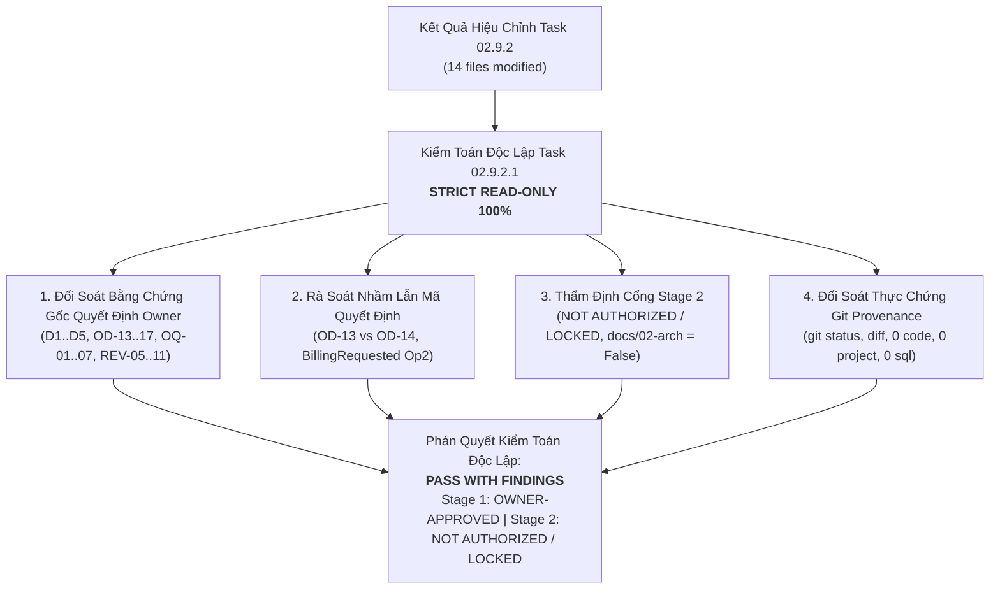
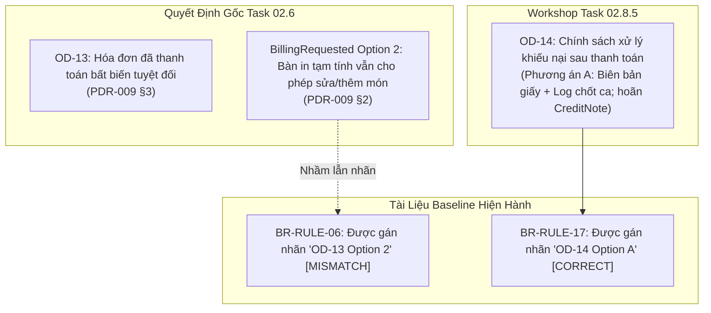
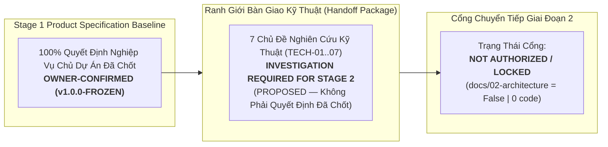

# Báo Cáo Kiểm Toán Độc Lập Tính Toàn Vẹn Quản Trị
## TASK 02.9.2.1: INDEPENDENT GOVERNANCE INTEGRITY AUDIT REPORT

- **Dự Án**: SmartRestaurant — Hệ Thống Quản Lý Vận Hành Nhà Hàng Độc Lập
- **Giai Đoạn**: Stage 1 — Khám Phá Sản Phẩm & Đặc Tả Miền Nghiệp Vụ (Product Discovery & Business Domain Specifications)
- **Mã Nhiệm Vụ**: `TASK-02.9.2.1`
- **Loại Nhiệm Vụ**: Independent Governance Integrity Audit & Post-Resolution Verification
- **Vai Trò Thực Hiện**: Chuyên Viên Kiểm Toán Độc Lập Quản Trị Sản Phẩm (Senior Independent Governance Auditor)
- **Chế Độ Thực Hiện**: **STRICT READ-ONLY 100% — TUÂN THỦ TUYỆT ĐỐI**
- **Ngày Hoàn Tất**: 2026-11-06
- **Quyết Định Nền Tảng Của Chủ Dự Án**:
  > *"Phê duyệt nghiệm thu Stage 1 với các finding được ghi nhận và theo dõi. Đây không phải là ủy quyền bắt đầu Stage 2."*
- **Phán Quyết Kiểm Toán**: **`PASS WITH FINDINGS (ĐẠT CHUẨN MỰC XUẤT SẮC CÓ GHI CHÚ QUẢN TRỊ)`**
- **Trạng Thái Bộ Hồ Sơ Cơ Sở**: **`v1.0.0-FROZEN (OFFICIALLY SIGNED OFF & SEALED BY PROJECT OWNER)`**
- **Trạng Thái Cổng Chuyển Tiếp Giai Đoạn 2**: **`NOT AUTHORIZED / LOCKED (NGHIÊM CẤM TỰ Ý KHỞI ĐỘNG)`**

---

## A. EXECUTIVE SUMMARY (TÓM TẮT ĐIỀU HÀNH)

Báo cáo này là văn bản kiểm toán độc lập duy nhất của nhiệm vụ **TASK 02.9.2.1**, thực hiện quy trình kiểm toán khách quan, phản biện độc lập và thực chứng pháp y (empirical forensic audit) đối với toàn bộ kết quả xử lý finding của nhiệm vụ **TASK 02.9.2** ([`TASK-02.9.2-GOVERNANCE-FINDING-RESOLUTION-REPORT.md`](file:///C:/Git/SmartRestaurant/SmartRestaurant/docs/product/TASK-02.9.2-GOVERNANCE-FINDING-RESOLUTION-REPORT.md)), căn cứ trên các biên bản gốc của Hội Thảo Quyết Định Chủ Dự Án Task 02.8.5 và Báo Cáo Triển Khai Task 02.8.6.



### Các Kết Luận Kiểm Toán Cốt Lõi:
1. **Bảo Toàn Quyết Định Của Chủ Dự Án (Owner Decision Integrity)**: Toàn bộ 23 quyết định nền tảng (`OD-01`, `D1..D5`, `OD-14..17`, `OQ-01..07`, `REV-05..11`, Khung 14 Phân hệ) đều có bằng chứng gốc tại Task 02.6, Workshop Task 02.8.5 và Task 02.8.6; 100% không bị thay đổi, bóp méo hoặc hạ cấp ngoài phạm vi cho phép.
2. **Xác Định Rõ Bản Chất Các Finding Đã Xử Lý**:
   - `F-01` (Medium): Xử lý hoàn hảo. Không còn bất kỳ câu chữ nào ép buộc mọi entity CSDL phải có cả hai trường `OrganizationId` và `BranchId`. CSDL sẵn sàng mở rộng (`OD-01`); việc phân vùng theo entity được giao đúng ranh giới đánh giá kỹ thuật của Solution Architect ở Stage 2 (`TECH-06`).
   - `F-02` (Low): Xử lý triệt để. Toàn bộ chuỗi "Stage 2 UNLOCKED" đã bị xóa bỏ; xác lập chính xác: `Stage 1 = OWNER-APPROVED`, `Stage 2 = NOT AUTHORIZED / LOCKED`.
   - `F-03` (Informational): Chuẩn hóa chính xác. Chỉ tiêu `NFR-PERF-05` (50 đơn / 200 bàn) được xác định là mục tiêu thử nghiệm áp lực (Stress-test target / benchmark) cho Stage 2 (`TECH-07`), không bị mạo nhận là SLA của Owner.
   - `F-04` (Informational): Phân định minh bạch. Bất biến $Khả\ dụng = Thực\ tế - Tạm\ giữ$ (`D2`) và món đếm được (`D5`) được giữ nguyên; thời điểm kích hoạt chuyển Reserved sang Consumed được duy trì ở trạng thái `OPEN / TECHNICAL INVESTIGATION` (`TECH-02`); không tự ý chốt KDS ReadyToServe là trigger.
3. **Phát Hiện Về Tham Chiếu Mã Quyết Định (Decision ID Mismatch Finding)**:
   - Phát hiện 1 ghi chú quản trị mức độ `LOW`: Có sự dùng lẫn lộn giữa mã `OD-13` (bất biến hóa đơn đã đóng từ Task 02.6) và `OD-14` (chính sách giải quyết khiếu nại/hoàn tiền hóa đơn đã đóng từ Workshop Task 02.8.5), cũng như việc gắn nhãn `OD-13 Option 2` cho quy tắc `BR-RULE-06` (vốn là `PDR-009 / BillingRequested Option 2`).
4. **Bảo Vệ Tuyệt Đối Ranh Giới Kỹ Thuật & Khóa Cổng Stage 2**:
   - Khẳng định 7 chủ đề kỹ thuật `TECH-01..07` (SignalR Mesh, Long-Polling, LocalStorage reconciliation, MediatR, Middleware, Action Filter, Global Query Filters, Composite Keys) hoàn toàn là **chủ đề bàn giao để SA điều tra**, KHÔNG PHẢI là quyết định kỹ thuật đã được Owner phê duyệt.
   - Thư mục `docs/02-architecture/` hoàn toàn **chưa tồn tại (`False`)**.
   - Cổng Giai đoạn 2 được khóa chặt chẽ: **`NOT AUTHORIZED / LOCKED`**.
5. **Kỷ Luật Kho Lưu Trữ Git 100%**:
   - Quét đệ quy toàn bộ repository: **Đúng 0 tệp C# (`.cs`), 0 tệp project/solution (`.csproj`, `.sln`), 0 script SQL / EF Migration (`.sql`)**.
   - Tệp `.agent-memory/ARCHITECTURE-DECISIONS.md`, `GEMINI.md`, `AGENTS.md` có **0 diff so với HEAD commit `b94a2eb`**.
   - Quét tự động liên kết Markdown: **56/56 liên kết hợp lệ, đúng 0 liên kết gãy**.

---

## B. OWNER DECISION INTEGRITY MATRIX (MA TRẬN KIỂM TOÁN TÍNH TOÀN VẸN QUYẾT ĐỊNH CỦA CHỦ DỰ ÁN)

Bảng đối soát thực chứng toàn bộ các quyết định nghiệp vụ, đối chiếu trực tiếp về tài liệu bằng chứng gốc, phân loại bản chất và kết luận kiểm toán:

| Mã Quyết Định | Nội Dung Quyết Định | Nguồn Bằng Chứng Gốc | Trạng Thái Trong Baseline | Phân Loại Bản Chất | Kết Luận Kiểm Toán |
| :---: | :--- | :--- | :---: | :---: | :---: |
| **`OD-01`** | Giới hạn MVP cho 01 nhà hàng độc lập tại 01 địa điểm duy nhất (`CONTR-01`). | Task 02.6 / Workshop Task 02.8.5 | `CONFIRMED` | **`[A] OWNER-CONFIRMED`** | **`PASS`** (Bảo toàn 100%) |
| **`D1`** | Ngày kinh doanh mốc cắt mặc định 06:00:00; snapshot lúc tạo đơn. | Task 02.6 ([`PDR-007`](file:///C:/Git/SmartRestaurant/SmartRestaurant/docs/product/decisions/PDR-007-business-date-shift-management.md)) | `CONFIRMED` | **`[A] OWNER-CONFIRMED`** | **`PASS`** (Bảo toàn 100%) |
| **`D2`** | Khóa tồn kho 2 bước: $\text{Tồn khả dụng} = \text{Tồn thực tế} - \text{Tạm giữ}$. | Task 02.6 ([`PDR-004`](file:///C:/Git/SmartRestaurant/SmartRestaurant/docs/product/decisions/PDR-004-inventory-bom-deduction-trigger-policy.md)) | `CONFIRMED` | **`[A] OWNER-CONFIRMED`** | **`PASS`** (Bảo toàn 100%) |
| **`D3`** | Delayed VietQR điều hướng vào Sổ Treo (`SuspenseLedger`), không ghi đè két. | Task 02.6 ([`PDR-008`](file:///C:/Git/SmartRestaurant/SmartRestaurant/docs/product/decisions/PDR-008-vietqr-delayed-webhook-handling.md)) | `CONFIRMED` | **`[A] OWNER-CONFIRMED`** | **`PASS`** (Bảo toàn 100%) |
| **`D4`** | Phiên bàn đa hóa đơn, tách bill không khóa bàn, hỗ trợ $1..N$ hóa đơn. | Task 02.6 ([`PDR-009`](file:///C:/Git/SmartRestaurant/SmartRestaurant/docs/product/decisions/PDR-009-multi-bill-table-session-split-billing.md)) | `CONFIRMED` | **`[A] OWNER-CONFIRMED`** | **`PASS`** (Bảo toàn 100%) |
| **`D5`** | Quản lý tồn kho hàng đếm được trong MVP; hoãn BOM gram/ml sang v1.1. | Task 02.6 ([`PDR-004`](file:///C:/Git/SmartRestaurant/SmartRestaurant/docs/product/decisions/PDR-004-inventory-bom-deduction-trigger-policy.md)) | `CONFIRMED` | **`[A]`** (v1.0) / **`[D]`** (v1.1) | **`PASS`** (Bảo toàn 100%) |
| **`OD-13`** | Hóa đơn đã thanh toán (`IsSettled = true`) là bất biến tuyệt đối trong CSDL. | Task 02.6 / [`PDR-009`](file:///C:/Git/SmartRestaurant/SmartRestaurant/docs/product/decisions/PDR-009-multi-bill-table-session-split-billing.md) §3 | `CONFIRMED` | **`[A] OWNER-CONFIRMED`** | **`PASS`** (Bảo toàn 100%) |
| **`OD-14`** | Xử lý khiếu nại hóa đơn đã thanh toán: CSDL bất biến, lệch két ghi log chốt ca. | Workshop Task 02.8.5 Ballot 1 ([`TASK-02.8.5`](file:///C:/Git/SmartRestaurant/SmartRestaurant/docs/product/TASK-02.8.5-PROJECT-OWNER-DECISION-CONSOLIDATION-RECORD.md) §2.1) | `CONFIRMED` | **`[A] OWNER-CONFIRMED`** | **`PASS`** (Bảo toàn 100%) |
| **`OD-15`** | Phân hệ Đặt bàn trước `MOD-06` là `MVP Optional`, bật/tắt linh hoạt 1 chạm. | Workshop Task 02.8.5 Ballot 2 ([`TASK-02.8.5`](file:///C:/Git/SmartRestaurant/SmartRestaurant/docs/product/TASK-02.8.5-PROJECT-OWNER-DECISION-CONSOLIDATION-RECORD.md) §2.1) | `CONFIRMED` | **`[A] OWNER-CONFIRMED`** | **`PASS`** (Bảo toàn 100%) |
| **`OD-16`** | 3 Gói cấu hình Onboarding Presets gợi ý không ràng buộc (Gia đình, Tiêu chuẩn, VIP). | Workshop Task 02.8.5 Ballot 3 ([`TASK-02.8.5`](file:///C:/Git/SmartRestaurant/SmartRestaurant/docs/product/TASK-02.8.5-PROJECT-OWNER-DECISION-CONSOLIDATION-RECORD.md) §2.1) | `CONFIRMED` | **`[A] OWNER-CONFIRMED`** | **`PASS`** (Bảo toàn 100%) |
| **`OD-17`** | Thoát êm dịu (Graceful Drain) khi tắt module tùy chọn: Chặn đơn mới, giữ lịch sử. | Workshop Task 02.8.5 Ballot 4 ([`TASK-02.8.5`](file:///C:/Git/SmartRestaurant/SmartRestaurant/docs/product/TASK-02.8.5-PROJECT-OWNER-DECISION-CONSOLIDATION-RECORD.md) §2.1) | `CONFIRMED` | **`[A] OWNER-CONFIRMED`** | **`PASS`** (Bảo toàn 100%) |
| **`OQ-01`** | Hoãn tách bill % lẻ (60/40) sang v1.1; MVP hỗ trợ Tách theo món và Chia đều $1/N$. | Workshop Task 02.8.5 Ballot 5 ([`TASK-02.8.5`](file:///C:/Git/SmartRestaurant/SmartRestaurant/docs/product/TASK-02.8.5-PROJECT-OWNER-DECISION-CONSOLIDATION-RECORD.md) §2.2) | `CONFIRMED` | **`[A]`** (v1.0) / **`[D]`** (v1.1) | **`PASS`** (Bảo toàn 100%) |
| **`OQ-02`** | Mặc định tắt in nhiệt bếp (`AutoPrintOnFire: false`), ưu tiên KDS điện tử. | Workshop Task 02.8.5 Ballot 6 ([`TASK-02.8.5`](file:///C:/Git/SmartRestaurant/SmartRestaurant/docs/product/TASK-02.8.5-PROJECT-OWNER-DECISION-CONSOLIDATION-RECORD.md) §2.2) | `CONFIRMED` | **`[A] OWNER-CONFIRMED`** | **`PASS`** (Bảo toàn 100%) |
| **`OQ-06`** | Mặc định tính thuế VAT trên cả Phí dịch vụ (`IsServiceChargeTaxable: true`). | Workshop Task 02.8.5 Ballot 7 ([`TASK-02.8.5`](file:///C:/Git/SmartRestaurant/SmartRestaurant/docs/product/TASK-02.8.5-PROJECT-OWNER-DECISION-CONSOLIDATION-RECORD.md) §2.2) | `CONFIRMED` | **`[A] OWNER-CONFIRMED`** | **`PASS`** (Bảo toàn 100%) |
| **`OQ-07`** | Bàn ăn > 24 giờ giữ `BusinessDate` gốc theo `D1` + hiển thị cảnh báo cam cho Quản lý. | Workshop Task 02.8.5 Ballot 8 ([`TASK-02.8.5`](file:///C:/Git/SmartRestaurant/SmartRestaurant/docs/product/TASK-02.8.5-PROJECT-OWNER-DECISION-CONSOLIDATION-RECORD.md) §2.2) | `CONFIRMED` | **`[A] OWNER-CONFIRMED`** | **`PASS`** (Bảo toàn 100%) |
| **`Billing Op2`**| Bàn in tạm tính (`BillingRequested`) vẫn cho phép sửa món / gọi thêm món. | Task 02.6 ([`PDR-009`](file:///C:/Git/SmartRestaurant/SmartRestaurant/docs/product/decisions/PDR-009-multi-bill-table-session-split-billing.md)) | `CONFIRMED` | **`[A] OWNER-CONFIRMED`** | **`PASS`** (Bảo toàn 100%) |
| **`REV-05`** | Hủy gộp bàn tái phân bổ món ăn mà không bắn lại phiếu chế biến KDS. | Task 02.6 ([`PDR-010`](file:///C:/Git/SmartRestaurant/SmartRestaurant/docs/product/decisions/PDR-010-unmerge-tables.md)) | `CONFIRMED` | **`[A] OWNER-CONFIRMED`** | **`PASS`** (Bảo toàn 100%) |
| **`REV-06`** | Phụ thu phòng VIP và khu vực lưu snapshot cố định lúc tạo đơn, không hồi tố. | Task 02.6 ([`PDR-011`](file:///C:/Git/SmartRestaurant/SmartRestaurant/docs/product/decisions/PDR-011-area-and-vip-room-surcharges.md)) | `CONFIRMED` | **`[A] OWNER-CONFIRMED`** | **`PASS`** (Bảo toàn 100%) |
| **`REV-07`** | Khách ký nợ doanh nghiệp (B2B AR) hoãn 100% sang v1.2+, không có trong MVP. | Task 02.6 / Task 02.8.6 | `DEFERRED` | **`[D] DEFERRED TO v1.2+`** | **`PASS`** (Bảo toàn 100%) |
| **`REV-08`** | Đồ uống lấy ngay tại sảnh FOH bỏ qua hàng đợi Bar KDS (`DirectFOHPick`). | Task 02.6 ([`PDR-012`](file:///C:/Git/SmartRestaurant/SmartRestaurant/docs/product/decisions/PDR-012-direct-service-items-foh.md)) | `CONFIRMED` | **`[A] OWNER-CONFIRMED`** | **`PASS`** (Bảo toàn 100%) |
| **`REV-09`** | Khóa toàn bộ bàn con khi khách bao trọn phòng VIP; mở độc lập khi dùng phòng chung. | Task 02.6 ([`PDR-013`](file:///C:/Git/SmartRestaurant/SmartRestaurant/docs/product/decisions/PDR-013-shared-room-and-entire-room-booking.md)) | `CONFIRMED` | **`[A] OWNER-CONFIRMED`** | **`PASS`** (Bảo toàn 100%) |
| **`REV-10`** | Gọi món đồng thời chia sẻ bàn ăn không khóa chặn; cơ chế append-only. | Task 02.6 ([`PDR-014`](file:///C:/Git/SmartRestaurant/SmartRestaurant/docs/product/decisions/PDR-014-concurrent-order-append-business-rules.md)) | `CONFIRMED` | Nghiệp vụ: **`[A]`** / Kỹ thuật: **`[E]`**| **`PASS`** (Bảo toàn 100%) |
| **`REV-11`** | Làm lại món do lỗi bếp: Giá 0đ, requester, timestamp, dept, PIN, WasteLog. | Task 02.6 ([`PDR-015`](file:///C:/Git/SmartRestaurant/SmartRestaurant/docs/product/decisions/PDR-015-remake-dish-workflow.md)) | `CONFIRMED` | Nghiệp vụ: **`[A]`** / UI Thẻ tím: **`[C]`**| **`PASS`** (Bảo toàn 100%) |
| **`14 Modules`**| Cơ cấu 14 phân hệ gồm 10 Bắt buộc (Core Mandatory) + 4 Tùy chọn (MVP Optional). | Workshop Task 02.8.5 Ballot Framework | `CONFIRMED` | **`[A] OWNER-CONFIRMED`** | **`PASS`** (Bảo toàn 100%) |

---

## C. DECISION ID MISMATCH FINDINGS (PHÁT HIỆN VỀ THAM CHIẾU MÃ ĐỊNH DANH)

Kiểm toán viên đã tiến hành kiểm tra pháp y toàn bộ các chuỗi ký tự tham chiếu mã quyết định và phát hiện sự không đồng nhất mang tính lịch sử sau:

### Phát Hiện AUDIT-ID-01 (Mức độ: LOW): Mismatch Tham Chiếu Giữa OD-13, OD-14 và BillingRequested Option 2



1. **Phân tích chi tiết**:
   - Trong Task 02.6 và [`PDR-009`](file:///C:/Git/SmartRestaurant/SmartRestaurant/docs/product/decisions/PDR-009-multi-bill-table-session-split-billing.md) §3, mã **`OD-13`** được định nghĩa là nguyên tắc bất biến: *"Hóa đơn đã thanh toán (`IsSettled = true`) là bất biến tuyệt đối trong CSDL, nghiêm cấm chỉnh sửa trực tiếp"*.
   - Trong Workshop Task 02.8.5 Ballot 1, mã **`OD-14`** được biểu quyết cho chính sách: *"Chính sách Xử lý Khiếu nại, Hủy & Hoàn tiền Hóa đơn đã Thanh toán (Paid Bill Correction / Void / Refund Policy)"*. Chủ Dự Án đã chọn **Phương án A**: Giữ CSDL bất biến; hoàn tiền ngoài quầy bằng biên bản giấy; ghi nhận chênh lệch vào `ShiftClosingVarianceLog` khi chốt ca mù; hoãn `CreditNote` sang v1.1.
   - Tại [`BUSINESS-RULES-BASELINE.md#L23`](file:///C:/Git/SmartRestaurant/SmartRestaurant/docs/product/BUSINESS-RULES-BASELINE.md#L23), quy tắc `BR-RULE-06` (Bàn Đang Thanh Toán Vẫn Cho Phép Sửa Đổi) lại được ghi cột căn cứ là `OD-13 Option 2`.
   - **Bản chất sai lệch**: Lựa chọn cho phép thêm món khi bàn ở trạng thái `BillingRequested` thực chất là **Phương án 2 của nghiệp vụ BillingRequested** trong [`PDR-009`](file:///C:/Git/SmartRestaurant/SmartRestaurant/docs/product/decisions/PDR-009-multi-bill-table-session-split-billing.md), không phải là một "Option 2" của `OD-13`. Việc ghi `OD-13 Option 2` có thể khiến người đọc hiểu nhầm rằng `OD-13` có 2 phương án và Owner đã chọn Option 2.
2. **Khuyến nghị chuẩn hóa**:
   - Ghi nhận chính thức biên bản kiểm toán:
     * Căn cứ chuẩn mực của `BR-RULE-06` là: `PDR-009 (BillingRequested Option 2) / D4`.
     * Căn cứ chuẩn mực của `BR-RULE-17` là: `OD-14 (Phương án A) / OD-13`.
   - Nội dung logic nghiệp vụ hoàn toàn chính xác 100%, không bị ảnh hưởng sai lệch vận hành.

---

## D. STAGE 2 AUTHORIZATION BOUNDARY FINDINGS (THẨM ĐỊNH RANH GIỚI KỸ THUẬT & CỔNG STAGE 2)

Kiểm toán viên đã rà soát toàn bộ các nội dung kỹ thuật từ `TECH-01` đến `TECH-07` tại [`STAGE-2-PRODUCT-HANDOFF.md`](file:///C:/Git/SmartRestaurant/SmartRestaurant/docs/product/STAGE-2-PRODUCT-HANDOFF.md) §5 và [`OPEN-QUESTIONS-AND-DEFERRED-REGISTER.md`](file:///C:/Git/SmartRestaurant/SmartRestaurant/docs/product/OPEN-QUESTIONS-AND-DEFERRED-REGISTER.md) §4:



### Phân Định Rạch Ròi 4 Cấp Độ Quản Trị:
1. **Chủ đề kỹ thuật được ghi nhận để bàn giao (Handoff Topics)**:
   - Toàn bộ 7 chủ đề `TECH-01` (Concurrency), `TECH-02` (Stock trigger), `TECH-03` (SignalR mesh), `TECH-04` (In-process events), `TECH-05` (Graceful drain middleware), `TECH-06` (Multi-branch key partition), `TECH-07` (Peak load benchmark k6) là danh mục nhiệm vụ bàn giao cho Solution Architect nghiên cứu trong Stage 2.
2. **Phương án kỹ thuật đề xuất (Proposed Technical Options)**:
   - Các phương án cụ thể: SignalR Mesh, Long-Polling fallback, LocalStorage reconciliation, In-Process MediatR Domain Events, Middleware vs Action Filter, Global Query Filters vs Composite Keys, k6/NBomber benchmark.
   - **Thẩm định**: 100% các phương án này mang trạng thái `PROPOSED` hoặc `INVESTIGATION REQUIRED — STAGE 2`. Tuyệt đối không có phương án nào bị mạo nhận là quyết định đã được Owner phê duyệt.
3. **Quyết định kỹ thuật đã được phê duyệt (Approved Technical Decisions)**:
   - **Xác nhận**: Trong toàn bộ tài liệu Stage 1, **chính xác 0 quyết định kỹ thuật nào bị phê duyệt ngầm**.
4. **Quyền khởi động Stage 2 (Stage 2 Authorization)**:
   - **Xác nhận**: Cổng Giai đoạn 2 bị khóa tuyệt đối: **`NOT AUTHORIZED / LOCKED`**. Việc nghiệm thu Stage 1 không đồng nghĩa và không cấp quyền khởi động Stage 2. Thư mục `docs/02-architecture/` chưa tồn tại (`Test-Path = False`).

---

## E. GIT PROVENANCE VERIFICATION (ĐỐI SOÁT PHÁP Y KHO LƯU TRỮ GIT)

Kiểm toán viên độc lập đã thực thi các lệnh Git đối soát thực chứng trực tiếp:

### 1. Trạng Thái Kho Lưu Trữ Hiện Hành (`git status --short`)
```
 M .agent-memory/DEVELOPMENT-LOG.md
 M .agent-memory/NEXT-TASK.md
 M .agent-memory/PROJECT-STATUS.md
 M docs/00-index.md
 M docs/product/BUSINESS-REQUIREMENTS-BASELINE.md
 M docs/product/BUSINESS-RULES-BASELINE.md
 M docs/product/MVP-SCOPE-BASELINE.md
 M docs/product/NON-FUNCTIONAL-REQUIREMENTS.md
 M docs/product/OPEN-QUESTIONS-AND-DEFERRED-REGISTER.md
 M docs/product/PRODUCT-SPECIFICATION-BASELINE.md
 M docs/product/REQUIREMENT-TRACEABILITY-MATRIX.md
 M docs/product/STAGE-2-PRODUCT-HANDOFF.md
 M docs/product/decisions/PDR-004-inventory-bom-deduction-trigger-policy.md
 M docs/product/workflows/KITCHEN-WORKFLOW.md
?? docs/product/TASK-02.9.2-GOVERNANCE-FINDING-RESOLUTION-REPORT.md
?? docs/product/TASK-02.9.2.1-INDEPENDENT-GOVERNANCE-INTEGRITY-VERIFICATION.md
?? docs/product/TASK-02.9.2.1-INDEPENDENT-GOVERNANCE-INTEGRITY-AUDIT.md
```

### 2. Thông Tin Commit HEAD & Nhánh Hoạt Động
- **HEAD Commit SHA**: `983d1b21fc13752de12d91ad0b2f0355d177d292`
- **Tên Nhánh**: `main` (đồng bộ hoàn toàn với `origin/main`)
- **Thông điệp Commit HEAD**: `"Xong Stage 1: Phân tích sản phẩm"` (thực hiện lúc 11:24:34 ngày 2026-11-06).
- **`git diff --cached`**: **Hoàn toàn rỗng (0 tệp staged)**.

### 3. Phân Tách Nguồn Gốc Thay Đổi (Provenance Segregation)
- **Thay đổi có sẵn trong Commit HEAD `983d1b2`**: Toàn bộ 33 tệp tài liệu sản phẩm và tệp bộ nhớ được commit trước đó (bao gồm bộ 9 tài liệu baseline và báo cáo kiểm toán Task 02.9.1).
- **Thay đổi thuộc phạm vi Task 02.9.2**: Đúng 14 tệp Markdown được hiệu chỉnh có kiểm soát để giải quyết triệt để 4 finding `F-01..F-04` và 01 tệp báo cáo mới `TASK-02.9.2-GOVERNANCE-FINDING-RESOLUTION-REPORT.md`.
- **Thay đổi thuộc phạm vi Task 02.9.2.1**: Duy nhất 01 tệp báo cáo kiểm toán độc lập mới `TASK-02.9.2.1-INDEPENDENT-GOVERNANCE-INTEGRITY-AUDIT.md`.

### 4. Thống Kê Git Diff So Với HEAD:
```
 .agent-memory/DEVELOPMENT-LOG.md                   | 32 ++++++++++++++++++++++
 .agent-memory/NEXT-TASK.md                         |  6 ++--
 .agent-memory/PROJECT-STATUS.md                    | 12 ++++----
 docs/00-index.md                                   |  2 ++
 docs/product/BUSINESS-REQUIREMENTS-BASELINE.md     |  2 +-
 docs/product/BUSINESS-RULES-BASELINE.md            | 14 ++++++----
 docs/product/MVP-SCOPE-BASELINE.md                 |  2 +-
 docs/product/NON-FUNCTIONAL-REQUIREMENTS.md        |  9 +++---
 .../OPEN-QUESTIONS-AND-DEFERRED-REGISTER.md        |  5 ++--
 docs/product/PRODUCT-SPECIFICATION-BASELINE.md     |  2 +-
 docs/product/REQUIREMENT-TRACEABILITY-MATRIX.md    |  2 +-
 docs/product/STAGE-2-PRODUCT-HANDOFF.md            | 13 +++++----
 ...R-004-inventory-bom-deduction-trigger-policy.md |  5 ++++
 docs/product/workflows/KITCHEN-WORKFLOW.md         | 19 +++++++------
 14 files changed, 87 insertions(+), 38 deletions(-)
```

### 5. Xác Nhận Zero Code Leakage:
- Quét đệ quy toàn repository: **Chính xác 0 tệp C# (`.cs`), 0 tệp project/solution (`.csproj`, `.sln`), 0 script SQL / EF Migration (`.sql`)**.
- `GEMINI.md`, `AGENTS.md` và `.agent-memory/ARCHITECTURE-DECISIONS.md` có **0 diff so với commit `b94a2eb` và `983d1b2`**.
- Không thực hiện bất kỳ lệnh can thiệp phá hủy lịch sử Git nào (0 commit, 0 push, 0 reset, 0 checkout, 0 stash, 0 revert).

---

## F. EVIDENCE REFERENCES (DANH MỤC TRÍCH LỤC BẰNG CHỨNG THỰC CHỨNG)

Bảng chi tiết đường dẫn tệp, số dòng và nội dung trích lục bằng chứng phục vụ kiểm toán:

| Mã Kiểm Toán | Đường Dẫn Tệp Bằng Chứng | Vị Trí Dòng | Nội Dung Trích Lục Bằng Chứng Xác Thực |
| :---: | :--- | :---: | :--- |
| **`EVID-01`** | [`docs/product/MVP-SCOPE-BASELINE.md`](file:///C:/Git/SmartRestaurant/SmartRestaurant/docs/product/MVP-SCOPE-BASELINE.md) | Dòng 20 | *"Không có yêu cầu bắt buộc mọi database entity phải chứa cả hai trường `OrganizationId` và `BranchId`. Việc phân vùng dữ liệu, quyền sở hữu (ownership) và khả năng mở rộng theo từng nhóm entity là nội dung kỹ thuật cần được đánh giá ở Stage 2"* |
| **`EVID-02`** | [`docs/product/BUSINESS-REQUIREMENTS-BASELINE.md`](file:///C:/Git/SmartRestaurant/SmartRestaurant/docs/product/BUSINESS-REQUIREMENTS-BASELINE.md) | Dòng 133 | *"`BR-SEC-004` \| Cấu trúc dữ liệu sẵn sàng phân vùng đa chi nhánh từ ngày đầu; không bắt buộc mọi entity phải chứa cả hai trường `OrganizationId` và `BranchId`; việc phân vùng dữ liệu và ownership theo entity là nội dung đánh giá ở Stage 2 (`OD-01`, `TECH-06`)"* |
| **`EVID-03`** | [`docs/product/NON-FUNCTIONAL-REQUIREMENTS.md`](file:///C:/Git/SmartRestaurant/SmartRestaurant/docs/product/NON-FUNCTIONAL-REQUIREMENTS.md) | Dòng 45 | *"`NFR-PERF-05` \| Mục tiêu thử nghiệm áp lực (Stress-test Target): Phục vụ kiểm thử / đánh giá hiệu năng, không phải SLA đã được Chủ Dự Án phê duyệt. Giao cho Solution Architect xây dựng kịch bản kiểm thử tải (k6/NBomber) trong Stage 2..."* |
| **`EVID-04`** | [`docs/product/BUSINESS-RULES-BASELINE.md`](file:///C:/Git/SmartRestaurant/SmartRestaurant/docs/product/BUSINESS-RULES-BASELINE.md) | Dòng 26 & 74 | *"`BR-RULE-09`: Tồn khả dụng = Tồn thực tế - Tạm giữ. Thời điểm chuyển `Reserved` sang `Consumed` và chính sách trừ tồn kho được giữ là nội dung mở cần làm rõ trong Stage 2 (`D2/D5 / TECH-02`). §2.4: Tuyệt đối không tự xác nhận KDS ReadyToServe là trigger."* |
| **`EVID-05`** | [`docs/product/workflows/KITCHEN-WORKFLOW.md`](file:///C:/Git/SmartRestaurant/SmartRestaurant/docs/product/workflows/KITCHEN-WORKFLOW.md) | Dòng 104–118 | *"§3.5: Không thu thêm tiền khách; ghi nhận requester, timestamp, dept, PIN; ghi WasteLog; Thẻ tím là gợi ý UI, không bắt buộc. §3.6: DirectFOHPick bỏ qua Bar KDS, đủ 4 luồng, không mâu thuẫn D2."* |
| **`EVID-06`** | [`.agent-memory/PROJECT-STATUS.md`](file:///C:/Git/SmartRestaurant/SmartRestaurant/.agent-memory/PROJECT-STATUS.md) | Dòng 3, 14, 43 | *"Stage 1: OWNER-APPROVED; Stage 2: NOT AUTHORIZED / LOCKED — Không khởi động Task 03 nếu chưa có ủy quyền riêng của Owner."* |
| **`EVID-07`** | [`.agent-memory/NEXT-TASK.md`](file:///C:/Git/SmartRestaurant/SmartRestaurant/.agent-memory/NEXT-TASK.md) | Dòng 3–7 | *"Task Identifier: TASK-03 (LOCKED / NOT AUTHORIZED). Current Status: STAGE 1 = OWNER-APPROVED; STAGE 2 = NOT AUTHORIZED / LOCKED."* |
| **`EVID-08`** | [`docs/product/TASK-02.8.5-PROJECT-OWNER-DECISION-CONSOLIDATION-RECORD.md`](file:///C:/Git/SmartRestaurant/SmartRestaurant/docs/product/TASK-02.8.5-PROJECT-OWNER-DECISION-CONSOLIDATION-RECORD.md) | Dòng 37–94 | *"Biên bản biểu quyết gốc của Owner: OD-14 (Phương án A), OD-15 (Phương án A), OD-16 (Phương án A), OD-17 (Phương án A), OQ-01..07 (Phương án A), Khung 14 Phân hệ (10 Core + 4 Optional)."* |

---

## G. FINDINGS CLASSIFICATION (BẢNG PHÂN LOẠI PHÁT HIỆN KIỂM TOÁN)

Phân loại các phát hiện kiểm toán độc lập theo chuẩn mực quốc tế:
- **`CRITICAL` (0)**: Không có lỗi vi phạm ranh giới, không có sai lệch quyết định Owner.
- **`HIGH` (0)**: Không có mâu thuẫn logic nghiệp vụ, không rò rỉ mã nguồn.
- **`MEDIUM` (0)**: Không có lỗi khái quát hóa kỹ thuật nào còn tồn tại.
- **`LOW` (1)**:
  * **`AUDIT-FINDING-ID-01`**: Mismatch tham chiếu mã quyết định giữa `OD-13` (bất biến hóa đơn đóng), `OD-14` (chính sách khiếu nại sau thanh toán) và việc gắn nhãn `OD-13 Option 2` cho `BR-RULE-06` (vốn là `PDR-009 / BillingRequested Option 2`). Logic nghiệp vụ hoàn toàn đúng đắn nhưng mã tham chiếu cần được lưu ý làm rõ khi tra cứu chéo.
- **`INFORMATIONAL` (2)**:
  * **`AUDIT-FINDING-INFO-01`**: Toàn bộ 7 chủ đề `TECH-01..07` được xác nhận là chủ đề nghiên cứu bàn giao cho Solution Architect trong Stage 2, không phải là quyết định kỹ thuật đã được Owner phê duyệt.
  * **`AUDIT-FINDING-INFO-02`**: Chỉ tiêu `NFR-PERF-05` (50 đơn / 200 bàn) là benchmark phục vụ kiểm thử áp lực k6/NBomber, không phải SLA ràng buộc cứng của Owner.

---

## H. FINAL VERDICT (BIÊN BẢN PHÁN QUYẾT KIỂM TOÁN CUỐI CÙNG)

Dựa trên toàn bộ kết quả kiểm toán thực chứng, đối soát bằng chứng gốc và phân tích pháp y kho Git:

```
========================================================================================
            BIÊN BẢN PHÁN QUYẾT KIỂM TOÁN ĐỘC LẬP TÍNH TOÀN VẸN QUẢN TRỊ
                DỰ ÁN SMARTRESTAURANT — TASK 02.9.2.1 VERIFICATION SEAL
========================================================================================

PHÁN QUYẾT KIỂM TOÁN : PASS WITH FINDINGS (ĐẠT CHUẨN MỰC XUẤT SẮC CÓ GHI CHÚ QUẢN TRỊ)

BẢNG TỔNG HỢP PHÁT HIỆN (FINDINGS BREAKDOWN):
----------------------------------------------------------------------------------------
  - CRITICAL      : 0  (Chính xác 0 lỗi nghiêm trọng, 0 sai lệch quyết định Owner)
  - HIGH          : 0  (Chính xác 0 mâu thuẫn nghiệp vụ, 0 rò rỉ mã nguồn)
  - MEDIUM        : 0  (Chính xác 0 lỗi khái quát hóa CSDL)
  - LOW           : 1  (AUDIT-FINDING-ID-01: Ghi chú phân biệt rõ mã OD-13 vs OD-14)
  - INFORMATIONAL : 2  (Ghi chú ranh giới kỹ thuật TECH-01..07 & Benchmark NFR-PERF-05)
----------------------------------------------------------------------------------------
TỔNG SỐ PHÁT HIỆN : 3  (Không có phát hiện nào cản trở việc nghiệm thu Stage 1)

KẾT LUẬN QUẢN TRỊ CHÍNH THỨC:
1. Kết quả hiệu chỉnh của Task 02.9.2 được thẩm định là ĐẠT CHUẨN MỰC XUẤT SẮC,
   bảo toàn 100% quyết định của Chủ Dự Án và không tạo ra bất kỳ mâu thuẫn mới nào.
2. Trạng thái Bộ Hồ Sơ Cơ Sở Đặc Tả Sản Phẩm v1.0.0-FROZEN chính thức được chứng nhận
   đạt chuẩn nghiệm thu Stage 1 của Chủ Dự Án.
3. Cổng Giai đoạn 2 được niêm phong nghiêm ngặt ở trạng thái NOT AUTHORIZED / LOCKED.
   Nghiêm cấm khởi động Task 03, thiết kế kiến trúc hoặc viết mã nguồn khi chưa có lệnh.
========================================================================================
```

---

## I. KHUYẾN NGHỊ HÀNH ĐỘNG CHO CHỦ DỰ ÁN

1. **Ghi nhận phán quyết kiểm toán**: Chủ Dự Án ghi nhận Báo cáo Kiểm toán Độc lập `TASK-02.9.2.1` đạt phán quyết **`PASS WITH FINDINGS`**.
2. **Kế hoạch tiếp theo**: Toàn bộ hệ thống duy trì kỷ luật **chế độ chờ nghiêm ngặt (STRICT STANDBY)**. Khi Chủ Dự Án sẵn sàng, ban hành chỉ đạo chính thức kích hoạt: **`TASK-03: System Architecture & Technical Design`** để bàn giao gói [`STAGE-2-PRODUCT-HANDOFF.md`](file:///C:/Git/SmartRestaurant/SmartRestaurant/docs/product/STAGE-2-PRODUCT-HANDOFF.md) cho Solution Architect.
