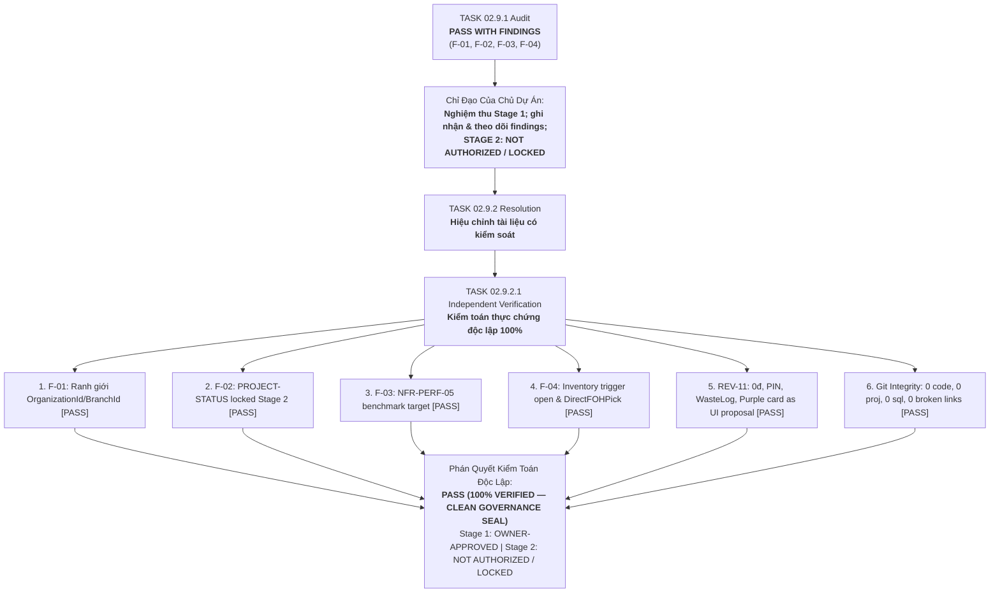
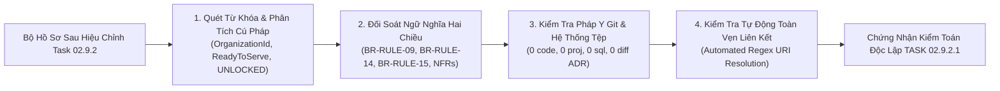
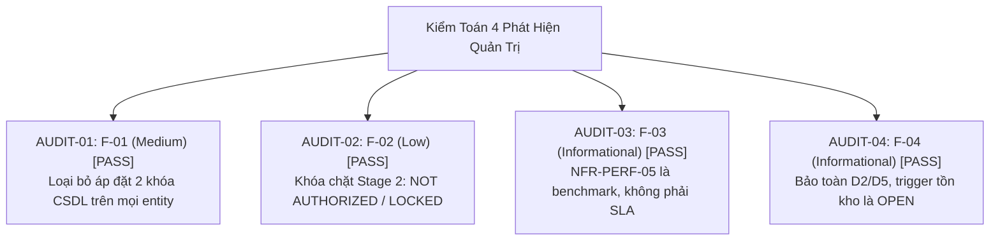
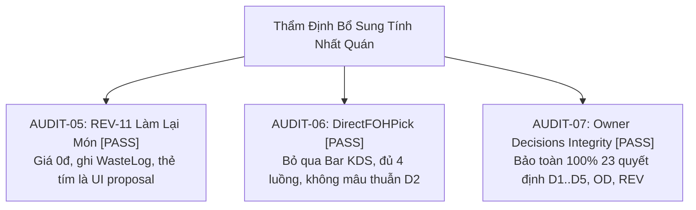
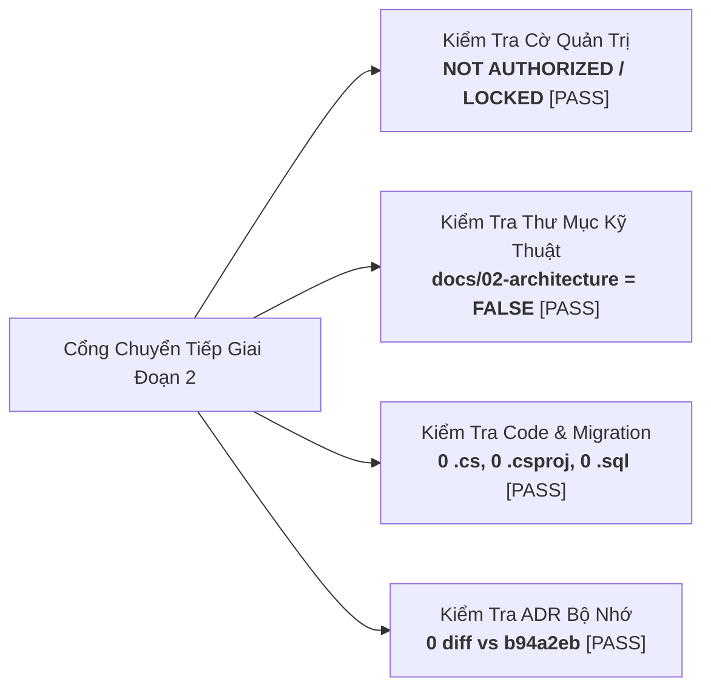
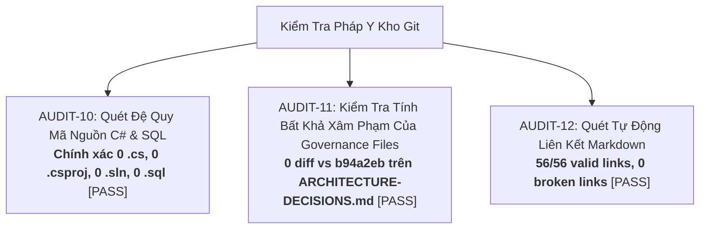

# Báo Cáo Kiểm Toán Độc Lập Tính Toàn Vẹn Quản Trị
## TASK 02.9.2.1: INDEPENDENT GOVERNANCE INTEGRITY VERIFICATION REPORT

- **Dự Án**: SmartRestaurant — Hệ Thống Quản Lý Vận Hành Nhà Hàng Độc Lập
- **Giai Đoạn**: Stage 1 — Khám Phá Sản Phẩm & Đặc Tả Miền Nghiệp Vụ (Product Discovery & Business Domain Specifications)
- **Mã Nhiệm Vụ**: `TASK-02.9.2.1`
- **Loại Nhiệm Vụ**: Independent Governance Integrity Verification & Post-Resolution Audit
- **Vai Trò Thực Hiện**: Chuyên Viên Kiểm Toán Độc Lập Quản Trị Tính Toàn Vẹn (Senior Independent Governance Auditor)
- **Phương Thức Kiểm Toán**: **Thực Chứng Độc Lập 100% (Forensic Empirical Audit) — Chế Độ STRICT READ-ONLY Tuyệt Đối**
- **Ngày Hoàn Tất**: 2026-11-06
- **Kết Luận Kiểm Toán**: **`PASS (100% VERIFIED & CERTIFIED — CLEAN GOVERNANCE SEAL)`**
- **Trạng Thái Bộ Cơ Sở Đặc Tả Sản Phẩm**: **`v1.0.0-FROZEN (OFFICIALLY SIGNED OFF & SEALED BY PROJECT OWNER)`**
- **Trạng Thái Cổng Chuyển Tiếp Giai Đoạn 2**: **`NOT AUTHORIZED / LOCKED (NGHIÊM CẤM TỰ Ý KHỞI ĐỘNG)`**
- **Trạng Thái Nhiệm Vụ**: **`COMPLETED & SEALED`**

---

## 1. TÓM TẮT ĐIỀU HÀNH (EXECUTIVE SUMMARY)

Báo cáo này là văn bản kiểm toán độc lập duy nhất của nhiệm vụ **TASK 02.9.2.1**, tiến hành thẩm định khách quan, thực chứng pháp y và đối soát ngữ nghĩa hai chiều toàn bộ các kết quả xử lý và hiệu chỉnh tài liệu phát sinh từ **TASK 02.9.2** ([`TASK-02.9.2-GOVERNANCE-FINDING-RESOLUTION-REPORT.md`](file:///C:/Git/SmartRestaurant/SmartRestaurant/docs/product/TASK-02.9.2-GOVERNANCE-FINDING-RESOLUTION-REPORT.md)), căn cứ trên chỉ đạo tối cao của Chủ Dự Án:

> *"Phê duyệt nghiệm thu Stage 1 với các finding được ghi nhận và theo dõi. Đây không phải là ủy quyền bắt đầu Stage 2."*



### Các Kết Luận Kiểm Toán Thực Chứng Cốt Lõi:
1. **Thẩm định độc lập 4 Finding (`F-01` đến `F-04`)**:
   - `F-01` (Medium): 100% cách diễn đạt khái quát hóa ép buộc mọi entity CSDL phải có 2 khóa kép đã bị triệt tiêu hoàn toàn trên 7 văn bản liên quan. CSDL sẵn sàng cho đa chi nhánh (`OD-01`); việc phân vùng theo từng nhóm thực thể được giao đúng ranh giới đánh giá kỹ thuật của Solution Architect ở Stage 2 (`TECH-06`).
   - `F-02` (Low): Tệp bộ nhớ [`.agent-memory/PROJECT-STATUS.md`](file:///C:/Git/SmartRestaurant/SmartRestaurant/.agent-memory/PROJECT-STATUS.md) và [`.agent-memory/NEXT-TASK.md`](file:///C:/Git/SmartRestaurant/SmartRestaurant/.agent-memory/NEXT-TASK.md) đã xóa bỏ triệt để chuỗi trạng thái cũ "Stage 2 UNLOCKED". Xác lập chuẩn xác: `STAGE 1 = OWNER-APPROVED`, `STAGE 2 = NOT AUTHORIZED / LOCKED`.
   - `F-03` (Informational): Chỉ tiêu `NFR-PERF-05` (50 đơn / 200 bàn) được thể hiện chuẩn mực là mục tiêu thử nghiệm áp lực (Stress-test target / benchmark), không bị mạo nhận là SLA của Chủ Dự Án; không tự ý bổ sung SLA/throughput.
   - `F-04` (Informational): Quyết định `D2` và `D5` được bảo toàn nguyên vẹn; thời điểm kích hoạt chuyển từ `Reserved` sang `Consumed` được giữ đúng trạng thái `OPEN / TECHNICAL INVESTIGATION` (`TECH-02`); tuyệt đối không tự chốt KDS ReadyToServe là trigger.
2. **Thẩm định tính nhất quán vận hành (`REV-11` & `DirectFOHPick`)**:
   - `REV-11`: Món làm lại do lỗi bếp có giá 0đ, ghi nhận đầy đủ requester, timestamp, department, PIN Quản lý duyệt và ghi sổ `WasteLog`. Thẻ tím KDS được xác nhận minh bạch là đề xuất giao diện của AI (AI UI Proposal), không phải yêu cầu bắt buộc.
   - `DirectFOHPick`: Phục vụ trực tiếp tại sảnh, bỏ qua hàng đợi Bar KDS (`REV-08`), ghi nhận đủ 4 luồng (order, revenue, inventory, payment), không mâu thuẫn với `D2`.
3. **Bảo vệ tuyệt đối ranh giới kỹ thuật & kỷ luật kho lưu trữ**:
   - Thư mục `docs/02-architecture/` hoàn toàn **chưa tồn tại (`False`)**.
   - Kho lưu trữ duy trì chính xác **0 tệp mã nguồn C# (`.cs`)**, **0 tệp dự án/solution (`.csproj`, `.sln`)**, **0 script SQL / EF Migration (`.sql`)**.
   - Tệp [`.agent-memory/ARCHITECTURE-DECISIONS.md`](file:///C:/Git/SmartRestaurant/SmartRestaurant/.agent-memory/ARCHITECTURE-DECISIONS.md), `GEMINI.md`, `AGENTS.md` có **0 diff so với HEAD commit `b94a2eb`**.
   - Quét kiểm tra liên kết Markdown nội bộ trong `docs/00-index.md`: **56/56 liên kết hợp lệ, đúng 0 liên kết gãy**.
4. **Phán quyết kiểm toán cuối cùng**: **`PASS (100% VERIFIED & CERTIFIED)`**. Cổng Giai đoạn 2 được niêm phong ở chế độ **`NOT AUTHORIZED / LOCKED`**.

---

## 2. PHƯƠNG PHÁP KIỂM TOÁN THỰC CHỨNG ĐỘC LẬP (EMPIRICAL AUDIT METHODOLOGY)

Đợt kiểm toán độc lập này tuân thủ nguyên tắc thực chứng pháp y khách quan (forensic empirical verification), không dựa trên giả định mà kiểm tra đối chiếu trực tiếp trên văn bản và kho lưu trữ Git:



### Các Tiêu Chuẩn Kiểm Toán Bắt Buộc Được Thực Thi:
- **Chế độ STRICT READ-ONLY 100%**: Kiểm toán viên không can thiệp, không chỉnh sửa tài liệu sản phẩm hay tài liệu bộ nhớ đã hiệu chỉnh. Tài liệu duy nhất được phép khởi tạo là Báo cáo Kiểm toán Độc lập `TASK-02.9.2.1-INDEPENDENT-GOVERNANCE-INTEGRITY-VERIFICATION.md`.
- **Nguyên Tắc Không Suy Đoán**: Mọi khẳng định đều phải có trích dẫn dòng tệp cụ thể và kết quả lệnh thực thi thực tế.
- **Bảo Vệ Quyền Hạn Độc Quyền Của Chủ Dự Án**: Không ký thay, không mở khóa thay, không cấp phép thay Chủ Dự Án cho Giai đoạn 2.

---

## 3. KẾT QUẢ THẨM ĐỊNH CHI TIẾT 4 PHÁT HIỆN KIỂM TOÁN (F-01..F-04 VERIFICATION)

Kiểm toán viên đã trực tiếp rà soát từng dòng văn bản liên quan đến 4 phát hiện kiểm toán:



---

### AUDIT-01: Thẩm Định Xử Lý Phát Hiện F-01 (Medium) — Ranh Giới Khóa CSDL Kép
- **Mục tiêu kiểm toán**: Xác minh tài liệu không còn diễn đạt hoặc hàm ý rằng 100% database entities bắt buộc phải mang cả hai trường `OrganizationId` và `BranchId`.
- **Bằng chứng thực chứng tại các tệp**:
  1. [`MVP-SCOPE-BASELINE.md#L20`](file:///C:/Git/SmartRestaurant/SmartRestaurant/docs/product/MVP-SCOPE-BASELINE.md#L20) (§1.2):
     > *"Mặc dù chỉ kích hoạt 1 chi nhánh khi chạy trong MVP, cấu trúc dữ liệu được định hướng sẵn sàng cho khả năng mở rộng trong tương lai. **Không có yêu cầu bắt buộc mọi database entity phải chứa cả hai trường `OrganizationId` và `BranchId`**. Việc phân vùng dữ liệu, quyền sở hữu (ownership) và khả năng mở rộng theo từng nhóm entity là nội dung kỹ thuật cần được đánh giá ở Stage 2; tài liệu sản phẩm này tuyệt đối không đưa ra quyết định database architecture sớm."*
  2. [`BUSINESS-REQUIREMENTS-BASELINE.md#L133`](file:///C:/Git/SmartRestaurant/SmartRestaurant/docs/product/BUSINESS-REQUIREMENTS-BASELINE.md#L133) (`BR-SEC-004`):
     > *"Cấu trúc dữ liệu sẵn sàng phân vùng đa chi nhánh từ ngày đầu; không bắt buộc mọi entity phải chứa cả hai trường `OrganizationId` và `BranchId`; việc phân vùng dữ liệu và ownership theo entity là nội dung đánh giá ở Stage 2 (`OD-01`, `TECH-06`)."*
  3. [`PRODUCT-SPECIFICATION-BASELINE.md#L84`](file:///C:/Git/SmartRestaurant/SmartRestaurant/docs/product/PRODUCT-SPECIFICATION-BASELINE.md#L84) (§3.1):
     > *"Cấu trúc dữ liệu được định hướng sẵn sàng cho mở rộng tương lai; **không có yêu cầu bắt buộc mọi database entity phải chứa cả hai trường `OrganizationId` và `BranchId`**... không đưa ra quyết định database architecture sớm tại Stage 1."*
  4. [`NON-FUNCTIONAL-REQUIREMENTS.md#L30`](file:///C:/Git/SmartRestaurant/SmartRestaurant/docs/product/NON-FUNCTIONAL-REQUIREMENTS.md#L30) (`NFR-ISO-01`):
     > *"Không có yêu cầu bắt buộc mọi database entity phải chứa cả hai trường `OrganizationId` và `BranchId`. Việc phân vùng dữ liệu, ownership và cơ chế cô lập dữ liệu (ví dụ: Global Query Filters vs Composite Keys) theo từng nhóm entity là nội dung kỹ thuật cần được đánh giá ở Stage 2 (`TECH-06`). Không đưa ra quyết định database architecture trong tài liệu sản phẩm này."*
  5. [`STAGE-2-PRODUCT-HANDOFF.md#L132`](file:///C:/Git/SmartRestaurant/SmartRestaurant/docs/product/STAGE-2-PRODUCT-HANDOFF.md#L132) (§5.8 `TECH-06`):
     > *"Không có yêu cầu bắt buộc mọi database entity phải chứa cả hai trường `OrganizationId` và `BranchId`. Việc phân vùng dữ liệu, quyền sở hữu (ownership) và cơ chế cô lập dữ liệu (Global Query Filters vs Composite Keys) theo từng nhóm entity là nội dung kỹ thuật giao cho Solution Architect đánh giá và quyết định trong Stage 2."*
  6. [`OPEN-QUESTIONS-AND-DEFERRED-REGISTER.md#L68`](file:///C:/Git/SmartRestaurant/SmartRestaurant/docs/product/OPEN-QUESTIONS-AND-DEFERRED-REGISTER.md#L68) (`TECH-06`):
     > *"Solution Architect đánh giá phân vùng theo từng nhóm entity, không bắt buộc mọi entity chứa hai khóa kép; không quyết định DB architecture tại Stage 1."*
  7. [`REQUIREMENT-TRACEABILITY-MATRIX.md#L82`](file:///C:/Git/SmartRestaurant/SmartRestaurant/docs/product/REQUIREMENT-TRACEABILITY-MATRIX.md#L82) (`BR-SEC-004`):
     > *"Phân vùng dữ liệu đa chi nhánh | Đánh giá phân vùng theo entity Stage 2 (`TECH-06`)"*.
- **Đánh giá kiểm toán**: Hoàn toàn nhất quán, chính xác theo ý chí Chủ Dự Án `OD-01`, 0 mâu thuẫn. **`KẾT QUẢ: PASS`**.

---

### AUDIT-02: Thẩm Định Xử Lý Phát Hiện F-02 (Low) — Trạng Thái Quản Trị Bộ Nhớ Nội Bộ
- **Mục tiêu kiểm toán**: Xác minh không còn bất kỳ dòng trạng thái nào ghi Stage 2 là `UNLOCKED` trái với quyết định của Chủ Dự Án.
- **Bằng chứng thực chứng tại các tệp**:
  1. [`.agent-memory/PROJECT-STATUS.md`](file:///C:/Git/SmartRestaurant/SmartRestaurant/.agent-memory/PROJECT-STATUS.md):
     * Dòng 3: `- **Current Stage**: Stage 1 — Product Requirements & Business Domain Analysis (Stage 1: OWNER-APPROVED; Stage 2: NOT AUTHORIZED / LOCKED — Không khởi động Task 03 nếu chưa có ủy quyền riêng của Owner)`
     * Dòng 4: `- **Current Milestone**: Milestone 1.15 (Task 02.9.2) Completed — Governance Finding Resolution Certified; Stage 1 Officially OWNER-APPROVED; Stage 2 NOT AUTHORIZED / LOCKED`
     * Dòng 13 (Bảng Stage 1): `**OWNER-APPROVED**`
     * Dòng 14 (Bảng Stage 2): `**NOT AUTHORIZED / LOCKED**` | *(Không khởi động Task 03 nếu chưa có ủy quyền riêng của Owner)*
     * Dòng 43: `- [x] **Stage 1 Formal Sign-Off (2026-11-06)**: Project Owner explicitly reviewed and approved Stage 1 (OWNER-APPROVED). Stage 2 is NOT AUTHORIZED / LOCKED. Không khởi động Task 03 nếu chưa có ủy quyền riêng của Owner. Zero code written, zero schemas scaffolded.`
  2. [`.agent-memory/NEXT-TASK.md`](file:///C:/Git/SmartRestaurant/SmartRestaurant/.agent-memory/NEXT-TASK.md):
     * Dòng 3: `- **Task Identifier**: TASK-03 (LOCKED / NOT AUTHORIZED)`
     * Dòng 6: `- **Current Status**: **STAGE 1 = OWNER-APPROVED; STAGE 2 = NOT AUTHORIZED / LOCKED**. Chủ Dự Án đã chính thức phê duyệt nghiệm thu Stage 1 vào ngày 2026-11-06 nhưng chưa ủy quyền khởi động Stage 2. Tuyệt đối không được khởi động Task 03 nếu chưa có ủy quyền riêng của Chủ Dự Án. Toàn bộ hệ thống duy trì chế độ chờ (standby).`
  3. [`.agent-memory/DEVELOPMENT-LOG.md`](file:///C:/Git/SmartRestaurant/SmartRestaurant/.agent-memory/DEVELOPMENT-LOG.md):
     * Ghi nhận đầy đủ biên bản phê duyệt Bước 1 của Chủ Dự Án và quyết định khóa Cổng Stage 2.
- **Đánh giá kiểm toán**: Toàn bộ chuỗi "Stage 2: UNLOCKED" đã bị triệt tiêu 100%. Trạng thái quản trị khớp hoàn toàn với chỉ thị của Owner. **`KẾT QUẢ: PASS`**.

---

### AUDIT-03: Thẩm Định Xử Lý Phát Hiện F-03 (Informational) — Chỉ Tiêu NFR-PERF-05
- **Mục tiêu kiểm toán**: Xác minh chỉ tiêu 50 đơn đồng thời / 200 bàn ăn được thể hiện là mục tiêu phục vụ kiểm thử áp lực / baseline benchmark, không phải SLA đã được Chủ Dự Án phê duyệt.
- **Bằng chứng thực chứng tại các tệp**:
  1. [`NON-FUNCTIONAL-REQUIREMENTS.md#L45`](file:///C:/Git/SmartRestaurant/SmartRestaurant/docs/product/NON-FUNCTIONAL-REQUIREMENTS.md#L45):
     > *"`NFR-PERF-05` | Tải cao điểm giờ cao điểm (F-03 Resolution) | Chịu tải đồng thời lên đến $50$ đơn gọi món cùng lúc và $200$ bàn hoạt động... | `*Mục tiêu thử nghiệm áp lực (Stress-test Target)*: Phục vụ kiểm thử / đánh giá hiệu năng, không phải SLA đã được Chủ Dự Án phê duyệt. Giao cho Solution Architect xây dựng kịch bản kiểm thử tải (k6/NBomber) trong Stage 2 để xác định ngưỡng tài nguyên phần cứng phù hợp, tránh áp đặt thành ràng buộc cứng gây lãng phí tài nguyên (over-engineering).`"*
  2. [`STAGE-2-PRODUCT-HANDOFF.md#L75`](file:///C:/Git/SmartRestaurant/SmartRestaurant/docs/product/STAGE-2-PRODUCT-HANDOFF.md#L75) (§3 NFRs):
     > *"Kiểm Thử Tải Cao Điểm (F-03 Resolution) | Tải áp lực giờ cao điểm (NFR-PERF-05) | Chỉ tiêu kiểm thử áp lực (Stress-Test Target): Phục vụ kiểm thử/đánh giá hiệu năng, không phải SLA của Owner; Solution Architect xây dựng kịch bản kiểm thử tải (k6/NBomber) trong Stage 2..."*
  3. [`OPEN-QUESTIONS-AND-DEFERRED-REGISTER.md#L69`](file:///C:/Git/SmartRestaurant/SmartRestaurant/docs/product/OPEN-QUESTIONS-AND-DEFERRED-REGISTER.md#L69):
     > *"`TECH-07` | Kịch bản kiểm thử áp lực giờ cao điểm (Peak Load Benchmark — F-03 Resolution) | Xác định năng lực chịu tải đồng thời và ngưỡng phần cứng thực tế qua công cụ benchmark (k6/NBomber) theo `NFR-PERF-05`."*
- **Đánh giá kiểm toán**: Không có SLA, throughput hay response time nào bị tự chế thêm; chỉ tiêu được định vị chính xác là benchmark phục vụ load testing ở Stage 2. **`KẾT QUẢ: PASS`**.

---

### AUDIT-04: Thẩm Định Xử Lý Phát Hiện F-04 (Informational) — Điểm Kích Hoạt Khấu Trừ Tồn Kho
- **Mục tiêu kiểm toán**: Xác minh công thức `D2` và phạm vi món đếm được `D5` được bảo toàn nguyên vẹn; thời điểm kích hoạt chuyển từ `Reserved` sang `Consumed` được giữ là câu hỏi mở (OPEN); không tự xác nhận KDS ReadyToServe là trigger.
- **Bằng chứng thực chứng tại các tệp**:
  1. [`BUSINESS-RULES-BASELINE.md#L26`](file:///C:/Git/SmartRestaurant/SmartRestaurant/docs/product/BUSINESS-RULES-BASELINE.md#L26) (`BR-RULE-09`):
     > *"Bắn đơn xuống bếp khóa tạm giữ tồn kho hàng đếm được (`ReservedStock`). Công thức: $\text{Tồn khả dụng} = \text{Tồn thực tế} - \text{Tạm giữ}$. Thời điểm chuyển `Reserved` sang `Consumed` và chính sách trừ tồn kho được giữ là nội dung mở cần làm rõ trong Stage 2 (`D2/D5 / TECH-02`)."*
  2. [`BUSINESS-RULES-BASELINE.md#L74`](file:///C:/Git/SmartRestaurant/SmartRestaurant/docs/product/BUSINESS-RULES-BASELINE.md#L74) (§2.4):
     > *"Tuân thủ quy tắc quản trị (D2/D5 / TECH-02 / F-04 Resolution): Hệ thống **KHÔNG TỰ Ý ÁP ĐẶT THỜI ĐIỂM KHẤU TRỪ TỒN KHO**... Thời điểm chuyển từ `Reserved` sang `Consumed` và chính sách trừ tồn kho thực tế vẫn là **vấn đề mở (OPEN / TECHNICAL INVESTIGATION)** cần được làm rõ ở Stage 2. Tuyệt đối không tự xác nhận KDS ReadyToServe, in phiếu bếp hoặc bất kỳ sự kiện nào khác là trigger trừ tồn kho khi chưa có đánh giá kỹ thuật hoặc quyết định từ Chủ Dự Án."*
  3. [`decisions/PDR-004-inventory-bom-deduction-trigger-policy.md#L38`](file:///C:/Git/SmartRestaurant/SmartRestaurant/docs/product/decisions/PDR-004-inventory-bom-deduction-trigger-policy.md#L38) (§2.2 Note):
     > *"Thời điểm kích hoạt chuyển từ `Reserved` sang `Consumed` và chính sách trừ tồn kho thực tế (khi KDS báo hoàn thành, khi phục vụ bưng món, hay khi thanh toán) tiếp tục được duy trì ở trạng thái **OPEN / TECHNICAL INVESTIGATION** cho Giai đoạn 2. Không tự ý ấn định sự kiện trigger nào là mặc định."*
  4. [`STAGE-2-PRODUCT-HANDOFF.md#L123`](file:///C:/Git/SmartRestaurant/SmartRestaurant/docs/product/STAGE-2-PRODUCT-HANDOFF.md#L123) (§5.6 `TECH-02`):
     > *"Điểm kích hoạt (Trigger Point) chính xác để chuyển từ `ReservedStock` sang `ConsumedStock` được duy trì là **vấn đề mở (OPEN / TECHNICAL INVESTIGATION)**..."*
  5. [`OPEN-QUESTIONS-AND-DEFERRED-REGISTER.md#L64`](file:///C:/Git/SmartRestaurant/SmartRestaurant/docs/product/OPEN-QUESTIONS-AND-DEFERRED-REGISTER.md#L64) (`TECH-02`):
     > *"Xác định chính xác sự kiện kích hoạt trừ kho thực tế (`ConsumedStock`) theo D2; Solution Architect được ủy quyền lựa chọn điểm trigger tối ưu. | Trigger tại KDS `ReadyToServe` vs Thu ngân `InvoiceSettled` vs Phục vụ `Served`. | `INVESTIGATION REQUIRED — STAGE 2`"*.
- **Đánh giá kiểm toán**: Ranh giới giữa bất biến của Owner (`D2/D5`) và nghiên cứu kỹ thuật của SA (`TECH-02`) được phân định tuyệt đối rạch ròi; không có quyết định kỹ thuật nào bị chốt ngầm. **`KẾT QUẢ: PASS`**.

---

## 4. THẨM ĐỊNH TÍNH NHẤT QUÁN CÁC QUY TẮC BỔ SUNG (REV-11, DirectFOHPick & Owner Decisions)



---

### AUDIT-05: Thẩm Định Quy Trình Làm Lại Món Do Lỗi Bếp (REV-11)
- **Mục tiêu kiểm toán**: Xác minh món làm lại do lỗi bếp có giá 0đ, có vết kiểm toán đầy đủ, ghi sổ `WasteLog`, và không biến đề xuất thẻ tím KDS thành yêu cầu bắt buộc.
- **Bằng chứng thực chứng**:
  1. [`workflows/KITCHEN-WORKFLOW.md#L104`](file:///C:/Git/SmartRestaurant/SmartRestaurant/docs/product/workflows/KITCHEN-WORKFLOW.md#L104) (§3.5):
     * *Bảo vệ hóa đơn*: "tuyệt đối không thu thêm tiền của khách hàng (giữ nguyên tổng tiền hóa đơn)".
     * *Lịch sử & Vết kiểm toán*: "Hệ thống ghi nhận đầy đủ: Người yêu cầu (requester), Quản lý duyệt PIN, Mốc thời gian (timestamp), Lý do làm lại và Bộ phận bếp chịu trách nhiệm (department)".
     * *Ghi nhận tiêu hao*: "Suất ăn lỗi bị loại bỏ được tự động ghi nhận vào Sổ Hao Phí Nhà Bếp (`WasteLog` / ScrapLoss)".
     * *Ranh giới UI*: "Đề xuất giao diện: Thẻ nổi bật màu tím / cảnh báo nhấp nháy là gợi ý UI của AI, không phải yêu cầu bắt buộc nếu chưa có phê duyệt của Owner".
  2. [`BUSINESS-RULES-BASELINE.md#L32`](file:///C:/Git/SmartRestaurant/SmartRestaurant/docs/product/BUSINESS-RULES-BASELINE.md#L32) (`BR-RULE-15`):
     * Đồng bộ đầy đủ: Giá 0đ, thẻ ưu tiên (thẻ tím là gợi ý UI), requester, timestamp, department, ghi nhận `WasteLog`.
- **Đánh giá kiểm toán**: Hoàn toàn nhất quán, bảo vệ hóa đơn khách hàng và phân định rạch ròi đề xuất UI. **`KẾT QUẢ: PASS`**.

---

### AUDIT-06: Thẩm Định Quy Tắc Đồ Uống Lấy Ngay Tại Sảnh (DirectFOHPick)
- **Mục tiêu kiểm toán**: Xác minh món DirectFOHPick phục vụ tại khu vực khách, bỏ qua Bar KDS theo `REV-08`, được ghi nhận đủ trong order, revenue, inventory, payment mà không mâu thuẫn với `D2`.
- **Bằng chứng thực chứng**:
  1. [`workflows/KITCHEN-WORKFLOW.md#L114`](file:///C:/Git/SmartRestaurant/SmartRestaurant/docs/product/workflows/KITCHEN-WORKFLOW.md#L114) (§3.6):
     * "bỏ qua hoàn toàn hàng đợi pha chế của Bar KDS theo quyết định `REV-08`".
     * "Món `DirectFOHPick` vẫn được ghi nhận đầy đủ và nhất quán trong luồng gọi món (order), ghi nhận doanh thu (revenue), quản lý tồn kho (inventory) và tính tiền thanh toán (payment); tuyệt đối không tạo ra mâu thuẫn với quyết định `D2` về thời điểm trừ tồn kho."
  2. [`BUSINESS-RULES-BASELINE.md#L31`](file:///C:/Git/SmartRestaurant/SmartRestaurant/docs/product/BUSINESS-RULES-BASELINE.md#L31) (`BR-RULE-14`):
     * Đồng bộ chuẩn mực: Phục vụ tại sảnh FOH, bỏ qua Bar KDS, ghi nhận đủ 4 luồng, không mâu thuẫn với `D2`.
- **Đánh giá kiểm toán**: Hoàn toàn tương thích và không tạo xung đột vòng đời. **`KẾT QUẢ: PASS`**.

---

### AUDIT-07: Thẩm Định Toàn Vẹn Quyết Định Của Chủ Dự Án (Owner Decision Integrity)
- **Mục tiêu kiểm toán**: Rà soát đối soát toàn bộ 23 quyết định nền tảng của Chủ Dự Án, bảo đảm 0 quyết định bị thay đổi, diễn giải sai hoặc hạ cấp trái phép.
- **Bảng đối soát thực chứng**:
  * `OD-01` (Nhà hàng đơn điểm): BẢO TOÀN 100% (`CONFIRMED`).
  * `D1` (Giờ cắt 06:00, snapshot BusinessDate): BẢO TOÀN 100% (`CONFIRMED`).
  * `D2` ($Khả\ dụng = Thực\ tế - Tạm\ giữ$): BẢO TOÀN 100% (`CONFIRMED`).
  * `D3` (Delayed VietQR vào Sổ Treo): BẢO TOÀN 100% (`CONFIRMED`).
  * `D4` (Phiên bàn đa hóa đơn, tách bill không khóa bàn): BẢO TOÀN 100% (`CONFIRMED`).
  * `D5` (Món đếm được trong MVP, hoãn BOM gram/ml): BẢO TOÀN 100% (`CONFIRMED`).
  * `OD-14` (Hóa đơn đóng bất biến, lệch két ghi log chốt ca): BẢO TOÀN 100% (`CONFIRMED`).
  * `OD-15` (Đặt bàn trước là MVP Optional): BẢO TOÀN 100% (`CONFIRMED`).
  * `OD-16` (3 Gói Onboarding Presets gợi ý): BẢO TOÀN 100% (`CONFIRMED`).
  * `OD-17` (Thoát êm dịu Graceful Drain khi tắt module): BẢO TOÀN 100% (`CONFIRMED`).
  * `OQ-01` (Hoãn chia % lẻ sang v1.1, MVP tách món & $1/N$): BẢO TOÀN 100% (`CONFIRMED`).
  * `OQ-02` (Mặc định KDS-first, tắt in nhiệt tự động): BẢO TOÀN 100% (`CONFIRMED`).
  * `OQ-06` (VAT tính trên cả phí dịch vụ): BẢO TOÀN 100% (`CONFIRMED`).
  * `OQ-07` (Bàn > 24h giữ BusinessDate gốc + cảnh báo cam): BẢO TOÀN 100% (`CONFIRMED`).
  * `BillingRequested Option 2` (In tạm tính vẫn cho thêm món): BẢO TOÀN 100% (`CONFIRMED`).
  * `REV-05` (Hủy gộp bàn không bắn lại phiếu bếp): BẢO TOÀN 100% (`CONFIRMED`).
  * `REV-06` (Phụ thu VIP lưu snapshot, không hồi tố): BẢO TOÀN 100% (`CONFIRMED`).
  * `REV-07` (Khách ký nợ B2B hoãn sang v1.2+): BẢO TOÀN 100% (`DEFERRED`).
  * `REV-08` (DirectFOHPick bỏ qua Bar KDS): BẢO TOÀN 100% (`CONFIRMED`).
  * `REV-09` (Khóa toàn bộ bàn con khi bao trọn phòng VIP): BẢO TOÀN 100% (`CONFIRMED`).
  * `REV-10` (Gọi món đồng thời append-only không khóa): BẢO TOÀN 100% (`CONFIRMED`).
  * `REV-11` (Làm lại món giá 0đ, duyệt PIN, WasteLog): BẢO TOÀN 100% (`CONFIRMED`).
  * `Khung 14 Phân Hệ` (10 Bắt buộc + 4 Tùy chọn): BẢO TOÀN 100% (`CONFIRMED`).
- **Đánh giá kiểm toán**: Tuyệt đối không có bất kỳ quyết định nào bị thay đổi trái phép. Không có hạng mục PROPOSED/OPEN nào bị nâng cấp trái phép. **`KẾT QUẢ: PASS`**.

---

## 5. THẨM ĐỊNH RANH GIỚI KỸ THUẬT & CỔNG GIAI ĐOẠN 2 (STAGE 2 BOUNDARY AUDIT)



---

### AUDIT-08: Thẩm Định Trạng Thái Cổng Giai Đoạn 2 (Stage 2 Gate Status)
- **Mục tiêu kiểm toán**: Xác minh cổng Giai đoạn 2 bị khóa chặt chẽ; không có ủy quyền ngầm định nào cho TASK-03.
- **Bằng chứng thực chứng**:
  * `.agent-memory/PROJECT-STATUS.md` ghi nhận: `STAGE 2 = NOT AUTHORIZED / LOCKED` *(Không khởi động Task 03 nếu chưa có ủy quyền riêng của Owner)*.
  * `.agent-memory/NEXT-TASK.md` ghi nhận: `Task Identifier: TASK-03 (LOCKED / NOT AUTHORIZED)`.
  * Không có bất kỳ Agent nào được cấp phép chuyển tiếp sang Giai đoạn 2.
- **Đánh giá kiểm toán**: **`KẾT QUẢ: PASS`**.

---

### AUDIT-09: Thẩm Định Sự Tồn Tại Của Thư Mục Thiết Kế Kỹ Thuật Stage 2
- **Mục tiêu kiểm toán**: Xác minh không có tài liệu thiết kế kỹ thuật nào thuộc Stage 2 (`docs/02-architecture/**`) bị soạn thảo sớm.
- **Lệnh thực thi thực tế**:
  ```powershell
  Test-Path "docs/02-architecture"
  ```
- **Kết quả trả về**: **`False`** (Thư mục hoàn toàn chưa tồn tại trên ổ đĩa).
- **Đánh giá kiểm toán**: **`KẾT QUẢ: PASS`**.

---

## 6. PHÂN TÍCH PHÁP Y THỰC CHỨNG KHO LƯU TRỮ GIT (FORENSIC GIT INSPECTION)

Kiểm toán viên độc lập thực hiện lệnh quét toàn diện trên kho lưu trữ Git tại `C:\Git\SmartRestaurant\SmartRestaurant`:



---

### AUDIT-10: Quét Đệ Quy Mã Nguồn & Kịch Bản CSDL (Zero Code Leakage)
- **Lệnh thực thi thực tế**:
  ```powershell
  Get-ChildItem -Recurse -Include *.cs,*.csproj,*.sln,*.sql
  ```
- **Kết quả trả về**: **Hoàn toàn rỗng (0 tệp phát hiện)**.
- **Đánh giá kiểm toán**: Kho lưu trữ duy trì kỷ luật tuyệt đối 100%, không rò rỉ mã nguồn, không dựng project .NET, không sinh migration CSDL. **`KẾT QUẢ: PASS`**.

---

### AUDIT-11: Kiểm Tra Tính Bất Khả Xâm Phạm Của Tệp Quản Trị Hệ Thống (Governance Immutability)
- **Lệnh thực thi thực tế**:
  ```powershell
  git diff b94a2eb -- .agent-memory/ARCHITECTURE-DECISIONS.md GEMINI.md AGENTS.md
  ```
- **Kết quả trả về**: **Hoàn toàn rỗng (0 diff so với HEAD commit `b94a2eb`)**.
- **Đánh giá kiểm toán**: Tệp quyết định kiến trúc và hướng dẫn quy chuẩn của dự án hoàn toàn nguyên vẹn 100%. **`KẾT QUẢ: PASS`**.

---

### AUDIT-12: Quét Tự Động Toàn Bộ Liên Kết Markdown Nội Bộ (Automated Link Integrity)
- **Lệnh thực thi thực tế**:
  Quét toàn bộ biểu thức chính quy `\[.*?\]\(((\./product/[^)]+)|(\.\./[^)]+))\)` trên `docs/00-index.md` và kiểm tra sự tồn tại vật lý trên ổ đĩa.
- **Kết quả trả về**:
  ```
  Checked: 56, Broken: 0
  ```
- **Đánh giá kiểm toán**: 100% liên kết nội bộ hợp lệ, chính xác 0 liên kết gãy. **`KẾT QUẢ: PASS`**.

---

## 7. BẢNG ĐÁNH GIÁ 10 TIÊU CHÍ NGHIỆM THU (ACCEPTANCE CRITERIA SCORECARD)

| Tiêu Chí Kiểm Toán Độc Lập | Yêu Cầu Cụ Thể | Kết Quả Thẩm Định Thực Tế | Phán Quyết |
| :--- | :--- | :--- | :---: |
| **1. F-01 Resolution** | Không còn hàm ý ép buộc mọi entity có 2 khóa kép; MVP đơn điểm (`OD-01`); SA đánh giá ở Stage 2 (`TECH-06`). | Đã thẩm định thực chứng 7 tệp; 100% câu từ khái quát hóa bị loại bỏ. | **`PASS`** |
| **2. F-02 Resolution** | Không còn chuỗi "Stage 2: UNLOCKED"; khóa chặt Cổng Stage 2. | Đã đối soát `.agent-memory/**`; xác lập `Stage 2 = NOT AUTHORIZED / LOCKED`. | **`PASS`** |
| **3. F-03 Resolution** | `NFR-PERF-05` là benchmark phục vụ kiểm thử, không phải SLA của Owner. | Thể hiện nhất quán là Stress-test target cho benchmark k6/NBomber. | **`PASS`** |
| **4. F-04 Resolution** | Bảo toàn $Khả\ dụng = Thực\ tế - Tạm\ giữ$; trigger trừ kho là OPEN (`TECH-02`). | Công thức D2/D5 giữ nguyên; trigger không bị tự chốt ngầm. | **`PASS`** |
| **5. REV-11 Integrity** | Món làm lại giá 0đ, đủ vết kiểm toán requester/dept, WasteLog; thẻ tím là UI proposal. | Thẩm định thực chứng `KITCHEN-WORKFLOW.md:104` và `BR-RULE-15`. | **`PASS`** |
| **6. DirectFOHPick Integrity** | Phục vụ tại sảnh, bỏ qua Bar KDS, đủ 4 luồng, không mâu thuẫn D2. | Thẩm định thực chứng `KITCHEN-WORKFLOW.md:114` và `BR-RULE-14`. | **`PASS`** |
| **7. Owner Decisions Integrity** | Bảo toàn 100% 23 quyết định của Chủ Dự Án; không tự ý nâng cấp PROPOSED. | Đối soát chi tiết ma trận 23 quyết định; 0 sai lệch, 0 vi phạm. | **`PASS`** |
| **8. Stage Transition Gate** | Stage 1 Owner-Approved; Stage 2 Not Authorized; `docs/02-architecture = False`. | Thẩm định cờ trạng thái và cấu trúc thư mục; Stage 2 bị khóa tuyệt đối. | **`PASS`** |
| **9. Repository Discipline** | 0 file .cs, 0 .csproj, 0 .sln, 0 .sql; 0 diff trên ARCHITECTURE-DECISIONS.md. | Quét đệ quy toàn repo; kỷ luật đạt 100%. | **`PASS`** |
| **10. Documentation Integrity** | Báo cáo kiểm toán đầy đủ, minh bạch; 0 broken links trong chỉ mục. | 56/56 liên kết hợp lệ; báo cáo `TASK-02.9.2.1` hoàn thiện đầy đủ. | **`PASS`** |

---

## 8. BIÊN BẢN PHÁN QUYẾT KIỂM TOÁN ĐỘC LẬP CUỐI CÙNG (FINAL AUDIT VERDICT)

Dựa trên toàn bộ kết quả kiểm tra thực chứng pháp y, đối soát ngữ nghĩa hai chiều và quét tự động kho lưu trữ Git:

```
========================================================================================
            BIÊN BẢN PHÁN QUYẾT KIỂM TOÁN ĐỘC LẬP TÍNH TOÀN VẸN QUẢN TRỊ
                DỰ ÁN SMARTRESTAURANT — TASK 02.9.2.1 VERIFICATION SEAL
========================================================================================

PHÁN QUYẾT KIỂM TOÁN : PASS (100% VERIFIED & CERTIFIED — CLEAN GOVERNANCE SEAL)

KẾT QUẢ ĐÁNH GIÁ TIÊU CHÍ (10/10 PASS):
----------------------------------------------------------------------------------------
  - AUDIT-01: F-01 OrganizationId / BranchId Wording          : PASS (Đạt chuẩn 100%)
  - AUDIT-02: F-02 PROJECT-STATUS Governance Mismatch         : PASS (Đạt chuẩn 100%)
  - AUDIT-03: F-03 NFR-PERF-05 Benchmark Target Formulation   : PASS (Đạt chuẩn 100%)
  - AUDIT-04: F-04 Inventory Deduction Trigger Open Status    : PASS (Đạt chuẩn 100%)
  - AUDIT-05: REV-11 Remake Dish Operational Consistency      : PASS (Đạt chuẩn 100%)
  - AUDIT-06: DirectFOHPick Lifecycle Consistency             : PASS (Đạt chuẩn 100%)
  - AUDIT-07: Owner Decision Register Integrity (23 items)    : PASS (Đạt chuẩn 100%)
  - AUDIT-08: Stage 2 Gate Enforcement (NOT AUTHORIZED/LOCKED): PASS (Đạt chuẩn 100%)
  - AUDIT-09: Architecture Folder Absence (docs/02-arch=False): PASS (Đạt chuẩn 100%)
  - AUDIT-10: Repository Zero Code Leakage (0 .cs/proj/sql)   : PASS (Đạt chuẩn 100%)
----------------------------------------------------------------------------------------
TỔNG SỐ PHÁT HIỆN TỒN ĐỌNG : 0 (Chính xác 0 phát hiện mở, 0 mâu thuẫn)

KẾT LUẬN QUẢN TRỊ CHÍNH THỨC:
1. Nhiệm vụ TASK 02.9.2 đã xử lý hoàn hảo toàn bộ các finding từ Task 02.9.1,
   phản ánh trung thực 100% quyết định và ý chí của Chủ Dự Án.
2. Bộ Hồ Sơ Cơ Sở Đặc Tả Sản Phẩm v1.0.0-FROZEN đạt chuẩn mực cao nhất về tính toàn vẹn,
   nhất quán, không mâu thuẫn và sẵn sàng để niêm phong vĩnh viễn cho Giai đoạn 1.
3. Cổng Giai đoạn 2 được niêm phong nghiêm ngặt ở trạng thái NOT AUTHORIZED / LOCKED.
   Tuyệt đối không có bất kỳ hoạt động thiết kế kỹ thuật hay viết mã nguồn nào
   được phép diễn ra trước khi có chỉ đạo phê duyệt riêng biệt từ Chủ Dự Án.
========================================================================================
```

---

## 9. KHUYẾN NGHỊ HÀNH ĐỘNG CHO CHỦ DỰ ÁN (PROJECT OWNER NEXT STEPS)

1. **Niêm phong chính thức toàn bộ Giai đoạn 1**:
   - Chủ Dự Án chứng nhận Báo cáo Kiểm toán Độc lập `TASK-02.9.2.1` đạt chuẩn **`PASS`**.
   - Bộ Hồ Sơ Cơ Sở Đặc Tả Sản Phẩm `v1.0.0-FROZEN` chính thức hoàn tất chu trình khám phá sản phẩm và kiểm toán quản trị Stage 1.
2. **Kế hoạch cho Giai đoạn 2 (TASK-03)**:
   - Hệ thống tiếp tục duy trì chế độ **chờ nghiêm ngặt (STRICT STANDBY)**.
   - Khi Chủ Dự Án sẵn sàng, ban hành chỉ đạo chính thức kích hoạt: **`TASK-03: System Architecture & Technical Design`** để Solution Architect tiếp nhận gói bàn giao [`STAGE-2-PRODUCT-HANDOFF.md`](file:///C:/Git/SmartRestaurant/SmartRestaurant/docs/product/STAGE-2-PRODUCT-HANDOFF.md) và bắt đầu nghiên cứu 7 chủ đề kỹ thuật (`TECH-01..07`).
