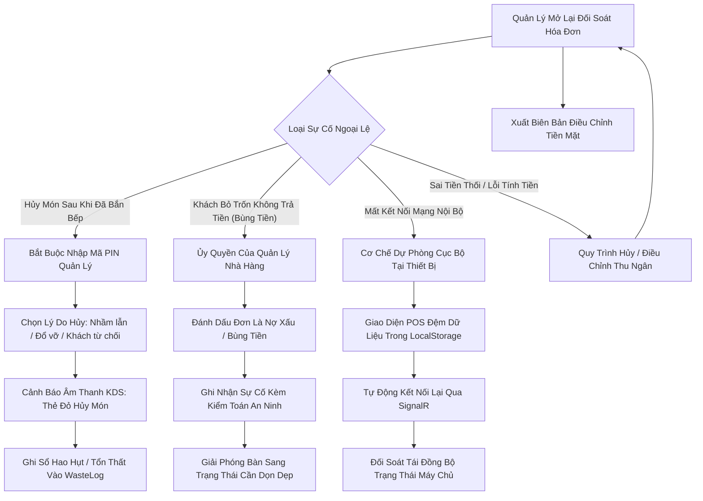

# Đặc Tả Yêu Cầu Nghiệp Vụ (BRS) — SmartRestaurant
## (Business Requirements Specification — BRS)

- **Phiên Bản Tài Liệu**: 1.0.0
- **Trạng Thái Tài Liệu**: `CONFIRMED` (Chủ Dự án đã phê duyệt chính thức trong Task 02.6)
- **Tài Liệu Liên Quan**: [PRD.md](./PRD.md), [MODULE-OVERVIEW.md](./MODULE-OVERVIEW.md), [DOMAIN-GLOSSARY.md](./DOMAIN-GLOSSARY.md)

---

## 1. Ma Trận Vai Trò Nghiệp Vụ & Quyền Hạn (Business Actors & Permission Matrix)

| Vai Trò | Phạm Vi & Thẩm Quyền Vận Hành | Năng Lực Nghiệp Vụ Chính |
| :--- | :--- | :--- |
| **Chủ Doanh Nghiệp / Quản Trị Hệ Thống (Franchise / System Owner)** | Toàn bộ Tổ chức Doanh nghiệp | Quản lý bên thuê (Tenant), mẫu danh mục thực đơn thương hiệu, tạo chi nhánh mới. |
| **Quản Lý Nhà Hàng (Restaurant Manager)** | Chi nhánh / Cửa hàng | Thiết kế sơ đồ mặt bằng, chỉnh sửa giá món, duyệt chiết khấu, duyệt hủy món/hóa đơn, quản lý ca nhân viên, kiểm toán doanh số ngày. |
| **Trưởng Ca / Giám Sát Bàn (Floor Captain / Head Waiter)** | Khu vực Ăn uống & Bàn ăn | Quản lý đặt bàn trước, xếp chỗ khách, gộp/tách bàn, chuyển tiếp đơn hàng ưu tiên gấp. |
| **Nhân Viên Phục Vụ (Waiter / Server)** | Khu vực bàn được giao & Tiền sảnh | Tạo đơn gọi món cảm ứng, thêm tùy chọn món, bắn đơn xuống bếp, in phiếu tạm tính, nhận cảnh báo món xong. |
| **Bếp Trưởng / Trưởng Bộ Phận Bếp (Head Chef / Kitchen Lead)** | Các Bộ phận Nhà bếp | Giám sát hàng đợi thẻ món các trạm, điều phối tiếp thực (Expediter), báo tạm hết món (86), theo dõi thời gian chế biến. |
| **Đầu Bếp / Nhân Viên Nấu (Line Cook / Kitchen Staff)** | Trạm Bếp Chuyên Trách Được Giao | Xác nhận thẻ món nhận được, cập nhật tiến độ (`Đang nấu` $\rightarrow$ `Đã xong (Chờ bưng)`), báo sự cố nấu hỏng. |
| **Nhân Viên Pha Chế (Bartender / Barista)** | Quầy Bar & Trạm Đồ Uống | Quản lý hàng đợi pha chế, tuân thủ công thức đồ uống, cập nhật trạng thái đồ uống hoàn thành. |
| **Nhân Viên Tiếp Thực / Chạy Bàn (Runner / Expediter)** | Bàn Ra Món / Cửa Tiếp Thực | Phối hợp hoàn thiện các đợt món, tiếp nhận món đã nấu xong, khớp thẻ món với nhân viên bưng bàn. |
| **Thu Ngân (Cashier)** | Quầy Thu Ngân & Két Tiền Mặt | Áp dụng giảm giá/voucher, xử lý thanh toán (Tiền mặt, Thẻ, VietQR), tách/gộp hóa đơn, đối soát tiền mặt cuối ca. |
| **Thủ Kho / Nhân Viên Quản Lý Tồn Kho (Stockkeeper / Inventory Staff)**| Kho Hàng Nhà Hàng | Nhập hàng mua sắm, theo dõi nhà cung cấp, kiểm kê định lượng món (BOM), ghi sổ hao phí hỏng hóc. |

---

## 2. Yêu Cầu Chức Năng Chi Tiết Theo Miền Nghiệp Vụ (Granular Functional Requirements)

### 2.1. Miền 01: Thiết Lập Nhà Hàng, Khu Vực & Sơ Đồ Bàn (Restaurant Setup, Areas & Floor Plan)
- **BR-AREA-001 (Phân Cấp Đa Khu Vực)**: Một chi nhánh nhà hàng phải hỗ trợ nhiều khu vực ăn uống riêng biệt (ví dụ: *Tầng 1 Trong Nhà*, *Sân Vườn Ngoài Trời*, *Phòng VIP*, *Khu Vực Tầng Thượng*).
- **BR-AREA-002 (Phòng Ăn & Phòng VIP Riêng Biệt)**: Trong một khu vực, hệ thống phải hỗ trợ các phòng độc lập (ví dụ: *Phòng 101*, *Sảnh Tiệc*) và các phòng VIP riêng biệt (ví dụ: *VIP 1*, *VIP 2*, *VIP 3*).
- **BR-AREA-003 (Canvas Sơ Đồ Bàn 2D Trực Quan)**:
  - Quản lý có thể tự thiết kế sơ đồ mặt bằng bằng công cụ kéo thả tương tác.
  - Hỗ trợ các hình dạng bàn cấu hình linh hoạt: Bàn tròn (2, 4, 8 ghế), Bàn chữ nhật (2, 4, 6, 8, 10 ghế), Bàn vuông (2, 4 ghế) và Bàn ghế sofa chữ L / Booth.
  - Hỗ trợ vẽ các vật cản kiến trúc: Cột nhà, tường ngăn, quầy thu ngân, cửa ra vào và lối đi để phản ánh chính xác thực tế mặt bằng.
- **BR-AREA-004 (Bao Trọn Phòng / Đặt Nguyên Khu Vực)**:
  - Hệ thống cho phép đặt trước hoặc phục vụ bao trọn một phòng hoặc một khu vực cho các sự kiện tiệc riêng tư của doanh nghiệp, tự động khóa toàn bộ các bàn con bên trong không cho khách vãng lai ngồi.
- **BR-AREA-005 (Trực Quan Hóa Trạng Thái Bàn Thời Gian Thực)**:
  - Điểm bàn trên sơ đồ mặt bằng phải hiển thị huy hiệu trạng thái theo mã màu trực quan:
    - `Available` (Màu xanh lá / Trung tính): Bàn trống, sẵn sàng đón lượt khách mới.
    - `Reserved` (Màu xanh dương): Đã có khách hẹn trước, kèm đồng hồ đếm ngược giờ đến.
    - `Occupied` (Màu vàng hổ phách): Đang có khách ngồi ăn, có đơn hàng đang hoạt động.
    - `BillingRequested` (Màu tím): Khách đã yêu cầu in phiếu tạm tính, đang chờ thu tiền.
    - `CleaningNeeded` (Màu cam): Đã thanh toán xong, khách đã rời đi, chờ nhân viên dọn bàn.
    - `OutOfService` (Màu xám): Bàn bị hỏng, bảo trì hoặc khu vực tạm thời đóng cửa.

### 2.2. Miền 02: Thực Đơn, Tùy Chọn & Ánh Xạ Trạm Bếp (Menu Catalog, Modifiers & Routing)
- **BR-MENU-001 (Cấu Trúc Danh Mục Phân Cấp)**: Phân cấp đa tầng (Danh mục lớn $\rightarrow$ Danh mục con $\rightarrow$ Món ăn / Đồ uống) kèm thứ tự sắp xếp tùy chỉnh và biểu tượng hiển thị.
- **BR-MENU-002 (Biến Thể & Kích Cỡ Món Ăn)**:
  - Các món tiêu chuẩn có thể có các biến thể kích cỡ (ví dụ: Nhỏ, Vừa, Lớn; 0.5kg vs 1.0kg) với giá bán và mã SKU riêng biệt.
- **BR-MENU-003 (Nhóm Tùy Chọn & Món Ăn Kèm - Topping)**:
  - **Bắt buộc chọn 1 (Single-choice required)**: Ví dụ: Chọn loại sợi bánh: Phở / Bún / Mì trứng.
  - **Tự chọn nhiều có giới hạn (Multi-choice optional with min/max caps)**: Ví dụ: Topping: Chọn tối thiểu 0, tối đa 3 trong 10 lựa chọn.
  - **Thuộc tính chế biến**: Mức đường (0%, 30%, 50%, 100%), Mức đá (Không đá, Ít đá, Bình thường), Độ cay (Không cay, Cay vừa, Cay nồng, Siêu cay).
  - **Cờ cảnh báo dị ứng**: Không chứa gluten, Đậu phộng, Hải sản, Sữa.
- **BR-MENU-004 (Quy Tắc Phân Tuyến Trạm Bếp Động)**:
  - Mọi món ăn phải được liên kết với một bộ phận bếp phụ trách (`HotKitchen`, `ColdKitchen`, `BarStation`, `BakeryStation`).
  - Hỗ trợ quy tắc ghi đè trạm theo biến thể món (ví dụ: Bia chai đóng sẵn $\rightarrow$ Trạm lấy đồ FOH của phục vụ; Cocktail pha chế $\rightarrow$ Quầy Bar).
- **BR-MENU-005 (Tồn Khả Dụng & Báo Tạm Hết Món - 86)**:
  - Trưởng bếp hoặc quản lý có thể đánh dấu bất kỳ món ăn nào là `Tạm hết món` (86 / Out-of-Stock).
  - Món bị báo hết sẽ ngay lập tức bị khóa trên toàn bộ máy tính bảng phục vụ và màn hình POS kèm hiệu ứng làm mờ để ngăn chặn việc nhận đơn món đã hết.

### 2.3. Miền 03: POS, Tiếp Nhận Đơn & Dịch Vụ Tại Bàn (POS, Order Capture & Table Service)
- **BR-ORD-001 (Khởi Tạo Lượt Khách)**: Xếp khách vào một bàn đang `Trống` sẽ tạo ra một `Lượt khách` (DiningSession) riêng biệt kèm số lượng khách và nhân viên phục vụ phụ trách.
- **BR-ORD-002 (Tạo Đơn Hàng & Giỏ Hàng Nháp)**:
  - Phục vụ chọn món qua lưới cảm ứng, tìm kiếm theo tên món, viết tắt (ví dụ: "BCT" cho Bò Cuộn Tiêu) hoặc duyệt danh mục.
  - Thêm tùy chọn, ghi chú riêng bằng văn bản tự do (ví dụ: "ít muối cho người lớn tuổi") và ghi nhận thông tin dị ứng của khách.
- **BR-ORD-003 (Báo Bếp / Bắn Đơn Xuống Bếp)**:
  - Khi bấm "Báo bếp" (Fire to Kitchen), các món trong giỏ hàng nháp được xác thực hợp lệ, lưu vào cơ sở dữ liệu và phát sóng qua SignalR tới các trạm bếp KDS đích.
- **BR-ORD-004 (Gọi Thêm Món Theo Đợt)**:
  - Khách có thể gọi thêm các đợt đồ uống, món ăn hoặc tráng miệng bất kỳ lúc nào.
  - Các món mới được nối thêm vào lượt khách hiện tại dưới dạng Đợt 2, Đợt 3, v.v., bảo toàn dấu ấn thời gian và phân tuyến độc lập mà không ảnh hưởng tới các món đã nấu trước đó.
- **BR-ORD-005 (Nghiệp Vụ Bàn — Chuyển Bàn & Gộp Bàn)**:
  - **Chuyển bàn (Move Table)**: Phục vụ chuyển lượt khách đang phục vụ từ Bàn 12 sang Bàn 15 (ví dụ: khách chuyển từ trong nhà ra sân vườn). Toàn bộ các món chưa thanh toán, thẻ KDS và phiếu tạm tính được chuyển tiếp nguyên vẹn.
  - **Gộp bàn (Merge Tables)**: Kết hợp Bàn 4 và Bàn 5 thành một đơn chính duy nhất (ví dụ: hai đoàn khách nhập lại). Các phiếu con được gom vào một tài khoản hóa đơn tổng.
- **BR-ORD-006 (Đơn Nhiều Bàn Cho Đoàn Lớn)**:
  - Một đoàn tiệc lớn có thể ngồi chiếm nhiều bàn vật lý (ví dụ: Bàn 21, 22, và 23) dưới một lượt khách thống nhất và một hóa đơn tổng đại diện.

### 2.4. Miền 04: Màn Hình Bếp KDS & Điều Phối Chế Biến (KDS & Prep Routing)
- **BR-KDS-001 (Tự Động Tách Thẻ Món Theo Trạm)**:
  - Khi Đơn #104 gồm (2x Bít tết, 1x Salad Caesar, 2x Cocktail), hệ thống tự động tách đơn:
    - KDS Bếp Nóng nhận: `2x Bít tết`.
    - KDS Bếp Nguội nhận: `1x Salad Caesar`.
    - KDS Quầy Bar nhận: `2x Cocktail`.
    - KDS Bàn Ra Món (Expediter) nhận đầy đủ cả 5 món kèm vị trí số bàn (#12).
- **BR-KDS-002 (Các Trạng Thái Vòng Đời Thẻ Món KDS)**:
  - Các món ăn tiến triển qua các trạng thái vận hành được định nghĩa nghiêm ngặt:
    - `Pending` (Chờ chế biến): Phục vụ vừa bắn đơn; đang trong hàng đợi chờ đầu bếp nhận nấu.
    - `Cooking` (Đang nấu): Đầu bếp đã bấm xác nhận bắt đầu chế biến.
    - `ReadyToServe` (Đã xong, chờ bưng): Đã nấu xong, đặt tại cửa sổ ra món; chuông báo phục vụ.
    - `Served` (Đã phục vụ): Đã bưng lên bàn khách thành công; xóa khỏi hàng đợi KDS hoạt động.
- **BR-KDS-003 (Đồng Hồ Cảnh Báo SLA & Ngưỡng Màu Sắc)**:
  - Mỗi thẻ món theo dõi thời gian trôi qua thực tế kể từ khi báo bếp:
    - **Huy hiệu Xanh lá**: Thời gian trôi qua $< 10$ phút.
    - **Huy hiệu Vàng**: Thời gian trôi qua $10 - 20$ phút.
    - **Cảnh báo Đỏ nhấp nháy**: Thời gian trôi qua $> 20$ phút (Vi phạm cam kết chất lượng SLA).
- **BR-KDS-004 (Tạm Giữ Món & Báo Nấu Món Giữ)**:
  - Nhân viên phục vụ có thể đánh dấu món ở trạng thái "Tạm giữ" (ví dụ: Món tráng miệng tạm giữ cho đến khi ăn xong món chính). Món tạm giữ hiển thị màu xám mờ trên KDS cho đến khi phục vụ bấm "Báo nấu món giữ".

### 2.5. Miền 05: Thu Ngân, Tính Tiền & Thanh Toán Đa Kênh (Cashier, Billing & Multi-Channel Payments)
- **BR-BIL-001 (Công Thức Tính Tiền Chuẩn Hóa)**:
  $$\text{Tổng tiền món} = \sum (\text{Giá gốc} + \text{Tùy chọn thêm}) \times \text{Số lượng}$$
  $$\text{Tiền món tạm tính (Subtotal)} = \sum \text{Tổng tiền món} - \text{Chiết khấu theo món}$$
  $$\text{Số tiền sau giảm giá} = \text{Tiền món tạm tính} - \text{Voucher toàn đơn}$$
  $$\text{Phí dịch vụ} = \text{Số tiền sau giảm giá} \times \text{Tỷ lệ phí dịch vụ (ví dụ: 5\%)}$$
  $$\text{Căn cứ tính thuế GTGT} = \text{Số tiền sau giảm giá} + \text{Phí dịch vụ}$$
  $$\text{Thuế GTGT (VAT)} = \text{Căn cứ tính thuế} \times \text{Thuế suất GTGT (ví dụ: 8\% hoặc 10\%)}$$
  $$\text{Tổng thanh toán} = \text{Căn cứ tính thuế} + \text{Thuế GTGT} + \text{Các khoản phụ thu}$$
- **BR-BIL-002 (Các Chế Độ Tách Hóa Đơn)**:
  - **Tách theo món được chọn**: Chuyển món A & B sang Hóa đơn 1, món C & D sang Hóa đơn 2. Thuế và giảm giá được tính toán lại theo tỷ lệ tương ứng trên từng hóa đơn tách.
  - **Chia đều (1/N)**: Lấy tổng số tiền thanh toán chia đều cho $N$ phần bằng nhau (ví dụ: 4 khách chia hóa đơn 1.200.000 ₫ sẽ trả 300.000 ₫ mỗi người).
- **BR-BIL-003 (Thanh Toán Kết Hợp Nhiều Hình Thức - Multi-Tender)**:
  - Một hóa đơn có thể được thanh toán bằng nhiều hình thức kết hợp (ví dụ: 500.000 ₫ Tiền mặt + 700.000 ₫ Chuyển khoản VietQR).
- **BR-BIL-004 (Tích Hợp Tự Động Mã QR Động VietQR)**:
  - Hiển thị mã VietQR động gồm Mã định danh ngân hàng (BIN), Số tài khoản, Số tiền chính xác và Mã tham chiếu thanh toán duy nhất.
  - Màn hình thu ngân tự động xác nhận thanh toán khi nhận được webhook giao dịch thành công hoặc đối soát thủ công.
- **BR-BIL-005 (Quản Lý Két Tiền & Vận Hành Ca)**:
  - Bắt buộc Mở ca: Thu ngân nhập số tiền mặt đầu ca chuẩn bị trong két (ví dụ: 2.000.000 ₫ tiền thối).
  - Chốt ca: Thu ngân thực hiện đếm tiền mù (Blind Drop); hệ thống đối soát chênh lệch ($\text{Số thực đếm} - \text{Hệ thống tính}$) và in báo cáo chốt ca Z-Report.

### 2.6. Miền 06: Bản Địa Hóa Thị Trường Việt Nam & Quy Chuẩn In Ấn
- **BR-LOC-001 (Giao Diện Tiếng Việt 100%)**:
  - Toàn bộ màn hình FOH, BOH, Thu ngân và Quản trị hiển thị tiếng Việt tự nhiên, chuẩn mực, tuân thủ nghiêm ngặt [VIETNAMESE-LOCALIZATION-STANDARD.md](./VIETNAMESE-LOCALIZATION-STANDARD.md).
- **BR-LOC-002 (Định Dạng Quy Chuẩn Khu Vực Việt Nam)**:
  - Tiền tệ hiển thị theo đồng Việt Nam định dạng `#,,### ₫` (không có phần thập phân lẻ).
  - Ngày tháng định dạng `dd/MM/yyyy`, thời gian định dạng 24h `HH:mm:ss`, múi giờ cố định `Asia/Ho_Chi_Minh` (UTC+7).
- **BR-LOC-003 (Tiêu Chuẩn In Ấn Phiếu Nhiệt ESC/POS)**:
  - Phiếu tạm tính và Hóa đơn thanh toán phải in đầy đủ dấu tiếng Việt qua mã hóa UTF-8 ESC/POS (kèm mã trang CodePage 1258 và phương án dự phòng ASCII không dấu).
- **BR-LOC-004 (Sẵn Sàng Hóa Đơn Điện Tử Khởi Tạo Từ Máy Tính Tiền)**:
  - Hóa đơn lưu trữ đầy đủ siêu dữ liệu thuế của khách hàng (Tên công ty, Mã số thuế, Địa chỉ, Email) để sẵn sàng kết nối API với các nhà cung cấp giải pháp HĐĐT theo Thông tư 78/Nghị định 123 trong các bản phát hành sau MVP.

---

## 3. Các Quy Tắc Nghiệp Vụ Bắt Buộc & Chính Sách Ràng Buộc (Business Rules & Policies)

| Mã Quy Tắc | Miền Nghiệp Vụ | Phát Biểu Quy Tắc Nghiệp Vụ | Cấp Độ Thực Thi |
| :--- | :--- | :--- | :--- |
| **BR-RULE-01** | Quản lý Bàn | Bàn không thể được gán cho lượt khách mới nếu đang ở trạng thái `Occupied` (Có khách), `BillingRequested` (Đang thanh toán), hoặc `CleaningNeeded` (Cần dọn dẹp). | Chặn Cứng Hệ Thống (Hard System Block) |
| **BR-RULE-02** | Điều chỉnh Đơn | Khi món ăn đã chuyển sang trạng thái `Cooking` (Đang nấu) hoặc `ReadyToServe` (Đã xong, chờ bưng), phục vụ KHÔNG THỂ xóa hoặc hủy món nếu thiếu mã PIN Quản lý ủy quyền và lý do hủy bắt buộc. | Phê Duyệt Của Quản Lý (Manager Authorization) |
| **BR-RULE-03** | Quy trách nhiệm Hao phí | Bất kỳ món ăn nào bị hủy sau khi đã vào trạng thái `Cooking` BẮT BUỘC phải được ghi nhận vào Sổ Ghi Nhận Hao Phí Nhà Bếp (Waste Register) (ghi nhận trực tiếp theo đơn vị suất ăn trong MVP; trừ BOM nguyên liệu trong v1.1). | Tự Động Tuân Thủ (Automatic Compliance) |
| **BR-RULE-04** | Chuyển Bàn | Yêu cầu chuyển bàn bị từ chối nếu bàn đích hiện đang có một lượt khách khác đang hoạt động. | Chặn Cứng Hệ Thống (Hard System Block) |
| **BR-RULE-05** | Cộng dồn Khuyến mãi | Giảm giá khuyến mãi theo từng món không được cộng dồn với voucher giảm giá theo phần trăm toàn đơn, trừ khi được bật rõ trong cấu hình cài đặt của nhà hàng. | Chính Sách Cấu Hình (Configurable Policy) |
| **BR-RULE-06** | Bàn Đang Thanh Toán Vẫn Cho Phép Sửa Đổi | Khi bàn đang ở trạng thái `BillingRequested` (Đang thanh toán), hóa đơn chưa thanh toán vẫn hoàn toàn được phép chỉnh sửa. Nhân viên có thể thêm, bớt hoặc điều chỉnh món (tuân thủ phân quyền và lưu vết kiểm toán). Món mới gọi thêm mặc định được nối tiếp vào hóa đơn chưa thanh toán hiện có, hoặc nhân viên có thể chủ động chọn tạo một hóa đơn con mới. Nhiều hóa đơn con có thể cùng tồn tại và được thanh toán độc lập. Bàn CHỈ ĐƯỢC GIẢI PHÓNG khi 100% hóa đơn đã thanh toán và hoàn tất phục vụ. Nghiêm cấm trực tiếp sửa đổi các hóa đơn đã thanh toán xong. | Linh Hoạt Vận Hành & Bảo Vệ Kiểm Toán |
| **BR-RULE-07** | Chốt Ca Thu Ngân | Thu ngân không thể đóng ca làm việc nếu vẫn còn hóa đơn mở chưa thanh toán do thiết bị của thu ngân đó khởi tạo. | Chặn Cứng Hệ Thống (Hard System Block) |
| **BR-RULE-08** | Ngày Kinh Doanh Theo Ca | Toàn bộ đơn hàng và hóa đơn tạo trong một ca làm việc đang mở đều thuộc về `BusinessDate` của ca đó (cấu hình theo chi nhánh, mặc định mốc cắt 06:00 sáng), bảo toàn tính liên tục kế toán xuyên nửa đêm. | Bất Biến Kế Toán (Accounting Invariant) |
| **BR-RULE-09** | Khóa Tồn Kho Hai Pha | Bắn đơn xuống bếp sẽ khóa tạm giữ tồn kho hàng đếm được (`ReservedStock`); bếp nấu xong hoặc phục vụ hoàn thành sẽ chuyển sang tiêu hao thực tế (`ConsumedStock`). Công thức: $\text{Khả dụng} = \text{Thực tế} - \text{Tạm giữ}$. Chống bán âm kho. | Toàn Vẹn Tồn Kho (Inventory Integrity) |
| **BR-RULE-10** | Xử Lý Tranh Chấp Thanh Toán VietQR | Khi chuyển phương thức thanh toán sang Tiền mặt, mã QR đang mở bị vô hiệu hóa; webhook ngân hàng đến muộn được điều hướng vào `Giao dịch treo đối soát` (Suspense Ledger) kèm cảnh báo thị giác/âm thanh tức thì để quản lý đối soát thủ công. | An Toàn Thanh Toán (Payment Safety) |
| **BR-RULE-11** | Tách Bill Không Khóa Bàn | Bàn đang thực hiện tách hóa đơn KHÔNG BỊ ĐÓNG BĂNG. Nhân viên phục vụ tiếp tục gọi thêm món vào các hóa đơn con đang mở với chỉ định đích rõ ràng. Bàn chỉ giải phóng khi 100% hóa đơn con đã thanh toán và toàn bộ món đã phục vụ. | Bất Biến Vòng Đời (Lifecycle Invariant) |
| **BR-RULE-12** | Hủy Gộp Bàn Phân Bổ Lại Món | Các bàn đã gộp có thể hủy gộp bất kỳ lúc nào; nhân viên phân bổ lại các món ăn tương ứng về bàn tách ra mà không phải bắn lại phiếu chế biến xuống nhà bếp. | Bảo Vệ Vận Hành (Operation Guard) |
| **BR-RULE-13** | Lưu Vết Phụ Thu Phòng & Khu Vực | Phòng VIP và khu vực hỗ trợ phụ thu theo tỷ lệ % hoặc số tiền cố định được chốt số liệu tại thời điểm tạo hóa đơn; thao tác chuyển bàn không tính toán lại hồi tố các món đã dùng trước đó. | Minh Bạch Hóa Đơn (Billing Transparency) |
| **BR-RULE-14** | Phân Tuyến Trực Tiếp Tại Quầy FOH | Đồ uống đóng chai sẵn và món lấy ngay được phục vụ trực tiếp tại quầy FOH, bỏ qua hàng đợi pha chế của Bar KDS nhưng vẫn bảo đảm liên kết đầy đủ với kiểm soát hóa đơn, doanh thu và tồn kho. | Tối Ưu Tốc Độ Pha Chế |
| **BR-RULE-15** | Làm Lại Món Do Lỗi Bếp (Remake Dish) | Món ăn nấu lại do lỗi nhà bếp không tính thêm tiền cho khách, sinh thẻ KDS làm lại món ưu tiên cao và tự động ghi nhận tổn thất nguyên liệu vào Sổ Ghi Nhận Hao Phí (WasteLog). | Chất Lượng & Kế Toán |
| **BR-RULE-16** | Gọi Món Đồng Thời Không Khóa Bàn | Nhiều nhân viên phục vụ có thể cùng lúc chọn món vào một bàn mà không bị khóa chặn bàn; hệ thống bảo đảm cơ chế chỉ nối thêm (append-only) an toàn và phát hiện xung đột cập nhật từng món. | Kiểm Soát Đồng Thời (Concurrency Rule) |
| **BR-RULE-17** | Xử Lý Khiếu Nại Hóa Đơn Đã Đóng (OD-14) | Hóa đơn đã quyết toán (`IsSettled = true`) là bất biến tuyệt đối trong CSDL MVP. Mọi sai sót tiền mặt được xử lý hoàn tiền thủ công ngoài quầy kèm "Biên bản điều chỉnh sai lệch két giấy" ký tay; hệ thống ghi nhận khoản tiền lệch vào thực thể `ShiftClosingVarianceLog` khi chốt ca kiểm tiền mù kèm mã hóa đơn gốc (`OriginalInvoiceId`); hoãn chức năng sinh bút toán `CreditNote` số hóa sang phiên bản v1.1. | Bất Biến Tài Chính & Kiểm Toán Két |
| **BR-RULE-18** | Phiên Bàn Kéo Dài > 24 Giờ (OQ-07) | Bàn ăn mở kéo dài hơn 24 giờ qua một hoặc nhiều mốc cắt ca vẫn giữ nguyên `BusinessDate` ban đầu khi mở theo nguyên tắc `D1`, đồng thời hiển thị dải băng cảnh báo màu cam cho Quản lý kiểm tra vận hành, nghiêm cấm việc tự động cưỡng bức đóng bàn làm gián đoạn bữa ăn của khách. | Bảo Toàn Phiên & Cảnh Báo Vận Hành |

---

## 4. Xử Lý Tình Huống Ngoại Lệ & Quy Trình Lỗi (Exceptional Workflows)

1. **Hủy Món Sau Khi Đã Bắn Đơn Xuống Bếp**:
   - Nếu khách hủy món khi đầu bếp đã bắt đầu nấu, phục vụ bấm "Hủy món".
   - Giao diện yêu cầu nhập mã PIN Quản lý và chọn mã lý do hủy (ví dụ: "Khách đổi ý", "Bếp làm chậm quá 30 phút", "Món bị cháy/hỏng").
   - Thông báo thẻ đỏ nhấp nháy phát âm thanh cảnh báo trên KDS trạm bếp tương ứng để đầu bếp dừng chế biến ngay lập tức.
   - Món bị loại khỏi hóa đơn của khách, nhưng hao phí định lượng được ghi vào bảng `WasteLog` để hạch toán tổn thất nhà bếp.
2. **Khách Bỏ Đi Không Trả Tiền (Walkout / Bùng Tiền)**:
   - Nếu khách rời quán mà không trả tiền, thu ngân không được phép tự ý xóa đơn hàng.
   - Quản lý bắt buộc phải phê duyệt sự cố, chuyển trạng thái đơn sang `Khách bùng / Nợ khó đòi` (Walkout / Bad Debt). Bàn chuyển sang trạng thái `Cần dọn dẹp`, và tổn thất được hạch toán vào báo cáo tổn thất vận hành của nhà hàng.
3. **Mất Kết Nối Mạng Nội Bộ (Wi-Fi Drops)**:
   - Trong trường hợp mạng Wi-Fi bị gián đoạn tạm thời, các thiết bị POS lưu tạm thời các thao tác vào bộ nhớ cục bộ (Local Storage).
   - Khi SignalR kết nối lại thành công, thiết bị thực hiện bắt tay đồng bộ hóa với máy chủ để ngăn chặn việc sinh trùng lặp thẻ món.
