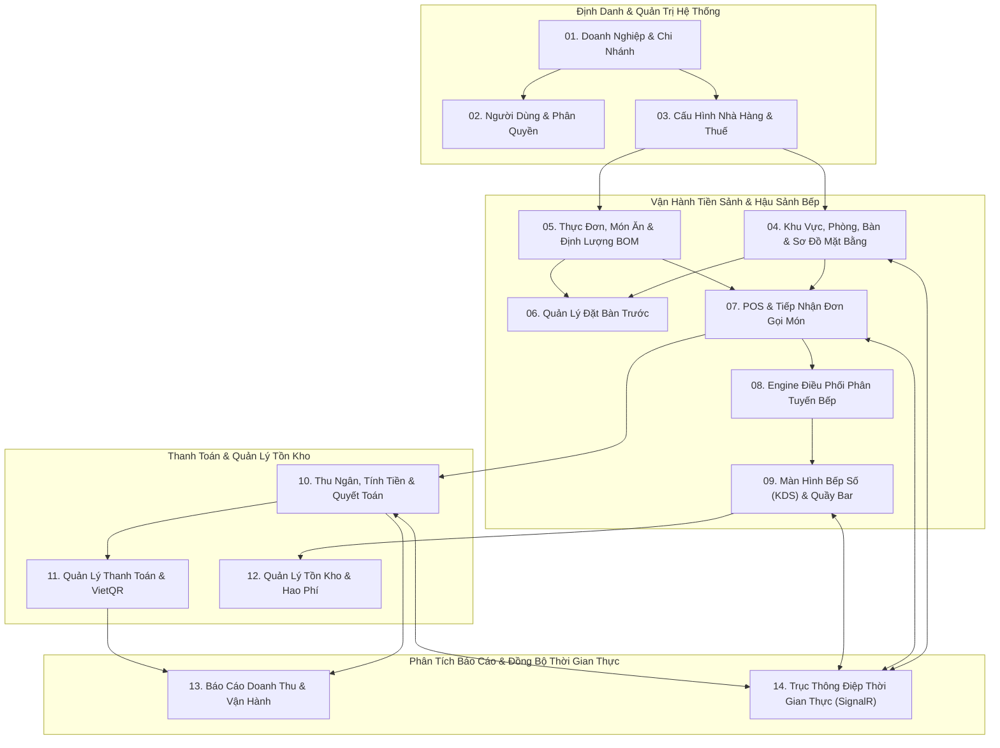

# Tổng Quan Các Phân Hệ Nghiệp Vụ & Ranh Giới Đề Xuất — SmartRestaurant
## (Business Module Overview & Proposed Boundaries)

- **Phiên Bản Tài Liệu**: 1.0.0
- **Trạng Thái Tài Liệu**: `CONFIRMED` (Chủ Dự án đã phê duyệt chính thức trong Task 02.6)
- **Tài Liệu Liên Quan**: [PRD.md](./PRD.md), [BUSINESS-REQUIREMENTS.md](./BUSINESS-REQUIREMENTS.md), [MVP-SCOPE.md](./MVP-SCOPE.md)

---

## 1. Sơ Đồ Ranh Giới Phân Hệ Kiến Trúc Modular Monolith (Modular Monolith Business Boundary Map)

SmartRestaurant được cấu trúc theo mô hình **Modular Monolith** gắn kết chặt chẽ. Logic nghiệp vụ được phân tách thành các phân hệ độc lập có tính kết dính cao. Giao tiếp giữa các phân hệ được giới hạn thông qua các giao diện dịch vụ (Service Interfaces) tường minh và các sự kiện miền nội bộ (In-Process Domain Events), ngăn chặn việc truy vấn chéo trực tiếp (Cross-join) làm phụ thuộc cơ sở dữ liệu.

---

## 2. Đặc Tả Chi Tiết 14 Phân Hệ Nghiệp Vụ (Module Specifications)

### Phân Hệ 01: Quản Trị Doanh Nghiệp & Chi Nhánh (Organization & Branch Management)
- **Trách nhiệm chính**: Thực thi phân lập dữ liệu đa khách thuê và cấu trúc phân cấp tổ chức đa chi nhánh.
- **Năng lực nghiệp vụ cốt lõi**:
  - Cấu hình tổ chức cấp cao nhất (`Organization`).
  - Thiết lập chi nhánh với giờ hoạt động, mã số thuế và thông tin liên hệ.
  - Thực thi phân vùng dữ liệu đa địa điểm (`OrganizationId`, `BranchId`).
- **Thực thể dữ liệu / Khái niệm chính**: `Organization`, `Branch`, `OperatingHours`, `BranchTaxProfile`.
- **Phụ thuộc**: Không có (Phân hệ gốc của tổ chức).
- **Phiên bản mục tiêu**: **v1.0 MVP**.

### Phân Hệ 02: Quản Lý Người Dùng & Phân Quyền (User & Access Management — RBAC)
- **Trách nhiệm chính**: Quản lý tài khoản nhân viên, xác thực, gán vai trò và ủy quyền bằng mã PIN của quản lý.
- **Năng lực nghiệp vụ cốt lõi**:
  - Khởi tạo nhân viên và gán vai trò (`Admin`, `Manager`, `Cashier`, `Waiter`, `Chef`, `Stockkeeper`).
  - Xác thực nhanh bằng mã PIN bảo mật để chuyển đổi tài khoản tức thì trên màn hình cảm ứng phục vụ/thu ngân.
  - Ủy quyền bằng mã PIN Quản lý cho các thao tác rủi ro cao (hủy hóa đơn, hủy món sau khi đã bắn bếp).
  - Ghi nhật ký kiểm toán bất biến cho các hành động nhạy cảm.
- **Thực thể dữ liệu / Khái niệm chính**: `StaffUser`, `Role`, `PermissionClaim`, `ManagerPinOverride`, `AuditLog`.
- **Phụ thuộc**: Phân hệ 01 (`Organization & Branch`).
- **Phiên bản mục tiêu**: **v1.0 MVP**.

### Phân Hệ 03: Cấu Hình Vận Hành Nhà Hàng (Restaurant Configuration)
- **Trách nhiệm chính**: Quản lý các tham số vận hành, quy tắc thuế bản địa, phí dịch vụ và mẫu in nhiệt hóa đơn.
- **Năng lực nghiệp vụ cốt lõi**:
  - Cấu hình các mức thuế suất GTGT (ví dụ: 8%, 10%).
  - Cấu hình phí dịch vụ (ví dụ: 0%, 5%, 10%) và quy tắc tính thuế trên phí dịch vụ.
  - Mẫu in máy in nhiệt (tiêu đề, chân trang, lời cảm ơn, mã QR chuyển khoản).
  - Quy chuẩn hiển thị tiền tệ (định dạng chuẩn VNĐ).
- **Thực thể dữ liệu / Khái niệm chính**: `RestaurantPolicy`, `TaxProfile`, `PrinterConfig`, `ReceiptTemplate`.
- **Phụ thuộc**: Phân hệ 01 (`Organization & Branch`).
- **Phiên bản mục tiêu**: **v1.0 MVP**.

### Phân Hệ 04: Khu Vực, Phòng Ăn, Bàn & Trình Thiết Kế Mặt Bằng (Areas, Rooms, Tables & Floor Plan)
- **Trách nhiệm chính**: Quản lý bố cục không gian vật lý của nhà hàng, trình thiết kế canvas trực quan 2D và vòng đời vận hành bàn.
- **Năng lực nghiệp vụ cốt lõi**:
  - Phân vùng đa khu vực (Trong nhà, Sân vườn, Tầng thượng, Sảnh chung).
  - Quản lý các phòng ăn độc lập và phòng VIP riêng biệt (VIP 1, VIP 2).
  - Trình thiết kế mặt bằng kéo thả tương tác 2D (Konva.js) hỗ trợ căn lưới, phóng to thu nhỏ và xoay bàn.
  - Thuộc tính hình học bàn (Tròn, Chữ nhật, Sofa) và số lượng chỗ ngồi.
  - Định vị các vật cản kiến trúc (cột nhà, vách ngăn, trạm tiếp nhận, cửa ra vào).
  - Vòng đời trạng thái bàn thời gian thực (`Available`, `Reserved`, `Occupied`, `BillingRequested`, `CleaningNeeded`, `OutOfService`).
  - Các thao tác nghiệp vụ bàn: Chuyển bàn, gộp bàn, tách bàn, hủy gộp bàn.
- **Thực thể dữ liệu / Khái niệm chính**: `DiningArea`, `Room`, `VipSuite`, `Table`, `TableNodeCoordinates`, `Obstacle`, `TableState`.
- **Phụ thuộc**: Phân hệ 01, Phân hệ 14 (`Real-Time Notification`).
- **Phiên bản mục tiêu**: **v1.0 MVP**.

### Phân Hệ 05: Thực Đơn, Danh Mục & Quản Lý Định Lượng BOM (Menu, Catalog & Recipe BOM)
- **Trách nhiệm chính**: Danh mục sản phẩm ẩm thực tổng thể, biến thể định lượng, nhóm tùy chọn món và công thức nguyên vật liệu.
- **Năng lực nghiệp vụ cốt lõi**:
  - Quản lý danh mục lớn và danh mục con kèm biểu tượng trực quan.
  - Tạo món ăn kèm giá bán cơ bản và các kích cỡ (Nhỏ, Vừa, Lớn).
  - Các nhóm tùy chọn bắt buộc hoặc tự chọn (chọn 1, chọn nhiều, giới hạn số lượng).
  - Thuộc tính chế biến riêng (mức đường, mức đá, độ cay).
  - Báo tạm hết món (86-ing / Out-of-Stock).
  - Công thức định lượng (v1.1): Ánh xạ món ăn và biến thể với định lượng nguyên vật liệu BOM chi tiết.
- **Thực thể dữ liệu / Khái niệm chính**: `Category`, `MenuItem`, `ItemVariant`, `ModifierGroup`, `ModifierOption`, `SaleableInventoryItem` (MVP); `RecipeBOM`, `Ingredient` (v1.1).
- **Phụ thuộc**: Phân hệ 01, Phân hệ 08 (`Kitchen Routing`).
- **Phiên bản mục tiêu**: **v1.0 MVP** (Danh mục thực đơn & Tùy chọn; Định lượng BOM nguyên liệu thô hoãn sang **v1.1**).

### Phân Hệ 06: Quản Lý Đặt Bàn Trước (Reservation & Guest Management)
- **Trách nhiệm chính**: Tiếp nhận lịch đặt bàn trước, số lượng khách, tiền đặt cọc và xếp bàn chờ cho khách vãng lai.
- **Năng lực nghiệp vụ cốt lõi**:
  - Tạo lịch đặt bàn với số lượng khách, giờ đến hẹn, yêu cầu đặc biệt và thông tin liên hệ.
  - Gán trước phòng hoặc bàn ăn cụ thể.
  - Đồng hồ đếm ngược giờ khách đến và cảnh báo tự động trên sơ đồ bàn.
  - Các bước chuyển trạng thái đặt bàn (`Confirmed` - Đã xác nhận, `Seated` - Đã vào bàn, `Cancelled` - Đã hủy, `NoShow` - Khách không đến).
- **Thực thể dữ liệu / Khái niệm chính**: `Reservation`, `GuestProfile`, `DepositRecord`.
- **Phụ thuộc**: Phân hệ 04 (`Tables & Areas`).
- **Phiên bản mục tiêu**: **v1.0 MVP (MVP Optional)** (Quản lý đặt bàn cốt lõi bật/tắt linh hoạt 1 chạm theo quyết định OD-15 Phương án A; CRM nâng cao trong v1.2).

### Phân Hệ 07: POS & Quản Lý Đơn Gọi Món (POS & Order Management)
- **Trách nhiệm chính**: Tiếp nhận gọi món tiền sảnh, giao diện cảm ứng máy tính bảng, quản lý đợt gọi món và theo dõi phiên ăn uống.
- **Năng lực nghiệp vụ cốt lõi**:
  - Khởi tạo lượt khách ăn uống ngay khi xếp khách vào bàn trống.
  - Giao diện nhập đơn cảm ứng tốc độ cao kèm tìm kiếm nhanh và chọn tùy chọn 1 chạm.
  - Quản lý các đợt gọi thêm món tăng dần (Đợt 1, Đợt 2, Đợt 3).
  - Bắn đơn xuống bếp được thực thi trong giao dịch cơ sở dữ liệu nguyên tử.
  - Điều chỉnh đơn (thêm món, giảm giá theo món, ghi chú của khách).
  - Hủy món sau khi đã bắn bếp với sự phê duyệt qua mã PIN Quản lý và lý do hủy bắt buộc.
  - Hỗ trợ các loại hình đơn: Ăn tại chỗ (`DineIn`), Mang đi (`Takeaway`), Giao hàng (`Delivery`).
- **Thực thể dữ liệu / Khái niệm chính**: `DiningSession`, `Order`, `OrderRound`, `OrderItem`, `OrderItemModifier`, `OrderType`.
- **Phụ thuộc**: Phân hệ 02, Phân hệ 04, Phân hệ 05, Phân hệ 08, Phân hệ 14.
- **Phiên bản mục tiêu**: **v1.0 MVP**.

### Phân Hệ 08: Engine Điều Phối Phân Tuyến Bếp (Kitchen Routing Engine)
- **Trách nhiệm chính**: Phân tích các món trong đơn và tự động bóc tách thành các phiếu chế biến gửi đến các trạm bếp chuyên trách.
- **Năng lực nghiệp vụ cốt lõi**:
  - Cấu hình ánh xạ trạm chế biến theo từng món ăn và biến thể.
  - Bóc tách đơn đa trạm (món nướng gửi Bếp Nóng, món gỏi gửi Bếp Nguội, đồ uống gửi Quầy Bar).
  - Tổng hợp toàn bộ phiếu món tại màn hình Trưởng Bếp Tiếp Thực (Master Expediter).
  - Điều phối thứ tự ra món và lệnh "Tạm giữ món / Báo nấu món giữ" (ví dụ: tạm giữ món tráng miệng).
- **Thực thể dữ liệu / Khái niệm chính**: `KitchenStation`, `RoutingRule`, `TicketDecomposer`.
- **Phụ thuộc**: Phân hệ 05 (`Menu Catalog`), Phân hệ 07 (`Order Management`).
- **Phiên bản mục tiêu**: **v1.0 MVP**.

### Phân Hệ 09: Màn Hình Bếp Số (KDS) & Quầy Pha Chế (Kitchen Display System & Bar Operations)
- **Trách nhiệm chính**: Hàng đợi thẻ món kỹ thuật số nhà bếp, chuyển trạng thái 1 chạm và giám sát thời gian cam kết SLA.
- **Năng lực nghiệp vụ cốt lõi**:
  - Các thẻ món trực quan độ tương phản cao sắp xếp theo thứ tự thời gian vào trước làm trước (FIFO).
  - Chuyển trạng thái từng món hoặc cả phiếu (`Chờ chế biến` $\rightarrow$ `Đang nấu` $\rightarrow$ `Đã xong - Chờ bưng` $\rightarrow$ `Đã phục vụ`).
  - Đồng hồ cảnh báo SLA theo mã màu: Xanh lá (<10p), Vàng (10–20p), Đỏ nhấp nháy (>20p).
  - Cửa sổ Bàn Ra Món hiển thị mức độ hoàn thành đồng bộ của toàn bộ bàn ăn.
  - Âm thanh chuông báo khi có thẻ món mới, món ưu tiên gấp và món bị hủy.
- **Thực thể dữ liệu / Khái niệm chính**: `KitchenTicket`, `TicketItem`, `StationQueue`, `SlaTimerConfig`.
- **Phụ thuộc**: Phân hệ 08, Phân hệ 12 (`Inventory Deduction`), Phân hệ 14.
- **Phiên bản mục tiêu**: **v1.0 MVP**.

### Phân Hệ 10: Thu Ngân, Tính Tiền & Quyết Toán (Cashier, Billing & Settlement)
- **Trách nhiệm chính**: Xuất hóa đơn chính xác, tính thuế GTGT và phí dịch vụ, áp dụng voucher giảm giá và tách/gộp phiếu tính tiền.
- **Năng lực nghiệp vụ cốt lõi**:
  - In phiếu tạm tính để khách kiểm tra danh sách món trước khi trả tiền.
  - Công thức tính toán chuẩn mực: tiền món tạm tính, giảm giá món, voucher toàn đơn, phí dịch vụ và thuế GTGT.
  - Tách hóa đơn: *Tách theo từng món được chọn* và *Chia đều hóa đơn ($1/N$)*.
  - Gộp nhiều bàn/đơn vào một lượt thanh toán tổng duy nhất.
  - Vận hành két tiền ca làm việc: nhập tiền mặt đầu ca, nộp tiền giữa ca, chốt ca, kiểm tiền mù đối soát chênh lệch và in báo cáo Z-Report.
- **Thực thể dữ liệu / Khái niệm chính**: `Invoice`, `InvoiceLineItem`, `SplitInvoice`, `Voucher`, `ShiftSession`, `CashDrawerTransaction`.
- **Phụ thuộc**: Phân hệ 03, Phân hệ 04, Phân hệ 07, Phân hệ 11.
- **Phiên bản mục tiêu**: **v1.0 MVP**.

### Phân Hệ 11: Quản Lý Thanh Toán & Tích Hợp VietQR (Payment Management & VietQR Integration)
- **Trách nhiệm chính**: Ghi nhận thanh toán đa kênh, tích hợp cổng thanh toán và tự động đối soát giao dịch.
- **Năng lực nghiệp vụ cốt lõi**:
  - Ghi nhận thanh toán kết hợp nhiều hình thức trên một hóa đơn (Tiền mặt, Thẻ ngân hàng, Chuyển khoản VietQR).
  - Sinh mã VietQR động (Napas 24/7) hiển thị trên màn hình với số tiền thanh toán chính xác và mã đối soát duy nhất.
  - Tự động xác nhận giao dịch thành công qua webhook cổng thanh toán hoặc cơ chế polling đối soát.
  - Xử lý hoàn tiền và hủy thanh toán với sự phê duyệt qua mã PIN Quản lý.
- **Thực thể dữ liệu / Khái niệm chính**: `Payment`, `PaymentMethod`, `VietQrTransaction`, `RefundRecord`.
- **Phụ thuộc**: Phân hệ 10 (`Cashier & Billing`).
- **Phiên bản mục tiêu**: **v1.0 MVP**.

### Phân Hệ 12: Quản Lý Tồn Kho & Hao Phí (Inventory & Waste Management)
- **Trách nhiệm chính**: Theo dõi tồn kho thành phẩm đếm được (suất ăn, chai, lon) theo cơ chế Khóa Hai Pha trong MVP; theo dõi tồn kho nguyên vật liệu thô, chuyển đổi đơn vị tính và trừ kho công thức BOM trong v1.1.
- **Năng lực nghiệp vụ cốt lõi**:
  - Quản lý tồn kho hàng bán trực tiếp với cơ chế Khóa Hai Pha (`Tồn khả dụng = Tồn thực tế - Tồn tạm giữ`).
  - Sổ ghi nhận hao phí và hủy hỏng với phân loại nguyên nhân bắt buộc (Cháy khét, Đổ vỡ, Hết hạn, Khách hủy sau khi đã nấu, Làm lại món lỗi).
  - Cảnh báo chạm ngưỡng tồn thấp và tự động báo hết món (86) khi số lượng khả dụng về 0.
  - Phiếu nhập kho mua sắm và quản lý nhà cung cấp cho các mặt hàng thành phẩm.
  - Quản lý tồn kho nguyên vật liệu chi tiết nhỏ (gram, ml), bảng chuyển đổi đơn vị và trừ kho BOM (từ v1.1+).
- **Thực thể dữ liệu / Khái niệm chính**: `StockLevel`, `ReservedStock`, `WasteLog`, `PurchaseOrder` (MVP); `Ingredient`, `UnitConversion`, `BOMDeductionRule` (v1.1).
- **Phụ thuộc**: Phân hệ 05, Phân hệ 09 (`KDS Readiness`).
- **Phiên bản mục tiêu**: **v1.0 MVP** (Quản lý tồn kho hàng bán trực tiếp & Sổ hao phí; BOM nguyên liệu hoãn sang **v1.1**).

### Phân Hệ 13: Báo Cáo Doanh Thu & Trí Tuệ Doanh Nghiệp (Reporting & Business Analytics)
- **Trách nhiệm chính**: Bảng điều khiển doanh số thời gian thực, báo cáo hiệu suất lịch sử, phân bổ doanh số theo nhân viên và phân tích chênh lệch kho.
- **Năng lực nghiệp vụ cốt lõi**:
  - Bảng điều khiển doanh thu trực quan (doanh thu gộp, doanh thu thuần, số bàn đang mở, quy mô hóa đơn trung bình).
  - Doanh số theo danh mục thực đơn, mức độ phổ biến của từng món (phân tích Pareto món bán chạy).
  - Biểu đồ nhiệt theo khung giờ (lượng đơn đặt cao điểm và thời gian chế biến của bếp).
  - Tốc độ quay vòng bàn và tỷ lệ lấp đầy bàn ăn.
  - Báo cáo tổn thất: phân tích món bị hủy, chiết khấu và giá trị hao hụt hủy bỏ.
- **Thực thể dữ liệu / Khái niệm chính**: `DailySalesReport`, `ItemPerformanceMetric`, `TableUtilizationMetric`.
- **Phụ thuộc**: Phân hệ 04, Phân hệ 07, Phân hệ 09, Phân hệ 10, Phân hệ 12.
- **Phiên bản mục tiêu**: **v1.0 MVP** (Bảng điều khiển cốt lõi); Phân tích dự báo nâng cao trong v2.0.

### Phân Hệ 14: Trục Đồng Bộ Sự Kiện Thời Gian Thực (Real-Time Notification Mesh)
- **Trách nhiệm chính**: Truyền thông điệp hai chiều SignalR tập trung với độ trễ bằng không trên toàn bộ các thiết bị đang kết nối trong nhà hàng.
- **Năng lực nghiệp vụ cốt lõi**:
  - Phát sóng cập nhật trạng thái bàn theo thời gian thực (`TableHub`).
  - Phát sóng tức thì đơn gọi món mới và cảnh báo hủy món (`OrderHub`).
  - Đồng bộ hàng đợi thẻ món KDS nhà bếp thời gian thực (`KitchenHub`).
  - Xử lý tái đồng bộ trạng thái khi thiết bị di động kết nối lại mạng.
- **Thực thể dữ liệu / Khái niệm chính**: `SignalREventContract`, `ClientConnectionRegistry`, `SyncHandshake`.
- **Phụ thuộc**: Hạ tầng dùng chung (Cross-cutting) cho toàn bộ các phân hệ vận hành.
- **Phiên bản mục tiêu**: **v1.0 MVP**.
