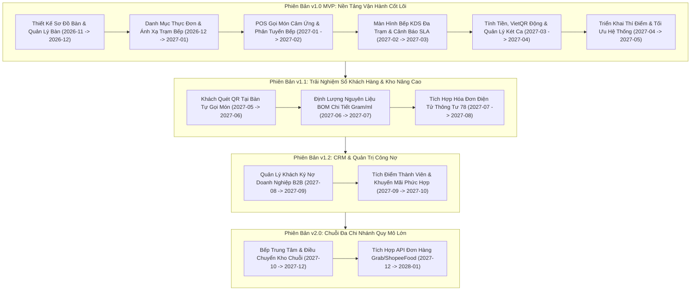
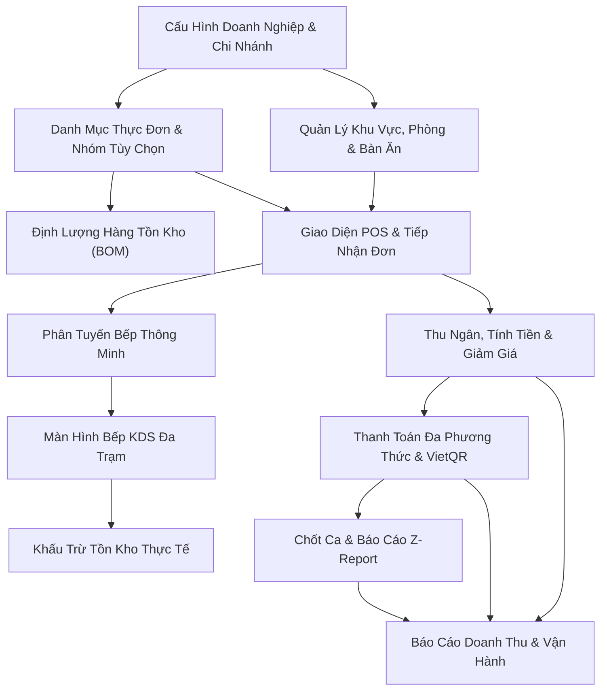

# Phạm Vi MVP & Lộ Trình Phát Hành — SmartRestaurant
## (MVP Scope & Release Roadmap)

- **Phiên Bản Tài Liệu**: 1.0.0
- **Trạng Thái Tài Liệu**: `CONFIRMED` (Chủ Dự án đã phê duyệt chính thức trong Task 02.6)
- **Tài Liệu Căn Cứ Đối Soát**: [PRD.md](./PRD.md), [BUSINESS-REQUIREMENTS.md](./BUSINESS-REQUIREMENTS.md), [MODULE-OVERVIEW.md](./MODULE-OVERVIEW.md)

---

## 1. Quản Trị Phạm Vi & Khung Ưu Tiên (Scope Governance & Prioritization Framework)

Để đảm bảo nền tảng cốt lõi ổn định, bền vững và sẵn sàng vận hành thực tế tại nhà hàng, SmartRestaurant áp dụng **Phương pháp Phân loại Ưu tiên MoSCoW** (Must Have — Bắt buộc phải có, Should Have — Nên có, Could Have — Có thể có, Won't Have — Chưa làm trong giai đoạn này).

### Các Nguyên Tắc Chỉ Đạo Xác Định Phạm Vi MVP
1. **Ưu Tiên Khả Năng Vận Hành Cốt Lõi Trước Tiên**: Một nhà hàng không thể vận hành dù chỉ một ca làm việc nếu thiếu việc theo dõi bàn ăn tin cậy, gọi món cảm ứng, phân tuyến trạm bếp và quyết toán tiền mặt/thẻ. Đây là các hạng mục bắt buộc tuyệt đối (`Must Have`).
2. **Bảo Vệ Luồng Giao Tiếp Bếp - Tiền Sảnh**: Loại bỏ phiếu giấy và thiết lập thẻ KDS cập nhật dưới một giây qua SignalR giúp ngăn ngừa nguyên nhân gây lỗi hàng đầu trong giờ cao điểm tại nhà hàng.
3. **Ngăn Ngừa Tích Hợp Sớm Các Hệ Thống Phức Tạp**: Các tính năng như cổng kết nối ứng dụng giao hàng bên thứ ba (Grab/Shopee), điều chuyển kho chuỗi đa chi nhánh và tiếp thị SMS tự động đòi hỏi phụ thuộc lớn vào bên ngoài và không mang lại giá trị cho sự ổn định của việc ăn uống trực tiếp tại quán trong tuần đầu khai trương.

---

## 2. Ma Trận Tính Năng Chi Tiết Theo Phương Pháp MoSCoW (Detailed MoSCoW Feature Matrix)

| Tính Năng / Phân Hệ | Mô Tả Chi Tiết Phạm Vi | Mức Độ Ưu Tiên | Phiên Bản Mục Tiêu | Lý Do Phân Loại & Căn Cứ |
| :--- | :--- | :---: | :---: | :--- |
| **Sơ Đồ Bàn 2D Trực Quan** | Canvas kéo thả tương tác (Konva.js), vị trí bàn, khu vực, phòng VIP. | **Bắt buộc (Must Have)** | v1.0 MVP | Căn bản để nhân viên phục vụ định vị bàn và theo dõi trạng thái bàn theo thời gian thực. |
| **Vòng Đời Trạng Thái Bàn** | `Trống`, `Có khách`, `Đã đặt trước`, `Đang thanh toán`, `Cần dọn dẹp`. | **Bắt buộc (Must Have)** | v1.0 MVP | Cực kỳ quan trọng để chống xếp trùng bàn và điều phối nhân viên dọn bàn. |
| **Chuyển Bàn, Gộp Bàn & Hủy Gộp** | Chuyển đơn mượt mà giữa các bàn; gộp bàn cho đoàn đông; hủy gộp bàn phân bổ lại món. | **Bắt buộc (Must Have)** | v1.0 MVP | Tần suất phát sinh hàng ngày rất cao tại các nhà hàng, quán nhậu và tiệc đông người. |
| **Thực Đơn Số & Tùy Chọn Món** | Danh mục, món ăn, kích cỡ, nhóm tùy chọn bắt buộc/tự chọn, cờ lấy ngay FOH, báo tạm hết món (86). | **Bắt buộc (Must Have)** | v1.0 MVP | Điều kiện tiên quyết để ghi nhận đơn hàng chính xác và xuất đồ uống quầy Bar nhanh. |
| **POS Cảm Ứng Cho Phục Vụ** | Tìm kiếm món nhanh, lưới chọn cảm ứng, ghi chú bếp, gọi thêm đợt món, ghi món đồng thời không khóa bàn. | **Bắt buộc (Must Have)** | v1.0 MVP | Công cụ làm việc chính yếu của nhân viên phục vụ tiền sảnh (FOH). |
| **Màn Hình Bếp Đa Trạm (KDS)** | Phân tuyến Bếp Nóng, Nguội, Bar, Bánh, thẻ làm lại món lỗi (Remake), đồng hồ SLA (<10p, 10-20p, >20p đỏ nhấp nháy). | **Bắt buộc (Must Have)** | v1.0 MVP | Điểm khác biệt cốt lõi; loại bỏ hoàn toàn phiếu giấy nhà bếp. |
| **Màn Hình Tiếp Thực (Expediter KDS)** | Màn hình tổng hợp toàn bộ món của bàn tại bàn ra món để điều phối nhân viên bưng bàn. | **Bắt buộc (Must Have)** | v1.0 MVP | Tránh tình trạng món ăn kèm bị nguội trong khi chờ món chính nấu xong. |
| **Tính Tiền & Thuế Phí** | Tiền tạm tính, chiết khấu món/voucher, phụ thu phòng VIP/khu vực (% hoặc số tiền), thuế GTGT cấu hình (8%/10%). | **Bắt buộc (Must Have)** | v1.0 MVP | Yêu cầu pháp lý và vận hành bắt buộc để quyết toán tài chính. |
| **Thanh Toán Đa Phương Thức** | Tiền mặt, quẹt thẻ máy POS ngân hàng, và Chuyển khoản VietQR động (kèm Hàng đợi tiền treo Suspense Ledger đối soát webhook muộn). | **Bắt buộc (Must Have)** | v1.0 MVP | Đáp ứng an toàn các thói quen thanh toán không tiền mặt phổ biến tại Việt Nam. |
| **Tách Hóa Đơn Đa Hóa Đơn (Multi-Bill)** | Phiên bàn đa hóa đơn (tách theo món, chia đều 1/N), không khóa bàn khi khách tách thanh toán trước, chỉ đóng bàn khi thanh toán 100%. | **Bắt buộc (Must Have)** | v1.0 MVP | Nhu cầu tần suất cao của các nhóm khách đi đông mà không làm gián đoạn phục vụ bàn. |
| **Vận Hành Ca Kíp & Két Tiền** | Khai báo tiền mặt đầu ca, nộp tiền giữa ca, chốt ca kiểm tiền mù, báo cáo chênh lệch, in Z-Report theo Ngày kinh doanh. | **Bắt buộc (Must Have)** | v1.0 MVP | Cần thiết cho kiểm soát nội bộ và quản trị ca làm việc xuyên đêm. |
| **Tồn Kho Hàng Hóa Đếm Được** | Quản lý tồn kho hàng thành phẩm đếm được (suất ăn, lon bia, chai nước) theo cơ chế Khóa Hai Pha (`Khả dụng = Thực tế - Tạm giữ`). | **Bắt buộc (Must Have)** | v1.0 MVP | Ngăn chặn bán vượt tồn kho mà không đòi hỏi thiết lập BOM gram/ml phức tạp ban đầu. |
| **Giao Diện Tiếng Việt 100%** | Toàn bộ giao diện tiếng Việt tự nhiên, định dạng VNĐ (`#,,### ₫`), hiển thị thời gian 24h. | **Bắt buộc (Must Have)** | v1.0 MVP | Nền tảng để nhân viên nhà hàng vận hành không gặp rào cản ngôn ngữ. |
| **Mã PIN Quản Lý Ủy Quyền** | Mã PIN bảo mật khi hủy hóa đơn, hủy món sau nấu, chiết khấu thủ công. | **Bắt buộc (Must Have)** | v1.0 MVP | Kiểm soát nội bộ sống còn chống thất thoát và gian lận. |
| **Bảng Điều Khiển Doanh Thu Trực Quan** | Doanh thu theo giờ theo Ngày kinh doanh, món bán chạy, tốc độ quay vòng bàn. | **Nên có (Should Have)** | v1.0 MVP | Cung cấp thông tin điều hành hàng ngày cho Quản lý nhà hàng. |
| **Đặt Bàn Trước (`MOD-06`)** | Lịch đặt bàn hẹn trước kèm đồng hồ đếm ngược giờ khách đến, cọc tiền và chuyển sang phiên bàn. | **MVP Tùy chọn (Optional)** | v1.0 MVP | Phục vụ đón khách đặt trước; bật/tắt linh hoạt 1 chạm; xác nhận theo OD-15 (Phương án A). |
| **Sổ Ghi Nhận Hao Phí & Hủy Hàng** | Ghi nhận món cháy, đổ vỡ và hao hụt làm lại món kèm mã lý do bắt buộc. | **Nên có (Should Have)** | v1.0 MVP | Liên kết lỗi nhà bếp với sai lệch tồn kho. |
| **Làm Lại Món Lỗi Nhà Bếp (Remake Dish)**| Thẻ làm lại món ưu tiên cao không tính thêm tiền khách; ghi sổ hao hụt WasteLog. | **Nên có (Should Have)** | v1.0 MVP | Bảo vệ độ chính xác hóa đơn của khách và theo dõi tỷ lệ sai sót của bếp. |
| **In Nhiệt Dự Phòng ESC/POS** | In phiếu tạm tính và phiếu chế biến tiếng Việt UTF-8 ra máy in nhiệt. | **Nên có (Should Have)** | v1.0 MVP | Phương án dự phòng phần cứng khi bảo trì mạng hoặc màn hình. |
| **Khách Ký Nợ Doanh Nghiệp (B2B AR)** | Quản lý hạn mức nợ, quy trình duyệt ký nợ, sổ theo dõi công nợ khách quen. | **Có thể có (Could Have)** | v1.2 | Thay thế việc ghi sổ tay bằng sổ cái công nợ chính quy sau MVP. |
| **Định Lượng BOM Chi Tiết (Gram/ml)** | Định lượng nguyên liệu thô chi tiết và trừ kho đa thành phần sâu. | **Có thể có (Could Have)** | v1.1 | Quản lý nguyên vật liệu thô nâng cao triển khai theo phân kỳ sau MVP. |
| **Khách Tự Quét QR Gọi Món Tại Bàn** | Khách tự mở menu và đặt món trên trình duyệt điện thoại. | **Có thể có (Could Have)** | v1.1 | Nâng cao trải nghiệm khách hàng, triển khai khi FOH đã vận hành ổn định. |
| **Tích Hợp Hóa Đơn Điện Tử Khởi Tạo Từ Máy Tính Tiền**| Kết nối API trực tiếp sang VNPT/Viettel/MISA phát hành HĐĐT (Thông tư 78). | **Có thể có (Could Have)** | v1.1 | Xuất hóa đơn điện tử chính thức có mã cơ quan thuế sau MVP. |
| **Khách Hàng Thân Thiết & Tích Điểm CRM** | Tích điểm thành viên, lịch sử ăn uống của khách. | **Có thể có (Could Have)** | v1.2 | Công cụ tiếp thị; chưa bắt buộc cho tuần đầu khai trương. |
| **Hỗ Trợ Đa Ngôn Ngữ (Multilingual)** | Ngôn ngữ phụ (Tiếng Anh, Hàn, Trung) qua tệp tài nguyên. | **Có thể có (Could Have)** | v2.0 | Phục vụ nhà hàng đón khách du lịch quốc tế; kiến trúc đã sẵn sàng i18n. |
| **Tích Hợp Ứng Dụng Giao Hàng** | Kết nối nhận đơn tự động từ GrabFood, ShopeeFood qua API. | **Chưa làm (Won't Have)** | v2.0 | Chi phí duy trì hợp đồng API cao; nằm ngoài trọng tâm ăn tại chỗ của MVP. |
| **Logistics Chuỗi Cung Ứng Tổng** | Điều chuyển kho liên chi nhánh và quy trình mua hàng bếp trung tâm. | **Chưa làm (Won't Have)** | v2.0 | Vận hành logistics chuỗi chưa áp dụng cho nhà hàng đơn lập MVP. |

---

## 3. Các Hạng Mục Loại Trừ Minh Bạch Trong MVP (Scope Boundary Guard)

Các năng lực sau đây được **loại trừ minh bạch** khỏi phiên bản MVP v1.0 nhằm bảo vệ tiến độ bàn giao, sự tường minh kiến trúc và độ tin cậy phần mềm:

1. **Ứng Dụng Giao Đồ Ăn Bên Thứ Ba**: Không tích hợp webhook tự động với GrabFood / ShopeeFood. Trong giai đoạn MVP, đơn từ các ứng dụng này được nhân viên nhập thủ công vào POS dưới dạng đơn "Mang đi" nếu cần.
2. **Logistics Kho Chuỗi Đa Chi Nhánh**: Mặc dù cấu trúc cơ sở dữ liệu hỗ trợ `OrganizationId` và `BranchId`, các luồng điều chuyển nguyên liệu giữa các chi nhánh và bếp trung tâm hoàn toàn không đưa vào MVP. Mỗi chi nhánh vận hành danh mục tồn kho độc lập.
3. **Cổng Khách Hàng Tự Phục Vụ / Đăng Ký Tài Khoản**: Khách hàng không cần đăng nhập hay tạo tài khoản trong MVP. Dịch vụ tại bàn được phục vụ trọn vẹn thông qua máy tính bảng của nhân viên.
4. **Thuật Toán Tự Động Tăng Giá Giờ Cao Điểm**: Không xây dựng thuật toán tự động đổi giá món theo độ đông của quán. Việc thay đổi giá được quản lý thiết lập thủ công theo lịch.
5. **Tích Hợp Thiết Bị Sinh Trắc Học**: Xác thực nhân viên dựa trên mã PIN, tài khoản và mật khẩu; không tích hợp SDK phần cứng nhận diện vân tay hay khuôn mặt.

---

## 4. Lộ Trình Phát Hành & Các Mốc Bàn Giao (Release Roadmap & Milestones)

---

## 5. Phụ Thuộc Kiến Trúc & Miền Nghiệp Vụ (Architectural & Domain Dependencies)

### Phân Tích Mối Quan Hệ Phụ Thuộc:
1. **Thực Đơn & Sơ Đồ Bàn phải có trước POS**: Không thể tạo đơn gọi món nếu chưa có bàn vật lý/ảo và các món ăn đang khả dụng.
2. **KDS đi trước Trừ Tồn Kho**: Tiêu hao tồn kho thực tế phụ thuộc vào tín hiệu hoàn thành chế biến của nhà bếp (`ReadyToServe`).
3. **Thu Ngân phụ thuộc vào Tiếp Nhận Đơn**: Hóa đơn không thể tính toán hoặc tách bill nếu thiếu các món ăn đã được xác nhận trong đơn và các voucher áp dụng.
