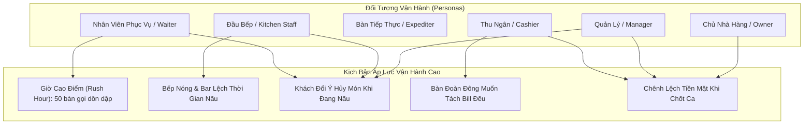

# Báo Cáo Thẩm Định & Đánh Giá Sản Phẩm — SmartRestaurant

- **Phiên bản tài liệu**: 1.0.0
- **Trạng thái tài liệu**: `CONFIRMED`
- **Mốc hoàn thành**: Task 02.5 — Rà Soát Sản Phẩm Toàn Diện & Thẩm Định Nghiệp Vụ Giai Đoạn 1 (Stage 1)
- **Tác giả**: Kiến trúc sư trưởng giải pháp & Chuyên viên phân tích nghiệp vụ
- **Ngày đánh giá**: 2026-11-02

---

## 1. Tóm Tắt Tổng Quan & Mục Tiêu Đánh Giá (Executive Summary & Review Objectives)

Tài liệu này cung cấp bản rà soát kiến trúc chính thức, toàn diện và thẩm định nghiệp vụ đối với **Bộ Tài Liệu Đặc Tả Sản Phẩm Giai Đoạn 1 (Stage 1)** của SmartRestaurant trước khi chuyển tiếp sang **Giai đoạn 2 (Thiết Kế Kỹ Thuật & Kiến Trúc Hệ Thống - Stage 2)**.

### Mục Tiêu Đánh Giá:
1. **Kiểm toán thực tế vận hành**: Thẩm định các yêu cầu nghiệp vụ dựa trên thực tế vận hành nhà hàng tại Việt Nam (nhà hàng phục vụ nhanh QSR, nhà hàng gọi món Casual Dining, mô hình Lẩu/Nướng BBQ và chuỗi nhượng quyền đa chi nhánh).
2. **Kiểm toán tính nhất quán chéo giữa các tài liệu**: Xác minh tính đồng nhất tuyệt đối về thuật ngữ, máy trạng thái (state-machine) và ranh giới nghiệp vụ xuyên suốt PRD, BRS, Phạm vi MVP, Thuật ngữ miền, Hành trình người dùng, Đặc tả module, Sơ đồ quy trình làm việc, Yêu cầu phi chức năng (NFR) và Tiêu chuẩn bản địa hóa tiếng Việt.
3. **Xác minh khả năng truy vết & Các kịch bản ngoại lệ**: Đảm bảo các tình huống biên áp lực cao trong vận hành (giờ cao điểm, bất đồng thông tin bếp-phục vụ, xung đột gộp/tách bàn, hủy món sau khi đã báo bếp, chênh lệch tiền mặt) được giải quyết triệt để ngay tại tầng logic nghiệp vụ.
4. **Cổng kiểm soát độ sẵn sàng kiến trúc**: Chứng nhận các ranh giới miền nghiệp vụ và vòng đời thực thể đã đạt độ chín muồi cần thiết để bắt đầu mô hình hóa lược đồ cơ sở dữ liệu (ERD) và đặc tả hợp đồng SignalR hub trong Giai đoạn 2 mà không còn mơ hồ về phạm vi.

---

## 2. Ma Trận Nhất Quán & Khả Năng Truy Vết Chéo Giữa Các Tài Liệu

Bộ tài liệu đặc tả Giai đoạn 1 bao gồm **10 tài liệu sản phẩm cốt lõi**, **4 tài liệu đặc tả quy trình vận hành chuyên sâu**, và **6 biên bản quyết định sản phẩm ban đầu**. Ma trận dưới đây thiết lập tính truy vết yêu cầu chính thức:

| Lĩnh vực chức năng | Điểm neo PRD | Yêu cầu nghiệp vụ (BRS) | Quy trình vận hành | Đặc tả Module | Điểm neo thuật ngữ bản địa hóa |
| :--- | :--- | :--- | :--- | :--- | :--- |
| **Quản lý Bàn & Sơ đồ** | PRD §4.1, §5.1 | `BR-AREA-001` đến `005`, `BR-RULE-01`, `04` | `FLOOR-PLAN-WORKFLOW.md` | `Module 04: Areas, Rooms, Tables` | `DOMAIN-GLOSSARY.md` §1, §2 |
| **Thực đơn & Danh mục / BOM** | PRD §4.1, §5.3 | `BR-MENU-001` đến `005`, `BR-RULE-03` | `ORDER-WORKFLOW.md` §1 | `Module 05: Menu & Recipe BOM` | `DOMAIN-GLOSSARY.md` §3 |
| **POS & Ghi nhận Đơn món** | PRD §4.1, §5.2 | `BR-ORD-001` đến `006`, `BR-RULE-02`, `06` | `ORDER-WORKFLOW.md` | `Module 07: POS & Order Management` | `DOMAIN-GLOSSARY.md` §4 |
| **Điều phối Bếp & KDS** | PRD §4.1, §5.4 | `BR-KDS-001` đến `004`, `BR-RULE-02`, `03` | `KITCHEN-WORKFLOW.md` | `Module 08: Routing`, `Module 09: KDS`| `DOMAIN-GLOSSARY.md` §4 |
| **Thu ngân & Hóa đơn** | PRD §4.1, §5.6 | `BR-BIL-001` đến `003`, `BR-RULE-05` | `CASHIER-PAYMENT-WORKFLOW.md` | `Module 10: Cashier & Billing` | `DOMAIN-GLOSSARY.md` §5 |
| **VietQR & Thanh toán** | PRD §4.1, §5.6 | `BR-BIL-004` | `CASHIER-PAYMENT-WORKFLOW.md` §1 | `Module 11: Payment Management` | `DOMAIN-GLOSSARY.md` §5 |
| **Kiểm soát Tiền & Ca làm việc** | PRD §5.8 | `BR-BIL-005`, `BR-RULE-07` | `CASHIER-PAYMENT-WORKFLOW.md` §3 | `Module 10: Cashier & Billing` | `DOMAIN-GLOSSARY.md` §5 |
| **Khấu trừ Tồn kho** | PRD §5.7 | `BR-MENU-004`, `BR-RULE-03` | `KITCHEN-WORKFLOW.md` §3.4 | `Module 12: Inventory & Waste` | `DOMAIN-GLOSSARY.md` §3 |
| **Bản địa hóa Tiếng Việt** | PRD §5.9 | `BR-LOC-001` đến `004` | Toàn bộ Quy trình (Chuỗi giao diện) | Đặc tả Xuyên suốt Toàn bộ Hệ thống | `VIETNAMESE-LOCALIZATION-STANDARD.md` |

### Kết Quả Kiểm Toán Tính Nhất Quán:
- **Không có yêu cầu mồ côi (Zero Orphaned Requirements)**: Mọi yêu cầu trong PRD đều được cụ thể hóa trong BRS, ánh xạ tới một module nghiệp vụ tường minh và được trực quan hóa trong sơ đồ tuần tự tương ứng.
- **Không có sự mơ hồ về máy trạng thái (Zero State Machine Ambiguity)**: 6 trạng thái bàn ăn (`Trống`, `Có khách`, `Đã đặt`, `Đang thanh toán`, `Cần dọn`, `Ngừng sử dụng`) và 5 trạng thái chế biến món (`Chờ chế biến`, `Đang nấu`, `Đã xong (Chờ bưng)`, `Đã phục vụ`, `Đã hủy món`) hoàn toàn đồng nhất trên tất cả các tài liệu.
- **Tuân thủ thuật ngữ nghiêm ngặt**: Tất cả các thao tác trên giao diện người dùng trong `USER-JOURNEYS.md` và sơ đồ quy trình đều tuân thủ 100% các thuật ngữ được phê duyệt trong [VIETNAMESE-LOCALIZATION-STANDARD.md](./VIETNAMESE-LOCALIZATION-STANDARD.md) và tránh các từ ngữ bị nghiêm cấm đã được tài liệu hóa.

---

## 3. Thẩm Định Đối Tượng Vận Hành & Thử Nghiệm Áp Lực (Persona Stress Validation)

### 3.1. Đối tượng 1: Nhân viên phục vụ & Trưởng ca (Waitstaff & Floor Captain)
- **Thực tế vận hành**: Di chuyển liên tục, không gian ồn ào, màn hình dính mỡ, khách hàng liên tục ngắt lời.
- **Thẩm định**:
  - *Kích thước cảm ứng*: Yêu cầu kích thước nút bấm cảm ứng tối thiểu $\ge 48 \times 48\text{ px}$ trên máy tính bảng xoay ngang giúp tránh bấm nhầm.
  - *Tốc độ chỉnh sửa món*: Các tùy chọn kèm theo được bố trí trong ngăn kéo phân loại (nước lẩu, độ cay, món gọi thêm) chọn được trong vòng $\le 2$ lần chạm.
  - *Chuyển/Gộp bàn*: Một bàn có thể được chuyển hoặc gộp trong đúng 3 thao tác chạm (`Bàn` $\rightarrow$ `Chuyển/Gộp` $\rightarrow$ `Bàn đích`), kèm phản hồi trực quan tức thì và không cần in lại phiếu giấy.

### 3.2. Đối tượng 2: Nhân viên bếp & Đầu bếp từng trạm (Kitchen Staff & Line Cooks)
- **Thực tế vận hành**: Bếp nóng, dầu sôi, bột mì, nhiệt độ môi trường cao, tiếng ồn lớn, khó đọc chữ nhỏ.
- **Thẩm định**:
  - *Cô lập theo trạm*: Đầu bếp Bếp Nóng chỉ nhìn thấy bít tết, lẩu và món xào; nhân viên pha chế chỉ thấy cocktail và bia. Hoàn toàn không bị rối mắt.
  - *Hệ thống trực quan độ tương phản cao*: Thẻ phiếu chế biến hiển thị số bàn to, đậm và tự động đổi màu theo thời gian trôi:
    - **Xanh lá (< 10 phút)**: Bình thường.
    - **Vàng (10 - 20 phút)**: Cảnh báo chú ý.
    - **Đỏ nhấp nháy (> 20 phút)**: Vi phạm SLA, ưu tiên hàng đầu.
  - *Hỗ trợ còi báo âm thanh*: Chuông cảnh báo bếp lớn đi kèm khi có đơn hối món hoặc hủy món giúp đầu bếp không cần phải nhìn chằm chằm vào màn hình liên tục.

### 3.3. Đối tượng 3: Bàn tiếp thực & Nhân viên điều phối ra món (Master Expediter & Runners)
- **Thực tế vận hành**: Đảm bảo các món ăn đi kèm được phục vụ nóng sốt cùng lúc; phối hợp các khay món bưng ra bàn.
- **Thẩm định**:
  - *Góc nhìn tổng hợp tại bàn ra món*: Màn hình Master Expediter tổng hợp các phiếu của tất cả các trạm cho cùng một bàn ăn. Khi món Bít tết Tomahawk `Đang nấu` và món salad đã `Đã xong`, người điều phối sẽ giữ đĩa salad lại bàn ra món cho đến khi đĩa bít tết hoàn thành để bưng ra cùng lúc.
  - *Điều phối một chạm*: Thao tác xác nhận bàn đã xong món sẽ gửi thông báo đến máy tính bảng của nhân viên tiếp thực kèm tiếng chuông tại bàn ra món.

### 3.4. Đối tượng 4: Thu ngân (Cashier)
- **Thực tế vận hành**: Xếp hàng dài tại quầy thanh toán, khách hàng sốt ruột muốn rời đi nhanh, nhiều phương thức thanh toán, yêu cầu chia tách hóa đơn.
- **Thẩm định**:
  - *Tốc độ tách hóa đơn*: Hỗ trợ cả *Tách theo món* (chuyển món giữa các khung hóa đơn) và *Chia đều (1/N)* trong vòng $\le 10$ giây mà không cần tính toán thủ công.
  - *Tích hợp VietQR động*: Mã QR động chứa chính xác số tiền và mã tham chiếu đơn hàng. Thu ngân không cần đọc số tài khoản hay xác minh số tiền thủ công; đối soát thanh toán diễn ra tự động và tức thì.
  - *Tính toàn vẹn ca làm việc*: Việc đếm tiền két mù ngăn chặn thu ngân can thiệp vào số liệu để che giấu các khoản thiếu hụt nhỏ.

### 3.5. Đối tượng 5: Quản lý nhà hàng & Chủ chuỗi (Manager & Franchise Owner)
- **Thực tế vận hành**: Ngăn chặn thất thoát nội bộ, theo dõi giá vốn hàng bán (COGS), giảm thiểu gian lận hủy hóa đơn.
- **Thẩm định**:
  - *Mã PIN ủy quyền của quản lý*: Không nhân viên phục vụ hay thu ngân nào có thể hủy món đã báo bếp hoặc hủy hóa đơn mà không có mã PIN 4 số của Quản lý.
  - *Sổ kiểm toán chống gian lận*: Mọi hành động can thiệp ủy quyền đều lưu lại mã nhân viên quản lý, mốc thời gian, số bàn và lý do bắt buộc.
  - *Tiêu hao định lượng BOM công thức trực tiếp*: Việc khấu trừ nguyên liệu gắn liền với thời điểm hoàn thành món ăn giúp số liệu tồn kho phản ánh đúng thực tế tiêu hao thay vì số liệu gọi món lý thuyết.

---

## 4. Kịch Bản Tình Huống Biên & Thẩm Định Hàng Rào An Toàn

### 4.1. Tình huống biên A: Các thao tác xung đột đồng thời trên cùng một bàn ăn
- **Tình huống**: Phục vụ Alex gọi thêm một lượt bia cho Bàn 04 trên máy tính bảng trong khi Thu ngân Thảo mở Bàn 04 để thanh toán tại quầy.
- **Giải pháp đã thẩm định**:
  - Thời điểm Thu ngân Thảo nhấn "In phiếu tạm tính" hoặc mở hộp thoại thanh toán, Bàn 04 chuyển sang trạng thái `Đang thanh toán` (BillingRequested).
  - Căn cứ Quyết định của Chủ nhà hàng OD-13 và PDR-009, Bàn 04 **KHÔNG bị khóa** quyền gọi món của nhân viên phục vụ. Hóa đơn mở chưa thanh toán vẫn hoàn toàn có thể chỉnh sửa.
  - Các món mới do Alex gửi mặc định được gắn vào hóa đơn mở chưa thanh toán hiện tại (tự động tính lại tổng tiền kèm nhật ký kiểm toán), hoặc Alex có thể chủ động tạo một hóa đơn con mới.
  - Màn hình của Thu ngân Thảo cập nhật tổng tiền mới theo thời gian thực hoặc yêu cầu xác nhận các món vừa gọi thêm trước khi hoàn tất thanh toán. Hóa đơn đã thanh toán là bất biến tuyệt đối.

### 4.2. Tình huống biên B: Mất kết nối Wi-Fi cục bộ tại nhà hàng
- **Tình huống**: Bộ định tuyến (router) khởi động lại trong giờ cao điểm; máy tính bảng và màn hình KDS mất kết nối SignalR trong 90 giây.
- **Giải pháp đã thẩm định**:
  - Các máy tính bảng tạm lưu các thao tác cảm ứng và đơn gọi món nháp vào bộ nhớ cục bộ trình duyệt (localStorage).
  - Màn hình KDS hiển thị nhãn cảnh báo: *"Đang kết nối lại..."* trong khi vẫn tiếp tục duy trì hiển thị tất cả các phiếu đang chế biến và đồng hồ đếm giờ cục bộ.
  - Ngay khi Wi-Fi phục hồi, máy khách tự động thực hiện bắt tay kết nối lại SignalR (`SyncHandshake`), đồng bộ lại các thay đổi trạng thái bị lỡ mà không tạo trùng phiếu.

### 4.3. Tình huống biên C: Hủy món sau khi đã báo bếp kèm hạch toán hao hụt
- **Tình huống**: Khách gọi nồi Lẩu 450.000 ₫, nhưng 8 phút sau hủy món khi nước dùng đã sôi và thịt bò đã được xếp lên đĩa.
- **Giải pháp đã thẩm định**:
  - Nhân viên phục vụ bấm "Hủy món". Hệ thống chặn lại và yêu cầu mã PIN của Quản lý.
  - Quản lý nhập mã PIN và chọn lý do: *"Khách đổi ý sau khi báo bếp"*.
  - SignalR lập tức gửi phiếu hủy nhấp nháy đỏ xuống KDS Bếp Nóng kèm chuông báo. Đầu bếp xác nhận và dừng chế biến.
  - Số tiền 450.000 ₫ được trừ khỏi hóa đơn của khách.
  - Định lượng BOM công thức (nước dùng, thịt bò, nấm) được tự động ghi nhận vào bảng `WasteLog` kèm mã lý do và định danh của quản lý, đảm bảo chênh lệch kho phản ánh đúng thực tế chế biến.

---

## 5. Mức Độ Sẵn Sàng Kỹ Thuật Cho Giai Đoạn 2 (Kiến Trúc & Mô Hình Dữ Liệu)

Bộ đặc tả nghiệp vụ đã đạt mức độ sẵn sàng kỹ thuật hoàn chỉnh để tiến hành **Giai đoạn 2 (Thiết Kế Kỹ Thuật & Kiến Trúc Hệ Thống - Stage 2)**:

1. **Ranh giới thực thể đã được xác định rõ**: Toàn bộ 14 module nghiệp vụ đề xuất đều có các thực thể, đối tượng giá trị (value objects) và mối quan hệ được mô tả tường minh, sẵn sàng cho việc ánh xạ mô hình ERD trong Entity Framework Core.
2. **Token kiểm soát tranh chấp đồng thời đã được định nghĩa**: Token khóa lạc quan (`RowVersion` / `byte[] ConcurrencyStamp`) được quy định bắt buộc cho `Table`, `DiningSession`, `Order`, `Invoice`, và `Shift`.
3. **Cấu trúc liên kết SignalR Hub đã được đặc tả**: 3 hub SignalR định kiểu mạnh riêng biệt được thiết lập:
   - `TableHub`: Sơ đồ mặt bằng thời gian thực và trạng thái bàn ăn.
   - `OrderHub`: Tiếp nhận đơn món của phục vụ, chỉnh sửa món và thông báo tạm tính.
   - `KitchenHub`: Hàng đợi phiếu chế biến từng trạm, đồng hồ SLA, cờ hối món và cảnh báo hủy món.
4. **Tách rời bản địa hóa sạch sẽ**: Tầng Ứng dụng (Application) và Tầng Miền (Domain) duy trì 100% bằng tiếng Anh (các thực thể C# POCO, repository, enum), trong khi Tầng Trình Diễn (Presentation) xử lý toàn bộ chuỗi hiển thị tiếng Việt thông qua các tệp tài nguyên (`.resx`) và từ điển chuỗi giao diện.

---

## 6. Danh Mục Kiểm Tra Ký Duyệt Thẩm Định Nghiệp Vụ (Sign-Off Checklist)

- [x] **Tầm nhìn & Phạm vi sản phẩm**: Rõ ràng, trọng tâm và không vướng phải chi phí phức tạp hóa microservices quá sớm.
- [x] **Định hướng thị trường mục tiêu**: Thiết kế tối ưu hóa riêng cho các nhà hàng và chuỗi ẩm thực F&B tại Việt Nam.
- [x] **Chuẩn mực ngôn ngữ & Khu vực**: Tầng giao diện 100% tiếng Việt, tiền tệ VNĐ (`#,,### ₫`), định dạng ngày `dd/MM/yyyy`, giờ 24h, múi giờ `Asia/Ho_Chi_Minh`.
- [x] **Vận hành sảnh (FOH) & Bếp (BOH)**: Hỗ trợ trọn vẹn vòng đời Bàn, Đơn món, KDS Đa trạm, Điều phối ra món và Quyết toán thu ngân.
- [x] **Tính toàn vẹn tài chính & Kho hàng**: Thanh toán đa phương thức, VietQR động, kiểm kê tiền két mù, Báo cáo Z chốt ca, và khấu trừ tồn kho theo định lượng món.
- [x] **Bảo mật & Tính kiểm toán**: Phân quyền RBAC chi tiết, mã PIN ủy quyền 4 số của Quản lý, và nhật ký kiểm toán chống can thiệp.
- [x] **Tính khả thi kỹ thuật**: Nền tảng Modular Monolith kiến trúc sạch (Clean Architecture) sử dụng ASP.NET Core, EF Core, SQL Server và SignalR.

---

## 7. Khuyến Nghị Hành Động & Độ Sẵn Sàng Sang Giai Đoạn 2 (Stage 2)

**Giai đoạn 1 (Khám Phá Sản Phẩm & Phân Tích Nghiệp Vụ Miền) đã được thẩm định và hoàn thiện về mặt nghiệp vụ.**

Các đặc tả sản phẩm đã được đối soát đầy đủ, vững chắc trước các kịch bản ngoại lệ vận hành, và sẵn sàng cho công tác thiết kế kiến trúc kỹ thuật. Sau khi nhận được phê duyệt chính thức từ Chủ nhà hàng (Owner Sign-off), đội ngũ kỹ thuật sẽ tiến hành triển khai **Giai đoạn 2: Thiết Kế Kỹ Thuật & Kiến Trúc Hệ Thống (TASK-03)**.
