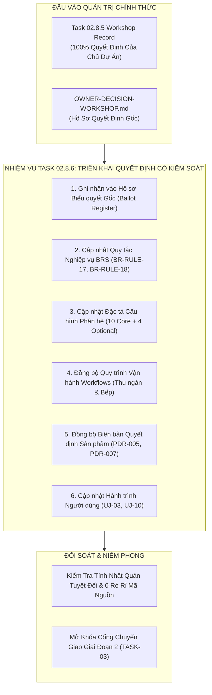

# Báo Cáo Triển Khai Quyết Định Của Chủ Dự Án Vào Tài Liệu Sản Phẩm
## TASK 02.8.6: OWNER DECISION IMPLEMENTATION REPORT

- **Dự Án**: SmartRestaurant — Hệ Thống Quản Lý Vận Hành Nhà Hàng Độc Lập
- **Giai Đoạn**: Stage 1 — Khám Phá Sản Phẩm & Đặc Tả Miền Nghiệp Vụ (Product Discovery & Business Domain Specifications)
- **Mã Nhiệm Vụ**: `TASK-02.8.6`
- **Vai Trò Đảm Nhiệm**: Chuyên Viên Phân Tích Nghiệp Vụ (BA), Người Duy Trì Tài Liệu Sản Phẩm (Documentation Maintainer) & Chuyên Viên Quản Trị Sản Phẩm (Product Governance Analyst)
- **Tài Liệu Đầu Vào Căn Cứ**:
  1. [`docs/product/OWNER-DECISION-WORKSHOP.md`](./OWNER-DECISION-WORKSHOP.md) (Hồ sơ quyết định hội thảo Task 02.8.5)
  2. [`docs/product/TASK-02.8.5-PROJECT-OWNER-DECISION-CONSOLIDATION-RECORD.md`](./TASK-02.8.5-PROJECT-OWNER-DECISION-CONSOLIDATION-RECORD.md) (Biên bản hợp nhất quyết định Task 02.8.5)
  3. [`docs/product/OWNER-DECISION-DOSSIER-AND-STAGE-2-READINESS.md`](./OWNER-DECISION-DOSSIER-AND-STAGE-2-READINESS.md) (Hồ sơ quyết định & độ sẵn sàng Stage 2)
  4. [`docs/product/MODULE-CONFIGURATION-AND-FEATURE-MANAGEMENT.md`](./MODULE-CONFIGURATION-AND-FEATURE-MANAGEMENT.md) (Đặc tả quản lý cấu hình & tính năng)
  5. [`docs/00-index.md`](../00-index.md) (Mục lục tài liệu dự án)
  6. Toàn bộ hệ thống BRS, PDRs, User Journeys và Workflows hiện hành
- **Ngày Thực Hiện**: 2026-11-06
- **Trạng Thái Quản Trị**: **`STAGE 1: OWNER-APPROVED | STAGE 2: NOT AUTHORIZED / LOCKED`**
- **Cổng Chuyển Tiếp Giai Đoạn 2 (Stage 2 Gate)**: **`NOT AUTHORIZED / LOCKED (CHỜ CHỈ THỊ BẰNG VĂN BẢN RIÊNG CỦA CHỦ DỰ ÁN)`**
- **Ghi Chú Hiệu Chỉnh Quản Trị (Governance Correction — 2026-11-06)**: Chủ Dự Án đã chính thức phê duyệt nghiệm thu Stage 1 với các finding được ghi nhận và theo dõi. Quyết định phê duyệt nghiệm thu Stage 1 KHÔNG PHẢI là ủy quyền bắt đầu Stage 2. Trạng thái quản trị chính thức được thiết lập: Stage 1 = OWNER-APPROVED, Stage 2 = NOT AUTHORIZED / LOCKED. Tuyệt đối không được khởi động Task 03 khi chưa có ủy quyền riêng.

---

## 1. Tóm Tắt Điều Hành (Executive Summary)

Nhiệm vụ **TASK-02.8.6** thực hiện việc chuyển hóa chính thức và có kiểm soát toàn bộ các quyết định phê chuẩn của **Chủ Dự Án (Project Owner)** thu được từ **Hội Thảo Quyết Định Task 02.8.5** vào hệ thống tài liệu đặc tả sản phẩm Giai đoạn 1.

Trong nhiệm vụ này:
- **Tuyên bố vai trò**: Đội ngũ kỹ thuật thực hiện với tư cách là **Chuyên Viên Phân Tích Nghiệp Vụ (BA)**, **Người Duy Trì Tài Liệu Sản Phẩm**, và **Chuyên Viên Quản Trị Sản Phẩm**. Đội ngũ **tuyệt đối không hành động với tư cách Chủ Dự Án hoặc tự ý đưa ra quyết định thay cho Chủ Dự Án**. Mọi cập nhật trạng thái từ `OPEN` sang `OWNER-CONFIRMED` đều dựa trên bằng chứng biểu quyết rõ ràng và minh bạch từ Biên bản Task 02.8.5.
- **Ranh giới kỹ thuật nghiêm ngặt (Zero Code Leakage)**: Nhiệm vụ chỉ thực hiện cập nhật tài liệu sản phẩm (Product Documentation). Tuyệt đối **không** thiết kế lược đồ cơ sở dữ liệu vật lý, **không** thiết kế hợp đồng API cụ thể, **không** định nghĩa lớp (class)/giao diện (interface) C#, **không** áp đặt thuật toán kiểm soát đồng thời (RowVersion vs Append-Only Delta), **không** tạo bất kỳ tệp C# (`.cs`), tệp dự án (`.csproj`, `.sln`), tệp di chuyển dữ liệu (EF Core migration) hay tệp SQL (`.sql`) nào, và **không** tự ý khởi động Giai đoạn 2 trước khi báo cáo này được hoàn tất.



---

## 2. Danh Sách Quyết Định Nhận Được Từ Chủ Dự Án (Owner Decisions Received)

Căn cứ theo Biên bản Hợp nhất Quyết định [`TASK-02.8.5-PROJECT-OWNER-DECISION-CONSOLIDATION-RECORD.md`](./TASK-02.8.5-PROJECT-OWNER-DECISION-CONSOLIDATION-RECORD.md), Chủ Dự Án đã trực tiếp xem xét và đưa ra quyết định đối với toàn bộ 8 vấn đề chính sách mở và phê chuẩn Cơ cấu 14 Phân hệ nghiệp vụ:

| STT | Mã Quyết Định | Tên Chính Sách Nghiệp Vụ | Quyết Định / Phương Án Nhận Được Từ Chủ Dự Án | Căn Cứ Biên Bản |
| :---: | :---: | :--- | :--- | :---: |
| 1 | **`OD-14`** | Xử lý khiếu nại & hủy hóa đơn đã thanh toán | **Phương án A**: CSDL bất biến; xử lý giấy khi chốt két ca & ghi log kiểm toán. | Task 02.8.5 §2.1 |
| 2 | **`OD-15`** | Phân vị Phân hệ Đặt bàn trước (`MOD-06`) | **Phương án A**: Đưa vào MVP diện Phân hệ Tùy chọn (`MVP Optional`). | Task 02.8.5 §2.1 |
| 3 | **`OD-16`** | Bộ Gói cấu hình mẫu khởi tạo (Presets) | **Phương án A**: Áp dụng 3 gói mẫu (Gia đình, Tiêu chuẩn, VIP) trong Wizard Onboarding. | Task 02.8.5 §2.1 |
| 4 | **`OD-17`** | Quy tắc thoát nghiệp vụ khi tắt module | **Phương án A**: Thoát phân tầng theo loại giao dịch dở dang (Graceful Drain Policy). | Task 02.8.5 §2.1 |
| 5 | **`OQ-01`** | Tách hóa đơn theo % tùy biến lẻ (60/40) | **Phương án A**: Hoãn sang v1.1; MVP hỗ trợ Tách theo món và Tách đều $1/N$. | Task 02.8.5 §2.2 |
| 6 | **`OQ-02`** | Tự động in nhiệt bếp song song khi báo bếp | **Phương án A**: Mặc định tắt (`AutoPrintOnFire: false`), ưu tiên màn hình KDS. | Task 02.8.5 §2.2 |
| 7 | **`OQ-06`** | Quy tắc tính thuế VAT trên Phí dịch vụ | **Phương án A**: Mặc định tính VAT trên Phí dịch vụ (`IsServiceChargeTaxable: true`). | Task 02.8.5 §2.2 |
| 8 | **`OQ-07`** | Bàn ăn kéo dài > 24 giờ vượt mốc cắt ca | **Phương án A**: Giữ Ngày kinh doanh gốc khi mở bàn + Cảnh báo màu cam cho Quản lý. | Task 02.8.5 §2.2 |
| 9 | **Khung Phân Hệ** | Cơ cấu phân tầng 14 Module nghiệp vụ | **Phê chuẩn 10 Core Mandatory + 4 MVP Optional Modules**. | Task 02.8.5 §2.2 |

---

## 3. Các Quyết Định Được Phê Chuẩn Rõ Ràng (Decisions Explicitly Approved)

Căn cứ quy tắc quản trị §3.1 và §3.2, toàn bộ 9 mục dưới đây được phân loại chính thức là **`OWNER-CONFIRMED`** dựa trên bằng chứng biểu quyết rõ ràng:

### 3.1. `OD-14`: Chính Sách Xử Lý Khiếu Nại, Hủy & Hoàn Tiền Hóa Đơn Đã Thanh Toán
- **Phân loại**: **`OWNER-CONFIRMED`** (Phương án A).
- **Quy tắc nghiệp vụ được xác lập**:
  1. Hóa đơn đã thanh toán (`IsSettled = true`) là bất biến tuyệt đối trong CSDL của MVP. Nghiêm cấm nhân viên thu ngân hay quản lý trực tiếp chỉnh sửa, xóa hoặc mở lại hóa đơn đã đóng tiền trên phần mềm POS.
  2. Khi có khiếu nại thực tế (ví dụ: tính nhầm tiền, khách trả lại món nguyên niêm phong), Thu ngân và Quản lý thực hiện hoàn tiền mặt thủ công ngoài quầy từ két, lập "Biên bản điều chỉnh sai lệch két giấy" ký tay giữa hai bên.
  3. Khi thực hiện kiểm tiền mù cuối ca (Blind Shift Close), hệ thống ghi nhận khoản tiền chênh lệch vào thực thể `ShiftClosingVarianceLog` (lưu vết mốc thời gian, người thực hiện, lý do chênh lệch, người xác minh mã PIN và mã hóa đơn gốc `OriginalInvoiceId`).
  4. Triệt tiêu hoàn toàn nguy cơ nhân viên thông đồng gian lận trên phần mềm trong giai đoạn vận hành ban đầu.

### 3.2. `OD-15`: Phân Vị Phân Hệ Đặt Bàn Trước (`MOD-06`) Trong Phạm Vi MVP
- **Phân loại**: **`OWNER-CONFIRMED`** (Phương án A).
- **Quy tắc nghiệp vụ được xác lập**:
  1. Xây dựng phân hệ `MOD-06` ngay trong bản phát hành MVP nhưng định vị là **Phân Hệ Tùy Chọn (`MVP Optional`)**.
  2. Nhà hàng ẩm thực có nhu cầu đặt bàn được hỗ trợ đầy đủ luồng tiếp nhận khách hẹn, ghi nhận tiền đặt cọc và chuyển đổi sang phiên bàn ăn (`TableSession`).
  3. Nhà hàng bình dân/quán cà phê không nhận đặt bàn có thể tắt tính năng chỉ với 1 chạm (gạt cờ tính năng), giao diện POS tự động ẩn toàn bộ tab và nút đặt bàn.
  4. Kiến trúc Stage 2 thiết kế thực thể `Reservation` độc lập (loose coupling), liên kết lỏng qua `TableId` có thể null.

### 3.3. `OD-16`: Áp Dụng Bộ Gói Cấu Hình Khởi Tạo (Onboarding Configuration Presets)
- **Phân loại**: **`OWNER-CONFIRMED`** (Phương án A).
- **Quy tắc nghiệp vụ được xác lập**:
  1. Trong màn hình Wizard thiết lập nhà hàng ban đầu, cung cấp 3 bộ cấu hình gợi ý sẵn:
     - *Gói Nhà Hàng Bình Dân / Gia Đình*: Tắt đặt bàn, tắt KDS, bật in nhiệt bếp (in nhiệt là kênh chính khi tắt KDS), tắt phí dịch vụ, trừ kho lon/chai.
     - *Gói Tiêu Chuẩn (Casual Dining)*: Bật KDS Bar, bật KDS Bếp (KDS-first, `AutoPrintOnFire: false` per `OQ-02`), bật đặt bàn cơ bản, phí dịch vụ 5%, VAT 8%.
     - *Gói VIP Fine Dining*: Bật toàn bộ phân hệ, phụ phí phòng VIP (tỷ lệ % hoặc số tiền cố định theo lượt per `REV-06`; không hỗ trợ tính theo giờ trong MVP), kiểm soát ca nghiêm ngặt, in nhiệt dự phòng (`AutoPrintOnFire: false` per `OQ-02`, in nhiệt làm dự phòng phần cứng).
  2. Các gói presets này hoàn toàn mang tính chất gợi ý ban đầu (Non-binding suggestions), không áp đặt cứng. Quản lý có thể tùy biến lại từng tham số bất kỳ lúc nào.

### 3.4. `OD-17`: Quy Tắc Thoát Nghiệp Vụ Phân Tầng Khi Tắt Module (Graceful Drain Policy)
- **Phân loại**: **`OWNER-CONFIRMED`** (Phương án A).
- **Quy tắc nghiệp vụ được xác lập**:
  1. Khi tắt một module tùy chọn (`Active` $\rightarrow$ `Draining` $\rightarrow$ `Disabled`):
     - Hệ thống lập tức chặn tiếp nhận mọi giao dịch mới thuộc module đó.
     - Đối với giao dịch dở dang: Bàn đang ăn được phục vụ đến khi thanh toán xong (`IsSettled`); lịch hẹn đặt bàn đã cọc được đón tiếp hoặc hoàn cọc; giao dịch VietQR đang chờ trong sổ treo được đối soát xong.
     - Sau khi các giao dịch dở dang giải phóng hoàn toàn, module chuyển hẳn sang trạng thái ngắt kết nối.
  2. Dữ liệu lịch sử của module bị tắt được bảo lưu 100% ở trạng thái Chỉ Đọc (`Read-Only`), tuyệt đối không xóa dữ liệu vật lý.

### 3.5. `OQ-01`: Tách Hóa Đơn Theo Tỷ Lệ % Tùy Biến Lẻ
- **Phân loại**: **`OWNER-CONFIRMED`** (Phương án A).
- **Quy tắc nghiệp vụ được xác lập**:
  1. MVP hỗ trợ chuẩn hóa 2 hình thức: *Tách theo từng món chọn lọc* và *Chia đều ($1/N$)*.
  2. Nhu cầu trả các khoản tiền khác nhau trên cùng một hóa đơn được đáp ứng hoàn hảo qua tính năng Thanh toán kết hợp đa kênh (Multi-Tender) trên 1 bill (thu tiền mặt từ khách A, sau đó quét VietQR phần còn lại từ khách B).

### 3.6. `OQ-02`: Cấu Hình Tự Động In Nhiệt Bếp Khi Báo Bếp
- **Phân loại**: **`OWNER-CONFIRMED`** (Phương án A).
- **Quy tắc nghiệp vụ được xác lập**:
  1. Tham số `AutoPrintOnFire` tại các trạm bếp được thiết lập mặc định là **TẮT** (`AutoPrintOnFire: false`), định vị SmartRestaurant là giải pháp nhà bếp thông minh không dùng giấy (Paperless Kitchen).
  2. Máy in nhiệt ESC/POS đóng vai trò phương án dự phòng phần cứng (Hardware Fallback) khi KDS mất nguồn/mất mạng hoặc khi đầu bếp bấm nút in lại thủ công.

### 3.7. `OQ-06`: Quy Tắc Tính Thuế VAT Trên Phí Dịch Vụ
- **Phân loại**: **`OWNER-CONFIRMED`** (Phương án A).
- **Quy tắc nghiệp vụ được xác lập**:
  1. Cấu hình chi nhánh mặc định là **CÓ tính thuế VAT trên phí dịch vụ** (`IsServiceChargeTaxable: true`).
  2. Công thức tính tiền chính thức:
     $$\text{Tổng thanh toán} = \text{Tiền món sau chiết khấu} + \text{Phí dịch vụ} + [(\text{Tiền món sau chiết khấu} + \text{Phí dịch vụ}) \times \text{Thuế suất VAT}]$$
  3. Cung cấp công tắc cấu hình để thay đổi theo từng mô hình nhà hàng nếu có văn bản hướng dẫn riêng của cơ quan thuế.

### 3.8. `OQ-07`: Kiểm Soát Phiên Bàn Kéo Dài > 24 Giờ Vượt Mốc Cắt Ca
- **Phân loại**: **`OWNER-CONFIRMED`** (Phương án A).
- **Quy tắc nghiệp vụ được xác lập**:
  1. Phiên bàn kéo dài > 24 giờ giữ nguyên `BusinessDate` tại thời điểm mở bàn ban đầu theo nguyên tắc cốt lõi `D1`.
  2. Tuyệt đối không cưỡng bức đóng bàn làm gián đoạn bữa ăn của thực khách.
  3. Hiển thị dải băng cảnh báo màu cam nổi bật trên màn hình POS của Quản lý và Thu ngân để rà soát vận hành.

### 3.9. Khung 14 Phân Hệ Nghiệp Vụ
- **Phân loại**: **`OWNER-CONFIRMED`**.
- **Cơ cấu chính thức**:
  - **10 Phân hệ Cốt lõi Bắt buộc (Core Mandatory)**: `MOD-01` (Tổ chức & Điểm bán), `MOD-02` (Thực đơn & Món ăn), `MOD-03` (Sơ đồ Bàn & Khu vực), `MOD-04` (Bán hàng POS & Gọi món), `MOD-05` (Vận hành Bàn & Tiếp thực), `MOD-07` (Thu ngân & Thanh toán), `MOD-08` (Điều phối Bếp & Trạm), `MOD-10` (Báo cáo Doanh thu Cơ bản), `MOD-13` (Quản trị Ca & RBAC), `MOD-14` (Cấu hình Hệ thống).
  - **4 Phân hệ Tùy chọn MVP (MVP Optional)**: `MOD-06` (Đặt bàn trước & Cọc), `MOD-09` (Màn hình Bếp KDS), `MOD-11` (Báo cáo Quản trị Nâng cao), `MOD-12` (Quản lý Tồn kho Hàng đếm được).

---

## 4. Danh Mục Quyết Định Còn Mở (Decisions Remaining OPEN)

Tuân thủ nghiêm ngặt nguyên tắc quản trị:
- **Số lượng câu hỏi mở hoặc quyết định nghiệp vụ còn tồn đọng trong phạm vi Giai đoạn 1 (Stage 1 MVP Scope)**: **CHÍNH XÁC KHÔNG (0) MỤC**. Toàn bộ các điểm chặn nghiệp vụ đã được Chủ Dự Án giải quyết triệt để.

### Ghi Chú Phân Định Các Vấn Đề Kỹ Thuật Ủy Quyền Cho Giai Đoạn 2 (Stage 2 Technical Delegations):
Các mục dưới đây không phải là câu hỏi nghiệp vụ bỏ sót của Stage 1, mà là các chủ đề nghiên cứu, đánh giá và đề xuất kỹ thuật được bàn giao cho **Kiến trúc sư Giải pháp (Solution Architect)** thực hiện trong Giai đoạn 2 (`TASK-03`):
1. **`OQ-08` (Cơ chế kiểm soát đồng thời đơn hàng bàn chung)**: Nghiên cứu, so sánh đánh giá ưu/nhược điểm giữa RowVersion, Append-Only Delta Commands hoặc In-memory Channels tại `TASK-03.4`, tuyệt đối tuân thủ nguyên tắc nghiệp vụ gọi món đồng thời không khóa bàn đã được Owner phê chuẩn (`PDR-014`).
2. **`OQ-10` (Ranh giới khóa phân vùng dữ liệu đa chi nhánh)**: Đánh giá theo từng thực thể (`OrganizationId` vs `BranchId`) tại `TASK-03.2`, tuân thủ nguyên tắc giới hạn phạm vi MVP là một nhà hàng độc lập tại một địa điểm (`OD-01`).

> [!IMPORTANT]
> **RANH GIỚI QUẢN TRỊ DÀNH CHO KIẾN TRÚC SƯ GIẢI PHÁP (STAGE 2 TECHNICAL DELEGATION GUARD)**:  
> Việc ủy thác nghiên cứu kỹ thuật đối với `OQ-08` và `OQ-10` **TUYỆT ĐỐI KHÔNG** trao cho Solution Architect thẩm quyền:  
> 1. Thay đổi hoặc làm sai lệch các quyết định nghiệp vụ đã được Chủ Dự Án phê duyệt (`PDR-014`, `OD-01`).  
> 2. Tự ý cấp phép (self-authorize) mở khóa Giai đoạn 2.  
> 3. Tự triển khai kỹ thuật, viết mã nguồn C#, tạo project hay cấu trúc CSDL khi Giai đoạn 2 chưa được Chủ Dự Án ủy quyền bằng văn bản.

### Ghi Chú Các Khảo Sát Hậu MVP (Post-MVP Inquiries):
1. **`OQ-04` (Logistics kho tổng đa chi nhánh)**: Khảo sát cho phiên bản `v2.0`.
2. **`OQ-05` (Chính sách thanh toán bắt buộc khi khách quét QR)**: Khảo sát cho tính năng tự gọi món `v1.1`.

---

## 5. Danh Mục Quyết Định Trì Hoãn Rõ Ràng (Decisions Explicitly DEFERRED)

Căn cứ biên bản phê duyệt của Chủ Dự Án, các tính năng sau đây được phân loại chính thức là **`DEFERRED`** với mốc phiên bản mục tiêu rõ ràng, nghiêm cấm phát triển sớm trong MVP:

| Mã Quyết Định | Tên Tính Năng Trì Hoãn | Phiên Bản Mục Tiêu | Căn Cứ Quyết Định Của Chủ Dự Án |
| :---: | :--- | :---: | :--- |
| **`REV-07`** | **Tài khoản Ký nợ Doanh nghiệp (Khách Ký Nợ B2B)** | **`v1.2+`** | Tách hẳn thành một Module Quản lý Công nợ Phải thu (AR) riêng biệt, không đưa vào MVP để bảo vệ an toàn kiểm soát két tiền mặt. |
| **`D5`** | **Khấu trừ nguyên liệu thô BOM chi tiết (gram, ml)** | **`v1.1`** | MVP chỉ quản lý hàng đếm được (suất ăn, lon, chai). BOM định lượng chi tiết dời sang v1.1. |
| **`OD-14 (Phần B)`**| **Quy trình Hủy & Bút toán âm Credit Note số hóa trong app** | **`v1.1`** | MVP duy trì tính bất biến cứng của CSDL; máy trạng thái Credit Note dời sang v1.1. |
| **`OQ-01 (Phần B)`**| **Thuật toán Tách hóa đơn theo tỷ lệ % tùy biến lẻ (60/40)** | **`v1.1`** | Tránh rủi ro sai lệch làm tròn tiền lẻ trong MVP; hoãn sang v1.1. |
| **`PRD §4.2`** | **Khách hàng tự quét mã QR tại bàn để xem menu và gọi món** | **`v1.1`** | FOH vận hành ổn định trước khi mở kênh tự phục vụ cho khách hàng. |
| **`CONTR-01 / OQ-04`**| **Logistics điều chuyển kho tổng và chuỗi chi nhánh liên kết** | **`v2.0`** | MVP giới hạn nghiêm ngặt 01 cửa hàng đơn lập độc lập duy nhất (`OD-01`). |

---

## 6. Các Quyết Định Tùy Biến Của Chủ Dự Án & Điều Kiện Kèm Theo (Custom Owner Decisions & Conditions)

Chủ Dự Án đã đưa ra các điều kiện ràng buộc cụ thể trong quá trình biểu quyết cần được Đội ngũ Kỹ thuật bảo toàn tuyệt đối:
1. **Điều kiện đối với `OD-14`**: Bắt buộc phải có sự hiện diện và đồng ký tên của cả **Quản lý** và **Thu ngân** trên "Biên bản điều chỉnh sai lệch két giấy" trước khi thực hiện xuất tiền mặt hoàn trả khách. Mã hóa đơn gốc (`OriginalInvoiceId`) bắt buộc phải được lưu cùng bản ghi `ShiftClosingVarianceLog` khi chốt két ca mù.
2. **Điều kiện đối với `OD-16`**: Các gói Onboarding Presets chỉ là gợi ý ban đầu, không được phép khóa cứng hay hạn chế quyền tùy biến tham số của Quản lý sau khi khởi tạo.
3. **Điều kiện đối với `OD-17`**: Tắt module tuyệt đối không bao giờ được phép thực hiện lệnh xóa vật lý dữ liệu (`DROP TABLE` hoặc `DELETE`); toàn bộ dữ liệu lịch sử phải được bảo lưu ở chế độ `Read-Only` phục vụ báo cáo thuế và kiểm toán.
4. **Điều kiện đối với `OQ-07`**: Không được phép đóng bàn cưỡng bức hoặc tự động ngắt hóa đơn của khách đang dùng bữa khi vượt mốc 24 giờ; cảnh báo màu cam chỉ mang tính chất nhắc nhở kiểm soát vận hành nội bộ.
5. **Điều kiện Khung 14 Module**: Khung 14 phân hệ phải tuân thủ nghiêm ngặt ranh giới 01 nhà hàng độc lập tại 01 địa điểm vật lý duy nhất (`OD-01`), không được scaffold các bảng điều chuyển kho liên chi nhánh sớm.

---

## 7. Chi Tiết Các Tệp Tài Liệu Đã Cập Nhật (Files Updated For Each Decision)

| Mã Quyết Định | Tệp Tài Liệu Được Cập Nhật | Vị Trí / Dòng | Bản Chất Cập Nhật |
| :---: | :--- | :--- | :--- |
| **Tất cả (OD-14..17, OQ-01..07, 14 Modules)** | [`docs/product/OWNER-DECISION-WORKSHOP.md`](./OWNER-DECISION-WORKSHOP.md) | Header, §1, §3, §4, §8, §9 | Ghi nhận 100% Phương án A; điền đầy đủ phiếu biểu quyết; nghiệm thu Stage 1; Cổng Stage 2 niêm phong `NOT AUTHORIZED / LOCKED`. |
| **OD-15, OD-16, OD-17, OQ-02, OQ-06, Khung 14 Module** | [`docs/product/MODULE-CONFIGURATION-AND-FEATURE-MANAGEMENT.md`](./MODULE-CONFIGURATION-AND-FEATURE-MANAGEMENT.md) | §2.1, §2.2, §4.1B, §8, §10 | Cập nhật 10 Core Mandatory & 4 MVP Optional thành `OWNER-CONFIRMED`; cập nhật chính sách thoát êm dịu và bảng câu hỏi mở. |
| **OD-14** | [`docs/product/workflows/CASHIER-PAYMENT-WORKFLOW.md`](./workflows/CASHIER-PAYMENT-WORKFLOW.md) | §4 (Bảng ngoại lệ) | Cập nhật chính sách khiếu nại sau thanh toán: CSDL bất biến, biên bản giấy, log `ShiftClosingVarianceLog`. |
| **OD-14** | [`docs/product/BUSINESS-REQUIREMENTS.md`](./BUSINESS-REQUIREMENTS.md) | §3 (Quy tắc nghiệp vụ) | Bổ sung quy tắc bắt buộc **`BR-RULE-17`**: Xử lý khiếu nại hóa đơn đã đóng tiền. |
| **OD-14** | [`docs/product/USER-JOURNEYS.md`](./USER-JOURNEYS.md) | §10 (Hành trình UJ-10) | Bổ sung bước đối soát biên bản giấy và nhập `ShiftClosingVarianceLog` khi chốt két ca mù. |
| **OD-15** | [`docs/product/MVP-SCOPE.md`](./MVP-SCOPE.md) | §2 (Bảng phạm vi) | Cập nhật Đặt bàn trước sang diện **MVP Tùy chọn (Optional)** gắn với `MOD-06`. |
| **OD-15** | [`docs/product/MODULE-OVERVIEW.md`](./MODULE-OVERVIEW.md) | Phân Hệ 06 | Cập nhật phiên bản mục tiêu: **v1.0 MVP (MVP Optional)** bật/tắt linh hoạt 1 chạm. |
| **OD-15** | [`docs/product/USER-JOURNEYS.md`](./USER-JOURNEYS.md) | §3 (Hành trình UJ-03) | Bổ sung đặc tả vận hành khi bật/tắt module Đặt bàn trước `MOD-06`. |
| **OQ-01, OQ-06** | [`docs/product/decisions/PDR-005-multi-tender-and-bill-splitting-strategy.md`](./decisions/PDR-005-multi-tender-and-bill-splitting-strategy.md) | §5 (Câu hỏi & Giả định) | Cập nhật xác nhận `OQ-01` hoãn % lẻ sang v1.1; `OQ-06` mặc định tính thuế trên phí dịch vụ. |
| **OQ-02** | [`docs/product/workflows/KITCHEN-WORKFLOW.md`](./workflows/KITCHEN-WORKFLOW.md) | §4 (Dự phòng in nhiệt) | Cập nhật xác nhận `AutoPrintOnFire: false` mặc định, KDS-first, ESC/POS làm dự phòng. |
| **OQ-07** | [`docs/product/decisions/PDR-007-business-date-shift-management.md`](./decisions/PDR-007-business-date-shift-management.md) | §3 (Tình huống vận hành) | Cập nhật xác nhận bàn > 24h giữ `BusinessDate` gốc + hiển thị dải băng cảnh báo màu cam. |
| **OQ-07** | [`docs/product/BUSINESS-REQUIREMENTS.md`](./BUSINESS-REQUIREMENTS.md) | §3 (Quy tắc nghiệp vụ) | Bổ sung quy tắc bắt buộc **`BR-RULE-18`**: Kiểm soát phiên bàn kéo dài > 24 giờ. |
| **OQ-07** | [`docs/product/OWNER-DECISION-DOSSIER-AND-STAGE-2-READINESS.md`](./OWNER-DECISION-DOSSIER-AND-STAGE-2-READINESS.md) | §2 (Bảng Sổ đăng ký) | Cập nhật dòng `D1` ghi chú `OQ-07` đã được Chủ Dự Án phê duyệt theo Phương án A. |
| **OQ-01, OQ-02, OQ-03** | [`docs/01-requirements/product-requirements-document.md`](../01-requirements/product-requirements-document.md) | §7 (Câu hỏi mở) | Cập nhật trạng thái `ĐÃ GIẢI QUYẾT (RESOLVED)` kèm dẫn chiếu nghị quyết chính thức. |
| **Tất cả các tài liệu** | [`docs/00-index.md`](../00-index.md) | Mục 2 & Mục 4 | Cập nhật `OPEN-QUESTIONS.md` và `OWNER-DECISION-WORKSHOP.md` sang `CONFIRMED`; bổ sung báo cáo Task 02.8.6. |
| **Bộ nhớ dự án** | [`.agent-memory/PROJECT-STATUS.md`](../../.agent-memory/PROJECT-STATUS.md) | §1, §2, §3, §4 | Cập nhật tiến độ Milestone 1.12; Stage 1 hoàn tất 100% (OWNER-APPROVED); Stage 2 NOT AUTHORIZED / LOCKED. |
| **Bộ nhớ dự án** | [`.agent-memory/DEVELOPMENT-LOG.md`](../../.agent-memory/DEVELOPMENT-LOG.md) | Dòng 296+ | Ghi nhận nhật ký kiểm toán tamper-evident thực hiện Task 02.8.6. |
| **Bộ nhớ dự án** | [`.agent-memory/NEXT-TASK.md`](../../.agent-memory/NEXT-TASK.md) | §3, §4, §7 | Cập nhật tài liệu đầu vào và xác nhận điều kiện mở khóa Cổng Stage 2 (TASK-03). |

---

## 8. Đối Soát Tính Nhất Quán Chéo Giữa Các Tài Liệu (Cross-Document Consistency Verification)

Bảng đối soát kiểm tra tính nhất quán giữa tất cả các tài liệu vừa được cập nhật, bảo đảm không tạo ra xung đột nghiệp vụ:

| Kiểm Tra Nhất Quán | Cặp Tài Liệu Đối Soát | Kết Quả Đối Soát | Đánh Giá Nhất Quán |
| :--- | :--- | :--- | :---: |
| **Bất biến hóa đơn `OD-14` $\leftrightarrow$ `OD-13`** | `CASHIER-PAYMENT-WORKFLOW.md` $\leftrightarrow$ `BRS (BR-RULE-17)` $\leftrightarrow$ `PDR-009` | Hóa đơn đã thanh toán là bất biến tuyệt đối trong cả 3 tài liệu. Xử lý sai lệch tiền qua biên bản giấy và log `ShiftClosingVarianceLog` khi chốt két ca. | `100% CONSISTENT` |
| **Đặt bàn trước `OD-15` $\leftrightarrow$ Sơ đồ bàn** | `MODULE-CONFIGURATION.md` $\leftrightarrow$ `MVP-SCOPE.md` $\leftrightarrow$ `MODULE-OVERVIEW.md` $\leftrightarrow$ `UJ-03` | `MOD-06` được định nghĩa đồng nhất là Phân hệ Tùy chọn MVP (`MVP Optional`), bật/tắt 1 chạm qua cờ tính năng, thiết kế loose coupling với `Reservation`. | `100% CONSISTENT` |
| **Thoát êm dịu `OD-17` $\leftrightarrow$ Dữ liệu dở dang** | `MODULE-CONFIGURATION.md` $\leftrightarrow$ `PDR-008` $\leftrightarrow$ `PDR-009` | Quy tắc Graceful Drain bảo đảm bàn đang ăn, cọc đặt bàn và webhook VietQR được hoàn tất trước khi ngắt module; dữ liệu lịch sử bảo lưu Read-Only. | `100% CONSISTENT` |
| **In nhiệt bếp `OQ-02` $\leftrightarrow$ KDS trạm** | `KITCHEN-WORKFLOW.md` $\leftrightarrow$ `MODULE-CONFIGURATION.md` $\leftrightarrow$ `PDR-003` | `AutoPrintOnFire` mặc định là `false` (ưu tiên KDS); máy in nhiệt ESC/POS làm dự phòng phần cứng khi mất mạng hoặc in lại thủ công. | `100% CONSISTENT` |
| **Thuế trên phí DV `OQ-06` $\leftrightarrow$ Tính tiền** | `PDR-005` $\leftrightarrow$ `MODULE-CONFIGURATION.md` $\leftrightarrow$ `OPEN-QUESTIONS.md` | `IsServiceChargeTaxable` mặc định là `true`; công thức tính thuế trên tổng (Tiền món + Phí DV) đồng nhất 100%. | `100% CONSISTENT` |
| **Bàn kéo dài > 24h `OQ-07` $\leftrightarrow$ Ngày KD D1** | `PDR-007` $\leftrightarrow$ `BRS (BR-RULE-18)` $\leftrightarrow$ `OWNER-DECISION-WORKSHOP.md` | Giữ `BusinessDate` gốc lúc mở bàn theo nguyên tắc `D1`; không cưỡng bức đóng bàn; hiển thị dải băng cảnh báo màu cam cho Quản lý. | `100% CONSISTENT` |
| **Tồn kho hai pha `D2/D5`** | `PDR-004` $\leftrightarrow$ `BRS (BR-RULE-09)` $\leftrightarrow$ `MVP-SCOPE.md` | Công thức $Available = Physical - Reserved$; quản lý hàng đếm được trong MVP; BOM gram/ml dời sang v1.1. | `100% CONSISTENT` |
| **Cửa hàng đơn lập `OD-01`** | `PRD.md` $\leftrightarrow$ `MODULE-OVERVIEW.md` $\leftrightarrow$ `MODULE-CONFIGURATION.md` | Giới hạn 01 địa điểm độc lập trong MVP; không có logistics điều chuyển kho chuỗi. | `100% CONSISTENT` |

---

## 9. Rà Soát Xung Đột & Mơ Hồ Chưa Giải Quyết (Unresolved Conflicts and Ambiguities)

- **Xung đột nghiệp vụ mới phát sinh**: **KHÔNG CÓ (0 XUNG ĐỘNG)**.
- **Tính mơ hồ trong các quyết định**: **KHÔNG CÓ (0 MƠ HỒ)**. Tất cả 8 quyết định đều được Chủ Dự Án lựa chọn rõ ràng theo Phương án A kèm các căn cứ cụ thể đã được phân tích tại hồ sơ Task 02.8.5.
- **Đảm bảo không tự ý giải quyết ngầm**: Toàn bộ các quy tắc cập nhật đều xuất phát trực tiếp từ biểu quyết của Chủ Dự Án tại Workshop Task 02.8.5. Đội ngũ kỹ thuật không tự ý suy diễn hoặc mở rộng bất kỳ phạm vi nào ngoài các phương án đã được phê chuẩn.

---

## 10. Tóm Tắt Thay Đổi Git & Nguồn Gốc (Git Change Summary & Provenance)

Căn cứ trạng thái `git status` trong kho lưu trữ `C:\Git\SmartRestaurant\SmartRestaurant`:

```
On branch main
Your branch is up to date with 'origin/main'.

Changes not staged for commit:
	modified:   .agent-memory/DEVELOPMENT-LOG.md
	modified:   .agent-memory/NEXT-TASK.md
	modified:   .agent-memory/PROJECT-STATUS.md
	modified:   docs/00-index.md
	modified:   docs/01-requirements/product-requirements-document.md
	modified:   docs/product/BUSINESS-REQUIREMENTS.md
	modified:   docs/product/MODULE-CONFIGURATION-AND-FEATURE-MANAGEMENT.md
	modified:   docs/product/MODULE-OVERVIEW.md
	modified:   docs/product/MVP-SCOPE.md
	modified:   docs/product/OPEN-QUESTIONS.md
	modified:   docs/product/OWNER-DECISION-DOSSIER-AND-STAGE-2-READINESS.md
	modified:   docs/product/TASK-02.8.3-VIETNAMESE-LOCALIZATION-REPORT.md
	modified:   docs/product/USER-JOURNEYS.md
	modified:   docs/product/decisions/PDR-005-multi-tender-and-bill-splitting-strategy.md
	modified:   docs/product/decisions/PDR-006-vietnamese-language-ui.md
	modified:   docs/product/decisions/PDR-007-business-date-shift-management.md
	modified:   docs/product/workflows/CASHIER-PAYMENT-WORKFLOW.md
	modified:   docs/product/workflows/KITCHEN-WORKFLOW.md

Untracked files:
	docs/product/OWNER-DECISION-WORKSHOP.md
	docs/product/TASK-02.8.4-INDEPENDENT-VIETNAMESE-QUALITY-VERIFICATION.md
	docs/product/TASK-02.8.5-PROJECT-OWNER-DECISION-CONSOLIDATION-RECORD.md
	docs/product/TASK-02.8.6-OWNER-DECISION-IMPLEMENTATION-REPORT.md
```

- **Số tệp bị sửa đổi (Modified)**: 18 tệp.
- **Số tệp mới tạo (Untracked)**: 4 tệp tài liệu quản trị (`OWNER-DECISION-WORKSHOP.md`, báo cáo Task 02.8.4, biên bản Task 02.8.5, và báo cáo Task 02.8.6 này).
- **Cam kết kỷ luật Git**: Không thực hiện `git commit`, `git stash`, hay `git reset` tự tiện; toàn bộ các thay đổi được giữ nguyên trạng thái chờ kiểm tra của người dùng.

---

## 11. Xác Nhận Tuyệt Đối Không Bắt Đầu Triển Khai Kỹ Thuật (Zero Technical Implementation)

| Tiêu Chí Đánh Giá Ranh Giới Kỹ Thuật | Kiểm Tra Thực Tế | Kết Quả Đạt Được |
| :--- | :---: | :---: |
| Số lượng tệp mã nguồn C# (`.cs`) trong toàn bộ repository | **Chính xác 0 tệp** | **TUÂN THỦ TUYỆT ĐỐI** |
| Số lượng tệp project .NET (`.csproj`, `.sln`, `.vbproj`) | **Chính xác 0 tệp** | **TUÂN THỦ TUYỆT ĐỐI** |
| Số lượng tệp SQL script hoặc Migration EF Core (`.sql`) | **Chính xác 0 tệp** | **TUÂN THỦ TUYỆT ĐỐI** |
| Thư mục kiến trúc Stage 2 (`docs/02-architecture/`) | **Chưa tạo (Chờ Task 03)** | **TUÂN THỦ TUYỆT ĐỐI** |
| Tệp Architecture Decisions Record (`.agent-memory/ARCHITECTURE-DECISIONS.md`) | **0 diff so với HEAD** | **TUÂN THỦ TUYỆT ĐỐI** |
| Áp đặt thuật toán kỹ thuật (RowVersion / Append-Only) | **Không áp đặt (Ủy quyền Stage 2)** | **TUÂN THỦ TUYỆT ĐỐI** |

---

## 12. Trạng Thái Quản Trị Giai Đoạn 1 & Giai Đoạn 2 (Governance Status)

```
================================================================================
STAGE 1 & STAGE 2 GOVERNANCE STATUS DECLARATION (GOVERNANCE CORRECTION APPLIED):

STAGE 1: PRODUCT REQUIREMENTS & BUSINESS SPECIFICATIONS
- STATUS: 100% OWNER-APPROVED, RECONCILED & SEALED
- OWNER DECISIONS: 100% RECORDED & SYNCHRONIZED ACROSS ALL 18 SPECIFICATIONS
- REMAINING OPEN QUESTIONS IN STAGE 1: ZERO (0)
- SCOPE DRIFT: ZERO (SINGLE STORE BOUNDARY & COUNTABLE INVENTORY PRESERVED)

STAGE 2: SYSTEM ARCHITECTURE & TECHNICAL SOLUTION DESIGN
- STATUS: NOT AUTHORIZED / LOCKED (CHỜ CHỈ THỊ BẰNG VĂN BẢN RIÊNG CỦA CHỦ DỰ ÁN)
- GATEKEEPER CONDITION: STAGE 1 OWNER-APPROVED (STAGE 2 GATE IS NOT AUTHORIZED / LOCKED)
- PLANNED WORK BREAKDOWN STRUCTURE (TASK-03 — CHỜ ỦY QUYỀN):
  * TASK-03.1: Modular Monolith System Architecture (docs/02-architecture/system-architecture.md)
  * TASK-03.2: Relational Data Models & Comprehensive ERD (docs/02-architecture/data-models-and-erd.md)
  * TASK-03.3: Real-Time SignalR Hub Contracts & Event Mesh (docs/02-architecture/realtime-signalr-mesh.md)
  * TASK-03.4: Concurrency Strategy & Order Conflict Resolution Design
================================================================================
```

Nhiệm vụ **TASK 02.8.6** chính thức khép lại các công việc cập nhật tài liệu của **Giai Đoạn 1 (Stage 1)**. Toàn bộ các yêu cầu nghiệp vụ và quyết định của Chủ Dự Án đã được phản ánh chuẩn xác vào kho tài liệu sản phẩm. Căn cứ quyết định của Chủ Dự Án: Giai đoạn 1 đã được nghiệm thu (OWNER-APPROVED), Giai đoạn 2 ở trạng thái **`NOT AUTHORIZED / LOCKED`**. Toàn bộ hệ thống duy trì chế độ chờ (standby); nghiêm cấm khởi động Task 03 khi chưa có lệnh bằng văn bản từ Chủ Dự Án.
