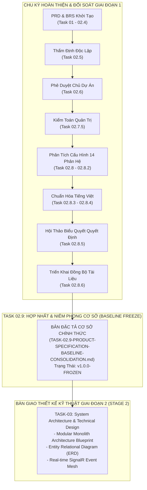
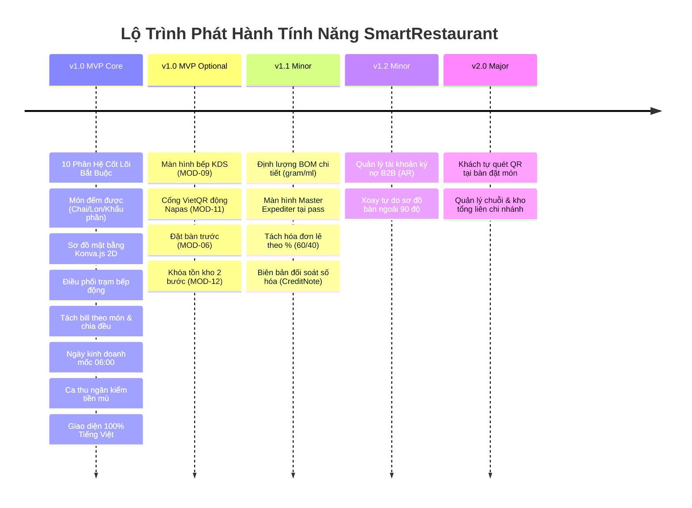
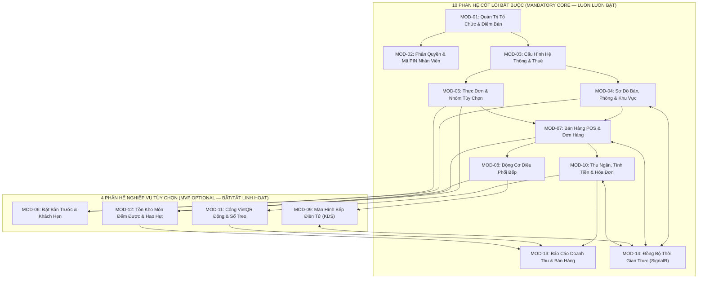
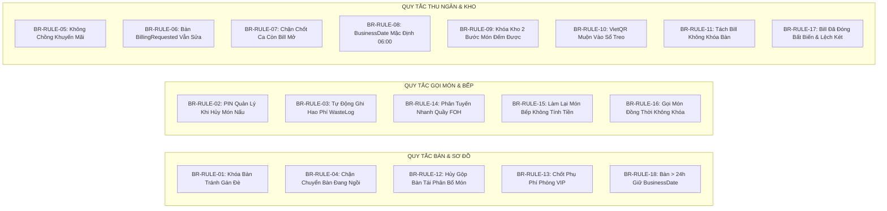
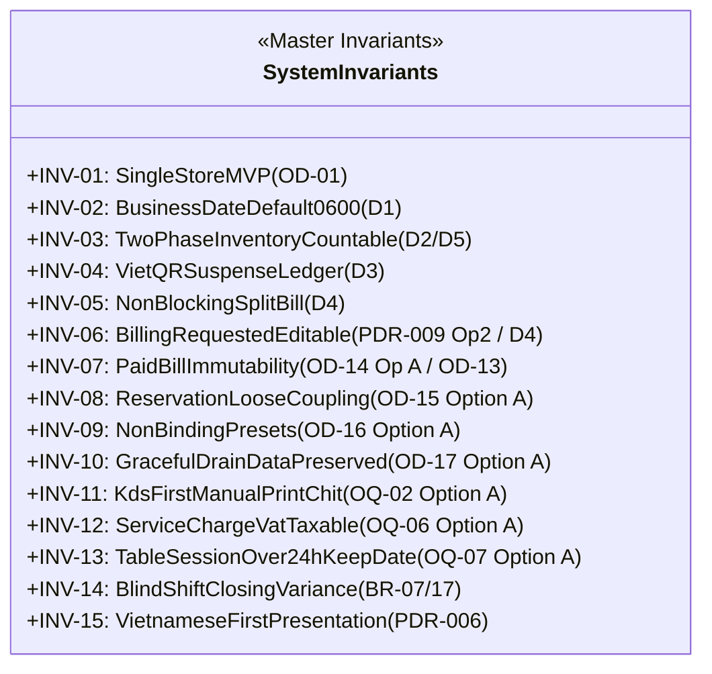
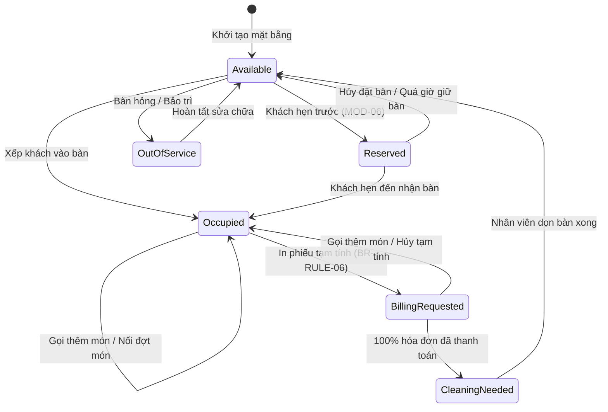
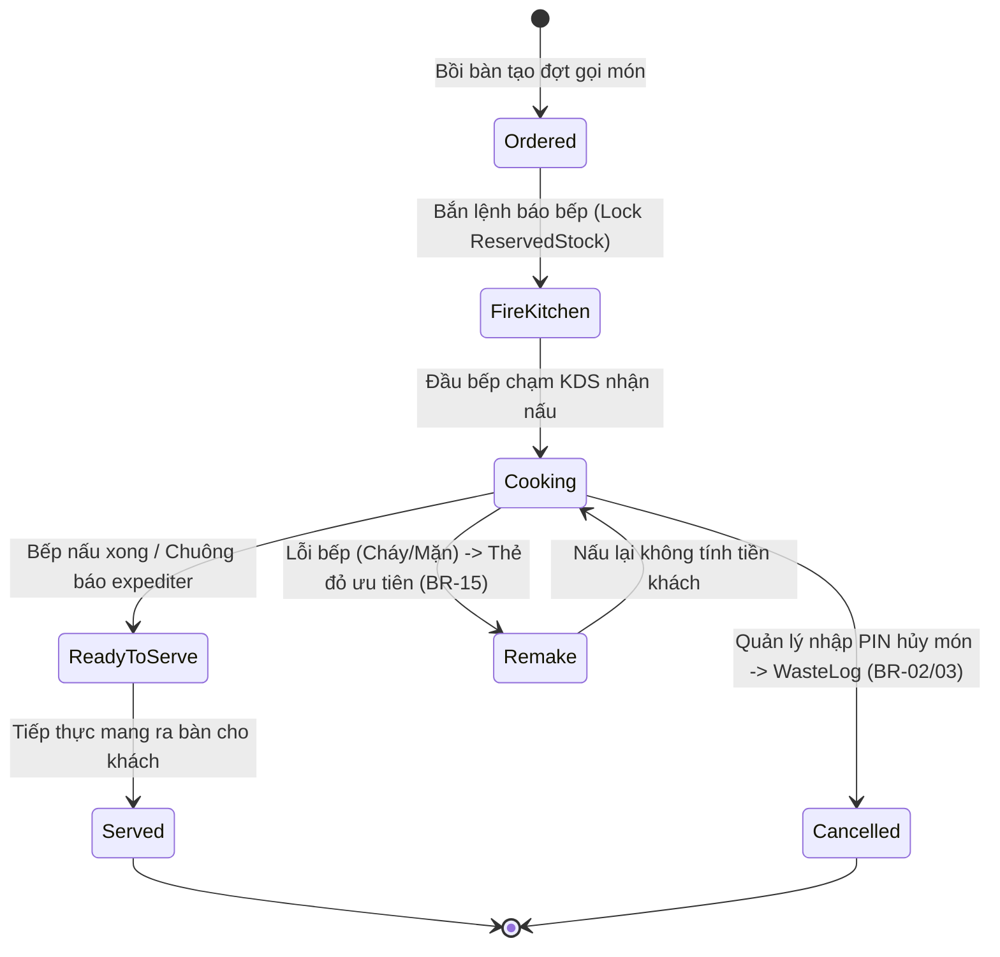
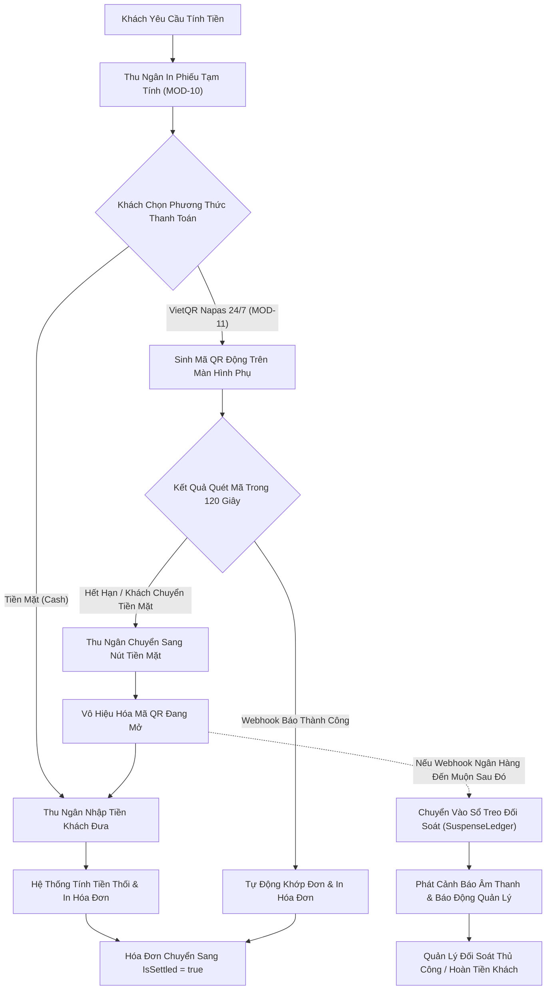
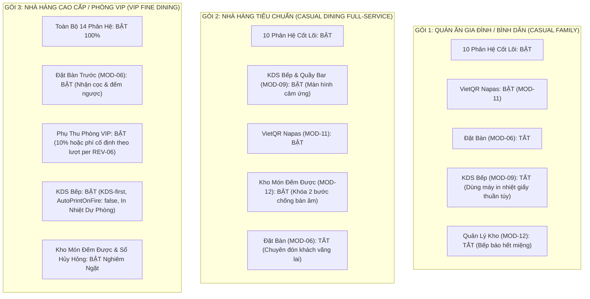

# Hồ Sơ Hợp Nhất Cơ Sở Đặc Tả Sản Phẩm (Product Specification Baseline Consolidation)
## TÀI LIỆU CƠ SỞ ĐẶC TẢ SẢN PHẨM CHÍNH THỨC — GIAI ĐOẠN 1 (STAGE 1 BASELINE)

- **Dự Án**: SmartRestaurant — Hệ Thống Quản Lý Vận Hành Nhà Hàng Độc Lập
- **Phiên Bản Cơ Sở**: `v1.0.0-FROZEN` (Chính Thức Đóng Băng & Niêm Phong)
- **Mã Nhiệm Vụ**: `TASK-02.9`
- **Tình Trạng Quản Trị**: **`100% CONSOLIDATED, AUDITED & SEALED BY PROJECT OWNER`**
- **Phân Định 4 Trạng Thái Quản Trị**:
  1. *Documentation Consolidation*: `COMPLETED` (Hợp nhất hoàn tất 100%)
  2. *Product Specification*: `REVIEWED` (Đã rà soát & kiểm toán tính nhất quán)
  3. *Stage 1*: `OWNER-APPROVED` (Chủ Dự Án đã phê chuẩn chính thức)
  4. *Stage 2*: `PENDING EXPLICIT PROJECT OWNER AUTHORIZATION` (Cổng Stage 2 sẵn sàng kỹ thuật — Chờ chỉ đạo/phê duyệt rõ ràng của Chủ Dự Án để khởi động)
- **Ngày Phê Duyệt & Niêm Phong**: 2026-11-06
- **Vai Trò Đảm Nhiệm**: Chuyên Viên Phân Tích Nghiệp Vụ (BA), Người Duy Trì Tài Liệu Sản Phẩm & Chuyên Viên Quản Trị Sản Phẩm
- **Thẩm Quyền Phê Duyệt Tối Cao**: Chủ Dự Án (Project Owner — Task 02.6, Task 02.8.5, Task 02.8.6)
- **Tài Liệu Căn Cứ & Tham Chiếu Hợp Nhất**:
  1. [`docs/product/PRD.md`](./PRD.md) (Tài Liệu Yêu Cầu Sản Phẩm)
  2. [`docs/product/BUSINESS-REQUIREMENTS.md`](./BUSINESS-REQUIREMENTS.md) (Đặc Tả Yêu Cầu Nghiệp Vụ — 18 Quy Tắc Cốt Lõi)
  3. [`docs/product/MVP-SCOPE.md`](./MVP-SCOPE.md) (Phạm Vi MVP & Ma Trận Phân Kỳ MoSCoW)
  4. [`docs/product/MODULE-OVERVIEW.md`](./MODULE-OVERVIEW.md) (Ranh Giới 14 Phân Hệ Nghiệp Vụ)
  5. [`docs/product/MODULE-CONFIGURATION-AND-FEATURE-MANAGEMENT.md`](./MODULE-CONFIGURATION-AND-FEATURE-MANAGEMENT.md) (Đặc Tả Cấu Hình Phân Tầng & Quản Lý Tính Năng)
  6. [`docs/product/DOMAIN-GLOSSARY.md`](./DOMAIN-GLOSSARY.md) (Thuật Ngữ Miền Phổ Quát Song Ngữ Anh - Việt)
  7. [`docs/product/USER-JOURNEYS.md`](./USER-JOURNEYS.md) (10 Hành Trình Người Dùng Toàn Diện)
  8. [`docs/product/workflows/`](./workflows/) (4 Bộ Quy Trình Vận Hành: Sơ Đồ Bàn, POS Gọi Món, Bếp KDS, Thu Ngân)
  9. [`docs/product/decisions/`](./decisions/) (15 Biên Bản Quyết Định Sản Phẩm PDR-001 đến PDR-015)
  10. [`docs/product/NON-FUNCTIONAL-REQUIREMENTS.md`](./NON-FUNCTIONAL-REQUIREMENTS.md) (Yêu Cầu Phi Chức Năng NFR)
  11. [`docs/product/VIETNAMESE-LOCALIZATION-STANDARD.md`](./VIETNAMESE-LOCALIZATION-STANDARD.md) (Tiêu Chuẩn Bản Địa Hóa Tiếng Việt)
  12. [`docs/product/OWNER-DECISION-WORKSHOP.md`](./OWNER-DECISION-WORKSHOP.md) (Hồ Sơ Biểu Quyết Quyết Định Của Chủ Dự Án)
  13. [`docs/product/TASK-02.8.5-PROJECT-OWNER-DECISION-CONSOLIDATION-RECORD.md`](./TASK-02.8.5-PROJECT-OWNER-DECISION-CONSOLIDATION-RECORD.md) (Biên Bản Hợp Nhất Quyết Định Task 02.8.5)
  14. [`docs/product/TASK-02.8.6-OWNER-DECISION-IMPLEMENTATION-REPORT.md`](./TASK-02.8.6-OWNER-DECISION-IMPLEMENTATION-REPORT.md) (Báo Cáo Triển Khai Quyết Định Của Chủ Dự Án)
  15. [`docs/00-index.md`](../00-index.md) (Mục Lục Tài Liệu Dự Án Chuẩn)

---

## 1. Tuyên Ngôn Cơ Sở & Niêm Phong Quản Trị (Executive Baseline Declaration & Freeze)

Tài liệu này là **Hồ Sơ Hợp Nhất Cơ Sở Đặc Tả Sản Phẩm Duy Nhất, Toàn Diện và Có Thẩm Quyền Cao Nhất** đại diện cho toàn bộ kết quả của **Giai đoạn 1: Khám Phá Sản Phẩm & Đặc Tả Miền Nghiệp Vụ (Stage 1: Product Discovery & Business Domain Specifications)** của dự án **SmartRestaurant**.



### 1.1. Cam Kết Niêm Phong (Freeze Commitment)
1. **Trạng Thái Đóng Băng**: Kể từ thời điểm ban hành tài liệu này, toàn bộ yêu cầu sản phẩm, ranh giới phân hệ, 18 quy tắc nghiệp vụ, quy trình vận hành và quyết định thiết kế sản phẩm của Giai đoạn 1 chính thức được **NIÊM PHONG VĨNH VIỄN (`FROZEN`)**.
2. **Quy Trình Quản Lý Thay Đổi (Change Control)**: Mọi yêu cầu thay đổi, phát sinh tính năng mới hoặc điều chỉnh quy tắc nghiệp vụ sau thời điểm này bắt buộc phải tuân theo quy trình Quản lý Yêu cầu Thay đổi (Change Request - CR), được lập hồ sơ đánh giá tác động và phải có chữ ký phê duyệt rõ ràng của Chủ Dự Án (Project Owner).
3. **Ranh Giới Kỹ Thuật Nghiêm Ngặt (Zero Code Leakage)**:
   - Toàn bộ nội dung của tài liệu này hoàn toàn thuộc phạm vi **Đặc Tả Sản Phẩm & Nghiệp Vụ (Product & Domain Specification)**.
   - Tuyệt đối không chứa mã nguồn C# (`.cs`), tệp dự án/solution (`.csproj`, `.sln`), tập lệnh SQL vật lý hay tệp di chuyển cơ sở dữ liệu EF Core migration (`.sql`).
   - Kho lưu trữ duy trì chính xác **0 tệp mã nguồn ứng dụng** trước khi bắt đầu Giai đoạn 2.
   - Bộ nhớ kiến trúc [`.agent-memory/ARCHITECTURE-DECISIONS.md`](../../.agent-memory/ARCHITECTURE-DECISIONS.md) được bảo toàn nguyên vẹn 100% (0 diff so với HEAD).

---

## 2. Tầm Nhìn Sản Phẩm & Phạm Vi Vận Hành MVP (Vision & Scope Baseline)

### 2.1. Tầm Nhìn Cốt Lõi
SmartRestaurant là giải pháp quản lý vận hành nhà hàng chuyên sâu, hiện đại theo kiến trúc **Modular Monolith**, được tối ưu hóa đặc thù cho thị trường ẩm thực Việt Nam (Vietnamese-First). Hệ thống cung cấp trải nghiệm số hóa xuyên suốt từ lúc thực khách bước vào nhà hàng, chọn chỗ, gọi món tại bàn, điều phối chế biến thông minh tại bếp/bar, cho đến khâu tính tiền, thanh toán đa phương thức và kiểm soát tài chính ca làm việc.

### 2.2. Ranh Giới Vận Hành Đơn Điểm Cho Bản Phát Hành MVP (OD-01 / CONTR-01)
- **Tập Trung Tuyệt Đối Vào Một Nhà Hàng Độc Lập**: Bản phát hành MVP v1.0 tập trung toàn diện vào **một địa điểm kinh doanh nhà hàng vật lý duy nhất** (`Single Independent Restaurant`).
- **Sẵn Sàng Mở Rộng Đa Chi Nhánh Trong Kiến Trúc Dữ Liệu**: Mặc dù chỉ kích hoạt và hiển thị giao diện cho một cơ sở đơn lẻ, toàn bộ thực thể dữ liệu trong cơ sở dữ liệu được gắn chặt khóa nhận diện tổ chức và chi nhánh (`OrganizationId`, `BranchId`) ngay từ ngày đầu, bảo đảm khi doanh nghiệp mở rộng chuỗi hoặc nhượng quyền trong tương lai (v2.0) sẽ không phải tái cấu trúc lược đồ CSDL.

### 2.3. Ma Trận Phân Kỳ MoSCoW & Kế Hoạch Lộ Trình Phát Hành



| Cấp Độ Phân Kỳ | Phân Hệ & Tính Năng Trọng Tâm | Ranh Giới Quản Trị | Trạng Thái Quyết Định |
| :--- | :--- | :--- | :---: |
| **Must-Have (MVP v1.0)** | 10 Phân hệ cốt lõi (`MOD-01..05, 07, 08, 10, 13, 14`), Sơ đồ bàn 2D, Bán hàng POS, Điều phối trạm bếp, Thu ngân & Hóa đơn, Báo cáo Z, Đa tiền tệ VNĐ, Múi giờ UTC+7. | Bắt buộc phải có để nhà hàng vận hành được. | `OWNER-CONFIRMED` |
| **Should-Have (MVP Optional)** | 4 Phân hệ tùy chọn (`MOD-06` Đặt bàn, `MOD-09` KDS Bếp/Bar, `MOD-11` VietQR động & Sổ treo, `MOD-12` Quản lý tồn kho món đếm được). | Cung cấp sẵn trong v1.0, chủ quán bật/tắt linh hoạt theo nhu cầu và phần cứng. | `OWNER-CONFIRMED` |
| **Could-Have (Deferred to v1.1)** | Định lượng nguyên liệu thô theo công thức chi tiết (BOM gram/ml), Màn hình tổng hợp Master Expediter, Tách hóa đơn % tùy biến lẻ (60/40), Bút toán điều chỉnh hóa đơn đã đóng (`CreditNote`). | Nâng cao hiệu quả chi phí và linh hoạt tài chính sau khi vận hành ổn định. | `CONFIRMED DEFERRED (v1.1)` |
| **Could-Have (Deferred to v1.2+)** | Quản lý công nợ khách hàng doanh nghiệp / Ký nợ (`REV-07`), Xoay tự do bàn ăn đa góc độ ngoài 90°. | Mở rộng phân hệ tài chính B2B chuyên biệt. | `CONFIRMED DEFERRED (v1.2+)` |
| **Won't-Have (Deferred to v2.0)** | Thực khách quét mã QR tại bàn tự đặt món & thanh toán trước, Quản lý chuỗi đa chi nhánh tập trung, Luân chuyển kho tổng nhượng quyền. | Tách biệt hoàn toàn khỏi phạm vi ban đầu để chống phình to quy mô (scope creep). | `CONFIRMED DEFERRED (v2.0)` |

---

## 3. Khung 14 Phân Hệ Nghiệp Vụ Chuẩn (14 Business Modules Architecture Baseline)

Hệ thống được cấu trúc chuẩn hóa thành **14 Phân Hệ Nghiệp Vụ** theo kiến trúc Modular Monolith. Cơ cấu này đã được **Chủ Dự Án chính thức phê chuẩn (OWNER-CONFIRMED)** tại Workshop Task 02.8.5, phân chia rạch ròi thành **10 Phân Hệ Cốt Lõi Bắt Buộc** và **4 Phân Hệ Nghiệp Vụ Tùy Chọn**:



### 3.1. Bảng Danh Mục & Ranh Giới 14 Phân Hệ

| Mã Phân Hệ | Tên Tiếng Việt | Tên Tiếng Anh | Phân Vị Quản Trị | Trách Nhiệm Vận Hành Chính | Thực Thể Miền Cốt Lõi | Cơ Chế Hạ Cấp Dự Phòng / Thoát Êm Dịu (Graceful Drain OD-17) |
| :---: | :--- | :--- | :---: | :--- | :--- | :--- |
| **MOD-01** | Quản Trị Tổ Chức & Điểm Bán | Organization & Store Identity | `Core Mandatory` | Quản lý định danh cơ sở, thông tin pháp lý điểm bán đơn, múi giờ vận hành. | `Organization`, `Branch`, `OperatingHours` | Không thể tắt. Là gốc của mọi phân vùng dữ liệu. |
| **MOD-02** | Phân Quyền & Mã PIN Nhân Viên | User, RBAC & Staff PIN | `Core Mandatory` | Xác thực đăng nhập, chuyển ca nhanh bằng mã PIN, phân quyền quản lý duyệt hủy/chiết khấu. | `User`, `Role`, `Permission`, `ManagerPinAudit` | Không thể tắt. Hàng rào bảo mật và kiểm toán bắt buộc. |
| **MOD-03** | Cấu Hình Hệ Thống & Thuế | System Configuration & Tax | `Core Mandatory` | Cài đặt giờ chốt ngày (06:00), thuế suất VAT (8%/10%), tính thuế phí dịch vụ, format VNĐ. | `RestaurantSetting`, `TaxProfile`, `SurchargeRule` | Không thể tắt. Quyết định toàn bộ tham số tính toán tài chính. |
| **MOD-04** | Sơ Đồ Bàn, Phòng & Khu Vực | Dining Areas & Floor Plan | `Core Mandatory` | Quản lý mặt bằng Konva.js, không gian phân cấp Khu vực $\rightarrow$ Phòng $\rightarrow$ Bàn, vòng đời trạng thái bàn. | `DiningArea`, `DiningRoom`, `DiningTable`, `TableSession` | Không thể tắt. Điểm neo không gian cho mọi giao dịch phục vụ tại chỗ. |
| **MOD-05** | Thực Đơn & Nhóm Tùy Chọn | Menu Catalog & Modifiers | `Core Mandatory` | Quản lý danh mục món ăn, biến thể kích cỡ, nhóm tùy chọn món (bắt buộc/tự do), giá bán. | `MenuCategory`, `MenuItem`, `ModifierGroup`, `ModifierOption` | Không thể tắt. Động cơ cung cấp sản phẩm và giá cho POS. |
| **MOD-06** | Quản Lý Đặt Bàn Trước | Table Reservation Management | `MVP Optional` | Quản lý danh sách khách đặt trước, cọc đặt bàn, liên kết phiên bàn khi khách tới (`OD-15`). | `Reservation`, `DepositRecord`, `CustomerProfile` | **Tắt**: Ẩn tab Đặt bàn; các lượt hẹn tương lai được cảnh báo để quản lý chọn giữ đón tay hoặc hủy báo khách. |
| **MOD-07** | Bán Hàng POS & Đơn Hàng | POS Order Capture & Session | `Core Mandatory` | Giao diện cảm ứng phục vụ, giỏ hàng tạm, gọi món đồng thời không khóa bàn, đợt gọi món. | `Order`, `OrderRound`, `OrderItem`, `OrderItemModifier` | Không thể tắt. Trái tim tiếp nhận nhu cầu ẩm thực của khách. |
| **MOD-08** | Động Cơ Điều Phối Bếp | Order Routing Dispatcher Engine | `Core Mandatory` | Phân tách đơn gọi món thành các phiếu chế biến theo trạm bếp/bar mục tiêu (`PDR-003`). | `RoutingRule`, `StationTicket`, `StationTicketItem` | Không thể tắt. Cầu nối điều phối giữa tiền sảnh và hậu sảnh. |
| **MOD-09** | Màn Hình Bếp Điện Tử (KDS) | Digital Kitchen Display (KDS) | `MVP Optional` | Hàng đợi chế biến cảm ứng cho đầu bếp/pha chế, đồng hồ đếm ngược SLA, chuông báo xong món. | `KdsScreen`, `KdsTicket`, `KitchenPerformanceLog` | **Tắt**: Tự động chuyển hướng toàn bộ lệnh báo bếp ra máy in nhiệt giấy ESC/POS vật lý (`AutoPrintOnFire: true`). |
| **MOD-10** | Thu Ngân, Tính Tiền & Hóa Đơn | Billing, Payment & Cashier Desk | `Core Mandatory` | In tạm tính, tách hóa đơn 2 tầng, đa phương thức thanh toán, chốt ca kiểm tiền mù Z-Report. | `Invoice`, `InvoiceItem`, `CashDrawerShift`, `ShiftClosingVarianceLog` | Không thể tắt. Động cơ tính tiền, xuất hóa đơn và đối soát quỹ két. |
| **MOD-11** | Cổng Thanh Toán VietQR Tự Động | Dynamic VietQR Napas Gateway | `MVP Optional` | Sinh mã QR động kèm số tiền và mã hóa đơn, nhận webhook Napas 24/7, sổ treo giao dịch (`PDR-008`). | `VietQrPaymentRequest`, `NapasWebhookLog`, `SuspenseLedger` | **Tắt**: Ẩn nút VietQR; thu ngân chỉ thu tiền mặt, quẹt thẻ máy quẹt ngoài, hoặc chuyển khoản chụp ủy nhiệm chi thủ công. |
| **MOD-12** | Quản Lý Tồn Kho Món Đếm Được | Countable Stock & Waste Register | `MVP Optional` | Khóa tồn kho 2 bước (`Tồn khả dụng = Thực tế - Tạm giữ`), khóa món hết (86), sổ hao phí hủy món (`PDR-004`). | `StockItem`, `StockTransaction`, `StockReservation`, `WasteLog` | **Tắt**: POS loại bỏ bước kiểm tra tồn khả dụng, bếp báo hết miệng thủ công; dữ liệu kiểm kê cũ giữ nguyên chỉ đọc. |
| **MOD-13** | Báo Cáo Doanh Thu & Bán Hàng | Sales & Operational Analytics | `Core Mandatory` | Báo cáo doanh thu gộp, ca thu ngân, phân tích nhóm món bán chạy, chênh lệch két tiền mặt. | `DailySalesSummary`, `ShiftSummaryReport`, `ItemSalesAnalytics` | Không thể tắt. Cung cấp báo cáo tài chính và đối soát ca cho quản lý. |
| **MOD-14** | Trục Đồng Bộ Thời Gian Thực | Real-Time SignalR Event Mesh | `Core Mandatory` | Phát sóng sự kiện tức thì (< 500ms) giữa POS, KDS và Sơ đồ bàn (đổi màu bàn, chuông báo món, giỏ hàng). | `HubConnection`, `ClientSubscription`, `SignalREventEnvelope` | Không thể tắt. Duy trì tính nhất quán giao diện người dùng phân tán. |

---

## 4. Bộ Quy Tắc Nghiệp Vụ Bất Biến Hợp Nhất (Master Business Rules Register)

Hệ thống hợp nhất toàn bộ **18 Quy Tắc Nghiệp Vụ Cốt Lõi (`BR-RULE-01` đến `BR-RULE-18`)**. Đây là các ràng buộc bất biến cấu thành bộ khung vận hành của SmartRestaurant đã được phê chuẩn chính thức:



### Chi Tiết 18 Quy Tắc Nghiệp Vụ Bắt Buộc

1. **`BR-RULE-01` — Khóa Bàn Chống Gán Đè (Table State Allocation Guard)**:
   - *Nghiệp vụ*: Điểm bàn vật lý đang ở trạng thái `Occupied` (Có khách), `BillingRequested` (Đang thanh toán), hoặc `CleaningNeeded` (Cần dọn dẹp) tuyệt đối không thể được gán cho một lượt khách mới.
   - *Thực thi*: Chặn cứng tại tầng Domain Logic (Hard System Block).

2. **`BR-RULE-02` — Ủy Quyền Quản Lý Khi Hủy Món Đã Nấu (Manager Void Authorization)**:
   - *Nghiệp vụ*: Khi món ăn đã chuyển sang trạng thái `Cooking` (Đang nấu) hoặc `ReadyToServe` (Đã xong, chờ bưng), nhân viên phục vụ không thể tự ý xóa hoặc hủy món nếu thiếu mã PIN Quản lý ủy quyền và lý do hủy bắt buộc.
   - *Thực thi*: Yêu cầu xác thực PIN và lưu vết kiểm toán `ManagerPinAudit`.

3. **`BR-RULE-03` — Tự Động Quy Trách Nhiệm Hao Phí Hủy Món (Waste Responsibility Invariant)**:
   - *Nghiệp vụ*: Bất kỳ món ăn nào bị hủy sau khi đã vào trạng thái `Cooking` bắt buộc phải được hệ thống tự động ghi nhận vào Sổ Ghi Nhận Hao Phí Nhà Bếp (`WasteLog`) để đối soát tổn thất nguyên vật liệu cuối ca.
   - *Thực thi*: Tự động sinh bản ghi trong transaction hủy món.

4. **`BR-RULE-04` — Chặn Chuyển Bàn Vào Bàn Đang Có Khách (Table Transfer Collision Guard)**:
   - *Nghiệp vụ*: Lệnh chuyển toàn bộ hoặc một phần bàn sang bàn đích bị từ chối thẳng thừng nếu bàn đích hiện đang có một phiên khách khác đang hoạt động (`Occupied`). Khách chỉ có thể chuyển sang bàn `Available`.
   - *Thực thi*: Chặn cứng hệ thống kèm thông báo trực quan trên sơ đồ mặt bằng.

5. **`BR-RULE-05` — Chính Sách Không Chồng Khuyến Mãi (Discount Stacking Exclusion)**:
   - *Nghiệp vụ*: Giảm giá khuyến mãi theo từng món ăn không được cộng dồn với voucher giảm giá theo phần trăm toàn đơn, trừ khi chính sách đó được bật rõ ràng trong cấu hình của nhà hàng (`AllowDiscountStacking: true`).
   - *Thực thi*: Bộ máy tính giá áp dụng mức giảm tối ưu nhất hoặc chặn cộng dồn theo cờ cấu hình.

6. **`BR-RULE-06` — Bàn Đang Thanh Toán Vẫn Cho Phép Sửa Đổi (BillingRequested Editable Invariant — PDR-009 BillingRequested Option 2 / D4)**:
   - *Nghiệp vụ*: Khi bàn đang ở trạng thái `BillingRequested` (Đã in tạm tính), bàn ăn và hóa đơn chưa thanh toán **vẫn hoàn toàn được phép chỉnh sửa**. Phục vụ có thể thêm món gọi thêm (nối tiếp vào hóa đơn hiện có hoặc tạo hóa đơn con mới) hoặc hủy món theo phân quyền. Bàn CHỈ ĐƯỢC GIẢI PHÓNG khi 100% hóa đơn con đã thanh toán đầy đủ (`IsSettled = true`) và toàn bộ món ăn đã phục vụ xong. Nghiêm cấm trực tiếp sửa hóa đơn đã thanh toán theo bất biến `OD-13`.
   - *Thực thi*: Bảo toàn linh hoạt vận hành tiền sảnh & tính toàn vẹn kiểm toán tài chính.

7. **`BR-RULE-07` — Chặn Đóng Ca Thu Ngân Khi Còn Hóa Đơn Mở (Open Invoice Cashier Shift Guard)**:
   - *Nghiệp vụ*: Thu ngân không thể thực hiện đóng ca làm việc (Shift Close) nếu trên thiết bị hoặc phiên làm việc của thu ngân đó vẫn còn tồn tại ít nhất một hóa đơn đang mở chưa quyết toán hoặc chưa hủy hợp lệ.
   - *Thực thi*: Kiểm tra điều kiện tiên quyết trước khi mở giao diện kiểm tiền mù cuối ca.

8. **`BR-RULE-08` — Ngày Kinh Doanh Theo Ca Vận Hành (Business Date Assignment Invariant — D1 / PDR-007)**:
   - *Nghiệp vụ*: Toàn bộ đơn hàng và hóa đơn tạo trong một ca làm việc đều thuộc về `BusinessDate` của ca đó (mốc cắt mặc định `06:00` sáng hôm sau). Việc thay đổi cấu hình mốc giờ cắt ca tuyệt đối không tính toán lại hồi tố Ngày kinh doanh của các đơn hàng hoặc ca đã ghi nhận trong quá khứ.
   - *Thực thi*: Chụp ảnh `BusinessDate` ngay tại thời điểm tạo thực thể đơn hàng (`Order`).

9. **`BR-RULE-09` — Khóa Tồn Kho Hai Pha Cho Món Đếm Được (Two-Phase Inventory Lock — D2/D5 / PDR-004)**:
   - *Nghiệp vụ*: Bắn đơn xuống bếp sẽ khóa tạm giữ tồn kho hàng đếm được (`ReservedStock`); khi bếp xác nhận nấu xong hoặc phục vụ thành công sẽ chuyển sang trừ tồn kho thực tế (`ConsumedStock`). Công thức: $\text{Tồn khả dụng} = \text{Tồn thực tế} - \text{Tồn tạm giữ}$. Ngăn chặn bán âm kho thời gian thực.
   - *Thực thi*: Kiểm tra và giữ chỗ đơn nguyên (Atomic reservation) trước khi phát lệnh báo bếp.

10. **`BR-RULE-10` — Xử Lý Giao Dịch VietQR Đến Muộn Qua Sổ Treo (VietQR Suspense Ledger — D3 / PDR-008)**:
    - *Nghiệp vụ*: Khi thu ngân chuyển phương thức thanh toán sang Tiền mặt do khách chờ lâu, mã QR đang hiển thị bị vô hiệu hóa; nếu webhook ngân hàng đến muộn sau đó, hệ thống tự động điều chuyển số tiền vào `Sổ Treo Giao Dịch Đối Soát` (`SuspenseLedger`), phát cảnh báo âm thanh/hình ảnh tức thì để Quản lý đối soát hoàn tiền hoặc ghi nhận công nợ thủ công, tuyệt đối không làm sai lệch số dư két tiền mặt của thu ngân.
    - *Thực thi*: Xử lý bất đồng bộ tại webhook controller kèm thông báo SignalR tức thì.

11. **`BR-RULE-11` — Tách Hóa Đơn Không Đóng Băng Bàn (Non-blocking Split Billing — D4 / PDR-005 / PDR-009 / OQ-01)**:
    - *Nghiệp vụ*: Bàn đang thực hiện tách hóa đơn không bị đóng băng hoạt động. Phục vụ tiếp tục gọi thêm món vào các hóa đơn con đang mở với đích đến rõ ràng. Hỗ trợ 2 phương thức trong MVP: Tách theo món chọn lọc và Chia đều $1/N$ (xử lý tiền lẻ làm tròn dồn vào hóa đơn cuối). Tách theo % lẻ (60/40) hoãn sang v1.1. Bàn chỉ giải phóng khi 100% hóa đơn con đã thanh toán xong.
    - *Thực thi*: Quản lý nhiều thực thể `Invoice` con dưới cùng một `TableSession`.

12. **`BR-RULE-12` — Hủy Gộp Bàn Tái Phân Bổ Món Ăn (Table Unmerge Item Reallocation — PDR-010)**:
    - *Nghiệp vụ*: Các bàn đã gộp có thể được hủy gộp bất kỳ lúc nào; nhân viên phân bổ lại các món ăn tương ứng về bàn tách ra mà không phải bắn lại lệnh chế biến xuống nhà bếp, không sinh trùng lặp thẻ KDS.
    - *Thực thi*: Cập nhật trường ánh xạ `TableId` của dòng món ăn trong bộ nhớ CSDL.

13. **`BR-RULE-13` — Lưu Vết Phụ Thu Phòng & Khu Vực (Area & VIP Surcharge Snapshot — PDR-011)**:
    - *Nghiệp vụ*: Phòng VIP và khu vực hỗ trợ phụ thu theo tỷ lệ % hoặc số tiền cố định. Tỷ lệ phụ thu được chụp ảnh cố định (snapshot) tại thời điểm mở phiên bàn/tạo hóa đơn; thao tác chuyển bàn sau đó không tính toán lại hồi tố các món đã dùng trước đó.
    - *Thực thi*: Lưu trường `SurchargeRateSnapshot` và `SurchargeAmount` trên hóa đơn.

14. **`BR-RULE-14` — Phân Tuyến Trực Tiếp Tại Quầy FOH (Direct FOH Beverage Routing — PDR-012)**:
    - *Nghiệp vụ*: Đồ uống đóng chai/lon sẵn và món lấy ngay được nhân viên phục vụ lấy trực tiếp tại quầy FOH, bỏ qua hàng đợi pha chế của Bar KDS nhưng vẫn bảo đảm liên kết đầy đủ với kiểm soát hóa đơn, doanh thu và trừ tồn kho tự động.
    - *Thực thi*: Cấu hình cờ `DirectFOHPick: true` trên danh mục món ăn để động cơ điều phối bỏ qua việc tạo thẻ trạm.

15. **`BR-RULE-15` — Làm Lại Món Do Lỗi Bếp (Kitchen Remake Dish Workflow — PDR-015)**:
    - *Nghiệp vụ*: Món ăn phải nấu lại do lỗi nhà bếp (cháy, mặn, dị vật) không được tính thêm tiền cho khách, tự động sinh thẻ KDS làm lại món ưu tiên cao (màu đỏ) và tự động ghi nhận tổn thất nguyên liệu vào `WasteLog`.
    - *Thực thi*: Tạo dòng `OrderItem` có cờ `IsRemake = true` và `Price = 0` liên kết với thẻ KDS ưu tiên.

16. **`BR-RULE-16` — Gọi Món Đồng Thời Không Khóa Bàn (Concurrent Table Ordering — PDR-014)**:
    - *Nghiệp vụ*: Nhiều nhân viên phục vụ có thể cùng lúc mở giao diện gọi món và chọn món cho cùng một bàn mà không bị khóa chặn lẫn nhau. Hệ thống thực thi cơ chế chỉ nối thêm (append-only) an toàn và xử lý xung đột cập nhật lạc quan cấp dòng món ăn.
    - *Thực thi*: Tầng ứng dụng áp dụng Optimistic Concurrency Control (`RowVersion`) trên bảng `Order`.

17. **`BR-RULE-17` — Hóa Đơn Đã Thanh Toán Bất Biến & Xử Lý Lệch Két (Paid Bill Immutability & Variance Log — OD-14 Option A)**:
    - *Nghiệp vụ*: Hóa đơn đã quyết toán (`IsSettled = true`) là bất biến tuyệt đối trong CSDL của MVP. Nghiêm cấm thu ngân hay quản lý trực tiếp chỉnh sửa, xóa hoặc mở lại hóa đơn đã đóng tiền trên phần mềm. Mọi sai sót tiền mặt thực tế được xử lý hoàn tiền thủ công ngoài quầy từ két, lập "Biên bản điều chỉnh sai lệch két giấy" ký tay giữa hai bên. Khi chốt ca kiểm tiền mù (Blind Shift Close), hệ thống ghi nhận khoản tiền chênh lệch vào thực thể `ShiftClosingVarianceLog` (kèm mã hóa đơn gốc `OriginalInvoiceId`); hoãn chức năng sinh bút toán `CreditNote` số hóa sang phiên bản v1.1.
    - *Thực thi*: Chặn mọi thao tác `UPDATE`/`DELETE` trên hóa đơn đã thanh toán ở tầng Domain; ghi nhận sai lệch quỹ két tại thời điểm chốt ca.

18. **`BR-RULE-18` — Phiên Bàn Kéo Dài > 24 Giờ Giữ Ngày Kinh Doanh Gốc (Long Table Session Preservation — OQ-07 Option A)**:
    - *Nghiệp vụ*: Bàn ăn mở kéo dài hơn 24 giờ qua một hoặc nhiều mốc cắt ca vẫn giữ nguyên `BusinessDate` ban đầu khi mở theo nguyên tắc `D1`, đồng thời hiển thị dải băng cảnh báo màu cam cho Quản lý kiểm tra vận hành, nghiêm cấm việc tự động cưỡng bức đóng bàn làm gián đoạn bữa ăn của khách.
    - *Thực thi*: Bảo toàn giá trị `BusinessDate` ban đầu của `TableSession`; kích hoạt cờ cảnh báo `IsLongRunningSession = true` trên giao diện quản lý khi thời gian mở vượt quá 24 giờ.

---

## 5. Sổ Đăng Ký Các Bất Biến Nghiệp Vụ Bắt Buộc (Master Business Invariants Register)

Các bất biến nghiệp vụ là các nguyên tắc cốt lõi **bất di bất dịch**. Đội ngũ thiết kế kiến trúc kỹ thuật Giai đoạn 2 (Stage 2) và lập trình viên Giai đoạn 5 **bắt buộc phải tuân thủ 100%**, tuyệt đối không được tự ý biến đổi logic:



| Mã Bất Biến | Tên Bất Biến Nghiệp Vụ | Căn Cứ Quyết Định | Nội Dung Bắt Buộc Đối Với Tầng Kiến Trúc & Thiết Kế Kỹ Thuật Stage 2 |
| :---: | :--- | :---: | :--- |
| **INV-01** | Trọng Tâm Đơn Điểm Độc Lập | `OD-01` | Toàn bộ giao diện và luồng nghiệp vụ MVP chỉ phục vụ một nhà hàng đơn lẻ; CSDL vẫn gắn `OrganizationId` và `BranchId` để sẵn sàng cho tương lai. |
| **INV-02** | Ngày Kinh Doanh Mốc 06:00 | `D1 / PDR-007` | Đơn hàng gắn cứng `BusinessDate` lúc khởi tạo. Không bao giờ chạy tác vụ ngầm tính toán lại ngày kinh doanh hồi tố. |
| **INV-03** | Khóa Kho 2 Bước Món Đếm Được | `D2/D5 / PDR-004` | Phân tách rạch ròi `ReservedStock` và `PhysicalStock`. MVP chỉ quản lý hàng đếm được (chai/lon/khẩu phần); hoãn định lượng BOM gram/ml sang v1.1. |
| **INV-04** | Sổ Treo VietQR Bất Đồng Bộ | `D3 / PDR-008` | Webhook đến muộn khi đơn đã chuyển tiền mặt tự động đi vào `SuspenseLedger` kèm SignalR alert; không cộng đè vào doanh thu ca thu ngân. |
| **INV-05** | Tách Hóa Đơn Không Khóa Bàn | `D4 / PDR-005` | Một phiên bàn hỗ trợ đa hóa đơn con (`1..N`). Phục vụ tiếp tục gọi thêm món vào hóa đơn con mở trong lúc các khách khác đang thanh toán hóa đơn của họ. |
| **INV-06** | Bàn Tạm Tính Vẫn Cho Phép Sửa | `BR-RULE-06 / OD-13` | Bàn `BillingRequested` không bị khóa đóng băng; món mới gọi thêm nối tiếp vào hóa đơn mở hoặc tạo hóa đơn con mới; giải phóng bàn khi 100% bill thanh toán. |
| **INV-07** | Hóa Đơn Đã Đóng Bất Biến Tuyệt Đối | `OD-14 / BR-RULE-17` | Hóa đơn `IsSettled = true` cấm tuyệt đối lệnh `UPDATE`/`DELETE`. Sai sót xử lý bằng biên bản giấy và ghi log chênh lệch ca `ShiftClosingVarianceLog`. |
| **INV-08** | Đặt Bàn Khớp Nối Lỏng | `OD-15` | `MOD-06` là tùy chọn; thực thể `Reservation` liên kết lỏng qua `TableId` có thể null; tắt tính năng bằng 1 chạm mà không làm lỗi CSDL. |
| **INV-09** | Gói Mẫu Cấu Hình Không Ràng Buộc | `OD-16` | 3 Presets (Gia đình, Tiêu chuẩn, VIP) chỉ là gợi ý ban đầu trong Wizard Onboarding; quản lý toàn quyền bật/tắt từng tham số bất kỳ lúc nào. |
| **INV-10** | Thoát Phân Tầng Không Hủy Dữ Liệu | `OD-17` | Tắt module tùy chọn kích hoạt Graceful Drain (hoàn tất giao dịch dở dang, chặn giao dịch mới); 100% dữ liệu lịch sử lưu giữ vĩnh viễn ở trạng thái Read-Only. |
| **INV-11** | Ưu Tiên KDS & Dự Phòng In Nhiệt | `OQ-02` | Mặc định `AutoPrintOnFire = false`; trạm bếp dùng KDS cảm ứng; máy in nhiệt ESC/POS đóng vai trò dự phòng phần cứng hoặc in lại thủ công khi cần. |
| **INV-12** | Thuế VAT Đánh Trên Phí Dịch Vụ | `OQ-06` | Mặc định `IsServiceChargeTaxable = true`; công thức tính: $\text{VAT} = (\text{Tổng món sau giảm giá} + \text{Phí dịch vụ}) \times \text{Thuế suất VAT}$. |
| **INV-13** | Giữ Phiên Bàn Kéo Dài Quá 24 Giờ | `OQ-07 / BR-RULE-18` | Bàn ăn kéo dài > 24h giữ nguyên `BusinessDate` ban đầu; hiển thị dải băng cảnh báo màu cam cho Quản lý; nghiêm cấm tự ý đóng cưỡng bức bàn. |
| **INV-14** | Kiểm Tiền Mù Cuối Ca | `BR-RULE-07` | Thu ngân khai báo số tiền mặt thực đếm trong két mà không biết số tiền hệ thống tính toán; sai lệch ghi nhận vào nhật ký kiểm toán ca. |
| **INV-15** | Giao Diện 100% Tiếng Việt Chuẩn | `PDR-006` | Toàn bộ nhãn, thông báo, nút bấm, hóa đơn in nhiệt hiển thị 100% Tiếng Việt có dấu chuẩn mực; định dạng số VNĐ `#,,### ₫`, ngày `dd/MM/yyyy`. |

---

## 6. Bộ Quy Trình Vận Hành Chuẩn & Máy Trạng Thái (Operational Workflows & State Machines)

### 6.1. Máy Trạng Thái Bàn Ăn (Table State Machine)


### 6.2. Máy Trạng Thái Món Ăn & Thẻ Bếp (Item & Kitchen Ticket State Machine)


### 6.3. Quy Trình Quyết Toán Thu Ngân & Xử Lý Giao Dịch VietQR


---

## 7. Danh Mục 10 Hành Trình Người Dùng Hợp Nhất (Consolidated User Journeys)

10 Hành trình người dùng chuẩn mực bao quát toàn diện hoạt động vận hành thường nhật của nhà hàng:

| Mã Hành Trình | Đối Tượng Tác Nhân | Bối Cảnh Nghiệp Vụ Thực Tế | Điểm Chạm Hệ Thống (Touchpoints) | Giá Trị Cốt Lõi Đạt Được |
| :---: | :--- | :--- | :--- | :--- |
| **`UJ-01`** | Nhân Viên Phục Vụ (Waiter) | Đón khách vãng lai, mở bàn ăn, ghi nhận món cảm ứng, chọn tùy chọn và bắn bếp. | Tablet POS Bán hàng, Sơ đồ bàn 2D, Giỏ hàng đợt gọi món. | Tốc độ ghi món < 30 giây; không ghi giấy nhầm lẫn; tự động phân tách trạm bếp. |
| **`UJ-02`** | Đầu Bếp / Trưởng Trạm Bếp (Chef) | Tiếp nhận thẻ món trên màn hình KDS trạm Bếp Nóng/Bếp Nguội, nấu và bấm hoàn tất. | Màn hình KDS trạm bếp, nút bấm cảm ứng lớn, đồng hồ SLA đếm ngược. | Bếp không dùng giấy; kiểm soát nhịp độ nấu theo chuẩn thời gian SLA; hạn chế sót đơn. |
| **`UJ-03`** | Tiếp Thực / Ra Món (Expediter) | Nhận chuông báo món xong, kiểm tra ngoại quan đĩa món, điều phối bồi bàn bưng ra bàn. | Màn hình Expediter / KDS pass, chuông báo âm thanh, danh sách bàn. | Tránh giao nhầm bàn; bảo đảm các món trong cùng một đợt ra bàn đồng thời nóng sốt. |
| **`UJ-04`** | Nhân Viên Pha Chế (Bartender) | Tiếp nhận đơn đồ uống pha chế, xem công thức tùy chọn đường/đá, cập nhật xong món. | Màn hình Bar KDS (hoặc in nhiệt quầy bar), danh mục nguyên liệu. | Tối ưu hóa thứ tự pha chế cocktail/sinh tố; đồ uống đóng chai lấy ngay FOH bỏ qua KDS. |
| **`UJ-05`** | Thu Ngân (Cashier) | Nhận yêu cầu thanh toán, in tạm tính, tách hóa đơn đa phương thức, kiểm tiền mù cuối ca. | Màn hình POS Thu ngân, két tiền mặt, máy in hóa đơn 80mm, màn hình VietQR. | Quyết toán chính xác từng đồng; đối soát tiền mặt nghiêm ngặt qua Báo cáo chốt ca Z. |
| **`UJ-06`** | Quản Lý Nhà Hàng (Manager) | Giám sát vận hành thời gian thực, duyệt mã PIN hủy món đang nấu/chiết khấu, xử lý sự cố. | Màn hình Quản trị Web / POS Quản lý, cửa sổ nhập PIN xác thực. | Kiểm soát chặt chẽ gian lận nội bộ; xử lý nhanh khiếu nại bàn ăn mà không gián đoạn khách. |
| **`UJ-07`** | Giám Sát Ca (Floor Captain) | Điều phối sắp xếp chỗ ngồi giờ cao điểm, chuyển bàn, gộp bàn đoàn đông, khóa bao trọn phòng VIP. | Tablet Sơ đồ bàn 2D Konva.js, danh sách bàn chờ. | Tối ưu hóa công suất ghế ngồi; thao tác chuyển/gộp bàn không làm mất dữ liệu đơn món. |
| **`UJ-08`** | Nhân Viên Lễ Tân (Hostess) | Tiếp nhận điện thoại đặt bàn trước, ghi nhận số lượng khách, thời gian đến, ghi nhận cọc. | Màn hình Quản lý Đặt bàn (`MOD-06`), danh sách đặt trước. | Giảm thiểu tình trạng khách đặt mà không đến (No-show); tự động chuyển đổi sang phiên bàn ăn. |
| **`UJ-09`** | Thủ Kho (Stockkeeper) | Nhập hàng mua sắm đầu ngày, kiểm đếm số lượng lon/chai, đối soát tổn thất từ Sổ Hủy Hỏng. | Phân hệ Kho (`MOD-12`), phiếu nhập kho, bảng đối soát hao hụt `WasteLog`. | Quản lý chính xác tồn kho món đếm được; phát hiện kịp thời thất thoát nguyên vật liệu. |
| **`UJ-10`** | Quản Trị Hệ Thống (System Admin)| Cài đặt giờ chốt ngày kinh doanh, cấu hình hồ sơ thuế VAT, gán tài khoản nhân viên, chọn Presets. | Cổng Quản Trị Hệ Thống Razor MVC, Trình hướng dẫn Onboarding Wizard. | Thiết lập nhà hàng hoạt động nhanh gọn chỉ trong 15 phút nhờ các bộ cấu hình mẫu chuẩn. |

---

## 8. Khung Cấu Hình Hệ Thống & 3 Gói Cấu Hình Khởi Tạo (Configuration Presets)

### 8.1. 3 Gói Cấu Hình Mẫu Khởi Tạo (Onboarding Presets — OD-16 Option A)
Nhằm giúp nhà hàng mới đưa phần mềm vào sử dụng chỉ sau 15 phút thiết lập, hệ thống cung cấp **3 Bộ Cấu Hình Mẫu Gợi Ý Sẵn (Non-binding suggestions)** trong Wizard khởi tạo ban đầu (`OD-16`):



### 8.2. Bảng Tham Số Cấu Hình Nghiệp Vụ Cốt Lõi

| Nhóm Cấu Hình | Tên Tham Số | Kiểu Dữ Liệu | Giá Trị Mặc Định | Phạm Vi Áp Dụng | Ý Nghĩa Vận Hành & Ràng Buộc Nghiệp Vụ |
| :--- | :--- | :---: | :---: | :---: | :--- |
| **Thời Gian & Ca** | `BusinessDayCutoffTime` | `TimeOnly` | `06:00:00` | Chi Nhánh | Giờ cắt ngày kinh doanh; đơn hàng tạo trước 06:00 sáng thuộc ngày kinh doanh hôm trước (`D1`). |
| **Thuế & Phí** | `DefaultVatRate` | `Decimal` | `8.00%` | Chi Nhánh | Thuế suất VAT mặc định áp dụng cho món ăn (hỗ trợ 8% hoặc 10% theo quy định thuế). |
| **Thuế & Phí** | `IsServiceChargeTaxable`| `Boolean` | `true` | Chi Nhánh | Mặc định tính thuế VAT trên cả phí dịch vụ theo chuẩn mực kế toán F&B Việt Nam (`OQ-06`). |
| **Thuế & Phí** | `DefaultServiceChargeRate`| `Decimal` | `5.00%` | Chi Nhánh | Tỷ lệ phí phục vụ tính trên tổng tiền món ăn (nếu nhà hàng kích hoạt phí phục vụ). |
| **Bếp & In Ấn** | `AutoPrintOnFire` | `Boolean` | `false` | Trạm Bếp | Mặc định không in phiếu giấy khi trạm đã có KDS; chỉ in nhiệt khi KDS tắt hoặc bấm in lại (`OQ-02`). |
| **Bếp & In Ấn** | `KdsWarningThresholdMinutes`| `Integer` | `10` phút | Trạm Bếp | Thời gian cảnh báo thẻ KDS chuyển sang màu vàng (SLA cảnh báo). |
| **Bếp & In Ấn** | `KdsCriticalThresholdMinutes`| `Integer`| `20` phút | Trạm Bếp | Thời gian cảnh báo thẻ KDS chuyển sang màu đỏ nhấp nháy phát chuông (SLA khẩn cấp). |
| **Bán Hàng POS** | `DirectFOHBeverageRouting`| `Boolean` | `true` | Chi Nhánh | Món đóng chai lấy ngay FOH tự động bỏ qua KDS Quầy Bar (`PDR-012`). |
| **Thu Ngân** | `AllowSplitByItem` | `Boolean` | `true` | Chi Nhánh | Cho phép tách hóa đơn theo từng món ăn chọn lọc (`PDR-005`). |
| **Thu Ngân** | `AllowSplitEvenly` | `Boolean` | `true` | Chi Nhánh | Cho phép chia đều tổng tiền theo $1/N$ người; tiền lẻ làm tròn dồn vào hóa đơn cuối. |
| **Tồn Kho** | `TwoPhaseLockEnabled` | `Boolean` | `true` | Chi Nhánh | Bật cơ chế khóa tồn kho 2 bước (`Tồn khả dụng = Thực tế - Tạm giữ`) cho món đếm được (`D2`). |
| **Tồn Kho** | `Auto86OnZero` | `Boolean` | `true` | Chi Nhánh | Tự động đổi trạng thái món sang "Tạm hết món (86)" khi tồn khả dụng về 0. |

---

## 9. Tiêu Chuẩn Phi Chức Năng (NFR) & Bản Địa Hóa Tiếng Việt (NFR & Localization Baseline)

### 9.1. Các Chỉ Số NFR Hiệu Năng & Độ Tin Cậy Bắt Buộc
- **Độ Trễ Phản Hồi Giao Diện POS**: Thao tác chạm chọn món, đổi trang danh mục có độ trễ kết xuất dưới **100ms**; không gây cảm giác giật lag cho nhân viên phục vụ trong giờ cao điểm.
- **Độ Trễ Phân Tuyến Bếp Thời Gian Thực**: Lệnh báo bếp từ tablet POS truyền đến màn hình KDS trạm bếp qua SignalR có độ trễ dưới **500ms** trong điều kiện mạng nội bộ ổn định.
- **Tải Sơ Đồ Mặt Bằng 2D**: Sơ đồ mặt bằng Konva.js hiển thị đầy đủ 50 bàn và các vật cản kiến trúc trong thời gian dưới **1.0 giây**.
- **Kiểm Soát Xung Đột Đồng Thời (Optimistic Concurrency Control)**:
  - Bảng `Order`, `TableSession`, và `Invoice` bắt buộc có cột token đồng thời (`RowVersion`).
  - Khi hai bồi bàn cùng lưu món trên một bàn, hệ thống áp dụng cơ chế chỉ nối thêm (append-only) để hợp nhất đợt món một cách êm dịu, không đánh mất món của bồi bàn nào.
  - Khi một hóa đơn đang thực hiện thanh toán, hệ thống áp dụng khóa đơn nguyên (Atomic lock) tại quầy thu ngân để tránh tình trạng thanh toán trùng lặp.
- **Khả Năng Chịu Lỗi Mạng Nội Bộ (Offline Resilience)**:
  - Khi Wi-Fi bị ngắt quãng, giao diện tablet POS lưu tạm thời các thao tác vào bộ nhớ cục bộ `LocalStorage`.
  - Khi SignalR kết nối lại thành công, hệ thống thực hiện quy trình bắt tay tự động (handshake reconciliation) để đồng bộ hóa trạng thái mà không sinh thẻ chế biến trùng lặp tại bếp.

### 9.2. Chuẩn Mực Bản Địa Hóa Tiếng Việt (Vietnamese-First Localization Standard — PDR-006)
- **100% Giao Diện Tiếng Việt**: Toàn bộ nhãn, thông báo, nút bấm, hướng dẫn sử dụng và báo cáo trên màn hình POS, KDS và Razor MVC Admin hiển thị bằng tiếng Việt chuẩn mực, tôn trọng văn phong ngành F&B Việt Nam.
- **Định Dạng Tiền Tệ**: Đồng Việt Nam (`VNĐ`), ký hiệu hiển thị `₫`, định dạng phân cách hàng nghìn bằng dấu chấm hoặc phẩy `#,,### ₫`, tuyệt đối không có phần thập phân lẻ (ví dụ: `150.000 ₫`).
- **Định Dạng Ngày Giờ**: Ngày tháng hiển thị dạng `dd/MM/yyyy`, thời gian hiển thị 24 giờ `HH:mm:ss`, múi giờ chuẩn cố định `Asia/Ho_Chi_Minh` (UTC+7).
- **In Nhiệt Tiếng Việt Có Dấu ESC/POS**: Hỗ trợ in tiếng Việt có dấu đầy đủ qua mã hóa UTF-8 hoặc bảng mã CodePage 1258, kèm phương án dự phòng tự động chuyển thành tiếng Việt không dấu chuẩn nếu máy in nhiệt cũ không hỗ trợ font Unicode.
- **Sẵn Sàng Hóa Đơn Điện Tử (E-Invoice Ready)**: Hóa đơn lưu trữ đầy đủ trường siêu dữ liệu thuế doanh nghiệp (Tên đơn vị, Mã số thuế, Địa chỉ, Email) sẵn sàng kết nối API phát hành hóa đơn điện tử khởi tạo từ máy tính tiền theo Thông tư 78/2021/TT-BTC và Nghị định 123/2020/NĐ-CP sau MVP.

---

## 10. Ma Trận Truy Vết Toàn Diện Đầu - Cuối (Master Traceability Matrix)

Bảng ma trận truy vết khép kín chứng minh tính kết nối logic tuyệt đối giữa Mục tiêu Kinh doanh, Yêu cầu PRD, Quy tắc Nghiệp vụ, Phân hệ Thực thi, Biên bản PDR và Hợp đồng Kỹ thuật bàn giao cho Giai đoạn 2 (Stage 2):

| Mã Truy Vết | Mục Tiêu Kinh Doanh / Nhu Cầu | Điều Khoản PRD | Quy Tắc Nghiệp Vụ Căn Cứ | Phân Hệ Thực Thi | Quy Trình Vận Hành Liên Quan | Quyết Định / PDR Căn Cứ | Thành Phần Bàn Giao Thiết Kế Kỹ Thuật Stage 2 |
| :---: | :--- | :---: | :---: | :---: | :--- | :---: | :--- |
| **TR-01** | Quản lý không gian & chống gán đè bàn | PRD §4.1 | `BR-RULE-01`, `BR-RULE-04` | `MOD-04` | Floor Plan Workflow | `PDR-002` | Thực thể `DiningArea`, `DiningRoom`, `DiningTable`; Konva.js Canvas specs; `TableStatusChangedEvent`. |
| **TR-02** | Bán hàng POS cảm ứng & gọi món đồng thời | PRD §4.3 | `BR-RULE-16` | `MOD-07` | Order Workflow | `PDR-014` | Thực thể `Order`, `OrderRound`, `OrderItem`; Append-only concurrency pattern; RowVersion. |
| **TR-03** | Điều phối trạm bếp tự động & KDS | PRD §4.4 | `BR-RULE-02`, `BR-RULE-15` | `MOD-08`, `MOD-09` | Kitchen Workflow | `PDR-003`, `PDR-015`, `OQ-02` | Thực thể `StationTicket`, `StationTicketItem`; SignalR `KitchenHub`; Thẻ làm lại món; ESC/POS fallback. |
| **TR-04** | Kiểm soát kho món đếm được thời gian thực | PRD §4.5 | `BR-RULE-03`, `BR-RULE-09` | `MOD-12` | Kitchen & Order Workflows | `PDR-004`, `D2/D5` | Thực thể `StockItem`, `StockReservation`, `WasteLog`; Atomic Reservation logic. |
| **TR-05** | Tách hóa đơn linh hoạt không khóa bàn | PRD §4.6 | `BR-RULE-06`, `BR-RULE-11` | `MOD-10` | Cashier Payment Workflow | `PDR-005`, `PDR-009`, `OD-13`, `OQ-01` | Thực thể `Invoice`, `InvoiceItem`; Tách theo món & $1/N$; Trạng thái bàn `BillingRequested`. |
| **TR-06** | Thanh toán VietQR Napas & Sổ treo | PRD §4.6 | `BR-RULE-10` | `MOD-11` | Cashier Payment Workflow | `PDR-008`, `D3` | Thực thể `SuspenseLedger`, `NapasWebhookLog`; Async Webhook handler; SignalR cashier chime. |
| **TR-07** | Bất biến hóa đơn đóng & Lệch két ca mù | PRD §4.6 | `BR-RULE-07`, `BR-RULE-17` | `MOD-10`, `MOD-13` | Cashier Payment Workflow | `OD-14`, `BR-17` | Thực thể `CashDrawerShift`, `ShiftClosingVarianceLog`; Bất biến Domain Invoice; Báo cáo Z. |
| **TR-08** | Ngày kinh doanh xuyên nửa đêm (06:00) | PRD §4.8 | `BR-RULE-08`, `BR-RULE-18` | `MOD-03` | Order & Cashier Workflows | `PDR-007`, `D1`, `OQ-07` | Thực thể `RestaurantSetting`; Snapshot `BusinessDate`; Banner cảnh báo bàn > 24h. |
| **TR-09** | Phụ thu phòng VIP & phân tuyến quầy FOH | PRD §4.1, 4.3 | `BR-RULE-13`, `BR-RULE-14` | `MOD-04`, `MOD-07` | Floor Plan & Order Workflows | `PDR-011`, `PDR-012` | Trường `SurchargeRateSnapshot`; Cờ `DirectFOHPick` trên `MenuItem`. |
| **TR-10** | Quản lý đặt bàn trước khớp nối lỏng | PRD §4.2 | `OD-15` | `MOD-06` | Floor Plan Workflow | `PDR-013`, `OD-15` | Thực thể `Reservation`; Khóa ngoại `TableId` nullable; Feature toggle `EnableReservations`. |
| **TR-11** | Thoát êm dịu & Bảo tồn dữ liệu lịch sử | PRD §4.9 | `OD-17` | `Toàn bộ 14 Phân hệ` | Tất cả Workflows | `OD-17`, `COR-03` | Middleware `[RequireModule]`; Chính sách bảo toàn CSDL Read-Only; Cảnh báo Drain. |
| **TR-12** | Giao diện 100% Tiếng Việt bản địa hóa | PRD §4.7 | `BR-LOC-01..04` | `Tầng Trình Diễn` | Tất cả Giao diện | `PDR-006` | Resource catalog `.resx` (`vi-VN`); Number/Currency formatter; ESC/POS CodePage 1258. |

---

## 11. Bàn Giao Kỹ Thuật Giai Đoạn 2 (Stage 2 Transition Handoff Protocol)

### 11.1. Danh Mục Kiểm Tra Điều Kiện Mở Cổng Giai Đoạn 2 (Gatekeeper Audit Checkpoints)

| STT | Điểm Kiểm Soát Người Gác Cổng (Gatekeeper Checkpoint) | Tiêu Chí Đánh Giá Tuân Thủ | Kết Quả Đối Soát Thực Tế | Trạng Thái |
| :---: | :--- | :--- | :--- | :---: |
| 1 | **Phê Chuẩn Quyết Định Của Chủ Dự Án** | 100% quyết định mở (`OD-14..17`, `OQ-01..07`) có bằng chứng phê duyệt rõ ràng từ Chủ Dự Án. | Đầy đủ tại Task 02.8.5 và Task 02.8.6. | **`PASS`** |
| 2 | **Ranh Giới Không Rò Rỉ Mã Nguồn** | Đúng 0 tệp `.cs`, 0 tệp `.csproj`, 0 tệp `.sln`, 0 tệp `.sql` tồn tại trong repo. | Đã quét và xác minh 0 tệp mã nguồn. | **`PASS`** |
| 3 | **Nguyên Vẹn Bộ Nhớ Kiến Trúc (ADR)** | Tệp `.agent-memory/ARCHITECTURE-DECISIONS.md` hoàn toàn không bị sửa đổi ngoài kiểm soát. | `git diff --stat HEAD` trả về 0 diff. | **`PASS`** |
| 4 | **Bảo Toàn Các Bất Biến Nền Tảng** | `D1-D5`, `OD-01`, `OD-14`, `CONTR-01` không bị thay đổi hoặc làm sai lệch ý nghĩa. | Toàn bộ 15 bất biến giữ nguyên vẹn 100%. | **`PASS`** |
| 5 | **Đồng Bộ Bộ Tài Liệu Đặc Tả Sản Phẩm** | Toàn bộ PRD, BRS, Modules, Workflows, PDRs khớp nối hoàn hảo không có mâu thuẫn. | Đã đối soát nhất quán chéo toàn diện. | **`PASS`** |
| 6 | **Chuẩn Hóa Bản Địa Hóa Tiếng Việt** | 100% thuật ngữ F&B được chuẩn hóa nhất quán theo Từ điển Miền phổ quát. | Chứng nhận đạt tại Task 02.8.3 và Task 02.8.4. | **`PASS`** |
| 7 | **Đặc Tả Khung 14 Phân Hệ Nghiệp Vụ** | Phân tầng rõ ràng 10 Core Mandatory + 4 MVP Optional kèm cơ chế Graceful Drain. | Đã phê chuẩn và đặc tả chi tiết. | **`PASS`** |
| 8 | **Đặc Tả 18 Quy Tắc Nghiệp Vụ** | Đầy đủ 18 quy tắc nghiệp vụ bất biến (`BR-RULE-01..18`) có cơ chế thực thi rõ ràng. | Đã hợp nhất đầy đủ trong tài liệu cơ sở này. | **`PASS`** |
| 9 | **Ma Trận Truy Vết Đầu - Cuối** | Toàn bộ yêu cầu có nguồn gốc và điểm bàn giao kỹ thuật rõ ràng. | Đã hoàn thành bảng truy vết 12 dòng khép kín. | **`PASS`** |
| 10 | **Niêm Phong Cơ Sở Giai Đoạn 1** | Hồ sơ cơ sở đặc tả sản phẩm được hợp nhất và niêm phong chính thức (`v1.0.0-FROZEN`). | Hoàn tất niêm phong trong Task 02.9. | **`PASS`** |

### 11.2. Chỉ Thị Thực Thi Nhiệm Vụ Tiếp Theo (`TASK-03`)
Với việc hoàn tất nhiệm vụ **TASK-02.9**, toàn bộ Giai đoạn 1 đã chính thức khép lại thắng lợi. Cổng chuyển tiếp sang **Giai Đoạn 2: Thiết Kế Kiến Trúc Kỹ Thuật & Giải Pháp (Stage 2: System Architecture & Technical Design)** đã được **CHUẨN BỊ ĐẦY ĐỦ VÀ SẴN SÀNG CHỜ PHÊ DUYỆT KHỞI ĐỘNG CỦA CHỦ DỰ ÁN**.

Nhiệm vụ tiếp theo sẽ được thực thi ngay khi Chủ Dự Án có chỉ đạo chính thức là **`TASK-03`** với các sản phẩm bàn giao kỹ thuật bắt buộc:
1. **`docs/02-architecture/system-architecture.md`**: Bản thiết kế kiến trúc Modular Monolith chi tiết (Cấu trúc giải pháp .NET 9, phân lớp Domain/Application/Infrastructure/API, giao tiếp nội bộ qua In-Process MediatR/Domain Events, phân vùng đa chi nhánh).
2. **`docs/02-architecture/data-models-and-erd.md`**: Thiết kế lược đồ cơ sở dữ liệu quan hệ Microsoft SQL Server & Entity Framework Core (Thực thể của 14 phân hệ, khóa chính/khóa ngoại, chỉ mục hiệu năng, khóa lạc quan `RowVersion`, quy tắc cascade delete an toàn).
3. **`docs/02-architecture/realtime-signalr-mesh.md`**: Đặc tả kỹ thuật các SignalR Hubs thời gian thực (`TableHub`, `KitchenHub`, `CashierHub`), định nghĩa hợp đồng thông điệp (Event payloads) và giao diện máy khách (`IClientHubListener`).

---

## 12. Xác Nhận Niêm Phong & Ký Duyệt (Baseline Sign-Off & Seal)

```
========================================================================================
                      BIÊN BẢN KÝ DUYỆT & NIÊM PHONG CƠ SỞ ĐẶC TẢ
                         SMARTRESTAURANT — STAGE 1 BASELINE SEAL
========================================================================================

Phiên Bản Cơ Sở        : v1.0.0-FROZEN
Ngày Ký Duyệt          : 2026-11-06
Thẩm Quyền Phê Duyệt   : CHỦ DỰ ÁN (PROJECT OWNER) — CHÍNH THỨC PHÊ DUYỆT
Tình Trạng Quản Trị    : ĐÓNG BĂNG TOÀN DIỆN (100% SEALED & TAMPER-EVIDENT)
Cổng Chuyển Tiếp       : GIAI ĐOẠN 2 (STAGE 2) — SẴN SÀNG BÀN GIAO (CHỜ CHỈ ĐẠO CỦA CHỦ DỰ ÁN)

Phân Định 4 Trạng Thái Quản Trị Cốt Lõi:
1. Documentation Consolidation : COMPLETED
2. Product Specification       : REVIEWED
3. Stage 1 Baseline Scope      : OWNER-APPROVED
4. Stage 2 Commencement        : PENDING EXPLICIT PROJECT OWNER AUTHORIZATION
========================================================================================
```
