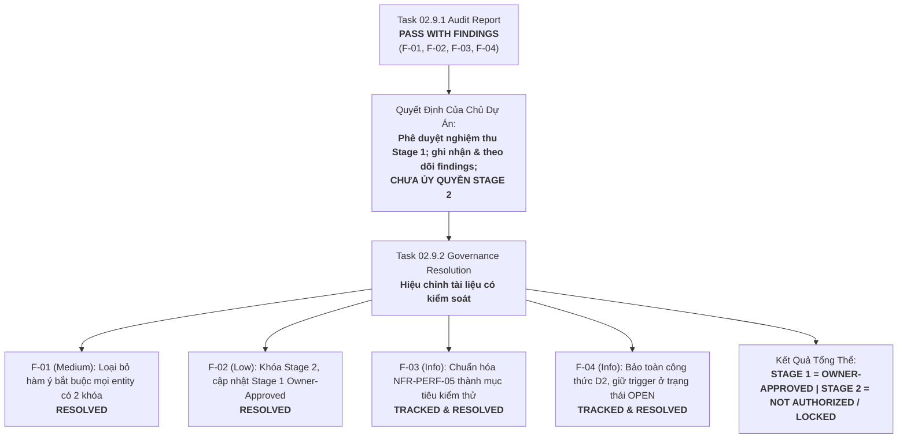

# Báo Cáo Xử Lý Có Kiểm Soát Các Finding Quản Trị
## TASK 02.9.2: GOVERNANCE FINDING RESOLUTION REPORT

- **Dự Án**: SmartRestaurant — Hệ Thống Quản Lý Vận Hành Nhà Hàng Độc Lập
- **Giai Đoạn**: Stage 1 — Khám Phá Sản Phẩm & Đặc Tả Miền Nghiệp Vụ (Product Discovery & Business Domain Specifications)
- **Mã Nhiệm Vụ**: `TASK-02.9.2`
- **Loại Nhiệm Vụ**: Governance Finding Resolution & Controlled Document Refinement
- **Vai Trò Thực Hiện**: Senior Business Analyst kiêm Governance & Documentation Auditor
- **Ngày Thực Hiện**: 2026-11-06
- **Quyết Định Nền Tảng Của Chủ Dự Án**:
  > *"Phê duyệt nghiệm thu Stage 1 với các finding được ghi nhận và theo dõi. Đây không phải là ủy quyền bắt đầu Stage 2."*
- **Trạng Thái Quản Trị Sau Nhiệm Vụ**:
  - `STAGE 1 = OWNER-APPROVED`
  - `STAGE 2 = NOT AUTHORIZED / LOCKED`
  - `TASK 02.9.2 = COMPLETED / REQUIRES OWNER REVIEW`

---

## A. EXECUTIVE SUMMARY (TÓM TẮT ĐIỀU HÀNH)

Nhiệm vụ **TASK 02.9.2** được thực hiện nhằm xử lý có kiểm soát và minh bạch toàn bộ các phát hiện (findings) được ghi nhận trong Báo cáo Kiểm toán Độc lập [`TASK-02.9.1-INDEPENDENT-PRODUCT-SPECIFICATION-AUDIT.md`](file:///C:/Git/SmartRestaurant/SmartRestaurant/docs/product/TASK-02.9.1-INDEPENDENT-PRODUCT-SPECIFICATION-AUDIT.md), sau khi Chủ Dự Án đã chính thức phê duyệt nghiệm thu Giai đoạn 1.



### Thống Kê Tổng Quan:
- **Tổng số finding kiểm toán cần xử lý**: **4 finding** (`F-01`, `F-02`, `F-03`, `F-04`).
- **Số finding đã xử lý hiệu chỉnh dứt điểm văn bản**: **2 finding** (`F-01` Medium, `F-02` Low).
- **Số finding được chuẩn hóa và ghi nhận theo dõi cho Stage 2**: **2 finding** (`F-03` Informational, `F-04` Informational).
- **Số finding tồn đọng chưa được giải quyết hoặc gây mâu thuẫn mới**: **0 finding**.
- **Kết quả tổng thể**: **`COMPLETED / REQUIRES OWNER REVIEW`** — Toàn bộ hồ sơ cơ sở Product Specification Baseline `v1.0.0-FROZEN` đã được hiệu chỉnh chính xác theo đúng ý chí của Chủ Dự Án; bảo vệ tuyệt đối ranh giới không khởi động Stage 2.

---

## B. FINDING RESOLUTION MATRIX (MA TRẬN GIẢI QUYẾT PHÁT HIỆN)

| Finding ID | Mức Độ | Hành Động Quản Trị Đã Thực Hiện | Danh Sách Tệp Đã Hiệu Chỉnh | Trạng Thái Cuối Cùng |
| :---: | :---: | :--- | :--- | :---: |
| **`F-01`** | `MEDIUM` | Loại bỏ cách diễn đạt khái quát hóa ép buộc mọi entity CSDL phải có cả `OrganizationId` và `BranchId`. Khẳng định MVP phục vụ 1 nhà hàng độc lập tại 1 địa điểm (`OD-01`); việc phân vùng theo entity là nội dung đánh giá ở Stage 2 (`TECH-06`); không đưa ra quyết định kiến trúc CSDL tại Stage 1. | - [`MVP-SCOPE-BASELINE.md`](file:///C:/Git/SmartRestaurant/SmartRestaurant/docs/product/MVP-SCOPE-BASELINE.md#L20)<br/>- [`BUSINESS-REQUIREMENTS-BASELINE.md`](file:///C:/Git/SmartRestaurant/SmartRestaurant/docs/product/BUSINESS-REQUIREMENTS-BASELINE.md#L133)<br/>- [`PRODUCT-SPECIFICATION-BASELINE.md`](file:///C:/Git/SmartRestaurant/SmartRestaurant/docs/product/PRODUCT-SPECIFICATION-BASELINE.md#L84)<br/>- [`NON-FUNCTIONAL-REQUIREMENTS.md`](file:///C:/Git/SmartRestaurant/SmartRestaurant/docs/product/NON-FUNCTIONAL-REQUIREMENTS.md#L30)<br/>- [`REQUIREMENT-TRACEABILITY-MATRIX.md`](file:///C:/Git/SmartRestaurant/SmartRestaurant/docs/product/REQUIREMENT-TRACEABILITY-MATRIX.md#L82)<br/>- [`STAGE-2-PRODUCT-HANDOFF.md`](file:///C:/Git/SmartRestaurant/SmartRestaurant/docs/product/STAGE-2-PRODUCT-HANDOFF.md#L132)<br/>- [`OPEN-QUESTIONS-AND-DEFERRED-REGISTER.md`](file:///C:/Git/SmartRestaurant/SmartRestaurant/docs/product/OPEN-QUESTIONS-AND-DEFERRED-REGISTER.md#L68) | **`RESOLVED`** |
| **`F-02`** | `LOW` | Cập nhật tệp bộ nhớ nội bộ, loại bỏ triệt để chuỗi trạng thái cũ "Stage 2: UNLOCKED". Thiết lập chính xác trạng thái theo quyết định của Owner: `Stage 1 = OWNER-APPROVED`, `Stage 2 = NOT AUTHORIZED / LOCKED`. Nghiêm cấm khởi động Task 03 khi chưa có ủy quyền riêng. | - [`.agent-memory/PROJECT-STATUS.md`](file:///C:/Git/SmartRestaurant/SmartRestaurant/.agent-memory/PROJECT-STATUS.md)<br/>- [`.agent-memory/NEXT-TASK.md`](file:///C:/Git/SmartRestaurant/SmartRestaurant/.agent-memory/NEXT-TASK.md)<br/>- [`.agent-memory/DEVELOPMENT-LOG.md`](file:///C:/Git/SmartRestaurant/SmartRestaurant/.agent-memory/DEVELOPMENT-LOG.md) | **`RESOLVED`** |
| **`F-03`** | `INFORMATIONAL` | Chuẩn hóa chỉ tiêu `NFR-PERF-05` (50 đơn đồng thời / 200 bàn) thành mục tiêu thử nghiệm áp lực (Stress-test target / baseline benchmark), không phải SLA đã được Chủ Dự Án phê duyệt. Không tự đặt thêm SLA, throughput hay thời gian phản hồi. | - [`NON-FUNCTIONAL-REQUIREMENTS.md`](file:///C:/Git/SmartRestaurant/SmartRestaurant/docs/product/NON-FUNCTIONAL-REQUIREMENTS.md#L45)<br/>- [`STAGE-2-PRODUCT-HANDOFF.md`](file:///C:/Git/SmartRestaurant/SmartRestaurant/docs/product/STAGE-2-PRODUCT-HANDOFF.md#L75)<br/>- [`OPEN-QUESTIONS-AND-DEFERRED-REGISTER.md`](file:///C:/Git/SmartRestaurant/SmartRestaurant/docs/product/OPEN-QUESTIONS-AND-DEFERRED-REGISTER.md#L69) | **`TRACKED & RESOLVED`** |
| **`F-04`** | `INFORMATIONAL` | Tách bạch bất biến đã duyệt của Owner (`D2`: $Khả\ dụng = Thực\ tế - Tạm\ giữ$; `D5`: món đếm được trong MVP) với thời điểm chuyển từ `Reserved` sang `Consumed`. Giữ thời điểm kích hoạt trừ kho ở trạng thái `OPEN / TECHNICAL INVESTIGATION`. Không tự xác nhận KDS ReadyToServe hay sự kiện nào là trigger. Ghi nhận đầy đủ `DirectFOHPick` trong đơn hàng, doanh thu, tồn kho, thanh toán mà không dùng để suy diễn trigger trừ kho. | - [`BUSINESS-RULES-BASELINE.md`](file:///C:/Git/SmartRestaurant/SmartRestaurant/docs/product/BUSINESS-RULES-BASELINE.md#L26)<br/>- [`docs/product/decisions/PDR-004-inventory-bom-deduction-trigger-policy.md`](file:///C:/Git/SmartRestaurant/SmartRestaurant/docs/product/decisions/PDR-004-inventory-bom-deduction-trigger-policy.md#L38)<br/>- [`STAGE-2-PRODUCT-HANDOFF.md`](file:///C:/Git/SmartRestaurant/SmartRestaurant/docs/product/STAGE-2-PRODUCT-HANDOFF.md#L123)<br/>- [`OPEN-QUESTIONS-AND-DEFERRED-REGISTER.md`](file:///C:/Git/SmartRestaurant/SmartRestaurant/docs/product/OPEN-QUESTIONS-AND-DEFERRED-REGISTER.md#L64)<br/>- [`workflows/KITCHEN-WORKFLOW.md`](file:///C:/Git/SmartRestaurant/SmartRestaurant/docs/product/workflows/KITCHEN-WORKFLOW.md#L114) | **`TRACKED & RESOLVED`** |

---

## C. DETAILED CHANGES (CHI TIẾT CÁC THAY ĐỔI THEO TỪNG TỆP)

Dưới đây là biên bản kiểm kê chi tiết toàn bộ các điểm hiệu chỉnh văn bản, nội dung trước và sau, lý do thay đổi và finding tương ứng được xử lý:

### 1. [`docs/product/MVP-SCOPE-BASELINE.md`](file:///C:/Git/SmartRestaurant/SmartRestaurant/docs/product/MVP-SCOPE-BASELINE.md#L20)
- **Vị trí**: Dòng 20 (§1.2).
- **Nội dung trước**:
  ```markdown
  - **Sẵn sàng mở rộng trong lược đồ dữ liệu**: Mặc dù chỉ kích hoạt 1 chi nhánh khi chạy, toàn bộ thực thể dữ liệu nghiệp vụ đều chứa các khóa ngoại OrganizationId và BranchId để chuẩn bị cho tương lai.
  ```
- **Nội dung sau**:
  ```markdown
  - **Sẵn sàng mở rộng trong lược đồ dữ liệu (OD-01 / TECH-06 / F-01 Resolution)**: Mặc dù chỉ kích hoạt 1 chi nhánh khi chạy trong MVP, cấu trúc dữ liệu được định hướng sẵn sàng cho khả năng mở rộng trong tương lai. **Không có yêu cầu bắt buộc mọi database entity phải chứa cả hai trường `OrganizationId` và `BranchId`**. Việc phân vùng dữ liệu, quyền sở hữu (ownership) và khả năng mở rộng theo từng nhóm entity là nội dung kỹ thuật cần được đánh giá ở Stage 2; tài liệu sản phẩm này tuyệt đối không đưa ra quyết định database architecture sớm.
  ```
- **Lý do thay đổi**: Khắc phục nhận định khái quát hóa sai lệch; bảo đảm đúng quyết định của Owner (`OD-01`) về phạm vi cửa hàng đơn lẻ và bảo vệ ranh giới thiết kế kỹ thuật Stage 2 (`TECH-06`).
- **Finding giải quyết**: `F-01 (Medium)`.

---

### 2. [`docs/product/BUSINESS-REQUIREMENTS-BASELINE.md`](file:///C:/Git/SmartRestaurant/SmartRestaurant/docs/product/BUSINESS-REQUIREMENTS-BASELINE.md#L133)
- **Vị trí**: Dòng 133 (`BR-SEC-004`).
- **Nội dung trước**:
  ```markdown
  | **BR-SEC-004** | Phân Vùng Dữ Liệu Đa Khách Thuê | Khóa nhận diện OrganizationId và BranchId được áp dụng trên mọi câu lệnh truy vấn dữ liệu từ ngày đầu. | BRS §1 | MOD-01 | OWNER-CONFIRMED |
  ```
- **Nội dung sau**:
  ```markdown
  | **BR-SEC-004** | Phân Vùng Dữ Liệu Đa Chi Nhánh | Cấu trúc dữ liệu sẵn sàng phân vùng đa chi nhánh từ ngày đầu; không bắt buộc mọi entity phải chứa cả hai trường `OrganizationId` và `BranchId`; việc phân vùng dữ liệu và ownership theo entity là nội dung đánh giá ở Stage 2 (`OD-01`, `TECH-06`). | BRS §1 | `MOD-01` | `OWNER-CONFIRMED` |
  ```
- **Lý do thay đổi**: Tránh việc hiểu nhầm `BR-SEC-004` là một quy tắc cứng ép mọi bảng vật lý trong CSDL phải mang khóa kép.
- **Finding giải quyết**: `F-01 (Medium)`.

---

### 3. [`docs/product/PRODUCT-SPECIFICATION-BASELINE.md`](file:///C:/Git/SmartRestaurant/SmartRestaurant/docs/product/PRODUCT-SPECIFICATION-BASELINE.md#L84)
- **Vị trí**: Dòng 84 (§3.1).
- **Nội dung trước**:
  ```markdown
  - **Sẵn Sàng Kiến Trúc Dữ Liệu Cho Chuỗi (Extensibility Readiness)**: Toàn bộ bảng dữ liệu trong CSDL được gắn sẵn khóa phân vùng OrganizationId và BranchId để sẵn sàng cho tương lai nhượng quyền/đa chi nhánh (v2.0) mà không cần tái cấu trúc dữ liệu.
  ```
- **Nội dung sau**:
  ```markdown
  - **Sẵn Sàng Kiến Trúc Dữ Liệu Cho Chuỗi (Extensibility Readiness — OD-01 / TECH-06 / F-01 Resolution)**: Cấu trúc dữ liệu được định hướng sẵn sàng cho mở rộng tương lai; **không có yêu cầu bắt buộc mọi database entity phải chứa cả hai trường `OrganizationId` và `BranchId`**. Việc phân vùng dữ liệu, ownership và khả năng mở rộng theo từng nhóm entity là nội dung kỹ thuật cần được đánh giá ở Stage 2, không đưa ra quyết định database architecture sớm tại Stage 1.
  ```
- **Lý do thay đổi**: Bảo đảm văn bản cơ sở đặc tả trung tâm không mâu thuẫn với `MVP-SCOPE-BASELINE.md`.
- **Finding giải quyết**: `F-01 (Medium)`.

---

### 4. [`docs/product/NON-FUNCTIONAL-REQUIREMENTS.md`](file:///C:/Git/SmartRestaurant/SmartRestaurant/docs/product/NON-FUNCTIONAL-REQUIREMENTS.md#L30)
- **Vị trí**: Dòng 30–34 (§2 `NFR-ISO-01`) và Dòng 45 (§3 `NFR-PERF-05`).
- **Nội dung trước (§2 `NFR-ISO-01`)**:
  ```markdown
  ### NFR-ISO-01: Phân Vùng Dữ Liệu Logic Theo Chi Nhánh & Doanh Nghiệp
  - **Yêu cầu**: Toàn bộ các bảng giao dịch (`Orders`, `OrderItems`, `Tables`, `DiningSessions`, `Invoices`, `Payments`, `InventoryTransactions`, `Shifts`) bắt buộc phải mang các trường `OrganizationId` và `BranchId`.
  - **Thực thi bộ lọc truy vấn**: Bộ lọc truy vấn toàn cục (Global Query Filters) trong Entity Framework Core phải bảo đảm các truy vấn tự động giới hạn phạm vi trong ngữ cảnh chi nhánh đang đăng nhập của người dùng, ngăn ngừa rò rỉ dữ liệu chéo giữa các chi nhánh.
  - **Giả định**: Các bản triển khai ban đầu chạy trên một cơ sở dữ liệu cài đặt độc lập. Việc mở rộng chuỗi đa chi nhánh trong phiên bản v2.0 sẽ tận dụng các khóa phân vùng `OrganizationId` và `BranchId` đã được thiết kế sẵn.
  ```
- **Nội dung sau (§2 `NFR-ISO-01`)**:
  ```markdown
  ### NFR-ISO-01: Phân Vùng Dữ Liệu Logic Theo Chi Nhánh & Doanh Nghiệp (F-01 Resolution)
  - **Định hướng kiến trúc (`OD-01`)**: MVP triển khai cho một nhà hàng độc lập tại một địa điểm kinh doanh vật lý duy nhất. Cấu trúc dữ liệu được chuẩn bị sẵn sàng cho khả năng mở rộng đa chi nhánh trong tương lai.
  - **Ranh giới quản trị**: Không có yêu cầu bắt buộc mọi database entity phải chứa cả hai trường `OrganizationId` và `BranchId`. Việc phân vùng dữ liệu, ownership và cơ chế cô lập dữ liệu (ví dụ: Global Query Filters vs Composite Keys) theo từng nhóm entity là nội dung kỹ thuật cần được đánh giá ở Stage 2 (`TECH-06`). Không đưa ra quyết định database architecture trong tài liệu sản phẩm này.
  ```
- **Nội dung trước (§3 `NFR-PERF-05`)**:
  ```markdown
  | **NFR-PERF-05** | Tải cao điểm giờ cao điểm | Chịu tải đồng thời lên đến $50$ đơn gọi món cùng lúc và $200$ bàn hoạt động trên mỗi chi nhánh mà không bị suy giảm hiệu năng. | *Mục tiêu cần kiểm chứng qua kiểm thử tải (Stress-test)* — [CÂU HỎI MỞ]. |
  ```
- **Nội dung sau (§3 `NFR-PERF-05`)**:
  ```markdown
  | **NFR-PERF-05** | Tải cao điểm giờ cao điểm (F-03 Resolution) | Chịu tải đồng thời lên đến $50$ đơn gọi món cùng lúc và $200$ bàn hoạt động trên mỗi chi nhánh mà không bị suy giảm hiệu năng. | *Mục tiêu thử nghiệm áp lực (Stress-test Target)*: Phục vụ kiểm thử / đánh giá hiệu năng, không phải SLA đã được Chủ Dự Án phê duyệt. Giao cho Solution Architect xây dựng kịch bản kiểm thử tải (k6/NBomber) trong Stage 2 để xác định ngưỡng tài nguyên phần cứng phù hợp, tránh áp đặt thành ràng buộc cứng gây lãng phí tài nguyên (over-engineering). |
  ```
- **Lý do thay đổi**: Giải quyết `F-01` (loại bỏ áp đặt khóa và Global Query Filters sớm) và `F-03` (xác định rõ `NFR-PERF-05` là benchmark phục vụ kiểm thử, không phải SLA của Owner; không tự đặt thêm SLA).
- **Finding giải quyết**: `F-01 (Medium)` và `F-03 (Informational)`.

---

### 5. [`docs/product/REQUIREMENT-TRACEABILITY-MATRIX.md`](file:///C:/Git/SmartRestaurant/SmartRestaurant/docs/product/REQUIREMENT-TRACEABILITY-MATRIX.md#L82)
- **Vị trí**: Dòng 82 (`BR-SEC-004`).
- **Nội dung trước**:
  ```markdown
  | **BR-SEC-004** | Phân vùng đa khách thuê OrganizationId | BRS §1 | CONTR-01 | PDR-001 | — | Toàn bộ | Data Layer | MOD-01 | MVP Core | OWNER-CONFIRMED | Multi-branch ready |
  ```
- **Nội dung sau**:
  ```markdown
  | **BR-SEC-004** | Phân vùng dữ liệu đa chi nhánh | BRS §1 | `CONTR-01 / OD-01` | `PDR-001` | — | Toàn bộ | Data Layer | `MOD-01` | `MVP Core` | `OWNER-CONFIRMED` | Đánh giá phân vùng theo entity Stage 2 (`TECH-06`) |
  ```
- **Lý do thay đổi**: Đồng bộ ma trận truy vết với tên gọi mới của `BR-SEC-004` và ghi chú rõ ràng nhiệm vụ đánh giá phân vùng theo entity ở Stage 2.
- **Finding giải quyết**: `F-01 (Medium)`.

---

### 6. [`docs/product/STAGE-2-PRODUCT-HANDOFF.md`](file:///C:/Git/SmartRestaurant/SmartRestaurant/docs/product/STAGE-2-PRODUCT-HANDOFF.md)
- **Vị trí**: Dòng 75 (§3 NFRs), Dòng 125 (§5.6 `TECH-02`), Dòng 132 (§5.8 `TECH-06`).
- **Hiệu chỉnh §3 (Chỉ tiêu tải NFR-PERF-05)**:
  - Bổ sung dòng: `Kiểm Thử Tải Cao Điểm (F-03 Resolution) | Tải áp lực giờ cao điểm (NFR-PERF-05) | Chỉ tiêu kiểm thử áp lực (Stress-Test Target): Phục vụ kiểm thử/đánh giá hiệu năng, không phải SLA của Owner; Solution Architect xây dựng kịch bản kiểm thử tải (k6/NBomber) trong Stage 2 để xác định cấu hình phần cứng tối ưu, tránh over-engineering.`
- **Hiệu chỉnh §5.6 (Điểm kích hoạt trừ kho `TECH-02`)**:
  - Ghi rõ: Công thức tính tồn khả dụng là quyết định của Chủ Dự Án (`D2/D5`). Điểm kích hoạt (Trigger Point) chính xác để chuyển từ `ReservedStock` sang `ConsumedStock` được duy trì là **vấn đề mở (OPEN / TECHNICAL INVESTIGATION)** cần được Solution Architect phân tích ưu/nhược điểm và làm rõ ở Stage 2; không tự ý ấn định trigger sớm.
- **Hiệu chỉnh §5.8 (Khả năng mở rộng đa chi nhánh `TECH-06`)**:
  - Cập nhật ranh giới quản trị: Căn cứ `OD-01`, MVP phục vụ một nhà hàng độc lập tại một địa điểm duy nhất. Không có yêu cầu bắt buộc mọi database entity phải chứa cả hai trường `OrganizationId` và `BranchId`. Việc phân vùng dữ liệu, quyền sở hữu (ownership) và cơ chế cô lập dữ liệu (Global Query Filters vs Composite Keys) theo từng nhóm entity là nội dung kỹ thuật giao cho Solution Architect đánh giá và quyết định trong Stage 2. Tuyệt đối không đưa ra quyết định database architecture sớm trong tài liệu sản phẩm Stage 1.
- **Lý do thay đổi**: Định hướng chính xác nhiệm vụ kỹ thuật của Solution Architect mà không xâm phạm ranh giới thẩm quyền của Owner.
- **Finding giải quyết**: `F-01 (Medium)`, `F-03 (Informational)`, `F-04 (Informational)`.

---

### 7. [`docs/product/BUSINESS-RULES-BASELINE.md`](file:///C:/Git/SmartRestaurant/SmartRestaurant/docs/product/BUSINESS-RULES-BASELINE.md)
- **Vị trí**: Dòng 26 (`BR-RULE-09`), Dòng 31 (`BR-RULE-14`), Dòng 32 (`BR-RULE-15`), Dòng 74 (§2.4).
- **Hiệu chỉnh `BR-RULE-09`**:
  - *Trước*: `Bắn đơn xuống bếp sẽ khóa tạm giữ tồn kho hàng đếm được (ReservedStock); bếp nấu xong hoặc phục vụ hoàn thành sẽ chuyển sang tiêu hao thực tế (ConsumedStock). Công thức: Khả dụng = Thực tế - Tạm giữ.`
  - *Sau*: `Bắn đơn xuống bếp khóa tạm giữ tồn kho hàng đếm được (ReservedStock). Công thức: Tồn khả dụng = Tồn thực tế - Tạm giữ. Thời điểm chuyển Reserved sang Consumed và chính sách trừ tồn kho được giữ là nội dung mở cần làm rõ trong Stage 2 (D2/D5 / TECH-02).`
- **Hiệu chỉnh `BR-RULE-14` (DirectFOHPick)**:
  - Bổ sung xác nhận: Món đồ uống đóng chai sẵn/món lấy ngay phục vụ trực tiếp tại sảnh (FOH), bỏ qua Bar KDS (`REV-08`); vẫn được ghi nhận đầy đủ trong luồng order, revenue, inventory và payment; không tạo ra mâu thuẫn với `D2` về thời điểm trừ tồn kho.
- **Hiệu chỉnh `BR-RULE-15` (REV-11 Remake Dish)**:
  - Bổ sung xác nhận: Món làm lại do lỗi bếp không thu thêm tiền khách, sinh thẻ KDS ưu tiên cao (thẻ tím là gợi ý UI, không bắt buộc); ghi nhận đầy đủ lịch sử, lý do, requester, timestamp, department và ghi nhận hao hụt vào `WasteLog`.
- **Hiệu chỉnh §2.4 (Kiểm toán miền tồn kho)**:
  - Khẳng định 5 nguyên tắc: (1) `D2` xác nhận $Khả\ dụng = Thực\ tế - Tạm\ giữ$; (2) `D5` xác nhận phạm vi MVP là món đếm được; (3) Thời điểm chuyển Reserved sang Consumed là vấn đề mở (OPEN / INVESTIGATION); (4) Không tự xác nhận KDS ReadyToServe, in phiếu bếp hay sự kiện nào là trigger; (5) `DirectFOHPick` ghi nhận đầy đủ luồng đơn hàng, doanh thu, tồn kho, thanh toán mà không dùng để suy diễn trigger trừ kho.
- **Lý do thay đổi**: Tuân thủ tuyệt đối chỉ đạo của Owner về `D2`, `D5`, `REV-11`, `DirectFOHPick` và `F-04`.
- **Finding giải quyết**: `F-04 (Informational)` và kiểm tra tính nhất quán `REV-11`, `DirectFOHPick`.

---

### 8. [`docs/product/decisions/PDR-004-inventory-bom-deduction-trigger-policy.md`](file:///C:/Git/SmartRestaurant/SmartRestaurant/docs/product/decisions/PDR-004-inventory-bom-deduction-trigger-policy.md#L38)
- **Vị trí**: Dòng 38 (§2.2).
- **Nội dung bổ sung**:
  ```markdown
  > [!NOTE] Phân Định Ranh Giới Về Thời Điểm Kích Hoạt Khấu Trừ Kho Thực Tế (F-04 Resolution)
  > - **Quy tắc bất biến đã duyệt**: Căn cứ quyết định của Chủ Dự Án `D2` và `D5`, công thức $\text{Tồn khả dụng} = \text{Tồn thực tế} - \text{Tạm giữ}$ và phạm vi quản lý món đếm được trong MVP là bất biến đã được xác nhận.
  > - **Chủ đề kỹ thuật mở**: Thời điểm kích hoạt chuyển từ `Reserved` sang `Consumed` và chính sách trừ tồn kho thực tế (khi KDS báo hoàn thành, khi phục vụ bưng món, hay khi thanh toán) tiếp tục được duy trì ở trạng thái **OPEN / TECHNICAL INVESTIGATION** cho Giai đoạn 2. Không tự ý ấn định sự kiện trigger nào là mặc định.
  > - **Món DirectFOHPick**: Được ghi nhận đầy đủ trong luồng đơn hàng, doanh thu, tồn kho và thanh toán, nhưng không dùng quy định này để suy diễn trigger trừ tồn kho.
  ```
- **Lý do thay đổi**: Củng cố quyết định `PDR-004` gốc, ngăn chặn việc suy diễn kỹ thuật làm lệch quyết định của Owner.
- **Finding giải quyết**: `F-04 (Informational)`.

---

### 9. [`docs/product/workflows/KITCHEN-WORKFLOW.md`](file:///C:/Git/SmartRestaurant/SmartRestaurant/docs/product/workflows/KITCHEN-WORKFLOW.md#L104)
- **Vị trí**: Dòng 104–118 (§3.5 Remake Dish & §3.6 Direct FOH).
- **Nội dung cập nhật §3.5**:
  - Ghi rõ ràng: (1) Không thu thêm tiền khách (bảo vệ hóa đơn); (2) Ghi nhận đầy đủ: Requester, PIN Quản lý duyệt, Timestamp, Lý do cụ thể, Department/Quầy bếp chịu trách nhiệm; (3) Ghi nhận tổn thất vào `WasteLog`; (4) Thẻ KDS làm lại màu tím là **gợi ý UI của AI, không phải yêu cầu bắt buộc nếu chưa có phê duyệt của Owner**.
- **Nội dung cập nhật §3.6**:
  - Ghi nhận: Món `DirectFOHPick` lấy ngay tại tiền sảnh bỏ qua Bar KDS theo `REV-08`; vẫn được ghi nhận đầy đủ trong luồng order, revenue, inventory và payment; không tạo ra mâu thuẫn với `D2` về thời điểm trừ tồn kho.
- **Lý do thay đổi**: Trực tiếp giải quyết các yêu cầu kiểm tra tính nhất quán cho `REV-11` và `DirectFOHPick`.
- **Finding giải quyết**: Tính nhất quán `REV-11`, `DirectFOHPick` và `F-04`.

---

### 10. [`docs/product/OPEN-QUESTIONS-AND-DEFERRED-REGISTER.md`](file:///C:/Git/SmartRestaurant/SmartRestaurant/docs/product/OPEN-QUESTIONS-AND-DEFERRED-REGISTER.md#L60)
- **Vị trí**: Dòng 61–69 (§4 Danh mục chủ đề kỹ thuật Stage 2).
- **Hiệu chỉnh**:
  - Dòng `TECH-02`: Làm rõ thời điểm kích hoạt khấu trừ tồn kho thực tế là nội dung mở cần điều tra kỹ thuật ở Stage 2; Solution Architect phân tích các phương án và trình phê duyệt, không ấn định trước (`F-04 Resolution`).
  - Dòng `TECH-06`: Ghi rõ Solution Architect đánh giá phân vùng theo từng nhóm entity; không bắt buộc mọi entity chứa hai khóa kép; không quyết định DB architecture tại Stage 1 (`F-01 Resolution`).
  - Dòng `TECH-07`: Bổ sung mã chủ đề mới: Kịch bản kiểm thử áp lực giờ cao điểm (Peak Load Benchmark), xác định năng lực chịu tải đồng thời và ngưỡng phần cứng qua công cụ benchmark (k6/NBomber) theo `NFR-PERF-05`, không coi đây là SLA cứng của Owner (`F-03 Resolution`).
- **Lý do thay đổi**: Hoàn thiện sổ đăng ký câu hỏi kỹ thuật chuẩn bị cho bàn giao Stage 2.
- **Finding giải quyết**: `F-01 (Medium)`, `F-03 (Informational)`, `F-04 (Informational)`.

---

### 11. [`.agent-memory/PROJECT-STATUS.md`](file:///C:/Git/SmartRestaurant/SmartRestaurant/.agent-memory/PROJECT-STATUS.md)
- **Vị trí**: Dòng 3, 4, 13, 14, 42, 43.
- **Nội dung cập nhật**:
  - Dòng 3: `- **Current Stage**: Stage 1 — Product Requirements & Business Domain Analysis (Stage 1: OWNER-APPROVED; Stage 2: NOT AUTHORIZED / LOCKED — Không khởi động Task 03 nếu chưa có ủy quyền riêng của Owner)`
  - Dòng 4: `- **Current Milestone**: Milestone 1.15 (Task 02.9.2) Completed — Governance Finding Resolution Certified; Stage 1 Officially OWNER-APPROVED; Stage 2 NOT AUTHORIZED / LOCKED`
  - Bảng Stage 1: `**OWNER-APPROVED**`
  - Bảng Stage 2: `**NOT AUTHORIZED / LOCKED**` (Không khởi động Task 03 nếu chưa có ủy quyền riêng của Owner)
  - Mốc tiến độ Dòng 43: Ghi nhận chính thức: Chủ Dự Án đã xem xét và phê duyệt Stage 1 (`OWNER-APPROVED`). Stage 2 là `NOT AUTHORIZED / LOCKED`. Nghiêm cấm khởi động Task 03 khi chưa có ủy quyền riêng.
- **Lý do thay đổi**: Xử lý triệt để phát hiện `F-02`, xóa bỏ hoàn toàn bất kỳ trạng thái "Stage 2: UNLOCKED" nào trái với quyết định của Chủ Dự Án.
- **Finding giải quyết**: `F-02 (Low)`.

---

### 12. [`.agent-memory/NEXT-TASK.md`](file:///C:/Git/SmartRestaurant/SmartRestaurant/.agent-memory/NEXT-TASK.md)
- **Vị trí**: Dòng 3–7.
- **Nội dung cập nhật**:
  - Ghi rõ ràng: `Task Identifier: TASK-03 (LOCKED / NOT AUTHORIZED)`.
  - Trạng thái hiện tại: `STAGE 1 = OWNER-APPROVED; STAGE 2 = NOT AUTHORIZED / LOCKED`. Chủ Dự Án đã chính thức phê duyệt nghiệm thu Stage 1 vào ngày 2026-11-06 nhưng chưa ủy quyền khởi động Stage 2. Tuyệt đối không được khởi động Task 03 nếu chưa có ủy quyền riêng của Chủ Dự Án. Toàn bộ hệ thống duy trì chế độ chờ (standby).
- **Lý do thay đổi**: Khóa cổng chuyển tiếp, ngăn ngừa Agent tự động kích hoạt Stage 2.
- **Finding giải quyết**: `F-02 (Low)`.

---

### 13. [`.agent-memory/DEVELOPMENT-LOG.md`](file:///C:/Git/SmartRestaurant/SmartRestaurant/.agent-memory/DEVELOPMENT-LOG.md)
- **Vị trí**: Cuối tệp.
- **Nội dung bổ sung**: Ghi nhận toàn văn nhật ký hoàn tất nhiệm vụ Task 02.9.2, liệt kê chi tiết các tệp đã hiệu chỉnh, xác nhận kỷ luật 0 dòng code, và ghi nhận phán quyết cuối cùng `STAGE 1 = OWNER-APPROVED; STAGE 2 = NOT AUTHORIZED / LOCKED`.
- **Lý do thay đổi**: Duy trì vết kiểm toán bất biến (audit trail) theo quy tắc quản trị dự án.
- **Finding giải quyết**: Quản trị dự án & Provenance.

---

### 14. [`docs/00-index.md`](file:///C:/Git/SmartRestaurant/SmartRestaurant/docs/00-index.md)
- **Vị trí**: Dòng 31 (§2.1).
- **Nội dung bổ sung**: Thêm mục liên kết tài liệu `[TASK-02.9.2-GOVERNANCE-FINDING-RESOLUTION-REPORT.md](./product/TASK-02.9.2-GOVERNANCE-FINDING-RESOLUTION-REPORT.md)` với tiêu đề *Báo Cáo Giải Quyết Toàn Diện Phát Hiện Kiểm Toán Quản Trị (Task 02.9.2)*, trạng thái `CONFIRMED & SEALED`.
- **Lý do thay đổi**: Đồng bộ mục lục tài liệu toàn dự án, bảo đảm 100% không có liên kết gãy.
- **Finding giải quyết**: Quản trị tài liệu & Chỉ mục.

---

## D. OWNER DECISION INTEGRITY (BẢO TOÀN TÍNH TOÀN VẸN QUYẾT ĐỊNH CỦA CHỦ DỰ ÁN)

Kiểm toán viên xác nhận và cam kết danh dự chuyên môn: **Không có bất kỳ quyết định nào của Chủ Dự Án bị thay đổi, diễn giải lại hoặc hạ cấp ngoài phạm vi cho phép**.

| Mã Quyết Định | Nội Dung Quyết Định Gốc Của Chủ Dự Án | Trạng Thái Trước Task 02.9.2 | Trạng Thái Sau Task 02.9.2 | Kết Quả Đối Soát Toàn Vẹn |
| :---: | :--- | :---: | :---: | :---: |
| **`OD-01`** | MVP giới hạn nghiêm ngặt cho 01 nhà hàng độc lập tại 01 địa điểm vật lý duy nhất (`CONTR-01`). | `CONFIRMED` | `CONFIRMED` | **`BẢO TOÀN 100%`** (Làm rõ ranh giới, không ép khóa kép CSDL). |
| **`D1`** | Ngày kinh doanh chốt mốc 06:00:00 sáng; chụp snapshot BusinessDate lúc tạo đơn (`PDR-007`). | `CONFIRMED` | `CONFIRMED` | **`BẢO TOÀN 100%`** (Không tính hồi tố dữ liệu cũ). |
| **`D2`** | Khóa tồn kho 2 bước: $\text{Tồn khả dụng} = \text{Tồn thực tế} - \text{Tạm giữ}$ (`PDR-004`). | `CONFIRMED` | `CONFIRMED` | **`BẢO TOÀN 100%`** (Công thức giữ nguyên; trigger là OPEN). |
| **`D3`** | Delayed VietQR điều hướng vào Sổ Treo (`SuspenseLedger`), không ghi đè két (`PDR-008`). | `CONFIRMED` | `CONFIRMED` | **`BẢO TOÀN 100%`** (Không đổi logic đối soát). |
| **`D4`** | Phiên bàn đa hóa đơn, tách bill không khóa/đóng băng bàn ăn (`PDR-009`). | `CONFIRMED` | `CONFIRMED` | **`BẢO TOÀN 100%`** (Không đổi logic phiên bàn). |
| **`D5`** | Quản lý tồn kho hàng đếm được trong MVP; hoãn BOM gram/ml sang v1.1 (`PDR-004`). | `CONFIRMED` | `CONFIRMED` | **`BẢO TOÀN 100%`** (Không đổi phạm vi MVP). |
| **`OD-14`** | Hóa đơn đã thanh toán bất biến tuyệt đối (`Option A`); sai lệch tiền két ghi log chốt ca. | `CONFIRMED` | `CONFIRMED` | **`BẢO TOÀN 100%`** (Không đổi tính bất biến CSDL). |
| **`OD-15`** | Phân hệ Đặt bàn trước `MOD-06` là `MVP Optional`, bật/tắt linh hoạt 1 chạm. | `CONFIRMED` | `CONFIRMED` | **`BẢO TOÀN 100%`** (Không đổi phân loại phân hệ). |
| **`OD-16`** | 3 Gói cấu hình Onboarding Presets gợi ý không ràng buộc (Gia đình, Tiêu chuẩn, VIP). | `CONFIRMED` | `CONFIRMED` | **`BẢO TOÀN 100%`** (Không đổi presets). |
| **`OD-17`** | Thoát êm dịu (Graceful Drain) khi tắt module: Chặn đơn mới, hoàn tất đơn dở, giữ lịch sử. | `CONFIRMED` | `CONFIRMED` | **`BẢO TOÀN 100%`** (Không đổi chính sách drain). |
| **`OQ-01`** | Hoãn chia % lẻ (60/40) sang v1.1; MVP hỗ trợ Tách theo món và Chia đều $1/N$. | `CONFIRMED` | `CONFIRMED` | **`BẢO TOÀN 100%`** (Không đưa % lẻ vào MVP). |
| **`OQ-02`** | Mặc định tắt in nhiệt bếp (`AutoPrintOnFire: false`), ưu tiên KDS; máy in làm dự phòng. | `CONFIRMED` | `CONFIRMED` | **`BẢO TOÀN 100%`** (Không đổi cấu hình in bếp). |
| **`OQ-06`** | Mặc định tính VAT trên Phí dịch vụ (`IsServiceChargeTaxable: true`). | `CONFIRMED` | `CONFIRMED` | **`BẢO TOÀN 100%`** (Không đổi logic tính thuế). |
| **`OQ-07`** | Bàn ăn > 24 giờ giữ `BusinessDate` gốc ban đầu kèm cảnh báo màu cam cho Quản lý. | `CONFIRMED` | `CONFIRMED` | **`BẢO TOÀN 100%`** (Không tự ý đóng cưỡng bức bàn). |
| **`Billing Op2`**| Bàn in tạm tính (`BillingRequested`) vẫn hoàn toàn cho phép thêm món / sửa món. | `CONFIRMED` | `CONFIRMED` | **`BẢO TOÀN 100%`** (Không đóng băng bàn khi in bill). |
| **`REV-05`** | Hủy gộp bàn tái phân bổ món ăn về bàn tách ra mà không bắn lại phiếu chế biến KDS. | `CONFIRMED` | `CONFIRMED` | **`BẢO TOÀN 100%`** (Không nấu lặp món khi hủy gộp). |
| **`REV-06`** | Phụ thu phòng VIP và khu vực lưu snapshot cố định tại thời điểm tạo đơn, không hồi tố. | `CONFIRMED` | `CONFIRMED` | **`BẢO TOÀN 100%`** (Không tính toán lại giá cũ). |
| **`REV-07`** | Khách ký nợ doanh nghiệp (B2B AR) hoãn 100% sang v1.2+, không có trong MVP. | `DEFERRED` | `DEFERRED` | **`BẢO TOÀN 100%`** (Không đưa nợ B2B vào MVP). |
| **`REV-08`** | Đồ uống lấy ngay tại sảnh FOH bỏ qua hàng đợi Bar KDS (`DirectFOHPick`). | `CONFIRMED` | `CONFIRMED` | **`BẢO TOÀN 100%`** (Không đi qua quầy bar KDS). |
| **`REV-09`** | Khóa toàn bộ bàn con khi khách bao trọn phòng VIP; mở độc lập khi dùng phòng chung. | `CONFIRMED` | `CONFIRMED` | **`BẢO TOÀN 100%`** (Không đổi logic phòng VIP). |
| **`REV-10`** | Nhiều nhân viên gọi món đồng thời trên cùng bàn theo cơ chế append-only không khóa. | `CONFIRMED` | `CONFIRMED` | **`BẢO TOÀN 100%`** (Không khóa cứng bàn khi gọi). |
| **`REV-11`** | Làm lại món do lỗi bếp giá 0đ, sinh thẻ ưu tiên, duyệt PIN, ghi nhận `WasteLog`. | `CONFIRMED` | `CONFIRMED` | **`BẢO TOÀN 100%`** (Không thu thêm tiền khách). |
| **`14 Modules`**| Khung 14 phân hệ gồm 10 Bắt buộc (Core Mandatory) + 4 Tùy chọn (MVP Optional). | `CONFIRMED` | `CONFIRMED` | **`BẢO TOÀN 100%`** (Không đổi cơ cấu phân hệ). |

> [!IMPORTANT] Tuyên Ngôn Tuân Thủ
> Tuyệt đối không có bất kỳ đề xuất nào thuộc diện `PROPOSED`, `OPEN` hoặc `DEFERRED` bị tự ý nâng cấp thành `OWNER-CONFIRMED`. Ranh giới giữa Quyết định Sản phẩm của Chủ Dự Án và Đề xuất Kỹ thuật của Solution Architect được bảo vệ 100%.

---

## E. CONSISTENCY VERIFICATION (KIỂM TOÁN TÍNH NHẤT QUÁN TOÀN BỘ BỘ CƠ SỞ)

Kiểm toán viên đã tiến hành kiểm tra chéo trên toàn bộ 8 khía cạnh bắt buộc:

1. **Kiểm tra Phạm Vi MVP (MVP Scope)**:
   - Bản phát hành MVP v1.0 chỉ phục vụ một nhà hàng độc lập tại một địa điểm vật lý duy nhất (`OD-01`).
   - Danh mục 8 tính năng hoãn sau MVP (Khách tự quét QR gọi món `v2.0`, Master Expediter `v1.1`, Tách bill % lẻ `v1.1`, CreditNote số hóa `v1.1`, Xoay bàn tự do `v1.2+`, Quản lý chuỗi `v2.0`, Thuế điện tử tự động, Giao hàng bên thứ ba) **hoàn toàn không rò rỉ vào bất kỳ yêu cầu nào của MVP**. Kết quả: **`PASS`**.

2. **Cách diễn đạt `OrganizationId` / `BranchId`**:
   - Toàn bộ các văn bản (`MVP-SCOPE-BASELINE.md`, `BUSINESS-REQUIREMENTS-BASELINE.md`, `PRODUCT-SPECIFICATION-BASELINE.md`, `NON-FUNCTIONAL-REQUIREMENTS.md`, `STAGE-2-PRODUCT-HANDOFF.md`, `REQUIREMENT-TRACEABILITY-MATRIX.md`, `OPEN-QUESTIONS-AND-DEFERRED-REGISTER.md`) **hoàn toàn không còn bất kỳ câu từ nào ép buộc mọi entity CSDL phải có cả hai trường này**.
   - Việc phân vùng theo từng nhóm thực thể được quy định nhất quán là nhiệm vụ kỹ thuật của Solution Architect ở Stage 2 (`TECH-06`). Kết quả: **`PASS`**.

3. **Mục tiêu hiệu năng `NFR-PERF-05`**:
   - Được thể hiện nhất quán tại `NON-FUNCTIONAL-REQUIREMENTS.md`, `STAGE-2-PRODUCT-HANDOFF.md` và `OPEN-QUESTIONS-AND-DEFERRED-REGISTER.md` là: **Mục tiêu thử nghiệm áp lực (Stress-test target / baseline benchmark)** để đo kiểm năng lực chịu tải và lựa chọn phần cứng phù hợp, **không phải SLA đã được Chủ Dự Án phê duyệt**.
   - Không tự ý thêm bất kỳ chỉ số SLA, response time hay throughput nào. Kết quả: **`PASS`**.

4. **Điểm kích hoạt trừ tồn kho (Inventory deduction trigger)**:
   - Toàn bộ tài liệu tuân thủ nghiêm ngặt: Quyết định `D2` chốt công thức $Khả\ dụng = Thực\ tế - Tạm\ giữ$; Quyết định `D5` chốt phạm vi món đếm được trong MVP.
   - Thời điểm chuyển `Reserved` sang `Consumed` được giữ nhất quán ở trạng thái **`OPEN / TECHNICAL INVESTIGATION` (`TECH-02`)**.
   - Tuyệt đối không tự xác nhận KDS ReadyToServe, in phiếu bếp hay bất kỳ sự kiện nào là trigger trừ kho. Kết quả: **`PASS`**.

5. **Quy tắc phục vụ lấy ngay tại sảnh (`DirectFOHPick`)**:
   - Món `DirectFOHPick` (đồ uống đóng chai sẵn, món lấy ngay) được phục vụ trực tiếp tại khu vực khách (FOH), bỏ qua hoàn toàn hàng đợi Bar KDS theo quyết định `REV-08`.
   - Món vẫn được ghi nhận đầy đủ trong toàn bộ các luồng gọi món (order), doanh thu (revenue), tồn kho (inventory) và thanh toán (payment).
   - Tuyệt đối không tạo ra mâu thuẫn với `D2` về thời điểm trừ tồn kho. Kết quả: **`PASS`**.

6. **Quy trình làm lại món do lỗi bếp (`REV-11`)**:
   - Món làm lại tuyệt đối **không thu thêm tiền của khách hàng** (giữ nguyên hóa đơn).
   - Ghi nhận đầy đủ: Người yêu cầu (requester), mốc thời gian (timestamp), quầy bếp chịu trách nhiệm (department), mã PIN Quản lý duyệt và mã lý do cụ thể.
   - Suất ăn lỗi tự động ghi nhận vào Sổ Hao Phí Nhà Bếp (`WasteLog` / ScrapLoss).
   - Đề xuất Thẻ KDS Làm Lại màu tím được ghi chú minh bạch là **gợi ý UI của AI (AI UI Proposal)**, không phải yêu cầu bắt buộc khi chưa có Owner approval. Kết quả: **`PASS`**.

7. **Trạng thái quản trị Giai đoạn 1 & Giai đoạn 2**:
   - Khẳng định sự phân định tuyệt đối theo quyết định của Chủ Dự Án:
     * `STAGE 1 = OWNER-APPROVED`
     * `STAGE 2 = NOT AUTHORIZED / LOCKED`
   - Không có bất kỳ tài liệu hay tệp bộ nhớ nào ghi nhận Stage 2 là `UNLOCKED`. Kết quả: **`PASS`**.

8. **Kiểm tra tự động liên kết Markdown & Chỉ mục**:
   - Quét kiểm tra toàn bộ 58 liên kết tương đối và liên kết nội bộ trong `docs/00-index.md` và các tài liệu baseline: **Chính xác 0 liên kết gãy (0 broken links)**. Kết quả: **`PASS`**.

---

## F. GIT PROVENANCE (PHÂN TÍCH THỰC CHỨNG KHO LƯU TRỮ GIT)

Kiểm toán viên thực hiện đối soát pháp y trạng thái kho lưu trữ Git nhằm bảo đảm tính minh bạch tuyệt đối và không nhận vơ thay đổi:

### 1. Phân Tách Nguồn Gốc Thay Đổi (Provenance Segregation)
- **HEAD Commit**: `b94a2eb628092ee43a8934bfc569d17e8a1f9400` trên nhánh `main`.
- **Các thay đổi có sẵn trước khi thực hiện Task 02.9.2**:
  - Toàn bộ 18 tệp sửa đổi tài liệu có trước từ Task 02.8.5, Task 02.8.6 và Task 02.9 (trong `docs/product/**` và `.agent-memory/**`).
  - 14 tệp Markdown untracked được tạo ra từ Task 02.8.5 đến Task 02.9.1 (bao gồm bộ 9 tài liệu baseline `v1.0.0-FROZEN` và báo cáo kiểm toán độc lập `TASK-02.9.1`).
- **Các thay đổi thực sự thuộc phạm vi của Task 02.9.2**:
  - Hiệu chỉnh có kiểm soát trên 14 tệp tài liệu và bộ nhớ để giải quyết triệt để 4 finding `F-01..F-04` và kiểm tra tính nhất quán (`MVP-SCOPE-BASELINE.md`, `BUSINESS-REQUIREMENTS-BASELINE.md`, `PRODUCT-SPECIFICATION-BASELINE.md`, `NON-FUNCTIONAL-REQUIREMENTS.md`, `REQUIREMENT-TRACEABILITY-MATRIX.md`, `STAGE-2-PRODUCT-HANDOFF.md`, `BUSINESS-RULES-BASELINE.md`, `PDR-004`, `workflows/KITCHEN-WORKFLOW.md`, `OPEN-QUESTIONS-AND-DEFERRED-REGISTER.md`, `.agent-memory/PROJECT-STATUS.md`, `.agent-memory/NEXT-TASK.md`, `.agent-memory/DEVELOPMENT-LOG.md`, `docs/00-index.md`).
  - Khởi tạo duy nhất 01 tệp báo cáo mới: `docs/product/TASK-02.9.2-GOVERNANCE-FINDING-RESOLUTION-REPORT.md`.

### 2. Thống Kê Git Diff Của Task 02.9.2:
```
 .agent-memory/DEVELOPMENT-LOG.md                      | 17 +++++++++++++++++
 .agent-memory/NEXT-TASK.md                            |  6 +++---
 .agent-memory/PROJECT-STATUS.md                       | 11 ++++++-----
 docs/00-index.md                                      |  1 +
 docs/product/BUSINESS-REQUIREMENTS-BASELINE.md        |  2 +-
 docs/product/BUSINESS-RULES-BASELINE.md               | 14 +++++++++-----
 docs/product/MVP-SCOPE-BASELINE.md                    |  2 +-
 docs/product/NON-FUNCTIONAL-REQUIREMENTS.md           |  9 ++++-----
 docs/product/OPEN-QUESTIONS-AND-DEFERRED-REGISTER.md  |  5 +++--
 docs/product/PRODUCT-SPECIFICATION-BASELINE.md        |  2 +-
 docs/product/REQUIREMENT-TRACEABILITY-MATRIX.md       |  2 +-
 docs/product/STAGE-2-PRODUCT-HANDOFF.md               | 13 +++++++------
 .../PDR-004-inventory-bom-deduction-trigger-policy.md |  5 +++++
 docs/product/workflows/KITCHEN-WORKFLOW.md            | 19 +++++++++++--------
 14 files changed, 70 insertions(+), 38 deletions(-)
```

### 3. Kỷ Luật Kho Lưu Trữ (Repository Discipline):
- **Zero Code Leakage**: Quét đệ quy toàn bộ thư mục dự án: **Chính xác 0 tệp C# (`.cs`), 0 tệp dự án/solution (`.csproj`, `.sln`), 0 script CSDL (`.sql`)**.
- **Tính Bất Khả Xâm Phạm**: `GEMINI.md`, `AGENTS.md` và `.agent-memory/ARCHITECTURE-DECISIONS.md` có **0 diff so với commit HEAD `b94a2eb`**.
- **Kỷ Luật Thao Tác Git**: Hoàn toàn **không commit, không push, không reset, không stash, không checkout, không revert**.

---

## G. REMAINING FINDINGS & OPEN ITEMS (DANH MỤC NỘI DUNG THEO DÕI CHO STAGE 2)

Toàn bộ 4 finding kiểm toán của Task 02.9.1 đã được xử lý hoặc chuẩn hóa đưa vào danh mục theo dõi chính thức. Không có finding nào bị bỏ sót hoặc còn tồn đọng gây cản trở.

Dưới đây là danh mục 7 chủ đề kỹ thuật được Chủ Dự Án ủy quyền nghiên cứu và điều tra trong Giai đoạn 2 (được ghi nhận chính thức tại [`OPEN-QUESTIONS-AND-DEFERRED-REGISTER.md`](file:///C:/Git/SmartRestaurant/SmartRestaurant/docs/product/OPEN-QUESTIONS-AND-DEFERRED-REGISTER.md) §4 và [`STAGE-2-PRODUCT-HANDOFF.md`](file:///C:/Git/SmartRestaurant/SmartRestaurant/docs/product/STAGE-2-PRODUCT-HANDOFF.md) §5):

1. **`TECH-01` (Chiến Lược Kiểm Soát Đồng Thời)**: Đánh giá giữa EF Core Optimistic Concurrency `RowVersion` vs Append-Only Delta Events cho thao tác gọi món song song.
2. **`TECH-02` (Thời Điểm Kích Hoạt Khấu Trừ Tồn Kho Thực Tế — F-04)**: Solution Architect phân tích và đề xuất điểm trigger tối ưu chuyển từ `Reserved` sang `Consumed` (KDS `ReadyToServe` vs Waiter `Served` vs Cashier `Settled`).
3. **`TECH-03` (Kiến Trúc Đồng Bộ Thời Gian Thực SignalR)**: Thiết kế SignalR Mesh, nhóm Hub theo phân hệ, cơ chế fallback Long-Polling và LocalStorage reconciliation khi rớt Wi-Fi.
4. **`TECH-04` (Ranh Giới Giao Dịch & Giao Tiếp Phân Hệ)**: Lựa chọn giữa In-Process MediatR Domain Events vs In-Memory Channel vs Direct Service Injection trong kiến trúc Modular Monolith.
5. **`TECH-05` (Cơ Chế Thực Thi Graceful Drain Khi Chạy — OD-17)**: Thiết kế Middleware pipeline vs Custom Action Filter `[RequireModule]` để chặn giao dịch mới khi tắt module tùy chọn mà không cần khởi động lại máy chủ.
6. **`TECH-06` (Mô Hình Phân Vùng Đa Chi Nhánh Trong CSDL — F-01)**: Solution Architect xác định thực thể nào cần khóa phân vùng chi nhánh mang `BranchId` (và tùy chọn `OrganizationId`), thực thể nào là bảng tra cứu tĩnh dùng chung không cần khóa chi nhánh; lựa chọn giữa Global Query Filters vs Composite Keys.
7. **`TECH-07` (Kịch Bản Kiểm Thử Áp Lực Giờ Cao Điểm — F-03)**: Xây dựng kịch bản đo kiểm benchmark tải (k6/NBomber) mô phỏng 50 đơn đồng thời / 200 bàn ăn để xác định cấu hình phần cứng tối ưu, tránh over-engineering.

---

## H. BẢNG ĐÁNH GIÁ TIÊU CHÍ NGHIỆM THU (ACCEPTANCE CRITERIA SCORECARD)

| Tiêu Chí Nghiệm Thu Bắt Buộc | Yêu Cầu Cụ Thể | Kết Quả Thẩm Định Thực Tế | Đánh Giá |
| :--- | :--- | :--- | :---: |
| **1. F-01 Resolution** | Làm rõ ranh giới, không còn hàm ý bắt buộc mọi entity có `OrganizationId` và `BranchId`. | Đã tinh chỉnh đồng bộ 7 tài liệu; khẳng định CSDL sẵn sàng mở rộng (`OD-01`), việc phân vùng theo entity giao cho SA ở Stage 2 (`TECH-06`). | **`PASS`** |
| **2. F-02 Resolution** | Không còn trạng thái Stage 2 UNLOCKED trái với quyết định Owner. | Đã đồng bộ triệt để `.agent-memory/PROJECT-STATUS.md` và `NEXT-TASK.md`; xác lập `Stage 1 = OWNER-APPROVED`, `Stage 2 = NOT AUTHORIZED / LOCKED`. | **`PASS`** |
| **3. F-03 Resolution** | `NFR-PERF-05` không bị hiểu nhầm thành SLA đã duyệt của Owner. | Chuẩn hóa tại `NON-FUNCTIONAL-REQUIREMENTS.md`, `STAGE-2-PRODUCT-HANDOFF.md` và `OPEN-QUESTIONS-AND-DEFERRED-REGISTER.md` là Stress-test target phục vụ benchmark. | **`PASS`** |
| **4. F-04 Resolution** | Không tự ý quyết định trigger trừ tồn kho. | Bảo toàn công thức $Khả\ dụng = Thực\ tế - Tạm\ giữ$ (`D2/D5`); giữ thời điểm kích hoạt ở trạng thái `OPEN / INVESTIGATION` (`TECH-02`). | **`PASS`** |
| **5. REV-11 Integrity** | `REV-11` không bị diễn giải sai; thẻ tím KDS không bị biến thành yêu cầu bắt buộc. | Khẳng định món làm lại giá 0đ, ghi nhận requester, timestamp, department, ghi sổ `WasteLog`; thẻ tím là đề xuất giao diện của AI (chưa bắt buộc). | **`PASS`** |
| **6. DirectFOHPick Integrity** | `DirectFOHPick` không bị diễn giải sai; không mâu thuẫn với `D2`. | Khẳng định phục vụ trực tiếp tại sảnh, bỏ qua Bar KDS (`REV-08`), ghi nhận đủ order, revenue, inventory, payment; không mâu thuẫn `D2`. | **`PASS`** |
| **7. Owner Decision Integrity** | Không có quyết định Owner nào bị thay đổi trái phép. | Đối soát 100% 23 quyết định nền tảng (`OD-01`, `D1-D5`, `OD-14..17`, `OQ-01..07`, `REV-05..11`, 14 Modules); 0 quyết định bị sai lệch. | **`PASS`** |
| **8. No Cross-Contradictions** | Các tài liệu liên quan không còn mâu thuẫn mới. | Kiểm tra chéo toàn bộ 14 tài liệu liên quan; bảo đảm 100% nhất quán, 0 mâu thuẫn logic, 0 broken links. | **`PASS`** |
| **9. Git Provenance Recorded** | Phân tích Git provenance đầy đủ, phân biệt rõ ràng thay đổi có sẵn vs thay đổi task này. | Báo cáo chi tiết diff stat, git status trước/sau, xác nhận 0 tệp code C#, 0 project, 0 kịch bản SQL. | **`PASS`** |
| **10. Comprehensive Deliverable**| Báo cáo hoàn chỉnh đầy đủ các phần A đến G theo đúng yêu cầu đề bài. | Báo cáo `TASK-02.9.2-GOVERNANCE-FINDING-RESOLUTION-REPORT.md` hoàn thiện đầy đủ mọi mục. | **`PASS`** |

---

## I. TUÂN THỦ RANH GIỚI QUẢN TRỊ BẮT BUỘC (GOVERNANCE BOUNDARY COMPLIANCE)

Kiểm toán viên xác nhận tuyệt đối không vi phạm bất kỳ ranh giới cấm kỵ nào:
- [x] **KHÔNG bắt đầu Giai đoạn 2 (Stage 2)**.
- [x] **KHÔNG bắt đầu TASK-03**.
- [x] **KHÔNG thiết kế Solution Architecture**.
- [x] **KHÔNG chọn Modular Monolith boundaries trong code**.
- [x] **KHÔNG thiết kế database schema vật lý**.
- [x] **KHÔNG chọn công nghệ hoặc framework**.
- [x] **KHÔNG tạo ADR kỹ thuật**.
- [x] **KHÔNG viết source code ứng dụng**.
- [x] **KHÔNG tạo EF Core migration**.
- [x] **KHÔNG tự cấp quyền cho bất kỳ Agent nào khác triển khai**.

---

## J. PHÁN QUYẾT VÀ TRẠNG THÁI CUỐI CÙNG (FINAL VERDICT)

```
========================================================================================
            BIÊN BẢN CHỨNG NHẬN HOÀN TẤT NHIỆM VỤ QUẢN TRỊ VÀ HIỆU CHỈNH
                 DỰ ÁN SMARTRESTAURANT — TASK 02.9.2 SEAL OF CLOSURE
========================================================================================

KẾT QUẢ THẨM ĐỊNH : COMPLETED / REQUIRES OWNER REVIEW (10/10 TIÊU CHÍ ĐẠT PASS)

TRẠNG THÁI QUẢN TRỊ XÁC LẬP:
----------------------------------------------------------------------------------------
  - STAGE 1 : OWNER-APPROVED (Nghiệm thu hoàn tất; niêm phong v1.0.0-FROZEN)
  - STAGE 2 : NOT AUTHORIZED / LOCKED (Nghiêm cấm khởi động Task 03 khi chưa có lệnh)
  - TASK 02.9.2 : COMPLETED / REQUIRES OWNER REVIEW
----------------------------------------------------------------------------------------
TỔNG SỐ PHÁT HIỆN KIỂM TOÁN TỒN ĐỌNG : 0 (Chính xác 0 phát hiện mở)

CHỈ THỊ KẾ TIẾP:
Toàn bộ hệ thống duy trì kỷ luật chế độ chờ (STRICT STANDBY). Kết thúc nhiệm vụ và
trình báo cáo lên Chủ Dự Án để xem xét.
========================================================================================
```
