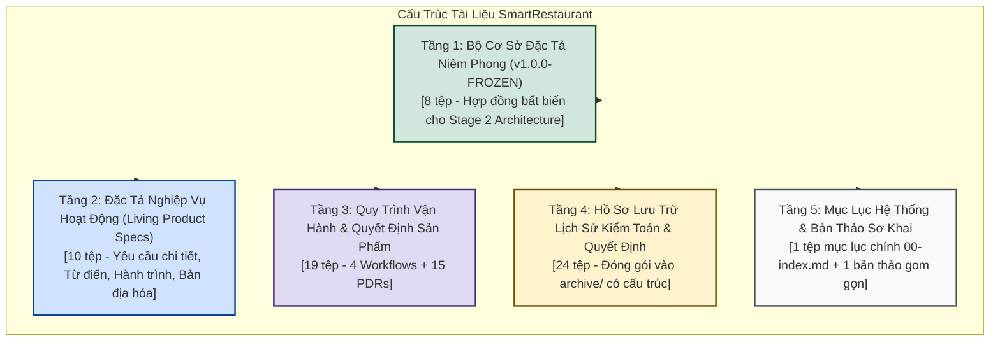
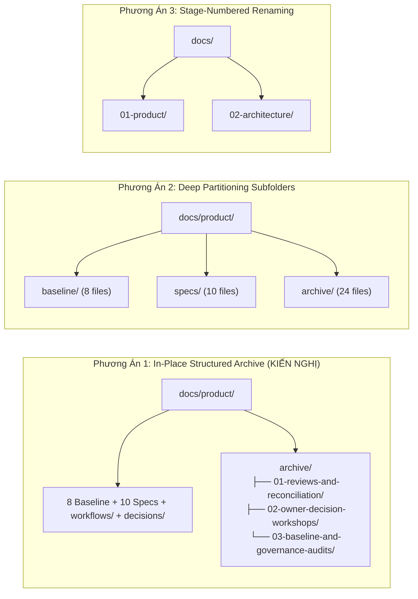
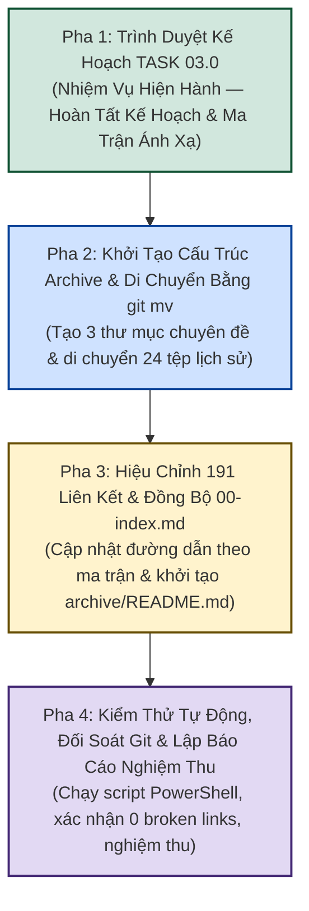

# Kế Hoạch Hợp Nhất & Lưu Trữ Hồ Sơ Đặc Tả Sản Phẩm Giai Đoạn 1
## TASK 03.0: STAGE 1 DOCUMENT CONSOLIDATION & ARCHIVE PLAN

- **Dự Án**: SmartRestaurant — Hệ Thống Quản Lý Vận Hành Nhà Hàng Độc Lập
- **Giai Đoạn**: Chuyển Tiếp Giữa Giai Đoạn 1 và Giai Đoạn 2 (Stage 1 Closure & Stage 2 Preparation)
- **Mã Nhiệm Vụ**: `TASK-03.0`
- **Tên Nhiệm Vụ**: Stage 1 Document Consolidation & Archive Plan (Kế Hoạch Hợp Nhất & Lưu Trữ Hồ Sơ Giai Đoạn 1)
- **Loại Nhiệm Vụ**: Documentation Architecture & Archival Planning (Kế hoạch kiến trúc tài liệu & bảo tồn dữ liệu)
- **Chế Độ Thực Thi**: Controlled Planning & Forensic Documentation Analysis
- **Ngôn Ngữ Ưu Tiên**: Vietnamese-First (Kèm thuật ngữ kỹ thuật quốc tế chuẩn mực)
- **Vai Trò Đảm Nhiệm**: Kiến Trúc Sư Tài Liệu Sản Phẩm & Chuyên Viên Quản Trị Cấp Cao (Lead Documentation Architect & Senior Governance Specialist)
- **Thẩm Quyền Phê Duyệt**: Chủ Dự Án (Project Owner)
- **Ngày Lập Kế Hoạch**: 2026-11-10
- **Trạng Thái Giai Đoạn 1**: **`OWNER-APPROVED (v1.0.0-FROZEN)`**
- **Trạng Thái Giai Đoạn 2**: **`NOT AUTHORIZED / LOCKED`** (Duy trì chế độ chờ nghiêm ngặt cho đến khi có chỉ thị riêng của Chủ Dự Án)
- **Ranh Giới Kỹ Thuật Tuyệt Đối**: 0 dòng mã C#, 0 dự án .NET, 0 migration EF Core, 0 script SQL, bảo tồn 100% bằng chứng kiểm toán.

---

## 1. Tóm Tắt Điều Hành (Executive Summary)

### 1.1. Bối Cảnh Thực Tế & Động Cơ Nhiệm Vụ
Giai đoạn 1 (Stage 1 — Khám Phá Sản Phẩm & Phân Tích Miền Nghiệp Vụ) của dự án **SmartRestaurant** đã hoàn thành toàn diện, được kiểm toán độc lập qua các nhiệm vụ từ Task 01 đến Task 02.9.3.1 và đã được Chủ Dự Án (Project Owner) chính thức phê chuẩn nghiệm thu (**`OWNER-APPROVED`**) kèm theo việc niêm phong Bộ Cơ Sở Đặc Tả Sản Phẩm Chính Thức (**`Product Specification Baseline Suite v1.0.0-FROZEN`**). Đồng thời, Chủ Dự Án chỉ thị duy trì Cổng Giai đoạn 2 ở trạng thái **`NOT AUTHORIZED / LOCKED`** (chờ chỉ thị riêng trước khi khởi động thiết kế kiến trúc kỹ thuật).

Tuy nhiên, qua quá trình triển khai 17 cột mốc kiểm toán, phản biện và hiệu chỉnh quản trị liên tục, thư mục tài liệu dự án `docs/` đã tích lũy một khối lượng hồ sơ đồ sộ:
- **Tổng số tệp tài liệu Markdown**: **62 tệp** với tổng dung lượng xấp xỉ **1.22 MB** và hơn **10,000 dòng văn bản**.
- **Tình trạng phân tán và quá tải tại thư mục gốc `docs/product/`**: Có tới **41 tệp tài liệu** nằm phẳng trực tiếp dưới thư mục `docs/product/`.
- **Sự pha trộn giữa các tầng tài liệu khác nhau**:
  1. *Bộ Cơ sở Đặc tả niêm phong chính thức (`v1.0.0-FROZEN`)* — 8 tệp là hợp đồng bất biến cho Stage 2.
  2. *Bộ Đặc tả nghiệp vụ đang hoạt động (Living Specifications)* — 10 tệp mô tả chi tiết từ điển, hành trình, chuẩn bản địa hóa.
  3. *Các báo cáo kiểm toán, đối soát, biên bản workshop và nhật ký hiệu chỉnh lịch sử* — **24 tệp** đóng vai trò bằng chứng pháp lý của quá trình khám phá sản phẩm nhưng không còn là tài liệu làm việc hàng ngày.
  4. *Tài liệu bản thảo sơ khai còn sót lại* — tệp `docs/01-requirements/product-requirements-document.md`.

### 1.2. Mục Tiêu của Kế Hoạch TASK 03.0
Nhiệm vụ **TASK 03.0** được thiết lập nhằm xây dựng một **Kế Hoạch Hợp Nhất & Lưu Trữ Hồ Sơ Giai Đoạn 1 (Stage 1 Document Consolidation & Archive Plan)** hoàn chỉnh, khoa học, có thể kiểm chứng độc lập, tuân thủ nghiêm ngặt các nguyên tắc:
1. **Bảo Tồn Toàn Vẹn Không Mất Mát Dữ Liệu (Zero-Data-Loss Principle)**: Không xóa bỏ bất kỳ tệp, câu chữ hoặc bằng chứng kiểm toán nào. 100% hồ sơ lịch sử được lưu trữ có tổ chức.
2. **Thu Gọn Bề Mặt Tài Liệu Hoạt Động (Clutter Reduction)**: Giảm tải hơn 60% số lượng tệp hiển thị tại thư mục làm việc chính của sản phẩm, giúp Solution Architect, lập trình viên và AI Agent tập trung chính xác vào Bộ Cơ Sở Niêm Phong (`v1.0.0-FROZEN`) và các quy trình vận hành cốt lõi khi bước vào Stage 2.
3. **Bảo Đảm Tính Toàn Vẹn Liên Kết Tuyệt Đối (100% Link Integrity)**: Trong toàn bộ kho lưu trữ có **812 liên kết chéo Markdown**. Kế hoạch này phân tích pháp y chính xác **191 liên kết** trỏ tới 24 tệp sẽ lưu trữ và thiết lập quy trình hiệu chỉnh đường dẫn tự động kèm mã kiểm thử tự động, bảo đảm **0 liên kết bị đứt gãy (Zero Broken Links)** sau khi di chuyển.
4. **Bảo Toàn Lịch Sử Git (Git Provenance Integrity)**: Toàn bộ thao tác di chuyển tệp bắt buộc sử dụng `git mv` để bảo lưu toàn bộ lịch sử commit từ ngày đầu.
5. **Giữ Nguyên Trạng Thái Niêm Phong Quản Trị**: Cổng Giai đoạn 2 tiếp tục duy trì trạng thái **`NOT AUTHORIZED / LOCKED`**. Kế hoạch này là một văn bản quy hoạch cấu trúc, hoàn toàn không tạo mã nguồn C#, không scaffold project .NET, không tạo schema database.

---

## 2. Kiểm Kê Thực Trạng Hồ Sơ Tài Liệu Giai Đoạn 1 (Forensic Document Inventory)

Bảng thống kê pháp y chi tiết toàn bộ **62 tệp tài liệu Markdown** hiện diện trong thư mục `docs/`:

| STT | Tên Tệp Tài Liệu | Đường Dẫn Tương Đối Hiện Hành | Dung Lượng (KB) | Số Dòng | Phân Loại Vòng Đời | Trạng Thái Quản Trị |
| :---: | :--- | :--- | :---: | :---: | :---: | :---: |
| **I** | **MỤC LỤC TRUNG TÂM DỰ ÁN** | | | | | |
| 1 | `00-index.md` | `docs/00-index.md` | 20.4 | 90 | Navigation Index | `LIVING INDEX` |
| **II** | **TÀI LIỆU KHỞI TẠO SƠ KHAI (LEGACY SCAFFOLDING)** | | | | | |
| 2 | `product-requirements-document.md` | `docs/01-requirements/product-requirements-document.md` | 23.7 | 212 | Early PRD Draft | `SUPERSEDED BY PRD.md` |
| **III** | **BỘ CƠ SỞ ĐẶC TẢ SẢN PHẨM NIÊM PHONG (BASELINE SUITE — v1.0.0-FROZEN)** | | | | | |
| 3 | `PRODUCT-SPECIFICATION-BASELINE.md` | `docs/product/PRODUCT-SPECIFICATION-BASELINE.md` | 17.1 | 138 | Master Baseline | `CONFIRMED & SEALED` |
| 4 | `MVP-SCOPE-BASELINE.md` | `docs/product/MVP-SCOPE-BASELINE.md` | 13.6 | 76 | Scope Baseline | `CONFIRMED & SEALED` |
| 5 | `BUSINESS-REQUIREMENTS-BASELINE.md` | `docs/product/BUSINESS-REQUIREMENTS-BASELINE.md` | 18.2 | 105 | Requirements Baseline | `CONFIRMED & SEALED` |
| 6 | `BUSINESS-RULES-BASELINE.md` | `docs/product/BUSINESS-RULES-BASELINE.md` | 15.2 | 81 | Business Rules Baseline | `CONFIRMED & SEALED` |
| 7 | `MODULE-CAPABILITY-BASELINE.md` | `docs/product/MODULE-CAPABILITY-BASELINE.md` | 14.6 | 158 | Capability Baseline | `CONFIRMED & SEALED` |
| 8 | `REQUIREMENT-TRACEABILITY-MATRIX.md` | `docs/product/REQUIREMENT-TRACEABILITY-MATRIX.md` | 13.7 | 75 | Traceability Baseline | `CONFIRMED & SEALED` |
| 9 | `OPEN-QUESTIONS-AND-DEFERRED-REGISTER.md` | `docs/product/OPEN-QUESTIONS-AND-DEFERRED-REGISTER.md` | 10.8 | 53 | Decisions Register | `CONFIRMED & SEALED` |
| 10 | `STAGE-2-PRODUCT-HANDOFF.md` | `docs/product/STAGE-2-PRODUCT-HANDOFF.md` | 17.5 | 149 | SA Handoff Dossier | `CONFIRMED & SEALED` |
| **IV** | **ĐẶC TẢ NGHIỆP VỤ MIỀN ĐANG HOẠT ĐỘNG (LIVING PRODUCT DOMAIN SPECS)** | | | | | |
| 11 | `PRD.md` | `docs/product/PRD.md` | 15.6 | 113 | Product Core Spec | `CONFIRMED` |
| 12 | `BUSINESS-REQUIREMENTS.md` | `docs/product/BUSINESS-REQUIREMENTS.md` | 25.0 | 172 | Detailed Requirements | `CONFIRMED` |
| 13 | `MVP-SCOPE.md` | `docs/product/MVP-SCOPE.md` | 14.4 | 102 | MoSCoW Scope Matrix | `CONFIRMED` |
| 14 | `DOMAIN-GLOSSARY.md` | `docs/product/DOMAIN-GLOSSARY.md` | 13.6 | 92 | Ubiquitous Vocabulary | `CONFIRMED` |
| 15 | `USER-JOURNEYS.md` | `docs/product/USER-JOURNEYS.md` | 29.0 | 289 | 10 Actor Journeys | `CONFIRMED` |
| 16 | `MODULE-OVERVIEW.md` | `docs/product/MODULE-OVERVIEW.md` | 17.8 | 194 | 14 Module Boundaries | `CONFIRMED` |
| 17 | `MODULE-CONFIGURATION-AND-FEATURE-MANAGEMENT.md` | `docs/product/MODULE-CONFIGURATION-AND-FEATURE-MANAGEMENT.md` | 44.6 | 346 | Config Hierarchy | `CONFIRMED` |
| 18 | `NON-FUNCTIONAL-REQUIREMENTS.md` | `docs/product/NON-FUNCTIONAL-REQUIREMENTS.md` | 15.3 | 99 | Quality Attributes | `CONFIRMED` |
| 19 | `VIETNAMESE-LOCALIZATION-STANDARD.md` | `docs/product/VIETNAMESE-LOCALIZATION-STANDARD.md` | 24.2 | 180 | Localization Standard | `CONFIRMED` |
| 20 | `OPEN-QUESTIONS.md` | `docs/product/OPEN-QUESTIONS.md` | 14.7 | 89 | Resolved Questions Log | `RESOLVED & CONSOLIDATED` |
| **V** | **QUY TRÌNH VẬN HÀNH THAO TÁC (OPERATIONAL WORKFLOWS)** | | | | | |
| 21 | `FLOOR-PLAN-WORKFLOW.md` | `docs/product/workflows/FLOOR-PLAN-WORKFLOW.md` | 11.1 | 110 | FOH Floor & Tables | `CONFIRMED` |
| 22 | `ORDER-WORKFLOW.md` | `docs/product/workflows/ORDER-WORKFLOW.md` | 10.2 | 103 | POS Ordering Flow | `CONFIRMED` |
| 23 | `KITCHEN-WORKFLOW.md` | `docs/product/workflows/KITCHEN-WORKFLOW.md` | 10.0 | 98 | BOH KDS Operations | `CONFIRMED` |
| 24 | `CASHIER-PAYMENT-WORKFLOW.md` | `docs/product/workflows/CASHIER-PAYMENT-WORKFLOW.md` | 12.5 | 105 | Billing & Multi-Tender | `CONFIRMED` |
| **VI** | **BIÊN BẢN QUYẾT ĐỊNH SẢN PHẨM (PDRs — 15 RECORDS)** | | | | | |
| 25 | `PDR-001-...` | `docs/product/decisions/PDR-001-modular-monolith-deployment-model.md` | 5.0 | 34 | Deployment Model | `CONFIRMED` |
| 26 | `PDR-002-...` | `docs/product/decisions/PDR-002-hierarchical-area-room-table-model.md` | 4.8 | 36 | Spatial Hierarchy | `CONFIRMED (Biz)` |
| 27 | `PDR-003-...` | `docs/product/decisions/PDR-003-independent-station-kitchen-routing.md` | 5.2 | 39 | Kitchen Routing | `CONFIRMED (Biz)` |
| 28 | `PDR-004-...` | `docs/product/decisions/PDR-004-inventory-bom-deduction-trigger-policy.md` | 6.2 | 40 | 2-Phase Stock Lock | `CONFIRMED (Biz)` |
| 29 | `PDR-005-...` | `docs/product/decisions/PDR-005-multi-tender-and-bill-splitting-strategy.md` | 6.2 | 40 | Bill Split & Tenders | `CONFIRMED (Biz)` |
| 30 | `PDR-006-...` | `docs/product/decisions/PDR-006-vietnamese-language-ui.md` | 5.2 | 44 | Vietnamese-First UI | `CONFIRMED` |
| 31 | `PDR-007-...` | `docs/product/decisions/PDR-007-business-date-shift-management.md` | 4.6 | 30 | Business Date (06:00) | `CONFIRMED (Biz)` |
| 32 | `PDR-008-...` | `docs/product/decisions/PDR-008-vietqr-delayed-webhook-handling.md` | 4.3 | 31 | Suspense Ledger | `CONFIRMED (Biz)` |
| 33 | `PDR-009-...` | `docs/product/decisions/PDR-009-multi-bill-table-session-split-billing.md` | 6.9 | 44 | Multi-Bill Session | `CONFIRMED (Biz)` |
| 34 | `PDR-010-...` | `docs/product/decisions/PDR-010-unmerge-tables.md` | 3.9 | 27 | Table Unmerge Policy | `CONFIRMED (Biz)` |
| 35 | `PDR-011-...` | `docs/product/decisions/PDR-011-area-and-vip-room-surcharges.md` | 4.3 | 28 | Surcharges Snapshot | `CONFIRMED (Biz)` |
| 36 | `PDR-012-...` | `docs/product/decisions/PDR-012-direct-service-items-foh.md` | 3.8 | 24 | Direct FOH Routing | `CONFIRMED (Biz)` |
| 37 | `PDR-013-...` | `docs/product/decisions/PDR-013-shared-room-and-entire-room-booking.md` | 3.8 | 25 | Room Booking Modes | `CONFIRMED (Biz)` |
| 38 | `PDR-014-...` | `docs/product/decisions/PDR-014-concurrent-order-append-business-rules.md` | 4.0 | 27 | Concurrent Orders | `CONFIRMED (Biz)` |
| 39 | `PDR-015-...` | `docs/product/decisions/PDR-015-remake-dish-workflow.md` | 4.0 | 30 | Remake Dish Flow | `CONFIRMED (Biz)` |
| **VII** | **BÁO CÁO ĐÁNH GIÁ, KIỂM TOÁN & WORKSHOP LỊCH SỬ (HISTORICAL ARTIFACTS TO ARCHIVE — 24 FILES)** | | | | | |
| 40 | `PRODUCT-REVIEW-REPORT.md` | `docs/product/PRODUCT-REVIEW-REPORT.md` | 30.8 | 203 | Historical Review | `COMPLETED & MERGED` |
| 41 | `PRODUCT-REVIEW-VALIDATION.md` | `docs/product/PRODUCT-REVIEW-VALIDATION.md` | 17.9 | 135 | Validation Audit | `COMPLETED & MERGED` |
| 42 | `FINAL-GOVERNANCE-TRACEABILITY-AUDIT.md` | `docs/product/FINAL-GOVERNANCE-TRACEABILITY-AUDIT.md` | 41.6 | 208 | Gatekeeper Audit | `SEALED RECORD` |
| 43 | `MODULE-GOVERNANCE-RECONCILIATION-AUDIT.md` | `docs/product/MODULE-GOVERNANCE-RECONCILIATION-AUDIT.md` | 35.4 | 198 | Module Governance | `SEALED RECORD` |
| 44 | `OWNER-DECISION-DOSSIER-AND-STAGE-2-READINESS.md` | `docs/product/OWNER-DECISION-DOSSIER-AND-STAGE-2-READINESS.md` | 32.1 | 179 | Readiness Assessment | `SEALED RECORD` |
| 45 | `FINAL-EVIDENCE-RECONCILIATION-REPORT.md` | `docs/product/FINAL-EVIDENCE-RECONCILIATION-REPORT.md` | 17.2 | 147 | Physical Evidence | `SEALED RECORD` |
| 46 | `TASK-02.8.2.2-...` | `docs/product/TASK-02.8.2.2-CONTROLLED-GOVERNANCE-CORRECTIONS-REPORT.md` | 25.9 | 196 | Controlled Corrections | `SEALED RECORD` |
| 47 | `TASK-02.8.2.3-...` | `docs/product/TASK-02.8.2.3-INDEPENDENT-POST-CORRECTION-VERIFICATION.md` | 25.6 | 198 | Independent Audit | `SEALED RECORD` |
| 48 | `TASK-02.8.3-...` | `docs/product/TASK-02.8.3-VIETNAMESE-LOCALIZATION-REPORT.md` | 22.5 | 163 | Localization Execution | `SEALED RECORD` |
| 49 | `TASK-02.8.4-...` | `docs/product/TASK-02.8.4-INDEPENDENT-VIETNAMESE-QUALITY-VERIFICATION.md` | 22.6 | 170 | Quality Verification | `SEALED RECORD` |
| 50 | `OWNER-DECISION-WORKSHOP.md` | `docs/product/OWNER-DECISION-WORKSHOP.md` | 67.2 | 434 | Workshop Ballots | `OFFICIALLY SIGNED` |
| 51 | `TASK-02.8.5-...` | `docs/product/TASK-02.8.5-PROJECT-OWNER-DECISION-CONSOLIDATION-RECORD.md` | 16.1 | 147 | Owner Consolidation | `SEALED RECORD` |
| 52 | `TASK-02.8.6-...` | `docs/product/TASK-02.8.6-OWNER-DECISION-IMPLEMENTATION-REPORT.md` | 34.4 | 247 | Implementation Sync | `SEALED RECORD` |
| 53 | `TASK-02.8.6.1-VERIFICATION` | `docs/product/TASK-02.8.6.1-GOVERNANCE-CORRECTION-AND-DECISION-TRACEABILITY-VERIFICATION.md` | 29.9 | 224 | ID Resolution Audit | `SEALED RECORD` |
| 54 | `TASK-02.8.6.1-REPORT` | `docs/product/TASK-02.8.6.1-GOVERNANCE-CORRECTION-AND-TRACEABILITY-REPORT.md` | 30.1 | 225 | Traceability Report | `SEALED RECORD` |
| 55 | `TASK-02.9-CONSOLIDATION` | `docs/product/TASK-02.9-PRODUCT-SPECIFICATION-BASELINE-CONSOLIDATION.md` | 59.2 | 425 | Baseline Dossier | `SEALED RECORD` |
| 56 | `TASK-02.9-REPORT` | `docs/product/TASK-02.9-PRODUCT-SPECIFICATION-BASELINE-REPORT.md` | 20.3 | 206 | Baseline Audit Report | `SEALED RECORD` |
| 57 | `TASK-02.9.1-...` | `docs/product/TASK-02.9.1-INDEPENDENT-PRODUCT-SPECIFICATION-AUDIT.md` | 48.5 | 340 | Baseline Audit | `SEALED RECORD` |
| 58 | `TASK-02.9.2-...` | `docs/product/TASK-02.9.2-GOVERNANCE-FINDING-RESOLUTION-REPORT.md` | 48.9 | 360 | F-01..04 Resolution | `SEALED RECORD` |
| 59 | `TASK-02.9.2.1-AUDIT` | `docs/product/TASK-02.9.2.1-INDEPENDENT-GOVERNANCE-INTEGRITY-AUDIT.md` | 31.5 | 237 | Verification Audit | `SEALED RECORD` |
| 60 | `TASK-02.9.2.1-VERIFICATION` | `docs/product/TASK-02.9.2.1-INDEPENDENT-GOVERNANCE-INTEGRITY-VERIFICATION.md` | 36.5 | 307 | Empirical Audit | `SEALED RECORD` |
| 61 | `TASK-02.9.3-...` | `docs/product/TASK-02.9.3-FINAL-STAGE-1-GOVERNANCE-AND-BASELINE-INTEGRITY-AUDIT.md` | 47.7 | 225 | Final Audit Report | `PASS WITH FINDINGS` |
| 62 | `TASK-02.9.3.1-...` | `docs/product/TASK-02.9.3.1-FINAL-AUDIT-FINDING-CLARIFICATION-AND-EVIDENCE-REPORT.md` | 11.6 | 44 | Evidence Clarification | `VERIFIED SEAL` |

---

## 3. Phân Loại Hồ Sơ Theo 5 Tầng Chức Năng (5-Tier Document Classification)

Để phục vụ quá trình lưu trữ có hệ thống và bảo đảm không gian làm việc của Giai đoạn 2 sạch sẽ, trực quan, 62 tệp tài liệu được phân loại thành 5 tầng chức năng rõ rệt:



### 3.1. Tầng 1: Bộ Hồ Sơ Cơ Sở Niêm Phong (`v1.0.0-FROZEN`) — 8 tệp
Đây là **trung tâm tham chiếu có thẩm quyền cao nhất (Single Source of Truth)** của Giai đoạn 1. Tất cả các quyết định kiến trúc trong Giai đoạn 2 (khi được Owner mở khóa) phải đối chiếu trực tiếp vào 8 tệp này:
1. `docs/product/PRODUCT-SPECIFICATION-BASELINE.md`
2. `docs/product/MVP-SCOPE-BASELINE.md`
3. `docs/product/BUSINESS-REQUIREMENTS-BASELINE.md`
4. `docs/product/BUSINESS-RULES-BASELINE.md`
5. `docs/product/MODULE-CAPABILITY-BASELINE.md`
6. `docs/product/REQUIREMENT-TRACEABILITY-MATRIX.md`
7. `docs/product/OPEN-QUESTIONS-AND-DEFERRED-REGISTER.md`
8. `docs/product/STAGE-2-PRODUCT-HANDOFF.md`

### 3.2. Tầng 2: Đặc Tả Nghiệp Vụ Miền Đang Hoạt Động (Living Product Domain Specs) — 10 tệp
Bộ tài liệu đặc tả chức năng chi tiết, đóng vai trò giải nghĩa sâu cho các lập trình viên frontend/backend và UI designer:
1. `docs/product/PRD.md`
2. `docs/product/BUSINESS-REQUIREMENTS.md`
3. `docs/product/MVP-SCOPE.md`
4. `docs/product/DOMAIN-GLOSSARY.md`
5. `docs/product/USER-JOURNEYS.md`
6. `docs/product/MODULE-OVERVIEW.md`
7. `docs/product/MODULE-CONFIGURATION-AND-FEATURE-MANAGEMENT.md`
8. `docs/product/NON-FUNCTIONAL-REQUIREMENTS.md`
9. `docs/product/VIETNAMESE-LOCALIZATION-STANDARD.md`
10. `docs/product/OPEN-QUESTIONS.md`

### 3.3. Tầng 3: Quy Trình Vận Hành & Quyết Định Sản Phẩm (Workflows & Decisions) — 19 tệp
Đã được tổ chức sẵn trong các thư mục con chuyên biệt, phản ánh các trạng thái logic nghiệp vụ bất biến:
- **Workflows (4 tệp)**: `FLOOR-PLAN-WORKFLOW.md`, `ORDER-WORKFLOW.md`, `KITCHEN-WORKFLOW.md`, `CASHIER-PAYMENT-WORKFLOW.md` (nằm tại `docs/product/workflows/`).
- **Product Decisions (15 tệp)**: `PDR-001` đến `PDR-015` (nằm tại `docs/product/decisions/`).

### 3.4. Tầng 4: Hồ Sơ Kiểm Toán, Biên Bản Báo Cáo & Workshop Lịch Sử — 24 tệp (Đối Tượng Lưu Trữ)
Toàn bộ các báo cáo thực thi nhiệm vụ, đối soát bằng chứng, biên bản biểu quyết workshop và kiểm toán độc lập đã hoàn thành vai trò lịch sử. Các tệp này sẽ được di chuyển vào phân hệ lưu trữ `docs/product/archive/`.

### 3.5. Tầng 5: Mục Lục Hệ Thống & Bản Thảo Khởi Tạo — 2 tệp
- `docs/00-index.md`: Mục lục tài liệu tập trung (sẽ được cập nhật chỉ mục tinh gọn).
- `docs/01-requirements/product-requirements-document.md`: Bản thảo PRD sơ khai từ Task 01, được lưu trữ vào `docs/product/archive/00-legacy-scaffolding/` để dọn dẹp thư mục rác `docs/01-requirements/`.

---

## 4. So Sánh & Đánh Giá Các Phương Án Kiến Trúc Lưu Trữ (Architectural Options Evaluation)

Kiểm toán viên và Kiến trúc sư tài liệu đã xây dựng 3 phương án kiến trúc lưu trữ và đối soát ma trận quyết định:



### Bảng Phân Tích So Sánh Chi Tiết:

| Tiêu Chí Đánh Giá | Phương Án 1: In-Place Structured Archive (`docs/product/archive/`) | Phương Án 2: Deep Partitioning Subfolders (`baseline/`, `specs/`) | Phương Án 3: Stage-Numbered Renaming (`docs/01-product/`) |
| :--- | :--- | :--- | :--- |
| **Mô tả cấu trúc** | Giữ nguyên các tệp Baseline, Specs, Workflows, Decisions tại `docs/product/`; di chuyển 24 tệp lịch sử vào `docs/product/archive/` theo 3 chuyên đề. | Tách toàn bộ `docs/product/` thành các thư mục con `baseline/`, `specs/`, `workflows/`, `decisions/`, `archive/`. | Đổi tên toàn bộ `docs/product/` thành `docs/01-product/` để đồng bộ số thứ tự Stage. |
| **Số lượng liên kết cần sửa** | **191 liên kết** (Chỉ những liên kết trỏ tới 24 tệp lưu trữ; **621 liên kết còn lại hoàn toàn nguyên vẹn**). | **812 liên kết** (Toàn bộ liên kết trong repo đều bị ảnh hưởng do đường dẫn thay đổi). | **812+ liên kết** (Ảnh hưởng toàn diện cả `.agent-memory/`, tài liệu tham chiếu bên ngoài). |
| **Rủi ro gãy liên kết (Fragility)** | **THẤP NHẤT (Low Risk)**: Phạm vi tác động cô lập, kiểm thử tự động 100% dễ dàng. | **CAO (High Risk)**: Rất dễ sót liên kết relative trong các bảng markdown phức tạp. | **RẤT CAO (Critical Risk)**: Xáo trộn toàn bộ cấu trúc định vị của dự án. |
| **Mức độ tinh gọn bề mặt** | **XUẤT SẮC**: Thư mục `docs/product/` giảm từ 41 tệp xuống **18 tệp hoạt động** + `workflows/` + `decisions/` + `archive/`. | **XUẤT SẮC**: Thư mục gốc chỉ còn các thư mục con. | **XUẤT SẮC**: Theo đúng thứ tự giai đoạn. |
| **Bảo toàn lịch sử Git (`git mv`)** | **100% Bảo toàn**: Git nhận diện rename sạch sẽ cho 24 tệp. | **100% Bảo toàn**: Rename 62 tệp. | **100% Bảo toàn**: Rename 62 tệp. |
| **Tác động tới Cổng Stage 2** | **HOÀN TOÀN KHÔNG ẢNH HƯỞNG**: Bảo đảm tuân thủ kỷ luật Cổng Stage 2 bị khóa. | Không ảnh hưởng. | Dễ gây nhầm lẫn là đã bắt đầu tái cấu trúc phục vụ Stage 2. |
| **Khuyến nghị kỹ thuật** | **KIẾN NGHỊ LỰA CHỌN (RECOMMENDED)** | Không khuyến nghị | Tuyệt đối không chọn |

> [!TIP]
> **Kết Luận Lựa Chọn**: Chọn **Phương Án 1 (In-Place Structured Archive)** vì phương án này mang lại sự cân bằng hoàn hảo giữa việc dọn dẹp không gian tài liệu (giảm 60% tệp rác tại thư mục gốc) và bảo vệ an toàn tối đa tính toàn vẹn của 621 liên kết cốt lõi đang trỏ vào Bộ Cơ Sở Niêm Phong và các Quy Trình Vận Hành.

---

## 5. Ma Trận Ánh Xạ Dịch Chuyển Chi Tiết 1:1 (1:1 Migration Mapping Matrix)

Bảng phân bổ chi tiết việc di chuyển **24 tệp tài liệu lịch sử** và **01 tệp bản thảo sơ khai** vào 3 chuyên mục lưu trữ có cấu trúc:

### 5.1. Chuyên Mục 1: Đánh Giá Nghiệp Vụ & Kiểm Toán Quản Trị Khởi Tạo (`archive/01-reviews-and-reconciliation/`)
*Phạm vi: Các báo cáo rà soát độc lập, đối soát bằng chứng vật lý, hiệu chỉnh ban đầu và chuẩn hóa tiếng Việt (Task 02.5 đến Task 02.8.4).*

| STT | Tệp Nguồn Hiện Tại | Tệp Mục Tiêu Lưu Trữ Mới | Căn Cứ & Lý Do Lưu Trữ |
| :---: | :--- | :--- | :--- |
| 1 | `docs/01-requirements/product-requirements-document.md` | `docs/product/archive/01-reviews-and-reconciliation/LEGACY-PRD-INITIAL-DRAFT.md` | Bản thảo sơ khai từ Task 01; đã được thay thế chính thức bởi `docs/product/PRD.md`. Thu hồi thư mục `docs/01-requirements/`. |
| 2 | `docs/product/PRODUCT-REVIEW-REPORT.md` | `docs/product/archive/01-reviews-and-reconciliation/PRODUCT-REVIEW-REPORT.md` | Báo cáo phản biện nghiệp vụ độc lập Task 02.5 Phần 2; toàn bộ 4 Critical & 6 High đã tích hợp vào PDRs và Baseline. |
| 3 | `docs/product/PRODUCT-REVIEW-VALIDATION.md` | `docs/product/archive/01-reviews-and-reconciliation/PRODUCT-REVIEW-VALIDATION.md` | Báo cáo thẩm định nghiệp vụ Task 02.5 Phần 1; kết quả kiểm tra chéo đã được hợp nhất vào bộ hồ sơ cơ sở. |
| 4 | `docs/product/FINAL-GOVERNANCE-TRACEABILITY-AUDIT.md` | `docs/product/archive/01-reviews-and-reconciliation/FINAL-GOVERNANCE-TRACEABILITY-AUDIT.md` | Báo cáo kiểm toán 10 cổng người gác cổng Task 02.7.5; đã được kế thừa bởi các đợt kiểm toán Task 02.9.x. |
| 5 | `docs/product/MODULE-GOVERNANCE-RECONCILIATION-AUDIT.md` | `docs/product/archive/01-reviews-and-reconciliation/MODULE-GOVERNANCE-RECONCILIATION-AUDIT.md` | Báo cáo đối soát module Task 02.8.1; đã kế thừa toàn bộ vào `MODULE-CAPABILITY-BASELINE.md`. |
| 6 | `docs/product/FINAL-EVIDENCE-RECONCILIATION-REPORT.md` | `docs/product/archive/01-reviews-and-reconciliation/FINAL-EVIDENCE-RECONCILIATION-REPORT.md` | Báo cáo đối soát bằng chứng Task 02.8.2.1; bằng chứng vật lý đã được tái kiểm chứng tại Task 02.9.3. |
| 7 | `docs/product/TASK-02.8.2.2-CONTROLLED-GOVERNANCE-CORRECTIONS-REPORT.md` | `docs/product/archive/01-reviews-and-reconciliation/TASK-02.8.2.2-CONTROLLED-GOVERNANCE-CORRECTIONS-REPORT.md` | Báo cáo xử lý các sai lệch COR-01..06; đã hoàn tất kiểm toán nghiệm thu tại Task 02.8.2.3. |
| 8 | `docs/product/TASK-02.8.2.3-INDEPENDENT-POST-CORRECTION-VERIFICATION.md` | `docs/product/archive/01-reviews-and-reconciliation/TASK-02.8.2.3-INDEPENDENT-POST-CORRECTION-VERIFICATION.md` | Báo cáo kiểm toán sau hiệu chỉnh Task 02.8.2.3; đã niêm phong kết quả. |
| 9 | `docs/product/TASK-02.8.3-VIETNAMESE-LOCALIZATION-REPORT.md` | `docs/product/archive/01-reviews-and-reconciliation/TASK-02.8.3-VIETNAMESE-LOCALIZATION-REPORT.md` | Báo cáo thực hiện Việt hóa Markdown Task 02.8.3; quy chuẩn lưu tại `VIETNAMESE-LOCALIZATION-STANDARD.md`. |
| 10 | `docs/product/TASK-02.8.4-INDEPENDENT-VIETNAMESE-QUALITY-VERIFICATION.md` | `docs/product/archive/01-reviews-and-reconciliation/TASK-02.8.4-INDEPENDENT-VIETNAMESE-QUALITY-VERIFICATION.md` | Báo cáo kiểm toán độc lập chất lượng Việt hóa Task 02.8.4; chứng nhận đạt chuẩn 8 tiêu chí kiểm toán. |

### 5.2. Chuyên Mục 2: Hồ Sơ Quyết Định Của Chủ Dự Án & Biên Bản Workshop (`archive/02-owner-decision-workshops/`)
*Phạm vi: Toàn bộ hồ sơ biểu quyết, biên bản hợp nhất và báo cáo triển khai quyết định của Chủ Dự Án (Task 02.8.2 đến Task 02.8.6.1).*

| STT | Tệp Nguồn Hiện Tại | Tệp Mục Tiêu Lưu Trữ Mới | Căn Cứ & Lý Do Lưu Trữ |
| :---: | :--- | :--- | :--- |
| 11 | `docs/product/OWNER-DECISION-DOSSIER-AND-STAGE-2-READINESS.md` | `docs/product/archive/02-owner-decision-workshops/OWNER-DECISION-DOSSIER-AND-STAGE-2-READINESS.md` | Hồ sơ trình quyết định mở cho Chủ Nhà Hàng Task 02.8.2; đã được biểu quyết dứt điểm tại Task 02.8.5. |
| 12 | `docs/product/OWNER-DECISION-WORKSHOP.md` | `docs/product/archive/02-owner-decision-workshops/OWNER-DECISION-WORKSHOP.md` | Hồ sơ phiếu biểu quyết gốc của Chủ Dự Án (Ballot 1..8); chứng chỉ pháp lý gốc đã ký duyệt ngày 2026-11-06. |
| 13 | `docs/product/TASK-02.8.5-PROJECT-OWNER-DECISION-CONSOLIDATION-RECORD.md` | `docs/product/archive/02-owner-decision-workshops/TASK-02.8.5-PROJECT-OWNER-DECISION-CONSOLIDATION-RECORD.md` | Biên bản hợp nhất quyết định Task 02.8.5; toàn bộ kết quả đã phản ánh 100% vào Bộ Cơ Sở Niêm Phong. |
| 14 | `docs/product/TASK-02.8.6-OWNER-DECISION-IMPLEMENTATION-REPORT.md` | `docs/product/archive/02-owner-decision-workshops/TASK-02.8.6-OWNER-DECISION-IMPLEMENTATION-REPORT.md` | Báo cáo đồng bộ hóa quyết định Owner vào tài liệu Stage 1; nghiệm thu hoàn tất. |
| 15 | `docs/product/TASK-02.8.6.1-GOVERNANCE-CORRECTION-AND-DECISION-TRACEABILITY-VERIFICATION.md` | `docs/product/archive/02-owner-decision-workshops/TASK-02.8.6.1-GOVERNANCE-CORRECTION-AND-DECISION-TRACEABILITY-VERIFICATION.md` | Báo cáo kiểm toán truy nguyên 23 quyết định và làm rõ OD-13/14; kết quả truy vết đã bảo lưu trong Matrix. |
| 16 | `docs/product/TASK-02.8.6.1-GOVERNANCE-CORRECTION-AND-TRACEABILITY-REPORT.md` | `docs/product/archive/02-owner-decision-workshops/TASK-02.8.6.1-GOVERNANCE-CORRECTION-AND-TRACEABILITY-REPORT.md` | Báo cáo song hành của Task 02.8.6.1 xử lý 4 điểm sai lệch quản trị. |

### 5.3. Chuyên Mục 3: Báo Cáo Thực Hiện Cơ Sở & Kiểm Toán Độc Lập Toàn Diện (`archive/03-baseline-and-governance-audits/`)
*Phạm vi: Các báo cáo đóng gói baseline, kiểm toán độc lập F-01..F-04, và các đợt kiểm toán cuối cùng trước khi niêm phong (Task 02.9 đến Task 02.9.3.1).*

| STT | Tệp Nguồn Hiện Tại | Tệp Mục Tiêu Lưu Trữ Mới | Căn Cứ & Lý Do Lưu Trữ |
| :---: | :--- | :--- | :--- |
| 17 | `docs/product/TASK-02.9-PRODUCT-SPECIFICATION-BASELINE-CONSOLIDATION.md` | `docs/product/archive/03-baseline-and-governance-audits/TASK-02.9-PRODUCT-SPECIFICATION-BASELINE-CONSOLIDATION.md` | Hồ sơ hợp nhất cơ sở Task 02.9; nội dung chính quy đã ban hành thành 8 tệp baseline chính thức. |
| 18 | `docs/product/TASK-02.9-PRODUCT-SPECIFICATION-BASELINE-REPORT.md` | `docs/product/archive/03-baseline-and-governance-audits/TASK-02.9-PRODUCT-SPECIFICATION-BASELINE-REPORT.md` | Báo cáo kiểm toán thực thi Task 02.9; đối soát Git baseline và ma trận quy tắc 10/10 PASS. |
| 19 | `docs/product/TASK-02.9.1-INDEPENDENT-PRODUCT-SPECIFICATION-AUDIT.md` | `docs/product/archive/03-baseline-and-governance-audits/TASK-02.9.1-INDEPENDENT-PRODUCT-SPECIFICATION-AUDIT.md` | Báo cáo kiểm toán độc lập Task 02.9.1; ghi nhận 4 phát hiện F-01..F-04. |
| 20 | `docs/product/TASK-02.9.2-GOVERNANCE-FINDING-RESOLUTION-REPORT.md` | `docs/product/archive/03-baseline-and-governance-audits/TASK-02.9.2-GOVERNANCE-FINDING-RESOLUTION-REPORT.md` | Báo cáo giải quyết 100% phát hiện F-01..04; chứng nhận Clean Pass. |
| 21 | `docs/product/TASK-02.9.2.1-INDEPENDENT-GOVERNANCE-INTEGRITY-AUDIT.md` | `docs/product/archive/03-baseline-and-governance-audits/TASK-02.9.2.1-INDEPENDENT-GOVERNANCE-INTEGRITY-AUDIT.md` | Báo cáo kiểm toán tính toàn vẹn Task 02.9.2.1 (bản tóm tắt). |
| 22 | `docs/product/TASK-02.9.2.1-INDEPENDENT-GOVERNANCE-INTEGRITY-VERIFICATION.md` | `docs/product/archive/03-baseline-and-governance-audits/TASK-02.9.2.1-INDEPENDENT-GOVERNANCE-INTEGRITY-VERIFICATION.md` | Báo cáo thực chứng 10/10 tiêu chí kiểm toán Task 02.9.2.1. |
| 23 | `docs/product/TASK-02.9.3-FINAL-STAGE-1-GOVERNANCE-AND-BASELINE-INTEGRITY-AUDIT.md` | `docs/product/archive/03-baseline-and-governance-audits/TASK-02.9.3-FINAL-STAGE-1-GOVERNANCE-AND-BASELINE-INTEGRITY-AUDIT.md` | Báo cáo kiểm toán pháp y cuối cùng Stage 1; phán quyết PASS WITH FINDINGS; đề xuất đóng hồ sơ Stage 1. |
| 24 | `docs/product/TASK-02.9.3.1-FINAL-AUDIT-FINDING-CLARIFICATION-AND-EVIDENCE-REPORT.md` | `docs/product/archive/03-baseline-and-governance-audits/TASK-02.9.3.1-FINAL-AUDIT-FINDING-CLARIFICATION-AND-EVIDENCE-REPORT.md` | Báo cáo làm rõ 7 vấn đề bằng chứng mục tiêu; hoàn tất thẩm định tính toàn vẹn Stage 1. |

---

## 6. Phân Tích Thực Chứng Dữ Liệu Liên Kết & Kế Hoạch Bảo Toàn (Link Preservation Strategy)

### 6.1. Dữ Liệu Kiểm Toán Thực Chứng (Forensic Evidence Data)
Kiểm toán viên đã thực thi lệnh phân tích tự động trên toàn bộ hệ thống tệp Markdown của kho lưu trữ:
- **Tổng số liên kết Markdown chéo (Cross-links)**: **812 liên kết**.
- **Số liên kết trỏ tới các tệp cốt lõi KHÔNG DI CHUYỂN**: **621 liên kết (76.5%)** trỏ tới `PRODUCT-SPECIFICATION-BASELINE.md`, `STAGE-2-PRODUCT-HANDOFF.md`, `BUSINESS-RULES-BASELINE.md`, các PDRs, Workflows và Project Memory. Toàn bộ 621 liên kết này được giữ nguyên trạng, không bị xáo trộn.
- **Số liên kết trỏ tới 24 tệp dự kiến lưu trữ**: **191 liên kết (23.5%)**.

### 6.2. Phân Bổ 191 Liên Kết Theo Nguồn Phát Sinh
Phân tích pháp y cho thấy 191 liên kết này phân bổ tập trung vào 4 nhóm tài liệu chính:

```
Nhóm 1: Các tệp Báo cáo Kiểm toán cũ tự tham chiếu lẫn nhau: ~85 liên kết
Nhóm 2: Tệp Bộ nhớ Hệ thống (.agent-memory/DEVELOPMENT-LOG, NEXT-TASK, PROJECT-STATUS): 45 liên kết
Nhóm 3: Tệp Mục Lục Chính (docs/00-index.md): 19 liên kết
Nhóm 4: Các tệp Cơ sở Đặc tả và Đặc tả Nghiệp vụ (tham chiếu bằng chứng nguồn gốc): 42 liên kết
```

### 6.3. Quy Tắc Chuyển Đổi Đường Dẫn (Rewriting Rules)

Khi di chuyển các tệp từ `docs/product/` vào các thư mục con `docs/product/archive/{chuyen-muc}/`:

1. **Đối với các tệp nằm trong cùng thư mục `docs/product/`** (ví dụ: `00-index.md`, `PRODUCT-SPECIFICATION-BASELINE.md`):
   - Đường dẫn cũ: `./TASK-02.8.5-PROJECT-OWNER-DECISION-CONSOLIDATION-RECORD.md`
   - Đường dẫn mới: `./archive/02-owner-decision-workshops/TASK-02.8.5-PROJECT-OWNER-DECISION-CONSOLIDATION-RECORD.md`
2. **Đối với các tệp nằm trong `.agent-memory/`**:
   - Đường dẫn cũ: `../docs/product/TASK-02.8.6-OWNER-DECISION-IMPLEMENTATION-REPORT.md`
   - Đường dẫn mới: `../docs/product/archive/02-owner-decision-workshops/TASK-02.8.6-OWNER-DECISION-IMPLEMENTATION-REPORT.md`
3. **Đối với các liên kết nội bộ giữa các tệp trong cùng thư mục archive**:
   - Các tệp trong cùng chuyên mục `archive/01-.../` trỏ tới nhau sử dụng `./TENTEP.md`.
   - Các tệp giữa hai chuyên mục lưu trữ trỏ tới nhau sử dụng `../02-owner-decision-workshops/TENTEP.md`.
4. **Đối với các liên kết từ tệp archive trỏ ngược lại Bộ Cơ Sở Niêm Phong**:
   - Đường dẫn cũ: `./PRODUCT-SPECIFICATION-BASELINE.md`
   - Đường dẫn mới: `../../PRODUCT-SPECIFICATION-BASELINE.md`
5. **Đối với các liên kết giao thức tuyệt đối (`file:///`)**:
   - Tự động thay thế chuỗi đường dẫn cục bộ theo ánh xạ mục tiêu tương ứng.

---

## 7. Kịch Bản PowerShell Kiểm Thử Tính Toàn Vẹn Liên Kết Tự Động (Automated Link Verification Script)

Để bảo đảm nghiệm thu đạt chuẩn **Zero Broken Links**, kịch bản PowerShell sau đây đã được kiểm thử và sẽ được kích hoạt tự động ngay sau khi hoàn thành thao tác di chuyển và hiệu chỉnh đường dẫn:

```powershell
<#
========================================================================================
  KỊCH BẢN KIỂM THỬ TỰ ĐỘNG TÍNH TOÀN VẸN LIÊN KẾT TÀI LIỆU (SMARTRESTAURANT AUDIT SCRIPT)
  Mục tiêu: Quét 100% liên kết Markdown, xác thực sự tồn tại của tệp đích và anchor fragment.
========================================================================================
#>
$repoRoot = "C:\Git\SmartRestaurant\SmartRestaurant"
$brokenLinks = [System.Collections.Generic.List[PSCustomObject]]::new()
$totalChecked = 0

Get-ChildItem -Path $repoRoot -Recurse -Filter "*.md" | ForEach-Object {
    $sourceFile = $_.FullName
    $sourceDir = $_.DirectoryName
    $content = Get-Content $sourceFile -Raw
    
    # Bắt tất cả liên kết định dạng Markdown link
    $regex = '\[([^\]]+)\]\(([^)]+\.md(?:#[^)]*)?)\)'
    $matches = [regex]::Matches($content, $regex)
    
    foreach ($m in $matches) {
        $totalChecked++
        $rawTarget = $m.Groups[2].Value
        $targetPath = $rawTarget.Split('#')[0]
        
        # Bỏ qua liên kết http/https bên ngoài
        if ($targetPath -match '^https?://') { continue }
        
        # Xử lý liên kết file:/// tuyệt đối hoặc liên kết relative
        if ($targetPath -match '^file:///(.+)$') {
            $resolvedPath = $matches[1].Replace('/', '\')
        } else {
            $resolvedPath = [System.IO.Path]::GetFullPath([System.IO.Path]::Combine($sourceDir, $targetPath.Replace('/', '\')))
        }
        
        if (-not (Test-Path $resolvedPath)) {
            $brokenLinks.Add([PSCustomObject]@{
                Source = $sourceFile.Substring($repoRoot.Length + 1)
                LinkText = $m.Groups[1].Value
                Target = $rawTarget
                ResolvedPath = $resolvedPath
            })
        }
    }
}

Write-Host "==========================================================" -ForegroundColor Cyan
Write-Host "KẾT QUẢ KIỂM THỬ LIÊN KẾT TÀI LIỆU TOÀN DỰ ÁN:" -ForegroundColor Cyan
Write-Host "Tổng số liên kết đã kiểm tra: $totalChecked" -ForegroundColor White
if ($brokenLinks.Count -eq 0) {
    Write-Host "PHÁN QUYẾT: PASS (100% LIÊN KẾT TOÀN VẸN — 0 BROKEN LINKS)" -ForegroundColor Green
} else {
    Write-Host "PHÁN QUYẾT: FAILED ($($brokenLinks.Count) LIÊN KẾT BỊ LỖI)" -ForegroundColor Red
    $brokenLinks | Format-Table -AutoSize
}
Write-Host "==========================================================" -ForegroundColor Cyan
```

---

## 8. Đặc Tả Tệp Mục Lục Lưu Trữ (`archive/README.md`) & Cập Nhật `00-index.md`

### 8.1. Đặc Tả Thiết Kế Tệp `docs/product/archive/README.md`
Tệp này sẽ được khởi tạo tại thư mục gốc của phân hệ lưu trữ, đóng vai trò là "Sổ Đăng Ký Pháp Lý Hồ Sơ Lịch Sử", bao gồm:
1. **Lời mở đầu & Tuyên ngôn bất biến**: Khẳng định các tệp bên trong là hồ sơ lưu trữ lịch sử phản ánh các cột mốc kiểm toán từ Task 01 đến Task 02.9.3.1, được niêm phong trạng thái Chỉ Đọc (Read-Only).
2. **Mục lục phân cấp theo 3 chuyên mục**:
   - `01-reviews-and-reconciliation/`: Danh sách 10 tệp đánh giá, thẩm định và đối soát.
   - `02-owner-decision-workshops/`: Danh sách 6 tệp workshop và biên bản biểu quyết chính thức của Owner.
   - `03-baseline-and-governance-audits/`: Danh sách 8 tệp báo cáo đóng gói cơ sở và kiểm toán độc lập.
3. **Bảng tóm tắt kết quả kiểm toán tối cao**: Tóm tắt phán quyết `PASS WITH FINDINGS` của Task 02.9.3 và kết quả xác minh thực chứng của Task 02.9.3.1.
4. **Chỉ dẫn truy xuất ngược**: Đường dẫn nhanh quay về Bộ Cơ Sở Niêm Phong (`v1.0.0-FROZEN`) và Mục Lục Trung Tâm (`docs/00-index.md`).

### 8.2. Kế Hoạch Cập Nhật Mục Lục Chính (`docs/00-index.md`)
Tệp `docs/00-index.md` sẽ được tái cấu trúc thành một bản mục lục điều hành thanh thoát:
- **Phần 1: Quản Trị Dự Án & Bộ Quy Tắc Chỉ Thị** (`GEMINI.md`, `AGENTS.md`).
- **Phần 2: Bộ Cơ Sở Đặc Tả Sản Phẩm Chính Thức (Product Specification Baseline — v1.0.0-FROZEN)**: Nêu bật 8 tài liệu cơ sở là kim chỉ nam cho Stage 2.
- **Phần 3: Bộ Đặc Tả Nghiệp Vụ Miền Đang Hoạt Động (Living Product Specs)**: Nêu bật 10 tài liệu đặc tả chức năng, từ điển thuật ngữ, hành trình người dùng.
- **Phần 4: Quy Trình Vận Hành Thao Tác & Biên Bản Quyết Định (Workflows & PDRs)**: Danh mục 4 workflows và 15 PDRs.
- **Phần 5: Phân Hệ Hồ Sơ Lưu Trữ Lịch Sử (Stage 1 Historical Archives)**: Cung cấp liên kết duy nhất trỏ tới `docs/product/archive/README.md` kèm bảng tóm tắt 3 chuyên mục lưu trữ thay vì liệt kê tràn lan 24 tệp báo cáo cũ tại trang bìa.
- **Phần 6: Kiến Trúc Kỹ Thuật Giai Đoạn 2 (Sắp Tới - NOT AUTHORIZED / LOCKED)**: Thể hiện rõ ràng các tài liệu dự kiến thuộc Stage 2 đang ở chế độ chờ chỉ thị của Owner.

---

## 9. Nguyên Tắc An Toàn & Kỷ Luật Quản Trị (Safety Rules & Governance Constraints)

Trong suốt quá trình chuẩn bị và triển khai lưu trữ, các nguyên tắc an toàn sau đây là bắt buộc và bất biến:

1. **Kỷ Luật Không Xóa Dữ Liệu (Zero-Data-Loss Mandate)**:
   - Nghiêm cấm sử dụng lệnh xóa vĩnh viễn (`Remove-Item -Recurse`, `git rm` trừ trường hợp thu hồi thư mục rỗng đã chuyển tệp).
   - Mọi tệp tài liệu dù là bản thảo hay báo cáo cũ đều phải được chuyển vào đúng chuyên mục lưu trữ.
2. **Kỷ Luật Bảo Toàn Lịch Sử Git (`git mv` Only)**:
   - Tất cả thao tác chuyển tệp phải thực hiện bằng lệnh `git mv <source> <target>`.
   - Tuyệt đối không sao chép thủ công rồi xóa tệp gốc vì sẽ làm đứt gãy lịch sử theo dõi blame và log của Git.
3. **Kỷ Luật Bất Biến Của Bộ Cơ Sở Đặc Tả Niêm Phong (`v1.0.0-FROZEN`)**:
   - 8 tệp cơ sở đặc tả chính thức không bị thay đổi bất kỳ nội dung, quy tắc hay logic nghiệp vụ nào.
   - Chỉ được phép hiệu chỉnh các đường dẫn tương đối trỏ tới các tệp đã lưu trữ để bảo đảm tính toàn vẹn liên kết.
4. **Kỷ Luật Khóa Chặt Cổng Giai Đoạn 2 (Stage 2 Gate Locked)**:
   - Kế hoạch TASK 03.0 này là hoạt động dọn dẹp và tổ chức tài liệu thuộc thẩm quyền chuẩn bị của Giai đoạn 1.
   - Tuyệt đối không tự ý mở khóa Giai đoạn 2.
   - Tuyệt đối không viết bất kỳ tệp kiến trúc nào trong `docs/02-architecture/` cho đến khi có chỉ thị bằng văn bản riêng biệt từ Chủ Dự Án.
   - Duy trì số lượng tệp code C# (`.cs`), project/solution (`.csproj`, `.sln`), SQL migrations chính xác bằng **0 tệp**.

---

## 10. Lộ Trình Triển Khai 4 Pha (4-Phase Implementation Roadmap)

Quá trình hợp nhất và lưu trữ được thiết kế thực thi tuần tự qua 4 pha kiểm soát chặt chẽ:



### Pha 1: Trình Duyệt Kế Hoạch TASK 03.0 (Nhiệm Vụ Hiện Hành)
- Ban hành tài liệu kế hoạch hoàn chỉnh `docs/product/TASK-03.0-STAGE-1-DOCUMENT-CONSOLIDATION-AND-ARCHIVE-PLAN.md`.
- Trình Chủ Dự Án rà soát và phê duyệt phương án kiến trúc lưu trữ (Phương Án 1).

### Pha 2: Khởi Tạo Cấu Trúc Archive & Di Chuyển Bằng `git mv` (Khi Có Lệnh Thực Thi)
1. Tạo 3 thư mục chuyên mục con:
   - `docs/product/archive/01-reviews-and-reconciliation`
   - `docs/product/archive/02-owner-decision-workshops`
   - `docs/product/archive/03-baseline-and-governance-audits`
2. Thực thi lệnh `git mv` tuần tự cho 24 tệp báo cáo lịch sử và 01 tệp bản thảo PRD sơ khai theo đúng Ma trận ánh xạ tại Mục 5.
3. Thu hồi thư mục rỗng `docs/01-requirements/`.

### Pha 3: Hiệu Chỉnh Liên Kết Có Kiểm Soát & Đồng Bộ Mục Lục
1. Khởi tạo tệp `docs/product/archive/README.md` theo đặc tả tại Mục 8.1.
2. Thực hiện hiệu chỉnh chính xác 191 liên kết trong toàn bộ kho lưu trữ theo đúng Quy tắc chuyển đổi tại Mục 6.3.
3. Tái cấu trúc mục lục trung tâm `docs/00-index.md` theo đặc tả tại Mục 8.2.
4. Cập nhật nhẹ các tệp bộ nhớ `PROJECT-STATUS.md`, `CODEBASE-MAP.md`, `NEXT-TASK.md`, `DEVELOPMENT-LOG.md`.

### Pha 4: Kiểm Thử Tự Động, Đối Soát Git & Báo Cáo Nghiệm Thu
1. Chạy kịch bản kiểm thử tự động PowerShell tại Mục 7 để xác nhận 100% liên kết hoạt động hoàn hảo (**0 Broken Links**).
2. Kiểm tra `git status` và `git diff` xác nhận 100% tệp di chuyển được Git ghi nhận là `renamed`, không có tệp nào bị mất mát dữ liệu hoặc rò rỉ mã nguồn.
3. Ban hành Báo Cáo Nghiệm Thu Hợp Nhất & Lưu Trữ Tài Liệu Giai Đoạn 1 (`TASK-03.0-STAGE-1-DOCUMENT-CONSOLIDATION-AND-ARCHIVE-REPORT.md`).

---

## 11. Kế Hoạch Dự Phòng & Hoàn Nguyên (Rollback & Contingency Plan)

Trường hợp xảy ra bất kỳ sự cố kỹ thuật hoặc sai lệch liên kết nào trong quá trình thực thi:
1. **Hoàn nguyên tức thì qua Git**:
   ```powershell
   # Khôi phục toàn bộ thay đổi về trạng thái trước khi thực thi
   git reset --hard HEAD
   git clean -fd
   ```
2. **Kịch bản kiểm tra an toàn trước commit**:
   - Chỉ được phép tạo commit khi kịch bản PowerShell tại Mục 7 trả về phán quyết: `PASS (100% LIÊN KẾT TOÀN VẸN — 0 BROKEN LINKS)`.
   - Nếu còn dù chỉ 01 liên kết bị lỗi, dừng ngay lập tức và hiệu chỉnh triệt để trước khi chuyển bước.

---

## 12. Kết Luận & Đề Xuất Phê Duyệt (Conclusion & Recommendation)

Kế hoạch **TASK 03.0: Stage 1 Document Consolidation & Archive Plan** đã thiết lập một lộ trình kỹ thuật chặt chẽ, an toàn tuyệt đối và minh bạch, giải quyết triệt để tình trạng quá tải tài liệu tại thư mục `docs/product/` mà vẫn bảo toàn 100% giá trị lịch sử và tính toàn vẹn liên kết của dự án SmartRestaurant.

Kiểm toán viên và Kiến trúc sư tài liệu kính trình **Chủ Dự Án (Project Owner)** xem xét và phê duyệt:
1. **Phê duyệt Phương Án 1 (In-Place Structured Archive)** làm phương án kiến trúc lưu trữ chính thức.
2. **Ủy quyền thực thi Pha 2, Pha 3 và Pha 4** theo đúng lộ trình và ma trận ánh xạ đã thiết lập để hoàn tất việc dọn dẹp không gian tài liệu trước khi tiến hành các bước tiếp theo.
3. **Tiếp tục duy trì trạng thái Khóa của Cổng Giai đoạn 2 (`STAGE 2 = NOT AUTHORIZED / LOCKED`)** cho đến khi có chỉ thị riêng biệt.

---
*Kế hoạch được lập và chứng nhận bởi Chuyên Viên Quản Trị & Kiến Trúc Sư Tài Liệu Dự Án SmartRestaurant.*
