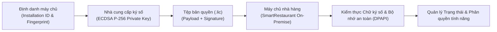
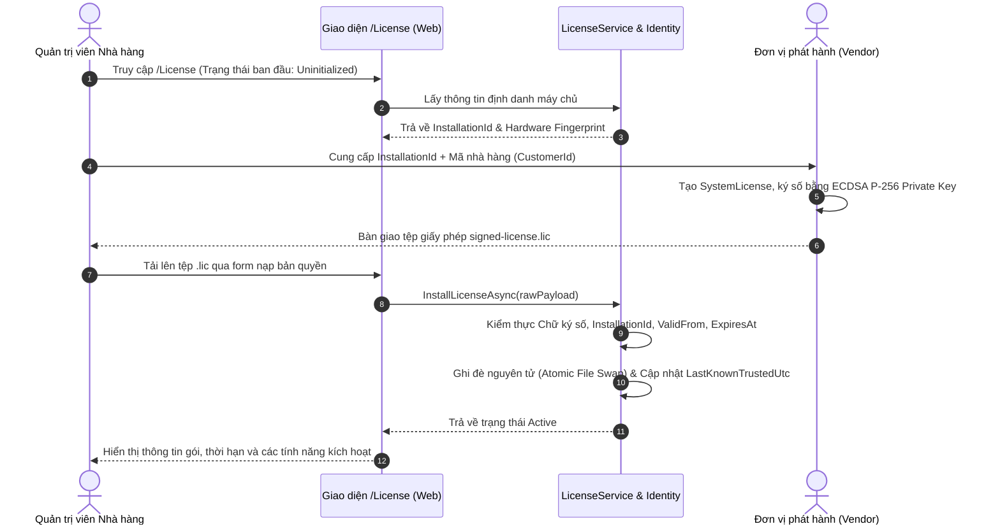
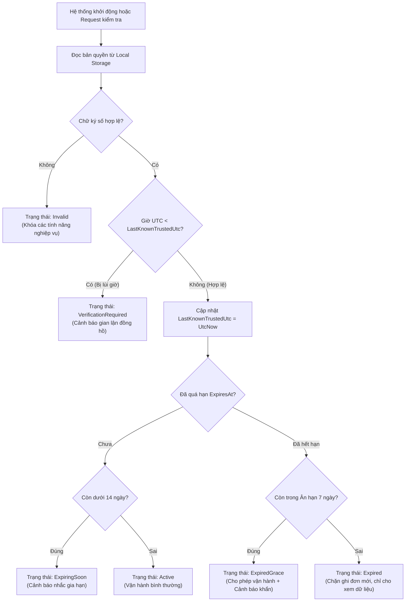
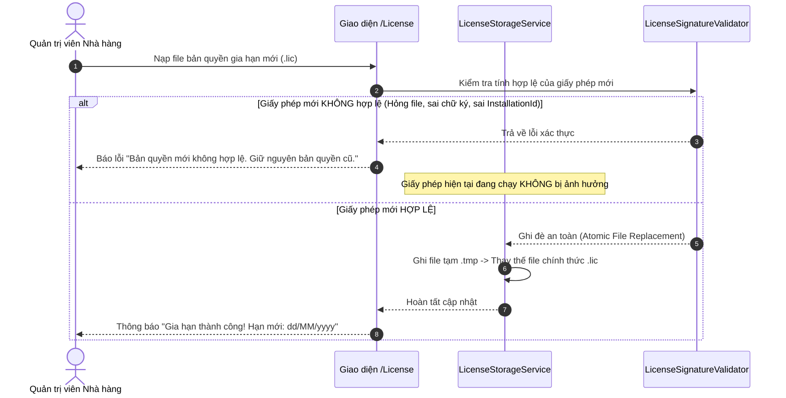

# Sổ Tay Hướng Dẫn Nghiệp Vụ & Vận Hành Bản Quyền (SmartRestaurant License Guide)

Tài liệu này chuẩn hóa toàn bộ kiến trúc, quy trình nghiệp vụ và hướng dẫn thao tác thực tế đối với phân hệ **Quản lý Bản quyền (SmartRestaurant Licensing Foundation)** được thiết kế và triển khai trên nền tảng .NET 9 LTS.

---

## 1. Tổng Quan Kiến Trúc & Nguyên Tắc Cốt Lõi

Phân hệ Bản quyền của SmartRestaurant được xây dựng nhằm đáp ứng mô hình thương mại phần mềm doanh nghiệp với các đặc điểm:

| Tiêu Chí | Thiết Kế & Quyết Định Nghiệp Vụ |
| :--- | :--- |
| **Mô hình triển khai** | On-Premise (Cài đặt cục bộ trên máy chủ trung tâm của nhà hàng). |
| **Kỳ hạn thuê bao** | Thuê bao theo năm (12 tháng / kỳ). |
| **Ràng buộc thiết bị** | Ràng buộc chặt chẽ với máy chủ ứng dụng trung tâm của nhà hàng (`InstallationId` + `HardwareFingerprint`). |
| **Hoạt động ngoại tuyến** | Hỗ trợ vận hành ngoại tuyến 100% không cần kết nối Internet liên tục, có hạn mức ngoại tuyến (`OfflineAllowanceDays = 30 ngày`). |
| **Bảo mật chữ ký số** | Sử dụng mật mã học bất đối xứng **ECDSA P-256** với băm SHA-256. |
| **Khóa ký số** | **Private Key** chỉ nằm tại hạ tầng phát hành của Nhà cung cấp (Vendor), tuyệt đối không nhúng trong mã nguồn hay máy khách hàng. Khách hàng chỉ lưu giữ **Public Key** để kiểm thực. |
| **Cơ chế thay thế an toàn** | **Atomic File Replacement Invariant**: Không bao giờ để một tệp bản quyền lỗi hoặc hỏng phá hủy tệp bản quyền hợp lệ đang chạy. |
| **Bảo vệ thời gian** | Cơ chế đồng hồ tin cậy chống lùi giờ hệ điều hành (`LastKnownTrustedUtc`). |



---

## 2. Quy Trình Nghiệp Vụ 1: Cấp Mới & Kích Hoạt Lần Đầu

Quy trình này diễn ra khi nhà hàng triển khai hệ thống SmartRestaurant lần đầu tiên trên máy chủ nội bộ.



### Các bước thao tác chi tiết:
1. **Khởi tạo định danh máy chủ (`InstallationIdentityService`)**:
   - Khi hệ thống khởi động lần đầu, dịch vụ tự sinh ngẫu nhiên một mã GUID duy nhất (`InstallationId`) và trích xuất dấu vân tay phần cứng (`HardwareFingerprint`).
   - Khóa định danh máy chủ được bảo vệ cục bộ bằng Windows Data Protection API (DPAPI).
2. **Xuất thông tin đăng ký**:
   - Quản trị viên nhà hàng truy cập màn hình `/License`.
   - Sao chép chuỗi `InstallationId` (hoặc xuất yêu cầu đăng ký).
3. **Phát hành tệp bản quyền**:
   - Đơn vị phát hành tiếp nhận `InstallationId`, thiết lập gói dịch vụ (12 tháng, danh mục tính năng cho phép).
   - Đơn vị phát hành dùng Private Key để ký số và xuất tệp `signed-license.lic`.
4. **Nạp và kích hoạt**:
   - Quản trị viên chọn tệp `.lic` và bấm **Kích hoạt Bản quyền**.
   - Hệ thống kiểm thực chữ ký số bằng Public Key, kiểm tra ngày hiệu lực và ghi nhận vào kho lưu trữ an toàn. Trạng thái chuyển thành `Active`.

---

## 3. Quy Trình Nghiệp Vụ 2: Vận Hành Ngoại Tuyến & Đồng Hồ Tin Cậy

SmartRestaurant được thiết kế để nhà hàng hoạt động bình thường ngay cả khi mất kết nối mạng Internet hoặc không có đường truyền ra ngoài.



### Nguyên tắc bảo vệ đồng hồ tin cậy (Anti-Rollback):
- Hệ thống duy trì mốc thời gian UTC cao nhất từng được ghi nhận (`LastKnownTrustedUtc`).
- Mỗi khi kiểm thực, nếu `DateTime.UtcNow < LastKnownTrustedUtc` quá dung sai cho phép (5 phút), hệ thống nhận diện có sự can thiệp lùi giờ máy tính và kích hoạt trạng thái `VerificationRequired` để ngăn chặn hành vi cố tình kéo dài thời hạn bản quyền lậu.
- Hạn mức ngoại tuyến (`OfflineAllowanceDays` mặc định 30 ngày): Sau 30 ngày hoạt động ngoại tuyến hoàn toàn mà không có cập nhật xác thực mới, hệ thống chuyển sang trạng thái nhắc nhở `OfflineGrace`.

---

## 4. Vòng Đời Trạng Thái Bản Quyền & Chính Sách Ân Hạn

Hệ thống quản lý 9 trạng thái vòng đời bản quyền chặt chẽ (`LicenseState`):

| Trạng thái | Mã định danh | Điều kiện phát sinh | Hành vi ứng xử của hệ thống |
| :--- | :--- | :--- | :--- |
| **Chưa kích hoạt** | `Uninitialized` | Chưa nạp file bản quyền nào vào máy chủ. | Mở màn hình `/License`, nhắc nhở nạp bản quyền; các phân hệ POS/KDS bị khóa. |
| **Đang hoạt động** | `Active` | Bản quyền hợp lệ, thời gian nằm trong kỳ thuê bao, đồng hồ chuẩn xác. | Mở khóa toàn bộ các tính năng được cấp phép. |
| **Sắp hết hạn** | `ExpiringSoon` | Thời hạn còn lại ≤ 14 ngày so với `ExpiresAt`. | Vận hành bình thường; hiển thị Banner cảnh báo vàng trên trang quản trị nhắc liên hệ gia hạn. |
| **Ân hạn ngoại tuyến** | `OfflineGrace` | Hoạt động ngoại tuyến vượt quá 30 ngày (`OfflineAllowanceDays`). | Cho phép tiếp tục bán hàng nhưng hiển thị nhắc nhở kết nối/xác thực. |
| **Ân hạn hết hạn** | `ExpiredGrace` | Đã quá ngày hết hạn `ExpiresAt` nhưng còn trong hạn ân hạn 7 ngày (`ExpiryGraceDays`). | **Bảo vệ nghiệp vụ nhà hàng**: Không cắt dịch vụ đột ngột; hiển thị cảnh báo đỏ khẩn cấp yêu cầu gia hạn ngay. |
| **Hết hạn hoàn toàn** | `Expired` | Quá ngày hết hạn + 7 ngày ân hạn. | Khóa tính năng tạo đơn mới (POS), khóa bếp (KDS). Cho phép tra cứu hóa đơn cũ, xuất báo cáo và nạp bản quyền mới. |
| **Cần kiểm thực** | `VerificationRequired` | Phát hiện lùi giờ máy chủ (`UtcNow < LastKnownTrustedUtc`). | Khóa tính năng tạo đơn, cảnh báo quản trị viên chỉnh lại đồng hồ chuẩn. |
| **Không hợp lệ** | `Invalid` | Sai chữ ký số, sai `InstallationId`, file rách hỏng. | Từ chối kích hoạt, thông báo chi tiết lý do không hợp lệ. |
| **Đình chỉ** | `Suspended` | Bản quyền bị tạm đình chỉ từ phía quản trị cấp cao. | Tạm dừng toàn bộ nghiệp vụ nhà hàng. |

---

## 5. Quy Trình Nghiệp Vụ 3: Gia Hạn & Thay Thế An Toàn

Khi hợp đồng thuê bao 12 tháng sắp kết thúc, nhà hàng thực hiện gia hạn bản quyền:



### Nguyên tắc bất biến sống còn (Safe Replacement Invariant):
- Khi nạp tệp `.lic` mới, `LicenseStorageService` không ghi đè trực tiếp lên file đang dùng.
- Quy trình ghi sử dụng cơ chế file tạm (`.tmp`) và thay thế nguyên tử (`File.Replace` hoặc sao lưu dự phòng).
- Nếu tệp mới bị lỗi định dạng, sai chữ ký số, hoặc hết hạn, hệ thống ném ngoại lệ và **tuyệt đối không làm tổn hại đến tệp bản quyền hợp lệ hiện tại**. Nhà hàng tiếp tục vận hành bình thường mà không bị gián đoạn.

---

## 6. Quy Trình Nghiệp Vụ 4: Chuyển Đổi Máy Chủ (Hardware Rehost)

Áp dụng khi nhà hàng nâng cấp phần cứng máy chủ, thay Mainboard, hoặc chuyển sang máy chủ dự phòng:

1. **Cài đặt SmartRestaurant trên máy chủ mới**: Máy chủ mới khởi tạo `InstallationId` mới và bộ vân tay phần cứng mới.
2. **Tạo yêu cầu cấp lại (Rehost Request)**:
   - Trên hệ thống cũ (nếu còn truy cập được) hoặc giao diện máy mới, trích xuất thông tin `InstallationId` mới.
   - Gửi yêu cầu `RehostRequest` kèm lý do chuyển đổi tới Đơn vị phát hành.
3. **Phê duyệt & Hủy định danh cũ**:
   - Đơn vị phát hành kiểm tra lịch sử hợp đồng, đánh dấu thu hồi `InstallationId` cũ trên cổng quản trị của Vendor.
   - Ký số tệp bản quyền mới gắn với `InstallationId` của máy chủ mới với thời hạn tương ứng hợp đồng còn lại.
4. **Kích hoạt máy chủ mới**:
   - Nạp tệp bản quyền mới lên máy chủ mới và đưa vào hoạt động chính thức.

---

## 7. Cơ Chế Kiểm Soát Tính Năng (Feature Entitlements)

Mỗi giấy phép chứa danh sách các tính năng được phép sử dụng (`Features`):

```json
{
  "Edition": "Enterprise",
  "Features": [
    "SmartRestaurant.Pos",
    "SmartRestaurant.Kds",
    "SmartRestaurant.Inventory",
    "SmartRestaurant.Reports",
    "SmartRestaurant.MultiBranch"
  ]
}
```

### Cách thức kiểm tra trong mã nguồn:
Các module nghiệp vụ kiểm tra phân quyền thông qua interface `ILicenseService`:
```csharp
// Kiểm tra quyền sử dụng phân hệ Bếp KDS
if (!_licenseService.IsFeatureEnabled("SmartRestaurant.Kds"))
{
    throw new FeatureNotLicensedException("SmartRestaurant.Kds");
}
```

### Chế độ phát triển (Development Mode):
- Khi thiết lập cấu hình `Licensing:Mode = "Development"` trong `appsettings.json`, phương thức `IsFeatureEnabled` luôn trả về `true` cho mọi tính năng.
- Mục đích: Đảm bảo đội ngũ phát triển và kiểm thử có thể làm việc trơn tru trên các phân hệ Manager, POS, KDS mà không bị cản trở bởi cơ chế khóa bản quyền thương mại.

---

## 8. Danh Mục Mã Nguồn & Tệp Tin Cốt Lõi

| Thành phần | Đường dẫn tệp tin | Trách nhiệm |
| :--- | :--- | :--- |
| **Domain Entity** | `src/SmartRestaurant.Domain/Entities/SystemLicense.cs` | Mô hình thực thể bản quyền, đánh giá trạng thái (`EvaluateState`), kiểm tra tính năng (`IsFeatureEnabled`). |
| **Domain Enums** | `src/SmartRestaurant.Domain/Enums/LicenseState.cs` | Định nghĩa 9 trạng thái bản quyền. |
| **Application Interfaces** | `src/SmartRestaurant.Application/Interfaces/ILicenseService.cs` | Hợp đồng giao tiếp dịch vụ bản quyền. |
| **Application DTOs** | `src/SmartRestaurant.Application/DTOs/LicenseDtos.cs` | DTO nạp bản quyền, phản hồi trạng thái, yêu cầu rehost. |
| **Infrastructure - Identity** | `src/SmartRestaurant.Infrastructure/Licensing/InstallationIdentityService.cs` | Quản lý định danh máy chủ (`InstallationId`), bảo vệ DPAPI. |
| **Infrastructure - Crypto** | `src/SmartRestaurant.Infrastructure/Licensing/LicenseSignatureValidator.cs` | Kiểm thực chữ ký số bất đối xứng ECDSA P-256 + SHA-256. |
| **Infrastructure - Storage** | `src/SmartRestaurant.Infrastructure/Licensing/LicenseStorageService.cs` | Lưu trữ file nguyên tử, bảo vệ dữ liệu nhạy cảm. |
| **Infrastructure - Clock** | `src/SmartRestaurant.Infrastructure/Licensing/LicenseClockService.cs` | Bảo vệ đồng hồ tin cậy, chống lùi giờ máy chủ. |
| **Presentation - Controller** | `src/SmartRestaurant.Web/Controllers/LicenseController.cs` | Endpoint hiển thị thông tin và tiếp nhận file bản quyền tải lên. |
| **Presentation - View** | `src/SmartRestaurant.Web/Views/License/Index.cshtml` | Giao diện quản trị bản quyền 100% tiếng Việt bản địa. |
| **Test Suites** | `tests/SmartRestaurant.Domain.Tests/SystemLicenseTests.cs`<br/>`tests/SmartRestaurant.Application.Tests/LicenseFoundationTests.cs` | 74 kịch bản kiểm thử tự động toàn diện. |

---
*Tài liệu này là căn cứ chuẩn hóa cho các quy trình phát hành, kích hoạt, gia hạn và bảo hành phần mềm SmartRestaurant.*
