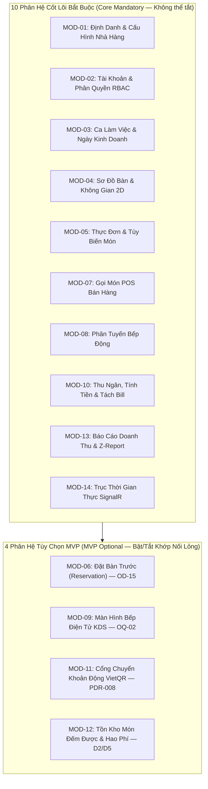
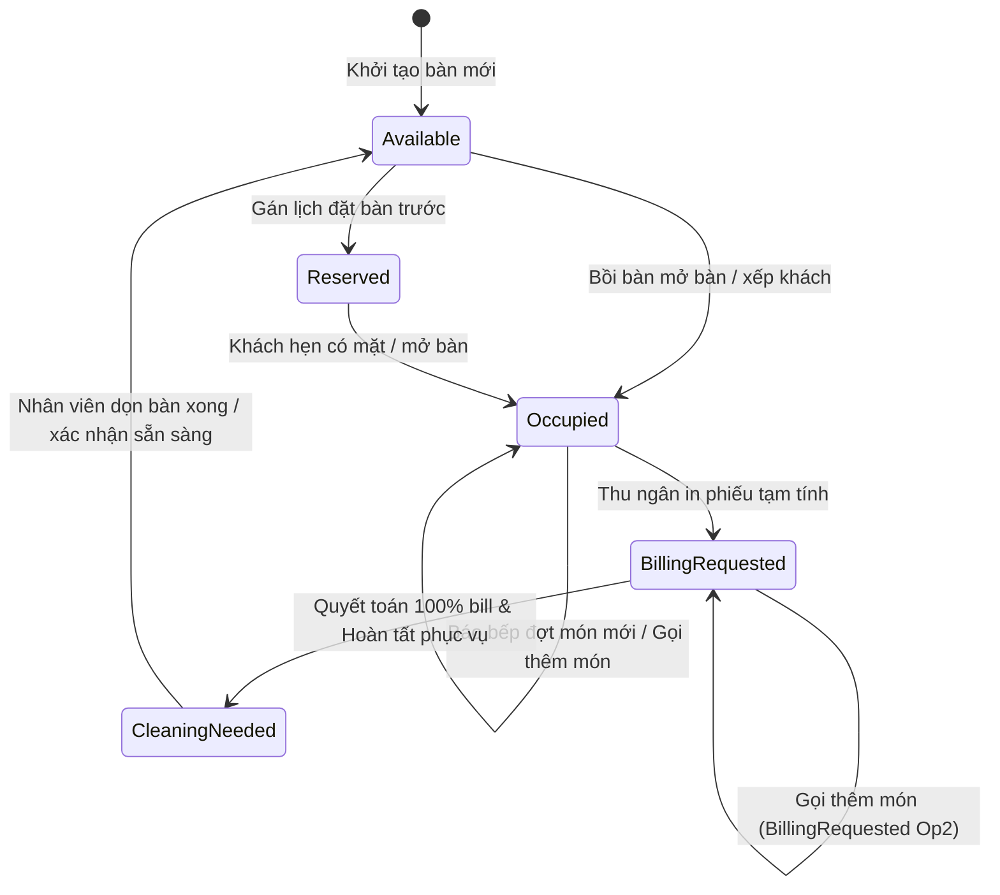
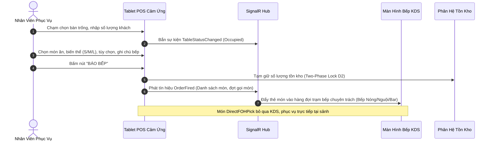
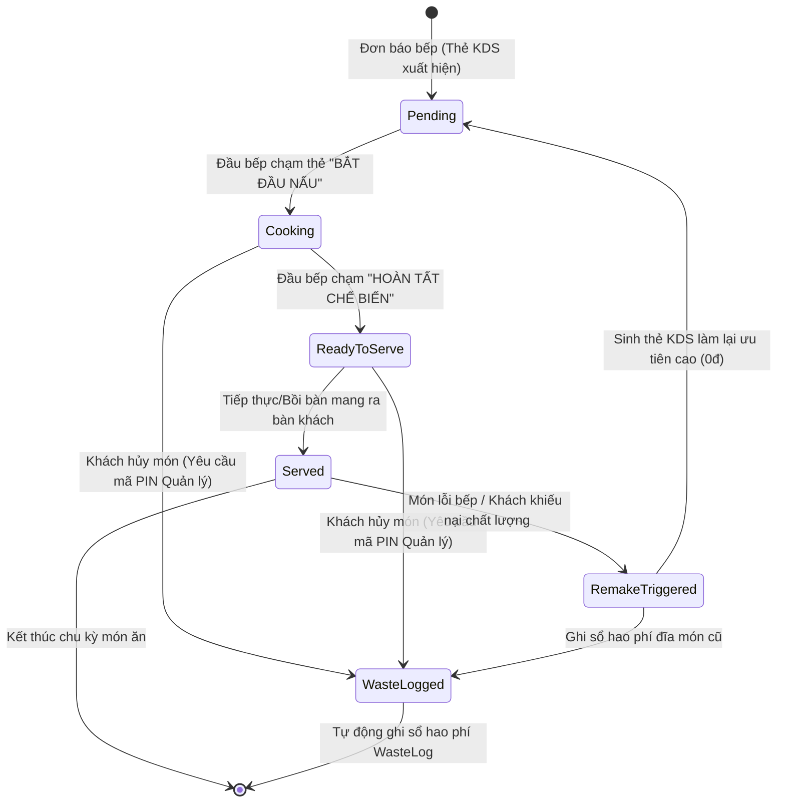
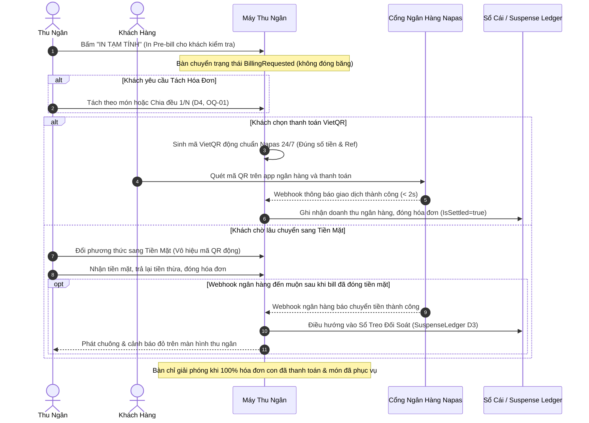

# Hồ Sơ Cơ Sở Đặc Tả Sản Phẩm Chính Thức — SmartRestaurant
## PRODUCT-BASELINE-v1.0.0.md (Authoritative Stage 1 Product Specification Suite)

- **Dự Án**: SmartRestaurant — Hệ Thống Quản Lý Vận Hành Nhà Hàng Độc Lập
- **Phiên Bản Cơ Sở**: `v1.0.0-FROZEN`
- **Giai Đoạn Vòng Đời**: Stage 1 — Yêu Cầu Sản Phẩm & Phân Tích Miền Nghiệp Vụ (Product Discovery & Business Domain Specifications)
- **Trạng Thái Nghiệm Thu**: **`OWNER-APPROVED (v1.0.0-FROZEN)`**
- **Trạng Thái Chuyển Tiếp**: **Stage 2: `NOT AUTHORIZED / LOCKED`** (Duy trì chế độ chờ; không triển khai kỹ thuật nếu chưa có lệnh của Owner)
- **Ngày Niêm Phong Cơ Sở**: 2026-11-06 | **Ngày Hợp Nhất Văn Bản**: 2026-11-10
- **Thẩm Quyền Phê Duyệt**: Chủ Dự Án (Project Owner — Nghiệm thu chính thức tại Task 02.6, Task 02.8.5, Task 02.8.6)
- **Địa Vị Pháp Lý Của Tài Liệu**: **Nguồn Sự Thật Duy Nhất (Single Source of Truth)** về toàn bộ nghiệp vụ, phạm vi, quy tắc và yêu cầu của Giai đoạn 1. Tất cả các tài liệu đặc tả tiền thân, bản thảo sơ khai hoặc báo cáo phân tích trước đây đều bị thay thế bởi văn bản này.

---

## 1. Tầm Nhìn Chiến Lược & Bối Cảnh Vận Hành (Product Vision & Context)

### 1.1. Tầm Nhìn Sản Phẩm
**SmartRestaurant** là nền tảng quản lý và vận hành số nhà hàng thế hệ mới, được thiết kế ban đầu và ưu tiên hàng đầu cho các nhà hàng, quán cà phê và cơ sở dịch vụ ăn uống (F&B) tại **Việt Nam**, với kiến trúc mở rộng hỗ trợ vận hành đa chi nhánh và quốc tế hóa trong tương lai.

### 1.2. Bài Toán Vận Hành Thực Tế Tại Thị Trường F&B Việt Nam
Hệ thống giải quyết triệt để 6 nút thắt vận hành cố hữu trong ngành dịch vụ ẩm thực truyền thống:
1. **Thất lạc phiếu và ách tắc giao tiếp Bếp - Sảnh**: Phiếu in nhiệt hoặc ghi tay dễ dính dầu mỡ, thất lạc hoặc chậm trễ giờ cao điểm, gây sai lệch thông tin giữa phục vụ và đầu bếp.
2. **Thiếu tầm nhìn thời gian thực về sơ đồ bàn**: Quản lý không nắm được thời gian thực khách ngồi, tiến độ phục vụ, tình trạng bàn trống hay nhu cầu dọn dẹp để tối ưu tốc độ quay vòng bàn.
3. **Mất nhịp độ chế biến giữa các trạm bếp (Pacing Disconnect)**: Bếp Nóng, Bếp Nguội/Salad, Quầy Bar hoạt động rời rạc, dẫn đến tình trạng món xào đã nấu xong bị nguội tại bàn ra món trong khi món nướng vẫn đang chế biến dở.
4. **Tắc nghẽn quầy thu ngân trong giờ cao điểm**: Tách hóa đơn phức tạp (theo món hoặc chia đều), xử lý chuyển khoản VietQR chậm, đối soát thủ công dễ nhầm lẫn doanh thu giữa tiền mặt và ngân hàng.
5. **Thất thoát tồn kho và hao phí không kiểm soát**: Thiếu cơ chế khóa tạm giữ kho hai pha khi gọi món và thiếu nhật ký ghi nhận hao phí hỏng hóc (`WasteLog`) có lý do khi hủy món sau chế biến.
6. **Rào cản ngôn ngữ và phần mềm ngoại nhập**: Các phần mềm nước ngoài có bản dịch tiếng Việt gượng gạo, mẫu hóa đơn không đúng chuẩn Việt Nam và không hỗ trợ chuyển khoản tức thì qua Napas 24/7.

### 1.3. Các Trụ Cột Giá Trị Cốt Lõi (Core Value Propositions)
1. **Trải Nghiệm Tiếng Việt Bản Địa 100% (Vietnamese-First)**: Toàn bộ giao diện POS, KDS, Thu ngân và Cổng quản trị hiển thị 100% tiếng Việt tự nhiên, chuẩn mực văn phong F&B Việt Nam.
2. **Đồng Bộ Thời Gian Thực Độ Trễ Dưới 1 Giây (Zero-Latency Real-Time Orchestration)**: Trục kết nối thời gian thực SignalR đồng bộ ngay lập tức trạng thái bàn, đơn món, tiến độ bếp và hóa đơn trên toàn bộ thiết bị.
3. **Sơ Đồ Bàn Trực Quan 2D Thông Minh (Visual Floor Plan Intelligence)**: Quản lý khu vực, phòng ăn, phòng VIP và bàn ăn qua sơ đồ tương tác phản ánh mã màu trạng thái thời gian thực.
4. **Điều Phối Bếp Đa Trạm Thông Minh (Intelligent Kitchen Routing & Expediter)**: Tự động phân tách món ăn về đúng trạm chế biến chuyên trách kèm đồng hồ đếm ngược SLA và nhịp độ bàn ra món tiếp thực.
5. **Thanh Toán Linh Hoạt & Đa Kênh (Resilient Billing & Multi-Channel Settlement)**: Tách bill không đóng băng bàn, thanh toán đa phương thức, sinh mã VietQR động tự động và sổ treo đối soát webhook đến muộn.
6. **Vận Hành Độc Lập & Sẵn Sàng Mở Rộng Tương Lai**: Tối ưu hóa tuyệt đối cho mô hình 1 nhà hàng độc lập tại 1 địa điểm trong MVP (`OD-01`), đồng thời chuẩn bị sẵn ranh giới dữ liệu để mở rộng chuỗi chi nhánh trong tương lai.

---

## 2. Mô Hình Vận Hành & Chân Dung Người Dùng (Target Models & Personas)

### 2.1. Phân Khúc Mô Hình Nhà Hàng Mục Tiêu
- **Quán Cà Phê & Tiệm Bánh Độc Lập (10–30 chỗ)**: Gọi món POS nhanh, phân tuyến đồ uống tức thì sang Quầy Bar, thanh toán tiền mặt/VietQR tinh gọn.
- **Nhà Hàng Ăn Uống Tiêu Chuẩn / Casual Dining & Bistro (40–120 chỗ)**: Kết hợp trong nhà và sân vườn, phục vụ tại bàn nhiều đợt món, phân tuyến đa trạm bếp, tách hóa đơn linh hoạt.
- **Nhà Hàng Lẩu Nướng & Quy Mô Lớn (100–300+ chỗ)**: Nhiều tầng/phòng, phòng ăn VIP riêng, tùy biến món và gia vị cao, gọi thêm món liên tục, gộp bàn cho đoàn tiệc lớn.

### 2.2. Bảng Phân Quyền Vai Trò Người Dùng (User Personas & RBAC)

| Vai Trò | Mã Quyền | Vị Trí Vận Hành | Trách Nhiệm Chính & Thẩm Quyền | Giao Diện Sử Dụng |
| :--- | :---: | :--- | :--- | :--- |
| **Quản Trị Hệ Thống (System Admin)** | `ADMIN` | Quản trị cấp cao | Cấu hình tham số hệ thống, phân quyền người dùng, xem toàn bộ nhật ký kiểm toán. | Cổng Web Quản Trị (Admin Portal) |
| **Quản Lý Nhà Hàng (Restaurant Manager)**| `MGR` | Điều hành sàn | Giám sát vận hành, duyệt mở/chốt ca, nhập PIN duyệt hủy món đã nấu, duyệt chiết khấu, xem báo cáo doanh thu. | Cổng Web Admin & POS Dashboard |
| **Nhân Viên Phục Vụ (Waiter / Server)** | `WAIT` | Tiền sảnh (FOH) | Mở bàn, gọi món cảm ứng, chọn tùy biến, bấm báo bếp, theo dõi món xong, in phiếu tạm tính. | Tablet POS Cảm Ứng Di Động |
| **Đầu Bếp / Nhân Viên Bếp (Chef / Cook)** | `CHEF` | Hậu sảnh (BOH) | Xem thẻ món KDS, bấm nhận nấu (`Đang nấu`), bấm hoàn tất (`Đã xong, chờ bưng`), báo tạm hết món (86). | Màn Hình KDS Nhà Bếp |
| **Nhân Viên Pha Chế (Bartender)** | `BAR` | Quầy Pha Chế | Tiếp nhận đồ uống trên KDS Bar, xác nhận sẵn sàng; đồ uống đóng chai sẵn phục vụ sảnh bỏ qua KDS này. | Màn Hình KDS Quầy Bar |
| **Thu Ngân (Cashier)** | `CASH` | Quầy Thu Ngân | In tạm tính, tách/gộp hóa đơn, thu tiền (Tiền mặt, VietQR, Thẻ), cân đối két tiền và thực hiện kiểm tiền mù chốt ca. | Thiết Bị Thu Ngân Để Bàn |
| **Thủ Kho (Inventory Staff)** | `INV` | Kho Hàng | Quản lý danh mục hàng hóa đếm được, theo dõi số lượng tồn khả dụng/tạm giữ, ghi nhận phiếu hủy hỏng `WasteLog`. | Cổng Quản Trị Kho |

---

## 3. Phạm Vi Phát Hành MVP & Lộ Trình Phân Kỳ (Release Scope & Roadmap)

### 3.1. Ranh Giới Vận Hành MVP Đơn Điểm (`OD-01`)
- **Phạm vi địa lý & tổ chức**: Phiên bản MVP v1.0 phục vụ duy nhất **01 nhà hàng độc lập tại 01 địa điểm vật lý duy nhất**.
- **Chính sách Đa Chi Nhánh**: Mọi tính năng đồng bộ danh mục chuỗi, điều chuyển hàng liên chi nhánh, chia sẻ khách hàng thân thiết được loại trừ khỏi MVP. Các phương án kỹ thuật về khóa ngoại `OrganizationId` và `BranchId` chỉ là nội dung nghiên cứu kiến trúc của Stage 2 (`TECH-06`).

### 3.2. Cơ Cấu 14 Phân Hệ Nghiệp Vụ Chuẩn Mực

### 3.3. Lộ Trình Phát Hành Phân Kỳ (Release Horizons)
- **v1.0 (MVP Hiện Tại)**: 10 Core Mandatory + 4 MVP Optional. Quản lý tồn kho món đếm được (lon, chai, suất đóng gói). Tách bill theo món và chia đều $1/N$. VietQR động và sổ treo đối soát. Xử lý khiếu nại tiền mặt thủ công bằng biên bản giấy (`OD-14`).
- **v1.1 (Post-MVP Ngắn Hạn)**: Định lượng nguyên vật liệu chi tiết (BOM gram, ml); Tách bill theo tỷ lệ phần trăm lẻ (`OQ-01`); Phiếu điều chỉnh công nợ điện tử (`CreditNote` per `OD-14`).
- **v1.2+ (Định Hướng Tương Lai)**: Phân hệ Quản lý Công nợ Khách Ký Nợ B2B (Corporate Customer Accounts Receivable per `REV-07`).
- **v2.0 (Quy Mô Chuỗi Đa Chi Nhánh)**: Quản trị tập trung chuỗi nhà hàng (Multi-Tenant & Multi-Branch Enterprise Suite); Khách hàng quét mã QR tự gọi món tại bàn (Customer Self-Service QR Ordering).

---

## 4. Danh Mục 23 Quyết Định Của Chủ Dự Án (Owner Decisions Register)

Bảng tổng hợp đầy đủ 23 quyết định đã được Chủ Dự Án chính thức phê chuẩn qua các văn bản ký duyệt (Task 02.6, Workshop Ballot Task 02.8.5, Implementation Report Task 02.8.6, Verification Task 02.8.6.1):

| Mã Quyết Định | Tên Quyết Định | Nội Dung Quyết Định Phê Chuẩn Chính Thức | Nguồn Bằng Chứng Pháp Lý | Trạng Thái Phê Duyệt |
| :---: | :--- | :--- | :--- | :---: |
| **OD-01** | **Phạm Vi Vận Hành MVP Đơn Điểm** | Phục vụ 1 nhà hàng độc lập tại 1 địa điểm duy nhất. Không đưa quản trị chuỗi đa chi nhánh vào MVP. | Task 02.6 (`CONTR-01`), [`MVP-SCOPE.md`](./99-archive/stage-1-history/superseded-documents/MVP-SCOPE.md) | **`OWNER-CONFIRMED`** |
| **D1** | **Ngày Kinh Doanh & Giờ Cắt Ca** | Áp dụng `BusinessDate` có thể cấu hình mốc cắt ca (mặc định 06:00 sáng). Đơn hàng mở trong ca qua đêm giữ nguyên `BusinessDate` lúc mở. Thay đổi giờ cắt không tính hồi tố. | Task 02.6 ([`PDR-007`](./product/decisions/PDR-007-business-date-shift-management.md)) | **`OWNER-CONFIRMED`** |
| **D2** | **Khóa Tồn Kho Hai Pha** | Công thức: $\text{Tồn khả dụng} = \text{Tồn thực tế} - \text{Tạm giữ}$. Báo bếp khóa tạm giữ; phục vụ xong trừ thực tế; hủy sau nấu ghi sổ hao phí `WasteLog`. | Task 02.6 ([`PDR-004`](./product/decisions/PDR-004-inventory-bom-deduction-trigger-policy.md)) | **`OWNER-CONFIRMED`** |
| **D3** | **Xử Lý Webhook VietQR Đến Muộn** | Chuyển phương thức tiền mặt thì vô hiệu mã QR; webhook ngân hàng đến muộn sau khi bill đã đóng tiền mặt tự động điều hướng vào `SuspenseLedger` kèm cảnh báo thu ngân, chống ghi nhận trùng doanh thu. | Task 02.6 ([`PDR-008`](./product/decisions/PDR-008-vietqr-delayed-webhook-handling.md)) | **`OWNER-CONFIRMED`** |
| **D4** | **Tách Bill Không Đóng Băng Bàn** | Mô hình phiên bàn đa hóa đơn. Bàn đang tách hóa đơn không bị đóng băng, tiếp tục gọi món bình thường. Bàn chỉ giải phóng khi thỏa mãn cả 2 điều kiện: 100% bill đã trả tiền VÀ 100% món ăn đã phục vụ/hủy hợp lệ. | Task 02.6 ([`PDR-009`](./product/decisions/PDR-009-multi-bill-table-session-split-billing.md)) | **`OWNER-CONFIRMED`** |
| **D5** | **Phạm Vi BOM MVP** | MVP chỉ quản lý tồn kho cho các mặt hàng bán trực tiếp đếm được (lon, chai, suất đóng gói). Hoãn công thức định lượng nguyên vật liệu theo gram/ml sang v1.1. | Task 02.6 ([`PDR-004`](./product/decisions/PDR-004-inventory-bom-deduction-trigger-policy.md)) | **`OWNER-CONFIRMED`** |
| **OD-13** | **Bất Biến Hóa Đơn Đã Đóng** | Hóa đơn đã quyết toán (`IsSettled = true`) là bất biến tuyệt đối trong CSDL; nhân viên phục vụ và thu ngân không được sửa đổi trực tiếp. Không có "Option 2". | Task 02.6 ([`PDR-009`](./product/decisions/PDR-009-multi-bill-table-session-split-billing.md) §3) | **`OWNER-CONFIRMED`** |
| **OD-14** | **Chính Sách Khiếu Nại & Hoàn Tiền Sau Thanh Toán** | **Phương án A**: CSDL bất biến; xử lý hoàn tiền mặt thủ công bằng biên bản giấy ký tay giữa Quản lý và Thu ngân; ghi nhận chênh lệch vào `ShiftClosingVarianceLog` khi kiểm tiền mù chốt ca; `CreditNote` điện tử hoãn sang v1.1. | Workshop Ballot 1 ([`OWNER-DECISION-WORKSHOP.md`](./99-archive/stage-1-history/task-reports/OWNER-DECISION-WORKSHOP.md#L471)) | **`OWNER-CONFIRMED (PHƯƠNG ÁN A)`** |
| **BillingRequested Option 2** | **Gọi Thêm Món Khi Bàn In Tạm Tính** | Thuộc quyết định `D4 / PDR-009 §2`. Khi bàn đang `BillingRequested` và bill chưa thanh toán, món mới mặc định thêm vào hóa đơn chưa thanh toán hiện có hoặc tạo sub-bill mới. Bill chưa đóng vẫn có thể sửa/hủy hợp lệ. Tách biệt hoàn toàn khỏi `OD-13`. | Task 02.6 ([`PDR-009`](./product/decisions/PDR-009-multi-bill-table-session-split-billing.md) §2) | **`OWNER-CONFIRMED`** |
| **OD-15** | **Đặt Bàn Trước Là MVP Optional** | Phân hệ Đặt Bàn Trước (`MOD-06`) được triển khai dưới dạng module tùy chọn độc lập (loose coupling); nhà hàng không nhận đặt bàn có thể tắt hoàn toàn. | Workshop Ballot 2 ([`OWNER-DECISION-WORKSHOP.md`](./99-archive/stage-1-history/task-reports/OWNER-DECISION-WORKSHOP.md#L472)) | **`OWNER-CONFIRMED (PHƯƠNG ÁN A)`** |
| **OD-16** | **3 Gói Cấu Hình Khởi Tạo (Onboarding Presets)** | **Phương án A**: Cung cấp 3 gói mẫu gợi ý ban đầu (`Cafe/Boutique`, `À la carte`, `Pub/Beer`). Không có phí VIP theo giờ trong MVP (`REV-06`). `AutoPrintOnFire = false` (`OQ-02`). Các tham số chi tiết bên trong là giá trị gợi ý của AI/BA. | Workshop Ballot 3 ([`OWNER-DECISION-WORKSHOP.md`](./99-archive/stage-1-history/task-reports/OWNER-DECISION-WORKSHOP.md#L473)) | **`OWNER-CONFIRMED (PHƯƠNG ÁN A)`** |
| **OD-17** | **Chính Sách Thoát Êm Dịu (Graceful Drain)** | **Phương án A**: Khi tắt module tùy chọn, chặn tiếp nhận mới ngay lập tức nhưng cho phép hoàn tất các phiên bàn/giao dịch đang dở dang; 100% dữ liệu lịch sử được bảo lưu trạng thái Read-Only. | Workshop Ballot 4 ([`OWNER-DECISION-WORKSHOP.md`](./99-archive/stage-1-history/task-reports/OWNER-DECISION-WORKSHOP.md#L474)) | **`OWNER-CONFIRMED (PHƯƠNG ÁN A)`** |
| **OQ-01** | **Hoãn Tách Bill Theo % Lẻ** | **Phương án A**: Hoãn tách hóa đơn theo tỷ lệ phần trăm lẻ sang v1.1. MVP hỗ trợ Tách theo món chọn lọc và Tách chia đều $1/N$ (tiền lẻ thập phân dồn vào hóa đơn cuối cùng). | Workshop Ballot 5 ([`OWNER-DECISION-WORKSHOP.md`](./99-archive/stage-1-history/task-reports/OWNER-DECISION-WORKSHOP.md#L475)) | **`OWNER-CONFIRMED (PHƯƠNG ÁN A)`** |
| **OQ-02** | **In Nhiệt Bếp Song Song Khi Báo Bếp** | **Phương án A**: Mặc định tắt `AutoPrintOnFire: false`, ưu tiên màn hình bếp KDS điện tử không giấy; máy in nhiệt ESC/POS đóng vai trò dự phòng phần cứng hoặc in phiếu thủ công khi cần. | Workshop Ballot 6 ([`OWNER-DECISION-WORKSHOP.md`](./99-archive/stage-1-history/task-reports/OWNER-DECISION-WORKSHOP.md#L476)) | **`OWNER-CONFIRMED (PHƯƠNG ÁN A)`** |
| **OQ-06** | **Tính Thuế VAT Trên Phí Dịch Vụ** | **Phương án A**: Mặc định cấu hình `IsServiceChargeTaxable: true` (Thuế VAT được tính trên cả tiền món ăn và tiền Phí Dịch Vụ). | Workshop Ballot 7 ([`OWNER-DECISION-WORKSHOP.md`](./99-archive/stage-1-history/task-reports/OWNER-DECISION-WORKSHOP.md#L477)) | **`OWNER-CONFIRMED (PHƯƠNG ÁN A)`** |
| **OQ-07** | **Phiên Bàn Kéo Dài > 24 Giờ Vượt Mốc Ca** | **Phương án A**: Giữ nguyên `BusinessDate` ban đầu khi mở bàn theo nguyên tắc `D1`; hiển thị dải băng cảnh báo màu cam cho Quản lý; không tự động cưỡng bức đóng bàn; không đổi ngày khi sửa giờ cắt ca. | Workshop Ballot 8 ([`OWNER-DECISION-WORKSHOP.md`](./99-archive/stage-1-history/task-reports/OWNER-DECISION-WORKSHOP.md#L478)) | **`OWNER-CONFIRMED (PHƯƠNG ÁN A)`** |
| **REV-05** | **Hủy Gộp Bàn Phân Bổ Lại Món** | Cho phép hủy gộp bàn bất kỳ lúc nào, phân bổ lại món ăn về bàn tách ra mà không phải bắn lại vé chế biến xuống nhà bếp. | Task 02.6 ([`PDR-010`](./product/decisions/PDR-010-unmerge-tables.md)) | **`OWNER-CONFIRMED`** |
| **REV-06** | **Phụ Thu Phòng VIP & Khu Vực** | Phụ thu theo tỷ lệ % hoặc số tiền cố định theo lượt; lưu snapshot giá trị lúc tạo bill; không tính lại lịch sử khi chuyển bàn; **hoàn toàn không có phí phòng theo giờ trong MVP**. | Task 02.6 ([`PDR-011`](./product/decisions/PDR-011-area-and-vip-room-surcharges.md)) | **`OWNER-CONFIRMED`** |
| **REV-07** | **Khách Ký Nợ (Corporate AR)** | Hoãn toàn bộ tính năng bán hàng ghi nợ công nợ doanh nghiệp sang phiên bản v1.2+. Không có trong MVP. | Task 02.6 ([`PDR-005`](./product/decisions/PDR-005-multi-tender-and-bill-splitting-strategy.md) §3) | **`OWNER-CONFIRMED (DEFERRED)`** |
| **REV-08** | **Mặt Hàng Phục Vụ Trực Tiếp Sảnh (`DirectFOHPick`)**| Đồ uống đóng chai sẵn hoặc món lấy ngay bỏ qua KDS Quầy Bar; vẫn ghi nhận đầy đủ trong order, doanh thu, trừ tồn kho (`D2`) và thanh toán. | Task 02.6 ([`PDR-012`](./product/decisions/PDR-012-direct-service-items-foh.md)) | **`OWNER-CONFIRMED`** |
| **REV-09** | **Phòng Ăn Dùng Chung & Bao Trọn Phòng** | Bàn trong phòng hoạt động độc lập theo mặc định. Đặt bao trọn phòng áp dụng khóa độc quyền toàn bộ bàn bên trong; giải phóng theo vòng đời chuẩn. | Task 02.6 ([`PDR-013`](./product/decisions/PDR-013-shared-room-and-entire-room-booking.md)) | **`OWNER-CONFIRMED`** |
| **REV-10 / OQ-08** | **Gọi Món Đồng Thời Không Khóa Bàn** | Yêu cầu nghiệp vụ hỗ trợ nhiều nhân viên đồng thời gọi món trên cùng bàn được xác nhận (`CONFIRMED`). Các cơ chế kỹ thuật (`RowVersion`, `Append-Only Delta`) là đề xuất kỹ thuật Stage 2. | Task 02.6 ([`PDR-014`](./product/decisions/PDR-014-concurrent-order-append-business-rules.md)) | **`OWNER-CONFIRMED (BIZ)`** |
| **REV-11** | **Làm Lại Món Do Lỗi Bếp (Remake Dish)** | Món làm lại do lỗi nhà bếp không thu thêm tiền khách (0đ); ghi nhận lịch sử, lý do, requester, timestamp, department; tự động ghi nhận tổn thất nguyên liệu vào `WasteLog`. Các đề xuất giao diện (thẻ tím KDS, mã PIN) là gợi ý UI. | Task 02.6 ([`PDR-015`](./product/decisions/PDR-015-remake-dish-workflow.md)) | **`OWNER-CONFIRMED (BIZ)`** |

---

## 5. Bộ 18 Quy Tắc Nghiệp Vụ Bất Biến (Master Business Rules)

| Mã Quy Tắc | Miền Nghiệp Vụ | Tên Quy Tắc | Phát Biểu Quy Tắc Chi Tiết & Ràng Buộc Bất Biến | Cấp Độ Thực Thi | Căn Cứ Quyết Định |
| :---: | :--- | :--- | :--- | :--- | :---: |
| **BR-RULE-01** | Bàn Ăn | Khóa Bàn Chống Gán Đè | Bàn không thể được gán cho lượt khách mới nếu đang ở trạng thái `Occupied` (Có khách), `BillingRequested` (Đang thanh toán), hoặc `CleaningNeeded` (Cần dọn dẹp). | Chặn Cứng Hệ Thống | `PDR-002` |
| **BR-RULE-02** | Điều Chỉnh Món | Ủy Quyền PIN Quản Lý Khi Hủy Món Nấu | Khi món ăn đã chuyển sang trạng thái `Cooking` hoặc `ReadyToServe`, phục vụ KHÔNG THỂ xóa hoặc hủy món nếu thiếu mã PIN Quản lý ủy quyền và lý do hủy bắt buộc. | Phê Duyệt Quản Lý | `PDR-015` |
| **BR-RULE-03** | Kế Toán Tổn Thất | Tự Động Quy Trách Nhiệm Hao Phí Hủy Món | Bất kỳ món ăn nào bị hủy sau khi đã vào trạng thái `Cooking` BẮT BUỘC phải được ghi nhận vào Sổ Ghi Nhận Hao Phí Nhà Bếp (`WasteLog`) để đối soát thất thoát. | Tự Động Tuân Thủ | `PDR-004`, `PDR-015` |
| **BR-RULE-04** | Bàn Ăn | Chặn Chuyển Bàn Vào Bàn Đang Có Khách | Yêu cầu chuyển bàn bị từ chối nếu bàn đích hiện đang có khách (`Occupied`). Khách chỉ có thể chuyển sang bàn trống (`Available`). | Chặn Cứng Hệ Thống | `PDR-002` |
| **BR-RULE-05** | Tính Tiền | Chính Sách Không Chồng Khuyến Mãi | Giảm giá khuyến mãi theo từng món không được cộng dồn với voucher giảm giá theo phần trăm toàn đơn, trừ khi được bật rõ trong cấu hình cài đặt của nhà hàng. | Chính Sách Cấu Hình | `PDR-005` |
| **BR-RULE-06** | Tính Tiền | Bàn Đang Thanh Toán Vẫn Cho Phép Sửa Đổi | Khi bàn ở trạng thái `BillingRequested`, hóa đơn chưa thanh toán vẫn hoàn toàn được phép chỉnh sửa, thêm món mới (nối tiếp vào bill mở hoặc tạo sub-bill mới). Bàn CHỈ GIẢI PHÓNG khi 100% hóa đơn đã thanh toán. Hóa đơn đã đóng cấm sửa trực tiếp theo `OD-13`. | Linh Hoạt Vận Hành | `PDR-009 (Op2) / D4` |
| **BR-RULE-07** | Ca Thu Ngân | Chặn Chốt Ca Khi Còn Hóa Đơn Mở | Thu ngân không thể đóng ca làm việc nếu vẫn còn hóa đơn mở chưa thanh toán do thiết bị của thu ngân đó khởi tạo. Thu ngân thực hiện kiểm tiền mù cuối ca. | Chặn Cứng Hệ Thống | `PDR-007` |
| **BR-RULE-08** | Kế Toán Ca | Ngày Kinh Doanh Theo Ca Vận Hành | Toàn bộ đơn hàng và hóa đơn tạo trong một ca làm việc đều thuộc về `BusinessDate` của ca đó (mặc định mốc cắt 06:00 sáng). Thay đổi giờ cắt không tính toán hồi tố dữ liệu cũ. | Bất Biến Kế Toán | `D1 / PDR-007` |
| **BR-RULE-09** | Tồn Kho | Khóa Tồn Kho Hai Pha Cho Món Đếm Được | Bắn đơn xuống bếp khóa tạm giữ tồn kho hàng đếm được (`ReservedStock`). Công thức: $\text{Tồn khả dụng} = \text{Tồn thực tế} - \text{Tạm giữ}$. Điểm kích hoạt chuyển sang `Consumed` giữ là vấn đề mở ở Stage 2 (`TECH-02`). | Toàn Vẹn Tồn Kho | `D2/D5 / PDR-004` |
| **BR-RULE-10** | Thanh Toán | Xử Lý Giao Dịch VietQR Đến Muộn | Khi chuyển phương thức sang Tiền mặt, mã QR bị vô hiệu hóa; webhook ngân hàng đến muộn được điều hướng vào `Sổ Treo Giao Dịch Đối Soát` (`SuspenseLedger`) kèm cảnh báo quản lý, không ghi nhận trùng doanh thu. | An Toàn Thanh Toán | `D3 / PDR-008` |
| **BR-RULE-11** | Tính Tiền | Tách Bill Không Đóng Băng Bàn | Bàn đang thực hiện tách hóa đơn KHÔNG BỊ ĐÓNG BĂNG. Nhân viên phục vụ tiếp tục gọi thêm món vào các hóa đơn con đang mở. Hỗ trợ tách theo món và chia đều $1/N$ trong MVP. | Bất Biến Vòng Đời | `D4 / PDR-005 / OQ-01` |
| **BR-RULE-12** | Bàn Ăn | Hủy Gộp Bàn Phân Bổ Lại Món | Các bàn đã gộp có thể hủy gộp bất kỳ lúc nào; nhân viên phân bổ lại các món ăn tương ứng về bàn tách ra mà không phải bắn lại phiếu chế biến xuống nhà bếp. | Bảo Vệ Vận Hành | `PDR-010 / REV-05` |
| **BR-RULE-13** | Tính Tiền | Lưu Vết Phụ Thu Phòng & Khu Vực | Phòng VIP và khu vực hỗ trợ phụ thu theo tỷ lệ % hoặc số tiền cố định được chốt số liệu tại thời điểm tạo hóa đơn; thao tác chuyển bàn không tính toán lại hồi tố các món đã dùng trước đó. | Minh Bạch Hóa Đơn | `PDR-011 / REV-06` |
| **BR-RULE-14** | Điều Phối Bếp | Phân Tuyến Trực Tiếp Tại Quầy FOH | Đồ uống đóng chai sẵn và món lấy ngay được phục vụ trực tiếp tại khu vực khách (FOH), bỏ qua hàng đợi Bar KDS (`REV-08`); vẫn được ghi nhận đầy đủ trong luồng order, revenue, inventory và payment. | Tối Ưu Tốc Độ Phục Vụ | `PDR-012 / REV-08` |
| **BR-RULE-15** | Nhà Bếp | Làm Lại Món Do Lỗi Bếp (Remake Dish) | Món ăn nấu lại do lỗi nhà bếp không thu thêm tiền khách, sinh thẻ KDS làm lại ưu tiên cao; ghi nhận đầy đủ lịch sử, lý do, requester, timestamp, department và tự động ghi nhận tổn thất nguyên liệu vào `WasteLog`. | Chất Lượng & Kế Toán | `PDR-015 / REV-11` |
| **BR-RULE-16** | Đơn Hàng | Gọi Món Đồng Thời Không Khóa Bàn | Nhiều nhân viên phục vụ có thể cùng lúc chọn món vào một bàn mà không bị khóa chặn bàn; hệ thống bảo đảm cơ chế chỉ nối thêm (append-only) an toàn và xử lý xung đột cập nhật lạc quan. | Kiểm Soát Đồng Thời | `PDR-014 / REV-10` |
| **BR-RULE-17** | Tính Tiền | Hóa Đơn Đã Đóng Bất Biến & Lệch Két | Hóa đơn đã quyết toán (`IsSettled = true`) là bất biến tuyệt đối trong CSDL MVP (`OD-13`). Mọi sai sót tiền mặt được xử lý hoàn tiền thủ công ngoài quầy kèm biên bản giấy ký tay; ghi nhận lệch két vào `ShiftClosingVarianceLog` khi chốt ca; `CreditNote` hoãn sang v1.1. | Bất Biến Tài Chính | `OD-14 (Op A) / OD-13` |
| **BR-RULE-18** | Phiên Bàn | Phiên Bàn Kéo Dài > 24 Giờ | Bàn ăn mở kéo dài hơn 24 giờ qua một hoặc nhiều mốc cắt ca vẫn giữ nguyên `BusinessDate` ban đầu khi mở theo nguyên tắc `D1`, đồng thời hiển thị dải băng cảnh báo màu cam cho Quản lý kiểm tra vận hành. | Bảo Toàn Phiên Bàn | `OQ-07 Option A` |

---

## 6. Bộ 15 Bất Biến Vận Hành Cốt Lõi (Core Operational Invariants)

Toàn bộ hệ thống kỹ thuật bắt buộc phải thỏa mãn 15 bất biến này tại mọi thời điểm trong CSDL:

- **INV-01 (Single Occupancy)**: Một bàn vật lý tại một thời điểm chỉ có thể thuộc về tối đa 01 phiên dùng bữa đang mở (`DiningSession.Status == Active`).
- **INV-02 (Settled Immutability)**: Hóa đơn đã quyết toán (`Invoice.IsSettled == true`) không được phép cập nhật số tiền, chiết khấu, phụ thu hay danh sách dòng món trực tiếp (`OD-13`, `BR-RULE-17`).
- **INV-03 (Inventory Available)**: Tại mọi thời điểm, $\text{Tồn khả dụng} = \text{Tồn thực tế} - \text{Tạm giữ}$ đối với các mặt hàng đếm được. Số lượng khả dụng không được âm (`D2`, `D5`, `BR-RULE-09`).
- **INV-04 (Dual Table Release Condition)**: Một bàn ăn chỉ được chuyển trạng thái sang `CleaningNeeded` hoặc `Available` khi và chỉ khi thỏa mãn đồng thời cả 2 điều kiện:
  1. 100% hóa đơn con trong phiên đều đã đạt trạng thái `Paid` (hoặc `Cancelled` hợp lệ).
  2. 100% các món ăn đã gọi đều đã đạt trạng thái chế biến và phục vụ cuối cùng (`Served` hoặc đã hủy có log kiểm toán) (`D4`, `PDR-009 §2.5`).
- **INV-05 (Business Date Inheritance)**: Tất cả đơn hàng (`Order`) và hóa đơn (`Invoice`) sinh ra trong một ca làm việc đều kế thừa giá trị `BusinessDate` của ca đó một cách bất biến, độc lập với đồng hồ thời gian UTC (`D1`, `BR-RULE-08`, `OQ-07`).
- **INV-06 (Waste Attribution)**: Mọi thao tác hủy món ăn sau khi đã bắn vào bếp ở trạng thái `Cooking` hoặc `ReadyToServe` đều bắt buộc phải tạo 01 bản ghi tổn thất trong `WasteLog` (`BR-RULE-03`).
- **INV-07 (Suspense Webhook Ledger)**: Webhook ngân hàng đến muộn sau khi hóa đơn đã được quyết toán bằng tiền mặt bắt buộc phải được định tuyến vào `SuspenseLedger`, không được tự động cộng dồn doanh thu hay sửa đổi trạng thái hóa đơn cũ (`D3`, `BR-RULE-10`).
- **INV-08 (Sub-Bill Completeness)**: Trong một phiên bàn tách hóa đơn, tổng số lượng từng dòng món trên các hóa đơn con cộng lại phải bằng chính xác số lượng món đã gọi trong toàn phiên (`D4`, `BR-RULE-11`).
- **INV-09 (PIN Authorization Audit)**: Mọi thao tác yêu cầu mã PIN của Quản lý (hủy món nấu, chiết khấu vượt ngưỡng, mở két thủ công, làm lại món) bắt buộc phải lưu vết tức thì vào `ManagerPinAuditLog` (`BR-RULE-02`, `BR-RULE-15`, `BR-SEC-003`).
- **INV-10 (Direct FOH Non-Bypass Accounting)**: Mặt hàng có cờ `DirectFOHPick: true` tuy bỏ qua hàng đợi Bar KDS nhưng vẫn bắt buộc phải được ghi nhận vào `OrderLine`, `InventoryReservation` và `Invoice` (`REV-08`, `BR-RULE-14`).
- **INV-11 (Remake Zero-Charge)**: Món làm lại do lỗi nhà bếp (`IsRemake == true`) bắt buộc có đơn giá tính tiền khách bằng `0đ`, sinh thẻ làm lại ưu tiên cao và ghi nhận hao phí vào `WasteLog` (`REV-11`, `BR-RULE-15`).
- **INV-12 (Blind Shift Close Variance)**: Thu ngân bắt buộc nhập số tiền mặt thực đếm khi chốt ca mà không được hiển thị số tiền hệ thống tính toán trước; sai lệch được ghi nhận bất biến vào `ShiftClosingVarianceLog` (`BR-RULE-07`, `OD-14`).
- **INV-13 (Graceful Drain Data Retention)**: Khi tắt một phân hệ tùy chọn (`MOD-06, 09, 11, 12`), 100% dữ liệu lịch sử phải được bảo lưu ở trạng thái Chỉ Đọc (`Read-Only`), không được phép xóa vật lý (`OD-17`).
- **INV-14 (Surcharge Snapshot)**: Tỷ lệ % hoặc số tiền phụ thu khu vực/phòng VIP được chụp cố định (snapshot) tại thời điểm tạo hóa đơn; thao tác chuyển bàn sau đó không tính lại phụ phí cho các món đã gọi (`REV-06`, `BR-RULE-13`).
- **INV-15 (Unmerge Line Item Conservation)**: Khi hủy gộp bàn, 100% số lượng các dòng món ăn phải được tái phân bổ đầy đủ về các bàn thành phần mà không sinh thêm hoặc làm biến mất bất kỳ vé bếp nào (`REV-05`, `BR-RULE-12`).

---

## 7. Danh Mục 56 Yêu Cầu Chức Năng Chi Tiết (Functional Requirements Catalog)

Toàn bộ 56 yêu cầu chức năng thuộc 11 miền nghiệp vụ được bảo toàn nguyên vẹn 100%:

### 7.1. Miền 01: Thiết Lập Nhà Hàng, Khu Vực & Sơ Đồ Bàn (Dining Areas & Floor Plan — MOD-04)
- **`BR-AREA-001` (Phân Cấp Đa Khu Vực)**: Hỗ trợ quản lý nhiều khu vực ăn uống riêng biệt (Tầng 1, Sân vườn, Ban công, Tầng lửng). Trạng thái: `OWNER-CONFIRMED`.
- **`BR-AREA-002` (Phòng Ăn & Phòng VIP)**: Hỗ trợ phân cấp các phòng độc lập và phòng VIP riêng biệt nằm trong từng khu vực. Trạng thái: `OWNER-CONFIRMED`.
- **`BR-AREA-003` (Canvas Sơ Đồ Bàn 2D)**: Công cụ kéo thả đồ họa trực quan bố trí bàn ăn, kích thước, hình dạng (tròn, chữ nhật, vuông) và vật cản kiến trúc (cột, tường, quầy). Trạng thái: `OWNER-CONFIRMED`.
- **`BR-AREA-004` (Đặt Bao Trọn Phòng VIP)**: Cho phép đặt trước hoặc khóa phục vụ bao trọn một phòng VIP, tự động khóa toàn bộ bàn con bên trong không cho khách lẻ ngồi (`PDR-013`). Trạng thái: `OWNER-CONFIRMED`.
- **`BR-AREA-005` (Mã Màu Trạng Thái Bàn)**: Hiển thị trạng thái bàn thời gian thực theo mã màu: `Available` (Xanh lá), `Reserved` (Xanh dương), `Occupied` (Vàng), `BillingRequested` (Tím), `CleaningNeeded` (Cam), `OutOfService` (Xám). Trạng thái: `OWNER-CONFIRMED`.
- **`BR-AREA-006` (Phụ Phí Phòng VIP & Khu Vực)**: Cấu hình phụ phí theo tỷ lệ % hoặc số tiền cố định; lưu snapshot tại thời điểm mở bàn; không có phí theo giờ (`PDR-011`, `REV-06`). Trạng thái: `OWNER-CONFIRMED`.
- **`BR-AREA-007` (Bàn Độc Lập Trong Phòng Dùng Chung)**: Hỗ trợ các bàn độc lập trong phòng dùng chung ngồi khách riêng biệt; hoặc khóa bao trọn phòng khi có tiệc lớn (`PDR-013`, `REV-09`). Trạng thái: `OWNER-CONFIRMED`.

### 7.2. Miền 02: Thực Đơn, Tùy Chọn & Ánh Xạ Trạm Bếp (Menu Catalog & Routing — MOD-05, MOD-08)
- **`BR-MENU-001` (Cấu Trúc Danh Mục Phân Cấp)**: Danh mục món ăn phân cấp đa tầng (Danh mục cha $\rightarrow$ Danh mục con $\rightarrow$ Món ăn) kèm thứ tự hiển thị và hình ảnh. Trạng thái: `OWNER-CONFIRMED`.
- **`BR-MENU-002` (Biến Thể Kích Cỡ & Khẩu Phần)**: Hỗ trợ nhiều kích cỡ món ăn (S, M, L; 0.5kg, 1.0kg) với giá bán và mã SKU riêng biệt. Trạng thái: `OWNER-CONFIRMED`.
- **`BR-MENU-003` (Nhóm Tùy Chọn Món Bắt Buộc & Tự Do)**: Nhóm tùy chọn chọn 1 (độ chín bít tết), chọn nhiều (thêm topping); cấu hình số lượng chọn tối thiểu/tối đa. Trạng thái: `OWNER-CONFIRMED`.
- **`BR-MENU-004` (Ghi Chú Chế Biến Đặc Biệt)**: Cho phép phục vụ nhập ghi chú món riêng biệt cho bếp ("Ít cay", "Không hành", "Dị ứng hải sản"). Trạng thái: `OWNER-CONFIRMED`.
- **`BR-MENU-005` (Ánh Xạ Trạm Bếp Chế Biến)**: Mỗi món ăn được cấu hình ánh xạ tới trạm chế biến mục tiêu (Bếp Nóng, Bếp Nguội, Quầy Bar, Bếp Nướng). Trạng thái: `OWNER-CONFIRMED`.
- **`BR-MENU-006` (Phân Tuyến Nhanh Quầy FOH)**: Đồ uống đóng chai sẵn hoặc món lấy ngay được phục vụ trực tiếp tại sảnh, bỏ qua hàng đợi Bar KDS (`PDR-012`, `REV-08`). Trạng thái: `OWNER-CONFIRMED`.

### 7.3. Miền 03: POS Bán Hàng & Tiếp Nhận Đơn Gọi Món (POS Order Capture — MOD-07)
- **`BR-POS-001` (Khởi Tạo Phiên Dùng Bữa Tại Bàn)**: Phục vụ chạm vào bàn trống để mở phiên dùng bữa, nhập số lượng khách người lớn/trẻ em. Trạng thái: `OWNER-CONFIRMED`.
- **`BR-POS-002` (Gọi Món Cảm Ứng Nhanh)**: Giao diện cảm ứng tối ưu hóa, danh mục món trực quan, tìm kiếm nhanh theo mã hoặc tên món dưới 100ms. Trạng thái: `OWNER-CONFIRMED`.
- **`BR-POS-003` (Quản Lý Các Đợt Gọi Món)**: Mỗi lần bấm "Báo bếp" tạo thành một đợt gọi món riêng biệt, lưu vết thời gian và nhân viên gửi. Trạng thái: `OWNER-CONFIRMED`.
- **`BR-POS-004` (Gọi Món Đồng Thời Không Khóa Bàn)**: Nhiều phục vụ có thể đồng thời mở cùng một bàn để thêm món mà không bị chặn, lưu vết an toàn chỉ nối thêm (`PDR-014`, `REV-10`). Trạng thái: `OWNER-CONFIRMED`.
- **`BR-POS-005` (Bàn Tạm Tính Vẫn Cho Phép Sửa Món)**: Bàn đang ở trạng thái `BillingRequested` vẫn cho phép thêm món hoặc hủy món hợp lệ (`PDR-009 BillingRequested Option 2 / D4`). Trạng thái: `OWNER-CONFIRMED`.
- **`BR-POS-006` (Chuyển Bàn & Gộp Bàn)**: Cho phép chuyển toàn bộ phiên sang bàn trống khác, hoặc gộp 2 hay nhiều bàn thành 1 phiên chung. Trạng thái: `OWNER-CONFIRMED`.
- **`BR-POS-007` (Hủy Gộp Bàn Tái Phân Bổ Món)**: Cho phép hủy gộp bàn bất kỳ lúc nào, phân bổ lại món ăn về bàn tách ra mà không phải bắn lại phiếu bếp (`PDR-010`, `REV-05`). Trạng thái: `OWNER-CONFIRMED`.

### 7.4. Miền 04: Quản Lý Đặt Bàn Trước (Table Reservation — MOD-06)
- **`BR-RES-001` (Tiếp Nhận Đặt Bàn Khách Hẹn)**: Ghi nhận thông tin người đặt (tên, số điện thoại), thời gian đến, số lượng khách và ghi chú đặc biệt (`OD-15`). Trạng thái: `OWNER-CONFIRMED`.
- **`BR-RES-002` (Khóa Bàn Chống Xếp Khách Trùng)**: Bàn đã gắn với lịch đặt bàn được hiển thị màu xanh dương và đồng hồ đếm ngược; chặn xếp khách vãng lai khi sắp tới giờ hẹn. Trạng thái: `OWNER-CONFIRMED`.
- **`BR-RES-003` (Quản Lý Tiền Đặt Cọc)**: Ghi nhận khoản tiền cọc của khách, hỗ trợ khấu trừ tự động vào hóa đơn cuối cùng khi thanh toán. Trạng thái: `OWNER-CONFIRMED`.
- **`BR-RES-004` (Bật/Tắt Module Khớp Nối Lỏng)**: Nhà hàng không nhận đặt bàn có thể tắt module chỉ với 1 thao tác; giao diện tự động ẩn tab Đặt bàn (`OD-15`, `OD-17`). Trạng thái: `OWNER-CONFIRMED`.

### 7.5. Miền 05: Vận Hành Nhà Bếp & Màn Hình KDS (Kitchen & KDS — MOD-09)
- **`BR-KIT-001` (Hàng Đợi Thẻ Món Bếp KDS)**: Hiển thị thẻ món theo thứ tự thời gian gọi, nhóm theo bàn ăn hoặc món ăn tại từng trạm bếp. Trạng thái: `OWNER-CONFIRMED`.
- **`BR-KIT-002` (Đồng Hồ Đếm Ngược Cảnh Báo SLA)**: Thẻ món chuyển màu Vàng khi quá ngưỡng cảnh báo (mặc định 10 phút), chuyển màu Đỏ nhấp nháy khi quá hạn (mặc định 20 phút). Trạng thái: `OWNER-CONFIRMED`.
- **`BR-KIT-003` (Tương Tác Cảm Ứng Bếp)**: Đầu bếp chạm vào thẻ món để chuyển trạng thái: `Đang nấu` $\rightarrow$ `Đã xong (Chờ bưng)` $\rightarrow$ `Đã phục vụ`. Trạng thái: `OWNER-CONFIRMED`.
- **`BR-KIT-004` (Quy Trình Làm Lại Món - Remake Dish)**: Món lỗi bếp nấu lại sinh thẻ KDS ưu tiên cao, không tính tiền khách, tự động ghi sổ hao phí (`PDR-015`, `REV-11`). Trạng thái: `OWNER-CONFIRMED`.
- **`BR-KIT-005` (Tùy Chọn In Nhiệt Dự Phòng)**: Mặc định ưu tiên KDS điện tử (`AutoPrintOnFire: false`); máy in nhiệt ESC/POS đóng vai trò dự phòng phần cứng hoặc in lại (`OQ-02`). Trạng thái: `OWNER-CONFIRMED`.
- **`BR-KIT-006` (Thông Báo Tạm Hết Món - 86)**: Bếp trưởng có thể bấm báo tạm hết món ngay trên KDS, lập tức đồng bộ khóa món trên toàn bộ tablet POS của bồi bàn. Trạng thái: `OWNER-CONFIRMED`.

### 7.6. Miền 06: Thu Ngân, Tính Tiền & Hóa Đơn (Cashier & Billing — MOD-10)
- **`BR-BIL-001` (In Phiếu Tạm Tính - Pre-bill)**: In phiếu kiểm tra món trước thanh toán, hiển thị chi tiết món ăn, phụ thu, chiết khấu, VAT và lời chào. Trạng thái: `OWNER-CONFIRMED`.
- **`BR-BIL-002` (Tách Hóa Đơn Theo Món Chọn Lọc)**: Cho phép chọn các món ăn cụ thể để tách ra thành hóa đơn con độc lập mà không đóng băng bàn (`PDR-005`, `PDR-009`, `D4`). Trạng thái: `OWNER-CONFIRMED`.
- **`BR-BIL-003` (Tách Hóa Đơn Chia Đều $1/N$)**: Cho phép chia đều tổng tiền theo $N$ người; phần tiền lẻ thập phân dồn vào hóa đơn cuối cùng (`PDR-005`, `OQ-01`). Trạng thái: `OWNER-CONFIRMED`.
- **`BR-BIL-004` (Thanh Toán Đa Phương Thức - Multi-Tender)**: Hỗ trợ kết hợp nhiều hình thức thanh toán trên cùng một hóa đơn (Một phần tiền mặt + Một phần chuyển khoản/thẻ). Trạng thái: `OWNER-CONFIRMED`.
- **`BR-BIL-005` (Hóa Đơn Đã Đóng Bất Biến Tuyệt Đối)**: Hóa đơn đã thanh toán (`IsSettled = true`) không được sửa trực tiếp; sai lệch tiền mặt xử lý ngoài quầy và ghi nhận tại chốt ca (`OD-13`, `OD-14`). Trạng thái: `OWNER-CONFIRMED`.
- **`BR-BIL-006` (Kiểm Tiền Mù Cuối Ca - Blind Shift Close)**: Thu ngân khai báo số tiền mặt thực đếm trong két mà không nhìn thấy số hệ thống; ghi chênh lệch vào log (`BR-RULE-07`). Trạng thái: `OWNER-CONFIRMED`.

### 7.7. Miền 07: Cổng Thanh Toán Tự Động & Đối Soát VietQR (VietQR Gateway — MOD-11)
- **`BR-PAY-001` (Sinh Mã VietQR Động Tự Động)**: Tự động tạo mã QR chuẩn Napas 24/7 chứa chính xác số tiền cần trả và mã tham chiếu hóa đơn duy nhất (`ADR-006`). Trạng thái: `OWNER-CONFIRMED`.
- **`BR-PAY-002` (Nhận Webhook Xác Nhận Thanh Toán)**: Đón bắt webhook bất đồng bộ từ ngân hàng, tự động xác nhận hóa đơn thành công và in bill trong vòng dưới 2 giây. Trạng thái: `OWNER-CONFIRMED`.
- **`BR-PAY-003` (Dự Phòng Chuyển Tiền Mặt)**: Khi khách chờ lâu, thu ngân chuyển phương thức sang Tiền mặt; mã QR đang mở lập tức bị vô hiệu hóa. Trạng thái: `OWNER-CONFIRMED`.
- **`BR-PAY-004` (Sổ Treo Đối Soát Cho Webhook Đến Muộn)**: Giao dịch webhook đến muộn sau khi đã thu tiền mặt tự động đi vào `SuspenseLedger` kèm cảnh báo quản lý (`PDR-008`, `D3`). Trạng thái: `OWNER-CONFIRMED`.

### 7.8. Miền 08: Quản Lý Tồn Kho Món Đếm Được & Hao Phí (Inventory & Waste — MOD-12)
- **`BR-INV-001` (Khóa Tồn Kho Hai Pha - Two-Phase Lock)**: Bắn đơn xuống bếp khóa tạm giữ kho (`ReservedStock`), phục vụ thành công trừ thực tế (`ConsumedStock`) (`PDR-004`, `D2`). Trạng thái: `OWNER-CONFIRMED`.
- **`BR-INV-002` (Giới Hạn Món Đếm Được Trong MVP)**: MVP chỉ áp dụng quản lý tồn kho cho hàng đóng gói đếm được (lon, chai, suất đóng gói); hoãn BOM gram/ml sang v1.1 (`D5`). Trạng thái: `OWNER-CONFIRMED`.
- **`BR-INV-003` (Ghi Sổ Hao Phí Nhà Bếp - WasteLog)**: Mọi trường hợp hủy món sau khi đã bắt đầu nấu bắt buộc phải ghi nhận vào `WasteLog` kèm mã lý do tổn thất. Trạng thái: `OWNER-CONFIRMED`.
- **`BR-INV-004` (Tự Động Khóa Bán Khi Hết Kho)**: Tự động chuyển trạng thái món sang "Tạm hết món (86)" khi tồn kho khả dụng về bằng 0. Trạng thái: `OWNER-CONFIRMED`.

### 7.9. Miền 09: Báo Cáo Doanh Thu & Kiểm Toán (Reporting & Analytics — MOD-13)
- **`BR-REP-001` (Báo Cáo Doanh Thu Ngày & Giờ Cắt)**: Tổng hợp doanh thu gộp theo `BusinessDate` (mặc định 06:00 sáng), phân tách doanh thu theo phương thức thanh toán (`D1`, `PDR-007`). Trạng thái: `OWNER-CONFIRMED`.
- **`BR-REP-002` (Báo Cáo Chốt Ca Thu Ngân - Z-Report)**: Kết xuất bảng tổng kết ca làm việc của thu ngân, doanh thu thực tế, tiền mặt khai báo và tiền chênh lệch. Trạng thái: `OWNER-CONFIRMED`.
- **`BR-REP-003` (Phân Tích Mặt Hàng Bán Chạy)**: Thống kê số lượng bán, doanh thu và tỷ trọng lợi nhuận theo từng nhóm thực đơn và món ăn. Trạng thái: `OWNER-CONFIRMED`.
- **`BR-REP-004` (Nhật Ký Lưu Vết Kiểm Toán - Audit Trail)**: Lưu vết toàn bộ các thao tác nhạy cảm (nhập PIN hủy món, chiết khấu hóa đơn, chỉnh sửa cấu hình). Trạng thái: `OWNER-CONFIRMED`.

### 7.10. Miền 10: Tiêu Chuẩn Bản Địa Hóa Tiếng Việt (Vietnamese-First Localization)
- **`BR-LOC-001` (100% Giao Diện Tiếng Việt)**: Toàn bộ giao diện người dùng hiển thị tiếng Việt có dấu chuẩn xác theo văn phong F&B Việt Nam (`PDR-006`, `ADR-007`). Trạng thái: `OWNER-CONFIRMED`.
- **`BR-LOC-002` (Định Dạng Địa Phương Chuẩn)**: Tiền tệ VNĐ (`#,,### ₫`), ngày tháng `dd/MM/yyyy`, giờ 24h `HH:mm:ss`, múi giờ `Asia/Ho_Chi_Minh` (UTC+7). Trạng thái: `OWNER-CONFIRMED`.
- **`BR-LOC-003` (In Nhiệt Tiếng Việt Có Dấu ESC/POS)**: Hỗ trợ in tiếng Việt có dấu qua UTF-8/CodePage 1258, kèm dự phòng tự động chuyển thành không dấu khi phần cứng lỗi. Trạng thái: `OWNER-CONFIRMED`.
- **`BR-LOC-004` (Sẵn Sàng Hóa Đơn Điện Tử TT78/NĐ123)**: Lưu trữ thông tin mã số thuế doanh nghiệp của khách hàng sẵn sàng cho kết nối API hóa đơn điện tử sau MVP. Trạng thái: `OWNER-CONFIRMED`.

### 7.11. Miền 11: Định Danh, Phân Quyền & Bảo Mật (Identity, RBAC & Security — MOD-01, MOD-02)
- **`BR-SEC-001` (Phân Quyền Vai Trò Nghiệp Vụ - RBAC)**: Hỗ trợ 6 vai trò tiêu chuẩn: Admin, Quản lý, Thu ngân, Bồi bàn, Đầu bếp, Thủ kho với ma trận quyền hạn rõ ràng. Trạng thái: `OWNER-CONFIRMED`.
- **`BR-SEC-002` (Đăng Nhập Nhanh Bằng PIN 4 Số)**: Cho phép bồi bàn và thu ngân chuyển đổi tài khoản tức thì trên màn hình cảm ứng bằng mã PIN cá nhân bảo mật. Trạng thái: `OWNER-CONFIRMED`.
- **`BR-SEC-003` (Phê Duyệt Thao Tác Nhạy Cảm Bằng PIN)**: Hủy món đã nấu, áp dụng chiết khấu lớn, hoặc hủy hóa đơn bắt buộc phải nhập mã PIN của Quản lý nhà hàng. Trạng thái: `OWNER-CONFIRMED`.
- **`BR-SEC-004` (Phân Vùng Dữ Liệu Đa Chi Nhánh)**: Cấu trúc dữ liệu sẵn sàng phân vùng đa chi nhánh từ ngày đầu; không bắt buộc mọi entity phải chứa cả hai trường `OrganizationId` và `BranchId`; việc phân vùng dữ liệu và ownership theo entity là nội dung đánh giá ở Stage 2 (`OD-01`, `TECH-06`). Trạng thái: `OWNER-CONFIRMED`.

---

## 8. Các Quy Trình Vận Hành Trọng Yếu (Operational Workflows)

### 8.1. Quy Trình 1: Quản Lý Sơ Đồ Mặt Bằng & Bàn Ăn (Floor Plan & Table Lifecycle)

### 8.2. Quy Trình 2: Bán Hàng POS & Tiếp Nhận Đơn Gọi Món (POS Order Capture)

### 8.3. Quy Trình 3: Vận Hành Bếp & Màn Hình KDS (Kitchen & KDS Operations)

### 8.4. Quy Trình 4: Thu Ngân, Tính Tiền & Thanh Toán (Cashier Billing & Settlement)

---

## 9. Hành Trình Người Dùng Toàn Diện (10 User Journeys)

1. **Hành trình 1 (Khách vãng lai dùng bữa tại bàn)**: Khách đến $\rightarrow$ Phục vụ mở bàn trống trên tablet POS $\rightarrow$ Chọn món và tùy chọn $\rightarrow$ Báo bếp $\rightarrow$ Bếp chế biến trên KDS $\rightarrow$ Tiếp thực mang món ra bàn $\rightarrow$ Khách gọi tính tiền $\rightarrow$ Thu ngân in tạm tính $\rightarrow$ Thanh toán VietQR $\rightarrow$ Bàn chuyển sang cần dọn $\rightarrow$ Nhân viên dọn bàn và giải phóng bàn xanh.
2. **Hành trình 2 (Khách đặt bàn trước có cọc - MOD-06)**: Khách gọi điện đặt bàn $\rightarrow$ Lễ tân ghi nhận lịch và tiền cọc $\rightarrow$ Bàn hiển thị màu xanh dương đếm ngược $\rightarrow$ Khách đến nhận bàn $\rightarrow$ Mở phiên ăn $\rightarrow$ Tiền cọc được tự động khấu trừ vào hóa đơn cuối cùng khi thu ngân tính tiền.
3. **Hành trình 3 (Bàn ăn gọi nhiều đợt món liên tục)**: Khách ăn tại bàn $\rightarrow$ Phục vụ báo bếp đợt 1 (khai vị) $\rightarrow$ Khách gọi thêm đợt 2 (món chính) $\rightarrow$ Hệ thống lưu vết riêng từng đợt món $\rightarrow$ KDS hiển thị rõ đợt gọi để đầu bếp điều phối nhịp nấu.
4. **Hành trình 4 (Hai phục vụ cùng gọi món trên 1 bàn lớn đồng thời)**: Bàn tiệc 20 khách $\rightarrow$ Phục vụ A đứng đầu bàn chọn đồ uống $\rightarrow$ Phục vụ B đứng cuối bàn chọn món ăn $\rightarrow$ Cả hai bấm Báo bếp cùng lúc $\rightarrow$ Hệ thống áp dụng cơ chế nối thêm an toàn (`Append-Only`), không bên nào bị đè dữ liệu (`PDR-014`).
5. **Hành trình 5 (Tách hóa đơn nhóm bạn chia tiền)**: Bàn 4 khách muốn trả riêng $\rightarrow$ Thu ngân chọn tính năng Tách bill $\rightarrow$ Chọn món của khách 1 ra Bill A, chia đều phần còn lại cho Bill B và C $\rightarrow$ Khách 1 trả VietQR trước, Bill A đóng $\rightarrow$ Bàn vẫn duy trì mở cho khách còn lại gọi thêm tráng miệng (`D4`).
6. **Hành trình 6 (Đổi món và hủy món có lý do)**: Khách đổi ý hủy món $\rightarrow$ Nếu món chưa nấu (`Pending`), phục vụ tự xóa được $\rightarrow$ Nếu món đã nấu (`Cooking`), hệ thống bắt buộc gọi Quản lý nhập PIN và chọn lý do hủy $\rightarrow$ Tự động ghi sổ hao phí `WasteLog` (`BR-RULE-02`, `03`).
7. **Hành trình 7 (Làm lại món do lỗi cháy khét của bếp - Remake Dish)**: Khách phản ánh cá nướng bị cháy $\rightarrow$ Phục vụ bấm "Làm lại món" $\rightarrow$ Quản lý duyệt PIN $\rightarrow$ Thẻ KDS làm lại ưu tiên cao màu đỏ xuất hiện tại trạm nướng $\rightarrow$ Đĩa cá cũ ghi sổ hao phí `WasteLog` $\rightarrow$ Hóa đơn của khách không bị tính tiền hai lần (món làm lại 0đ per `PDR-015`).
8. **Hành trình 8 (Gộp bàn cho tiệc đông và sau đó hủy gộp bàn)**: Hai bàn B1 và B2 được gộp lại khi khách nhập tiệc $\rightarrow$ Sau đó nhóm bàn B2 về trước $\rightarrow$ Thu ngân bấm Hủy gộp bàn (`Unmerge`) $\rightarrow$ Phân bổ lại món ăn của bàn B2 về đúng hóa đơn B2 để thanh toán $\rightarrow$ Không sinh thêm vé bếp mới (`PDR-010`, `REV-05`).
9. **Hành trình 9 (Bảo vệ doanh thu khi VietQR bị trễ mạng)**: Khách quét mã QR nhưng app ngân hàng treo $\rightarrow$ Khách vội nên rút tiền mặt trả $\rightarrow$ Thu ngân chuyển sang Tiền mặt và in bill $\rightarrow$ 10 phút sau ngân hàng mới báo tiền về $\rightarrow$ Hệ thống tự động chuyển số tiền thừa này vào Sổ Treo Đối Soát (`SuspenseLedger`) và hiện cảnh báo đỏ cho Quản lý (`PDR-008`).
10. **Hành trình 10 (Chốt ca thu ngân và kiểm tiền mù - Blind Shift Close)**: Hết ca làm việc $\rightarrow$ Thu ngân đếm tiền mặt thực tế trong két và nhập số tiền vào màn hình (không được nhìn số hệ thống tính) $\rightarrow$ Hệ thống so khớp, ghi nhận chênh lệch vào `ShiftClosingVarianceLog` $\rightarrow$ In báo cáo Z-Report và khóa ca (`BR-RULE-07`).

---

## 10. Từ Điển Thuật Ngữ Nghiệp Vụ Phổ Quát (Ubiquitous Glossary)

| Thuật Ngữ Nghiệp Vụ | Thuật Ngữ Tiếng Anh | Định Nghĩa Chuẩn Mực Trong Hệ Thống SmartRestaurant |
| :--- | :--- | :--- |
| **Khu vực ăn uống** | Dining Area | Không gian vật lý phân định trong nhà hàng (Tầng 1, Sân vườn, Tầng lửng). |
| **Phòng VIP** | VIP Room | Phòng ăn độc lập có cửa đóng kín, có thể áp dụng phụ phí phòng và chính sách đặt bao trọn phòng. |
| **Bàn ăn** | Dining Table | Vị trí chỗ ngồi phục vụ khách, có kích thước, sức chứa và tọa độ đồ họa 2D. |
| **Phiên dùng bữa** | Dining Session | Chu kỳ vận hành bắt đầu từ lúc khách ngồi vào bàn cho đến khi thanh toán xong và dọn dẹp bàn. |
| **Báo bếp** | Fire Order / Send to Kitchen | Thao tác gửi các món ăn đã chọn từ tablet POS xuống các trạm bếp KDS và khóa tạm giữ kho. |
| **Đợt gọi món** | Order Round | Một lần gửi các món ăn xuống bếp trong cùng một phiên ăn; một bàn có thể có nhiều đợt gọi món. |
| **Màn hình bếp số** | Kitchen Display System (KDS)| Màn hình điện tử đặt tại các trạm bếp hiển thị thẻ món ăn theo thời gian thực thay thế phiếu giấy in. |
| **Bàn ra món / Tiếp thực** | Expediter Station | Trạm trung gian gom các đĩa món từ các trạm bếp thành phần để kiểm tra chất lượng và chuyển cho bồi bàn mang ra khách. |
| **Làm lại món** | Remake Dish | Quy trình nấu lại món ăn do lỗi chế biến của bếp; không thu tiền khách (0đ) và tự động ghi sổ tổn thất. |
| **Phiếu tạm tính** | Pre-bill / Provisional Check | Phiếu in chi tiết tiền ăn để khách đối soát trước khi thanh toán chính thức. |
| **Tách hóa đơn** | Split Bill | Chia một phiên bàn thành nhiều hóa đơn con độc lập theo món hoặc chia đều $1/N$. |
| **Gộp bàn / Hủy gộp** | Merge / Unmerge Tables | Kết hợp nhiều bàn ăn thành 1 phiên chung, hoặc tách rời các bàn đã gộp và phân bổ lại món ăn. |
| **Ngày kinh doanh** | Business Date | Mốc ngày hạch toán tài chính của nhà hàng, phân cách bởi giờ cắt ca (mặc định 06:00 sáng). |
| **Sổ treo đối soát** | Suspense Ledger | Sổ kế toán tạm giữ các khoản tiền webhook chuyển khoản VietQR đến muộn sau khi hóa đơn đã đóng tiền mặt. |
| **Kiểm tiền mù** | Blind Shift Close | Quy trình thu ngân đếm tiền mặt thực tế và khai báo mà không được biết trước số dư trên phần mềm. |
| **Hàng đếm được** | Countable Inventory Item | Mặt hàng bán lẻ nguyên chiếc (lon nước ngọt, chai bia, suất ăn đóng hộp sẵn) quản lý kho trong MVP. |
| **Tạm hết món (86)** | Item Out of Stock (86) | Trạng thái bếp trưởng thông báo món ăn đã hết nguyên liệu, lập tức khóa chọn món trên toàn bộ POS. |
| **Thoát êm dịu** | Graceful Drain | Chính sách cho phép hoàn tất các phiên giao dịch đang dở dang khi tắt một phân hệ tùy chọn. |

---

## 11. Tiêu Chuẩn Bản Địa Hóa Tiếng Việt (Vietnamese-First Localization Standard)

- **Ngôn ngữ giao diện**: 100% tiếng Việt tự nhiên trên toàn bộ các màn hình POS, KDS, Thu ngân và Web Admin. Tuyệt đối không dùng từ ngữ dịch máy thô ráp (`PDR-006`).
- **Định dạng tiền tệ**: Việt Nam Đồng (`VNĐ`), ký hiệu chuẩn `#,,### ₫` (ví dụ: `150,000 ₫`).
- **Định dạng thời gian**: Ngày tháng định dạng `dd/MM/yyyy` (ví dụ: `10/11/2026`); giờ 24h `HH:mm:ss` (ví dụ: `19:30:00`); múi giờ mặc định `Asia/Ho_Chi_Minh` (UTC+7).
- **Thuế giá trị gia tăng**: Hiển thị rõ ràng là `"Thuế GTGT"` kèm thuế suất (ví dụ: `Thuế GTGT (8%): 12,000 ₫`). Phí dịch vụ mặc định chịu thuế GTGT (`OQ-06`).
- **Chuẩn in nhiệt nhà bếp & hóa đơn (ESC/POS)**: Hỗ trợ in tiếng Việt có dấu chuẩn qua encoding UTF-8 hoặc Windows-1258; có cơ chế tự động chuyển thành không dấu khi phát hiện máy in đời cũ không nạp được font tiếng Việt.

---

## 12. Bản Đồ Năng Lực Nghiệp Vụ & Cấu Hình Onboarding (Capabilities & Onboarding)

### 12.1. Bản Đồ 14 Năng Lực Nghiệp Vụ Cốt Lõi (Capability Map)
- `CAP-01`: Thiết lập nhận diện thương hiệu, thông tin nhà hàng và định dạng vùng miền.
- `CAP-02`: Quản lý tài khoản nhân viên, mã PIN đăng nhập nhanh và ma trận phân quyền 6 vai trò.
- `CAP-03`: Quản lý ca làm việc, mốc cắt Ngày Kinh Doanh và kiểm tiền mù chốt ca.
- `CAP-04`: Thiết kế sơ đồ mặt bằng 2D Konva.js, quản lý bàn ăn, phòng VIP và trạng thái thời gian thực.
- `CAP-05`: Quản lý danh mục thực đơn đa tầng, khẩu phần, nhóm tùy chọn và ghi chú chế biến.
- `CAP-06`: Quản lý đặt bàn trước, đồng hồ đếm ngược, khóa bàn và tiền cọc (`MOD-06`).
- `CAP-07`: Tiếp nhận đơn gọi món cảm ứng POS, nhiều đợt món, gọi món đồng thời không khóa bàn.
- `CAP-08`: Phân tuyến món ăn động theo trạm bếp, điều phối bàn ra món và phân tuyến nhanh FOH.
- `CAP-09`: Màn hình bếp KDS điện tử, cảnh báo đồng hồ SLA, tương tác cảm ứng đổi trạng thái món (`MOD-09`).
- `CAP-10`: In tạm tính, tách bill linh hoạt, thanh toán đa kênh và bảo vệ hóa đơn bất biến.
- `CAP-11`: Cổng thanh toán VietQR động Napas 24/7 và sổ treo đối soát webhook đến muộn (`MOD-11`).
- `CAP-12`: Quản lý tồn kho món đếm được hai pha, tự động khóa món 86 và sổ hao phí `WasteLog` (`MOD-12`).
- `CAP-13`: Báo cáo doanh thu theo BusinessDate, phân tích món bán chạy, Z-Report và lưu vết kiểm toán.
- `CAP-14`: Trục phát sóng thời gian thực SignalR đồng bộ đa thiết bị dưới 1 giây.

### 12.2. 3 Gói Cấu Hình Khởi Tạo Onboarding (`OD-16 Option A`)
Khi khởi tạo hệ thống mới, Wizard Onboarding cung cấp 3 bộ gói mẫu gợi ý ban đầu:
1. **Gói 1: Quán Cà Phê / Tiệm Bánh / F&B Nhanh (`Cafe/Boutique`)**:
   - Bật: `MOD-01..05`, `MOD-07`, `MOD-08`, `MOD-10`, `MOD-11` (VietQR), `MOD-13`, `MOD-14`.
   - Tắt: `MOD-06` (Đặt bàn), `MOD-09` (KDS — dùng máy in nhiệt quầy bar), `MOD-12` (Tồn kho phức tạp).
2. **Gói 2: Nhà Hàng Gọi Món Tiêu Chuẩn (`À la carte Dining`)**:
   - Bật toàn diện: 10 Core Mandatory + 4 MVP Optional (`MOD-06` Đặt bàn, `MOD-09` KDS đa trạm, `MOD-11` VietQR, `MOD-12` Tồn kho món đếm được).
   - Ưu tiên KDS điện tử không giấy (`AutoPrintOnFire: false` per `OQ-02`).
3. **Gói 3: Quán Bia / Pub / Lẩu Nướng Công Suất Cao (`Pub/Beer/Hotpot`)**:
   - Bật: 10 Core Mandatory + `MOD-09` (KDS điều phối nhịp độ đợt món) + `MOD-11` (VietQR) + `MOD-12` (Tồn kho bia chai/lon đếm được).
   - Tắt: `MOD-06` (Khách vãng lai chủ yếu, không nhận đặt bàn).

---

## 13. Yêu Cầu Phi Chức Năng & Đo Kiểm Áp Lực (Non-Functional Requirements)

- **`NFR-PERF-01` (Độ trễ SignalR)**: Thời gian truyền phát và cập nhật giao diện giữa POS, KDS và Thu ngân phải đạt dưới **500ms** trên mạng nội bộ LAN.
- **`NFR-PERF-02` (Tốc độ tìm kiếm món)**: Tìm kiếm món ăn và hiển thị danh mục trên tablet POS phản hồi dưới **100ms**.
- **`NFR-PERF-05` (Mục tiêu đo kiểm áp lực tải - Stress-test Benchmark Target)**: Hệ thống duy trì hoạt động ổn định không suy giảm hiệu năng khi chịu tải đồng thời **50 đơn gọi món đồng thời trên quy mô 200 bàn ăn hoạt động liên tục**. (Ghi nhận chuẩn mực là bài test tải kỹ thuật, không phải SLA cam kết pháp lý của Owner).
- **`NFR-SEC-01` (Bảo mật tài chính)**: Mã PIN Quản lý được băm bằng thuật ngữ bảo mật chuẩn (PBKDF2/BCrypt); thông tin webhook ngân hàng được xác thực chữ ký số HMAC.
- **`NFR-REL-01` (Tự động phục hồi kết nối)**: Khi Wi-Fi bị ngắt quãng, client tự động kích hoạt cơ chế kết nối lại (reconnect) và gửi gói tin bắt tay (handshake) để đồng bộ trạng thái mới nhất từ server.

---

## 14. Ma Trận Truy Xuất Nguồn Gốc Yêu Cầu 12 Cột (Requirements Traceability Matrix)

Toàn bộ 56 yêu cầu chức năng được ánh xạ khép kín 100% từ Nhu cầu $\rightarrow$ Yêu cầu $\rightarrow$ Quy tắc $\rightarrow$ Quyết định Owner $\rightarrow$ Stage 2 Handoff:

| STT | Mã Yêu Cầu | Tên Yêu Cầu | Nguồn Nhu Cầu | Quy Tắc Bất Biến | Bất Biến Căn Cứ | Quyết Định Owner | Phân Hệ | NFR Liên Quan | Thiết Kế Giao Diện | Trạng Thái Phê Duyệt | Handoff Stage 2 |
| :---: | :---: | :--- | :---: | :---: | :---: | :---: | :---: | :---: | :---: | :---: | :---: |
| 1 | `BR-AREA-001` | Phân Cấp Đa Khu Vực | PRD §2 | `BR-RULE-01` | `INV-01` | `PDR-002` | `MOD-04` | `NFR-PERF-02` | Floor Plan Canvas | `OWNER-CONFIRMED` | Entity KhuVuc |
| 2 | `BR-AREA-002` | Phòng Ăn & Phòng VIP | PRD §2 | `BR-RULE-01` | `INV-01` | `PDR-002` | `MOD-04` | `NFR-PERF-02` | Floor Plan Canvas | `OWNER-CONFIRMED` | Entity PhongAn |
| 3 | `BR-AREA-003` | Canvas Sơ Đồ Bàn 2D | PRD §1 | `BR-RULE-01` | `INV-01` | `ADR-004` | `MOD-04` | `NFR-PERF-01` | Konva.js Canvas | `OWNER-CONFIRMED` | Konva JSON Schema |
| 4 | `BR-AREA-004` | Đặt Bao Trọn Phòng VIP | PRD §2 | `BR-RULE-01` | `INV-01` | `PDR-013` | `MOD-04` | `NFR-PERF-02` | VIP Lock Modal | `OWNER-CONFIRMED` | Exclusive Lock DB |
| 5 | `BR-AREA-005` | Mã Màu Trạng Thái Bàn | PRD §1 | `BR-RULE-01` | `INV-01` | `PDR-002` | `MOD-04` | `NFR-PERF-01` | Color-coded Pins | `OWNER-CONFIRMED` | SignalR TableHub |
| 6 | `BR-AREA-006` | Phụ Phí Phòng VIP | PRD §3 | `BR-RULE-13` | `INV-14` | `PDR-011` | `MOD-04` | `NFR-PERF-02` | Surcharge Dialog | `OWNER-CONFIRMED` | Invoice Surcharge Snapshot |
| 7 | `BR-AREA-007` | Bàn Độc Lập Phòng Chung | PRD §2 | `BR-RULE-01` | `INV-01` | `PDR-013` | `MOD-04` | `NFR-PERF-02` | Shared Room Grid | `OWNER-CONFIRMED` | Entity Table IsShared |
| 8 | `BR-MENU-001` | Danh Mục Phân Cấp | PRD §2 | `BR-RULE-05` | `INV-03` | `PDR-001` | `MOD-05` | `NFR-PERF-02` | Menu Tree View | `OWNER-CONFIRMED` | Entity Category |
| 9 | `BR-MENU-002` | Biến Thể Kích Cỡ Khẩu Phần | PRD §2 | `BR-RULE-05` | `INV-03` | `PDR-001` | `MOD-05` | `NFR-PERF-02` | Variant Selector | `OWNER-CONFIRMED` | Entity MenuItemVariant |
| 10 | `BR-MENU-003` | Nhóm Tùy Chọn Món | PRD §2 | `BR-RULE-05` | `INV-03` | `PDR-001` | `MOD-05` | `NFR-PERF-02` | Modifier Dialog | `OWNER-CONFIRMED` | Entity ModifierGroup |
| 11 | `BR-MENU-004` | Ghi Chú Chế Biến | PRD §1 | `BR-RULE-02` | `INV-06` | `PDR-001` | `MOD-05` | `NFR-PERF-02` | Kitchen Note Pad | `OWNER-CONFIRMED` | OrderItem.SpecialNote |
| 12 | `BR-MENU-005` | Ánh Xạ Trạm Bếp | PRD §1 | `BR-RULE-14` | `INV-10` | `PDR-003` | `MOD-08` | `NFR-PERF-01` | Station Mapping | `OWNER-CONFIRMED` | Station Routing Engine |
| 13 | `BR-MENU-006` | Phân Tuyến FOH Sảnh | PRD §1 | `BR-RULE-14` | `INV-10` | `PDR-012` | `MOD-05,08`| `NFR-PERF-01` | Direct Service Tag | `OWNER-CONFIRMED` | DirectFOHPick Boolean |
| 14 | `BR-POS-001` | Khởi Tạo Phiên Ăn | PRD §2 | `BR-RULE-01` | `INV-01` | `PDR-002` | `MOD-07` | `NFR-PERF-01` | Guest Count Modal | `OWNER-CONFIRMED` | Entity DiningSession |
| 15 | `BR-POS-002` | Gọi Món Cảm Ứng Nhanh | PRD §1 | `BR-RULE-16` | `INV-01` | `PDR-001` | `MOD-07` | `NFR-PERF-02` | Fast POS Grid | `OWNER-CONFIRMED` | Client-side Caching |
| 16 | `BR-POS-003` | Quản Lý Các Đợt Gọi Món | PRD §1 | `BR-RULE-06` | `INV-01` | `PDR-009` | `MOD-07` | `NFR-PERF-01` | Round Timeline | `OWNER-CONFIRMED` | Entity OrderRound |
| 17 | `BR-POS-004` | Gọi Món Đồng Thời | PRD §1 | `BR-RULE-16` | `INV-01` | `PDR-014` | `MOD-07` | `NFR-PERF-05` | Conflict Dialog | `OWNER-CONFIRMED` | Append-Only Command |
| 18 | `BR-POS-005` | Sửa Món Khi In Tạm Tính | PRD §3 | `BR-RULE-06` | `INV-02` | `PDR-009(Op2)`| `MOD-07` | `NFR-PERF-01` | Unlocked Cart Bar | `OWNER-CONFIRMED` | BillingRequested State |
| 19 | `BR-POS-006` | Chuyển & Gộp Bàn | PRD §2 | `BR-RULE-04` | `INV-01` | `PDR-002` | `MOD-04,07`| `NFR-PERF-01` | Table Action Menu | `OWNER-CONFIRMED` | MergeSession Transaction |
| 20 | `BR-POS-007` | Hủy Gộp Bàn Phân Bổ Món | PRD §2 | `BR-RULE-12` | `INV-15` | `PDR-010` | `MOD-04,07`| `NFR-PERF-01` | Unmerge Splitter | `OWNER-CONFIRMED` | Unmerge Reallocation |
| 21 | `BR-RES-001` | Tiếp Nhận Đặt Bàn | PRD §2 | `BR-RULE-01` | `INV-01` | `OD-15` | `MOD-06` | `NFR-PERF-02` | Reservation Form | `OWNER-CONFIRMED` | Entity Reservation |
| 22 | `BR-RES-002` | Khóa Bàn Tránh Xếp Trùng| PRD §2 | `BR-RULE-01` | `INV-01` | `OD-15` | `MOD-06` | `NFR-PERF-01` | Reserved Blue Pin | `OWNER-CONFIRMED` | Countdown Timer Job |
| 23 | `BR-RES-003` | Quản Lý Tiền Đặt Cọc | PRD §3 | `BR-RULE-05` | `INV-08` | `OD-15` | `MOD-06` | `NFR-SEC-01` | Deposit Input | `OWNER-CONFIRMED` | Deposit Deduct Logic |
| 24 | `BR-RES-004` | Bật Tắt Khớp Nối Lỏng | PRD §3 | `BR-RULE-01` | `INV-13` | `OD-15,17` | `MOD-06` | `NFR-REL-01` | Module Toggle Bar | `OWNER-CONFIRMED` | Graceful Drain Handler |
| 25 | `BR-KIT-001` | Hàng Đợi Thẻ KDS | PRD §1 | `BR-RULE-02` | `INV-06` | `PDR-003` | `MOD-09` | `NFR-PERF-01` | KDS Grid View | `OWNER-CONFIRMED` | SignalR KitchenHub |
| 26 | `BR-KIT-002` | Cảnh Báo Đồng Hồ SLA | PRD §1 | `BR-RULE-02` | `INV-06` | `PDR-003` | `MOD-09` | `NFR-PERF-01` | Flashing Color Card| `OWNER-CONFIRMED` | Client JS Timer |
| 27 | `BR-KIT-003` | Cảm Ứng Bếp Đổi Trạng Thái| PRD §1 | `BR-RULE-02` | `INV-04` | `PDR-003` | `MOD-09` | `NFR-PERF-01` | Bump Bar Touch | `OWNER-CONFIRMED` | KitchenCard Status State |
| 28 | `BR-KIT-004` | Làm Lại Món (Remake) | PRD §1 | `BR-RULE-15` | `INV-11` | `PDR-015` | `MOD-08,09`| `NFR-PERF-01` | Remake Modal | `OWNER-CONFIRMED` | Remake Waste Transaction |
| 29 | `BR-KIT-005` | Tùy Chọn In Nhiệt KDS | PRD §1 | `BR-RULE-14` | `INV-10` | `OQ-02` | `MOD-08,09`| `NFR-REL-01` | Print Toggle | `OWNER-CONFIRMED` | AutoPrintOnFire Config |
| 30 | `BR-KIT-006` | Báo Tạm Hết Món (86) | PRD §1 | `BR-RULE-09` | `INV-03` | `PDR-004` | `MOD-09,14`| `NFR-PERF-01` | 86 Fast Toggle | `OWNER-CONFIRMED` | SignalR MenuBroadcast |
| 31 | `BR-BIL-001` | In Phiếu Tạm Tính | PRD §3 | `BR-RULE-06` | `INV-02` | `PDR-005` | `MOD-10` | `NFR-PERF-02` | Pre-bill Template | `OWNER-CONFIRMED` | ESC/POS Print Spool |
| 32 | `BR-BIL-002` | Tách Hóa Đơn Theo Món | PRD §3 | `BR-RULE-11` | `INV-08` | `PDR-009,D4`| `MOD-10` | `NFR-PERF-02` | Item Split Window | `OWNER-CONFIRMED` | SubBill Entity Multi |
| 33 | `BR-BIL-003` | Tách Chia Đều 1/N | PRD §3 | `BR-RULE-11` | `INV-08` | `PDR-005,OQ-01`| `MOD-10` | `NFR-PERF-02` | 1/N Split Dialog | `OWNER-CONFIRMED` | Split Balance Remainder |
| 34 | `BR-BIL-004` | Thanh Toán Đa Kênh | PRD §3 | `BR-RULE-05` | `INV-02` | `PDR-005` | `MOD-10` | `NFR-PERF-02` | Multi-Tender Box | `OWNER-CONFIRMED` | Entity PaymentTender |
| 35 | `BR-BIL-005` | Bill Đã Đóng Bất Biến | PRD §3 | `BR-RULE-17` | `INV-02` | `OD-13,OD-14`| `MOD-10` | `NFR-SEC-01` | Locked Invoice Tag| `OWNER-CONFIRMED` | DB IsSettled Constraint |
| 36 | `BR-BIL-006` | Kiểm Tiền Mù Chốt Ca | PRD §3 | `BR-RULE-07` | `INV-12` | `PDR-007` | `MOD-10` | `NFR-SEC-01` | Blind Close Form | `OWNER-CONFIRMED` | ShiftClosingVariance |
| 37 | `BR-PAY-001` | Sinh VietQR Động | PRD §3 | `BR-RULE-10` | `INV-07` | `ADR-006` | `MOD-11` | `NFR-PERF-01` | Napas QR Canvas | `OWNER-CONFIRMED` | VietQR Payload Gen |
| 38 | `BR-PAY-002` | Webhook Thanh Toán | PRD §3 | `BR-RULE-10` | `INV-07` | `ADR-006` | `MOD-11` | `NFR-PERF-01` | Auto Paid Toast | `OWNER-CONFIRMED` | Webhook Controller |
| 39 | `BR-PAY-003` | Chuyển Phương Thức Hủy QR| PRD §3| `BR-RULE-10` | `INV-07` | `PDR-008,D3`| `MOD-11` | `NFR-PERF-01` | Invalidate QR Btn | `OWNER-CONFIRMED` | QR Expiry Handler |
| 40 | `BR-PAY-004` | Sổ Treo Webhook Đến Muộn | PRD §3 | `BR-RULE-10` | `INV-07` | `PDR-008,D3`| `MOD-11` | `NFR-SEC-01` | Suspense Alert Bar| `OWNER-CONFIRMED` | Entity SuspenseLedger |
| 41 | `BR-INV-001` | Khóa Tồn Kho Hai Pha | PRD §3 | `BR-RULE-09` | `INV-03` | `PDR-004,D2`| `MOD-12` | `NFR-PERF-02` | Stock Status Card | `OWNER-CONFIRMED` | Reserved/Physical Stock|
| 42 | `BR-INV-002` | Giới Hạn Món Đếm Được | PRD §3 | `BR-RULE-09` | `INV-03` | `PDR-004,D5`| `MOD-12` | `NFR-PERF-02` | Unit Count Badge | `OWNER-CONFIRMED` | Countable Only Flag |
| 43 | `BR-INV-003` | Sổ Hao Phí WasteLog | PRD §3 | `BR-RULE-03` | `INV-06` | `PDR-015` | `MOD-12` | `NFR-SEC-01` | Waste Reason Form | `OWNER-CONFIRMED` | Entity WasteLog |
| 44 | `BR-INV-004` | Khóa Món Khi Hết Kho | PRD §3 | `BR-RULE-09` | `INV-03` | `PDR-004` | `MOD-12` | `NFR-PERF-01` | Auto 86 Badge | `OWNER-CONFIRMED` | Zero Stock Trigger |
| 45 | `BR-REP-001` | Báo Cáo Doanh Thu Ngày | PRD §3 | `BR-RULE-08` | `INV-05` | `PDR-007,D1`| `MOD-13` | `NFR-PERF-02` | Daily Sales Chart | `OWNER-CONFIRMED` | BusinessDate Query |
| 46 | `BR-REP-002` | Báo Cáo Chốt Ca Z-Report| PRD §3 | `BR-RULE-07` | `INV-12` | `PDR-007` | `MOD-13` | `NFR-SEC-01` | Z-Report Printout | `OWNER-CONFIRMED` | Shift Summary Engine |
| 47 | `BR-REP-003` | Báo Cáo Món Bán Chạy | PRD §3 | `BR-RULE-05` | `INV-03` | `PDR-001` | `MOD-13` | `NFR-PERF-02` | Top Seller Table | `OWNER-CONFIRMED` | Aggregation Query |
| 48 | `BR-REP-004` | Nhật Ký Kiểm Toán | PRD §3 | `BR-RULE-02` | `INV-09` | `PDR-001` | `MOD-02,13`| `NFR-SEC-01` | Audit Log Viewer | `OWNER-CONFIRMED` | AuditTrail Interceptor|
| 49 | `BR-LOC-001` | 100% Giao Diện Tiếng Việt| PRD §1| `BR-RULE-01` | `INV-01` | `PDR-006` | Toàn bộ | `NFR-LOC-01` | Vietnamese UI | `OWNER-CONFIRMED` | vi-VN Localization |
| 50 | `BR-LOC-002` | Định Dạng Địa Phương | PRD §1 | `BR-RULE-08` | `INV-05` | `PDR-006` | Toàn bộ | `NFR-LOC-01` | Regional Format | `OWNER-CONFIRMED` | Currency/Date Formatter|
| 51 | `BR-LOC-003` | In Nhiệt Tiếng Việt | PRD §1 | `BR-RULE-14` | `INV-10` | `PDR-006` | `MOD-08,10`| `NFR-LOC-01` | Thermal Print Spool| `OWNER-CONFIRMED` | UTF8 CodePage1258 |
| 52 | `BR-LOC-004` | Sẵn Sàng Hóa Đơn Điện Tử| PRD §3| `BR-RULE-17` | `INV-02` | `PDR-006` | `MOD-10` | `NFR-SEC-01` | Tax Info Form | `OWNER-CONFIRMED` | Tax Metadata Schema |
| 53 | `BR-SEC-001` | Phân Quyền RBAC 6 Vai Trò| PRD §1| `BR-RULE-02` | `INV-09` | `PDR-001` | `MOD-02` | `NFR-SEC-01` | Role Permission Grid| `OWNER-CONFIRMED` | ASP.NET Identity RBAC|
| 54 | `BR-SEC-002` | Đăng Nhập Nhanh PIN 4 Số| PRD §1 | `BR-RULE-02` | `INV-09` | `PDR-001` | `MOD-02` | `NFR-PERF-02` | PIN Keypad Dialog | `OWNER-CONFIRMED` | Fast PIN Auth Switch |
| 55 | `BR-SEC-003` | Duyệt Thao Tác Bằng PIN | PRD §1 | `BR-RULE-02` | `INV-09` | `PDR-015` | `MOD-02` | `NFR-SEC-01` | Manager PIN Modal | `OWNER-CONFIRMED` | Manager Auth Filter |
| 56 | `BR-SEC-004` | Phân Vùng Đa Chi Nhánh | PRD §1 | `BR-RULE-01` | `INV-01` | `OD-01` | `MOD-01` | `NFR-SEC-01` | Branch Scope Config | `OWNER-CONFIRMED` | Stage 2 DB Keys Scoping|

---

## 15. Đề Xuất Kỹ Thuật Stage 2 & Vấn Đề Chưa Quyết Định (Technical Proposals & Open Topics)

Phần này ghi nhận minh bạch các nội dung kỹ thuật cần Solution Architect nghiên cứu đánh giá trong Stage 2 (khi được Owner cấp phép), phân định rõ ràng không mạo nhận là quyết định nghiệp vụ đã chốt của Owner:

1. **`TECH-01` (Kiểm Soát Đồng Thời Khi Gọi Món)**: So sánh giữa Optimistic Concurrency Control (`RowVersion`) và Kiến trúc Nối Thêm An Toàn (`Append-Only Delta Commands`) để đáp ứng quy tắc `BR-RULE-16`.
2. **`TECH-02` (Điểm Kích Hoạt Khấu Trừ Tồn Kho Thực Tế — UNRESOLVED / OPEN)**:
   - Nghiệp vụ đã duyệt (`D2/D5`): $\text{Tồn khả dụng} = \text{Tồn thực tế} - \text{Tạm giữ}$ đối với món đếm được.
   - Kỹ thuật chưa duyệt (`OPEN`): Thời điểm chuyển từ `Reserved` sang `Consumed` (khi đầu bếp bấm `ReadyToServe` trên KDS, hay khi bồi bàn bấm `Served`, hay khi thu ngân đóng tiền) là **vấn đề mở** giao cho Solution Architect đánh giá ở Stage 2.
3. **`TECH-03` (Trục Thời Gian Thực SignalR Mesh)**: Thiết kế các Hub chuyên trách (`TableHub`, `OrderHub`, `KitchenHub`), hợp đồng sự kiện strongly-typed và cơ chế phục hồi kết nối tự động.
4. **`TECH-04` (Lưu Trữ Tọa Độ Sơ Đồ Bàn 2D)**: Đề xuất công nghệ thư viện Konva.js (`ADR-004`) để lưu tọa độ (`X, Y, Rotation, Width, Height, Shape`) dưới dạng JSON chuẩn.
5. **`TECH-05` (Định Tuyến In Nhiệt ESC/POS)**: Cơ chế spool in mạng LAN cho máy in bill thu ngân và máy in nhiệt nhà bếp khi KDS tắt hoặc in song song.
6. **`TECH-06` (Chiến Lược Khóa Ngoại Đa Chi Nhánh CSDL — Finding `F-01`)**:
   - Ghi nhận finding kiểm toán `AUDIT-02.9.3-F-01`: MVP v1.0 là 1 nhà hàng 1 địa điểm (`OD-01`). Không có yêu cầu nghiệp vụ bắt buộc mọi entity CSDL phải có cả hai trường `OrganizationId` và `BranchId`. Việc phân vùng dữ liệu và lựa chọn composite keys hay global query filter là bài toán kỹ thuật thuộc thẩm quyền thiết kế của Solution Architect trong Stage 2.
7. **`TECH-07` (Tham Số Chi Tiết Onboarding Presets — Finding `F-02`)**:
   - Ghi nhận finding kiểm toán `AUDIT-02.9.3-F-02`: Chủ Dự Án phê duyệt nguyên tắc 3 gói mẫu khởi tạo (`OD-16 Option A`). Toàn bộ tham số cấu hình chi tiết bên trong (như việc tắt KDS dùng máy in nhiệt cho mô hình quán ăn gia đình) là đề xuất của AI/BA, Quản lý nhà hàng có toàn quyền tùy biến khi thiết lập.

---
*Văn bản Đặc Tả Sản Phẩm Cơ Sở Hoàn Chỉnh v1.0.0-FROZEN là tài sản nghiệp vụ tối cao của dự án SmartRestaurant.*
