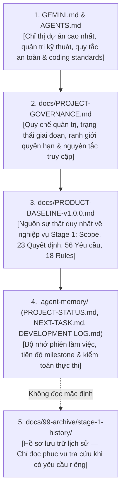

# SmartRestaurant — Quy Chế Quản Trị Dự Án & Ranh Giới Thẩm Quyền
## PROJECT-GOVERNANCE.md (Authoritative Governance & Lifecycle Charter)

- **Dự Án**: SmartRestaurant — Hệ Thống Quản Lý Vận Hành Nhà Hàng Độc Lập
- **Phiên Bản Quy Chế**: 1.0.0 (Official Governance Baseline)
- **Ngày Ban Hành**: 2026-11-10
- **Thẩm Quyền Phê Duyệt**: Chủ Dự Án (Project Owner)
- **Phạm Vi Áp Dụng**: Toàn bộ các phiên làm việc của AI Agent, Kỹ sư phần mềm, Solution Architect và thành viên dự án.

---

## 1. Trạng Thái Vòng Đời Dự Án (Lifecycle Stage Status)

Dự án SmartRestaurant được vận hành và kiểm soát nghiêm ngặt theo 7 giai đoạn vòng đời được thiết lập tại [GEMINI.md](../GEMINI.md):

| Giai Đoạn | Tên Giai Đoạn | Trạng Thái Quản Trị Hiện Hành | Quyền Hạn Thực Thi |
| :--- | :--- | :---: | :--- |
| **Giai Đoạn 1 (Stage 1)** | Khám Phá Sản Phẩm & Phân Tích Miền Nghiệp Vụ | **`OWNER-APPROVED (v1.0.0-FROZEN)`** | **ĐÃ NGHIỆM THU & NIÊM PHONG**. Toàn bộ yêu cầu nghiệp vụ, quy tắc bất biến và quyết định đã được Chủ Dự Án phê duyệt chính thức. |
| **Giai Đoạn 2 (Stage 2)** | Kiến Trúc Hệ Thống & Thiết Kế Kỹ Thuật | **`NOT AUTHORIZED / LOCKED`** | **CHƯA CẤP PHÉP / KHÓA CHẶT**. Tuyệt đối không khởi động nếu chưa có văn bản/chỉ thị riêng của Chủ Dự Án. |
| **Giai Đoạn 3 (Stage 3)** | Đặc Tả Module Chi Tiết & Data Models | `PENDING` | Chờ hoàn thành và nghiệm thu Stage 2. |
| **Giai Đoạn 4 (Stage 4)** | Kế Hoạch Triển Khai & Phân Kỳ Milestone | `PENDING` | Chờ nghiệm thu Stage 3. |
| **Giai Đoạn 5 (Stage 5)** | Triển Khai Mã Nguồn Theo Milestone | `PENDING` | Chờ nghiệm thu Stage 4. |
| **Giai Đoạn 6 (Stage 6)** | Kiểm Thử Chất Lượng & Đo Kiểm E2E | `PENDING` | Chờ hoàn thành Stage 5. |
| **Giai Đoạn 7 (Stage 7)** | Đóng Gói Triển Khai & Vận Hành Thử Nghiệm | `PENDING` | Chờ nghiệm thu Stage 6. |

---

## 2. Thẩm Quyền Độc Quyền Của Chủ Dự Án (Project Owner Authority)

Chủ Dự Án (Project Owner) là chủ thể duy nhất nắm giữ thẩm quyền quyết định cao nhất đối với toàn bộ dự án:
1. **Phê duyệt phạm vi sản phẩm (Product Scope)**: Toàn bộ phạm vi MVP, danh mục phân hệ Core/Optional, lộ trình phát hành (v1.1, v1.2+, v2.0) và các loại trừ phạm vi chỉ có hiệu lực khi có sự phê chuẩn chính thức của Chủ Dự Án.
2. **Ban hành và sửa đổi quy tắc nghiệp vụ**: Không có bất kỳ kỹ sư, kiến trúc sư hay AI Agent nào được quyền tự ý sửa đổi, bổ sung, hoặc loại bỏ các quy tắc nghiệp vụ bất biến (`BR-RULE-01..18`) và các bất biến cốt lõi (`INV-01..15`).
3. **Giải quyết các câu hỏi mở (Open Questions)**: Mọi quyết định nghiệp vụ còn mở chỉ được coi là đã chốt khi có lá phiếu biểu quyết chính thức của Chủ Dự Án.
4. **Thẩm quyền mở khóa chuyển tiếp giai đoạn (Gate Transition Authority)**: Chỉ có Chủ Dự Án mới có quyền ra quyết định chuyển tiếp từ Stage 1 sang Stage 2, hoặc mở khóa bất kỳ giai đoạn tiếp theo nào.

---

## 3. Ranh Giới & Giới Hạn Của AI Agent và Solution Architect (Limitations & Boundaries)

Mọi AI Agent, Pair Programmer và Solution Architect khi tham gia dự án bắt buộc phải tuân thủ các điều cấm sau:

1. **Tuyệt đối không tự cấp phép (No Self-Authorization)**:
   - Nghiêm cấm AI Agent tự ý tuyên bố Stage 2 đã mở khóa (`UNLOCKED`) hoặc tự ý bắt đầu thực hiện nhiệm vụ Task 03/Stage 2 khi Chủ Dự Án chưa yêu cầu bằng văn bản cụ thể.
2. **Phân định rạch ròi giữa Quyết định Nghiệp vụ và Đề xuất Kỹ thuật**:
   - Các giải pháp kỹ thuật do AI hoặc Solution Architect đề xuất (ví dụ: công nghệ canvas Konva.js `ADR-004`, cơ chế khóa dòng `RowVersion` vs `Append-Only Delta`, kiến trúc SignalR Mesh, cấu trúc khóa ngoại `OrganizationId`/`BranchId`) là **Đề xuất kỹ thuật (`PROPOSED / TECHNICAL INVESTIGATION`)**, tuyệt đối không được mạo nhận thành Quyết định nghiệp vụ của Chủ Dự Án.
   - Solution Architect không có quyền thay đổi quy tắc nghiệp vụ để phù hợp với giải pháp kỹ thuật cá nhân.
3. **Kỷ luật không viết mã sớm (No Premature Coding)**:
   - Trong các giai đoạn phân tích và thiết kế (Stage 1 đến Stage 4), nghiêm cấm tạo mã nguồn C# (`.cs`), scaffolding project .NET (`.csproj`, `.sln`), hoặc tạo schema database / EF Core migration (`.sql`).
   - Mọi nỗ lực tạo mã giả lập, stub, placeholder, hoặc `throw new NotImplementedException()` đều bị nghiêm cấm.
4. **Không tự suy diễn giả định (No Speculative Assumptions)**:
   - Khi gặp một yêu cầu hoặc tham số chưa rõ ràng, AI Agent phải gắn nhãn là `OPEN / UNRESOLVED / NEED OWNER INPUT` và dừng lại xin ý kiến, tuyệt đối không tự bịa đặt hoặc suy diễn yêu cầu.

---

## 4. Thứ Bậc Thẩm Quyền Tài Liệu & Nguồn Sự Thật (Source of Truth Hierarchy)

Để tránh hiện tượng mâu thuẫn chéo giữa các văn bản, thứ bậc thẩm quyền tài liệu được thiết lập chặt chẽ như sau:

- **Quy tắc Nguồn Sự Thật Nghiệp Vụ Duy Nhất**:
  Tệp [**`docs/PRODUCT-BASELINE-v1.0.0.md`**](./PRODUCT-BASELINE-v1.0.0.md) là **nguồn sự thật nghiệp vụ duy nhất (Sole Active Product Specification)** cho toàn bộ Giai đoạn 1. Mọi tài liệu đặc tả tiền thân, bản thảo sơ khai, hoặc báo cáo phân tích trước đây đều bị thay thế bởi tệp này.
- **Xử lý xung đột tài liệu**:
  Nếu có sự khác biệt giữa một tài liệu lưu trữ cũ và `PRODUCT-BASELINE-v1.0.0.md`, nội dung trong `PRODUCT-BASELINE-v1.0.0.md` là quyết định cuối cùng có hiệu lực.

---

## 5. Quy Tắc Xử Lý Các Quyết Định Chưa Chốt (Unresolved Decision Handling Rules)

Đối với các nội dung chưa được Chủ Dự Án phê duyệt chính thức:

1. **Nguyên tắc Minh Bạch Trạng Thái**:
   - Tất cả các chủ đề kỹ thuật cần nghiên cứu phải được đánh mã rõ ràng (`TECH-01` đến `TECH-07`) và mang nhãn `OPEN / TECHNICAL INVESTIGATION`.
   - Cụ thể: Điểm kích hoạt trừ tồn kho thực tế (**`TECH-02`**) được duy trì trạng thái **`UNRESOLVED / OPEN`** giao Solution Architect đánh giá ở Stage 2, không tự ý ấn định vào trạng thái `ReadyToServe` hay `OrderFired`.
2. **Quy tắc Bảo Tồn Finding Kiểm Toán**:
   - Finding **`AUDIT-02.9.3-F-01`**: Nhận định rằng không bắt buộc mọi entity CSDL phải có cả `OrganizationId` và `BranchId`; việc phân vùng dữ liệu do Solution Architect đề xuất trong Stage 2.
   - Finding **`AUDIT-02.9.3-F-02`**: Ghi nhận tham số chi tiết của 3 Onboarding Presets (`OD-16`) là giá trị gợi ý ban đầu do AI/BA đề xuất, không phải quyết định bắt buộc bất biến của Owner.

---

## 6. Quy Tắc Truy Cập Hồ Sơ Lưu Trữ Lịch Sử (Archive Access Policy)

Toàn bộ các báo cáo thực thi nhiệm vụ, biên bản kiểm toán độc lập và tài liệu bản thảo cũ được đóng gói lưu trữ tại thư mục:
`docs/99-archive/stage-1-history/`

### Các Điều Khoản Bắt Buộc Dành Cho AI Agent:
1. **Nghiêm Cấm Quét Đệ Quy Mặc Định (No Default Recursive Scan)**:
   - Trong quá trình thực hiện các nhiệm vụ thông thường, AI Agent **TUYỆT ĐỐI KHÔNG ĐƯỢC ĐỌC** các tệp nằm trong `docs/99-archive/`.
   - Không được đưa nội dung tệp lưu trữ vào ngữ cảnh làm việc để tránh lãng phí token và gây ô nhiễm thông tin (context contamination).
2. **Tài Liệu Lưu Trữ Không Phải Là Yêu Cầu Hiện Hành**:
   - Nghiêm cấm trích dẫn các tài liệu lưu trữ để suy luận hoặc áp đặt yêu cầu cho các giai đoạn tiếp theo. Chỉ có `PRODUCT-BASELINE-v1.0.0.md` mới có giá trị pháp lý nghiệp vụ.
3. **Trường Hợp Ngoại Lệ Duy Nhất Để Truy Cập Archive**:
   - AI Agent chỉ được phép mở và đọc tài liệu trong `docs/99-archive/` khi và chỉ khi **Chủ Dự Án đưa ra câu lệnh rõ ràng** yêu cầu điều tra pháp y, đối soát lại lịch sử biểu quyết hoặc tra cứu bằng chứng kiểm toán cụ thể.
4. **Nguyên Tắc Bảo Toàn Bất Biến (Tamper-Evident Immutability)**:
   - Toàn bộ hồ sơ lưu trữ trong `docs/99-archive/` là tài sản lịch sử ở chế độ **CHỈ ĐỌC (STRICT READ-ONLY)**. Nghiêm cấm sửa đổi, ghi đè hoặc xóa bỏ bất kỳ tệp lưu trữ nào.

---
*Văn bản Quy chế Quản trị Dự án SmartRestaurant được niêm phong và bảo vệ bởi Bộ Chỉ Thị GEMINI.md.*
