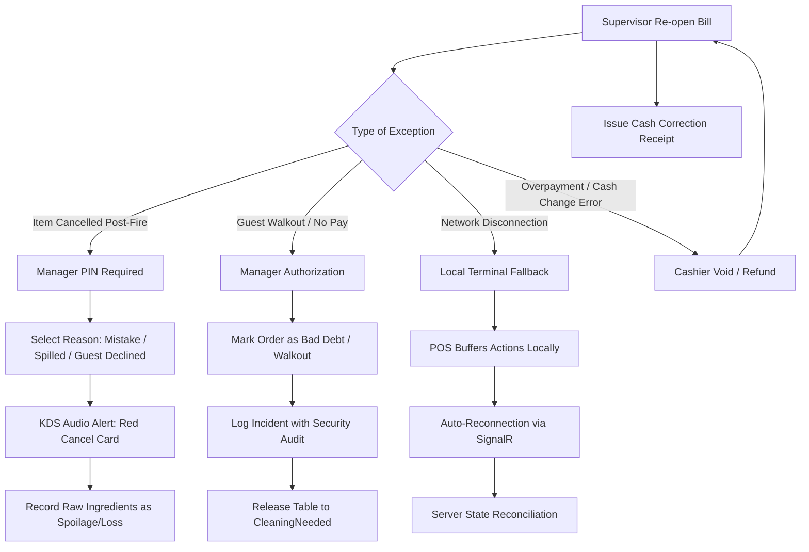

# Business Requirements Specification (BRS) — SmartRestaurant

- **Document Version**: 1.0.0
- **Document Status**: `PROPOSED`
- **Related Documents**: [PRD.md](./PRD.md), [MODULE-OVERVIEW.md](./MODULE-OVERVIEW.md), [DOMAIN-GLOSSARY.md](./DOMAIN-GLOSSARY.md)

---

## 1. Business Actors & Permission Matrix

| Role | Scope & Operational Authority | Key Business Capabilities |
| :--- | :--- | :--- |
| **Franchise / System Owner** | Enterprise Organization | Global tenant management, brand catalog templates, branch creation. |
| **Restaurant Manager** | Branch / Restaurant | Floor plan visual design, price editing, discount approval, void authorization, staff shifts, daily sales auditing. |
| **Floor Captain / Head Waiter** | Dining Areas & Tables | Table reservations, seating allocation, table merges/splits, high-priority order escalation. |
| **Waiter / Server** | Assigned Tables & FOH | Touch order creation, adding dish modifiers, sending orders to kitchen, printing pre-bills, table service alerts. |
| **Head Chef / Kitchen Lead** | Kitchen Departments | Station ticket queue monitoring, expediter coordination, ingredient 86-ing (marking unavailable), prep time monitoring. |
| **Line Cook / Kitchen Staff** | Designated Kitchen Station | Acknowledging incoming tickets, updating prep states (`Cooking` $\rightarrow$ `ReadyToServe`), reporting cooking errors. |
| **Bartender / Barista** | Bar & Beverage Station | Managing drink queues, recipe adherence, updating drink readiness. |
| **Runner / Expediter** | Pass / Kitchen Window | Coordinating multi-course completion, picking up finished dishes, matching tickets to table runners. |
| **Cashier** | Cash Drawer & Settlement | Applying bill discounts, processing payments (Cash, Card, VietQR), splitting/merging invoices, daily cash reconciliation. |
| **Stockkeeper / Inventory Staff** | Restaurant Warehouse | Inward inventory receipts, supplier tracking, recipe BOM audits, waste/spoilage logging. |

---

## 2. Granular Functional Requirements by Business Domain

### 2.1. Domain 01: Restaurant Setup, Areas & Floor Plan
- **BR-AREA-001 (Multi-Area Hierarchy)**: A restaurant branch must support multiple distinct dining areas (e.g., Indoor Ground Floor, Garden Terrace, Rooftop Lounge, Basement Wine Cellar).
- **BR-AREA-002 (Rooms & VIP Enclosures)**: Within an area, the system must support independent rooms (e.g., Room 101, Banquet Hall) and dedicated VIP suites (e.g., VIP 1, VIP 2, VIP 3).
- **BR-AREA-003 (Visual 2D Floor Plan Canvas)**:
  - Managers must be able to design floor plans using an interactive drag-and-drop canvas.
  - Supports configurable table geometries: Round (2, 4, 8 seats), Rectangular (2, 4, 6, 8, 10 seats), Square (2, 4 seats), and L-shaped / Booth seating.
  - Supports architectural obstacles: Pillars, interior walls, service counters, doors, and walkways to mirror physical reality accurately.
- **BR-AREA-004 (Whole Room / Area Booking)**:
  - The system must allow booking or occupying an entire room or area for private corporate events or banquets, automatically locking all child tables from walk-in assignment.
- **BR-AREA-005 (Table Status Real-Time Visualization)**:
  - Table nodes on the floor plan must dynamically display color-coded status badges:
    - `Available` (Green / Neutral): Ready for new guest seating.
    - `Reserved` (Blue): Reserved for upcoming party with arrival countdown.
    - `Occupied` (Yellow / Amber): Guests seated, active order in progress.
    - `BillingRequested` (Purple): Pre-bill printed, guests awaiting payment settlement.
    - `CleaningNeeded` (Orange): Bill settled, guests departed, awaiting sanitization.
    - `OutOfService` (Gray): Broken furniture, maintenance, or closed section.

### 2.2. Domain 02: Menu Catalog, Modifiers & Kitchen Station Mapping
- **BR-MENU-001 (Category Structure)**: Multi-level hierarchy (Category $\rightarrow$ Subcategory $\rightarrow$ Dish/Beverage) with custom sorting orders and display icons.
- **BR-MENU-002 (Product Variants & Sizes)**:
  - Standard items can have portion size variants (e.g., Small, Medium, Large; 0.5kg vs 1.0kg) with variant-specific pricing and SKUs.
- **BR-MENU-003 (Modifier Groups & Add-ons)**:
  - **Single-choice required** (e.g., Choose noodle type: Pho / Egg noodle).
  - **Multi-choice optional with min/max caps** (e.g., Toppings: Choose min 0, max 3 from 10 choices).
  - **Cooking attributes**: Sugar levels (0%, 30%, 50%, 100%), Ice levels (No ice, Less ice, Normal), Spicy levels (Mild, Medium, Hot, Extra hot).
  - **Allergen flags**: Gluten-free, Peanuts, Shellfish, Dairy.
- **BR-MENU-004 (Dynamic Station Routing Rule)**:
  - Every dish item must be bound to a target kitchen department (`HotKitchen`, `ColdKitchen`, `BarStation`, `BakeryStation`).
  - Items can have override routing rules based on variant (e.g., Bottled Beer $\rightarrow$ Waiter Pickup Station; Cocktail $\rightarrow$ Bar Station).
- **BR-MENU-005 (Stock Availability & 86-ing)**:
  - Kitchen leads or managers can mark any dish as `Temporarily Unavailable` (86-ed).
  - Unavailable dishes immediately lock on all waiter tablets and POS screens with visual disabled styling to prevent taking unavailable orders.

### 2.3. Domain 03: POS, Order Capture & Table Service
- **BR-ORD-001 (Session Initialization)**: Seating guests on an `Available` table creates a distinct `DiningSession` with customer headcount and server attribution.
- **BR-ORD-002 (Order Composition & Draft Cart)**:
  - Servers compose orders via touch grid, searching by dish name, abbreviation (e.g., "BCT" for Bò Cuộn Tiêu), or category.
  - Adding modifiers, free-form special notes (e.g., "less salt for elderly guest"), and customer-specific allergies.
- **BR-ORD-003 (Firing Order to Kitchen)**:
  - On tapping "Send to Kitchen" (Fire), the draft cart items are validated, committed to the database, and dispatched via SignalR to target KDS stations.
- **BR-ORD-004 (Incremental / Additional Orders)**:
  - Guests can order additional rounds of drinks, dishes, or desserts at any time.
  - New items append to the active dining session as Round 2, Round 3, etc., preserving ticket timestamps and routing independently without modifying previously cooked dishes.
- **BR-ORD-005 (Table Operations — Move & Merge)**:
  - **Table Move**: Server transfers active session from Table 12 to Table 15 (e.g., guest moves from indoor to outdoor terrace). All unbilled items, KDS tickets, and pre-bills carry over seamlessly.
  - **Table Merge**: Combine Table 4 and Table 5 into a single master order (e.g., two parties joining together). Sub-tickets merge into one consolidated billing account.
- **BR-ORD-006 (Multi-Table Orders)**:
  - A single large banquet party can occupy multiple physical tables (e.g., Tables 21, 22, and 23) under a unified dining session and single master bill.

### 2.4. Domain 04: Kitchen Display System (KDS) & Prep Routing
- **BR-KDS-001 (Automated Ticket Decomposition)**:
  - When Order #104 contains (2x Steak, 1x Caesar Salad, 2x Cocktails), the system splits the order:
    - Hot Kitchen KDS receives: `2x Steak`.
    - Cold Station KDS receives: `1x Caesar Salad`.
    - Bar KDS receives: `2x Cocktails`.
    - Master Expediter KDS receives all 5 items with table location (#12).
- **BR-KDS-002 (KDS Ticket Lifecycle States)**:
  - Line items progress through strictly defined operational states:
    - `Pending`: Placed by server; awaiting chef pickup.
    - `Cooking`: Chef has started active preparation.
    - `ReadyToServe`: Placed at pickup window / pass; runner alerted.
    - `Served`: Delivered to guest table; cleared from active KDS queue.
- **BR-KDS-003 (SLA Wait-Time Alerts & Color Thresholds)**:
  - Every kitchen card tracks active elapsed minutes since firing:
    - **Green Badge**: Elapsed time $< 10$ minutes.
    - **Yellow Badge**: Elapsed time $10 - 20$ minutes.
    - **Red / Flashing Alert**: Elapsed time $> 20$ minutes (Overdue SLA breach).
- **BR-KDS-004 (Course Firing & Hold)**:
  - Waiters can mark specific items as "Hold" (e.g., Dessert held until mains are cleared). Held items appear greyed out on KDS until the server explicitly taps "Fire Next Course".

### 2.5. Domain 05: Cashier, Billing & Multi-Channel Payments
- **BR-BIL-001 (Bill Calculation Engine)**:
  $$\text{Item Total} = \sum (\text{Base Price} + \text{Modifiers}) \times \text{Quantity}$$
  $$\text{Subtotal} = \sum \text{Item Totals} - \text{Item-Level Discounts}$$
  $$\text{Discounted Amount} = \text{Subtotal} - \text{Order-Level Voucher}$$
  $$\text{Service Charge} = \text{Discounted Amount} \times \text{ServiceChargeRate (e.g., 5\%)}$$
  $$\text{Tax Base} = \text{Discounted Amount} + \text{Service Charge}$$
  $$\text{VAT Tax} = \text{Tax Base} \times \text{VAT Rate (e.g., 8\% or 10\%)}$$
  $$\text{Final Payable Amount} = \text{Tax Base} + \text{VAT Tax} + \text{Surcharges}$$
- **BR-BIL-002 (Bill Splitting Modes)**:
  - **Split by Selected Items**: Move item A & B to Bill 1, item C & D to Bill 2. Taxes and discounts re-calculate proportionally on each split bill.
  - **Split Evenly (Equal Divide)**: Total payable amount divided by $N$ equal parts (e.g., 4 guests splitting a 1,200,000 VND bill pay 300,000 VND each).
- **BR-BIL-003 (Multi-Tender Payments)**:
  - A bill can be settled using multiple payment methods (e.g., 500,000 VND Cash + 700,000 VND VietQR transfer).
- **BR-BIL-004 (VietQR Automated Integration)**:
  - Display dynamic VietQR payload (Bank Bin, Account No, Exact Amount, Unique Payment Reference Code).
  - Cashier screen confirms payment upon verified transaction callback or cashier manual check.
- **BR-BIL-005 (Cash Drawer & Shift Operations)**:
  - Mandatory Shift Open: Cashier inputs opening float (e.g., 2,000,000 VND change fund).
  - Shift Close: Cashier performs blind drop cash count; system generates discrepancy analysis ($\text{Expected} - \text{Actual}$) and prints Z-Report.

### 2.6. Domain 06: Vietnamese Market Localization & Printing Compliance
- **BR-LOC-001 (100% Vietnamese Interface)**:
  - All FOH, BOH, Cashier, and Admin screens must display natural, professional Vietnamese adhering strictly to [VIETNAMESE-LOCALIZATION-STANDARD.md](./VIETNAMESE-LOCALIZATION-STANDARD.md).
- **BR-LOC-002 (Vietnam Regional Formats)**:
  - Currency displayed in VND formatted as `#,,### ₫` (no decimal cents).
  - Date formatted as `dd/MM/yyyy`, time formatted in 24h `HH:mm:ss`, timezone fixed to `Asia/Ho_Chi_Minh` (UTC+7).
- **BR-LOC-003 (Thermal Bill Printing Standards)**:
  - Pre-bills ("Phiếu tạm tính") and final VAT invoices ("Hóa đơn thanh toán") must print with full Vietnamese diacritics via UTF-8 ESC/POS (with CodePage 1258 and unaccented ASCII fallback).
- **BR-LOC-004 (E-Invoice Phase-In Readiness)**:
  - Invoices must structure customer tax metadata (Company Name, Tax Code / Mã số thuế, Address, Email) to enable seamless connection to Vietnamese E-Invoice providers (Thông tư 78/Nghị định 123) in post-MVP releases.

---

## 3. Explicit Business Rules & Validation Policies

| Rule ID | Domain | Business Rule Statement | Enforcement Level |
| :--- | :--- | :--- | :--- |
| **BR-RULE-01** | Table Management | A table cannot be assigned to a new guest session if its status is `Occupied`, `BillingRequested`, or `CleaningNeeded`. | Hard System Block |
| **BR-RULE-02** | Order Amendments | Once an item state is `Cooking` or `ReadyToServe`, a waiter CANNOT delete or cancel it without Manager PIN override and a mandatory cancellation reason. | Manager Authorization |
| **BR-RULE-03** | Waste Attribution | Any item cancelled after entering `Cooking` state MUST be logged to the kitchen Waste Register (BOM deduction still applies as loss). | Automatic Compliance |
| **BR-RULE-04** | Table Transfer | A table transfer is rejected if the destination table is currently occupied by an active session. | Hard System Block |
| **BR-RULE-05** | Discount Stacking | Item-level promotional discounts cannot stack with an order-level percentage voucher unless explicitly enabled in restaurant settings. | Configurable Policy |
| **BR-RULE-06** | Checkout Lock | When a table enters `BillingRequested` status, server tablets cannot add additional dishes unless cashier unlocks the table back to `Occupied`. | Concurrency Guard |
| **BR-RULE-07** | Shift Closure | A cashier cannot close their active shift if there are unpaid open bills initiated by that cashier's terminal. | Hard System Block |

---

## 4. Exceptional Business Workflows & Error Handling

1. **Kitchen Item Cancellation Post-Fire**:
   - If a customer cancels a dish while it is already being cooked, the waiter triggers "Cancel Item".
   - The UI prompts for Manager PIN and a cancellation reason code (e.g., "Guest changed mind", "Kitchen delay exceeded 30 mins", "Food burnt/spoiled").
   - A flashing red cancellation notification appears on the relevant KDS station so the cook immediately stops preparing the dish.
   - The dish is removed from the guest's bill, but its recipe BOM is logged into the `WasteLog` table as kitchen loss.
2. **Customer Walkout (Unpaid Bill)**:
   - If guests leave without paying, the cashier cannot simply delete the order.
   - Manager must approve the incident, classifying the order as `Walkout / Bad Debt`. The table resets to `CleaningNeeded`, and the loss is attributed to the restaurant's operational loss report.
3. **Local Network Dropouts**:
   - In the event of Wi-Fi failure, client terminals buffer transactions in browser local storage.
   - Upon SignalR reconnection, the client issues a synchronization handshake with the server to prevent duplicate ticket generation.
