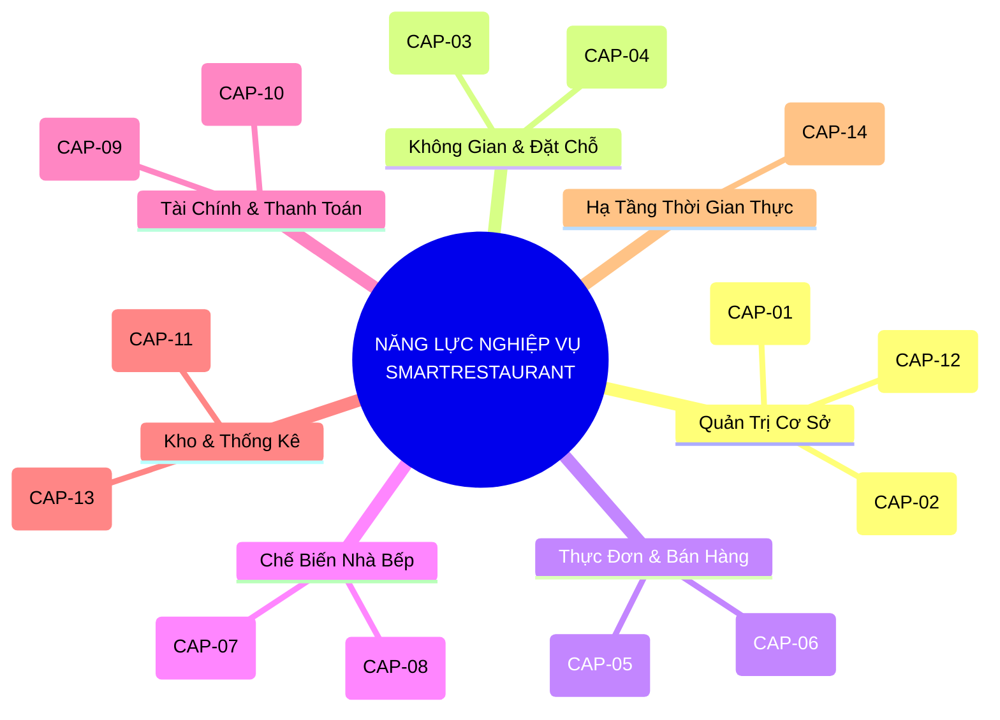
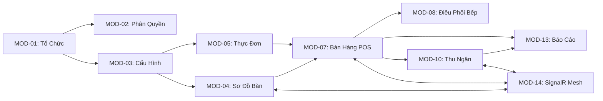

# Hồ Sơ Cơ Sở Phân Hệ & Bản Đồ Năng Lực Nghiệp Vụ (Module Capability Baseline)
## DỰ ÁN SMARTRESTAURANT — GIAI ĐOẠN 1 (STAGE 1 BASELINE)

- **Dự Án**: SmartRestaurant — Hệ Thống Quản Lý Vận Hành Nhà Hàng Độc Lập
- **Mã Tài Liệu**: `MODULE-CAPABILITY-BASELINE`
- **Phiên Bản Cơ Sở**: `v1.0.0-FROZEN`
- **Trạng Thái Quản Trị**: `OWNER-CONFIRMED & SEALED`
- **Tài Liệu Căn Cứ**: [`MODULE-OVERVIEW.md`](./MODULE-OVERVIEW.md), [`MODULE-CONFIGURATION-AND-FEATURE-MANAGEMENT.md`](./MODULE-CONFIGURATION-AND-FEATURE-MANAGEMENT.md), [`OWNER-DECISION-WORKSHOP.md`](./OWNER-DECISION-WORKSHOP.md), [`TASK-02.8.6-OWNER-DECISION-IMPLEMENTATION-REPORT.md`](./TASK-02.8.6-OWNER-DECISION-IMPLEMENTATION-REPORT.md)

---

## 1. Bản Đồ 14 Nhóm Năng Lực Nghiệp Vụ (Business Capability Map)

Hệ thống được ánh xạ đầy đủ theo 14 nhóm năng lực nghiệp vụ nền tảng:

| Mã Năng Lực | Nhóm Năng Lực Nghiệp Vụ | Mô Tả Giá Trị Nghiệp Vụ | Phân Hệ Phụ Trách | Trạng Thái Phê Duyệt |
| :---: | :--- | :--- | :---: | :---: |
| **CAP-01** | Store & Business Configuration | Thiết lập thông tin pháp lý nhà hàng, giờ mở/đóng cửa, giờ cắt ngày kinh doanh 06:00, hồ sơ thuế VAT và định dạng tiền tệ địa phương VNĐ. | `MOD-01`, `MOD-03` | `OWNER-CONFIRMED` |
| **CAP-02** | User, Role & Permission (RBAC) | Quản lý định danh nhân viên, tài khoản, gán vai trò theo ma trận phân quyền, xác thực mã PIN bảo mật cho bồi bàn và thu ngân. | `MOD-02` | `OWNER-CONFIRMED` |
| **CAP-03** | Floor Plan & Table Management | Quản lý sơ đồ mặt bằng 2D tương tác Konva.js, bố cục phân cấp Khu vực $\rightarrow$ Phòng $\rightarrow$ Bàn, đổi màu trạng thái bàn và phụ thu phòng VIP. | `MOD-04` | `OWNER-CONFIRMED` |
| **CAP-04** | Table Reservation Management | Quản lý danh sách đặt bàn trước, tiền đặt cọc, đếm ngược giờ khách đến và tự động liên kết phiên bàn khi khách tới (`OD-15`). | `MOD-06` | `OWNER-CONFIRMED` |
| **CAP-05** | Menu & Product Catalog | Quản lý danh mục món ăn phân cấp, biến thể khẩu phần (S/M/L), nhóm tùy chọn (bắt buộc/tự do) và phân tuyến phục vụ trực tiếp quầy FOH. | `MOD-05` | `OWNER-CONFIRMED` |
| **CAP-06** | POS & Order Management | Giao diện gọi món cảm ứng tại bàn, đợt gọi món, gọi món đồng thời không khóa bàn, bàn tạm tính vẫn cho phép sửa/thêm món. | `MOD-07` | `OWNER-CONFIRMED` |
| **CAP-07** | Kitchen Routing Dispatcher | Phân tách đơn gọi món của bàn thành các phiếu chế biến riêng biệt cho từng trạm bếp mục tiêu (Bếp Nóng, Bếp Nguội, Bar, Nướng). | `MOD-08` | `OWNER-CONFIRMED` |
| **CAP-08** | Kitchen Display System (KDS) | Hàng đợi đơn món cảm ứng không dùng giấy tại các trạm bếp, đồng hồ SLA đếm ngược, quy trình làm lại món do lỗi bếp và chuông báo. | `MOD-09` | `OWNER-CONFIRMED` |
| **CAP-09** | Cashier & Billing | In phiếu tạm tính, tách hóa đơn theo món và chia đều $1/N$, tính phụ thu phòng VIP, hóa đơn đã đóng bất biến và kiểm tiền mù chốt ca Z. | `MOD-10` | `OWNER-CONFIRMED` |
| **CAP-10** | Payment & Reconciliation | Tự động tạo mã VietQR động Napas 24/7, nhận webhook thanh toán, dự phòng chuyển tiền mặt và sổ treo đối soát giao dịch đến muộn. | `MOD-11` | `OWNER-CONFIRMED` |
| **CAP-11** | Inventory & Waste Management | Khóa tồn kho 2 bước (`Khả dụng = Thực tế - Tạm giữ`) cho món đếm được, tự động khóa hết món (86), ghi nhận hao phí hủy món vào `WasteLog`. | `MOD-12` | `OWNER-CONFIRMED` |
| **CAP-12** | Staff Management & PIN Approval | Ủy quyền quản lý duyệt hủy món đang nấu, duyệt chiết khấu, mở két tiền khẩn cấp và lưu vết nhật ký kiểm toán ca làm việc. | `MOD-02` | `OWNER-CONFIRMED` |
| **CAP-13** | Reporting & Business Analytics | Tổng hợp doanh thu theo ngày kinh doanh, báo cáo ca thu ngân, phân tích nhóm món bán chạy và theo dõi chênh lệch két tiền mặt. | `MOD-13` | `OWNER-CONFIRMED` |
| **CAP-14** | Real-Time Synchronization | Đồng bộ hóa dữ liệu thời gian thực dưới 500ms giữa POS, KDS và Sơ đồ bàn, đệm dữ liệu cục bộ khi mất mạng và tự động bắt tay kết nối lại. | `MOD-14` | `OWNER-CONFIRMED` |

---

## 2. Đặc Tả Chi Tiết 14 Phân Hệ Nghiệp Vụ (Module Specifications)

### 2.1. Nhóm 10 Phân Hệ Cốt Lõi Bắt Buộc (Core Mandatory Modules — Luôn Luôn Bật)

#### MOD-01: Quản Trị Tổ Chức & Điểm Bán (Organization & Store Identity)
- **Năng lực nghiệp vụ**: CAP-01.
- **Trách nhiệm chính**: Thiết lập hồ sơ pháp lý nhà hàng, giờ mở/đóng cửa, điểm neo dữ liệu đa khách thuê.
- **Thực thể dữ liệu**: `Organization`, `Branch`, `OperatingHours`.
- **Phụ thuộc**: Không có (Phân hệ gốc).
- **Cơ chế thoát êm dịu (Graceful Drain)**: Không áp dụng (Không thể tắt).

#### MOD-02: Phân Quyền & Mã PIN Nhân Viên (User, RBAC & Staff PIN)
- **Năng lực nghiệp vụ**: CAP-02, CAP-12.
- **Trách nhiệm chính**: Xác thực nhân viên, đăng nhập nhanh bằng PIN 4 số, ủy quyền Quản lý duyệt hủy/chiết khấu.
- **Thực thể dữ liệu**: `User`, `Role`, `Permission`, `ManagerPinAudit`.
- **Phụ thuộc**: `MOD-01`.
- **Cơ chế thoát êm dịu (Graceful Drain)**: Không áp dụng (Không thể tắt).

#### MOD-03: Cấu Hình Hệ Thống & Thuế (System Configuration & Tax)
- **Năng lực nghiệp vụ**: CAP-01.
- **Trách nhiệm chính**: Quản lý giờ chốt ngày kinh doanh (`06:00:00`), hồ sơ thuế VAT (8%/10%), thuế phí dịch vụ (`IsServiceChargeTaxable: true`), định dạng VNĐ.
- **Thực thể dữ liệu**: `RestaurantSetting`, `TaxProfile`, `SurchargeRule`.
- **Phụ thuộc**: `MOD-01`.
- **Cơ chế thoát êm dịu (Graceful Drain)**: Không áp dụng (Không thể tắt).

#### MOD-04: Sơ Đồ Bàn, Phòng & Khu Vực (Dining Areas & Floor Plan)
- **Năng lực nghiệp vụ**: CAP-03.
- **Trách nhiệm chính**: Quản lý không gian 2D Konva.js, phân cấp Khu vực $\rightarrow$ Phòng $\rightarrow$ Bàn, vòng đời trạng thái bàn ăn, phụ phí phòng VIP.
- **Thực thể dữ liệu**: `DiningArea`, `DiningRoom`, `DiningTable`, `TableSession`.
- **Phụ thuộc**: `MOD-01`, `MOD-03`.
- **Cơ chế thoát êm dịu (Graceful Drain)**: Không áp dụng (Không thể tắt).

#### MOD-05: Thực Đơn & Nhóm Tùy Chọn (Menu Catalog & Modifiers)
- **Năng lực nghiệp vụ**: CAP-05.
- **Trách nhiệm chính**: Danh mục món ăn phân cấp, khẩu phần, nhóm tùy chọn món, cờ lấy ngay `DirectFOHPick`.
- **Thực thể dữ liệu**: `MenuCategory`, `MenuItem`, `ModifierGroup`, `ModifierOption`.
- **Phụ thuộc**: `MOD-01`.
- **Cơ chế thoát êm dịu (Graceful Drain)**: Không áp dụng (Không thể tắt).

#### MOD-07: Bán Hàng POS & Đơn Hàng (POS Order Capture & Session)
- **Năng lực nghiệp vụ**: CAP-06.
- **Trách nhiệm chính**: Giao diện cảm ứng phục vụ tại bàn, đợt gọi món, gọi món đồng thời không khóa bàn, bàn tạm tính cho phép sửa món.
- **Thực thể dữ liệu**: `Order`, `OrderRound`, `OrderItem`, `OrderItemModifier`.
- **Phụ thuộc**: `MOD-02`, `MOD-04`, `MOD-05`.
- **Cơ chế thoát êm dịu (Graceful Drain)**: Không áp dụng (Không thể tắt).

#### MOD-08: Động Cơ Điều Phối Bếp (Order Routing Dispatcher)
- **Năng lực nghiệp vụ**: CAP-07.
- **Trách nhiệm chính**: Phân tách đơn món thành các phiếu chế biến theo từng trạm bếp/bar mục tiêu.
- **Thực thể dữ liệu**: `RoutingRule`, `StationTicket`, `StationTicketItem`.
- **Phụ thuộc**: `MOD-05`, `MOD-07`.
- **Cơ chế thoát êm dịu (Graceful Drain)**: Không áp dụng (Không thể tắt).

#### MOD-10: Thu Ngân, Tính Tiền & Hóa Đơn (Billing, Payment & Cashier Desk)
- **Năng lực nghiệp vụ**: CAP-09.
- **Trách nhiệm chính**: In tạm tính, tách bill theo món & chia đều $1/N$, đa phương thức thanh toán, hóa đơn đã đóng bất biến, chốt ca kiểm tiền mù.
- **Thực thể dữ liệu**: `Invoice`, `InvoiceItem`, `CashDrawerShift`, `ShiftClosingVarianceLog`.
- **Phụ thuộc**: `MOD-03`, `MOD-07`.
- **Cơ chế thoát êm dịu (Graceful Drain)**: Không áp dụng (Không thể tắt).

#### MOD-13: Báo Cáo Doanh Thu & Bán Hàng (Sales Analytics)
- **Năng lực nghiệp vụ**: CAP-13.
- **Trách nhiệm chính**: Doanh thu ngày kinh doanh, Báo cáo Z chốt ca, phân tích mặt hàng bán chạy, chênh lệch quỹ két.
- **Thực thể dữ liệu**: `DailySalesSummary`, `ShiftSummaryReport`, `ItemSalesAnalytics`.
- **Phụ thuộc**: `MOD-07`, `MOD-10`.
- **Cơ chế thoát êm dịu (Graceful Drain)**: Không áp dụng (Không thể tắt).

#### MOD-14: Trục Đồng Bộ Thời Gian Thực (Real-Time SignalR Event Mesh)
- **Năng lực nghiệp vụ**: CAP-14.
- **Trách nhiệm chính**: Phát sóng sự kiện thời gian thực dưới 500ms, đồng bộ màu bàn, chuông báo xong món, bắt tay kết nối lại.
- **Thực thể dữ liệu**: `HubConnection`, `ClientSubscription`, `SignalREventEnvelope`.
- **Phụ thuộc**: Hạ tầng dùng chung.
- **Cơ chế thoát êm dịu (Graceful Drain)**: Không áp dụng (Không thể tắt).

---

### 2.2. Nhóm 4 Phân Hệ Nghiệp Vụ Tùy Chọn (MVP Optional Modules — Bật/Tắt Linh Hoạt)

#### MOD-06: Quản Lý Đặt Bàn Trước (Table Reservation — OD-15)
- **Năng lực nghiệp vụ**: CAP-04.
- **Trách nhiệm chính**: Tiếp nhận khách hẹn, giữ cọc, đếm ngược giờ đến, chuyển đổi sang phiên bàn ăn.
- **Thực thể dữ liệu**: `Reservation`, `DepositRecord`, `CustomerProfile`.
- **Phụ thuộc**: `MOD-04` (Sơ đồ bàn).
- **Hành vi khi BẬT**: Sơ đồ bàn hiển thị nhãn đếm ngược giờ hẹn; bàn đặt được khóa chống xếp khách vãng lai.
- **Hành vi khi TẮT**: Ẩn tab Đặt bàn khỏi POS/Admin. Không phát cảnh báo đặt bàn.
- **Chính sách Thoát Êm Dịu (Graceful Drain — OD-17)**: Khi tắt, hệ thống cảnh báo danh sách lịch hẹn trong tương lai để Quản lý chọn giữ lại đón tay hoặc hủy báo khách; không khóa cứng hệ thống; dữ liệu lịch sử lưu giữ Read-Only.

#### MOD-09: Màn Hình Bếp Điện Tử (Digital KDS — OQ-02)
- **Năng lực nghiệp vụ**: CAP-08.
- **Trách nhiệm chính**: Hàng đợi đơn món cảm ứng không dùng giấy tại trạm bếp, đồng hồ SLA, làm lại món.
- **Thực thể dữ liệu**: `KdsScreen`, `KdsTicket`, `KitchenPerformanceLog`.
- **Phụ thuộc**: `MOD-08` (Điều phối bếp), `MOD-14` (SignalR).
- **Hành vi khi BẬT**: Đầu bếp thao tác trên màn hình cảm ứng; mặc định `AutoPrintOnFire: false`.
- **Hành vi khi TẮT**: Tự động chuyển hướng toàn bộ lệnh báo bếp ra máy in nhiệt giấy ESC/POS vật lý (`AutoPrintOnFire: true`).
- **Chính sách Thoát Êm Dịu (Graceful Drain — OD-17)**: Nấu nốt các phiếu đang dở hoặc hủy ghi nhận hao phí; dữ liệu hiệu suất bếp cũ lưu giữ Read-Only.

#### MOD-11: Cổng Thanh Toán VietQR Tự Động (VietQR Gateway — PDR-008)
- **Năng lực nghiệp vụ**: CAP-10.
- **Trách nhiệm chính**: Sinh mã VietQR động Napas 24/7, nhận webhook ngân hàng, xử lý webhook đến muộn vào Sổ Treo.
- **Thực thể dữ liệu**: `VietQrPaymentRequest`, `NapasWebhookLog`, `SuspenseLedger`.
- **Phụ thuộc**: `MOD-10` (Thu ngân & Hóa đơn), `MOD-14` (SignalR).
- **Hành vi khi BẬT**: Thu ngân hiển thị QR động trên màn hình phụ; ngân hàng tự động xác nhận; xử lý webhook đến muộn.
- **Hành vi khi TẮT**: Ẩn nút VietQR; thu ngân chỉ thu tiền mặt, quẹt thẻ máy ngoài hoặc chuyển khoản chụp ủy nhiệm chi thủ công.
- **Chính sách Thoát Êm Dịu (Graceful Drain — OD-17)**: Chờ các giao dịch đang hiển thị hoàn tất hoặc chuyển tiền mặt; tác vụ nền thăm dò tự động dừng êm dịu; sổ treo đối soát cũ giữ Read-Only.

#### MOD-12: Quản Lý Tồn Kho Món Đếm Được (Countable Stock & Waste — PDR-004)
- **Năng lực nghiệp vụ**: CAP-11.
- **Trách nhiệm chính**: Khóa tồn kho 2 bước cho chai/lon/khẩu phần, cảnh báo hết món (86), ghi sổ hao phí hủy món `WasteLog`.
- **Thực thể dữ liệu**: `StockItem`, `StockTransaction`, `StockReservation`, `WasteLog`.
- **Phụ thuộc**: `MOD-05` (Thực đơn), `MOD-07` (Đơn hàng).
- **Hành vi khi BẬT**: Hệ thống chống bán âm kho; tự động khóa món hết (86); ghi nhận lỗi bếp vào Sổ Hủy Hỏng.
- **Hành vi khi TẮT**: POS loại bỏ bước kiểm tra tồn khả dụng, bếp báo hết miệng thủ công; dữ liệu xuất nhập tồn cũ giữ nguyên chỉ đọc.
- **Chính sách Thoát Êm Dịu (Graceful Drain — OD-17)**: Tự động giải phóng các khoản tạm giữ (ReservedStock) của đơn chưa nấu; bảo tồn 100% dữ liệu thẻ kho lịch sử.
