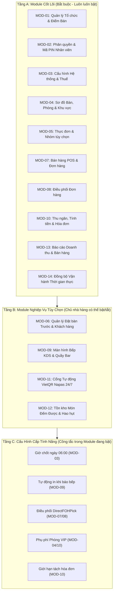
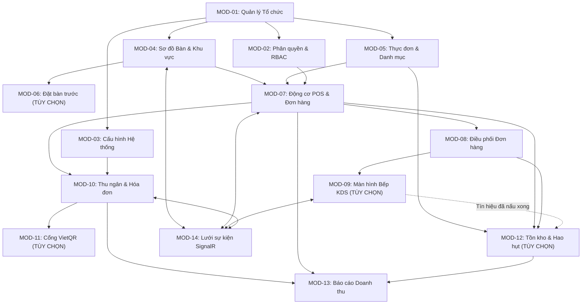
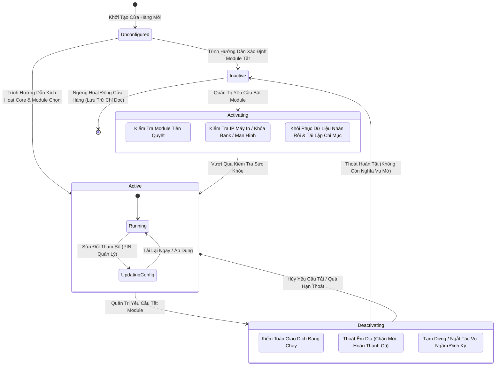
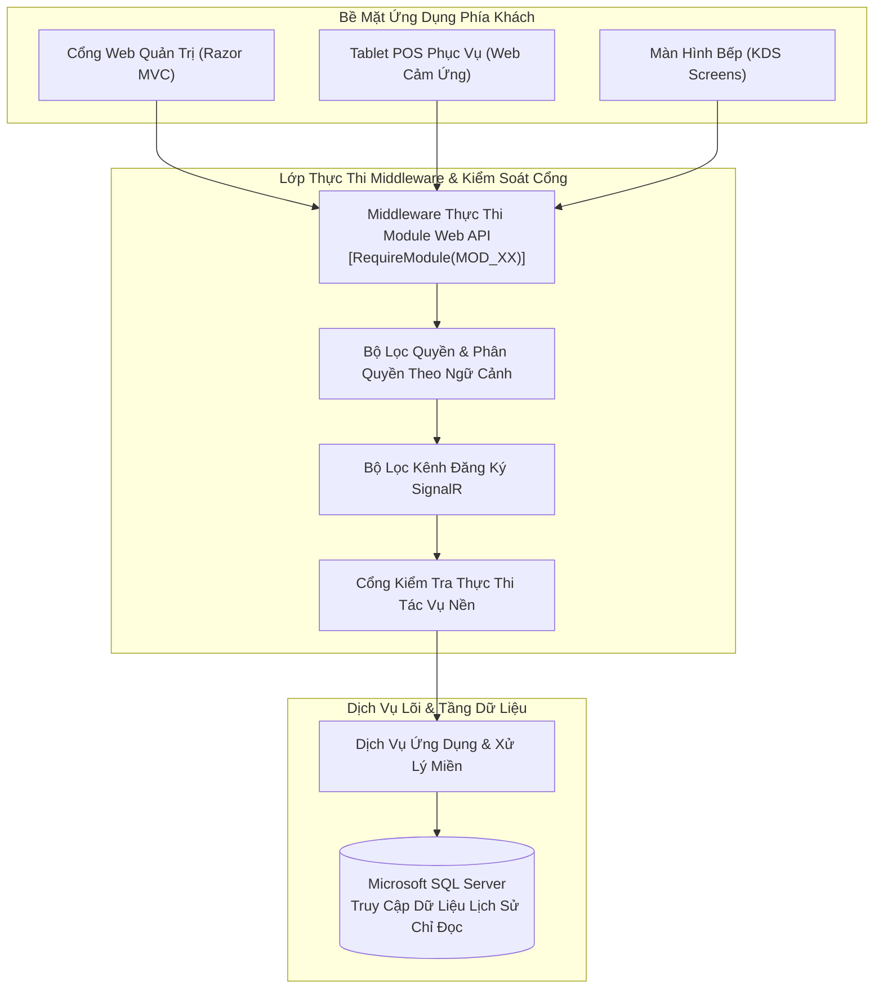
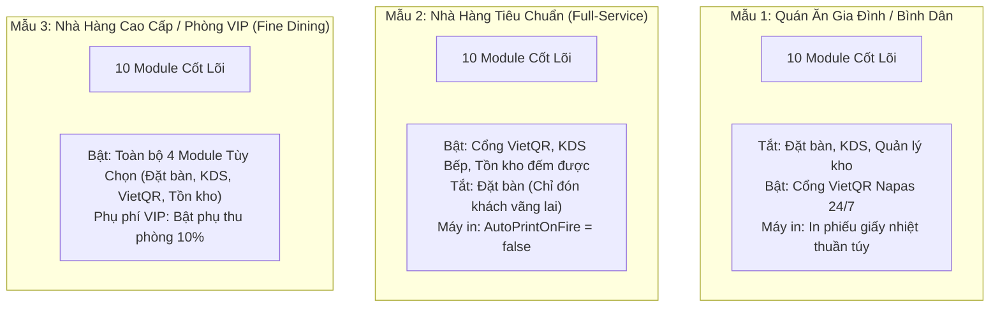

# SmartRestaurant — Phân Tích Cấu Hình Module & Quản Lý Tính Năng Nghiệp Vụ

- **Mã định danh tài liệu (Document Identifier)**: `SPEC-02.8` / `TASK-02.8`
- **Phiên bản tài liệu**: 2.0.0 (Đặc tả miền toàn diện)
- **Trạng thái tài liệu**: `PENDING OWNER REVIEW` (Đường cơ sở quản trị: Báo cáo phân tích của AI/BA)
- **Ngày lập**: 2026-11-05
- **Vai trò**: Chuyên viên kiểm toán quản trị sản phẩm cấp cao & Trưởng nhóm phân tích nghiệp vụ
- **Giai đoạn vòng đời**: Giai đoạn 1 — Khám phá sản phẩm & Đặc tả miền nghiệp vụ
- **Đối tượng mục tiêu**: Chủ nhà hàng (Project Owner), Kiến trúc sư giải pháp, Trưởng nhóm kỹ thuật, Trưởng nhóm QA

---

## 1. Tóm Tắt Tổng Quan (Executive Summary)

Trong ngành dịch vụ ẩm thực thương mại (F&B), mô hình vận hành vô cùng đa dạng—từ các quán cà phê gọi món trả tiền ngay tại quầy đơn giản, nhà hàng gia đình bình dân cho đến các nhà hàng gọi món cao cấp nhiều phân khu với phòng tiệc VIP riêng biệt và bộ phận điều phối bếp phức tạp. Một kiến trúc hệ thống nguyên khối, cứng nhắc sẽ gây cồng kềnh khó dùng cho các mô hình nhỏ, đồng thời lại thiếu hụt công cụ quản lý chuyên sâu cho các nhà hàng quy mô lớn.

Tài liệu này cung cấp bản **Khám Phá Sản Phẩm & Phân Tích Miền Nghiệp Vụ** toàn diện cho **Hệ Thống Cấu Hình Module Của SmartRestaurant**.

### Các Nguyên Tắc Kiến Trúc Cốt Lõi & Ranh Giới Phạm Vi:
1. **Chỉ thị nhà hàng độc lập đơn điểm (OD-01 / CONTR-01)**: Phạm vi MVP tập trung chính xác vào **một nhà hàng độc lập tại một địa điểm kinh doanh vật lý duy nhất**. Toàn bộ việc kích hoạt module, tham số cấu hình và bật tắt tính năng đều hoạt động trong ranh giới đơn điểm này. Tuyệt đối không đưa logic quản lý chuỗi đa chi nhánh vào MVP.
2. **Mô hình phân tầng phạm vi 3 cấp độ (Three-Layer Scoping Model)**: Phân tách rạch ròi giữa **Các module cốt lõi bắt buộc (Core Mandatory Modules)** (không thể bị tắt), **Các module nghiệp vụ tùy chọn (Optional Business Modules)** (có thể bật/tắt theo nhu cầu vận hành của nhà hàng), và **Cấu hình cấp tính năng (Feature-Level Configurations)** (các công tắc điều chỉnh hành vi chi tiết bên trong từng module đang hoạt động).
3. **Vòng đời không phá hủy & Lưu giữ dữ liệu toàn vẹn**: Việc tắt một module tùy chọn sẽ thực hiện thoát êm dịu (graceful drain) các quy trình vận hành đang chạy dở và **lưu giữ 100% dữ liệu lịch sử ở trạng thái chỉ đọc**. Nghiêm cấm tuyệt đối hành vi thanh trừng xóa sạch dữ liệu vật lý khi tắt module.
4. **Kiến trúc tách rời & Không triển khai sớm**: Định nghĩa rõ ràng năng lực nghiệp vụ, yêu cầu thực thi khi chạy (runtime enforcement), quy tắc phụ thuộc và các đề xuất gói cấu hình mẫu khởi tạo (onboarding presets) trong khi vẫn bảo toàn nghiêm ngặt ranh giới Giai đoạn 1 (không viết mã nguồn C#, không tạo lược đồ cơ sở dữ liệu, không tạo migration).

---

## 2. Ma Trận Phân Loại Module (Module Classification Matrix)

Để ngăn ngừa tình trạng bế tắc vận hành và tránh nhầm lẫn giữa năng lực cấu trúc hệ thống với các tùy chọn hành vi, hệ thống phân loại toàn bộ 14 module đã định nghĩa trong [`MODULE-OVERVIEW.md`](../99-archive/stage-1-history/superseded-documents/MODULE-OVERVIEW.md) thành 3 tầng kiến trúc tách bạch:



### 2.1. Tầng A: Các Module Cốt Lõi (Đề Xuất Bắt Buộc — Không Thể Bị Tắt)
Các module cốt lõi cấu thành bộ động cơ vận hành khả thi tối thiểu (MVP) của SmartRestaurant. Toàn bộ 10 phân hệ dưới đây đã được **Chủ Dự Án phê duyệt chính thức (OWNER-CONFIRMED)** tại Workshop Task 02.8.5 là các module bắt buộc không thể tắt:

| Mã Module | Tên Module (VN / EN) | Căn cứ nghiệp vụ bắt buộc phải là Module cốt lõi | Tác động nếu hệ thống cho phép tắt | Phân loại quản trị |
| :--- | :--- | :--- | :--- | :---: |
| **MOD-01** | Quản lý Tổ chức & Điểm Bán / Store Identity | Thiết lập hồ sơ pháp lý điểm bán đơn, định danh chi nhánh, và múi giờ vận hành cơ sở. | Ứng dụng đổ vỡ vì thiếu điểm neo danh tính cửa hàng. | `OWNER-CONFIRMED (Core Mandatory)` |
| **MOD-02** | Phân quyền & Tài khoản / RBAC & Staff PIN | Quản lý đăng nhập của nhân viên, xác thực PIN thu ngân, và mã PIN ủy quyền của Quản lý. | Hàng rào bảo mật sụp đổ; hoàn toàn mất kiểm soát kiểm toán việc hủy món hay chốt tiền két. | `OWNER-CONFIRMED (Core Mandatory)` |
| **MOD-03** | Cấu hình Nghiệp vụ / System Configuration | Quản lý giờ chốt ngày kinh doanh (06:00), thuế suất VAT (8%/10%), lời chào hóa đơn, và định dạng VNĐ. | Không thể tính toán thuế, không thể in hóa đơn VNĐ, hoặc không thể chia tách ca qua đêm. | `OWNER-CONFIRMED (Core Mandatory)` |
| **MOD-04** | Sơ đồ Bàn & Khu vực / Tables & Dining Areas | Cung cấp vòng đời trạng thái không gian bàn ăn (`Trống`, `Có khách`, `Đang thanh toán`, `Cần dọn`). | Phục vụ không thể gắn đơn món vào bàn vật lý hoặc không theo dõi được bàn có khách. | `OWNER-CONFIRMED (Core Mandatory)` |
| **MOD-05** | Thực đơn & Nhóm tùy chọn / Menu & Modifiers | Lưu trữ danh mục món ăn gốc, các biến thể khẩu phần (S/M/L), món gọi thêm và ghi chú chế biến. | Động cơ gọi món không có hàng hóa, giá bán hoặc tùy chọn để nhân viên chọn món cho khách. | `OWNER-CONFIRMED (Core Mandatory)` |
| **MOD-07** | Bán hàng POS & Đơn hàng / POS & Order Capture | Quản lý phiên dùng bữa, giỏ hàng tạm, các đợt gọi món bổ sung, và tính năng hủy gộp bàn. | Nhân viên phục vụ không thể nhận món từ khách, không thể gọi món thêm, hay gửi lệnh xuống bếp. | `OWNER-CONFIRMED (Core Mandatory)` |
| **MOD-08** | Điều phối Đơn hàng / Order Routing Dispatcher | Phân tách đơn gọi món của bàn thành các phiếu chế biến riêng cho từng bộ phận sản xuất mục tiêu. | Bộ phận Bếp/Bar không bao giờ nhận được phiếu; các món ăn bị kẹt cứng trong giỏ hàng POS. | `OWNER-CONFIRMED (Core Mandatory)` |
| **MOD-10** | Thu ngân, Tính tiền & Hóa đơn / Billing & Cashier | Tính tạm tính, chiết khấu, VAT, phí phục vụ, tách hóa đơn đa phương thức, và Báo cáo Z chốt ca. | Nhà hàng không thể in tạm tính, không thể thu tiền, không thể chia bill hay cân bằng tiền két ca. | `OWNER-CONFIRMED (Core Mandatory)` |
| **MOD-13** | Báo cáo Doanh thu & Bán hàng / Sales Reporting | Tổng hợp doanh thu gộp hàng ngày, biểu đồ nhiệt doanh thu theo giờ, phân tích nhóm món, và số dư tiền mặt. | Quản lý không thể đối soát số dư két tiền ca hoặc đánh giá hiệu quả tài chính nhà hàng. | `OWNER-CONFIRMED (Core Mandatory)` |
| **MOD-14** | Đồng bộ Vận hành Thời gian thực / Real-Time Synchronization | Đảm bảo tính nhất quán trạng thái tức thì giữa các máy POS/KDS (trạng thái bàn, chuông báo xong món, tạm tính). | Các thiết bị đầu cuối trở thành các ốc đảo rời rạc đòi hỏi nhân viên phải liên tục bấm tải lại trang thủ công. | `OWNER-CONFIRMED (Core Mandatory)` |

---

### 2.2. Tầng B: Các Module Nghiệp Vụ Tùy Chọn (Chủ Dự Án Đã Phê Chuẩn Cơ Chế Bật/Tắt)
Các module tùy chọn cung cấp những năng lực vận hành chuyên biệt đã được Chủ Dự Án chính thức phê chuẩn thuộc diện MVP Optional (OD-15 & Khung 14 Phân hệ). Chủ nhà hàng có thể bật hoặc tắt các module này tùy theo mô hình ẩm thực, số lượng nhân sự, trang thiết bị phần cứng sẵn có hoặc ngân sách đầu tư:

| Mã Module | Tên Module (VN / EN) | Giá trị nghiệp vụ & Mục tiêu vận hành | Tác động vận hành khi BẬT | Tác động vận hành khi TẮT | Phân loại quản trị |
| :--- | :--- | :--- | :--- | :--- | :---: |
| **MOD-06** | Quản lý Đặt bàn & Khách hàng / Table Reservation | Quản lý danh sách đặt bàn trước, đồng hồ đếm ngược giờ khách đến, tiền đặt cọc và số lượng khách. | Sơ đồ mặt bằng hiển thị nhãn đếm ngược đặt bàn; bàn đã đặt được khóa chống xếp khách vãng lai. | Nhà hàng chỉ phục vụ khách vãng lai thuần túy. Tab "Đặt bàn" ẩn khỏi toàn bộ POS/Admin. Không phát cảnh báo đặt bàn. | `OWNER-CONFIRMED (OD-15: Phương án A)` |
| **MOD-09** | Hệ thống Màn hình Bếp (KDS) / Digital KDS | Hàng đợi đơn món cảm ứng điện tử cho trạm Bếp Nóng, Bếp Nguội và Quầy Bar kèm đồng hồ SLA. | Nhân viên bếp chuyển trạng thái món trên màn hình (`Đang nấu` $\rightarrow$ `Đã xong`). Tiếp thực nhận chuông báo. | Khu bếp vận hành hoàn toàn bằng phiếu in nhiệt giấy ESC/POS vật lý. Lệnh báo bếp gửi thẳng ra máy in mạng. | `OWNER-CONFIRMED (MVP Optional)` |
| **MOD-11** | Cổng Thanh toán VietQR / VietQR Gateway | Tạo mã VietQR động Napas 24/7 tự động kèm xác minh webhook bất đồng bộ và sổ treo đối soát. | Thu ngân hiển thị QR động trên màn hình; ngân hàng xác nhận tiền tự động; xử lý webhook đến muộn. | Thu ngân nhận Tiền mặt, quẹt thẻ qua máy POS ngân hàng cầm tay ngoài, hoặc chuyển khoản chụp ủy nhiệm chi thủ công. | `OWNER-CONFIRMED (MVP Optional)` |
| **MOD-12** | Quản lý Tồn kho & Hao hụt / Countable Stock & Waste | Khóa tồn kho 2 bước thời gian thực (`Tồn khả dụng = Tồn thực tế - Tồn tạm giữ`) cho khẩu phần, chai, lon. | Hệ thống ngăn chặn bán vượt số lượng tồn; tự động khóa món hết (86); ghi nhận lỗi bếp vào Sổ Hủy Hỏng. | Tính năng tự động tạm giữ kho thời gian thực bị tắt. Hàng rào bảo vệ hết hàng dựa vào nhân viên bấm "Tạm hết món (86)" thủ công, bếp hô miệng, và hạn mức chuẩn bị đầu ca. | `OWNER-CONFIRMED (MVP Optional)` |

---

### 2.3. Tầng C: Cấu Hình Cấp Tính Năng (Bên Trong Module Đang Bật)
Các cấu hình cấp tính năng tinh chỉnh các quy tắc, hạn mức và hành vi cụ thể của những module đang hoạt động. **Việc kích hoạt một module không quy định cứng chính sách vận hành của nó; chính sách được quyết định bởi các công tắc cấu hình Tầng C:**

```mermaid
classDiagram
    class MOD_03_Configuration {
        +TimeOnly BusinessDayCutoffTime = 06:00:00
        +Decimal DefaultVatRate = 8.00%
        +Boolean IsServiceChargeTaxable = true
        +String PreBillDisclaimer = "Phiếu này chỉ dùng để đối chiếu..."
    }
    class MOD_07_POS {
        +Enum BillingRequestedMode = AllowEditableAppend (OD-13)
        +Boolean AllowTableUnmerging = true (OD-06)
        +Boolean DirectFOHBeverageRouting = true (OD-08)
    }
    class MOD_09_KDS {
        +Boolean AutoPrintOnFire = false (OQ-02)
        +Integer YellowAlertMinutes = 10
        +Integer RedAlertMinutes = 20
        +Boolean AudioChimeEnabled = true
    }
    class MOD_10_Billing {
        +Boolean AllowSplitByItem = true
        +Boolean AllowSplitEvenly = true
        +Integer MaxSplitSubBills = 4
        +Enum OddCentsStrategy = AllocateToLastBill
    }
    class MOD_12_Inventory {
        +Boolean TwoPhaseLockEnabled = true (D2)
        +Boolean Auto86OnZero = true
        +Boolean MandatoryWasteReason = true
    }
```



---

## 3. Phân Tích Sự Phụ Thuộc Giữa Các Module (Module Dependency Analysis)

Các module trong SmartRestaurant duy trì tính phụ thuộc một chiều nghiêm ngặt. Việc tắt một module cha sẽ tự động ảnh hưởng hoặc ức chế các năng lực phụ thuộc phía sau:



### 3.1. Ma Trận Phụ Thuộc Chi Tiết

| Module Được Đánh Giá | Điều kiện tiên quyết bắt buộc (Phải BẬT) | Hiệu ứng kết hợp tùy chọn (Tăng cường) | Cấu hình xung đột / Không tương thích | Hành vi khi Module tiên quyết bị TẮT | Trạng thái phát hiện |
| :--- | :--- | :--- | :--- | :--- | :---: |
| **MOD-06: Đặt bàn** | `MOD-04` (Sơ đồ bàn & Khu vực) | `MOD-02` (Quyền nhân viên gán phòng VIP) | Không thể xếp bàn nếu nhà hàng vận hành chế độ Chỉ bán mang đi / Tại quầy. | Nếu `MOD-04` không có bàn, đặt chỗ không thể gắn với bàn ghế vật lý; chuyển sang danh sách chờ theo số lượng người. | `RESOLVED` |
| **MOD-09: KDS Bếp** | `MOD-08` (Động cơ điều phối đơn món) | `MOD-14` (SignalR bắn phiếu dưới 1s), `MOD-12` (Trừ kho khi nấu) | Không thể bật nếu phần cứng thiếu màn hình và cờ `AutoPrintOnFire` bị tắt. | Nếu điều phối `MOD-08` lỗi, các trạm KDS sẽ nhận phiếu thô chưa được phân tách. | `RESOLVED` |
| **MOD-11: Cổng VietQR** | `MOD-10` (Thu ngân & Quyết toán) | `MOD-14` (SignalR phát chuông báo tức thì cho thu ngân khi có webhook) | Không thể bật nếu thiếu thông tin tài khoản ngân hàng và mã Napas merchant ID. | Nếu `MOD-10` bị tắt, không tồn tại hóa đơn để gắn mã tham chiếu thanh toán động. | `RESOLVED` |
| **MOD-12: Kho & Hao hụt** | `MOD-05` (Thực đơn), `MOD-07` (Ghi nhận đơn) | `MOD-09` (KDS gửi sự kiện trừ kho vĩnh viễn khi `ReadyToServe`) | Không tương thích với việc cho phép bán âm kho; xung đột với các món gọi ngoài menu chưa kiểm duyệt. | Nếu bỏ qua `MOD-07`, việc tạm giữ kho không thể gắn kết với phiên dùng bữa đang hoạt động. | `RESOLVED` |

### 3.2. Hành Vi Dự Phòng Khi Thiếu Module Phụ Thuộc
- **Khi MOD-09 (KDS) bị TẮT**: `MOD-08` (Động cơ điều phối bếp) đón bắt các lệnh báo bếp và chuyển hướng hoàn toàn sang bộ đệm máy in nhiệt giấy ESC/POS mạng. Đầu bếp làm việc bằng cách kẹp phiếu in giấy lên thanh kẹp phiếu.
- **Khi MOD-11 (VietQR) bị TẮT**: `MOD-10` (Thu ngân) ẩn tab "Thanh toán VietQR". Giao diện thu ngân giới hạn ở các nút "Tiền mặt" (Cash) và "Thẻ ngân hàng (POS quẹt thẻ)" (External Bank Card).
- **Khi MOD-12 (Tồn kho) bị TẮT**: `MOD-07` (POS) loại bỏ bước kiểm tra tồn kho khi gửi lệnh báo bếp. Các món ăn không bao giờ bị hệ thống tự động khóa "Hết món (86)". Nhân viên phục vụ có thể gọi số lượng tùy ý cho đến khi đầu bếp báo miệng hết đồ.

---

## 4. Phân Tích Vòng Đời Của Module (Module Lifecycle Analysis)

Việc bật hoặc tắt một module vận hành đòi hỏi sự kiểm soát nghiêm ngặt bằng máy trạng thái nhằm ngăn chặn sai lệch giao dịch, thất thoát dữ liệu hoặc bỏ rơi các nghĩa vụ của thực khách:



### 4.1. Chuyển Đổi Vòng Đời & Quy Tắc Vận Hành

#### A. Khởi Tạo Cửa Hàng Ban Đầu (Initial Onboarding)
1. Khi thiết lập cửa hàng mới, hệ thống đăng ký các thực thể `Organization` và `Branch`.
2. 10 Module Cốt Lõi (`Tầng A`) được tự động kích hoạt vĩnh viễn.
3. Người quản lý được hướng dẫn qua trình chọn module tùy chọn để bật/tắt các module thuộc `Tầng B` (Đặt bàn, KDS, VietQR, Tồn kho).

#### B. Tắt Một Module Đang Hoạt Động (Thoát Phân Hóa & Bảo Tồn Dữ Liệu)
Khi quản trị viên chuyển một module đang hoạt động sang trạng thái `Disabled`:
1. **Kiểm toán giao dịch phân hóa (Chính sách thoát êm dịu OD-17: Phương án A — Đã được Chủ Dự Án phê chuẩn)**:
   - *Phiên bàn đang phục vụ / Hóa đơn đang mở*: Tuyệt đối không thể tắt tính năng thanh toán hoặc POS khi bàn ăn vẫn đang có đơn dở dang. Các phiên hoạt động phải đạt trạng thái kết thúc (`Paid` hoặc `Cancelled`).
   - *Lịch đặt bàn trước trong tương lai (MOD-06)*: KHÔNG áp dụng lệnh chặn cứng nhiều tuần. Thay vào đó, hệ thống cảnh báo quản lý: *"Có 5 lượt đặt bàn trong tương lai. Bạn muốn: (A) Giữ lại để đón khách thủ công, hay (B) Hủy và gửi thông báo cho khách?"*.
   - *Giao dịch ngân hàng đang chờ webhook (MOD-11)*: Các hóa đơn có trạng thái `PendingWebhook` phải chờ hết 120s timeout hoặc chuyển sang Dự phòng Tiền mặt trước khi hoàn tất việc tắt module.
   - *Phiếu bếp đang nấu dở trên KDS (MOD-09)*: Đầu bếp nấu nốt các món đang dở hoặc hủy món kèm mã PIN quản lý ghi vào sổ hủy hỏng.
2. **Khóa chặn tiếp nhận giao dịch mới**: Mọi giao dịch mới thuộc module đó lập tức bị chặn trên toàn bộ máy POS và thiết bị đầu cuối.
3. **Tách rời tác vụ ngầm**: Các tác vụ chạy nền định kỳ (ví dụ: quét thăm dò VietQR, gửi nhắc lịch đặt bàn) tạm dừng thực thi hoặc bỏ qua các chu kỳ chạy một cách êm dịu.
4. **Bảo tồn dữ liệu vĩnh viễn & Chính sách hiển thị theo từng báo cáo**:
   - Việc tắt module **TUYỆT ĐỐI KHÔNG BAO GIỜ thực thi lệnh `DROP TABLE`, `DELETE`, hay dọn sạch dữ liệu vật lý**. Toàn bộ dữ liệu lịch sử được bảo toàn vĩnh viễn trong Microsoft SQL Server.
   - **Quy tắc hiển thị theo loại báo cáo**:
     * *Màn hình Vận hành Trực tiếp* (Sơ đồ mặt bằng, bàn ra món KDS) sẽ ẩn các thành phần của module bị tắt để tránh rác mắt.
     * *Báo cáo Tài chính, Thuế & Kiểm toán* (Doanh thu ngày, Báo cáo Z, ca thu ngân, nhật ký kiểm toán) **bắt buộc duy trì và hiển thị đầy đủ 100% giao dịch lịch sử**, kèm nhãn thông tin: `"(Dữ liệu lịch sử — Phân hệ hiện đang tắt)"`.

#### C. Bật Lại Module Đã Tắt
1. Khi được bật lại, hệ thống thực hiện **Kiểm tra Sức khỏe & Điều kiện Tiên quyết**:
   - Đối với `MOD-09` (KDS): Xác minh có ít nhất một màn hình trạm hoặc máy in mạng đã được cấu hình.
   - Đối với `MOD-11` (VietQR): Xác minh số tài khoản ngân hàng, mã ngân hàng và khóa webhook hợp lệ.
2. Dữ liệu nhàn rỗi được tái lập chỉ mục (re-index).
3. Menu điều hướng, các tab POS và kênh SignalR hub được mở lại trên toàn bộ máy khách qua thông báo SignalR tức thì mà không cần đăng xuất.

---

## 5. Các Nguyên Tắc Cấu Hình Module

Mọi tham số của module bắt buộc phải tuân thủ 4 nguyên tắc quản trị kỹ thuật nghiêm ngặt:

1. **Nguyên tắc bất biến tài chính (Snapshot-on-Creation)**:
   - Thuế suất, phụ phí và ngày kinh doanh được chụp ảnh cố định (snapshot) vào đơn hàng ngay khi tạo.
   - Việc điều chỉnh `BusinessDayCutoffTime` từ `06:00` sang `07:00` chỉ áp dụng cho các chu kỳ kinh doanh trong tương lai. Tuyệt đối không thay đổi hồi tố `BusinessDate` của các bàn đang mở, đơn hàng cũ hay ca làm việc đã đóng.
   - Việc điều chỉnh phụ phí phòng VIP (ví dụ: từ 10% lên 15%) chỉ áp dụng cho các phiên dùng bữa mở sau thời điểm chỉnh sửa.
2. **Nguyên tắc vận hành không phá hủy (Non-Destructive Operation)**:
   - Việc thiết lập lại tham số hoặc tắt module tuyệt đối không bao giờ kéo theo hành động xóa phá hủy lịch sử giao dịch.
3. **Nguyên tắc kiểm soát kép và lưu vết kiểm toán (Dual-Control Auditability)**:
   - Mọi thay đổi đối với hạn mức tài chính, hồ sơ VAT hoặc trạng thái kích hoạt module đều bắt buộc phải nhập lại mã PIN 4 số của Quản lý.
   - Mọi thay đổi đều được ghi vĩnh viễn vào bảng `ConfigurationAuditLog`.
4. **Nguyên tắc kế thừa an toàn & Giá trị dự phòng cục bộ (Safe Inheritance & Local Fallbacks)**:
   - Nếu trạm bếp hoặc bàn ăn cục bộ thiếu cấu hình riêng, hệ thống tự động kế thừa giá trị mặc định của Chi nhánh, rồi kế thừa giá trị mặc định hệ thống lúc biên dịch, triệt tiêu hoàn toàn lỗi `NullReferenceException` khi vận hành.

---

## 6. Yêu Cầu Thực Thi Khi Hệ Thống Chạy (Runtime Enforcement Requirements)

Hệ thống cấu hình module phải thực thi trạng thái module và tính năng một cách thống nhất trên toàn bộ các tầng kiến trúc:



### 6.1. Đặc Tả Thực Thi Từng Tầng

> [!NOTE] Ranh Giới Kiến Trúc & Phân Định Trách Nhiệm
> Các mẫu thiết kế triển khai liệt kê dưới đây (ASP.NET Core Middleware, Action Filters, SignalR Hubs, `BackgroundService`, `IMemoryCache`) là **Các đề xuất kiến trúc kỹ thuật dành cho Giai đoạn 2 (Stage 2)**, KHÔNG PHẢI là yêu cầu sản phẩm bắt buộc của Giai đoạn 1. Yêu cầu sản phẩm bắt buộc của Giai đoạn 1 là **hành vi hiển thị thân thiện phía người dùng, thông điệp lỗi rõ ràng và sự an toàn dữ liệu** khi bật/tắt module.

| Tầng hệ thống | Cơ chế thực thi | Hành vi khi Module bị TẮT | Yêu cầu thiết kế kỹ thuật cho Giai đoạn 2 | Phân loại |
| :--- | :--- | :--- | :--- | :---: |
| **Giao diện Quản trị (Razor MVC)** | Bộ lọc điều hướng động & Feature TagHelpers (`<feature>`) | Màn hình cài đặt và quản trị của module bị tắt sẽ ẩn khỏi thanh menu. Điều hướng URL trực tiếp sẽ chuyển hướng về Dashboard kèm thông báo SweetAlert2: *"Phân hệ này chưa được kích hoạt"*. | MVC Action Filter: `[ValidateModuleActive(ModuleCode.KDS)]`. | `TECHNICAL DESIGN REQUIRED — STAGE 2` |
| **Máy Bán Hàng POS (Web)** | Khung giao diện cảm ứng động & Động cơ dựng tab | Tab "Đặt bàn" biến mất; nút "Thanh toán VietQR" ẩn đi; món ăn không hiển thị huy hiệu tồn kho nếu kho bị tắt. | Khung máy khách nhận gói tin `/api/bootstrap` lưu bộ nhớ đệm danh mục module đang bật. | `TECHNICAL DESIGN REQUIRED — STAGE 2` |
| **Màn Hình KDS** | Bộ định tuyến điều phối trạm | Thiết bị đầu cuối không thể đăng nhập vào giao diện KDS; màn hình hiển thị: *"Chế độ KDS đang tắt. Đơn hàng được in trực tiếp qua máy in nhiệt."* | Hub SignalR `KitchenHub` từ chối kết nối nếu `MOD-09` bị tắt. | `TECHNICAL DESIGN REQUIRED — STAGE 2` |
| **Backend Web API** | Global Controller Middleware & Action Filters | Các endpoint thuộc module bị tắt sẽ chặn các yêu cầu HTTP gửi đến và trả về `HTTP 400 Bad Request` hoặc `HTTP 403 Forbidden`: `{"error": "MODULE_DISABLED", "message": "Phân hệ Đặt bàn hiện không khả dụng"}`. | ASP.NET Core Middleware hoặc Resource Filter đánh giá `IModuleStatusProvider` trong bộ nhớ. | `TECHNICAL DESIGN REQUIRED — STAGE 2` |
| **Xác thực & RBAC** | Bộ đánh giá quyền hạn (Permission Claims) | Vai trò nhân viên vẫn giữ các quyền đã gán, nhưng các quyền gắn liền với module bị tắt sẽ chuyển sang trạng thái nhàn rỗi (dormant). | Đường ống chuyển đổi Claims (Claims Transformation) triệt tiêu quyền của module không hoạt động. | `TECHNICAL DESIGN REQUIRED — STAGE 2` |
| **Tác Vụ Nền** | Cổng thực thi Hosted Service | Các worker ngầm (ví dụ: `ReservationReminderWorker`, `VietQrPollingWorker`) kiểm tra trạng thái module ở mỗi chu kỳ trước khi truy vấn DB; tạm dừng nếu tắt. | `BackgroundService` bọc logic kiểm tra trong `if (_moduleManager.IsEnabled(MOD_11))`. | `TECHNICAL DESIGN REQUIRED — STAGE 2` |
| **Thời Gian Thực SignalR** | Đăng ký nhóm Hub động | Máy khách không nhận được các sự kiện phát thanh của module bị tắt (ví dụ: không nhận `ReservationCreatedEvent` nếu `MOD-06` tắt). | Các phương thức trong Hub kiểm tra trạng thái module trước khi gửi thông điệp tới nhóm máy khách. | `TECHNICAL DESIGN REQUIRED — STAGE 2` |
| **Báo Cáo & Thống Kê** | Phân vùng truy vấn lịch sử | Báo cáo tài chính hàng ngày vẫn truy cập 100%. Doanh thu, hủy món và xuất kho lịch sử vẫn kết xuất đầy đủ kèm cờ kiểm toán. | Các câu truy vấn EF Core bao gồm các bản ghi lịch sử trong khi các ô thông số trên dashboard của module bị tắt hiển thị trạng thái nhàn rỗi. | `TECHNICAL DESIGN REQUIRED — STAGE 2` |

---

## 7. Các Đề Xuất Cấu Hình Mẫu Khởi Tạo (Chỉ Là Đề Xuất Của AI/BA)

Nhằm đơn giản hóa việc thiết lập hệ thống ban đầu cho các nhà hàng mới, 3 bộ cấu hình mẫu vận hành được đề xuất.

> [!NOTE]
> **THÔNG BÁO QUẢN TRỊ (OD-16: PHƯƠNG ÁN A — OWNER-CONFIRMED)**: 3 bộ cấu hình mẫu dưới đây đã được **Chủ Dự Án chính thức phê duyệt (OWNER-CONFIRMED)** tại Workshop Task 02.8.5 theo Quyết định `OD-16 (Phương án A)`. Các gói mẫu này đóng vai trò là **bộ gợi ý cấu hình ban đầu không ràng buộc (Non-binding suggestions)** trong Wizard khởi tạo giúp rút ngắn thời gian thiết lập ban đầu. Chủ nhà hàng và Quản lý luôn giữ toàn quyền tùy biến, bật hoặc tắt bất kỳ phân hệ hoặc tham số riêng lẻ nào sau đó.



### 7.1. Đánh Giá Cấu Hình Mẫu & Đánh Đổi Vận Hành

| Cấu hình mẫu đề xuất | Mô hình F&B mục tiêu | Các Module bật sẵn | Các Module tắt sẵn | Đánh đổi vận hành & Rủi ro tiềm ẩn | Trạng thái quản trị |
| :--- | :--- | :--- | :--- | :--- | :---: |
| **Mẫu 1: Quán Ăn Gia Đình / Bình Dân** | Quy mô nhỏ, 10–20 bàn, 1 thu ngân, 2–3 phục vụ, bếp trưởng thường là chủ quán. | 10 Module Cốt Lõi + `MOD-11` (VietQR). | `MOD-06` (Đặt bàn), `MOD-09` (KDS), `MOD-12` (Tồn kho). | **Rủi ro**: Không bảo vệ tồn kho; kẹt giấy máy in làm gián đoạn đơn; khách không đặt chỗ trước được. **Ưu điểm**: Không tốn phần cứng, thiết lập cực nhanh (< 15 phút). | `OWNER-CONFIRMED (OD-16)` |
| **Mẫu 2: Nhà Hàng Tiêu Chuẩn** | Quy mô vừa, 20–50 bàn, phân tuyến bếp rõ ràng, quầy bar riêng, bàn ra món. | 10 Module Cốt Lõi + `MOD-09` (KDS) + `MOD-11` (VietQR) + `MOD-12` (Kho món đếm được). | `MOD-06` (Đặt bàn — giả định chỉ đón khách vãng lai). | **Rủi ro**: Cần máy tính bảng/màn hình trong bếp; đòi hỏi nhân viên tự giác ghi sổ hủy khi hỏng món. **Ưu điểm**: Chống bán vượt tồn, bếp không giấy, thanh toán QR tức thì. | `OWNER-CONFIRMED (OD-16)` |
| **Mẫu 3: Nhà Hàng Cao Cấp / Phòng VIP** | Quy mô lớn, nhiều phòng ăn riêng, sảnh sân vườn/rooftop, nhiều đợt món, đặt bàn trước. | Toàn bộ 14 Module được bật (Cốt lõi + Đặt bàn + KDS + VietQR + Kho đếm được + Phụ phí VIP). | Không có (Mọi tính năng đều kích hoạt). | **Rủi ro**: Độ phức tạp nhận thức cao nhất; nhân viên phải theo dõi đặt chỗ, khóa phòng và nhập kho. **Ưu điểm**: Kiểm soát tối đa, tăng doanh thu phụ phí VIP, lưu giữ hồ sơ khách hàng trọn vẹn. | `OWNER-CONFIRMED (OD-16)` |

### 7.2. Các Rủi Ro Khi Sử Dụng Cấu Hình Mẫu
1. **Tạo cảm giác ngộ nhận đã hoàn tất**: Quản lý nhà hàng có thể tưởng rằng các mẫu này là cố định không thể sửa và bỏ qua việc cấu hình các tham số trọng yếu của quán (như giờ chốt ngày hoặc thuế VAT).
2. **Ngấm ngầm ẩn tính năng mong muốn**: Việc áp dụng "Mẫu 1" cho một quán ăn có nhận đặt bàn qua điện thoại sẽ làm ẩn lịch đặt bàn, gây hoang mang cho nhân viên.
3. **Khuyến nghị giảm thiểu rủi ro**: Các mẫu cấu hình bắt buộc chỉ đóng vai trò là **công cụ điền mẫu gợi ý ban đầu** trong trình hướng dẫn thiết lập. Giao diện phải thông báo mạch lạc: *"Bạn có thể bật hoặc tắt từng phân hệ bất kỳ lúc nào trong phần Cài Đặt Hệ Thống."*

---

## 8. Khuyến Nghị Phân Kỳ Phạm Vi MVP So Với Sau MVP

Tuân thủ nghiêm ngặt Quyết định của Chủ nhà hàng `OD-01` và Phạm vi sản phẩm đã duyệt trong [`MVP-SCOPE.md`](../99-archive/stage-1-history/superseded-documents/MVP-SCOPE.md), mọi module và năng lực cấu hình được phân bổ vào phân kỳ phát hành cụ thể:

| Phân hệ / Năng lực | Phân kỳ phát hành | Cơ sở lựa chọn & Ranh giới vận hành | Phân loại |
| :--- | :---: | :--- | :---: |
| **Vận Hành Độc Lập Đơn Điểm** | `MVP Cốt lõi` | Tập trung 100% nguồn lực kỹ thuật để hoàn thiện vận hành nhà hàng độc lập đơn điểm (`OD-01`). | `OWNER-CONFIRMED (OD-01)` |
| **10 Module Cốt Lõi Bắt Buộc (`Tầng A`)** | `MVP Cốt lõi` | Động cơ vận hành thiết yếu cho phục vụ tại bàn, ghi nhận món, điều phối bếp và quyết toán két tiền. | `OWNER-CONFIRMED (Task 02.8.5)` |
| **KDS Màn Hình Bếp & Quầy Bar (`MOD-09`)** | `MVP Tùy chọn` | Hàng đợi đơn món cảm ứng không dùng giấy cho đầu bếp và nhân viên pha chế. | `OWNER-CONFIRMED (MVP Optional)` |
| **Cổng VietQR Động & Sổ Treo (`MOD-11`)** | `MVP Tùy chọn` | Thanh toán Napas 24/7 tự động kèm dự phòng tiền mặt và sổ đối soát giao dịch treo (`PDR-008`). | `OWNER-CONFIRMED (MVP Optional)` |
| **Khóa Tồn Kho Món Đếm Được 2 Bước (`MOD-12`)** | `MVP Tùy chọn` | Quản lý các khẩu phần bán trực tiếp, chai, lon (`Tồn khả dụng = Tồn thực tế - Tạm giữ`) theo `PDR-004`. | `OWNER-CONFIRMED (MVP Optional)` |
| **Quản Lý Đặt Bàn Trước (`MOD-06`)** | `MVP Tùy chọn` | Đặt chỗ trước cơ bản, số lượng khách và đếm ngược giờ khách đến (bật/tắt linh hoạt). | `OWNER-CONFIRMED (OD-15: Phương án A)` |
| **Định Lượng BOM Công Thức Chi Tiết (gram/ml)** | `Sau MVP (v1.1)` | Khấu trừ nguyên liệu thô theo công thức dời sang v1.1 để bảo vệ tiến độ MVP theo Quyết định D5 (`PDR-004`). | `OWNER-CONFIRMED (D5 / PDR-004)` |
| **Màn Hình Bàn Ra Món Master Expediter** | `Sau MVP (v1.1)` | Màn hình điều phối ra món tổng hợp dời sang v1.1; đầu bếp làm việc trực tiếp trên KDS trạm. | `AI/BA PROPOSAL (Đề xuất trong PDR-003)` |
| **Tài Khoản Ký Nợ Doanh Nghiệp (Khách Ký Nợ)** | `Trì hoãn (v1.2+)`| Tài khoản công nợ B2B dời sang sau MVP dưới dạng module Quản lý Công nợ Phải thu (AR) riêng biệt (`REV-07`).| `OWNER-CONFIRMED DEFERRED (REV-07)` |
| **Xoay Tự Do Trên Sơ Đồ Mặt Bằng** | `Sau MVP (v1.2)` | Trình thiết kế sơ đồ giới hạn ở 4 góc vuông 90° (0°, 90°, 180°, 270°) để giảm độ phức tạp giao diện. | `AI/BA PROPOSAL` |
| **Khách Tự Quét QR Đặt Món & Trả Trước** | `Sau MVP (v2.0)` | Khách dùng điện thoại quét mã QR tại bàn để tự gọi món dời sang Giai đoạn 2. | `OWNER-CONFIRMED (PRD §4.2)` |
| **Điều Chuyển Kho Tổng Cung Ứng Đa Chi Nhánh** | `Sau MVP (v2.0)` | Luân chuyển kho liên chi nhánh và hậu cần nhượng quyền dời sang v2.0 (`CONTR-01`). | `OWNER-CONFIRMED (CONTR-01)` |
| **Tách Hóa Đơn Theo Tỷ Lệ % Tùy Ý (60/40)** | `Sau MVP` | Tách hóa đơn giới hạn ở Tách theo món và Chia đều ($1/N$) trong MVP; % lẻ dời sang v1.1 (`OQ-01`). | `OWNER-CONFIRMED (OQ-01: Phương án A)` |

---

## 9. Phân Tích Tác Động Lên Các Tài Liệu Đặc Tả Hiện Có

Việc thiết lập khung quản lý tính năng và cấu hình module này tích hợp hoàn toàn ăn khớp với toàn bộ các tài liệu đặc tả của Giai đoạn 1 mà không làm phát sinh phình to phạm vi (scope creep):

| Tài liệu đặc tả hiện có | Tác động của Hệ thống Cấu hình Module | Trạng thái nhất quán |
| :--- | :--- | :--- :---: |
| **[PRD.md](./PRD.md)** | Tái khẳng định ranh giới Modular Monolith 14 module; củng cố trọng tâm đơn điểm cho MVP v1.0. | `CONSISTENT` |
| **[BUSINESS-REQUIREMENTS.md](../99-archive/stage-1-history/superseded-documents/BUSINESS-REQUIREMENTS.md)** | Làm rõ BR-01 đến BR-14 bằng cách chỉ rõ yêu cầu nào là cốt lõi bắt buộc so với tùy chọn bật/tắt. | `CONSISTENT` |
| **[MVP-SCOPE.md](../99-archive/stage-1-history/superseded-documents/MVP-SCOPE.md)** | Khớp nối hoàn hảo với thứ tự ưu tiên MoSCoW; bảo tồn các loại trừ rõ ràng (BOM gram/ml, Khách ký nợ). | `CONSISTENT` |
| **[USER-JOURNEYS.md](./USER-JOURNEYS.md)** | Xác nhận các hành trình người dùng chuyển đổi êm dịu (ví dụ: UJ-03 in phiếu giấy nếu KDS tắt). | `CONSISTENT` |
| **4 Quy trình vận hành (`workflows/`)** | Các máy trạng thái không đổi; các cờ module xác định nhánh rẽ được kích hoạt hay bỏ qua. | `CONSISTENT` |
| **PDR-001 đến PDR-015 (`decisions/`)** | Các yêu cầu nghiệp vụ trong PDR được củng cố; tham số cấu hình cung cấp các núm vặn vận hành thực tế. | `CONSISTENT` |

---

## 10. Các Quyết Định Của Chủ Dự Án Đã Phê Chuẩn & Ghi Nhận Chính Thức

Toàn bộ các chính sách cấu hình và câu hỏi mở dưới đây đã được **Chủ Dự Án phê duyệt chính thức (OWNER-CONFIRMED)** tại Workshop Task 02.8.5 và ghi nhận đầy đủ trong Task 02.8.6:

| Mã quyết định | Chính sách / Chủ đề | Phương án Chủ Dự Án phê duyệt | Tác động lên hệ thống | Trạng thái phê duyệt |
| :---: | :--- | :--- | :--- | :---: |
| **OD-15** | Trạng thái của `MOD-06` (Đặt bàn trước) trong MVP | **Phương án A — Đưa vào MVP dưới dạng Module Tùy chọn** (`MVP Optional`). | Nhà hàng không nhận đặt chỗ có thể tắt tính năng 1 chạm gọn gàng; thiết kế loose coupling. | `OWNER-CONFIRMED` |
| **OD-16** | Áp dụng các cấu hình mẫu khởi tạo (Presets) | **Phương án A — Cung cấp 3 bộ cấu hình mẫu gợi ý** (Gia đình, Tiêu chuẩn, VIP) trong Wizard Onboarding. | Rút ngắn thời gian khởi tạo hệ thống từ 2 giờ xuống 15 phút; quản lý tùy chỉnh tự do. | `OWNER-CONFIRMED` |
| **OD-17** | Xử lý tắt Module khi đang có giao dịch dở dang | **Phương án A — Thoát phân tầng theo loại giao dịch** (`Graceful Drain Policy`). | Chặn tạo mới; hoàn tất nốt bàn đang ăn, cọc đặt bàn, webhook; dữ liệu cũ giữ Read-Only. | `OWNER-CONFIRMED` |
| **OQ-02** | Hành vi in phiếu giấy vật lý khi KDS được bật | **Phương án A — Cài đặt cấp trạm**: Mặc định `AutoPrintOnFire: false`. | Ưu tiên KDS điện tử, giảm lãng phí giấy; máy in nhiệt ESC/POS làm dự phòng phần cứng. | `OWNER-CONFIRMED` |
| **OQ-06** | Tính thuế VAT trên phí dịch vụ | **Phương án A — Cài đặt cấp chi nhánh**: Mặc định `IsServiceChargeTaxable: true`. | Thuế VAT tính trên cả Phí dịch vụ; tuân thủ chuẩn mực kế toán F&B tại Việt Nam. | `OWNER-CONFIRMED` |

---

## 11. Đánh Giá Rủi Ro & Khuyến Nghị Kiến Trúc

### 11.1. Rủi Ro Vận Hành & Kỹ Thuật

| Mã rủi ro | Mô tả rủi ro | Mức độ | Khả năng | Chiến lược giảm thiểu kiến trúc |
| :--- | :--- | :---: | :---: | :--- |
| **RSK-CFG-01** | **Chi phí cơ sở dữ liệu do kiểm tra cấu hình liên tục**: Việc đánh giá trạng thái module và tham số trên từng yêu cầu HTTP làm giảm tốc độ API. | Trung bình | Cao | **Bộ nhớ đệm In-Memory kèm kênh hủy SignalR**: Kiến trúc sư giải pháp Stage 2 phải thiết kế `IConfigurationService` có bộ đệm `IMemoryCache`. Bộ đệm được hủy tức thì qua SignalR khi có tham số thay đổi. |
| **RSK-CFG-02** | **Vô tình tắt Module trong giờ phục vụ**: Quản lý lỡ tay tắt KDS trong giờ cao điểm tối Thứ Sáu, ngắt kết nối đầu bếp với các phiếu đang nấu. | Cao | Thấp | **Xác thực kép bằng PIN Quản lý & Cảnh báo phiên mở**: Giao diện Quản trị hiển thị cảnh báo danh sách các bàn đang mở và bắt buộc nhập PIN Quản lý 4 số để xác nhận. |
| **RSK-CFG-03** | **Sai lệch báo cáo lịch sử**: Tắt module làm ẩn hoặc sai lệch số liệu doanh thu, hủy món hoặc trừ kho trong quá khứ. | Cao | Trung bình | **Phân vùng báo cáo chỉ đọc**: Các câu truy vấn báo cáo tài chính không bao giờ lọc bỏ dữ liệu của module bị tắt; báo cáo hiển thị chỉ số lịch sử kèm nhãn thông tin. |
| **RSK-CFG-04** | **Không tương thích phần cứng**: Bật KDS trong khi khu bếp không có máy tính bảng hoặc màn hình mạng nào được cấu hình. | Trung bình | Trung bình | **Kiểm tra sức khỏe kích hoạt**: Hệ thống xác minh các điều kiện tiên quyết tối thiểu của trạm trước khi cho phép chuyển module sang `Active`. |

### 11.2. Các Khuyến Nghị Kiến Trúc Cho Giai Đoạn 2 (Stage 2)
1. **Định nghĩa các hợp đồng giao tiếp dịch vụ sạch sẽ trong tiến trình**:
   - Kiến trúc Giai đoạn 2 bắt buộc phải định nghĩa các giao diện `IModuleStatusProvider` và `IConfigurationProvider` trong tầng `SmartRestaurant.Application`.
   - Logic miền phải truy vấn qua các tầng trừu tượng này thay vì đọc trực tiếp từ các bảng cấu hình cơ sở dữ liệu.
2. **Triển khai Feature TagHelpers cho Tầng Trình Diễn**:
   - Các view Razor MVC Admin và máy POS cảm ứng nên sử dụng các thẻ tag tính năng khai báo:
     ```html
     <module name="MOD-06">
         <li class="nav-item"><a class="nav-link" href="/Reservations">Đặt Bàn</a></li>
     </module>
     ```
3. **Bảo tồn trọng tâm cách ly cửa hàng đơn điểm**:
   - Duy trì các khóa ngoại `OrganizationId` và `BranchId` trong mô hình dữ liệu để sẵn sàng cho tương lai đa chi nhánh, nhưng xây dựng toàn bộ dịch vụ ứng dụng và giao diện tối ưu hóa cho một chi nhánh hoạt động duy nhất trong phạm vi MVP.
