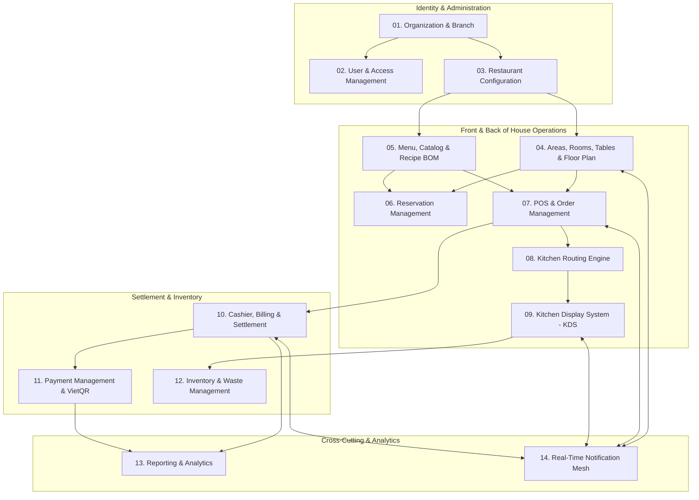

# Business Module Overview & Proposed Boundaries — SmartRestaurant

- **Document Version**: 1.0.0
- **Document Status**: `CONFIRMED` (Explicitly approved by Project Owner in Task 02.6)
- **Related Documents**: [PRD.md](./PRD.md), [BUSINESS-REQUIREMENTS.md](./BUSINESS-REQUIREMENTS.md), [MVP-SCOPE.md](./MVP-SCOPE.md)

---

## 1. Modular Monolith Business Boundary Map

SmartRestaurant is structured as a cohesive **Modular Monolith**. Business logic is partitioned into distinct, high-cohesion business modules. Inter-module communication is restricted to explicit service interfaces and in-process domain events, preventing tight database cross-joins.

---

## 2. Module Specifications

### Module 01: Organization & Branch Management
- **Main Responsibilities**: Enforces multi-tenant data isolation and multi-branch organizational hierarchy.
- **Key Business Capabilities**:
  - Global tenant configuration (`Organization`).
  - Branch provisioning with operating hours, tax identifiers, and contact details.
  - Multi-location data isolation enforcement (`OrganizationId`, `BranchId`).
- **Main Entities / Business Concepts**: `Organization`, `Branch`, `OperatingHours`, `BranchTaxProfile`.
- **Dependencies**: None (Top-level organizational root).
- **Release Target**: **v1.0 MVP**.

### Module 02: User & Access Management (RBAC)
- **Main Responsibilities**: Manages staff accounts, authentication, role assignments, and manager authorization overrides.
- **Key Business Capabilities**:
  - Staff onboarding and role assignment (`Admin`, `Manager`, `Cashier`, `Waiter`, `Chef`, `Stockkeeper`).
  - Secure PIN code authentication for quick waiter/cashier terminal switching.
  - Manager override PIN authorization for high-risk operations (voids, post-fire dish cancellations).
  - Activity audit logging for sensitive actions.
- **Main Entities / Business Concepts**: `StaffUser`, `Role`, `PermissionClaim`, `ManagerPinOverride`, `AuditLog`.
- **Dependencies**: Module 01 (`Organization & Branch`).
- **Release Target**: **v1.0 MVP**.

### Module 03: Restaurant Configuration
- **Main Responsibilities**: Manages operational parameters, localized tax rules, service charges, and receipt styling.
- **Key Business Capabilities**:
  - Configurable VAT rate profiles (e.g., 8%, 10%).
  - Configurable service charge rates (e.g., 0%, 5%, 10%) and taxability rules.
  - Thermal printer templates (receipt header, footer, promotional text, QR code).
  - Currency display rules (VND standard formatting).
- **Main Entities / Business Concepts**: `RestaurantPolicy`, `TaxProfile`, `PrinterConfig`, `ReceiptTemplate`.
- **Dependencies**: Module 01 (`Organization & Branch`).
- **Release Target**: **v1.0 MVP**.

### Module 04: Areas, Rooms, Tables & Floor Plan Designer
- **Main Responsibilities**: Manages physical restaurant layouts, 2D visual canvas designer, and table operational lifecycles.
- **Key Business Capabilities**:
  - Multi-area partitioning (Indoor, Terrace, Rooftop, Garden).
  - Enclosed rooms and private VIP suites (VIP 1, VIP 2).
  - Interactive 2D drag-and-drop floor plan designer (Konva.js) with grid alignment, zooming, and rotation.
  - Table geometric properties (Round, Rectangular, Booth) and seating capacities.
  - Architectural obstacles (pillars, walls, service stations, entryways).
  - Real-time table status lifecycle (`Available`, `Reserved`, `Occupied`, `BillingRequested`, `CleaningNeeded`, `OutOfService`).
  - Table operations: Move table, merge tables, split table.
- **Main Entities / Business Concepts**: `DiningArea`, `Room`, `VipSuite`, `Table`, `TableNodeCoordinates`, `Obstacle`, `TableState`.
- **Dependencies**: Module 01, Module 14 (`Real-Time Notification`).
- **Release Target**: **v1.0 MVP**.

### Module 05: Menu, Catalog & Recipe BOM Management
- **Main Responsibilities**: Master catalog of culinary offerings, portion variants, modifier groups, and raw material recipes.
- **Key Business Capabilities**:
  - Category and subcategory management with visual icons.
  - Menu item creation with base pricing and portion size variants (S, M, L).
  - Required and optional modifier groups (single-choice, multi-choice, min/max limits).
  - Special preparation preferences (sugar, ice, spicy levels).
  - Temporary dish unavailability (86-ing).
  - Recipe formulation (v1.1): Mapping dishes and variants to exact raw ingredient BOM quantities.
- **Main Entities / Business Concepts**: `Category`, `MenuItem`, `ItemVariant`, `ModifierGroup`, `ModifierOption`, `SaleableInventoryItem` (MVP); `RecipeBOM`, `Ingredient` (v1.1).
- **Dependencies**: Module 01, Module 08 (`Kitchen Routing`).
- **Release Target**: **v1.0 MVP** (Menu Catalog & Modifiers; Recipe BOM deferred to **v1.1**).

### Module 06: Reservation & Guest Management
- **Main Responsibilities**: Advance table bookings, guest headcount, deposit management, and walk-in waitlisting.
- **Key Business Capabilities**:
  - Booking creation with party size, arrival time, special requests, and contact details.
  - Room or specific table pre-assignment.
  - Automatic reservation arrival countdown and visual floor plan alerts.
  - Reservation status transitions (`Confirmed`, `Seated`, `Cancelled`, `NoShow`).
- **Main Entities / Business Concepts**: `Reservation`, `GuestProfile`, `DepositRecord`.
- **Dependencies**: Module 04 (`Tables & Areas`).
- **Release Target**: **v1.0 MVP** (Core reservations); Advanced CRM in v1.2.

### Module 07: POS & Order Management
- **Main Responsibilities**: Front-of-house order capture, tablet touch interface, order round management, and table session tracking.
- **Key Business Capabilities**:
  - Active dining session creation upon guest seating.
  - Touch-optimized order entry with fast item search and quick modifier selection.
  - Incremental order round management (Round 1, Round 2, Round 3).
  - Order firing to kitchen with atomic database transaction commit.
  - Order amendments (adding items, item-level discounts, customer notes).
  - Post-fire dish cancellation with manager PIN override and mandatory cancellation reason.
  - Order types: `DineIn`, `Takeaway`, `Delivery`.
- **Main Entities / Business Concepts**: `DiningSession`, `Order`, `OrderRound`, `OrderItem`, `OrderItemModifier`, `OrderType`.
- **Dependencies**: Module 02, Module 04, Module 05, Module 08, Module 14.
- **Release Target**: **v1.0 MVP**.

### Module 08: Kitchen Routing Engine
- **Main Responsibilities**: Evaluates ordered items and decomposes single orders into station-specific kitchen tickets based on business rules.
- **Key Business Capabilities**:
  - Configurable station mapping per dish and variant.
  - Multi-station decomposition (e.g., splitting steaks to Hot Kitchen, salads to Cold Kitchen, cocktails to Bar).
  - Master expediter ticket consolidation.
  - Course sequencing and "Hold / Fire" instructions (e.g., hold desserts).
- **Main Entities / Business Concepts**: `KitchenStation`, `RoutingRule`, `TicketDecomposer`.
- **Dependencies**: Module 05 (`Menu Catalog`), Module 07 (`Order Management`).
- **Release Target**: **v1.0 MVP**.

### Module 09: Kitchen Display System (KDS) & Bar Operations
- **Main Responsibilities**: Back-of-house digital ticket queue, touch-based status progression, and SLA wait-time monitoring.
- **Key Business Capabilities**:
  - High-visibility touchscreen cards sorted by arrival FIFO.
  - Line-item and ticket-level state progression (`Pending` $\rightarrow$ `Cooking` $\rightarrow$ `ReadyToServe` $\rightarrow$ `Served`).
  - Color-coded SLA timers: Green (<10m), Yellow (10–20m), Flashing Red (>20m).
  - Master Expediter window showing whole-table completion readiness.
  - Audio chimes for new tickets, rush priority tickets, and item cancellations.
- **Main Entities / Business Concepts**: `KitchenTicket`, `TicketItem`, `StationQueue`, `SlaTimerConfig`.
- **Dependencies**: Module 08, Module 12 (`Inventory Deduction`), Module 14.
- **Release Target**: **v1.0 MVP**.

### Module 10: Cashier, Billing & Settlement
- **Main Responsibilities**: Accurate invoice generation, tax and service charge calculations, discount vouchers, and split/merge checks.
- **Key Business Capabilities**:
  - Pre-bill preview printing for guest review.
  - Mathematical calculation of subtotal, item discounts, order vouchers, service charge, and VAT.
  - Bill splitting: *Split by selected items* and *Split evenly ($1/N$)*.
  - Combining multiple tables/orders into a single consolidated checkout.
  - Cash drawer shift operations: opening float, cash drops, shift close, blind drop reconciliation, and Z-Reports.
- **Main Entities / Business Concepts**: `Invoice`, `InvoiceLineItem`, `SplitInvoice`, `Voucher`, `ShiftSession`, `CashDrawerTransaction`.
- **Dependencies**: Module 03, Module 04, Module 07, Module 11.
- **Release Target**: **v1.0 MVP**.

### Module 11: Payment Management & VietQR Integration
- **Main Responsibilities**: Multi-channel payment recording, gateway integrations, and automated transaction reconciliation.
- **Key Business Capabilities**:
  - Multi-tender payment recording on a single invoice (Cash, Card, Bank Transfer).
  - Dynamic VietQR (Napas 24/7) on-screen QR generation with embedded exact payable amount and unique reference code.
  - Automated payment verification via gateway webhook or polling confirmation.
  - Payment refund and void handling with manager authorization.
- **Main Entities / Business Concepts**: `Payment`, `PaymentMethod`, `VietQrTransaction`, `RefundRecord`.
- **Dependencies**: Module 10 (`Cashier & Billing`).
- **Release Target**: **v1.0 MVP**.

### Module 12: Inventory & Waste Management
- **Main Responsibilities**: Direct finished portion stock tracking (portions, bottles, cans) with Two-Phase Lock in MVP; raw ingredient stock tracking, unit conversions, and automatic recipe BOM consumption in v1.1.
- **Key Business Capabilities**:
  - Direct saleable item stock management with Two-Phase Inventory Lock (`Available = Physical - Reserved`).
  - Waste and spoilage logging with mandatory root-cause categories (Burnt, Spilled, Expired, Customer Cancelled Post-Fire, Remake).
  - Low-stock threshold alerts and automatic 86-ing when available stock reaches zero.
  - Inward inventory receipts and supplier management for direct items.
  - Sub-gram raw ingredient inventory, unit conversions, and BOM recipe deduction (v1.1+).
- **Main Entities / Business Concepts**: `StockLevel`, `ReservedStock`, `WasteLog`, `PurchaseOrder` (MVP); `Ingredient`, `UnitConversion`, `BOMDeductionRule` (v1.1).
- **Dependencies**: Module 05, Module 09 (`KDS Readiness`).
- **Release Target**: **v1.0 MVP** (Direct Saleable Item Inventory & Waste Logging; Raw Material BOM deferred to **v1.1**).

### Module 13: Reporting & Business Analytics
- **Main Responsibilities**: Real-time sales dashboards, historical performance reports, staff sales attribution, and inventory variance.
- **Key Business Capabilities**:
  - Live revenue dashboard (gross sales, net sales, active open tables, average ticket size).
  - Sales by menu category, item popularity (Pareto analysis).
  - Hourly heatmaps (peak order volume and kitchen preparation duration).
  - Table turnaround time and utilization rates.
  - Loss reports: item cancellations, discounts, and waste write-offs.
- **Main Entities / Business Concepts**: `DailySalesReport`, `ItemPerformanceMetric`, `TableUtilizationMetric`.
- **Dependencies**: Module 04, Module 07, Module 09, Module 10, Module 12.
- **Release Target**: **v1.0 MVP** (Core dashboards); Advanced predictive analytics in v2.0.

### Module 14: Real-Time Notification Mesh
- **Main Responsibilities**: Centralized zero-latency bidirectional SignalR communication across all connected restaurant terminals.
- **Key Business Capabilities**:
  - Live table state broadcasts (`TableHub`).
  - Instant order dispatch and cancellation alerts (`OrderHub`).
  - Real-time KDS ticket queue synchronization (`KitchenHub`).
  - Reconnection state synchronization handling for mobile terminals.
- **Main Entities / Business Concepts**: `SignalREventContract`, `ClientConnectionRegistry`, `SyncHandshake`.
- **Dependencies**: Cross-cutting infrastructure for all operational modules.
- **Release Target**: **v1.0 MVP**.
