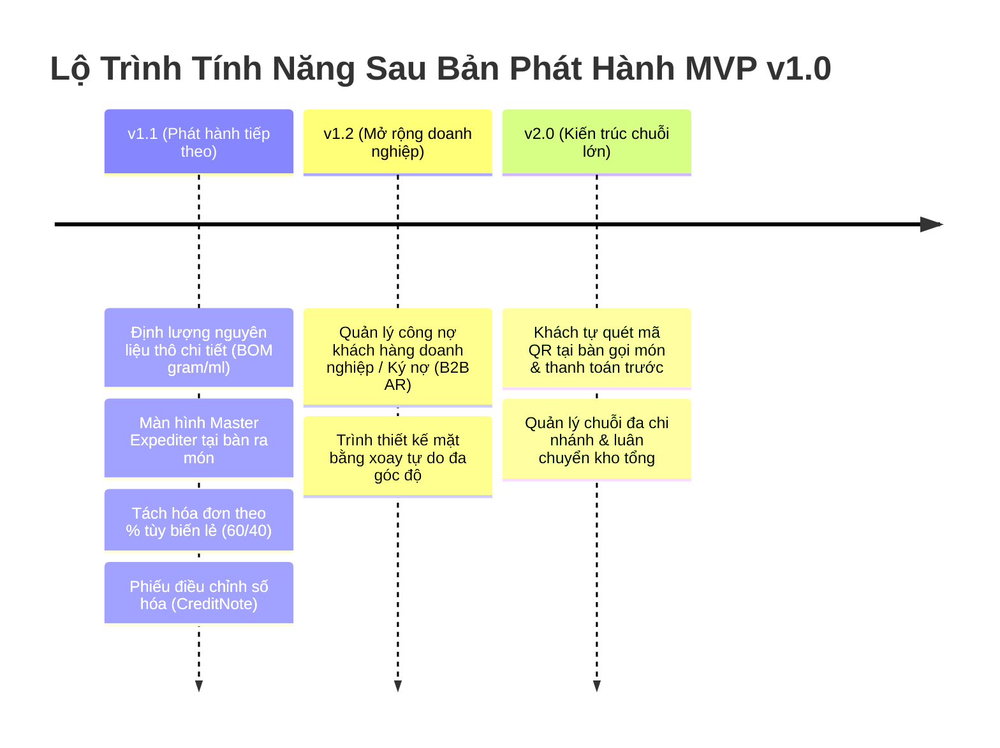

# Hồ Sơ Cơ Sở Phạm Vi MVP & Lộ Trình Phát Hành (MVP Scope Baseline)
## DỰ ÁN SMARTRESTAURANT — GIAI ĐOẠN 1 (STAGE 1 BASELINE)

- **Dự Án**: SmartRestaurant — Hệ Thống Quản Lý Vận Hành Nhà Hàng Độc Lập
- **Mã Tài Liệu**: `MVP-SCOPE-BASELINE`
- **Phiên Bản Cơ Sở**: `v1.0.0-FROZEN`
- **Trạng Thái Quản Trị**: `OWNER-CONFIRMED & SEALED`
- **Tài Liệu Căn Cứ**: [`MVP-SCOPE.md`](./MVP-SCOPE.md), [`PRD.md`](./PRD.md), [`OWNER-DECISION-WORKSHOP.md`](./OWNER-DECISION-WORKSHOP.md), [`TASK-02.8.6-OWNER-DECISION-IMPLEMENTATION-REPORT.md`](./TASK-02.8.6-OWNER-DECISION-IMPLEMENTATION-REPORT.md)

---

## 1. Tầm Nhìn Sản Phẩm & Ranh Giới Vận Hành MVP (Product Vision & Boundary)

### 1.1. Tuyên Ngôn Tầm Nhìn
SmartRestaurant được định vị là phần mềm quản lý vận hành chuyên sâu cho nhà hàng ẩm thực tại Việt Nam, tập trung vào trải nghiệm mượt mà, trực quan, tốc độ xử lý nhanh và tính minh bạch tài chính cao.

### 1.2. Ranh Giới Đơn Điểm Cốt Lõi (Single Independent Restaurant — OD-01 / CONTR-01)
- **Phạm vi MVP**: Toàn bộ luồng vận hành, giao diện người dùng và tính năng của bản phát hành MVP v1.0 được thiết kế chuyên biệt cho **một nhà hàng độc lập tại một địa điểm kinh doanh vật lý duy nhất**.
- **Không có nghiệp vụ chuỗi trong MVP**: Tuyệt đối không xây dựng các màn hình điều chuyển kho giữa các chi nhánh, đồng bộ danh mục thực đơn chuỗi, hay phân bổ doanh thu nhượng quyền trong phiên bản này.
- **Sẵn sàng mở rộng trong lược đồ dữ liệu**: Mặc dù chỉ kích hoạt 1 chi nhánh khi chạy, toàn bộ thực thể dữ liệu nghiệp vụ đều chứa các khóa ngoại `OrganizationId` và `BranchId` để chuẩn bị cho tương lai.

---

## 2. Khung Phân Loại Phạm Vi Sản Phẩm (Scope Classification Matrix)

Toàn bộ các phân hệ và năng lực nghiệp vụ được phân định nghiêm ngặt theo 4 cấp độ quản trị:

| Cấp Độ Phân Loại | Định Nghĩa Quản Trị | Trạng Thái Phê Duyệt |
| :--- | :--- | :---: |
| **`MVP Core`** | Các phân hệ và năng lực **bắt buộc phải có** để hệ thống có thể vận hành tối thiểu tại nhà hàng. Không thể tắt hoặc loại bỏ. | `OWNER-CONFIRMED` |
| **`MVP Optional`** | Các phân hệ và năng lực **được cung cấp sẵn trong bản v1.0**, nhưng chủ nhà hàng có thể bật hoặc tắt linh hoạt tùy nhu cầu và trang thiết bị. | `OWNER-CONFIRMED` |
| **`Post-MVP`** | Các năng lực **chưa thuộc MVP**, đã được Chủ Dự Án hoặc đội ngũ BA xác định lộ trình phát hành cụ thể (v1.1, v1.2+, v2.0). | `CONFIRMED DEFERRED` |
| **`OPEN`** | Các nội dung chưa có quyết định cuối cùng từ Chủ Dự Án hoặc đang chờ kiểm tra tính khả thi. | `OPEN` |

---

## 3. Ma Trận Chi Tiết 14 Phân Hệ Nghiệp Vụ Trong MVP

Bảng phân loại chi tiết 14 phân hệ đã được Chủ Dự Án chính thức phê chuẩn:

| Mã Phân Hệ | Tên Phân Hệ (VN / EN) | Mục Tiêu Nghiệp Vụ Chính | Phạm Vi Chức Năng Cụ Thể | Phụ Thuộc Nghiệp Vụ | Phân Loại MVP | Trạng Thái Phê Duyệt | Các Chức Năng Đã Xác Nhận (Confirmed) | Các Hạng Mục Còn OPEN |
| :---: | :--- | :--- | :--- | :--- | :---: | :---: | :--- | :---: |
| **MOD-01** | Quản Trị Tổ Chức & Điểm Bán / Store Identity | Xác lập pháp nhân điểm bán đơn, giờ hoạt động và thông tin liên hệ. | Hồ sơ nhà hàng, thông tin chi nhánh, giờ mở/đóng cửa, múi giờ UTC+7. | Không có (Gốc) | `MVP Core` | `OWNER-CONFIRMED` | Thiết lập điểm bán đơn, giờ làm việc, thông tin in bill. | Không có |
| **MOD-02** | Phân Quyền & Mã PIN / RBAC & Staff PIN | Kiểm soát truy cập, bảo mật tài khoản nhân viên và mã PIN Quản lý. | Đăng nhập tài khoản, chuyển ca nhanh bằng PIN 4 số, ủy quyền hủy món/chiết khấu. | `MOD-01` | `MVP Core` | `OWNER-CONFIRMED` | Phân quyền vai trò (Admin, Manager, Cashier, Waiter, Chef, Stockkeeper); xác thực PIN Quản lý. | Không có |
| **MOD-03** | Cấu Hình Hệ Thống & Thuế / System Configuration | Quản lý tham số tính toán tài chính, giờ cắt ngày và định dạng địa phương. | Cài đặt giờ chốt ngày (06:00), thuế suất VAT (8%/10%), thuế phí dịch vụ, lời chào bill. | `MOD-01` | `MVP Core` | `OWNER-CONFIRMED` | Giờ chốt ngày 06:00 (`D1`); VAT trên phí dịch vụ (`OQ-06`); định dạng VNĐ. | Không có |
| **MOD-04** | Sơ Đồ Bàn, Phòng & Khu Vực / Floor Plan | Quản lý không gian ăn uống 2D trực quan và trạng thái bàn ăn thời gian thực. | Trình thiết kế sơ đồ Konva.js, đổi màu trạng thái bàn, chuyển bàn, gộp/hủy gộp, bao trọn phòng VIP. | `MOD-01`, `MOD-03` | `MVP Core` | `OWNER-CONFIRMED` | Không gian phân cấp Khu vực $\rightarrow$ Phòng $\rightarrow$ Bàn; phụ thu phòng VIP (`PDR-011`); hủy gộp bàn (`PDR-010`). | Xoay tự do ngoài góc 90° (Hoãn v1.2) |
| **MOD-05** | Thực Đơn & Nhóm Tùy Chọn / Menu & Modifiers | Quản lý danh mục món ăn, nhóm tùy chọn món và giá bán theo khẩu phần. | Phân cấp danh mục đa tầng, biến thể kích cỡ (S/M/L), nhóm tùy chọn (bắt buộc/tự do), ghi chú món. | `MOD-01` | `MVP Core` | `OWNER-CONFIRMED` | Danh mục món; nhóm tùy chọn; cờ phục vụ trực tiếp `DirectFOHPick` (`PDR-012`). | Không có |
| **MOD-06** | Quản Lý Đặt Bàn Trước / Table Reservation | Tiếp nhận và quản lý danh sách khách đặt chỗ trước, nhận cọc và đếm ngược. | Danh sách đặt trước, tiền đặt cọc, đếm ngược giờ khách đến, chuyển đổi sang phiên bàn ăn. | `MOD-04` | `MVP Optional` | `OWNER-CONFIRMED (OD-15)` | Khớp nối lỏng (loose-coupling); 1 chạm bật/tắt; giữ cọc đặt bàn. | Không có |
| **MOD-07** | Bán Hàng POS & Đơn Hàng / POS Order Capture | Giao diện cảm ứng phục vụ tại bàn, đợt gọi món và giỏ hàng tạm thời. | Chọn món cảm ứng, thêm món gọi thêm, ghi chú bếp, gọi món đồng thời không khóa bàn. | `MOD-02, 04, 05` | `MVP Core` | `OWNER-CONFIRMED` | Gọi món đồng thời (`PDR-014`); bàn tạm tính vẫn cho phép sửa/gọi thêm (`OD-13 / BR-06`). | Không có |
| **MOD-08** | Động Cơ Điều Phối Bếp / Kitchen Routing | Phân tách đơn gọi món thành các phiếu chế biến theo từng trạm bếp/quầy bar. | Phân tuyến theo trạm Bếp Nóng, Bếp Nguội, Quầy Bar; bỏ qua trạm cho món đóng chai FOH. | `MOD-05, 07` | `MVP Core` | `OWNER-CONFIRMED` | Phân tuyến trạm động (`PDR-003`); bỏ qua KDS cho món lấy ngay FOH (`PDR-012`). | Màn hình Master Expediter (Hoãn v1.1) |
| **MOD-09** | Màn Hình Bếp Điện Tử / Digital KDS | Hàng đợi đơn món cảm ứng không dùng giấy tại các trạm bếp kèm đồng hồ SLA. | Hiển thị thẻ món, chuyển trạng thái nấu/xong, cảnh báo màu SLA vàng/đỏ, phát chuông. | `MOD-08, 14` | `MVP Optional` | `OWNER-CONFIRMED` | KDS đa trạm; ưu tiên KDS `AutoPrintOnFire: false` (`OQ-02`); làm lại món (`PDR-015`). | Tự động in nhiệt song song (Cấu hình) |
| **MOD-10** | Thu Ngân, Tính Tiền & Hóa Đơn / Billing & Cashier | Tính tiền, tách bill, chiết khấu, VAT, phí phục vụ và chốt ca thu ngân. | In phiếu tạm tính, tách bill theo món & chia đều, đa phương thức thanh toán, Báo cáo Z chốt két. | `MOD-03, 07` | `MVP Core` | `OWNER-CONFIRMED` | Tách bill không khóa bàn (`PDR-005/009`); kiểm tiền mù cuối ca; hóa đơn đã đóng bất biến (`OD-14`). | Tách bill theo % lẻ 60/40 (Hoãn v1.1) |
| **MOD-11** | Cổng Thanh Toán VietQR / VietQR Gateway | Thanh toán chuyển khoản tự động qua mã QR động Napas 24/7 và sổ treo đối soát. | Sinh mã VietQR động kèm số tiền/mã bill, nhận webhook Napas, sổ treo giao dịch đến muộn. | `MOD-10, 14` | `MVP Optional` | `OWNER-CONFIRMED` | Webhook bất đồng bộ; xử lý QR đến muộn vào Sổ Treo `SuspenseLedger` (`PDR-008`). | Không có |
| **MOD-12** | Quản Lý Tồn Kho Món Đếm Được / Stock & Waste | Quản lý số lượng tồn kho thành phẩm đếm được và ghi sổ tổn thất hao phí bếp. | Khóa tồn kho 2 bước cho chai/lon/khẩu phần, cảnh báo hết món (86), ghi sổ tổn thất hao phí hủy món. | `MOD-05, 07` | `MVP Optional` | `OWNER-CONFIRMED` | Khóa kho 2 bước món đếm được (`D2/D5`); ghi sổ hao phí hủy món vào `WasteLog` (`PDR-004`). | Định lượng BOM gram/ml (Hoãn v1.1) |
| **MOD-13** | Báo Cáo Doanh Thu & Bán Hàng / Sales Analytics | Thống kê doanh thu, báo cáo ca thu ngân, phân tích mặt hàng bán chạy. | Báo cáo doanh số theo ngày, doanh thu theo ca, chênh lệch quỹ két, phân tích nhóm món. | `MOD-07, 10` | `MVP Core` | `OWNER-CONFIRMED` | Báo cáo doanh thu gộp; đối soát ca thu ngân; lưu vết chênh lệch két `ShiftClosingVarianceLog`. | Không có |
| **MOD-14** | Trục Đồng Bộ Thời Gian Thực / SignalR Mesh | Đồng bộ hóa dữ liệu tức thì giữa các thiết bị POS, KDS và Sơ đồ bàn. | Phát sóng sự kiện đổi màu bàn, thông báo món nấu xong, cảnh báo đơn mới dưới 500ms. | Không có (Hạ tầng) | `MVP Core` | `OWNER-CONFIRMED` | Đồng bộ đa thiết bị; đệm dữ liệu cục bộ khi mất mạng và tự động kết nối lại. | Không có |

---

## 4. Lộ Trình Phát Hành Tính Năng Sau MVP (Post-MVP Roadmap)

### 4.1. Phiên Bản v1.1 (Phát Hành Kế Tiếp)
1. **Định lượng nguyên liệu thô theo công thức chi tiết (BOM gram/ml — D5 / PDR-004)**: Khấu trừ tồn kho nguyên vật liệu gốc (thịt bò, gạo, gia vị) theo công thức món ăn khi bếp nấu.
2. **Màn hình tổng hợp Master Expediter (`PDR-003`)**: Màn hình điều phối ra món tổng thể đặt tại cửa tiếp thực để kiểm soát nhịp độ bàn ăn.
3. **Tách hóa đơn theo tỷ lệ % tùy ý (`OQ-01`)**: Hỗ trợ tách bill phức tạp theo tỷ lệ lẻ (ví dụ: 60/40, 70/30) kèm xử lý làm tròn đồng Việt Nam.
4. **Bút toán điều chỉnh hóa đơn đã đóng số hóa (`CreditNote` — OD-14)**: Thay thế biên bản giấy bằng quy trình tạo CreditNote số hóa trong phần mềm.

### 4.2. Phiên Bản v1.2+ (Mở Rộng Nghiệp Vụ Doanh Nghiệp)
1. **Quản lý công nợ khách hàng doanh nghiệp / Ký nợ (`REV-07`)**: Phân hệ tài chính B2B chuyên biệt theo dõi hạn mức tín dụng và công nợ đối tác.
2. **Xoay tự do góc độ trên sơ đồ mặt bằng**: Nâng cấp công cụ Konva.js cho phép xoay bàn ăn tự do ở mọi góc độ lẻ ngoài 4 góc vuông (0°, 90°, 180°, 270°).

### 4.3. Phiên Bản v2.0 (Chuyển Đổi Mô Hình Chuỗi & Tự Phục Vụ)
1. **Thực khách tự quét QR tại bàn gọi món & trả trước (`PRD §4.2`)**: Khách dùng điện thoại cá nhân xem menu, gọi món và chuyển khoản trước.
2. **Hệ thống quản lý chuỗi nhà hàng tập trung & Kho tổng**: Hỗ trợ đồng bộ thực đơn từ trụ sở chính, phân bổ giá bán theo vùng miền và luân chuyển nguyên liệu liên chi nhánh.

---

## 5. Danh Mục Loại Trừ Phạm Vi Tuyệt Đối Trong MVP (Out-of-Scope Invariants)

Các tính năng sau đây **tuyệt đối không được thiết kế hoặc triển khai trong MVP v1.0**:
- **Không quản lý chuỗi / Nhiều chi nhánh**: MVP chỉ chạy trên 1 điểm bán đơn lẻ.
- **Không trừ kho nguyên liệu thô gram/ml**: Chỉ quản lý hàng thành phẩm/món đếm được.
- **Không ghi nợ B2B / Ký nợ doanh nghiệp**: Toàn bộ hóa đơn phải được quyết toán trong ca.
- **Không cho khách tự gọi món trên điện thoại cá nhân**: Chỉ nhân viên phục vụ dùng tablet POS gọi món.
- **Không tự động sinh mã hóa đơn điện tử với Tổng cục Thuế**: Chỉ lưu siêu dữ liệu thuế sẵn sàng cho kết nối sau này.
