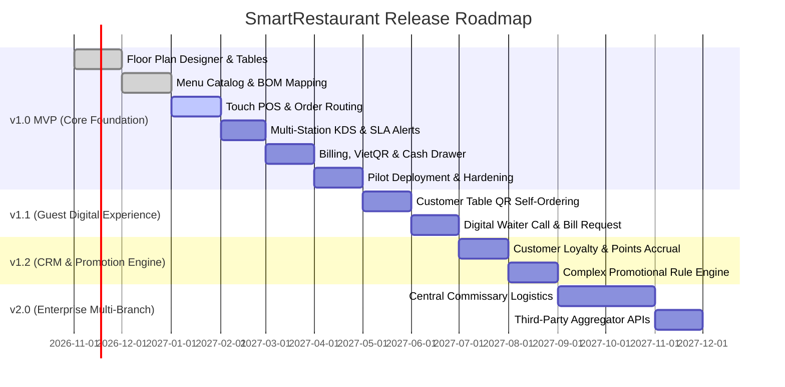
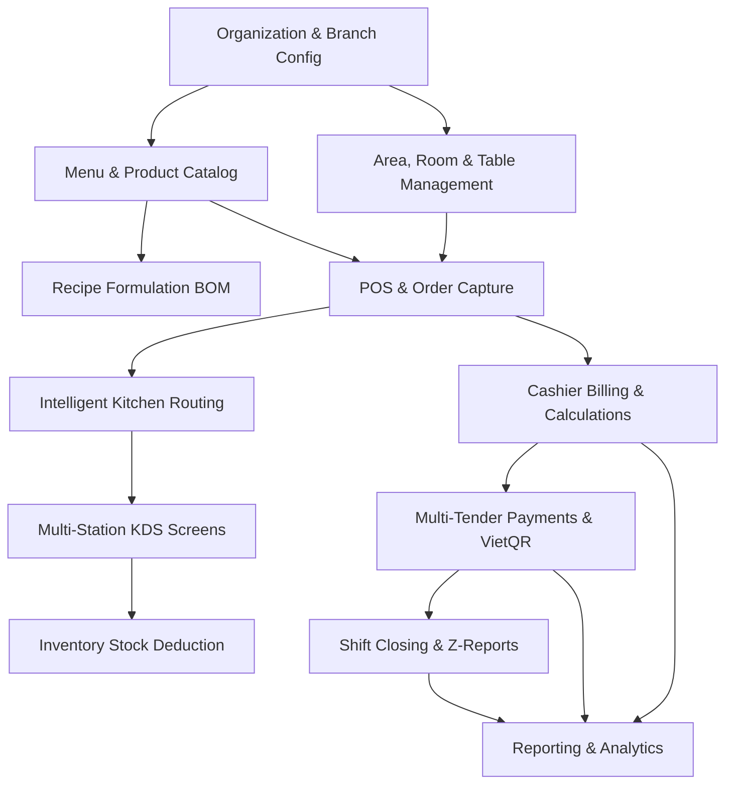

# MVP Scope & Release Roadmap — SmartRestaurant

- **Document Version**: 1.0.0
- **Document Status**: `PROPOSED`
- **Related Documents**: [PRD.md](./PRD.md), [BUSINESS-REQUIREMENTS.md](./BUSINESS-REQUIREMENTS.md), [MODULE-OVERVIEW.md](./MODULE-OVERVIEW.md)

---

## 1. Scope Governance & Prioritization Framework

To ensure a resilient, stable, and production-ready core, SmartRestaurant employs the **MoSCoW Prioritization Method** (Must Have, Should Have, Could Have, Won't Have).

### Guiding Principles for MVP Scoping
1. **Core Operational Viability First**: A restaurant cannot operate a single shift without reliable table tracking, touch order entry, kitchen station routing, and cash/card checkout. These are strict `Must-Have` items.
2. **Defend Kitchen-FOH Communication**: Eliminating paper chits and establishing sub-second SignalR KDS tickets prevents the #1 failure mode in busy restaurants.
3. **Prevent Premature Edge Integrations**: Features such as online delivery aggregators (Grab/Shopee), multi-warehouse inter-branch transfer logistics, and automated SMS marketing require massive external dependencies and add zero value to immediate on-premise dining stability.

---

## 2. Detailed MoSCoW Feature Matrix

| Feature / Subsystem | Scope Description | Priority | Target Release | Rationale for Classification |
| :--- | :--- | :---: | :---: | :--- |
| **Visual 2D Floor Plan** | Interactive drag-and-drop canvas (Konva.js), tables, areas, VIP rooms. | **Must Have** | v1.0 MVP | Fundamental for FOH staff to locate tables and visualize status in real-time. |
| **Table State Lifecycle** | `Available`, `Occupied`, `Reserved`, `BillingRequested`, `CleaningNeeded`. | **Must Have** | v1.0 MVP | Critical to prevent double-seating and coordinate busser sanitization. |
| **Table Move & Merge** | Seamless session migration between tables; merging parties. | **Must Have** | v1.0 MVP | Frequent daily occurrence in casual and banquet dining. |
| **Digital Menu & Modifiers**| Categories, items, portion sizes, required/optional modifier groups, 86-ing. | **Must Have** | v1.0 MVP | Core prerequisite for taking any accurate order. |
| **Waiter Touch POS** | Quick item search, touch grid, notes, add-on rounds, firing orders. | **Must Have** | v1.0 MVP | Primary FOH operational tool. |
| **Multi-Station KDS** | Hot, Cold, Bar, Bakery routing, SLA timers (<10m, 10-20m, >20m red alerts). | **Must Have** | v1.0 MVP | Core differentiator; eliminates paper kitchen chits. |
| **Master Expediter KDS** | Consolidated table pass view for coordinating runner dish delivery. | **Must Have** | v1.0 MVP | Prevents companion dishes from being served cold. |
| **Billing & Calculations** | Subtotals, item/order discounts, service charge, configurable VAT (8%/10%). | **Must Have** | v1.0 MVP | Legal and operational prerequisite for financial settlement. |
| **Multi-Tender Payments** | Cash, Card POS terminal, and Dynamic VietQR (Napas 24/7). | **Must Have** | v1.0 MVP | Accommodates modern Vietnamese payment preferences. |
| **Bill Splitting** | Split by item selection and split evenly ($1/N$). | **Must Have** | v1.0 MVP | High-frequency requirement for group dining. |
| **Shift & Cash Drawer** | Opening float, shift close, blind drop, cash discrepancy, Z-Report. | **Must Have** | v1.0 MVP | Essential for internal control and theft prevention. |
| **Basic Recipe BOM** | Ingredient formulation and auto-deduction on dish completion. | **Must Have** | v1.0 MVP | Fundamental for calculating Cost of Goods Sold (COGS). |
| **Vietnamese-First UI** | 100% natural Vietnamese interface, VNĐ formatting (`#,,### ₫`), 24h timestamps. | **Must Have** | v1.0 MVP | Fundamental for zero-friction operation in Vietnamese F&B establishments. |
| **Manager Override PIN** | Security PIN for bill voids, dish cancellation, manual discounts. | **Must Have** | v1.0 MVP | Vital anti-fraud control. |
| **Live Sales Dashboard** | Hourly revenue, top-selling items, table turnover rate. | **Should Have**| v1.0 MVP | Provides daily operational intelligence to managers. |
| **Table Reservations** | Advance booking schedule with arrival countdown. | **Should Have**| v1.0 MVP | Needed for peak weekend planning. |
| **Waste & Spoilage Log** | Recording burnt/dropped food with mandatory reason codes. | **Should Have**| v1.0 MVP | Connects kitchen errors to inventory variance. |
| **ESC/POS Thermal Printing**| Hardware backup for pre-bills and kitchen chits with UTF-8 Vietnamese. | **Should Have**| v1.0 MVP | Hardware resilience during network or screen maintenance. |
| **Customer QR Ordering** | Dine-in guest self-ordering via mobile browser. | **Could Have** | v1.1 | Enhances guest speed, but requires stable FOH baseline first. |
| **E-Invoice Integration** | Direct API connection to VNPT/Viettel/MISA E-Invoice (Thông tư 78). | **Could Have** | v1.1 | Official electronic tax invoice generation post-MVP. |
| **Customer CRM & Points** | Loyalty tier accrual, guest dining history. | **Could Have** | v1.2 | Marketing tool; not needed for opening week operations. |
| **Multilingual Support** | Secondary languages (English, Korean, Chinese) via resource catalogs. | **Could Have** | v2.0 | Caters to foreign tourist restaurants; i18n architectural readiness preserved. |
| **Aggregator Integrations** | GrabFood, ShopeeFood, Baemin API order ingestion. | **Won't Have** | v2.0 | High maintenance API contracts; outside MVP core focus. |
| **Central Supply Chain** | Inter-branch warehouse transfer & purchase requisition workflows. | **Won't Have** | v2.0 | Multi-branch logistics irrelevant for initial single/pilot branch. |

---

## 3. Explicit MVP Exclusions (Scope Boundary Guard)

The following capabilities are **explicitly excluded** from the v1.0 MVP to protect delivery timeline, architectural clarity, and software reliability:

1. **Third-Party Delivery Aggregators**: No GrabFood / ShopeeFood webhook integrations. Orders from third-party apps must be manually keyed into the POS as "Takeaway" if needed during MVP.
2. **Central Multi-Branch Warehouse Logistics**: While the database schema supports `OrganizationId` and `BranchId`, cross-branch ingredient transfers and central commissary workflows are excluded from MVP. Each branch operates its own independent inventory catalog.
3. **Customer Self-Service App / Portal**: Customers do not log in or register accounts in MVP. Table service is entirely facilitated by waitstaff tablets.
4. **Automated Dynamic Surge Pricing**: No automatic algorithm that changes dish prices during peak hours. Price changes are manual and scheduled by managers.
5. **Biometric Hardware Integration**: Staff authentication relies on PIN codes, usernames, and passwords; no fingerprint or facial recognition hardware SDKs.

---

## 4. Release Roadmap & Milestones

---

## 5. Architectural & Domain Dependencies

### Dependency Analysis:
1. **Menu & Floor Plan must precede POS**: An order cannot be formed without a physical or virtual table and active menu items.
2. **KDS precedes Inventory Deduction**: Real-time raw material consumption relies on kitchen preparation triggers (`ReadyToServe`).
3. **Billing relies on Order Capture**: An invoice cannot be calculated or split without confirmed order line items and applied promotional vouchers.
