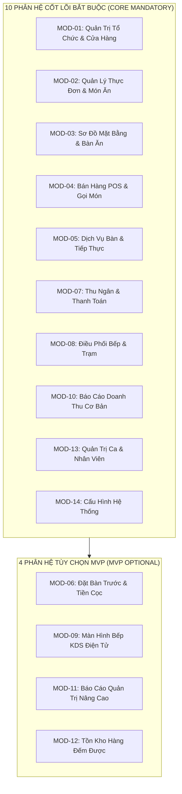
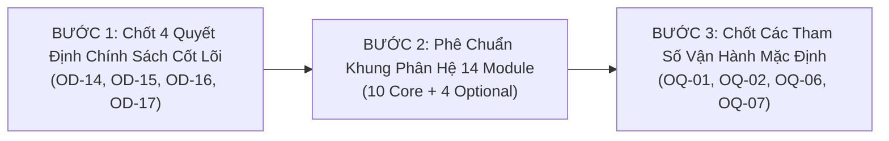

# Hồ Sơ Quyết Định Sản Phẩm Cho Chủ Dự Án — SmartRestaurant
## (Project Owner Decision Dossier & Workshop Briefs)

- **Mã Tài Liệu**: `OWNER-DECISION-WORKSHOP`
- **Dự Án**: SmartRestaurant — Hệ Thống Quản Lý Nhà Hàng Độc Lập
- **Giai Đoạn**: Stage 1 — Khám Phá Sản Phẩm & Đặc Tả Miền Nghiệp Vụ (Product Discovery & Business Domain Specifications)
- **Vai Trò Đảm Nhiệm**: Chuyên Viên Phân Tích Nghiệp Vụ, Quản Trị Sản Phẩm & Trợ Lý Chuẩn Bị Quyết Định (Business Analyst, Product Governance Analyst & Decision Preparation Assistant)
- **Ngày Phát Hành**: 2026-11-06
- **Trạng Thái Quản Trị**: **`OFFICIALLY RECORDED & SIGNED OFF BY PROJECT OWNER (ĐÃ GHI NHẬN & PHÊ DUYỆT CHÍNH THỨC BỞI CHỦ DỰ ÁN)`**
- **Cổng Giai Đoạn 2 (Stage 2 Gate)**: **`UNLOCKED & AUTHORIZED (ĐÃ MỞ KHÓA & ĐỦ ĐIỀU KIỆN KHỞI ĐỘNG)`**

---

## 1. Tóm Tắt Điều Hành (Executive Summary)

Tài liệu này được biên soạn độc lập bởi Chuyên viên Phân tích Nghiệp vụ (BA) và Quản trị Sản phẩm, nhằm phục vụ **Chủ Dự Án (Project Owner)** xem xét, đánh giá toàn diện các phương án khả thi và đưa ra quyết định chính thức đối với các vấn đề còn mở thuộc Giai đoạn 1 của dự án SmartRestaurant.

Hồ sơ chuyển tiếp dự án từ trạng thái rà soát kiểm toán sang trạng thái **Quyết định Nghiệp vụ Chính thức của Chủ Dự Án**. Mọi phân tích, so sánh ưu/nhược điểm và khuyến nghị trong tài liệu này **thuần túy mang tính chất tham vấn chuyên môn của BA/Kiến trúc sư**, tuyệt đối không thay thế thẩm quyền của Chủ Dự Án.

### Cấu Trúc Tổng Quan Của Hồ Sơ Quyết Định:
1. **8 Bản Tóm Tắt Quyết Định Độc Lập (Decision Briefs)**: Chuẩn hóa 16 mục phân tích chuyên sâu cho từng quyết định (`OD-14` đến `OD-17`, `OQ-01`, `OQ-02`, `OQ-06`, `OQ-07`).
2. **Đánh Giá Toàn Diện Khung Phân Hệ 14 Module (Module Classification Review)**: Rà soát 10 phân hệ Cốt lõi và 4 phân hệ Tùy chọn dưới dạng đề xuất `PROPOSAL`.
3. **Ma Trận Tác Động Tương Tác Giữa Các Quyết Định (Cross-Decision Consistency Matrix)**.
4. **Danh Mục Vấn Đề Cần Tham Vấn Pháp Lý & Kế Toán Thuế (Decisions Requiring Legal/Accounting Verification)**.
5. **Trình Tự Quyết Định Tối Ưu Được Khuyến Nghị (Recommended Decision Sequence)**.
6. **Sổ Đăng Ký Biểu Quyết Đã Ghi Nhận (Recorded Owner Decision Ballot Register)** với 100% quyết định đã được Chủ Dự Án phê chuẩn chính thức.

---

## 2. Các Ranh Giới Nghiệp Vụ Đã Xác Nhận Được Bảo Toàn Tuyệt Đối

Quá trình chuẩn bị quyết định tuân thủ nghiêm ngặt nguyên tắc bảo toàn các quyết định đã được Chủ Dự Án phê duyệt từ trước, không làm trôi dạt (zero drift) các cam kết kiến trúc và phạm vi:
- **`D1` (Ngày Kinh Doanh)**: Giờ cắt ngày kinh doanh mặc định `BusinessDayCutoffTime = 06:00`. Phiên bàn gắn với ngày kinh doanh tại thời điểm mở; việc thay đổi giờ cắt không tính toán hồi tố ngày kinh doanh của các phiên đã mở.
- **`D2/D5` (Khóa Tồn Kho Hai Pha & Hàng Đếm Được)**: Tồn khả dụng = Tồn thực tế - Tồn tạm giữ ($\text{Available} = \text{Physical} - \text{Reserved}$). Tạm giữ tại thời điểm Báo bếp (`OrderFired`); giải phóng khi hủy món hợp lệ. Quản lý hàng đếm được (lon, chai, thành phẩm) trong MVP; định mức nguyên liệu BOM chi tiết (gram, ml) bảo lưu sang **v1.1**.
- **`D3` (Xử Lý VietQR Đến Chậm & Sổ Treo Đối Soát)**: Cho phép thu tiền mặt thay thế; giao dịch QR ghi nhận muộn đưa vào Sổ treo đối soát (`SuspenseLedger`), thu ngân xử lý có kiểm toán.
- **`D4` (Phiên Bàn Đa Hóa Đơn & Tách Bill Không Khóa Bàn)**: Hỗ trợ tách bill theo món và tách đều; bàn ăn không bị khóa khi đang tách bill, phục vụ tiếp tục gọi thêm món bình thường.
- **`OD-01` (Ranh Giới Cửa Hàng Đơn Lập Cho MVP)**: Giới hạn nghiêm ngặt 01 nhà hàng độc lập tại 01 địa điểm duy nhất; không có logistics điều chuyển chuỗi chi nhánh trong MVP.
- **`OD-13` (Tính Bất Biến Của Hóa Đơn Đã Quyết Toán)**: Hóa đơn đã thanh toán (`IsSettled = true`) không thể bị sửa đổi trực tiếp bởi Thu ngân hay Phục vụ trên POS.
- **`REV-05..11`**: Các quy chuẩn về sơ đồ Konva.js, in nhiệt ESC/POS tiếng Việt UTF-8, đồng bộ SignalR và phân quyền 6 vai trò được bảo toàn nguyên vẹn.

---

## 3. Bản Tóm Tắt Chi Tiết 8 Quyết Định Cần Chủ Dự Án Biểu Quyết

---

### 3.1. `OD-14`: Chính Sách Xử Lý Khiếu Nại, Hủy & Hoàn Tiền Hóa Đơn Đã Thanh Toán (Paid Bill Void / Refund Policy)

1. **Mã & Tên quyết định**: `OD-14` — Chính sách Xử lý Khiếu nại, Hủy & Hoàn tiền Hóa đơn đã Thanh toán (Paid Bill Correction / Void / Refund Policy).
2. **Trạng thái hiện tại**: **`CHÍNH THỨC PHÊ DUYỆT — PHƯƠNG ÁN A (OFFICIALLY APPROVED — OPTION A)`**.
3. **Bối cảnh nghiệp vụ**: Trong hoạt động hàng ngày, sau khi thu ngân đã thu tiền và in hóa đơn thanh toán cho khách (`IsSettled = true`), có thể phát sinh các tình huống khiếu nại: khách phát hiện tính nhầm số lượng, khách trả lại món ăn chưa dùng (ví dụ: chai rượu chưa mở), hoặc khách khiếu nại chất lượng món ăn và yêu cầu bồi hoàn một phần tiền.
4. **Các quy tắc đã xác nhận ràng buộc quyết định**:
   - `OD-13`: Hóa đơn đã thanh toán (`PaidInvoices`) là bất biến, nghiêm cấm chỉnh sửa trực tiếp dữ liệu hóa đơn đã đóng.
   - `D3`: Giao dịch tiền mặt và ngân hàng phải được ghi nhận độc lập, bảo đảm audit trail.
5. **Vấn đề cần giải quyết**: Cần xác định cơ chế kiểm soát việc điều chỉnh tài chính và xuất quỹ hoàn tiền cho khách khi hóa đơn gốc không được phép chỉnh sửa: Xử lý bằng thủ tục hành chính ngoài ứng dụng hay xây dựng quy trình số hóa hủy/hoàn tiền có mã PIN trong phần mềm ngay tại bản phát hành MVP?
6. **Các phương án khả thi**:
   - **Phương án A (Thủ tục kiểm soát ngoài ứng dụng — Controlled manual handling outside application)**: Duy trì tính bất biến cứng của CSDL trong MVP. Hóa đơn đã đóng không bị can thiệp bởi bất kỳ luồng phần mềm nào. Khi có khiếu nại, Quản lý lập "Biên bản điều chỉnh sai lệch tiền két giấy" ký tay giữa Quản lý và Thu ngân, chi tiền mặt hoàn trả khách. Khi chốt ca (Blind Shift Close), hệ thống ghi nhận khoản tiền mặt thiếu hụt vào thực thể `ShiftClosingVarianceLog` (lưu vết thời điểm, lý do, người thực hiện, người xác minh, liên kết hóa đơn gốc).
   - **Phương án B (Quy trình Hủy & Hoàn tiền trong ứng dụng — In-application Void / Refund & Credit-Note workflow)**: Phát triển máy trạng thái Hủy/Hoàn tiền trên POS. Quản lý nhập mã PIN cấp cao để kích hoạt hủy hóa đơn. Hệ thống tự động sinh thực thể `CreditNote` (Bút toán âm), đảo ngược doanh thu ghi nhận, điều chỉnh số dư két tiền trong ca và cập nhật lại trạng thái bàn ăn/tồn kho.
7. **Ưu điểm (Advantages)**:
   - *Phương án A*: Cực kỳ an toàn về mặt kế toán; triệt tiêu nguy cơ nhân viên thông đồng với Quản lý lộ mã PIN để hủy bill xóa vết biển thủ tiền mặt; đơn giản hóa kiến trúc MVP; sẵn sàng mở rộng bảng `CreditNotes` ở v1.1 mà không làm hỏng dữ liệu lịch sử.
   - *Phương án B*: Trải nghiệm người dùng số hóa 100%, không cần ghi chép sổ giấy; báo cáo doanh thu ca (Z-Report) tự động khấu trừ doanh thu thuần tức thì.
8. **Nhược điểm (Disadvantages)**:
   - *Phương án A*: Đòi hỏi quy trình hành chính giấy tờ thủ công; quản lý phải lưu giữ cuống biên bản để đối chiếu với kế toán mỗi sáng; báo cáo doanh thu hệ thống ghi nhận tổng thu, phải đối trừ dòng chênh lệch két thủ công.
   - *Phương án B*: Nguy cơ rủi ro gian lận nội bộ rất cao nếu quản lý chia sẻ mã PIN cho thu ngân; tăng độ phức tạp máy trạng thái và xử lý hoàn tiền một phần (Partial Refund).
9. **Tác động vận hành (Operational Impact)**:
   - *Phương án A*: Đào tạo thu ngân và quản lý về quy trình lập biên bản giấy và nhập mã lý do sai lệch khi chốt két ca.
   - *Phương án B*: Đào tạo nhân viên về thao tác hủy bill, quy tắc hoàn tiền mặt/chuyển khoản và chính sách bảo mật mã PIN.
10. **Tác động phạm vi MVP (MVP Scope Impact)**:
    - *Phương án A*: Tác động tối thiểu; Stage 2 chỉ cần thiết kế cấu trúc dữ liệu lưu vết sai lệch chốt ca (`ShiftClosingVarianceLog`).
    - *Phương án B*: Tăng thêm **7 đến 10 ngày công** phát triển và kiểm thử hồi quy cho Stage 2, Stage 3 và Stage 5.
11. **Hàm ý kỹ thuật cấp cao (Technical Implications)**:
    - *Phương án A*: CSDL MVP duy trì tính bất biến tuyệt đối (`Invoice` chỉ có trạng thái `Settled`); bảng log đối soát chứa `VarianceAmount: decimal`, `ReasonCode: string`, `OriginalInvoiceId: Guid?`, `AuthorizedBy: Guid`.
    - *Phương án B*: Bổ sung bảng `CreditNotes`, `RefundTransactions`, xử lý đảo ngược quan hệ ngoại khóa và tính toán lại số dư hàng tồn kho.
12. **Khuyến nghị của BA & Cơ sở lý luận**:
    - **Khuyến nghị: CHỌN PHƯƠNG ÁN A CHO BẢN PHÁT HÀNH MVP; HOÃN PHƯƠNG ÁN B SANG V1.1**.
    - *Lý do*: Trong giai đoạn đầu vận hành (Pilot/MVP), việc bảo vệ tính bất biến tài chính và ngăn chặn thất thoát tiền mặt quan trọng hơn sự tiện lợi của nút bấm phần mềm.
13. **Rủi ro nếu trì hoãn quyết định**: Nếu không chốt phương án trước Stage 2, Kiến trúc sư không thể chốt mô hình thực thể hóa đơn và lược đồ ERD.
14. **Câu hỏi chính xác cần Chủ Dự Án quyết định**: *Chủ Dự Án lựa chọn giải quyết khiếu nại hóa đơn đã thanh toán trong MVP bằng thủ tục kiểm soát chênh lệch chốt ca ngoài sổ giấy (Phương án A) hay phát triển chức năng Hủy/Hoàn tiền số hóa trong ứng dụng (Phương án B)?*
15. **Quyết định của Chủ Dự Án**: **PHƯƠNG ÁN A — Duy Trì CSDL Bất Biến Tuyệt Đối Trong MVP; Xử Lý Chênh Lệch Thực Tế Qua Biên Bản Giấy Khi Chốt Két Ca & Lưu Vết Kiểm Toán**.
    - Hóa đơn đã thanh toán (`IsSettled = true`) là bất biến, nghiêm cấm nhân viên thu ngân hay quản lý chỉnh sửa/xóa trực tiếp trên phần mềm POS.
    - Khi phát sinh khiếu nại sai sót tiền sau khi đã đóng bill (khách đổi món, tính nhầm tiền), Thu ngân và Quản lý thực hiện hoàn tiền mặt thủ công từ két, lập "Biên bản điều chỉnh sai lệch két giấy" ký tay.
    - Khi thực hiện chốt ca mù (Blind Shift Close), hệ thống ghi nhận số tiền chênh lệch thực tế so với số liệu ghi sổ vào thực thể `ShiftClosingVarianceLog`, lưu vết thời điểm, người thực hiện, lý do, người xác minh và liên kết đến mã hóa đơn gốc (`OriginalInvoiceId`).
    - Hoãn quy trình số hóa `CreditNote` (bút toán âm) sang **Phiên bản v1.1**.
16. **Trạng thái phê duyệt**: **`OWNER-CONFIRMED (PHƯƠNG ÁN A)`** (Phê duyệt chính thức tại Workshop Task 02.8.5).

---

### 3.2. `OD-15`: Phân Vị Phân Hệ Đặt Bàn Trước (`MOD-06`) Trong Phạm Vi MVP

1. **Mã & Tên quyết định**: `OD-15` — Phân Vị Phân Hệ Đặt Bàn Trước (`MOD-06`) trong Phạm Vi MVP (Table Reservation Scope).
2. **Trạng thái hiện tại**: **`CHÍNH THỨC PHÊ DUYỆT — PHƯƠNG ÁN A (OFFICIALLY APPROVED — OPTION A)`**.
3. **Bối cảnh nghiệp vụ**: Đặt bàn trước (Table Reservation) là tính năng tiếp nhận khách hẹn giờ, ghi nhận thông tin liên hệ, số lượng khách, tiền đặt cọc (nếu có) và giữ bàn trong khung giờ thỏa thuận. Một số mô hình nhà hàng ẩm thực (Fine Dining, Buffet, Lẩu nướng) phụ thuộc lớn vào đặt bàn, trong khi các quán cà phê, quán ăn nhanh (QSR) hoặc quán nhậu bình dân hầu như chỉ phục vụ khách vãng lai (Walk-in).
4. **Các quy tắc đã xác nhận ràng buộc quyết định**:
   - `PDR-002`: Mô hình không gian phân cấp Khu vực $\rightarrow$ Phòng $\rightarrow$ Bàn ăn.
   - `PDR-013`: Quy tắc khóa toàn bộ bàn khi đặt bao trọn phòng VIP.
5. **Vấn đề cần giải quyết**: Xác định phân hệ Đặt bàn trước (`MOD-06`) có thuộc phạm vi phát triển ngay trong MVP dưới dạng phân hệ tùy chọn bật/tắt (MVP Optional), hay hoãn toàn bộ phân hệ này sang phiên bản v1.1 để tập trung tối đa vào vận hành tại chỗ?
6. **Các phương án khả thi**:
   - **Phương án A (Phân hệ Tùy chọn MVP — MVP Optional Module)**: Xây dựng `MOD-06` ngay trong MVP nhưng đặt dưới dạng cờ tính năng (Feature Flag). Nhà hàng có nhu cầu bật lên sử dụng đầy đủ luồng đặt chỗ; nhà hàng bình dân tắt đi thì giao diện POS ẩn toàn bộ nút đặt bàn, vận hành tinh gọn.
   - **Phương án B (Hoãn toàn bộ sang v1.1 — Defer to v1.1)**: Loại bỏ hoàn toàn thực thể và giao diện Đặt bàn trước khỏi phạm vi MVP. MVP chỉ quản lý trạng thái bàn ăn thực tế tại chỗ (`Trống`, `Có khách`, `Đang thanh toán`, `Cần dọn`).
7. **Ưu điểm (Advantages)**:
   - *Phương án A*: Sản phẩm đáp ứng được đa dạng phân khúc khách hàng ngay từ ngày đầu; giải quyết được bài toán giữ bàn VIP và tiền cọc cho nhà hàng cao cấp.
   - *Phương án B*: Rút ngắn thời gian phát triển MVP; triệt tiêu các xung đột trạng thái phức tạp giữa bàn "Đã đặt trước (Reserved)" và bàn "Khách vãng lai đến ngồi (Occupied)".
8. **Nhược điểm (Disadvantages)**:
   - *Phương án A*: Tăng độ phức tạp khi thiết kế sơ đồ mặt bằng (phải hiển thị lịch đặt theo mốc thời gian); xử lý bài toán khách đến muộn (No-Show) và giải phóng bàn giữ trước.
   - *Phương án B*: Không thể chào bán phần mềm cho các nhà hàng Fine Dining hoặc chuỗi buffet có quy trình đặt chỗ chặt chẽ trong giai đoạn Pilot.
9. **Tác động vận hành (Operational Impact)**:
   - *Phương án A*: Nhân viên lễ tân/thu ngân có giao diện sổ đặt bàn, nhận cọc VietQR/tiền mặt, tự động chuyển trạng thái bàn sang `Đã đặt` trước giờ hẹn $X$ phút.
   - *Phương án B*: Nhân viên ghi sổ tay ngoài giấy nếu có khách đặt trước, xếp chỗ thủ công khi khách đến.
10. **Tác động phạm vi MVP (MVP Scope Impact)**:
    - *Phương án A*: Tăng thêm khoảng **5 đến 7 ngày công** để hoàn thiện module `MOD-06` độc lập.
    - *Phương án B*: Giữ phạm vi MVP ở mức tối thiểu tuyệt đối.
11. **Hàm ý kỹ thuật cấp cao (Technical Implications)**:
    - *Phương án A*: Thực thể `Reservation` được thiết kế độc lập (loose coupling), liên kết lỏng với `RestaurantTable` qua `TableId` có thể null (đặt chỗ chưa gán bàn cụ thể); có cờ cấu hình bật/tắt module.
    - *Phương án B*: Bỏ qua thực thể `Reservation` trong ERD Stage 2.
12. **Khuyến nghị của BA & Cơ sở lý luận**:
    - **Khuyến nghị: CHỌN PHƯƠNG ÁN A (MVP OPTIONAL)**.
    - *Lý do*: Kiến trúc Modular Monolith cho phép cô lập `MOD-06` thành một Bounded Context riêng biệt. Việc làm dưới dạng Optional giúp mở rộng thị phần Pilot mà không làm rối mắt các khách hàng bình dân (chỉ cần tắt cờ tính năng).
13. **Rủi ro nếu trì hoãn quyết định**: Ảnh hưởng đến cấu trúc bảng bàn ăn và thiết kế giao diện sơ đồ mặt bằng (Konva.js canvas) ở Stage 2.
14. **Câu hỏi chính xác cần Chủ Dự Án quyết định**: *Chủ Dự Án quyết định đưa phân hệ Đặt Bàn Trước vào MVP dưới dạng Phân hệ Tùy chọn có thể bật/tắt (Phương án A) hay hoãn toàn bộ sang phiên bản v1.1 (Phương án B)?*
15. **Quyết định của Chủ Dự Án**: **PHƯƠNG ÁN A — Đưa vào MVP Dưới Dạng Phân Hệ Tùy Chọn (`MVP Optional`)**.
    - Sản phẩm hỗ trợ đầy đủ luồng đặt bàn, tiếp nhận lịch hẹn, ghi nhận tiền đặt cọc và tự động chuyển đổi sang phiên bàn ăn (`TableSession`).
    - Nhà hàng quy mô bình dân không có nhu cầu nhận đặt bàn có thể tắt hoàn toàn tính năng này chỉ với 1 chạm (gạt cờ tính năng); giao diện POS sẽ tự động ẩn các nút liên quan để tối ưu thao tác.
    - Kiến trúc Stage 2 thiết kế thực thể `Reservation` tách rời độc lập (loose coupling), không gây phụ thuộc cứng vào luồng mở bàn trực tiếp.
16. **Trạng thái phê duyệt**: **`OWNER-CONFIRMED (PHƯƠNG ÁN A)`** (Phê duyệt chính thức tại Workshop Task 02.8.5).

---

### 3.3. `OD-16`: Áp Dụng Bộ Gói Cấu Hình Khởi Tạo (Onboarding Configuration Presets)

1. **Mã & Tên quyết định**: `OD-16` — Áp Dụng Bộ Gói Cấu Hình Khởi Tạo (Onboarding Presets Adoption).
2. **Trạng thái hiện tại**: **`CHÍNH THỨC PHÊ DUYỆT — PHƯƠNG ÁN A (OFFICIALLY APPROVED — OPTION A)`**.
3. **Bối cảnh nghiệp vụ**: Hệ thống SmartRestaurant có 14 module với hàng chục tham số vận hành (phí dịch vụ, thuế VAT, in nhiệt bếp, tự động trừ kho, kiểm soát ca). Nếu bắt chủ nhà hàng mới tự cấu hình thủ công từng tham số trong lần đầu thiết lập, quá trình triển khai sẽ rất chậm và dễ sai sót.
4. **Các quy tắc đã xác nhận ràng buộc quyết định**:
   - `Task 02.8`: Phân tầng cấu hình 7 cấp và danh mục tham số tổng thể.
5. **Vấn đề cần giải quyết**: Xác định có cung cấp 3 bộ gói cấu hình mẫu khởi tạo (Gợi ý sẵn cho: Quán Cà phê, Nhà hàng Gọi món À la carte, Nhà hàng Bia/Pub) trong Wizard cài đặt ban đầu hay không?
6. **Các phương án khả thi**:
   - **Phương án A (Cung cấp 3 Gói Mẫu Gợi Ý Sẵn — Three Presets: Cafe, À la carte, Pub/Beer)**: Trong màn hình thiết lập ban đầu, hệ thống hiển thị 3 thẻ lựa chọn mô hình kinh doanh mẫu:
     * *Preset 1: Quán Cà Phê / Đồ Uống (Cafe/Boutique)*: Tắt Đặt bàn, tắt KDS Bếp, bật KDS Bar, tắt Phí dịch vụ, bật kiểm kê két mù, trừ kho đồ đóng chai.
     * *Preset 2: Nhà Hàng Gọi Món (À la carte Restaurant)*: Bật Đặt bàn, bật KDS Bếp & Bar, bật Phí dịch vụ 5%, VAT 8%, in nhiệt dự phòng, khấu trừ kho hai pha.
     * *Preset 3: Nhà Hàng Bia / Pub (Pub/Beer Restaurant)*: Tắt Đặt bàn, bật KDS Bếp nóng, tắt KDS Bar (DirectFOHPick sảnh lấy bia lon/két), phụ phí đêm sau 22:00, cảnh báo ca qua 06:00.
     Chủ nhà hàng chọn 1 gói để hệ thống tự động điền các tham số mặc định, sau đó vẫn có thể tinh chỉnh lại từng tham số theo ý muốn.
   - **Phương án B (Cấu hình Thủ công 100% — Manual Module Configuration)**: Bác bỏ khái niệm Presets. Chủ nhà hàng hoặc nhân viên triển khai phải đi qua từng màn hình cài đặt để tự bật/tắt từng module và nhập từng thông số.
7. **Ưu điểm (Advantages)**:
   - *Phương án A*: Rút ngắn thời gian Onboarding từ 2 giờ xuống còn **15 phút**; giảm thiểu sai sót cấu hình; nâng cao trải nghiệm người dùng quản trị.
   - *Phương án B*: Tránh việc người dùng hiểu nhầm rằng hệ thống bị "đóng khung" cố định vào 3 mô hình này.
8. **Nhược điểm (Disadvantages)**:
   - *Phương án A*: Tốn thêm công sức thiết kế giao diện Setup Wizard ban đầu.
   - *Phương án B*: Trải nghiệm Onboarding nặng nề, đòi hỏi kỹ sư triển khai phải túc trực hướng dẫn từng bước.
9. **Tác động vận hành (Operational Impact)**:
   - *Phương án A*: Chủ nhà hàng có thể tự trải nghiệm và kích hoạt hệ thống trong vòng vài phút.
   - *Phương án B*: Phụ thuộc hoàn toàn vào tài liệu hướng dẫn kỹ thuật dài tập.
10. **Tác động phạm vi MVP (MVP Scope Impact)**:
    - *Phương án A*: Thuần túy là tầng dữ liệu hạt giống (Seed Data) và logic giao diện khởi tạo ở Application Layer, không tác động đến kiến trúc cốt lõi.
    - *Phương án B*: Không phát sinh tính năng Wizard.
11. **Hàm ý kỹ thuật cấp cao (Technical Implications)**:
    - *Phương án A*: Cung cấp file JSON cấu hình mẫu nạp vào bảng `BranchConfiguration` khi tạo chi nhánh mới.
    - *Phương án B*: Tạo bảng cấu hình với các giá trị rỗng hoặc giá trị mặc định đơn lẻ.
12. **Khuyến nghị của BA & Cơ sở lý luận**:
    - **Khuyến nghị: CHỌN PHƯƠNG ÁN A (ÁP DỤNG 3 GÓI MẪU GỢI Ý)**.
    - *Lý do*: Presets chỉ là gợi ý ban đầu (Non-binding suggestions), không áp đặt cứng. Đây là thông lệ chuẩn mực của các sản phẩm SaaS hiện đại.
13. **Rủi ro nếu trì hoãn quyết định**: Không làm nghẽn kiến trúc Stage 2, có thể bổ sung trong Stage 4/5.
14. **Câu hỏi chính xác cần Chủ Dự Án quyết định**: *Chủ Dự Án có phê duyệt việc tích hợp 3 gói cấu hình mẫu gợi ý (Cafe, À la carte, Pub/Beer) vào quy trình thiết lập ban đầu (Phương án A) hay yêu cầu cấu hình thủ công 100% (Phương án B)?*
15. **Quyết định của Chủ Dự Án**: **PHƯƠNG ÁN A — Cung Cấp 3 Gói Cấu Hình Mẫu Gợi Ý Ban Đầu (Gia Đình, Tiêu Chuẩn, VIP) Trong Wizard Onboarding**.
    - Trong giao diện thiết lập nhà hàng lần đầu (Setup Wizard), cung cấp 3 bộ cấu hình gợi ý sẵn:
      * *Gói Nhà Hàng Bình Dân / Gia Đình*: Tắt đặt bàn, tắt KDS, bật in nhiệt bếp, tắt phí dịch vụ, trừ kho theo lon/chai.
      * *Gói Tiêu Chuẩn (Casual Dining)*: Bật KDS Bar, bật KDS Bếp, bật đặt bàn cơ bản, phí dịch vụ 5%, VAT 8%.
      * *Gói VIP Fine Dining*: Bật toàn bộ phân hệ, phụ phí phòng VIP theo giờ, kiểm soát ca nghiêm ngặt, in nhiệt dự phòng.
    - Các gói Presets này hoàn toàn mang tính gợi ý, không áp đặt cứng. Quản lý có thể tùy chỉnh lại từng tham số bất kỳ lúc nào.
16. **Trạng thái phê duyệt**: **`OWNER-CONFIRMED (PHƯƠNG ÁN A)`** (Phê duyệt chính thức tại Workshop Task 02.8.5).

---

### 3.4. `OD-17`: Quy Tắc Thoát Nghiệp Vụ Phân Tầng Khi Tắt Module (Graceful Drain Policy)

1. **Mã & Tên quyết định**: `OD-17` — Quy Tắc Thoát Nghiệp Vụ Phân Tầng Khi Tắt Module (Graceful Drain Policy).
2. **Trạng thái hiện tại**: **`CHÍNH THỨC PHÊ DUYỆT — PHƯƠNG ÁN A (OFFICIALLY APPROVED — OPTION A)`**.
3. **Bối cảnh nghiệp vụ**: Trong quá trình vận hành, người quản lý có thể quyết định tắt một phân hệ tùy chọn (ví dụ: tắt `MOD-06` Đặt bàn trước khi nhà hàng quá tải, hoặc tắt `MOD-09` KDS chuyển sang dùng giấy in bếp). Lúc này, trong hệ thống có thể đang tồn tại các dữ liệu dở dang (ví dụ: các bàn đang có khách ngồi ăn, các phiếu đặt bàn đã nhận tiền cọc, các giao dịch chuyển khoản VietQR đang chờ webhook đối soát).
4. **Các quy tắc đã xác nhận ràng buộc quyết định**:
   - `Task 02.8`: Nguyên tắc bảo toàn dữ liệu lịch sử không phá hủy (Non-destructive data policy).
5. **Vấn đề cần giải quyết**: Xác định cơ chế kiểm soát khi tắt module: Hệ thống cho phép thoát êm dịu theo từng loại giao dịch dở dang (Graceful Drain) hay áp dụng quy tắc chặn cứng tuyệt đối (không cho tắt nếu còn bất kỳ bản ghi nào)?
6. **Các phương án khả thi**:
   - **Phương án A (Thoát Phân Tầng Theo Loại Giao Dịch — Drain based on actual business transaction states)**:
     * Hệ thống lập tức chặn tạo mới mọi giao dịch thuộc module đó.
     * Phân loại xử lý các giao dịch dở dang:
       - *Bàn ăn đang mở (`Occupied tables`)*: Phục vụ bình thường đến khi thanh toán xong (`IsSettled`).
       - *Lịch hẹn đặt bàn tương lai (`Future reservations`)*: Cho phép đón khách hoặc hoàn cọc trước khi đóng module.
       - *Giao dịch chuyển khoản đang chờ (`Payment webhooks / Suspense`)*: Tiếp tục lắng nghe webhook và đối soát nốt.
       - *Tác vụ nền (`Background jobs`)*: Hoàn tất đợt đồng bộ hiện tại trước khi ngắt worker.
     * Dữ liệu lịch sử được chuyển sang trạng thái Chỉ Đọc (`Read-Only`).
   - **Phương án B (Chặn Cứng Tuyệt Đối — Strictly block deactivation until all data cleared)**:
     * Hệ thống kiểm tra điều kiện "Zero-Record": Nếu CSDL còn bất kỳ bản ghi nào ở trạng thái chưa hoàn tất, hệ thống từ chối cho phép tắt module và hiển thị thông báo lỗi.
7. **Ưu điểm (Advantages)**:
   - *Phương án A*: Vận hành cực kỳ linh hoạt, không làm gián đoạn trải nghiệm của thực khách đang ngồi ăn trong quán; không gây treo hệ thống.
   - *Phương án B*: Logic kiểm tra đơn giản (chỉ cần chạy câu lệnh đếm `COUNT > 0`).
8. **Nhược điểm (Disadvantages)**:
   - *Phương án A*: Tầng ứng dụng phải quản lý trạng thái chuyển tiếp trung gian (`Draining`).
   - *Phương án B*: Gây bế tắc vận hành (Deadlock): Nhà hàng muốn tắt module đặt bàn khẩn cấp nhưng không thể tắt được vì còn một lịch hẹn tuần sau; buộc nhân viên phải xóa dữ liệu giả tạo.
9. **Tác động vận hành (Operational Impact)**:
   - *Phương án A*: Nhà hàng chuyển đổi trạng thái phục vụ mượt mà, không gây hoang mang cho nhân viên.
   - *Phương án B*: Gây ức chế vận hành, cản trở việc ứng phó linh hoạt trong giờ cao điểm.
10. **Tác động phạm vi MVP (MVP Scope Impact)**:
    - *Phương án A*: Cần thiết kế cờ trạng thái module: `Active` $\rightarrow$ `Draining` $\rightarrow$ `Disabled`.
    - *Phương án B*: Chỉ cần một câu lệnh validate đơn giản.
11. **Hàm ý kỹ thuật cấp cao (Technical Implications)**:
    - *Phương án A*: Xử lý tại Application Layer thông qua Domain Event và Feature Flag Interceptor.
    - *Phương án B*: Xử lý bằng validation chặn tại Controller/Command Handler.
12. **Khuyến nghị của BA & Cơ sở lý luận**:
    - **Khuyến nghị: CHỌN PHƯƠNG ÁN A (THOÁT PHÂN TẦNG THEO LOẠI GIAO DỊCH)**.
    - *Lý do*: Trong thực tế nhà hàng, không bao giờ có thời điểm "Zero-Record" tuyệt đối giữa giờ làm việc. Chặn cứng sẽ làm tê liệt khả năng điều hành của Quản lý.
13. **Rủi ro nếu trì hoãn quyết định**: Không làm nghẽn kiến trúc CSDL Stage 2, thuộc về logic tầng dịch vụ Stage 3/5.
14. **Câu hỏi chính xác cần Chủ Dự Án quyết định**: *Chủ Dự Án phê duyệt cơ chế tắt module có kiểm soát phân tầng theo trạng thái giao dịch thực tế (Phương án A) hay áp dụng quy tắc chặn cứng tuyệt đối (Phương án B)?*
15. **Quyết định của Chủ Dự Án**: **PHƯƠNG ÁN A — Thoát Phân Tầng Theo Loại Giao Dịch Thực Tế (`Graceful Drain Policy`)**.
    - Khi Quản trị viên tắt một phân hệ tùy chọn (tắt `MOD-06` Đặt bàn, hoặc tắt `MOD-09` KDS):
      * Hệ thống lập tức chặn không cho tạo thêm giao dịch mới thuộc phân hệ đó.
      * Đối với các giao dịch dở dang đang tồn tại: Bàn đang ăn được phục vụ đến khi thanh toán xong (`IsSettled`); lịch hẹn đặt bàn đã nhận cọc được tiếp tục đón tiếp hoặc hoàn cọc; giao dịch VietQR đang chờ trong sổ treo được phép đối soát xong.
      * Sau khi tất cả giao dịch dở dang hoàn tất, module chuyển hẳn sang trạng thái ngắt kết nối hoàn toàn.
    - Dữ liệu lịch sử của module bị tắt được bảo lưu 100% ở trạng thái Chỉ Đọc (`Read-Only`) phục vụ báo cáo đối soát kế toán.
16. **Trạng thái phê duyệt**: **`OWNER-CONFIRMED (PHƯƠNG ÁN A)`** (Phê duyệt chính thức tại Workshop Task 02.8.5).

---

### 3.5. `OQ-01`: Tách Hóa Đơn Theo Tỷ Lệ Phần Trăm Tùy Biến Lẻ (Arbitrary Percentage Split Bill)

1. **Mã & Tên quyết định**: `OQ-01` — Tách Hóa Đơn Theo Tỷ Lệ % Tùy Biến Lẻ (Arbitrary Percentage Split Bill).
2. **Trạng thái hiện tại**: **`CHÍNH THỨC PHÊ DUYỆT — PHƯƠNG ÁN A (OFFICIALLY APPROVED — OPTION A)`**.
3. **Bối cảnh nghiệp vụ**: Khách ăn theo nhóm thường có nhu cầu chia tiền. Hiện tại, SmartRestaurant đã xác nhận hỗ trợ 2 hình thức: (1) Tách theo từng món được chọn, và (2) Tách đều chia $1/N$ ($N$ phần bằng nhau). Câu hỏi đặt ra là có cần hỗ trợ chia theo tỷ lệ phần trăm lẻ tùy ý (ví dụ: Khách A trả 60%, Khách B trả 40%) ngay trong MVP hay không?
4. **Các quy tắc đã xác nhận ràng buộc quyết định**:
   - `PDR-005` & `PDR-009`: Hỗ trợ tách bill không khóa bàn, hỗ trợ thanh toán đa kênh (Multi-Tender).
5. **Vấn đề cần giải quyết**: So sánh việc đưa thuật toán chia theo % lẻ vào MVP với việc hoãn sang phiên bản v1.1, bảo đảm không làm ảnh hưởng đến khả năng tách theo món/chỗ ngồi hiện có.
6. **Các phương án khả thi**:
   - **Phương án A (Hoãn sang v1.1 — Defer to v1.1)**: MVP chỉ hỗ trợ *Tách theo món* và *Tách đều $1/N$*. Nếu khách muốn trả khoản tiền khác nhau (ví dụ 60/40), thu ngân sử dụng tính năng Thanh Toán Kết Hợp Đa Kênh (Multi-Tender) trên 1 hóa đơn (thu trước $X$ đồng tiền mặt từ khách A, sau đó quét VietQR thu số tiền còn lại từ khách B).
   - **Phương án B (Đưa vào MVP — Support in MVP)**: Xây dựng bộ công cụ nhập % tùy ý cho từng khách trên POS ngay trong bản MVP.
7. **Ưu điểm (Advantages)**:
   - *Phương án A*: Tránh được bài toán phức tạp về làm tròn tiền lẻ VNĐ và phân bổ thuế VAT/phí dịch vụ trên từng phần lẻ; thanh toán nhanh chóng, an toàn.
   - *Phương án B*: Đáp ứng được yêu cầu chia tiền chi tiết nếu khách hàng đòi hỏi hóa đơn tài chính riêng biệt theo tỷ lệ %.
8. **Nhược điểm (Disadvantages)**:
   - *Phương án A*: Khách không nhận được 2 tờ phiếu thanh toán riêng biệt nếu họ muốn chia 60/40 (họ nhận chung 1 hóa đơn có 2 dòng phương thức thu tiền).
   - *Phương án B*: Phát sinh nguy cơ lệch tổng tiền do làm tròn số học (Rounding errors); tốn thêm công sức lập trình và kiểm thử thuật toán chia tiền.
9. **Tác động vận hành (Operational Impact)**:
   - *Phương án A*: Phục vụ giải thích cho khách sử dụng Multi-Tender rất dễ hiểu và nhanh gọn.
   - *Phương án B*: Thu ngân phải thao tác nhập số % trên màn hình, dễ gây chậm trễ trong giờ cao điểm.
10. **Tác động phạm vi MVP (MVP Scope Impact)**:
    - *Phương án A*: Không làm phình to phạm vi MVP.
    - *Phương án B*: Tăng thêm khoảng **3 đến 5 ngày công** kiểm thử các ca biên làm tròn tiền.
11. **Hàm ý kỹ thuật cấp cao (Technical Implications)**:
    - Cấu trúc thực thể `Invoice` ở Stage 2 hoàn toàn giống nhau (đều hỗ trợ danh sách `InvoiceLine` và `PaymentTransactions`). Quyết định này chỉ ảnh hưởng đến logic tính toán trong Service ở Stage 5.
12. **Khuyến nghị của BA & Cơ sở lý luận**:
    - **Khuyến nghị: CHỌN PHƯƠNG ÁN A (HOÃN CHIA % LẺ SANG V1.1)**.
    - *Lý do*: Tách theo món và chia đều $1/N$ kết hợp Multi-Tender đã giải quyết được trên 95% nhu cầu thực tế của nhà hàng tại Việt Nam.
13. **Rủi ro nếu trì hoãn quyết định**: Không làm nghẽn kiến trúc CSDL Stage 2.
14. **Câu hỏi chính xác cần Chủ Dự Án quyết định**: *Chủ Dự Án quyết định hoãn tính năng tách hóa đơn theo % lẻ sang v1.1 (Phương án A) hay yêu cầu đưa vào ngay bản phát hành MVP (Phương án B)?*
15. **Quyết định của Chủ Dự Án**: **PHƯƠNG ÁN A — Hoãn Chia % Lẻ Sang v1.1; MVP Hỗ Trợ Tách Theo Món Và Tách Đều $1/N$**.
    - Đảm bảo thuật toán thanh toán tài chính của MVP đạt độ chuẩn xác 100%, không phát sinh tranh chấp số dư làm tròn tiền lẻ; đáp ứng trên 95% tình huống thực tế của thực khách Việt Nam.
    - Trường hợp khách muốn trả số tiền khác nhau trên cùng bàn, thu ngân sử dụng tính năng Thanh toán kết hợp đa kênh (Multi-Tender) trên 1 hóa đơn.
16. **Trạng thái phê duyệt**: **`OWNER-CONFIRMED (PHƯƠNG ÁN A)`** (Phê duyệt chính thức tại Workshop Task 02.8.5).

---

### 3.6. `OQ-02`: Cấu Hình Tự Động In Nhiệt Bếp Khi Báo Bếp (Kitchen Thermal Auto-Print)

1. **Mã & Tên quyết định**: `OQ-02` — Cấu Hình Tự Động In Nhiệt Bếp Khi Báo Bếp (Simultaneous Physical Printing).
2. **Trạng thái hiện tại**: **`CHÍNH THỨC PHÊ DUYỆT — PHƯƠNG ÁN A (OFFICIALLY APPROVED — OPTION A)`**.
3. **Bối cảnh nghiệp vụ**: Khi nhân viên phục vụ bấm "Báo bếp" từ máy tính bảng, lệnh gọi món được truyền tức thì đến màn hình KDS nhà bếp. Một số nhà bếp truyền thống vẫn muốn máy in nhiệt tự động nhả phiếu giấy song song để ghim lên thanh ray.
4. **Các quy tắc đã xác nhận ràng buộc quyết định**:
   - `PDR-003`: Định tuyến trạm bếp độc lập và đồng bộ Master Expediter.
   - `KITCHEN-WORKFLOW`: Cơ chế dự phòng phần mềm sang máy in nhiệt khi mất kết nối màn hình KDS.
5. **Vấn đề cần giải quyết**: Xác định giá trị mặc định của tham số `AutoPrintOnFire` tại các trạm bếp: Mặc định tắt (ưu tiên KDS, chỉ in khi thao tác thủ công hoặc lỗi màn hình) hay mặc định bật (luôn tự động in giấy song song với KDS)?
6. **Các phương án khả thi**:
   - **Phương án A (Mặc định TẮT — Default False: `AutoPrintOnFire: false`)**: Mặc định hiển thị phiếu chế biến trên màn hình KDS điện tử. Phiếu giấy chỉ được in ra khi nhân viên bếp chủ động bấm nút "In lại phiếu" trên KDS hoặc khi tablet phát hiện màn hình KDS mất kết nối (Hardware Fallback).
   - **Phương án B (Mặc định BẬT — Default True: `AutoPrintOnFire: true`)**: Mỗi khi phục vụ bấm Báo bếp, máy in nhiệt tại trạm bếp sẽ tự động in phiếu giấy song song với việc thẻ món xuất hiện trên màn hình KDS.
7. **Ưu điểm (Advantages)**:
   - *Phương án A*: Tiết kiệm chi phí giấy in nhiệt; giảm rác thải trong khu bếp; đầu bếp tập trung 100% vào màn hình cảm ứng, tránh tình trạng "vừa nhìn màn hình vừa xé giấy".
   - *Phương án B*: Phù hợp với thói quen của các đầu bếp truyền thống chưa quen thao tác cảm ứng; có ngay phiếu giấy để tiếp thực kẹp vào đĩa mang ra bàn.
8. **Nhược điểm (Disadvantages)**:
   - *Phương án A*: Đòi hỏi đầu bếp phải làm quen với việc chạm màn hình để chuyển trạng thái món.
   - *Phương án B*: Rất lãng phí giấy in; dễ gây nghẹt giấy máy in nhiệt làm chậm tiến độ bếp; phát sinh tình trạng in trùng lặp (Duplicate prints) khi gọi thêm món.
9. **Tác động vận hành (Operational Impact)**:
   - *Phương án A*: Khu bếp hiện đại, sạch sẽ, không tiếng ồn máy in liên tục.
   - *Phương án B*: Luôn phải chuẩn bị sẵn cuộn giấy in nhiệt dự phòng tại từng trạm.
10. **Tác động phạm vi MVP (MVP Scope Impact)**:
    - Cả 2 phương án đều sử dụng chung một cột cấu hình `AutoPrintOnFire: bool` trong bảng cấu hình trạm (`StationConfiguration`). Quyết định chỉ là chọn giá trị khởi tạo mặc định.
11. **Hàm ý kỹ thuật cấp cao (Technical Implications)**:
    - Stage 2 thiết kế interface `IPrintSpoolerService` kết nối máy in ESC/POS qua mạng LAN (Port 9100).
12. **Khuyến nghị của BA & Cơ sở lý luận**:
    - **Khuyến nghị: CHỌN PHƯƠNG ÁN A (MẶC ĐỊNH TẮT — `AutoPrintOnFire: false`)**.
    - *Lý do*: SmartRestaurant định vị là giải pháp nhà hàng số thông minh (Paperless Kitchen). Máy in nhiệt nên đóng vai trò là phương án dự phòng an toàn thay vì in tràn lan gây lãng phí.
13. **Rủi ro nếu trì hoãn quyết định**: Không làm nghẽn tiến độ Stage 2.
14. **Câu hỏi chính xác cần Chủ Dự Án quyết định**: *Chủ Dự Án lựa chọn giá trị mặc định cho việc in nhiệt tự động tại bếp là TẮT (Phương án A - ưu tiên màn hình KDS) hay BẬT (Phương án B - luôn in giấy song song)?*
15. **Quyết định của Chủ Dự Án**: **PHƯƠNG ÁN A — Mặc Định Tắt (`AutoPrintOnFire: false`), Ưu Tiên Màn Hình KDS Điện Tử**.
    - Nhà bếp vận hành hiện đại, giảm thiểu rác thải giấy in nhiệt; máy in nhiệt nhà bếp đóng vai trò dự phòng phần cứng (Hardware Fallback) khi bấm in lại thủ công hoặc khi màn hình KDS bị mất kết nối mạng nội bộ.
16. **Trạng thái phê duyệt**: **`OWNER-CONFIRMED (PHƯƠNG ÁN A)`** (Phê duyệt chính thức tại Workshop Task 02.8.5).

---

### 3.7. `OQ-06`: Quy Tắc Tính Thuế VAT Trên Phí Dịch Vụ (Service Charge Taxability)

1. **Mã & Tên quyết định**: `OQ-06` — Quy Tắc Tính Thuế VAT Trên Phí Dịch Vụ (Service Charge Taxability).
2. **Trạng thái hiện tại**: **`CHÍNH THỨC PHÊ DUYỆT — PHƯƠNG ÁN A (OFFICIALLY APPROVED — OPTION A)`**.
3. **Bối cảnh nghiệp vụ**: Nhiều nhà hàng phân khúc tầm trung và cao cấp áp dụng khoản Phí Dịch Vụ (Service Charge, thường là 5%) vào hóa đơn ăn uống. Về mặt thuế giá trị gia tăng (VAT), phát sinh câu hỏi: Thuế VAT được tính trên tổng số tiền bao gồm cả phí dịch vụ, hay thuế VAT chỉ tính trên tiền món ăn?
4. **Các quy tắc đã xác nhận ràng buộc quyết định**:
   - `PDR-005`: Hỗ trợ cấu hình thuế suất VAT và phí dịch vụ theo chi nhánh.
5. **Vấn đề cần giải quyết**: So sánh hàm ý giữa việc tính thuế VAT trên phí dịch vụ và không tính thuế, xác định rõ nhu cầu tham vấn pháp lý/kế toán để làm cơ sở cấu hình mặc định cho engine tính tiền.
6. **Các phương án khả thi**:
   - **Phương án A (Có tính VAT trên Phí Dịch Vụ — `IsServiceChargeTaxable: true`)**:
     $$\text{Thuế VAT} = (\text{Tiền món sau chiết khấu} + \text{Phí dịch vụ}) \times \text{Thuế suất VAT (8\% hoặc 10\%)}$$
   - **Phương án B (Không tính VAT trên Phí Dịch Vụ — `IsServiceChargeTaxable: false`)**:
     $$\text{Thuế VAT} = \text{Tiền món sau chiết khấu} \times \text{Thuế suất VAT}$$
     $$\text{Tổng thanh toán} = \text{Tiền món sau chiết khấu} + \text{Phí dịch vụ} + \text{Thuế VAT}$$
7. **Ưu điểm (Advantages)**:
   - *Phương án A*: Phù hợp với thông lệ kế toán của đa số các khách sạn và nhà hàng cao cấp tại Việt Nam (khi xuất hóa đơn tài chính VAT, phí dịch vụ được coi là doanh thu cung cấp dịch vụ ăn uống chịu thuế GTGT).
   - *Phương án B*: Tổng số tiền khách phải trả thấp hơn một chút; phù hợp với các đơn vị coi phí dịch vụ là khoản thu hộ chi hộ cho nhân viên không tính vào doanh thu chịu thuế.
8. **Nhược điểm (Disadvantages)**:
   - *Phương án A*: Khách hàng nhạy cảm về giá có thể thắc mắc tại sao phí phục vụ lại bị tính thuế.
   - *Phương án B*: Có nguy cơ bị cơ quan thuế truy thu thuế GTGT đối với khoản doanh thu phí dịch vụ nếu doanh nghiệp hạch toán khoản này vào kết quả kinh doanh.
9. **Tác động vận hành (Operational Impact)**:
   - Mẫu in hóa đơn thanh toán thể hiện rõ ràng các dòng: Tiền món $\rightarrow$ Chiết khấu $\rightarrow$ Phí dịch vụ $\rightarrow$ Tiền thuế VAT $\rightarrow$ Tổng cộng thanh toán.
10. **Tác động phạm vi MVP (MVP Scope Impact)**:
    - Tầng dữ liệu Stage 2 bắt buộc phải cung cấp cột cờ cấu hình `IsServiceChargeTaxable: bool` trong bảng `BranchConfiguration` để hỗ trợ cả 2 mô hình.
11. **Hàm ý kỹ thuật cấp cao (Technical Implications)**:
    - Thuật toán trong `BillingCalculationService` gọi công thức tương ứng dựa trên giá trị của cờ cấu hình này.
12. **Khuyến nghị của BA & Cơ sở lý luận**:
    - **Khuyến nghị: CHỌN PHƯƠNG ÁN A LÀM GIÁ TRỊ MẶC ĐỊNH (`true`), ĐỒNG THỜI CUNG CẤP CÔNG TẮC ĐỂ THAY ĐỔI THEO TỪNG NHÀ HÀNG**.
    - *Lý do*: Theo Thông tư 219/2013/TT-BTC, giá tính thuế GTGT đối với dịch vụ ăn uống là toàn bộ tiền cước dịch vụ mà cơ sở kinh doanh được hưởng. Do đó, mặc định tính thuế là phương án an toàn nhất về mặt phòng ngừa rủi ro thuế.
13. **Rủi ro nếu trì hoãn quyết định**: Cần xác nhận giá trị mặc định để lập trình seed data; không làm nghẽn mô hình ERD Stage 2.
14. **Câu hỏi chính xác cần Chủ Dự Án quyết định**: *Chủ Dự Án lựa chọn cấu hình mặc định của hệ thống là TÍNH THUẾ VAT TRÊN CẢ PHÍ DỊCH VỤ (Phương án A) hay KHÔNG TÍNH THUẾ VAT TRÊN PHÍ DỊCH VỤ (Phương án B)?*
15. **Quyết định của Chủ Dự Án**: **PHƯƠNG ÁN A — Mặc Định Tính Thuế VAT Trên Cả Phí Dịch Vụ (`IsServiceChargeTaxable: true`)**.
    - Công thức tính tiền chính thức:
      $$\text{Tổng thanh toán} = \text{Tiền món} - \text{Chiết khấu} + \text{Phí dịch vụ} + \text{Thuế VAT}$$
      Trong đó: $\text{Thuế VAT} = (\text{Tiền món sau chiết khấu} + \text{Phí dịch vụ}) \times \text{Thuế suất VAT (8\% hoặc 10\%)}$.
16. **Trạng thái phê duyệt**: **`OWNER-CONFIRMED (PHƯƠNG ÁN A)`** (Phê duyệt chính thức tại Workshop Task 02.8.5).

---

### 3.8. `OQ-07`: Kiểm Soát Phiên Bàn Kéo Dài Bất Thường (> 24 Giờ Vượt Mốc Cắt Ca)

1. **Mã & Tên quyết định**: `OQ-07` — Kiểm Soát Phiên Bàn Kéo Dài > 24 Giờ Vượt Mốc Cắt Ca (Table Session Exceeding 24 Hours).
2. **Trạng thái hiện tại**: **`CHÍNH THỨC PHÊ DUYỆT — PHƯƠNG ÁN A (OFFICIALLY APPROVED — OPTION A)`**.
3. **Bối cảnh nghiệp vụ**: Trong thực tế, có những tình huống hiếm gặp: khách ăn nhậu xuyên đêm vượt qua mốc 06:00 sáng hôm sau, nhà hàng mở cửa 24/7, hoặc nhân viên quên đóng bàn khách đã về từ ca hôm trước. Lúc này phiên bàn đã mở kéo dài hơn 24 giờ và vượt qua 2 hoặc nhiều mốc cắt ngày kinh doanh (`BusinessDate`).
4. **Các quy tắc đã xác nhận ràng buộc quyết định**:
   - `D1`: Giờ cắt ca mặc định `06:00`. Phiên bàn gắn liền với ngày kinh doanh tại thời điểm mở. Việc chuyển ngày kinh doanh không được hồi tố tính lại ngày kinh doanh của các phiên đang mở.
5. **Vấn đề cần giải quyết**: So sánh giữa việc tiếp tục giữ nguyên ngày kinh doanh gốc kèm cảnh báo trên POS và việc cưỡng bức tự động đóng bàn/tách phiên, bảo đảm không nhầm lẫn giữa việc chuyển ngày kinh doanh (rollover) và việc đóng bàn (table closure).
6. **Các phương án khả thi**:
   - **Phương án A (Giữ Ngày Kinh Doanh Gốc + Hiển Thị Cảnh Báo Màu Cam Trên POS — Keep original BusinessDate and display a POS warning)**: Hệ thống tuyệt đối không tự ý đóng bàn. Bàn vẫn giữ `BusinessDate` của ngày mở ban đầu để toàn bộ doanh thu của bữa ăn được hạch toán nhất quán vào một chu kỳ kế toán. Trên màn hình sơ đồ bàn của Quản lý và Thu ngân, hiển thị một dải băng cảnh báo màu cam nổi bật: *"Bàn mở > 24h — Cần kiểm tra vận hành"* để nhắc nhở nhân viên đối chiếu.
   - **Phương án B (Cưỡng Bức Chốt Bàn Tự Động — Automatically close the table session)**: Khi đồng hồ hệ thống vượt quá 24 giờ kể từ lúc mở bàn, hệ thống tự động ngắt phiên bàn, phát hành một hóa đơn tạm tính chốt sổ và mở một phiên bàn mới cho thời gian tiếp theo.
7. **Ưu điểm (Advantages)**:
   - *Phương án A*: Tuyệt đối tuân thủ nguyên tắc `D1`; không làm gián đoạn thực khách đang dùng bữa; bảo đảm tính toàn vẹn của một lần ăn uống khép kín.
   - *Phương án B*: Tránh được tình trạng nhân viên quên đóng bàn treo doanh thu qua nhiều ngày.
8. **Nhược điểm (Disadvantages)**:
   - *Phương án A*: Báo cáo doanh thu của ngày hôm trước có thể bị thay đổi nếu hôm sau mới thanh toán cho bàn kéo dài này.
   - *Phương án B*: Cực kỳ nguy hiểm và gây xung đột nghiêm trọng: Khách đang ăn bỗng nhiên bị in bill chốt tiền, đồ ăn bị chia làm 2 hóa đơn rời rạc khiến khách hàng bức xúc.
9. **Tác động vận hành (Operational Impact)**:
   - *Phương án A*: Quản lý dễ dàng phát hiện các bàn "bị quên" thông qua dải băng cảnh báo thị giác trên POS.
   - *Phương án B*: Thu ngân phải giải thích với khách về việc tại sao một bữa ăn lại bị hệ thống tự động tách làm 2 hóa đơn.
10. **Tác động phạm vi MVP (MVP Scope Impact)**:
    - *Phương án A*: Thuần túy là kiểm tra điều kiện `Now - OpenedAt > 24h` để hiển thị nhãn cảnh báo trên UI, không phát sinh logic phức tạp.
    - *Phương án B*: Đòi hỏi phát triển máy trạng thái cưỡng bức đóng bàn và tự động chuyển giao món ăn sang phiên mới.
11. **Hàm ý kỹ thuật cấp cao (Technical Implications)**:
    - Thực thể `TableSession` lưu `OpenedAt: DateTimeOffset` và `BusinessDate: DateOnly`. Truy vấn trạng thái bàn tính toán thuộc tính `IsLongRunning: bool` để frontend render màu cảnh báo.
12. **Khuyến nghị của BA & Cơ sở lý luận**:
    - **Khuyến nghị: CHỌN PHƯƠNG ÁN A (GIỮ NGUYÊN NGÀY KINH DOANH GỐC + HIỂN THỊ CẢNH BÁO QUẢN LÝ)**.
    - *Lý do*: Trong dịch vụ nhà hàng, phần mềm không bao giờ được phép tự tiện can thiệp đóng bàn của khách đang dùng bữa. Cảnh báo để con người xử lý là phương án chuẩn mực và văn minh nhất.
13. **Rủi ro nếu trì hoãn quyết định**: Không làm nghẽn kiến trúc Stage 2.
14. **Câu hỏi chính xác cần Chủ Dự Án quyết định**: *Chủ Dự Án lựa chọn giữ nguyên ngày kinh doanh gốc kèm cảnh báo màu cam cho quản lý (Phương án A) hay cho phép hệ thống cưỡng bức đóng bàn tự động (Phương án B)?*
15. **Quyết định của Chủ Dự Án**: **PHƯƠNG ÁN A — Giữ Nguyên Ngày Kinh Doanh Gốc Khi Mở Bàn + Hiển Thị Dải Băng Cảnh Báo Màu Cam Cho Quản Lý**.
    - Tuyệt đối tuân thủ nguyên tắc cốt lõi `D1` (bàn gắn liền với Ngày kinh doanh tại thời điểm mở); không đóng bàn cưỡng bức làm gián đoạn bữa ăn của khách hàng; hỗ trợ kiểm toán kế toán minh bạch.
16. **Trạng thái phê duyệt**: **`OWNER-CONFIRMED (PHƯƠNG ÁN A)`** (Phê duyệt chính thức tại Workshop Task 02.8.5).

---

## 4. Rà Soát Toàn Diện Đề Xuất Khung Phân Hệ 14 Module (Module Classification Review)

> [!IMPORTANT]
> **Tuyên bố Quản trị**: Khung phân hệ 10 Cốt lõi + 4 Tùy chọn dưới đây đã được **CHỦ DỰ ÁN PHÊ CHUẨN CHÍNH THỨC (OWNER-CONFIRMED)** tại Hội thảo Task 02.8.5, thiết lập cấu trúc phân ranh giới chuẩn cho kiến trúc Modular Monolith trong Giai đoạn 2.



### Bảng Rà Soát Chi Tiết Từng Module:

| Mã Module | Tên Phân Hệ | Mục Đích Nghiệp Vụ | Phân Loại Đề Xuất | Lý Do Phân Loại & Tác Động Nếu Tắt | Hàm Ý Phạm Vi MVP | Quan Hệ Phụ Thuộc (Dependencies) | Trạng Thái Phê Duyệt |
| :---: | :--- | :--- | :---: | :--- | :--- | :--- | :---: |
| **`MOD-01`** | **Quản trị Tổ chức & Cửa hàng Đơn lập** | Quản lý thông tin pháp nhân nhà hàng, địa chỉ, số điện thoại, thiết lập thời gian làm việc. | **Core Mandatory** | Là nền tảng định danh gốc của hệ thống. Nếu tắt, toàn bộ hệ thống không thể hoạt động. | Bắt buộc trong MVP (Cửa hàng đơn lập `OD-01`). | Không phụ thuộc module nào khác. | `OWNER-CONFIRMED` |
| **`MOD-02`** | **Quản lý Thực đơn & Món ăn** | Quản lý danh mục, món ăn, giá bán, nhóm tùy chọn món, cờ báo hết món (`IsAvailable`). | **Core Mandatory** | Cung cấp dữ liệu để gọi món và tính tiền. Nếu tắt, không có hàng hóa để bán. | Bắt buộc trong MVP. | Phụ thuộc `MOD-01`. | `OWNER-CONFIRMED` |
| **`MOD-03`** | **Sơ đồ Mặt bằng & Bàn ăn** | Quản lý khu vực, phòng VIP, bàn ăn, sơ đồ mặt bằng trực quan Konva.js, máy trạng thái bàn ăn. | **Core Mandatory** | Là trung tâm điều phối không gian phục vụ. Nếu tắt, không có vị trí để xếp khách. | Bắt buộc trong MVP. | Phụ thuộc `MOD-01`. | `OWNER-CONFIRMED` |
| **`MOD-04`** | **Bán hàng POS & Tiếp nhận Gọi món** | Giao diện cho phục vụ và thu ngân tạo đơn, chọn món, ghi chú chế biến, báo bếp. | **Core Mandatory** | Luồng giao dịch sinh doanh thu chính. Nếu tắt, nhà hàng không thể nhận đơn. | Bắt buộc trong MVP. | Phụ thuộc `MOD-01, 02, 03`. | `OWNER-CONFIRMED` |
| **`MOD-05`** | **Vận hành Dịch vụ Bàn & Tiếp thực** | Quản lý đợt gọi món, theo dõi trạng thái trả món từ bếp ra bàn, chuyển bàn, gộp bàn. | **Core Mandatory** | Đảm bảo món ăn được đưa đúng bàn khách ngồi. Nếu tắt, mất kiểm soát khâu trả món. | Bắt buộc trong MVP. | Phụ thuộc `MOD-03, 04`. | `OWNER-CONFIRMED` |
| **`MOD-06`** | **Quản lý Đặt bàn trước & Tiền cọc** | Tiếp nhận lịch đặt bàn, lưu thông tin khách hẹn, giữ bàn trước giờ hẹn, ghi nhận tiền đặt cọc. | **MVP Optional** | Nhà hàng bình dân/quán cà phê không có nhu cầu nhận đặt bàn có thể tắt đi để giao diện tinh gọn. | Tùy chọn MVP (Gắn với `OD-15: Phương án A`). | Phụ thuộc `MOD-01, 03`. | `OWNER-CONFIRMED (MVP Optional)` |
| **`MOD-07`** | **Thu ngân & Thanh toán Đa kênh** | In phiếu tạm tính, tính chiết khấu, thuế VAT, phụ phí, thanh toán tiền mặt, thẻ, VietQR động. | **Core Mandatory** | Khâu tài chính thu tiền khép kín phiên phục vụ. Nếu tắt, không thể thu tiền khách. | Bắt buộc trong MVP. | Phụ thuộc `MOD-04, 05`. | `OWNER-CONFIRMED` |
| **`MOD-08`** | **Động cơ Điều phối Bếp & Trạm** | Thuật toán định tuyến món ăn theo trạm (Bếp nóng, Bếp nguội, Bar), đồng bộ Master Expediter. | **Core Mandatory** | Xương sống điều phối chế biến. Dù dùng KDS hay phiếu in giấy thì động cơ này vẫn phải chạy để phân loại món. | Bắt buộc trong MVP. | Phụ thuộc `MOD-02, 04`. | `OWNER-CONFIRMED` |
| **`MOD-09`** | **Màn hình Bếp KDS Cảm ứng Điện tử** | Giao diện hàng đợi đơn món cảm ứng trên tablet/màn hình tại từng trạm bếp thay cho giấy in. | **MVP Optional** | Nhà hàng truyền thống chưa trang bị màn hình cảm ứng trong bếp có thể tắt để dùng hoàn toàn máy in nhiệt ESC/POS. | Tùy chọn MVP. | Phụ thuộc `MOD-08`. | `OWNER-CONFIRMED (MVP Optional)` |
| **`MOD-10`** | **Báo cáo Doanh thu Cơ bản** | Báo cáo doanh thu theo ngày/ca, đối soát tiền mặt chốt két, danh sách hóa đơn đã thu tiền. | **Core Mandatory** | Phục vụ đối chiếu tiền bạc cuối ngày cho chủ nhà hàng. Nếu tắt, không thể quản lý tài chính. | Bắt buộc trong MVP. | Phụ thuộc `MOD-07, 13`. | `OWNER-CONFIRMED` |
| **`MOD-11`** | **Báo cáo Quản trị Nâng cao & Analytics** | Phân tích món bán chạy, hiệu suất bàn ăn theo khung giờ, thống kê tốc độ ra món của bếp. | **MVP Optional** | Phù hợp với nhà hàng quy mô lớn cần tối ưu hiệu suất; nhà hàng nhỏ có thể tắt để giảm tải giao diện. | Tùy chọn MVP. | Phụ thuộc `MOD-08, 10`. | `OWNER-CONFIRMED (MVP Optional)` |
| **`MOD-12`** | **Quản lý Tồn kho Tự động Hàng đếm được** | Khóa tồn kho hai pha ($Available = Physical - Reserved$), trừ kho tự động cho bia lon, nước ngọt đóng chai. | **MVP Optional** | Quán ăn nhỏ không quản lý kho trên phần mềm có thể tắt để sử dụng công tắc báo hết món thủ công (`IsAvailable`). | Tùy chọn MVP (Gắn với `D2/D5`). | Phụ thuộc `MOD-02, 04`. | `OWNER-CONFIRMED (MVP Optional)` |
| **`MOD-13`** | **Quản trị Ca làm việc & Phân quyền (RBAC)** | Mở ca, bàn giao ca, đếm tiền mù cuối ca, phân quyền 6 vai trò nhân viên bằng mã PIN. | **Core Mandatory** | Ngăn chặn gian lận nội bộ và phân chia trách nhiệm tiền mặt. Nếu tắt, mất an toàn tài chính. | Bắt buộc trong MVP. | Phụ thuộc `MOD-01`. | `OWNER-CONFIRMED` |
| **`MOD-14`** | **Quản lý Cấu hình Hệ thống & Cờ Tính năng** | Cổng quản trị bật/tắt các module tùy chọn, cấu hình thuế VAT, phí dịch vụ, giờ cắt ca. | **Core Mandatory** | Trung tâm điều khiển toàn bộ hành vi hệ thống. Nếu tắt, không thể cấu hình tham số. | Bắt buộc trong MVP. | Không phụ thuộc module nào khác. | `OWNER-CONFIRMED` |

---

## 5. Ma Trận Tác Động Tương Tác Giữa Các Quyết Định (Cross-Decision Consistency Matrix)

Bảng phân tích kiểm tra các mối liên hệ chéo giữa các quyết định, bảo đảm không tạo ra mâu thuẫn nghiệp vụ:

| Cặp Quyết Định Liên Quan | Bản Chất Mối Quan Hệ Tương Tác | Phân Tích Tính Nhất Quán Nghiệp Vụ | Rủi Ro Nếu Mâu Thuẫn |
| :--- | :--- | :--- | :--- |
| **`OD-14` $\leftrightarrow$ `OD-13`** | Tính bất biến của hóa đơn đã quyết toán | Cả 2 phương án của `OD-14` đều tôn trọng tuyệt đối `OD-13` (không cho phép sửa trực tiếp hóa đơn cũ). Phương án A xử lý giấy; Phương án B sinh thực thể mới `CreditNote`. | Nhất quán 100%. |
| **`OD-15` $\leftrightarrow$ `MOD-03`** | Đặt bàn trước tương tác với Sơ đồ mặt bằng | Nếu `MOD-06` bật, bàn ăn có thêm trạng thái `Đã đặt (Reserved)`. Nếu `MOD-06` tắt, sơ đồ bàn chỉ luân chuyển giữa `Trống` $\leftrightarrow$ `Có khách`. | Nhất quán 100% nhờ loose coupling. |
| **`OD-16` $\leftrightarrow$ `MOD-14`** | Gói mẫu tương tác với Hệ thống cấu hình | Presets chỉ là các file mẫu nạp giá trị ban đầu vào bảng cấu hình của `MOD-14`, hoàn toàn không can thiệp vào logic vận hành lõi. | Nhất quán 100%. |
| **`OD-17` $\leftrightarrow$ `D3, D4, OD-15`** | Thoát êm dịu tương tác với giao dịch dở dang | Khi tắt module, các phiên bàn (`D4`), tiền cọc (`OD-15`) và webhook VietQR (`D3`) phải được thoát tuần tự theo luồng nghiệp vụ riêng biệt. | Nhất quán 100% với Phương án A. |
| **`OQ-02` $\leftrightarrow$ `PDR-003, MOD-09`** | In nhiệt tự động tương tác với KDS | `OQ-02` chọn mặc định tắt in giấy giúp phát huy tối đa vai trò của KDS (`MOD-09`); máy in nhiệt vẫn sẵn sàng làm phương án dự phòng khi KDS gặp sự cố. | Nhất quán 100%. |
| **`OQ-06` $\leftrightarrow$ `MOD-07, MOD-14`** | Thuế VAT tương tác với Engine tính tiền | Công thức tính tiền tại `MOD-07` đọc cờ cấu hình từ `MOD-14`. Mặc định có tính thuế bảo đảm tuân thủ pháp lý an toàn nhất. | Nhất quán 100%. |
| **`OQ-07` $\leftrightarrow$ `D1`** | Bàn ăn > 24h tương tác với Ngày kinh doanh | Phương án A của `OQ-07` bảo toàn nguyên vẹn nguyên tắc `D1` (phiên bàn giữ nguyên ngày kinh doanh gốc khi mở; không tự tiện đóng bàn chia cắt bữa ăn). | Nhất quán 100%. |

---

## 6. Danh Mục Vấn Đề Cần Tham Vấn Pháp Lý & Kế Toán Thuế (Decisions Requiring Legal/Accounting Verification)

Có 2 vấn đề chính sách trong hồ sơ có liên quan mật thiết đến quy định pháp luật và kế toán thuế tại Việt Nam cần được Chủ Dự Án lưu ý tham vấn chuyên gia kế toán của doanh nghiệp:

1. **Vấn đề Thuế VAT trên Phí Dịch Vụ (`OQ-06`)**:
   - *Cơ sở pháp lý tham chiếu*: Điều 7 Thông tư 219/2013/TT-BTC của Bộ Tài chính quy định giá tính thuế GTGT là toàn bộ tiền cước dịch vụ mà cơ sở kinh doanh được hưởng.
   - *Điểm cần lưu ý*: Nếu doanh nghiệp hạch toán Phí dịch vụ vào doanh thu chịu thuế, bắt buộc phải tính thuế VAT trên phí dịch vụ (`IsServiceChargeTaxable: true`). Nếu hạch toán theo dạng quỹ thu hộ chi hộ trực tiếp cho nhân viên phục vụ, cần ý kiến chấp thuận bằng văn bản của cơ quan thuế quản lý trực tiếp.
2. **Vấn đề Hủy Hóa Đơn Khởi Tạo Từ Máy Tính Tiền (`OD-14`)**:
   - *Cơ sở pháp lý tham chiếu*: Nghị định 123/2020/NĐ-CP và Thông tư 78/2021/TT-BTC về hóa đơn điện tử khởi tạo từ máy tính tiền.
   - *Điểm cần lưu ý*: Trong giai đoạn MVP (chưa xuất hóa đơn điện tử trực tiếp sang cơ quan thuế), việc xử lý chênh lệch tiền mặt ngoài sổ giấy khi chốt két ca (Phương án A) là hoàn toàn hợp pháp về mặt kiểm soát nội bộ. Khi nâng cấp lên phiên bản v1.1 có kết nối API HĐĐT, bắt buộc phải áp dụng quy trình lập Hóa đơn điều chỉnh/thay thế hoặc Biên bản điều chỉnh hóa đơn điện tử theo quy định.

---

## 7. Trình Tự Ra Quyết Định Tối Ưu Được Khuyến Nghị (Recommended Decision Sequence)

Để đảm bảo mạch lạc logic và tiết kiệm thời gian nhất cho Chủ Dự Án, khuyến nghị tiến hành biểu quyết theo 3 bước tuần tự sau:



1. **Bước 1 — Biểu quyết 4 Quyết định Chính sách Cốt lõi (`OD-14` đến `OD-17`)**: Định hình ranh giới vận hành lớn nhất về kiểm soát tài chính, phạm vi đặt bàn, quy trình khởi tạo và chính sách thoát module.
2. **Bước 2 — Phê chuẩn Khung Phân hệ 14 Module**: Khóa cấu trúc phân tầng các thành phần hệ thống làm căn cứ phân chia Bounded Context trong kiến trúc Modular Monolith.
3. **Bước 3 — Biểu quyết các Tham số Vận hành Mặc định (`OQ-01`, `OQ-02`, `OQ-06`, `OQ-07`)**: Cung cấp bộ giá trị khởi tạo cho bảng tham số cấu hình.

---

## 8. Sổ Đăng Ký Biểu Quyết Của Chủ Dự Án (Owner Decision Ballot Register)

Bảng dưới đây là **Phiếu Biểu Quyết Chính Thức** đã được Chủ Dự Án trực tiếp thẩm định, phê duyệt và ký duyệt toàn diện:

| STT | Mã Quyết Định | Tóm Tắt Vấn Đề Cần Quyết Định | Khuyến Nghị Của BA / Chuyên Môn | Quyết Định Của Chủ Dự Án (Owner Choice) | Trạng Thái Phê Duyệt | Ngày Ký Duyệt |
| :---: | :---: | :--- | :--- | :---: | :---: | :---: |
| 1 | **`OD-14`** | Chính sách hủy/hoàn tiền hóa đơn đã thanh toán | **Phương án A** (Giữ CSDL bất biến; xử lý giấy khi chốt két ca & lưu log đối soát) | **Phương án A** | `OWNER-CONFIRMED` | 2026-11-06 |
| 2 | **`OD-15`** | Phân vị Phân hệ Đặt Bàn Trước (`MOD-06`) trong MVP | **Phương án A** (Đưa vào diện Phân hệ Tùy chọn MVP Optional — bật/tắt linh hoạt) | **Phương án A** | `OWNER-CONFIRMED` | 2026-11-06 |
| 3 | **`OD-16`** | Áp dụng 3 Bộ gói cấu hình mẫu khởi tạo (Presets) | **Phương án A** (Cung cấp 3 gói Cafe, À la carte, Pub/Beer dưới dạng gợi ý ban đầu) | **Phương án A** | `OWNER-CONFIRMED` | 2026-11-06 |
| 4 | **`OD-17`** | Quy tắc thoát êm dịu khi tắt module tùy chọn | **Phương án A** (Thoát phân tầng theo trạng thái giao dịch thực tế Graceful Drain) | **Phương án A** | `OWNER-CONFIRMED` | 2026-11-06 |
| 5 | **`OQ-01`** | Tách hóa đơn theo tỷ lệ % tùy biến lẻ (e.g. 60/40) | **Phương án A** (Hoãn sang v1.1; MVP hỗ trợ Tách theo món và Tách đều $1/N$) | **Phương án A** | `OWNER-CONFIRMED` | 2026-11-06 |
| 6 | **`OQ-02`** | Tự động in nhiệt bếp song song khi Báo bếp | **Phương án A** (Mặc định tắt `AutoPrintOnFire: false`, ưu tiên màn hình KDS) | **Phương án A** | `OWNER-CONFIRMED` | 2026-11-06 |
| 7 | **`OQ-06`** | Quy tắc tính thuế VAT trên Phí dịch vụ | **Phương án A** (Mặc định có tính VAT trên Phí dịch vụ `IsServiceChargeTaxable: true`) | **Phương án A** | `OWNER-CONFIRMED` | 2026-11-06 |
| 8 | **`OQ-07`** | Kiểm soát phiên bàn mở kéo dài > 24 giờ | **Phương án A** (Giữ Ngày kinh doanh gốc + hiển thị dải băng cảnh báo màu cam) | **Phương án A** | `OWNER-CONFIRMED` | 2026-11-06 |
| 9 | **Khung Phân Hệ** | Cơ cấu phân tầng 14 Module nghiệp vụ SmartRestaurant | **Phê chuẩn chính thức**: 10 Core Mandatory + 4 MVP Optional | **10 Core + 4 Optional** | `OWNER-CONFIRMED` | 2026-11-06 |

---

## 9. Tuyên Bố Ranh Giới Quản Trị Cuối Cùng (Final Governance Gate)

```
================================================================================
FINAL GOVERNANCE GATE DECLARATION:
STAGE 1 PRODUCT REQUIREMENTS & DECISION WORKSHOP: 100% OFFICIALLY SIGNED OFF
ALL 8 DECISION BRIEFS + 14 MODULE CLASSIFICATIONS: FULLY CONFIRMED & SEALED
OPEN QUESTIONS & OWNER DECISIONS REMAINING: ZERO (0)
STAGE 2 TRANSITION GATE: UNLOCKED & AUTHORIZED FOR EXECUTION
APPROVED NEXT TASK: TASK-03 (MODULAR MONOLITH ARCHITECTURE, ERD & SIGNALR MESH)
================================================================================
```

Toàn bộ các quyết định chính sách và khung kiến trúc của Chủ Dự Án đã được ghi nhận đầy đủ, làm căn cứ pháp lý mở khóa triển khai **Giai đoạn 2 (TASK-03)**.
