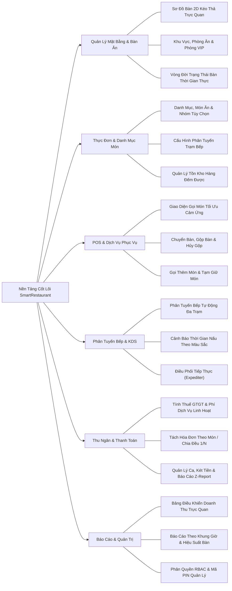

# Tài Liệu Yêu Cầu Sản Phẩm (PRD) — SmartRestaurant
## (Product Requirements Document — PRD)

- **Phiên Bản Tài Liệu**: 1.0.0
- **Trạng Thái Tài Liệu**: `CONFIRMED` (Chủ Dự án đã phê duyệt chính thức trong Task 02.6)
- **Chủ Quản Tài Liệu**: Trưởng Ban Kiến Trúc Sản Phẩm & Chuyên Viên Phân Tích Nghiệp Vụ (Senior Product Architect & Business Analyst)
- **Phiên Bản Phát Hành Mục Tiêu**: SmartRestaurant v1.0 (MVP)

---

## 1. Tầm Nhìn Sản Phẩm (Product Vision)

**SmartRestaurant** là nền tảng quản lý và vận hành số nhà hàng thế hệ mới, được thiết kế ban đầu và ưu tiên hàng đầu cho các nhà hàng, quán cà phê và cơ sở dịch vụ ăn uống (F&B) tại **Việt Nam**, với kiến trúc mở rộng hỗ trợ vận hành đa chi nhánh và quốc tế hóa trong tương lai.

### 1.1. Bài Toán Vận Hành Thực Tế (Strategic Problem Statement)
Các nhà hàng tại Việt Nam đang gặp nhiều trở ngại do các quy trình vận hành rời rạc:
- Phiếu giấy hoặc máy in nhiệt thông thường dễ bị thất lạc, dính dầu mỡ hoặc làm chậm giao tiếp với nhà bếp trong giờ cao điểm.
- Quản lý nhà hàng thiếu tầm nhìn thời gian thực về tốc độ quay vòng bàn, thời gian khách ngồi ăn và tình trạng sử dụng phòng VIP.
- Các bộ phận bếp (Bếp Nóng, Bếp Nguội/Salad, Quầy Pha Chế, Bếp Bánh) hoạt động không đồng bộ, dẫn đến tình trạng món ăn đã nấu xong bị nguội tại bàn ra món trong khi các món ăn kèm vẫn đang chế biến dở.
- Nhân viên phục vụ mất nhiều thời gian đối soát hóa đơn thủ công, tách hóa đơn chậm và dễ xảy ra sai sót khi áp dụng chương trình khuyến mãi hoặc xử lý thanh toán kết hợp nhiều hình thức (Multi-Tender).
- Chủ nhà hàng chịu thất thoát tồn kho đáng kể do việc theo dõi nguyên vật liệu thô bị tách rời và thiếu định lượng món ăn (BOM) theo từng suất ăn.
- Các phần mềm ngoại nhập có bản dịch tiếng Việt kém chất lượng, thuật ngữ gượng gạo, mẫu hóa đơn không tuân thủ quy định Việt Nam và thiếu tích hợp chuyển khoản liên ngân hàng VietQR.

### 1.2. Tầm Nhìn Chiến Lược & Triết Lý Cốt Lõi (Strategic Vision & Core Philosophy)
SmartRestaurant kết nối các mắt xích rời rạc này thông qua nền tảng kiến trúc **Modular Monolith** thống nhất với các đặc trưng cốt lõi:
1. **Trải Nghiệm Tiếng Việt Bản Địa 100% (Vietnamese-First)**: Toàn bộ giao diện trên POS, KDS, Thu ngân và Cổng quản trị hiển thị 100% tiếng Việt tự nhiên, tuân thủ nghiêm ngặt [Tiêu Chuẩn Bản Địa Hóa Việt Nam (Vietnamese-First Localization Standard)](./VIETNAMESE-LOCALIZATION-STANDARD.md).
2. **Đồng Bộ Thời Gian Thực Độ Trễ Bằng Không (Zero-Latency Real-Time Orchestration)**: Cập nhật trực tiếp qua SignalR trên toàn bộ Sơ đồ bàn, POS, KDS và Thu ngân mà không cần tải lại trang thủ công.
3. **Sơ Đồ Bàn Trực Quan Thông Minh (Visual Floor Plan Intelligence)**: Canvas 2D kéo thả tương tác hỗ trợ sơ đồ nhiều khu vực, nhiều phòng và phòng VIP với hiển thị trạng thái ăn uống theo thời gian thực.
4. **Phân Tuyến Bếp Thông Minh & Điều Phối Chế Biến Theo Nhịp (Intelligent Kitchen Routing)**: Tự động phân tách món ăn về các bộ phận bếp chuyên trách với cảnh báo thời gian SLA theo màu sắc, phối hợp tiếp thực (Expediter) và gọi nhân viên bưng món (Runner).
5. **Thanh Toán Linh Hoạt & Đa Kênh (Resilient Billing & Multi-Channel Settlement)**: Quyết toán hóa đơn tốc độ cao, tách hóa đơn linh hoạt (theo từng món hoặc chia đều), duyệt hủy món/chiết khấu qua PIN Quản lý và tích hợp tự động mã VietQR.
6. **Vận Hành Độc Lập & Sẵn Sàng Mở Rộng Tương Lai (Operational Autonomy with Future Scale)**: Triển khai độc lập, khép kín cho nhà hàng đơn lẻ trong giai đoạn hiện tại, đồng thời kiến trúc sẵn ranh giới Doanh nghiệp (Organization) và Chi nhánh (Branch) để mở rộng chuỗi tập trung trong các bản phát hành tương lai.

---

## 2. Khách Hàng Mục Tiêu & Mô Hình Vận Hành (Target Customers & Business Personas)

### 2.1. Phân Khúc Mô Hình Nhà Hàng Mục Tiêu

| Mô Hình Kinh Doanh | Quy Mô & Đặc Điểm Vận Hành | Trọng Tâm Vận Hành Trong SmartRestaurant |
| :--- | :--- | :--- |
| **Quán Cà Phê & Tiệm Bánh Độc Lập** | 10–30 chỗ ngồi; lượng khách tại quầy cao; thu ngân kiêm pha chế; phục vụ nhanh chóng. | Gọi món POS nhanh, phân tuyến đồ uống tức thì sang Quầy Bar, thanh toán tiền mặt/VietQR tinh gọn. |
| **Nhà Hàng Ăn Uống Tiêu Chuẩn (Casual Dining & Bistro)** | 40–120 chỗ ngồi; kết hợp không gian trong nhà và sân vườn; phục vụ tại bàn; nhiều đợt món. | Trực quan hóa trạng thái bàn, phân tuyến bếp đa trạm (Bếp Nóng/Bếp Nguội/Bar), tách hóa đơn linh hoạt. |
| **Nhà Hàng Lẩu Nướng & Quy Mô Lớn** | 100–300+ chỗ ngồi; nhiều tầng/phòng, phòng ăn VIP riêng; tùy biến món và gia vị cao. | Quản lý sơ đồ bàn trực quan, gộp bàn cho đoàn lớn, đặt trọn phòng VIP, gọi thêm đợt món liên tục. |
| **Chuỗi Nhà Hàng Đa Chi Nhánh (Định hướng tương lai)** | 3–50+ điểm kinh doanh; thực đơn thương hiệu tập trung; sơ đồ bàn và giá bán theo chi nhánh. | Phân lập dữ liệu theo Chi nhánh, quản lý danh mục thực đơn tập trung, báo cáo doanh thu độc lập từng điểm. |

---

## 3. Mục Tiêu Nghiệp Vụ & Chỉ Số Đo Lường (Business Objectives & Success Metrics)

### 3.1. Mục Tiêu Nghiệp Vụ (Business Goals)
- **Tăng Tốc Độ Quay Vòng Bàn**: Giảm 15% thời gian nhàn rỗi trung bình của mỗi lượt khách nhờ cảnh báo trạng thái bàn theo thời gian thực và in phiếu tạm tính dưới 1 giây.
- **Triệt Tiêu Sai Lệch Giao Tiếp Bếp - Phục Vụ**: Giảm tỷ lệ lỗi truyền đơn xuống bếp gần như bằng không (< 0.1%) bằng cách thay thế phiếu giấy truyền thống bằng màn hình bếp số (KDS).
- **Điều Phối Nhịp Độ Ra Món Đồng Đều**: Giữ các đợt món trong cùng một bàn ăn được ra đồng thời, tránh tình trạng món nguội chờ món nóng.
- **Ngăn Chặn Thất Thoát Doanh Thu**: Áp dụng cơ chế bắt buộc duyệt PIN Quản lý đối với các thao tác hủy món, hủy hóa đơn và chiết khấu thủ công kèm nhật ký kiểm toán bất biến.
- **Theo Dõi Tồn Kho Chính Xác**: Liên kết việc hoàn thành món ăn tại trạm bếp với việc trừ tồn kho thành phẩm (MVP) và định lượng nguyên vật liệu BOM (v1.1) để xác định chính xác hao hụt và lãng phí.

### 3.2. Tiêu Chí Đo Lường Định Lượng (KPIs)

| Chỉ Số Đo Lường | Mục Tiêu Chuẩn | Khung Thời Gian Đo Lường |
| :--- | :--- | :--- |
| **Thời Gian Nhập Đơn Trên POS** | $\le 15$ giây cho đơn hàng chuẩn gồm 4 món có tùy chọn. | Tương tác hoàn chỉnh của nhân viên phục vụ trên tablet. |
| **Độ Trễ Xuất Hiện Thẻ Món Trên KDS** | $\le 500$ mili-giây từ khi phục vụ bấm Báo bếp đến khi hiển thị trên KDS. | Phát sóng sự kiện SignalR qua mạng nội bộ. |
| **Độ Trễ Đồng Bộ Trạng Thái Bàn** | $\le 300$ mili-giây trên toàn bộ các thiết bị đang kết nối. | Cập nhật thị giác trên sơ đồ bàn 2D. |
| **Thời Gian In Hóa Đơn & Quyết Toán** | $\le 20$ giây cho toàn bộ quy trình thanh toán (bao gồm tách bill/in hóa đơn). | Tương tác tại quầy thu ngân. |
| **Độ Sẵn Sàng Hệ Thống Trong Giờ Phục Vụ** | $99.9\%$ độ sẵn sàng vận hành trong giờ mở cửa của nhà hàng. | Giờ hoạt động thực tế của nhà hàng. |
| **Tỷ Lệ Hủy Món/Hao Phí Không Lưu Vết** | $0\%$ món bị hủy sau khi đã báo bếp mà không có lý do trong nhật ký kiểm toán. | Báo cáo kiểm toán cuối ca làm việc. |

---

## 4. Phạm Vi Sản Phẩm (Product Scope)

### 4.1. Các Trụ Cột Chức Năng Thuộc Phạm Vi MVP (v1.0 In-Scope)

### 4.2. Ngoài Phạm Vi MVP Ban Đầu (Hoãn Sang v1.1+)
- Khách tự quét mã QR tại bàn để gọi món (Dành cho Giai đoạn 2 - Phase 2).
- Tích hợp trực tiếp với các ứng dụng giao đồ ăn bên thứ ba (GrabFood, ShopeeFood).
- Điều chuyển tồn kho liên chi nhánh tập trung và đặt hàng từ bếp trung tâm (MVP hỗ trợ vận hành độc lập theo từng chi nhánh dưới một tổ chức).
- Định mức công thức nguyên vật liệu chi tiết theo đơn vị nhỏ (gram, ml) và trừ kho nguyên liệu sâu (Hoãn sang v1.1; MVP theo dõi hàng thành phẩm đếm được).
- Quản lý công nợ khách hàng doanh nghiệp (Ký nợ / B2B Accounts Receivable) và sổ cái tuổi nợ (Hoãn sang v1.1+).
- Tích điểm thành viên khách hàng thân thiết và chiến dịch SMS/Marketing tự động.
- Xác thực sinh trắc học (vân tay) cho nhân viên.

---

## 5. Tổng Quan Năng Lực Cốt Lõi (Core Capabilities Overview)

1. **Thiết Kế Sơ Đồ Bàn & Lưới Bàn Động**: Canvas tương tác cho phép quản lý kéo thả bàn chữ nhật, bàn tròn hoặc bàn ghế sofa, vẽ tường và cột kiến trúc, cấu hình phòng VIP và theo dõi trực quan tiến độ ăn uống theo thời gian thực.
2. **Quản Lý Bàn Linh Hoạt**: Hỗ trợ bàn đơn lẻ, gộp nhiều bàn cho đoàn tiệc đông, chuyển bàn khi khách yêu cầu và đặt bao trọn phòng ăn.
3. **Thực Đơn Phân Cấp & Ma Trận Nhóm Tùy Chọn**: Phân loại danh mục đa tầng kèm kích cỡ (Nhỏ, Vừa, Lớn), các nhóm tùy chọn bắt buộc hoặc tự chọn (chọn loại nước sốt, đồ ăn kèm/topping, lượng đường/đá) và ghi chú chế biến đặc biệt cho bếp.
4. **Phân Tuyến Đơn Bếp Thông Minh**: Tự động phân tách từng món ăn trong một đơn gọi về đúng trạm phụ trách (Bếp Nóng, Bếp Nguội/Salad, Quầy Bar, Bếp Bánh/Tráng miệng), kết hợp màn hình Điều Phối Tiếp Thực (Expediter) tại bàn ra món.
5. **Màn Hình Bếp Số (KDS)**: Giao diện cảm ứng độ tương phản cao hiển thị thời gian chờ, số thứ tự đơn, cảnh báo ưu tiên và chuyển trạng thái 1 chạm (`Chờ chế biến` $\rightarrow$ `Đang nấu` $\rightarrow$ `Đã xong (Chờ bưng)` $\rightarrow$ `Đã phục vụ`).
6. **Thu Ngân Linh Hoạt & Quyết Toán Đa Kênh**: Tính tạm tính chính xác, cấu hình thuế GTGT (8% hoặc 10%), phí dịch vụ linh hoạt, phiếu giảm giá/voucher, tách hóa đơn theo món hoặc chia đều $1/N$, và thanh toán đa phương thức (Tiền mặt, Thẻ ngân hàng POS, Chuyển khoản VietQR).
7. **Bảo Mật Vận Hành Theo Vai Trò (RBAC)**: Phân định rõ 6 vai trò nghiệp vụ (`Quản trị hệ thống`, `Quản lý nhà hàng`, `Trưởng ca phục vụ`, `Nhân viên phục vụ`, `Bếp trưởng/Đầu bếp`, `Thu ngân`, `Thủ kho`) với yêu cầu xác thực PIN Quản lý cho các thao tác nhạy cảm (hủy món sau khi đã nấu, hủy hóa đơn, chiết khấu thủ công).
8. **Vận Hành Ca Kíp & Đối Soát Tiền Mặt**: Quy trình mở ca khai báo tiền mặt đầu ca, rút tiền gửi két giữa ca, kiểm kê tiền cuối ca (kiểm tiền mù), báo cáo chênh lệch và in báo cáo chốt ca Z-Report.
9. **Tiêu Chuẩn Bản Địa Hóa Tiếng Việt 100%**: Giao diện tiếng Việt tự nhiên trên POS, KDS, Thu ngân và Cổng quản trị với thuật ngữ F&B chuẩn xác, định dạng tiền tệ VNĐ (`#,,### ₫`), hiển thị thời gian 24h và hỗ trợ in nhiệt tiếng Việt UTF-8 ESC/POS.

---

## 6. Lộ Trình Tài Liệu & Tham Chiếu Chéo (Document Roadmap & Cross-References)

| Tài Liệu | Mục Đích & Nội Dung Chính | Đối Tượng Đọc |
| :--- | :--- | :--- |
| **[VIETNAMESE-LOCALIZATION-STANDARD.md](./VIETNAMESE-LOCALIZATION-STANDARD.md)** | Quy chuẩn từ điển giao diện tiếng Việt, định dạng vùng và tiêu chuẩn in ấn. | Toàn bộ đội ngũ, UI/UX, Lập trình viên |
| **[BUSINESS-REQUIREMENTS.md](../99-archive/stage-1-history/superseded-documents/BUSINESS-REQUIREMENTS.md)** | Yêu cầu nghiệp vụ chi tiết, vai trò tác nhân, quy tắc ràng buộc và xử lý ngoại lệ. | BA, Kiến trúc sư, Lập trình viên |
| **[MVP-SCOPE.md](../99-archive/stage-1-history/superseded-documents/MVP-SCOPE.md)** | Ma trận tính năng theo mức độ ưu tiên MoSCoW, danh mục hoãn và phụ thuộc. | Chủ dự án, Trưởng nhóm kỹ thuật |
| **[DOMAIN-GLOSSARY.md](./DOMAIN-GLOSSARY.md)** | Bảng đối chiếu thuật ngữ song ngữ Anh - Việt chuẩn mực ngành F&B. | Toàn bộ đội ngũ dự án |
| **[USER-JOURNEYS.md](./USER-JOURNEYS.md)** | 10 kịch bản trải nghiệm người dùng thực tế từ mở ca đến đóng ca. | Thiết kế UI/UX, Kiểm thử QA, Devs |
| **[MODULE-OVERVIEW.md](../99-archive/stage-1-history/superseded-documents/MODULE-OVERVIEW.md)** | Ranh giới 14 phân hệ nghiệp vụ cốt lõi, thực thể dữ liệu và phụ thuộc. | Kiến trúc sư hệ thống, Kỹ sư chính |
| **[Workflows/](./workflows/)** | Sơ đồ quy trình và máy trạng thái cho Mặt bằng, Đơn hàng, Bếp và Thu ngân. | Kỹ sư hệ thống, Kiểm thử QA |
| **[NON-FUNCTIONAL-REQUIREMENTS.md](./NON-FUNCTIONAL-REQUIREMENTS.md)** | Tiêu chuẩn hiệu năng, bảo mật, đồng thời, độ tin cậy và khả năng sử dụng. | Kiến trúc sư, Kỹ sư DevOps |
| **[Decisions/](./decisions/)** | Bộ bản ghi quyết định nghiệp vụ và kiến trúc (PDRs) kèm phân tích đánh đổi. | Quản trị dự án & Đội ngũ kỹ thuật |
