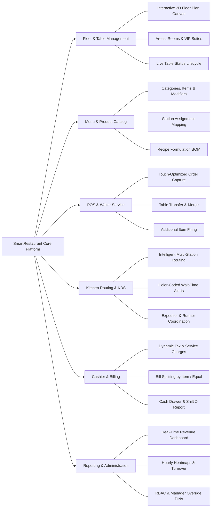

# Product Requirements Document (PRD) — SmartRestaurant

- **Document Version**: 1.0.0
- **Document Status**: `CONFIRMED` (Explicitly approved by Project Owner in Task 02.6)
- **Owner**: Senior Product Architect & Business Analyst
- **Target Release**: SmartRestaurant v1.0 (MVP)

---

## 1. Product Vision

**SmartRestaurant** is a next-generation Restaurant Management and Digital Operations Platform designed initially and primarily for restaurants, cafés, and food-service establishments in **Vietnam**, with an extensible architecture to support multi-branch operations and future internationalization.

### 1.1. Strategic Problem Statement
Restaurants in Vietnam struggle with disconnected operational silos:
- Paper tickets or basic printers get lost, soiled, or delay kitchen communication during peak service.
- Floor managers lack real-time visibility into table turnover, guest dining duration, and VIP room occupancy.
- Kitchen stations (Hot Kitchen, Cold/Salad, Bar, Bakery) operate out-of-sync, resulting in cold dishes sitting at the pass while companion dishes are still being cooked.
- Waiters face tedious manual billing reconciliations, slow bill splitting, and high error rates when applying promotions or processing multi-tender payments.
- Business owners suffer significant inventory shrinkage due to disconnected raw ingredient tracking and lack of dish-level recipe formulation (BOM).
- Software products built for foreign markets have poor Vietnamese translation, awkward terminology, non-compliant invoice templates, and lack native VietQR interbank integration.

### 1.2. Strategic Vision & Core Philosophy
SmartRestaurant bridges these silos through a unified **Modular Monolith** platform characterized by:
1. **Vietnamese-First & Authentic Hospitality Experience**: 100% natural Vietnamese presentation across POS, KDS, Cashier, and Admin, strictly adhering to the [Vietnamese-First Localization Standard](./VIETNAMESE-LOCALIZATION-STANDARD.md).
2. **Zero-Latency Real-Time Orchestration**: SignalR-driven live updates across Floor Plan, POS, KDS, and Cashier without requiring manual page refreshes.
3. **Visual Floor Plan Intelligence**: An interactive drag-and-drop 2D canvas supporting multi-area, multi-room, and VIP room layouts with real-time dining state visualization.
4. **Intelligent Kitchen Routing & Staged Preparation**: Automated routing of dishes to specialized kitchen departments with color-coded SLA timers, expediter coordination, and runner alerts.
5. **Resilient Billing & Multi-Channel Settlement**: High-speed cashier checkout, dynamic bill splitting (by dish and equal split), manager-authorized voids/discounts, and automated VietQR integration.
6. **Operational Autonomy with Future Scale**: Independent, self-contained deployment for single restaurants/cafés today, architected with strict Organization and Branch boundaries to support centralized multi-branch chain expansion in future releases.

---

## 2. Target Customers & Business Personas

### 2.1. Target Restaurant Profiles

| Business Model | Scale & Operational Profile | Key Operational Priorities in SmartRestaurant |
| :--- | :--- | :--- |
| **Independent Cafés & Bakeries** | 10–30 seats; high counter traffic; combined cashier/barista; rapid turnaround. | Fast POS order capture, quick beverage routing to Bar station, simple cash/QR payment. |
| **Casual Dining & Bistros** | 40–120 seats; mixed indoor/terrace areas; seated table service; multi-course dining. | Table state visualization, multi-station kitchen routing (Hot/Cold/Bar), bill splitting. |
| **Hotpot, BBQ & Large Restaurants** | 100–300+ seats; multiple rooms/floors, private VIP dining; high modifier customization. | Visual floor-plan management, table merging, VIP room booking, add-on order handling. |
| **Multi-Branch Restaurant Chains** | 3–50+ locations; centralized brand menu; localized branch floor plans and pricing. | Data isolation by Branch, centralized menu catalog, branch-level sales and performance reporting. |

---

## 3. Business Objectives & Success Metrics

### 3.1. Business Goals
- **Accelerate Table Turnover**: Reduce average dining session overhead by 15% through real-time table status alerts and sub-second pre-bill generation.
- **Eliminate Kitchen Miscommunication**: Reduce order-to-kitchen transmission errors to near zero (<0.1%) by replacing physical paper kitchen chits with real-time digital KDS screens.
- **Coordinate Dish Delivery**: Keep multi-course orders aligned so dishes intended for the same table arrive within an acceptable delivery window.
- **Prevent Revenue Leakage**: Enforce strict manager-authorization policies on item cancellations, bill voids, and manual discounts with mandatory audit logging.
- **Accurate Inventory Tracking**: Tie dish preparation directly to raw ingredient recipe deductions (BOM) to pinpoint waste and operational loss.

### 3.2. Quantitative Success Criteria (KPIs)

| Metric | Target Baseline | Measurement Window |
| :--- | :--- | :--- |
| **POS Order Entry Time** | $\le 15$ seconds for a standard 4-item order with modifiers. | End-to-end waiter tablet interaction. |
| **KDS Ticket Appearance Latency** | $\le 500$ milliseconds from waiter submission to KDS display. | Local network SignalR broadcast. |
| **Table Status Sync Latency** | $\le 300$ milliseconds across all connected terminals. | Floor plan visual update. |
| **Checkout & Bill Generation Time**| $\le 20$ seconds for full settlement including split/print. | Cashier terminal interaction. |
| **System Uptime during Service** | $99.9\%$ operational availability during operating hours. | Restaurant operating hours. |
| **Unrecorded Void/Waste Rate** | $0\%$ unlogged item cancellations after kitchen dispatch. | Shift audit reporting. |

---

## 4. Product Scope

### 4.1. Core In-Scope Functional Pillars (v1.0 MVP)

### 4.2. Out-of-Scope for Initial MVP (Deferred to v1.1+)
- Public customer self-ordering via table QR codes (Phase 2).
- Direct third-party food delivery aggregator integrations (GrabFood, ShopeeFood).
- Centralized inter-branch warehouse inventory transfer logistics and commissary purchase routing (MVP supports multi-branch independent operations under one organization).
- Detailed raw ingredient recipe BOM formulation (gram, ml) and deep kitchen ingredient deduction (deferred to v1.1; MVP tracks direct countable saleable items).
- Corporate customer credit account management (Ký nợ / Công nợ B2B) and AR aging ledgers (deferred to v1.1+).
- Customer loyalty point accrual and automated SMS/marketing campaigns.
- Biometric (fingerprint) staff authentication.

---

## 5. Core Capabilities Overview

1. **Floor Plan Designer & Dynamic Table Grid**: Interactive canvas allowing managers to drag and drop rectangular, circular, or booth tables, define walls and pillars, configure VIP suites, and observe real-time dining progress.
2. **Flexible Table Management**: Support for solo tables, merged tables for large banquets, table transfers, and whole-room reservations.
3. **Hierarchical Menu & Modifier Matrix**: Multi-level categorization with size variants (Small, Medium, Large), required and optional modifier groups (e.g., choice of dressing, toppings, ice/sugar levels), and special culinary notes.
4. **Intelligent Kitchen Order Routing**: Automatic item-level decomposition of a single order ticket into distinct station queues (Hot Kitchen, Cold/Salad Station, Bar, Dessert), combined with a Master Expediter view for order coordination.
5. **Kitchen Display System (KDS)**: High-visibility touch interface showing waiting timers, order sequence numbers, priority alerts, and single-tap status transitions (`Pending` $\rightarrow$ `Cooking` $\rightarrow$ `ReadyToServe` $\rightarrow$ `Served`).
6. **Robust Billing & Multi-Tender Settlement**: Accurate subtotaling, configurable taxes (VAT 8%/10%), discretionary or fixed service charges, vouchers, item-based or equal bill splitting, and multi-tender payments (Cash, Card, VietQR).
7. **Role-Based Operational Security**: Distinct roles (`SystemAdmin`, `RestaurantManager`, `FloorCaptain`, `Waiter`, `Chef`, `Cashier`, `Stockkeeper`) with manager PIN authorization required for risky operations (bill voids, post-fire dish cancellations, manual discounts).
8. **Shift Operations & Financial Reconciliation**: Structured shift opening floats, mid-shift drops, end-of-shift cash counting, discrepancy reporting, and printed Z-Reports.
9. **Vietnamese-First Localization Standard**: 100% Vietnamese presentation tier across POS, KDS, Cashier, and Admin with authentic culinary terminology, VNĐ formatting (`#,,### ₫`), 24h timestamps, and ESC/POS thermal printer encoding.

---

## 6. Document Roadmap & Cross-References

| Document | Purpose & Content | Target Audience |
| :--- | :--- | :--- |
| **[VIETNAMESE-LOCALIZATION-STANDARD.md](./VIETNAMESE-LOCALIZATION-STANDARD.md)** | Definitive Vietnamese-First UI dictionary, formatting, and printing standards. | Entire Team, UI/UX, Developers |
| **[BUSINESS-REQUIREMENTS.md](./BUSINESS-REQUIREMENTS.md)** | Deep business rules, actors, granular requirements, and exceptions. | BA, Architects, Developers |
| **[MVP-SCOPE.md](./MVP-SCOPE.md)** | Prioritized feature matrix, explicit exclusions, and dependencies. | Product Owners, Leads |
| **[DOMAIN-GLOSSARY.md](./DOMAIN-GLOSSARY.md)** | Standardized English & Vietnamese operational vocabulary. | Entire Team |
| **[USER-JOURNEYS.md](./USER-JOURNEYS.md)** | 10 end-to-end actor journeys covering daily restaurant routines. | UI/UX Designers, QA, Devs |
| **[MODULE-OVERVIEW.md](./MODULE-OVERVIEW.md)** | 12 core business module boundaries, entities, and dependencies. | Architects, Engineers |
| **[Workflows/](./workflows/)** | Visual diagrams and state transitions for Floor, Order, Kitchen, Cashier. | Systems Engineers, QA |
| **[NON-FUNCTIONAL-REQUIREMENTS.md](./NON-FUNCTIONAL-REQUIREMENTS.md)** | Performance, security, concurrency, reliability, and usability criteria. | Architects, DevOps |
| **[Decisions/](./decisions/)** | Architectural and business decision records with trade-off analysis. | Governance Leads |
