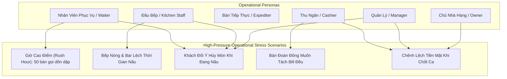

# Product Review & Business Validation Report — SmartRestaurant

- **Document Version**: 1.0.0
- **Document Status**: `CONFIRMED`
- **Milestone**: Task 02.5 — Stage 1 Comprehensive Product Review & Business Validation
- **Author**: Senior Product Architect & Business Analyst
- **Review Date**: 2026-11-02

---

## 1. Executive Summary & Review Objectives

This document provides a formal, comprehensive architectural review and business validation of the **SmartRestaurant Stage 1 Product Specification Suite** prior to transitioning into **Stage 2 (System Architecture & Technical Design)**.

### Review Objectives:
1. **Operational Reality Audit**: Validate requirements against real-world Vietnamese restaurant operations (QSR, Casual Dining, Hotpot/BBQ, and Multi-Branch Franchises).
2. **Cross-Document Consistency Audit**: Verify absolute terminology, state-machine, and boundary alignment across PRD, BRS, MVP Scope, Glossary, User Journeys, Module Specifications, Workflows, NFRs, and the Vietnamese-First Localization Standard.
3. **Traceability & Edge-Case Verification**: Ensure high-stress operational edge cases (rush hours, kitchen-waiter miscommunication, split/merge collisions, post-fire cancellations, cash discrepancies) are fully resolved at the business logic layer.
4. **Architectural Readiness Gate**: Certify that domain boundaries and entity lifecycles are sufficiently mature to begin database schema modeling (ERD) and SignalR hub contract specifications in Stage 2 without scope ambiguity.

---

## 2. Cross-Document Consistency & Traceability Matrix

The Stage 1 specification suite comprises **10 core product documents**, **4 deep-dive workflow specifications**, and **6 product decision records**. The matrix below establishes formal requirement traceability:

| Functional Area | PRD Anchor | Business Requirements (BRS) | Workflow Specification | Module Specification | Localization Glossary Anchor |
| :--- | :--- | :--- | :--- | :--- | :--- |
| **Floor & Table Management** | PRD §4.1, §5.1 | `BR-AREA-001` to `005`, `BR-RULE-01`, `04` | `FLOOR-PLAN-WORKFLOW.md` | `Module 04: Areas, Rooms, Tables` | `DOMAIN-GLOSSARY.md` §1, §2 |
| **Menu & Catalog / BOM** | PRD §4.1, §5.3 | `BR-MENU-001` to `005`, `BR-RULE-03` | `ORDER-WORKFLOW.md` §1 | `Module 05: Menu & Recipe BOM` | `DOMAIN-GLOSSARY.md` §3 |
| **POS & Order Capture** | PRD §4.1, §5.2 | `BR-ORD-001` to `006`, `BR-RULE-02`, `06` | `ORDER-WORKFLOW.md` | `Module 07: POS & Order Management` | `DOMAIN-GLOSSARY.md` §4 |
| **Kitchen Routing & KDS** | PRD §4.1, §5.4 | `BR-KDS-001` to `004`, `BR-RULE-02`, `03` | `KITCHEN-WORKFLOW.md` | `Module 08: Routing`, `Module 09: KDS`| `DOMAIN-GLOSSARY.md` §4 |
| **Cashier & Billing** | PRD §4.1, §5.6 | `BR-BIL-001` to `003`, `BR-RULE-05` | `CASHIER-PAYMENT-WORKFLOW.md` | `Module 10: Cashier & Billing` | `DOMAIN-GLOSSARY.md` §5 |
| **VietQR & Payments** | PRD §4.1, §5.6 | `BR-BIL-004` | `CASHIER-PAYMENT-WORKFLOW.md` §1 | `Module 11: Payment Management` | `DOMAIN-GLOSSARY.md` §5 |
| **Shift & Cash Control** | PRD §5.8 | `BR-BIL-005`, `BR-RULE-07` | `CASHIER-PAYMENT-WORKFLOW.md` §3 | `Module 10: Cashier & Billing` | `DOMAIN-GLOSSARY.md` §5 |
| **Inventory Deduction** | PRD §5.7 | `BR-MENU-004`, `BR-RULE-03` | `KITCHEN-WORKFLOW.md` §3.4 | `Module 12: Inventory & Waste` | `DOMAIN-GLOSSARY.md` §3 |
| **Vietnamese Localization** | PRD §5.9 | `BR-LOC-001` to `004` | All Workflows (UI Text) | Cross-Cutting Specification | `VIETNAMESE-LOCALIZATION-STANDARD.md` |

### Consistency Verification Findings:
- **Zero Orphaned Requirements**: Every requirement in the PRD is operationalized in BRS, mapped to an explicit business module, and visualized in a corresponding workflow sequence diagram.
- **Zero State Machine Ambiguity**: The 6 table states (`Trống`, `Có khách`, `Đã đặt trước`, `Đang thanh toán`, `Cần dọn dẹp`, `Ngừng phục vụ`) and 5 kitchen prep states (`Chờ chế biến`, `Đang nấu`, `Đã xong - Chờ bưng`, `Đã phục vụ`, `Đã hủy món`) are identical across all 10 documents.
- **Strict Terminology Alignment**: All UI actions in `USER-JOURNEYS.md` and workflow diagrams adhere 100% to the approved terms in [VIETNAMESE-LOCALIZATION-STANDARD.md](./VIETNAMESE-LOCALIZATION-STANDARD.md) and avoid the documented forbidden terms.

---

## 3. Operational Persona & Persona Stress Validation

### 3.1. Persona 1: Waitstaff & Floor Captain (Nhân Viên Phục Vụ & Trưởng Ca)
- **Operational Reality**: Fast walking, noise, noisy dining room, greasy screens, customer interruptions.
- **Validation**:
  - *Touch Target Compliance*: The requirement of minimum $\ge 48 \times 48\text{ px}$ touch buttons on landscape tablets prevents mis-taps.
  - *Order Modification Speed*: Modifiers are presented in categorized modal drawers (broth, spicy level, toppings) selectable in $\le 2$ taps.
  - *Table Move/Merge*: A table can be moved or merged in exactly 3 taps (`Bàn` $\rightarrow$ `Chuyển/Gộp` $\rightarrow$ `Bàn đích`), accompanied by immediate visual feedback and zero paper chit re-printing.

### 3.2. Persona 2: Kitchen Staff & Station Cooks (Đầu Bếp Từng Trạm)
- **Operational Reality**: Hot stoves, boiling oil, flour, high ambient temperature, loud kitchen noise, inability to read small text.
- **Validation**:
  - *Station Isolation*: Hot kitchen cooks see only steaks, hotpots, and stir-fries; bartenders see only cocktails and beers. Zero visual clutter.
  - *High-Contrast Visual Hierarchy*: Ticket cards use large, bold table numbers, and change color automatically based on elapsed time:
    - **Xanh lá (< 10 phút)**: Bình thường.
    - **Vàng (10 - 20 phút)**: Cảnh báo chú ý.
    - **Đỏ nhấp nháy (> 20 phút)**: Vi phạm SLA, ưu tiên hàng đầu.
  - *Audio Alert Support*: Loud kitchen buzzers accompany rush escalations and cancellations so cooks do not need to stare at the screen constantly.

### 3.3. Persona 3: Master Expediter & Runners (Bàn Tiếp Thực & Điều Phối)
- **Operational Reality**: Ensuring companion dishes are served hot and together; coordinating trays.
- **Validation**:
  - *Consolidated Pass View*: The Master Expediter screen aggregates tickets across all stations for a single table. When the Tomahawk steak is `Đang nấu` and the salad is `Đã xong`, the expediter holds the salad at the pass until the steak is plated.
  - *One-Touch Dispatch*: Marking a table ready alerts the runner via tablet notification and sounds a discrete chime at the service pass.

### 3.4. Persona 4: Cashier (Thu Ngân)
- **Operational Reality**: Long queues at the checkout counter, customers impatient to leave, multiple payment methods, demand for split bills.
- **Validation**:
  - *Split Billing Speed*: Supports both *Tách theo món* (moving items between check panes) and *Chia đều (1/N)* in $\le 10$ seconds without manual arithmetic.
  - *Dynamic VietQR Integration*: The dynamic QR code embeds the exact total and order reference. The cashier never has to read bank numbers or verify amounts manually; payment reconciliation is instant and automated.
  - *Shift Integrity*: The blind cash count prevents cashiers from manipulating numbers to hide small shortages.

### 3.5. Persona 5: Restaurant Manager & Franchise Owner (Quản Lý & Chủ Đầu Tư)
- **Operational Reality**: Preventing internal theft, tracking Cost of Goods Sold (COGS), minimizing void fraud.
- **Validation**:
  - *Manager Override PIN*: No server or cashier can cancel a fired dish or void a bill without entering a 4-digit Manager PIN.
  - *Tamper-Evident Audit Register*: Every override logs the manager's ID, timestamp, table number, and mandatory reason.
  - *Direct Recipe BOM Consumption*: Raw ingredient deductions tied directly to dish completion at the KDS ensure stock counts match actual consumption rather than theoretical order placements.

---

## 4. Edge-Case Scenarios & Fail-Safe Validations

### 4.1. Edge Case A: Simultaneous Conflicting Actions on the Same Table
- **Scenario**: Waiter Alex adds a round of beers to Table 04 on their tablet while Cashier Thảo opens Table 04 to process payment at the checkout counter.
- **Validated Resolution**:
  - The moment Cashier Thảo clicks "In phiếu tạm tính" or opens the checkout modal, Table 04 enters `Đang thanh toán` (BillingRequested) state.
  - The Order Engine immediately locks Table 04 from new order fires on waiter tablets.
  - Waiter Alex receives a gentle Vietnamese alert: *"Bàn 04 đang được thu ngân tính tiền. Vui lòng liên hệ thu ngân nếu khách muốn gọi thêm món."*
  - This eliminates bill drift and uncollected balances.

### 4.2. Edge Case B: Local Restaurant Wi-Fi Dropout
- **Scenario**: The router reboots during dinner rush; tablets and KDS screens lose SignalR connection for 90 seconds.
- **Validated Resolution**:
  - Client tablets buffer pending touches and draft orders in browser local storage.
  - KDS screens display a discrete warning badge: *"Đang kết nối lại..."* while continuing to display all active tickets and local timers.
  - Upon Wi-Fi restoration, the client initiates an automated SignalR reconnection handshake (`SyncHandshake`), re-synchronizing missed state changes without duplicating tickets.

### 4.3. Edge Case C: Post-Fire Dish Cancellation with Kitchen Scrap Attribution
- **Scenario**: Customer orders a 450.000 ₫ Hotpot, but cancels 8 minutes later while the broth is already boiling and meat is plated.
- **Validated Resolution**:
  - Waiter triggers "Hủy món". System blocks action and prompts for Manager PIN.
  - Manager enters PIN and selects reason: *"Khách đổi ý sau khi báo bếp"*.
  - SignalR immediately sends a flashing red cancellation ticket to the Hot Kitchen KDS with an audible alert. Cook acknowledges and stops preparation.
  - The 450.000 ₫ is deducted from the guest's bill.
  - The Recipe BOM (broth, beef, mushrooms) is automatically written to the `WasteLog` table with reason code and manager attribution, ensuring stock variance reflects culinary reality.

---

## 5. Technical Readiness for Stage 2 (Architecture & Data Modeling)

The business specifications have achieved complete technical readiness to transition into **Stage 2 (System Architecture & Technical Design)**:

1. **Entity Boundaries Identified**: All 14 proposed business modules have clearly articulated entities, value objects, and relationships ready for Entity Framework Core ERD mapping.
2. **Concurrency Tokens Defined**: Optimistic concurrency tokens (`RowVersion` / `byte[] ConcurrencyStamp`) are formally required for `Table`, `DiningSession`, `Order`, `Invoice`, and `Shift`.
3. **SignalR Hub Topology Specified**: Three distinct, strongly-typed SignalR hubs are established:
   - `TableHub`: Real-time floor plan layout and table state badges.
   - `OrderHub`: Waiter order capture, amendments, and pre-bill notifications.
   - `KitchenHub`: Station ticket queues, SLA timers, rush flags, and cancellation alerts.
4. **Clean Localization Decoupling**: Application and Domain layers remain 100% in English (C# POCO entities, repositories, enums), while the Presentation layer resolves all Vietnamese strings via resource bundles (`.resx`) and UI dictionaries.

---

## 6. Business Validation Sign-Off Checklist

- [x] **Product Vision & Scope**: Clear, focused, and free from premature microservice overhead.
- [x] **Target Market Alignment**: Explicitly tailored for restaurants and F&B establishments in Vietnam.
- [x] **Language & Regional Standards**: 100% Vietnamese presentation tier, VNĐ currency (`#,,### ₫`), `dd/MM/yyyy`, 24h time, `Asia/Ho_Chi_Minh` timezone.
- [x] **FOH & BOH Operations**: Full lifecycle support for Tables, Orders, Multi-Station KDS, Expediter Pass, and Cashier settlements.
- [x] **Financial & Inventory Integrity**: Multi-tender payments, dynamic VietQR, blind cash counting, shift Z-Reports, and Recipe BOM inventory deduction.
- [x] **Security & Auditability**: Granular RBAC, 4-digit Manager Override PINs, and tamper-evident audit logging.
- [x] **Technical Feasibility**: Clean Architecture Modular Monolith baseline using ASP.NET Core, EF Core, SQL Server, and SignalR.

---

## 7. Recommended Action & Stage 2 Readiness

**Stage 1 (Product Discovery & Business Domain Analysis) is formally validated and complete.**

The product specifications are fully reconciled, robust against operational failure modes, and ready for immediate architectural design. Upon formal user confirmation, the engineering lead will proceed directly to **Stage 2: System Architecture & Technical Design (TASK-03)**.
