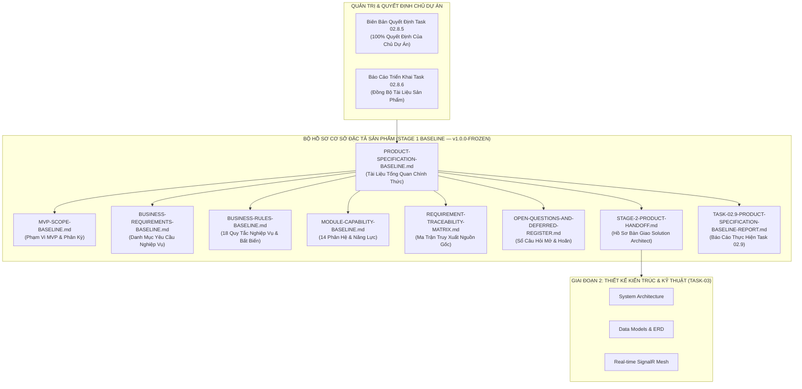
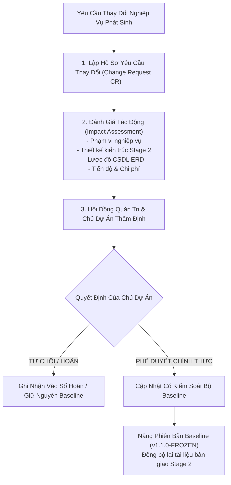

# Hồ Sơ Cơ Sở Đặc Tả Sản Phẩm Chính Thức (Master Product Specification Baseline)
## DỰ ÁN SMARTRESTAURANT — GIAI ĐOẠN 1 (STAGE 1 BASELINE)

- **Dự Án**: SmartRestaurant — Hệ Thống Quản Lý Vận Hành Nhà Hàng Độc Lập
- **Giai Đoạn**: Stage 1 — Khám Phá Sản Phẩm & Đặc Tả Miền Nghiệp Vụ (Product Discovery & Business Domain Specifications)
- **Mã Tài Liệu**: `PRODUCT-SPECIFICATION-BASELINE`
- **Phiên Bản Cơ Sở**: `v1.0.0-FROZEN` (Chính Thức Đóng Băng & Niêm Phong Toàn Diện)
- **Ngày Phê Duyệt**: 2026-11-06
- **Trạng Thái Quản Trị**: **`100% OWNER-CONFIRMED, CONSOLIDATED & AUDITED`**
- **Thẩm Quyền Phê Duyệt**: Chủ Dự Án (Project Owner — Quyết Định Chính Thức Tại Task 02.6, Task 02.8.5, Task 02.8.6)
- **Phân Định 4 Trạng Thái Quản Trị**:
  1. *Documentation Consolidation*: `COMPLETED` (Hoàn thành hợp nhất toàn bộ tài liệu đặc tả)
  2. *Product Specification*: `REVIEWED` (Đã rà soát & kiểm toán nhất quán chéo)
  3. *Stage 1*: `OWNER-APPROVED` (Chủ Dự Án đã phê chuẩn phạm vi & quyết định)
  4. *Stage 2*: `PENDING EXPLICIT PROJECT OWNER AUTHORIZATION` (Cổng Stage 2 sẵn sàng kỹ thuật — Chờ chỉ đạo/phê duyệt rõ ràng của Chủ Dự Án để khởi động TASK-03)

---

## 1. Tuyên Ngôn Cơ Sở Sản Phẩm (Executive Baseline Declaration)

Tài liệu này là **Văn bản Tổng quan Chính thức của Bộ Cơ sở Đặc tả Sản phẩm (Product Specification Baseline)** cho dự án SmartRestaurant. Đây là điểm quy chiếu trung tâm, hợp nhất toàn bộ kết quả nghiên cứu, phân tích nghiệp vụ, rà soát chất lượng, kiểm toán tính truy vết và các quyết định phê duyệt chính thức của Chủ Dự Án trong suốt Giai đoạn 1.



### 1.1. Cam Kết Niêm Phong & Quy Tắc Quản Trị Thay Đổi (Freeze Commitment)
1. **Niêm Phong Toàn Diện (`v1.0.0-FROZEN`)**: Kể từ thời điểm ban hành bộ tài liệu này, toàn bộ yêu cầu nghiệp vụ, ranh giới 14 phân hệ, 18 quy tắc nghiệp vụ cốt lõi và các quyết định thiết kế sản phẩm của Giai đoạn 1 được chính thức niêm phong.
2. **Quyền Hạn Duy Nhất Của Chủ Dự Án (Owner Authority)**: Chỉ có quyết định rõ ràng từ Chủ Dự Án mới có thẩm quyền chuyển đổi trạng thái phê duyệt. Mọi đề xuất của AI/BA, khuyến nghị kỹ thuật hay câu hỏi mở đều được phân định minh bạch.
3. **Quy Trình Kiểm Soát Thay Đổi (Change Request)**: Mọi yêu cầu phát sinh hoặc điều chỉnh nghiệp vụ sau thời điểm niêm phong bắt buộc phải lập Phiếu Yêu Cầu Thay Đổi (CR), đánh giá tác động kỹ thuật/nghiệp vụ và phải có phê chuẩn bằng văn bản của Chủ Dự Án.
4. **Tuyệt Đối Không Rò Rỉ Mã Nguồn (Zero Code Leakage)**: Bộ tài liệu này hoàn toàn thuộc phạm vi Tài Liệu Sản Phẩm (Product Documentation). Toàn bộ kho lưu trữ duy trì chính xác **0 tệp mã nguồn C# (`.cs`), 0 tệp dự án (`.csproj`, `.sln`), 0 tệp di chuyển dữ liệu (EF Core migration) và 0 tệp SQL (`.sql`)**.

---

## 2. Cấu Trúc Bộ Hồ Sơ Cơ Sở Đặc Tả Sản Phẩm (Baseline Documentation Suite)

Bộ cơ sở đặc tả sản phẩm được tổ chức phân cấp, chuyên biệt hóa thành 9 tài liệu thành phần chuẩn mực nhằm bảo đảm tính độc lập, dễ tra cứu và duy trì một nguồn sự thật duy nhất (Single Source of Truth):

| STT | Tên Tài Liệu Thành Phần | Đường Dẫn Tương Đối | Mục Tiêu & Phạm Vi Nội Dung | Trạng Thái |
| :---: | :--- | :--- | :--- | :---: |
| 1 | **Tài Liệu Tổng Quan Cơ Sở** | [`PRODUCT-SPECIFICATION-BASELINE.md`](./PRODUCT-SPECIFICATION-BASELINE.md) | Tài liệu điều hướng trung tâm, tuyên ngôn niêm phong, nguyên tắc quản trị và mục lục bộ cơ sở. | `CONFIRMED & SEALED` |
| 2 | **Cơ Sở Phạm Vi MVP** | [`MVP-SCOPE-BASELINE.md`](./MVP-SCOPE-BASELINE.md) | Phạm vi MVP Core, MVP Optional, phân kỳ Post-MVP (v1.1, v1.2+, v2.0) và ranh giới vận hành đơn điểm. | `CONFIRMED & SEALED` |
| 3 | **Cơ Sở Yêu Cầu Nghiệp Vụ** | [`BUSINESS-REQUIREMENTS-BASELINE.md`](./BUSINESS-REQUIREMENTS-BASELINE.md) | Danh mục hợp nhất toàn bộ yêu cầu nghiệp vụ chi tiết theo 11 nhóm chức năng vận hành. | `CONFIRMED & SEALED` |
| 4 | **Cơ Sở Quy Tắc Nghiệp Vụ** | [`BUSINESS-RULES-BASELINE.md`](./BUSINESS-RULES-BASELINE.md) | Bộ 18 quy tắc nghiệp vụ bất biến (`BR-RULE-01..18`), 15 bất biến cốt lõi (`INV-01..15`) và các kiểm toán nhất quán. | `CONFIRMED & SEALED` |
| 5 | **Cơ Sở Phân Hệ & Năng Lực** | [`MODULE-CAPABILITY-BASELINE.md`](./MODULE-CAPABILITY-BASELINE.md) | Ranh giới 14 phân hệ (10 Core + 4 Optional), bản đồ 14 nhóm năng lực, ma trận phụ thuộc và chính sách Graceful Drain. | `CONFIRMED & SEALED` |
| 6 | **Ma Trận Truy Xuất Nguồn Gốc**| [`REQUIREMENT-TRACEABILITY-MATRIX.md`](./REQUIREMENT-TRACEABILITY-MATRIX.md) | Ma trận truy xuất nguồn gốc hai chiều từ Nhu cầu $\rightarrow$ Yêu cầu $\rightarrow$ Quy tắc $\rightarrow$ PDR $\rightarrow$ Kiến trúc Stage 2. | `CONFIRMED & SEALED` |
| 7 | **Sổ Câu Hỏi Mở & Yêu Cầu Hoãn**| [`OPEN-QUESTIONS-AND-DEFERRED-REGISTER.md`](./OPEN-QUESTIONS-AND-DEFERRED-REGISTER.md) | Sổ quản lý vòng đời toàn bộ quyết định (`OD-14..17`), câu hỏi mở (`OQ-01..07`) và các yêu cầu hoãn có bằng chứng. | `CONFIRMED & SEALED` |
| 8 | **Hồ Sơ Bàn Giao Stage 2** | [`STAGE-2-PRODUCT-HANDOFF.md`](./STAGE-2-PRODUCT-HANDOFF.md) | Hồ sơ bàn giao chính thức cho Solution Architect: Bối cảnh nghiệp vụ, NFRs, ràng buộc và 13 chủ đề kỹ thuật cần nghiên cứu. | `CONFIRMED & SEALED` |
| 9 | **Báo Cáo Thực Hiện Task 02.9**| [`TASK-02.9-PRODUCT-SPECIFICATION-BASELINE-REPORT.md`](../99-archive/stage-1-history/audit-reports/TASK-02.9-PRODUCT-SPECIFICATION-BASELINE-REPORT.md) | Báo cáo kiểm toán, đối soát Git baseline, kiểm toán nhất quán quy tắc và xác nhận hoàn tất nhiệm vụ Task 02.9. | `CONFIRMED & SEALED` |

---

## 3. Các Nguyên Tắc Sản Phẩm & Ranh Giới Vận Hành Cốt Lõi

### 3.1. Trọng Tâm Nhà Hàng Độc Lập Đơn Điểm Trong MVP (OD-01 / CONTR-01)
- **Phạm Vi Vận Hành Thực Tế**: Bản phát hành MVP v1.0 phục vụ trọn vẹn và tối ưu hóa chuyên sâu cho **một nhà hàng độc lập tại một địa điểm kinh doanh vật lý duy nhất**.
- **Trải Nghiệm Tối Ưu Cho F&B Vừa & Nhỏ**: Giao diện trực quan, dễ đào tạo cho nhân viên thời vụ, giảm thiểu thao tác chạm, thiết lập nhanh trong 15 phút.
- **Sẵn Sàng Kiến Trúc Dữ Liệu Cho Chuỗi (Extensibility Readiness — OD-01 / TECH-06 / F-01 Resolution)**: Cấu trúc dữ liệu được định hướng sẵn sàng cho mở rộng tương lai; **không có yêu cầu bắt buộc mọi database entity phải chứa cả hai trường `OrganizationId` và `BranchId`**. Việc phân vùng dữ liệu, ownership và khả năng mở rộng theo từng nhóm entity là nội dung kỹ thuật cần được đánh giá ở Stage 2, không đưa ra quyết định database architecture sớm tại Stage 1.
- **Loại Trừ Quản Lý Chuỗi Trong MVP**: Tuyệt đối không đưa logic điều chuyển kho tổng, quản lý danh mục chuỗi tập trung hay báo cáo tài chính hợp nhất liên chi nhánh vào MVP.

### 3.2. Chuẩn Mực Bản Địa Hóa Tiếng Việt (Vietnamese-First — PDR-006)
- **100% Giao Diện Tiếng Việt**: Toàn bộ nhãn, thông báo, nút bấm, hóa đơn in nhiệt và báo cáo quản trị hiển thị bằng tiếng Việt chuẩn mực ngành F&B Việt Nam.
- **Định Dạng Tiền Tệ & Thời Gian Chuẩn**: Tiền tệ Đồng Việt Nam (`#,,### ₫`), không có phần thập phân; ngày tháng `dd/MM/yyyy`; thời gian 24h `HH:mm:ss`; múi giờ cố định `Asia/Ho_Chi_Minh` (UTC+7).
- **In Nhiệt ESC/POS Tiếng Việt Có Dấu**: Hỗ trợ in tiếng Việt có dấu đầy đủ qua UTF-8 / CodePage 1258, kèm cơ chế tự động chuyển thành không dấu dự phòng khi phần cứng không hỗ trợ.
- **Sẵn Sàng Hóa Đơn Điện Tử Khởi Tạo Từ Máy Tính Tiền**: Lưu trữ đầy đủ thông tin mã số thuế, tên doanh nghiệp, địa chỉ và email để sẵn sàng tích hợp HĐĐT theo Thông tư 78/Nghị định 123 sau MVP.

---

## 4. Tóm Tắt Quyết Định Của Chủ Dự Án & Các Bất Biến Nền Tảng

Bộ cơ sở đặc tả bảo toàn tuyệt đối tính toàn vẹn của các quyết định nền tảng đã được Chủ Dự Án phê duyệt:

1. **`D1` (Ngày Kinh Doanh)**: Giờ chốt ngày mặc định `06:00:00`. `BusinessDate` được xác định tại thời điểm tạo đơn hàng. Thay đổi giờ cắt không tính toán hồi tố dữ liệu cũ. Phiên bàn kéo dài > 24 giờ vẫn giữ nguyên `BusinessDate` ban đầu kèm dải băng cảnh báo màu cam cho Quản lý (`OQ-07` / `BR-RULE-18`).
2. **`D2` (Khóa Tồn Kho Hai Pha)**: `Tồn khả dụng = Tồn thực tế - Tạm giữ`. Phân định rạch ròi giữa Tạm giữ (Reserved), Tiêu hao thực tế (Physical Consumption), Hao hụt (Waste) và Khấu trừ kho (Inventory Deduction). Không tự ý áp đặt thời điểm khấu trừ tồn kho (thời điểm khấu trừ là chủ đề kỹ thuật cần nghiên cứu trong Stage 2).
3. **`D3` (Xử Lý VietQR Đến Muộn)**: Cho phép chuyển sang tiền mặt khi QR chờ lâu. Giao dịch webhook ngân hàng đến muộn tự động đi vào Sổ Treo Đối Soát (`SuspenseLedger`), phát cảnh báo quản lý, không ghi nhận thanh toán trùng, không tự ý hoàn tiền khi chưa xác minh.
4. **`D4` (Tách Hóa Đơn / Đa Hóa Đơn)**: Một phiên bàn hỗ trợ nhiều hóa đơn con thanh toán độc lập. Bàn đang thanh toán không bị khóa; nhân viên tiếp tục gọi thêm món vào hóa đơn chưa thanh toán. Bàn chỉ giải phóng khi 100% hóa đơn con đã thanh toán và hoàn tất phục vụ.
5. **`D5` (Phân Kỳ Tồn Kho)**: MVP quản lý hàng thành phẩm và hàng đếm được (lon, chai, suất ăn đóng gói). Định lượng nguyên liệu thô theo công thức chi tiết (BOM gram/ml) hoãn sang v1.1.
6. **`BillingRequested Option 2` & `BR-RULE-06` (liên hệ `OD-13`)**: Khi bàn đã in tạm tính, hóa đơn chưa thanh toán vẫn hoàn toàn được phép chỉnh sửa hoặc bổ sung món mới (`PDR-009 / D4`); hóa đơn đã thanh toán là bất biến tuyệt đối (`OD-13`). Sai sót tiền mặt xử lý ngoài quầy bằng biên bản giấy và ghi nhật ký chênh lệch ca `ShiftClosingVarianceLog` theo quyết định `OD-14` (Phương án A).
7. **`REV-05 đến REV-11`**:
   - `REV-05` (Hủy gộp bàn tái phân bổ món không bắn lại bếp — `PDR-010`).
   - `REV-06` (Chốt phụ phí phòng VIP/khu vực tại thời điểm tạo đơn — `PDR-011`).
   - `REV-07` (Hoãn tài khoản ký nợ doanh nghiệp B2B AR sang v1.2+).
   - `REV-08` (Phân tuyến đồ uống lấy ngay FOH bỏ qua Bar KDS — `PDR-012`).
   - `REV-09` (Bàn độc lập trong phòng dùng chung & khóa bao trọn phòng — `PDR-013`).
   - `REV-10` (Gọi món đồng thời không khóa bàn — `PDR-014`).
   - `REV-11` (Quy trình làm lại món do lỗi bếp không tính tiền khách, ghi nhận hao phí — `PDR-015`).
8. **Quyết Định Hội Thảo Task 02.8.5 (`OD-14` đến `OD-17`, `OQ-01`, `OQ-02`, `OQ-06`, `OQ-07`)**:
   - `OD-14`: Phương án A (Hóa đơn đã đóng bất biến trong CSDL; giải quyết sai lệch tiền mặt ngoài quầy kèm biên bản giấy và log chốt ca; `CreditNote` hoãn sang v1.1).
   - `OD-15`: Phương án A (Phân hệ Đặt bàn trước `MOD-06` là `MVP Optional`, thiết kế khớp nối lỏng loose-coupling).
   - `OD-16`: Phương án A (3 Gói Onboarding Presets: Gia đình, Tiêu chuẩn, VIP dưới dạng gợi ý cấu hình không ràng buộc).
   - `OD-17`: Phương án A (Chính sách thoát êm dịu Graceful Drain khi tắt module tùy chọn; 100% dữ liệu lịch sử lưu giữ Read-Only).
   - `OQ-01`: Phương án A (Hoãn tách hóa đơn theo % lẻ 60/40 sang v1.1; MVP hỗ trợ Tách theo món và Chia đều $1/N$).
   - `OQ-02`: Phương án A (Mặc định ưu tiên KDS điện tử `AutoPrintOnFire: false`; máy in nhiệt ESC/POS làm dự phòng phần cứng).
   - `OQ-06`: Phương án A (Mặc định thuế VAT tính trên cả phí dịch vụ `IsServiceChargeTaxable: true`).
   - `OQ-07`: Phương án A (Bàn ăn kéo dài > 24 giờ qua mốc cắt ca giữ nguyên `BusinessDate` ban đầu theo `D1`, hiển thị banner cam cảnh báo Quản lý; không tự động cưỡng bức đóng bàn).

---

## 5. Quy Trình Kiểm Soát Thay Đổi Cơ Sở (Baseline Change Control Protocol)

Để bảo vệ tính ổn định của thiết kế kỹ thuật trong Giai đoạn 2 và các giai đoạn tiếp theo, quy trình kiểm soát thay đổi cơ sở được thiết lập như sau:



---

## 6. Biên Bản Ký Duyệt & Niêm Phong Cơ Sở (Baseline Sign-Off & Seal)

```
========================================================================================
                      BIÊN BẢN KÝ DUYỆT & NIÊM PHONG CƠ SỞ ĐẶC TẢ
                         SMARTRESTAURANT — STAGE 1 BASELINE SEAL
========================================================================================

Tên Dự Án              : SmartRestaurant — Quản Lý Vận Hành Nhà Hàng Độc Lập
Phiên Bản Cơ Sở        : v1.0.0-FROZEN
Ngày Phê Duyệt         : 2026-11-06
Thẩm Quyền Ký Duyệt    : CHỦ DỰ ÁN (PROJECT OWNER) — ĐÃ PHÊ CHUẨN CHÍNH THỨC
Tình Trạng Quản Trị    : ĐÓNG BĂNG TOÀN DIỆN (100% SEALED & TAMPER-EVIDENT)
Cổng Chuyển Tiếp       : GIAI ĐOẠN 2 (STAGE 2) — SẴN SÀNG BÀN GIAO (CHỜ CHỈ ĐẠO CỦA CHỦ DỰ ÁN)

Phân Định Trạng Thái Quản Trị:
- Documentation Consolidation : COMPLETED
- Product Specification       : REVIEWED
- Stage 1 Baseline Scope      : OWNER-APPROVED
- Stage 2 Commencement        : PENDING EXPLICIT OWNER AUTHORIZATION

Đại Diện Quản Trị Sản Phẩm:
[ĐÃ KÝ VÀ NIÊM PHONG ĐIỆN TỬ]
Chuyên Viên Phân Tích Nghiệp Vụ & Quản Trị Sản Phẩm
========================================================================================
```
