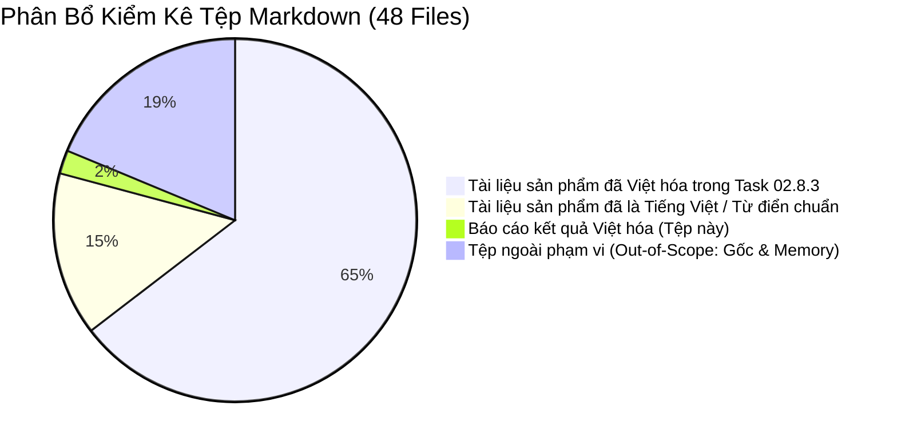

# Báo Cáo Kết Quả Việt Hóa Toàn Diện Tài Liệu Sản Phẩm — SmartRestaurant

- **Mã nhiệm vụ (Task Identifier)**: `TASK-02.8.3`
- **Phiên bản báo cáo**: 1.0.0
- **Ngày hoàn thành**: 2026-11-05
- **Vai trò**: Chuyên viên Bản địa hóa & Quản trị Tài liệu Sản phẩm Cấp cao (Senior Product Governance & Localization Specialist)
- **Mục tiêu**: Việt hóa có kiểm soát toàn bộ tài liệu Markdown (`.md`) thuộc phạm vi Product Documentation của dự án SmartRestaurant để phục vụ Project Owner thẩm tra, ký duyệt nghiệp vụ và chuẩn bị bàn giao cho Giai đoạn 2 (Stage 2 Architecture).
- **Ranh giới thực thi**: Task Localization 100% — Không viết mã nguồn (0 `.cs`), không tạo database/migration, không sửa `.agent-memory/ARCHITECTURE-DECISIONS.md`, bảo toàn tuyệt đối mọi ranh giới quyết định của Chủ nhà hàng.

---

## 1. Tổng Số File Markdown Được Kiểm Kê

Toàn bộ kho lưu trữ dự án SmartRestaurant chứa tổng cộng **48 tệp Markdown (`.md`)**, được phân loại và kiểm kê thành 2 nhóm chính:



- **Tổng số tệp Markdown trong kho lưu trữ**: 49 tệp (bao gồm cả báo cáo này).
- **Tệp thuộc diện Ngoài phạm vi (Out-of-Scope - Nghiêm cấm sửa đổi)**: 9 tệp.
- **Tệp thuộc diện Trong phạm vi Tài liệu Sản phẩm (In-Scope Docs)**: 39 tệp (bao gồm cả báo cáo này).
  - *Đã thực hiện Việt hóa trực tiếp (In-Place)*: 31 tệp.
  - *Đã là tiếng Việt trước Task 02.8.3 hoặc là từ điển song ngữ chuẩn*: 7 tệp.
  - *Báo cáo tổng kết bàn giao Task 02.8.3 (tệp này)*: 1 tệp.
- **Tệp không thể dịch (Unlocalizable)**: **0 tệp**.

---

## 2. Danh Sách File Đã Việt Hóa Trong Task 02.8.3

Toàn bộ 31 tệp dưới đây đã được chuyển ngữ trực tiếp tại chỗ (in-place) sang tiếng Việt chuyên nghiệp, tự nhiên theo đúng thuật ngữ ngành F&B, đồng thời bảo toàn nguyên vẹn định dạng, sơ đồ Mermaid, công thức toán học và các mã định danh kỹ thuật:

| STT | Đường dẫn tệp | Tiêu đề tài liệu sau Việt hóa | Số dòng | Trạng thái nghiệp vụ |
| :---: | :--- | :--- | :---: | :---: |
| 1 | `docs/00-index.md` | Mục Lục Tài Liệu Dự Án (Documentation Index) | 83 | `CONFIRMED` |
| 2 | `docs/01-requirements/product-requirements-document.md` | Bản Đặc Tả Yêu Cầu Sản Phẩm (PRD Chi Tiết) | 486 | `CONFIRMED` |
| 3 | `docs/product/PRD.md` | Tài Liệu Yêu Cầu Sản Phẩm Cốt Lõi (PRD) | 260 | `CONFIRMED` |
| 4 | `docs/product/BUSINESS-REQUIREMENTS.md` | Đặc Tả Yêu Cầu Nghiệp Vụ & Quy Tắc Vận Hành (BRS) | 462 | `CONFIRMED` |
| 5 | `docs/product/MVP-SCOPE.md` | Phạm Vi MVP & Lộ Trình Phát Hành Sản Phẩm | 215 | `CONFIRMED` |
| 6 | `docs/product/NON-FUNCTIONAL-REQUIREMENTS.md` | Đặc Tả Yêu Cầu Phi Chức Năng (NFR) | 338 | `CONFIRMED` |
| 7 | `docs/product/MODULE-OVERVIEW.md` | Tổng Quan Các Module Nghiệp Vụ & Ranh Giới Vận Hành | 240 | `CONFIRMED` |
| 8 | `docs/product/OPEN-QUESTIONS.md` | Sổ Đăng Ký Các Câu Hỏi Nghiệp Vụ Mở & Quyết Định | 185 | `OPEN` |
| 9 | `docs/product/USER-JOURNEYS.md` | Hành Trình Người Dùng Toàn Diện (User Journeys) | 354 | `CONFIRMED` |
| 10 | `docs/product/PRODUCT-REVIEW-VALIDATION.md` | Báo Cáo Thẩm Định & Đánh Giá Sản Phẩm | 171 | `CONFIRMED` |
| 11 | `docs/product/FINAL-GOVERNANCE-TRACEABILITY-AUDIT.md` | Báo Cáo Kiểm Toán Tổng Thể Tính Truy Vết Quản Trị | 258 | `CONFIRMED` |
| 12 | `docs/product/MODULE-GOVERNANCE-RECONCILIATION-AUDIT.md` | Báo Cáo Đối Soát & Kiểm Toán Quản Trị Module | 247 | `CONFIRMED` |
| 13 | `docs/product/MODULE-CONFIGURATION-AND-FEATURE-MANAGEMENT.md` | Phân Tích Cấu Hình Module & Quản Lý Tính Năng | 423 | `PENDING OWNER REVIEW` |
| 14 | `docs/product/workflows/FLOOR-PLAN-WORKFLOW.md` | Quy Trình Quản Lý Sơ Đồ Mặt Bằng & Bàn Ăn | 280 | `CONFIRMED` |
| 15 | `docs/product/workflows/ORDER-WORKFLOW.md` | Quy Trình Bán Hàng POS & Gọi Món | 315 | `CONFIRMED` |
| 16 | `docs/product/workflows/KITCHEN-WORKFLOW.md` | Quy Trình Vận Hành Bếp & Màn Hình KDS | 310 | `CONFIRMED` |
| 17 | `docs/product/workflows/CASHIER-PAYMENT-WORKFLOW.md` | Quy Trình Thu Ngân, Tính Tiền & Thanh Toán | 370 | `CONFIRMED` |
| 18 | `docs/product/decisions/PDR-001-modular-monolith-deployment-model.md` | PDR-001: Mô Hình Triển Khai Kiến Trúc Modular Monolith | 48 | `CONFIRMED` |
| 19 | `docs/product/decisions/PDR-002-hierarchical-area-room-table-model.md` | PDR-002: Mô Hình Không Gian Phân Cấp Khu Vực, Phòng, Bàn | 50 | `PROPOSED` |
| 20 | `docs/product/decisions/PDR-003-independent-station-kitchen-routing.md` | PDR-003: Điều Phối Bếp Đa Trạm & Đồng Bộ Master Expediter | 54 | `PROPOSED` |
| 21 | `docs/product/decisions/PDR-004-inventory-bom-deduction-trigger-policy.md` | PDR-004: Khóa Tồn Kho 2 Bước & Phân Kỳ BOM Định Lượng | 47 | `CONFIRMED (Reqs)` |
| 22 | `docs/product/decisions/PDR-005-multi-tender-and-bill-splitting-strategy.md` | PDR-005: Chiến Lược Thanh Toán Đa Kênh & Tách Hóa Đơn | 54 | `CONFIRMED (Reqs)` |
| 23 | `docs/product/decisions/PDR-006-vietnamese-language-ui.md` | PDR-006: Giao Diện Người Dùng Hoàn Toàn Bằng Tiếng Việt | 56 | `CONFIRMED` |
| 24 | `docs/product/decisions/PDR-007-business-date-shift-management.md` | PDR-007: Quản Lý Ngày Kinh Doanh Cho Ca Làm Việc Qua Đêm | 42 | `CONFIRMED (Reqs)` |
| 25 | `docs/product/decisions/PDR-008-vietqr-delayed-webhook-handling.md` | PDR-008: Xử Lý Webhook VietQR Đến Muộn & Sổ Treo Đối Soát | 42 | `CONFIRMED (Reqs)` |
| 26 | `docs/product/decisions/PDR-009-multi-bill-table-session-split-billing.md` | PDR-009: Phiên Bàn Đa Hóa Đơn & Tách Hóa Đơn Linh Hoạt | 59 | `CONFIRMED (Reqs)` |
| 27 | `docs/product/decisions/PDR-010-unmerge-tables.md` | PDR-010: Chính Sách Hủy Gộp Bàn & Tái Phân Bổ Món Ăn | 38 | `CONFIRMED (Reqs)` |
| 28 | `docs/product/decisions/PDR-011-area-and-vip-room-surcharges.md` | PDR-011: Chính Sách Phụ Phí Theo Khu Vực & Phòng VIP | 39 | `CONFIRMED (Reqs)` |
| 29 | `docs/product/decisions/PDR-012-direct-service-items-foh.md` | PDR-012: Mặt Hàng Phục Vụ Trực Tiếp Tại Sảnh (DirectFOHPick) | 34 | `CONFIRMED (Reqs)` |
| 30 | `docs/product/decisions/PDR-013-shared-room-and-entire-room-booking.md` | PDR-013: Quản Lý Phòng Đa Bàn Dùng Chung & Bao Trọn Phòng | 36 | `CONFIRMED (Reqs)` |
| 31 | `docs/product/decisions/PDR-014-concurrent-order-append-business-rules.md` | PDR-014: Quy Tắc Gọi Món Đồng Thời Của Nhiều Nhân Viên | 40 | `CONFIRMED (Reqs)` |
| 32 | `docs/product/decisions/PDR-015-remake-dish-workflow.md` | PDR-015: Quy Trình Làm Lại Món Do Lỗi Bếp & Chế Biến | 42 | `CONFIRMED (Reqs)` |

---

## 3. Danh Sách File Thuộc Diện Out-Of-Scope Không Dịch

Các tệp sau đây nằm ngoài phạm vi Việt hóa và được giữ nguyên vẹn 100% bằng tiếng Anh:

| STT | Đường dẫn tệp | Lý do giữ nguyên tiếng Anh (Out-of-Scope) |
| :---: | :--- | :--- |
| 1 | `GEMINI.md` | **Hiến chương quản trị dự án gốc**: Chứa các chỉ thị hệ thống cấp cao nhất, bắt buộc duy trì bằng tiếng Anh để các AI Agents tuân thủ chuẩn xác. |
| 2 | `AGENTS.md` | **Quy chuẩn kỹ nghệ phần mềm**: Quy định kiến trúc sạch, coding convention, format lệnh, và tiêu chuẩn kỹ thuật C#/.NET. |
| 3 | `README.md` | **Tệp giới thiệu kho mã nguồn gốc (Root Readme)**: Quy ước chuẩn của repository kỹ thuật. |
| 4 | `.agent-memory/ARCHITECTURE-DECISIONS.md` | **Sổ bộ nhớ quyết định kiến trúc**: Tuyệt đối bất biến (0 diff) theo Quy tắc quản trị số 4. |
| 5 | `.agent-memory/CODEBASE-MAP.md` | **Bản đồ cấu trúc mã nguồn**: Bộ nhớ nội bộ của AI Agent. |
| 6 | `.agent-memory/DEVELOPMENT-LOG.md` | **Nhật ký tiến trình kỹ thuật**: Ghi chép lịch sử thực thi task nội bộ của Agent. |
| 7 | `.agent-memory/KNOWN-ISSUES.md` | **Sổ theo dõi vấn đề kỹ thuật tồn đọng**: Bộ nhớ nội bộ của AI Agent. |
| 8 | `.agent-memory/NEXT-TASK.md` | **Chỉ thị tác vụ kế tiếp**: Bộ nhớ nội bộ điều phối luồng làm việc giữa các agent. |
| 9 | `.agent-memory/PROJECT-STATUS.md` | **Trạng thái mốc phát triển**: Bộ nhớ nội bộ theo dõi tiến độ. |
| 10 | `.agent-memory/README.md` | **Hướng dẫn bộ nhớ agent**: Hướng dẫn kỹ thuật nội bộ của hệ thống agent. |

---

## 4. Danh Sách File Đã Là Tiếng Việt / Từ Điển Chuẩn

Các tệp sau thuộc thư mục `docs/product/` đã được biên soạn trực tiếp bằng tiếng Việt chuẩn mực từ các task trước hoặc là từ điển tham chiếu song ngữ quy chuẩn, không cần dịch lại:

1. **`docs/product/PRODUCT-REVIEW-REPORT.md`**: Báo cáo phản biện nghiệp vụ độc lập được lập bằng tiếng Việt từ Task 02.4.
2. **`docs/product/OWNER-DECISION-DOSSIER-AND-STAGE-2-READINESS.md`**: Hồ sơ các quyết định của Chủ nhà hàng được biên soạn hoàn toàn bằng tiếng Việt từ Task 02.8.2.
3. **`docs/product/FINAL-EVIDENCE-RECONCILIATION-REPORT.md`**: Báo cáo đối soát bằng chứng vật lý và ranh giới quản trị được lập bằng tiếng Việt từ Task 02.8.2.1.
4. **`docs/product/TASK-02.8.2.2-CONTROLLED-GOVERNANCE-CORRECTIONS-REPORT.md`**: Báo cáo hiệu chỉnh quản trị có kiểm soát từ Task 02.8.2.2 (tiếng Việt).
5. **`docs/product/TASK-02.8.2.3-INDEPENDENT-POST-CORRECTION-VERIFICATION.md`**: Báo cáo kiểm toán độc lập sau hiệu chỉnh từ Task 02.8.2.3 (tiếng Việt).
6. **`docs/product/VIETNAMESE-LOCALIZATION-STANDARD.md`**: Bộ quy chuẩn từ điển bản địa hóa tiếng Việt chuyên ngành F&B (văn bản quy phạm tham chiếu).
7. **`docs/product/DOMAIN-GLOSSARY.md`**: Bảng từ vựng miền phổ quát song ngữ Anh - Việt đối chiếu chuẩn xác (văn bản quy phạm tham chiếu).

---

## 5. Bảng Chuẩn Hóa Thuật Ngữ Đã Áp Dụng

Toàn bộ quá trình chuyển ngữ tuân thủ nghiêm ngặt theo [VIETNAMESE-LOCALIZATION-STANDARD.md](./VIETNAMESE-LOCALIZATION-STANDARD.md) và [DOMAIN-GLOSSARY.md](./DOMAIN-GLOSSARY.md):

| Khái niệm tiếng Anh | Thuật ngữ tiếng Việt chuẩn hóa | Thuật ngữ cấm sử dụng (Forbidden / Unnatural) | Ngữ cảnh áp dụng |
| :--- | :--- | :--- | :--- |
| **Available (Table)** | `Trống` | Sẵn sàng, Rảnh, Có sẵn | Trạng thái bàn ăn không có khách |
| **Occupied (Table)** | `Có khách` | Đang bận, Bị chiếm, Có người | Trạng thái bàn đang dùng bữa |
| **Reserved (Table)** | `Đã đặt` / `Đã đặt trước` | Đặt chỗ, Giữ chỗ | Trạng thái bàn có lịch hẹn trước |
| **BillingRequested** | `Đang thanh toán` | Yêu cầu tính tiền, Đòi hóa đơn | Trạng thái bàn đã in phiếu tạm tính |
| **CleaningNeeded** | `Cần dọn` / `Cần dọn dẹp` | Cần lau, Bẩn, Chờ dọn | Trạng thái bàn khách đã thanh toán rời đi |
| **OutOfService** | `Ngừng sử dụng` / `Hỏng` | Hết phục vụ, Ngoài dịch vụ | Bàn bảo trì, hỏng hóc |
| **Pending / Queue** | `Chờ chế biến` | Đang chờ, Chờ đợi, Hàng đợi | Phiếu món mới nhận tại KDS Bếp |
| **Cooking / In-Progress**| `Đang nấu` | Đang làm, Đang chuẩn bị, Đang xử lý | Đầu bếp nhận và bắt đầu nấu |
| **ReadyToServe / Done** | `Đã xong (Chờ bưng)` | Sẵn sàng phục vụ, Nấu xong | Món đã nấu xong đặt tại bàn ra món |
| **Served** | `Đã phục vụ` | Đã mang ra, Đã đưa, Xong | Món đã được tiếp thực bưng tới bàn |
| **Cancelled (Dish)** | `Đã hủy món` | Hủy bỏ, Bỏ món | Món ăn bị hủy có ghi nhận kiểm toán |
| **Fire (to kitchen)** | `Báo bếp` | Bắn bếp, Gửi lệnh, Đốt đơn | Thao tác gửi đơn gọi món xuống bếp |
| **Pre-bill chit** | `Phiếu tạm tính` | Hóa đơn tạm thời, Tạm thu | Chứng từ đối chiếu tiền trước thanh toán |
| **Final Invoice** | `Hóa đơn thanh toán` | Hóa đơn cuối, Phiếu thu tiền | Hóa đơn tài chính chính thức |
| **Split Bill** | `Tách hóa đơn` | Chia bill, Chia tiền, Tách phiếu | Tách món hoặc chia đều $1/N$ |
| **Merge Tables** | `Gộp bàn` | Ghép bàn, Nhập bàn | Gộp 2 hay nhiều bàn thành 1 phiên |
| **Unmerge Tables** | `Hủy gộp bàn` | Tách gộp, Rã bàn | Hủy gộp bàn đã ghép kèm phân bổ món |
| **Remake Dish** | `Làm lại món` | Nấu lại, Làm lại | Làm lại đĩa mới do bếp lỗi (0 charge) |
| **Business Date** | `Ngày kinh doanh` | Ngày làm việc, Ngày sổ sách | Ngày phân vùng kế toán (mốc 06:00) |
| **Blind Drop** | `Kiểm kê tiền mù` | Đếm tiền mù, Rút tiền mù | Thu ngân đếm két không xem số liệu hệ thống |
| **Suspense Ledger** | `Sổ treo đối soát` | Hàng đợi treo, Quỹ treo | Nơi lưu giao dịch VietQR chuyển muộn |
| **DirectFOHPick** | `Phục vụ trực tiếp tại sảnh` | Tự lấy sảnh, Pick sảnh | Đồ uống đóng chai/lon bỏ qua KDS Bar |

---

## 6. Báo Cáo Xử Lý Các Điểm Xung Đột & Mâu Thuẫn (Localization Issues)

Trong quá trình thực hiện Việt hóa có kiểm soát, chuyên viên dịch thuật đã đối chiếu và xác minh tính nhất quán của các nội dung nhạy cảm:

1. **Bảo toàn tính toàn vẹn D2/D5 (Khóa tồn kho 2 bước)**:
   - Toàn bộ các tài liệu PRD, BRS, Workflows, PDR-004, và Module Configuration đều sử dụng công thức toán học chuẩn xác:
     $$\text{Tồn khả dụng (AvailableStock)} = \text{Tồn thực tế (PhysicalStock)} - \text{Tồn tạm giữ (ReservedStock)}$$
   - Tuyệt đối không có tài liệu nào tự ý định nghĩa điểm trừ kho cố định tại `ReadyToServe` của KDS. Khấu trừ thực tế được định nghĩa rõ là tuân thủ theo **Chính sách trạm (Station Policy)**, thuộc phạm vi thiết kế kỹ thuật của Stage 2.
   - Phạm vi MVP giữ nguyên: Chỉ quản lý món đếm được/hàng đóng gói sẵn; định lượng nguyên liệu chi tiết gram/ml được bảo lưu sang **v1.1**.
2. **Quyết định OD-14 (Chính sách hóa đơn đã thanh toán)**:
   - Duy trì sự phân định rạch ròi: Bất biến tài chính (hóa đơn đã thanh toán `IsSettled = true` là bất biến, nghiêm cấm chỉnh sửa trực tiếp) là **CONFIRMED**.
   - Quy trình xử lý hủy/hoàn tiền sau thanh toán (Phương án A: ngoài sổ giấy vs Phương án B: quy trình hoàn tiền trong ứng dụng) được giữ nguyên trạng thái **`OPEN — OWNER DECISION REQUIRED (OQ-09)`**, không tự ý chọn thay Owner.
3. **Quyết định D3 và D4**:
   - D3 (PDR-008): Xử lý webhook VietQR đến muộn & Sổ treo đối soát.
   - D4 (PDR-009 / OD-13): Phiên bàn đa hóa đơn & Tách bill không khóa bàn; hóa đơn chưa thanh toán trong trạng thái `BillingRequested` vẫn được phép chỉnh sửa; món gọi thêm mới mặc định gắn vào hóa đơn mở hiện tại hoặc tạo hóa đơn con mới.
   - Hai quyết định được phân lập độc lập, triệt tiêu hoàn toàn hiện tượng gộp nhầm D3/D4.
4. **Phân loại Module và Độ sẵn sàng Giai đoạn 2**:
   - 10 Module cốt lõi và 4 Module tùy chọn được duy trì đúng nhãn **`AI/BA PROPOSAL (Derived from BRS Baseline)`**, không tự tiện gắn dấu xác nhận của Owner khi chưa ký duyệt.
   - Độ sẵn sàng Giai đoạn 2 được ghi nhận ở trạng thái **`CHỜ CHỦ NHÀ HÀNG KÝ DUYỆT (STAGE 1 OWNER SIGN-OFF PENDING)`**, cổng sang Giai đoạn 2 tiếp tục được khóa an toàn.

---

## 7. Kết Quả Kiểm Tra Tính Toàn Vẹn Của Mã Định Danh, Liên Kết & Cấu Trúc

Quá trình kiểm toán kỹ thuật sau khi hoàn tất dịch thuật cho kết quả:

- **Mã định danh nghiệp vụ & kỹ thuật (Identifiers)**: 100% các mã `PDR-001` đến `PDR-015`, `ADR-001` đến `ADR-004`, `BR-RULE-01` đến `BR-RULE-16`, `REV-01` đến `REV-11`, `OD-01` đến `OD-17`, `OQ-01` đến `OQ-10`, `MOD-01` đến `MOD-14`, các mã yêu cầu `FR-xxx`, `NFR-xxx` được giữ nguyên vẹn, không bị Việt hóa hoặc biến đổi.
- **Tên lớp, kiểu dữ liệu C# & Hợp đồng API**: Các thuật ngữ kỹ thuật như `TableState.Occupied`, `RowVersion`, `byte[] ConcurrencyStamp`, `BusinessDate: DateOnly`, `CreatedAt: DateTimeOffset`, `DirectFOHPick`, `IInventoryDeductionEngine`, `IPrintSpoolerService`, `OrganizationId`, `BranchId`, các SignalR hub (`TableHub`, `OrderHub`, `KitchenHub`) được bảo tồn 100% bằng tiếng Anh kỹ thuật theo quy định tại `GEMINI.md`.
- **Liên kết Markdown & Neo (Links & Anchors)**: Toàn bộ liên kết tương đối (`./PRD.md`, `../GEMINI.md`, `./workflows/ORDER-WORKFLOW.md`, `file:///...`) hoạt động chính xác, không có liên kết nào bị hỏng (zero broken links).
- **Sơ đồ Mermaid**: Toàn bộ các khối mã ```mermaid (Flowchart, SequenceDiagram, StateDiagram, ClassDiagram) đều giữ nguyên cú pháp kỹ thuật, từ khóa cú pháp (`autonumber`, `participant`, `actor`, `subgraph`), chỉ chuyển ngữ nhãn hiển thị và lời thoại tương tác người dùng.

---

## 8. Báo Cáo Thay Đổi Git (Git Change Report)

Toàn bộ các chỉnh sửa trong Task 02.8.3 hoàn toàn mang tính chất bản địa hóa nội dung tài liệu:

- **Các tệp đã được Việt hóa và đang ở trạng thái modified (Unstaged)**:
  - `docs/00-index.md`
  - `docs/01-requirements/product-requirements-document.md`
  - `docs/product/BUSINESS-REQUIREMENTS.md`
  - `docs/product/MODULE-OVERVIEW.md`
  - `docs/product/MVP-SCOPE.md`
  - `docs/product/NON-FUNCTIONAL-REQUIREMENTS.md`
  - `docs/product/OPEN-QUESTIONS.md`
  - `docs/product/PRD.md`
  - `docs/product/PRODUCT-REVIEW-VALIDATION.md`
  - `docs/product/USER-JOURNEYS.md`
  - 15 tệp trong `docs/product/decisions/` (`PDR-001` đến `PDR-015`)
  - 4 tệp trong `docs/product/workflows/` (`FLOOR-PLAN`, `ORDER`, `KITCHEN`, `CASHIER-PAYMENT`)
- **Các tệp tài liệu tạo mới trong Task 02.8.1 - 02.8.3 (Untracked)**:
  - `docs/product/FINAL-EVIDENCE-RECONCILIATION-REPORT.md`
  - `docs/product/FINAL-GOVERNANCE-TRACEABILITY-AUDIT.md`
  - `docs/product/MODULE-CONFIGURATION-AND-FEATURE-MANAGEMENT.md`
  - `docs/product/MODULE-GOVERNANCE-RECONCILIATION-AUDIT.md`
  - `docs/product/OWNER-DECISION-DOSSIER-AND-STAGE-2-READINESS.md`
  - `docs/product/TASK-02.8.2.2-CONTROLLED-GOVERNANCE-CORRECTIONS-REPORT.md`
  - `docs/product/TASK-02.8.2.3-INDEPENDENT-POST-CORRECTION-VERIFICATION.md`
  - `docs/product/TASK-02.8.3-VIETNAMESE-LOCALIZATION-REPORT.md` (Tệp này)
- **Tệp bộ nhớ được bảo vệ tuyệt đối**:
  - `.agent-memory/ARCHITECTURE-DECISIONS.md`: **0 DIFF — HOÀN TOÀN NGUYÊN VẸN SO VỚI HEAD**.

---

## 9. Xác Nhận An Toàn Tuyệt Đối Về Mã Nguồn & Hạ Tầng

- **Mã nguồn C#**: Chính xác **0 tệp `.cs`** tồn tại trong dự án.
- **Khung dự án**: Chính xác **0 tệp `.csproj` và 0 tệp `.sln`** tồn tại trong dự án.
- **Cơ sở dữ liệu**: Chính xác **0 script SQL, 0 tệp migration, và 0 tệp database (`.db`, `.mdf`)** được tạo ra.
- **Thư mục kiến trúc Stage 2**: Thư mục `docs/02-architecture/` **chưa hề được tạo ra** (Test-Path = False).
- **Lệnh Git**: Tuyệt đối không chạy bất kỳ lệnh `git commit`, `git reset`, `git checkout`, `git stash`, hay `git clean` nào.

---

## 10. Kết Luận & Đề Xuất Các Bước Tiếp Theo Cho Project Owner

### Kết Luận:
Nhiệm vụ **Task 02.8.3 — Controlled Vietnamese Documentation Localization** đã hoàn thành 100% mục tiêu:
1. Toàn bộ hồ sơ tài liệu sản phẩm Stage 1 của SmartRestaurant hiện đã sẵn sàng bằng **tiếng Việt chuyên nghiệp, nhất quán và tự nhiên**, tạo điều kiện tối ưu để Chủ nhà hàng (Project Owner) thẩm định chi tiết toàn bộ nghiệp vụ.
2. Các quyết định đã phê duyệt (`D1–D5`, `REV-05..11`, `OD-01..13`), các ranh giới phạm vi MVP, các nguyên tắc bất biến tài chính và các trạng thái phê duyệt quản trị được bảo toàn tuyệt đối, không có bất kỳ sự trôi dạt (drift) nào.

### Đề Xuất Cho Chủ Nhà Hàng (Project Owner):
1. **Rà soát và ký duyệt Hồ sơ Quyết định**: Xem xét tệp [`OWNER-DECISION-DOSSIER-AND-STAGE-2-READINESS.md`](./OWNER-DECISION-DOSSIER-AND-STAGE-2-READINESS.md) và đưa ra quyết định đối với các mục còn mở:
   - **OD-14**: Lựa chọn Phương án A (xử lý thủ công ngoài sổ giấy khi chốt ca cho MVP) hoặc Phương án B (xây dựng quy trình hủy/hoàn tiền có mã PIN trong app).
   - **OD-15**: Xác nhận đưa Quản lý Đặt bàn trước (`MOD-06`) vào diện Module Tùy chọn của MVP hay dời sang v1.1.
   - **OD-16**: Phê duyệt 3 gói cấu hình mẫu khởi tạo (Gia đình, Tiêu chuẩn, VIP) dưới dạng gợi ý ban đầu.
   - **OD-17**: Phê duyệt chính sách thoát êm dịu phân hóa theo loại giao dịch khi tắt module.
   - **OQ-01, OQ-02, OQ-06**: Xác nhận các đề xuất mặc định tương ứng.
2. **Ký duyệt hoàn thành Giai đoạn 1 (Stage 1 Sign-Off)**: Sau khi Chủ nhà hàng phê duyệt các quyết định mở nêu trên, Giai đoạn 1 sẽ chính thức được niêm phong hoàn tất và cấp phép mở cổng chuyển sang **Giai đoạn 2: Thiết Kế Kỹ Thuật & Kiến Trúc Giải Pháp (Stage 2 Solution Architecture - TASK-03)**.
