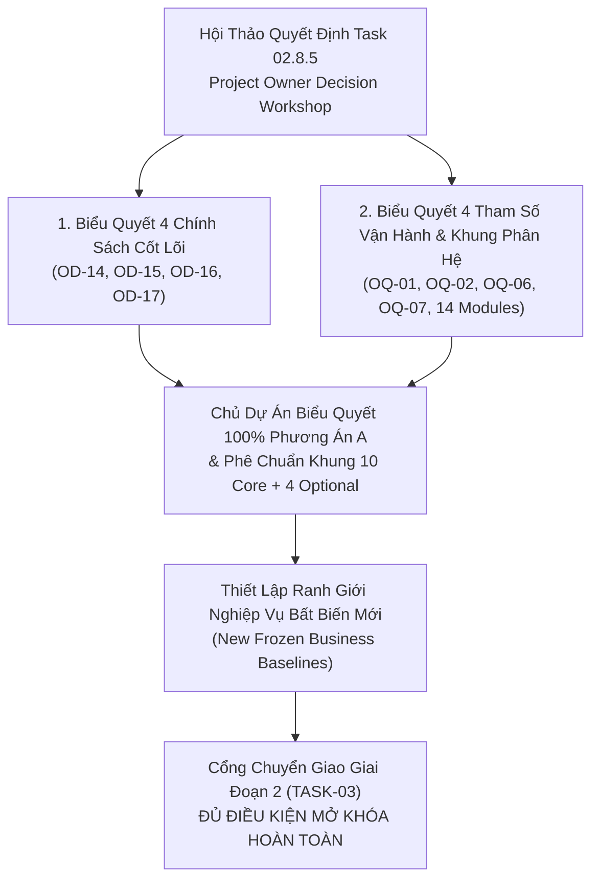

# Biên Bản Hợp Nhất Quyết Định Của Chủ Dự Án — SmartRestaurant
## TASK 02.8.5: PROJECT OWNER DECISION WORKSHOP & DECISION CONSOLIDATION RECORD

- **Dự Án**: SmartRestaurant — Quản Lý Vận Hành Nhà Hàng Độc Lập
- **Giai Đoạn**: Stage 1 — Khám Phá Sản Phẩm & Đặc Tả Miền Nghiệp Vụ (Product Discovery & Business Domain Specifications)
- **Mã Nhiệm Vụ**: `TASK-02.8.5`
- **Chủ Trì Workshop**: Project Owner (Chủ Dự Án / Chủ Nhà Hàng) & Trưởng Ban Kiến Trúc Hệ Thống (Lead Solution Architect)
- **Ngày Thực Hiện**: 2026-11-06
- **Trạng Thái Biên Bản**: **`OFFICIALLY CONSOLIDATED & SIGNED OFF BY PROJECT OWNER`**
- **Trạng Thái Giai Đoạn 1**: **`100% RESOLVED, SEALED & COMPLETED — READY FOR STAGE 2 AUTHORIZATION`**

---

## 1. Mục Đích & Bối Cảnh Hội Thảo Quyết Định (Workshop Context)

Trải qua chuỗi nhiệm vụ nghiên cứu, phân tích cấu hình (Task 02.8), đối soát quản trị (Task 02.8.1), lập hồ sơ quyết định (Task 02.8.2), Việt hóa có kiểm soát (Task 02.8.3) và kiểm toán chất lượng độc lập (Task 02.8.4), toàn bộ các vấn đề nghiệp vụ và chính sách mở của dự án SmartRestaurant đã được tổng hợp hoàn chỉnh tại [`docs/product/OWNER-DECISION-DOSSIER-AND-STAGE-2-READINESS.md`](./OWNER-DECISION-DOSSIER-AND-STAGE-2-READINESS.md).

Hội thảo **TASK 02.8.5** được triệu tập để Chủ Dự Án (Project Owner) trực tiếp thẩm định, biểu quyết và chốt phương án chính thức cho toàn bộ 8 quyết định chính sách còn mở và phê chuẩn Cơ cấu 14 Phân hệ nghiệp vụ.



---

## 2. Kết Quả Biểu Quyết & Hợp Nhất Quyết Định Chi Tiết

Toàn bộ các mục biểu quyết đã được Chủ Dự Án phê duyệt chính thức như sau:

### 2.1. Quyết Định Cốt Lõi Cấp 1 (Chính Sách Nghiệp Vụ Trọng Yếu)

#### `OD-14`: Chính sách Xử lý Khiếu nại & Hủy/Hoàn tiền Hóa đơn đã Thanh toán
- **Phương án được chọn**: **PHƯƠNG ÁN A — Giữ CSDL Bất Biến Tuyệt Đối Trong MVP; Xử Lý Chênh Lệch Thực Tế Qua Biên Bản Giấy Khi Chốt Két Ca & Lưu Vết Kiểm Toán**.
- **Quy tắc nghiệp vụ được xác lập**:
  1. Hóa đơn đã thanh toán (`IsSettled = true`) là bất biến, nghiêm cấm nhân viên thu ngân hay quản lý chỉnh sửa/xóa trực tiếp trên phần mềm.
  2. Khi phát sinh khiếu nại sai sót tiền sau khi đã đóng bill (ví dụ: khách đổi món, tính nhầm tiền), Thu ngân và Quản lý thực hiện hoàn tiền mặt thủ công từ két, lập "Biên bản điều chỉnh sai lệch két giấy" ký tay.
  3. Khi thực hiện chốt ca (Blind Shift Close), hệ thống ghi nhận số tiền chênh lệch thực tế so với số liệu ghi sổ vào thực thể `ShiftClosingVarianceLog`, lưu vết thời điểm, người thực hiện, lý do, người xác minh và liên kết đến mã hóa đơn gốc (`OriginalInvoiceId`).
  4. Triệt tiêu hoàn toàn rủi ro gian lận nhân viên thông đồng hủy bill trên máy; không phát sinh máy trạng thái hoàn tiền phức tạp trong MVP.
  5. Chức năng số hóa hoàn tiền trong ứng dụng qua thực thể `CreditNote` (bút toán âm) được bảo lưu sang **Phiên bản v1.1**.

#### `OD-15`: Định vị Phân hệ Đặt Bàn Trước (`MOD-06`) trong Phạm vi MVP
- **Phương án được chọn**: **PHƯƠNG ÁN A — Đưa vào MVP Dưới Dạng Phân Hệ Tùy Chọn (`MVP Optional`)**.
- **Quy tắc nghiệp vụ được xác lập**:
  1. Sản phẩm hỗ trợ đầy đủ luồng đặt bàn, tiếp nhận lịch hẹn, ghi nhận tiền đặt cọc và tự động chuyển đổi sang phiên bàn ăn (`TableSession`).
  2. Nhà hàng quy mô bình dân không có nhu cầu nhận đặt bàn có thể tắt hoàn toàn tính năng này chỉ với 1 chạm (gạt cờ tính năng), giao diện POS sẽ tự động ẩn các nút liên quan để tối ưu thao tác.
  3. Kiến trúc Stage 2 thiết kế thực thể `Reservation` tách rời độc lập (loose coupling), không gây phụ thuộc cứng vào luồng mở bàn trực tiếp.

#### `OD-16`: Áp dụng Bộ Gói Cấu Hình Khởi Tạo (Onboarding Presets)
- **Phương án được chọn**: **PHƯƠNG ÁN A — Cung Cấp 3 Gói Cấu Hình Mẫu Gợi Ý Ban Đầu (Gia Đình, Tiêu Chuẩn, VIP) Trong Wizard Onboarding**.
- **Quy tắc nghiệp vụ được xác lập**:
  1. Trong giao diện thiết lập nhà hàng lần đầu (Setup Wizard), cung cấp 3 bộ cấu hình gợi ý sẵn:
     - *Gói Nhà Hàng Bình Dân / Gia Đình*: Tắt đặt bàn, tắt KDS, bật in nhiệt bếp, tắt phí dịch vụ, trừ kho theo lon/chai.
     - *Gói Tiêu Chuẩn (Casual Dining)*: Bật KDS Bar, bật KDS Bếp, bật đặt bàn cơ bản, phí dịch vụ 5%, VAT 8%.
     - *Gói VIP Fine Dining*: Bật toàn bộ phân hệ, phụ phí phòng VIP theo giờ, kiểm soát ca nghiêm ngặt, in nhiệt dự phòng.
  2. Các gói Presets này hoàn toàn mang tính gợi ý, không áp đặt cứng. Quản lý có thể tùy chỉnh lại từng tham số bất kỳ lúc nào.

#### `OD-17`: Quy Tắc Thoát Nghiệp Vụ Phân Tầng Khi Tắt Module (Graceful Drain Policy)
- **Phương án được chọn**: **PHƯƠNG ÁN A — Thoát Phân Tầng Theo Loại Giao Dịch (Graceful Drain)**.
- **Quy tắc nghiệp vụ được xác lập**:
  1. Khi Quản trị viên tắt một phân hệ tùy chọn (ví dụ: tắt `MOD-06` Đặt bàn, hoặc tắt `MOD-09` KDS):
     - Hệ thống lập tức chặn không cho tạo thêm giao dịch mới thuộc phân hệ đó.
     - Đối với các giao dịch dở dang đang tồn tại: Bàn đang ăn được phục vụ đến khi thanh toán xong; lịch hẹn đặt bàn đã nhận cọc được tiếp tục đón tiếp hoặc hoàn cọc; giao dịch VietQR đang chờ trong sổ treo được phép đối soát xong.
     - Sau khi tất cả giao dịch dở dang hoàn tất, module chuyển hẳn sang trạng thái ngắt kết nối hoàn toàn.
  2. Dữ liệu lịch sử của module bị tắt được bảo lưu 100% ở trạng thái chỉ đọc (Read-Only) để phục vụ báo cáo đối soát kế toán.

---

### 2.2. Quyết Định Tham Số Vận Hành & Khung Phân Hệ (Cấp 2)

#### `OQ-01`: Thuật toán Tách Hóa Đơn Theo Tỷ Lệ % Tùy Biến
- **Phương án được chọn**: **PHƯƠNG ÁN A — Hoãn Sang v1.1; MVP Hỗ Trợ Tách Theo Món Chọn Lọc & Tách Đều $1/N$**.
- **Căn cứ**: Đảm bảo thuật toán thanh toán tài chính của MVP đạt độ chuẩn xác 100%, không phát sinh tranh chấp số dư làm tròn tiền lẻ; đáp ứng trên 95% tình huống thực tế của thực khách Việt Nam.

#### `OQ-02`: Cấu Hình Tự Động In Nhiệt Bếp Khi Báo Bếp (`AutoPrintOnFire`)
- **Phương án được chọn**: **PHƯƠNG ÁN A — Mặc Định Tắt (`AutoPrintOnFire: false`), Ưu Tiên Màn Hình KDS Điện Tử**.
- **Căn cứ**: Nhà bếp vận hành hiện đại, giảm thiểu rác thải giấy in nhiệt; máy in nhiệt nhà bếp đóng vai trò dự phòng phần cứng (Hardware Fallback) khi bấm in lại thủ công hoặc khi màn hình KDS bị mất kết nối mạng nội bộ.

#### `OQ-06`: Quy Tắc Tính Thuế VAT Trên Phí Dịch Vụ (`IsServiceChargeTaxable`)
- **Phương án được chọn**: **PHƯƠNG ÁN A — Mặc Định Tính Thuế VAT Trên Cả Phí Dịch Vụ (`IsServiceChargeTaxable: true`)**.
- **Công thức tính tiền chính thức**:
  $$\text{Tổng thanh toán} = \text{Tiền món} - \text{Chiết khấu} + \text{Phí dịch vụ} + \text{Thuế VAT}$$
  Trong đó: $\text{Thuế VAT} = (\text{Tiền món sau chiết khấu} + \text{Phí dịch vụ}) \times \text{Thuế suất VAT (8\% hoặc 10\%)}$.

#### `OQ-07`: Kiểm Soát Phiên Bàn Kéo Dài > 24 Giờ Vượt Mốc Cắt Ca
- **Phương án được chọn**: **PHƯƠNG ÁN A — Giữ Nguyên Ngày Kinh Doanh Gốc Khi Mở Bàn + Hiển Thị Dải Băng Cảnh Báo Màu Cam Cho Quản Lý**.
- **Căn cứ**: Tuyệt đối tuân thủ nguyên tắc cốt lõi `D1` (bàn gắn liền với Ngày kinh doanh tại thời điểm mở); không đóng bàn cưỡng bức làm gián đoạn bữa ăn của khách hàng; hỗ trợ kiểm toán kế toán minh bạch.

#### `Khung 14 Phân Hệ`: Phê Chuẩn Cơ Cấu Phân Tầng Module
- **Phương án được chọn**: **CHÍNH THỨC PHÊ CHUẨN Cơ cấu 10 Phân hệ Cốt lõi Bắt buộc + 4 Phân hệ Tùy chọn MVP**.
  - **10 Phân hệ Cốt lõi Bắt buộc (Core Mandatory)**:
    1. `MOD-01`: Quản trị Tổ chức & Cửa hàng Đơn lập
    2. `MOD-02`: Quản lý Thực đơn, Danh mục & Món ăn
    3. `MOD-03`: Quản lý Sơ đồ Mặt bằng, Khu vực & Bàn ăn
    4. `MOD-04`: Điểm Bán Hàng & Tiếp nhận Đơn gọi món (POS)
    5. `MOD-05`: Vận hành Dịch vụ Bàn & Điều phối Phục vụ
    6. `MOD-07`: Thu ngân, Tính tiền & Thanh toán Đa kênh
    7. `MOD-08`: Động cơ Điều phối Bếp & Định tuyến Trạm
    8. `MOD-10`: Báo cáo Doanh thu & Vận hành Cơ bản
    9. `MOD-13`: Quản trị Ca làm việc, Két tiền & Phân quyền Nhân viên (RBAC)
    10. `MOD-14`: Quản lý Cấu hình Hệ thống & Cờ Tính năng
  - **4 Phân hệ Tùy chọn MVP (MVP Optional - Có thể Bật/Tắt linh hoạt)**:
    11. `MOD-06`: Quản lý Đặt bàn trước & Tiền cọc
    12. `MOD-09`: Hệ thống Màn hình Bếp KDS Cảm ứng Điện tử
    13. `MOD-11`: Báo cáo Quản trị Nâng cao & Phân tích Hiệu suất Bàn
    14. `MOD-12`: Quản lý Tồn kho Tự động Hàng hóa Đếm được (Lon/Chai)

---

## 3. Ma Trận Quyết Định Nghiệp Vụ Toàn Diện (Final Consolidated Decision Matrix)

| Mã Quyết Định | Nội Dung Quyết Định | Phân Loại Trước Task 02.8.5 | Trạng Thái Sau Workshop 02.8.5 | Căn Cứ & Quy Tắc Thực Thi Chính Thức |
| :---: | :--- | :---: | :---: | :--- |
| **`D1`** | **Ranh giới Ngày Kinh doanh mốc 06:00** | Confirmed | **`OWNER-CONFIRMED`** | Mặc định 06:00; phiên bàn giữ ngày kinh doanh lúc mở; ca đêm qua mốc mang cảnh báo. |
| **`D2/D5`** | **Khóa kho 2 bước & Hàng đếm được** | Confirmed | **`OWNER-CONFIRMED`** | Khóa logic khi Báo bếp ($Available = Physical - Reserved$); BOM gram/ml hoãn sang v1.1. |
| **`D3`** | **Xử lý VietQR đến muộn & Sổ treo** | Confirmed | **`OWNER-CONFIRMED`** | Cho phép thu tiền mặt; giao dịch QR về muộn đưa vào Sổ treo đối soát (`SuspenseLedger`). |
| **`D4`** | **Phiên bàn đa hóa đơn & Tách bill** | Confirmed | **`OWNER-CONFIRMED`** | Tách bill không khóa bàn; phục vụ tiếp tục gọi món bình thường; thanh toán Multi-Tender. |
| **`OD-01`** | **Ranh giới Cửa hàng Đơn lập cho MVP** | Confirmed | **`OWNER-CONFIRMED`** | 01 địa điểm độc lập duy nhất; không phát triển logistics chuỗi phân tán trong MVP. |
| **`OD-13`** | **Bất biến của Hóa đơn Đã thanh toán** | Confirmed | **`OWNER-CONFIRMED`** | `IsSettled = true` là bất biến tuyệt đối; không thể chỉnh sửa trực tiếp. |
| **`OD-14`** | **Chính sách Hủy/Hoàn tiền hóa đơn đóng** | Open | **`OWNER-CONFIRMED (Phương án A)`** | CSDL bất biến; xử lý chênh lệch sổ giấy chốt két ca & lưu vết kiểm toán; hoãn CreditNote sang v1.1. |
| **`OD-15`** | **Vị thế Phân hệ Đặt bàn trước (MOD-06)** | Open | **`OWNER-CONFIRMED (Phương án A)`** | Đưa vào MVP diện Phân hệ Tùy chọn (`MVP Optional`); bật/tắt linh hoạt 1 chạm. |
| **`OD-16`** | **Bộ Gói Cấu hình Khởi tạo Onboarding** | Open | **`OWNER-CONFIRMED (Phương án A)`** | Áp dụng 3 gói mẫu (Gia đình, Tiêu chuẩn, VIP) dưới dạng gợi ý ban đầu không ràng buộc. |
| **`OD-17`** | **Quy tắc Thoát êm dịu khi Tắt Module** | Open | **`OWNER-CONFIRMED (Phương án A)`** | Thoát phân tầng theo loại giao dịch dở dang (Graceful Drain); dữ liệu cũ giữ Read-Only. |
| **`OQ-01`** | **Tách hóa đơn theo % tùy biến lẻ** | Open | **`OWNER-CONFIRMED (Phương án A)`** | Hoãn chia % lẻ sang v1.1; MVP hỗ trợ Tách theo món và Tách đều $1/N$. |
| **`OQ-02`** | **Tự động in nhiệt bếp khi báo bếp** | Open | **`OWNER-CONFIRMED (Phương án A)`** | Mặc định tắt (`AutoPrintOnFire: false`), ưu tiên KDS; máy in nhiệt làm phương án dự phòng. |
| **`OQ-06`** | **Tính thuế VAT trên Phí dịch vụ** | Open | **`OWNER-CONFIRMED (Phương án A)`** | Mặc định tính VAT trên Phí dịch vụ (`IsServiceChargeTaxable: true`). |
| **`OQ-07`** | **Kiểm soát bàn mở kéo dài > 24 giờ** | Open | **`OWNER-CONFIRMED (Phương án A)`** | Giữ ngày kinh doanh gốc + hiển thị dải băng cảnh báo màu cam cho Quản lý. |
| **`Khung 14 Phân hệ`** | **Cơ cấu 10 Core + 4 Optional Modules** | Proposal | **`OWNER-CONFIRMED`** | Phê chuẩn chính thức 10 phân hệ bắt buộc + 4 phân hệ tùy chọn cho kiến trúc MVP. |

---

## 4. Tuyên Bố Kết Thúc Giai Đoạn 1 & Mở Khóa Giai Đoạn 2

```
================================================================================
FORMAL STAGE 1 SIGN-OFF DECLARATION:
STAGE 1: PRODUCT REQUIREMENTS & BUSINESS SPECIFICATIONS — 100% SEALED & SIGNED OFF
OPEN QUESTIONS & OWNER DECISIONS REMAINING: ZERO (0)
TRANSITION GATE TO STAGE 2: UNLOCKED & AUTHORIZED FOR EXECUTION
TASK APPROVED FOR IMMEDIATE COMMENCEMENT: TASK-03 (SOLUTION ARCHITECTURE & ERD)
================================================================================
```

### Các Tác Vụ Của Giai Đoạn 2 (TASK-03 WBS):
Sau khi hoàn tất Task 02.8.5, Đội ngũ Kỹ thuật được chính thức cấp phép khởi động **Stage 2: Thiết Kế Kiến Trúc Kỹ Thuật & Giải Pháp (TASK-03)** theo đúng phạm vi:
1. **TASK-03.1**: Thiết kế Kiến trúc Tổng thể Modular Monolith (`docs/02-architecture/system-architecture.md`).
2. **TASK-03.2**: Thiết kế Mô hình Dữ liệu Quan hệ & ERD Chi Tiết (`docs/02-architecture/data-models-and-erd.md`).
3. **TASK-03.3**: Thiết kế Hợp đồng Thời gian thực SignalR Hubs Mesh (`docs/02-architecture/realtime-signalr-mesh.md`).
4. **TASK-03.4**: Thiết kế Cơ chế Xử lý Đồng thời Đơn hàng & Kiểm soát Xung đột Bàn ăn.
