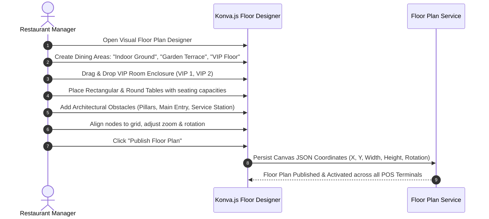
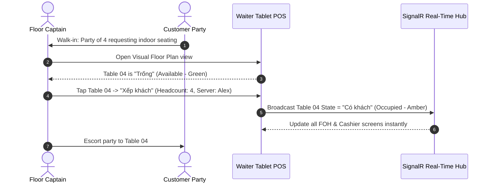
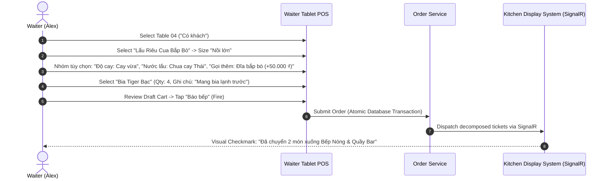
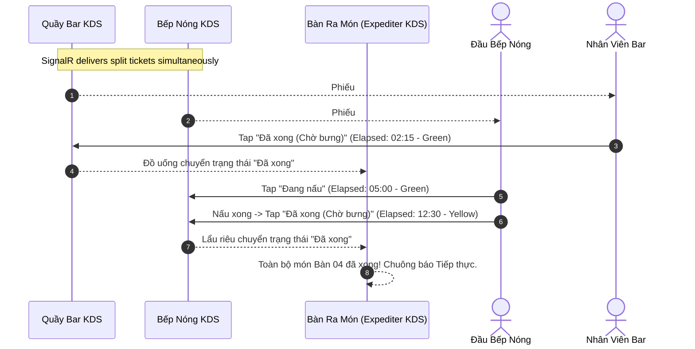
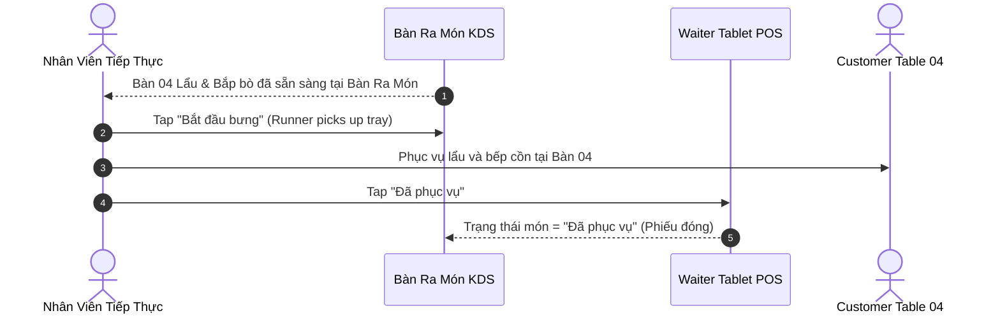
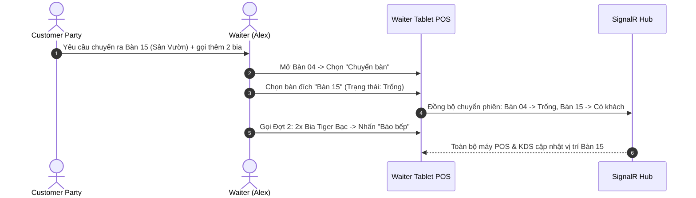

# Comprehensive User Journeys — SmartRestaurant

- **Document Version**: 1.0.0
- **Document Status**: `CONFIRMED` (Explicitly approved by Project Owner in Task 02.6)
- **Related Documents**: [PRD.md](./PRD.md), [BUSINESS-REQUIREMENTS.md](./BUSINESS-REQUIREMENTS.md), [Workflows/](./workflows/)

---

## Journey 01: Initial Restaurant Setup & Multi-Branch Configuration

- **Primary Persona**: System Admin / Franchise Owner
- **Goal**: Configure an independent restaurant branch with operating policies, tax profiles, and user accounts.

```mermaid
sequenceDiagram
    autonumber
    actor Admin as System Admin
    participant Web as Web Admin Portal
    participant Core as System Core Service

    Admin->>Web: Log in with System Admin credentials
    Admin->>Web: Create Branch "SmartRestaurant - Hoan Kiem Central"
    Admin->>Web: Set Operating Currency (VND), VAT (8%), Default Service Charge (5%)
    Admin->>Web: Define Staff Accounts (Manager, Cashier, Waiter, Chef)
    Web->>Core: Persist Branch and Tenant Config
    Core-->>Web: Confirmation; Branch Ready for Floor Plan Design
```

1. **Access Management**: Admin accesses the Web Admin portal and authenticates.
2. **Branch Creation**: Admin inputs branch metadata: Name, Physical Address, Phone, Operating Hours, Tax Code, and Receipt Header/Footer.
3. **Fiscal Configuration**: Configures local tax rates (VAT 8% or 10%), currency display formatting, and default service charge percentage (e.g., 5%).
4. **Staff Provisioning**: Admin registers key staff roles, assigns temporary login credentials, and establishes manager authorization PINs.

---

## Journey 02: Visual Floor Plan & Room/Table Designer

- **Primary Persona**: Restaurant Manager
- **Goal**: Visually map the physical layout of the restaurant into areas, rooms, VIP suites, tables, and architectural obstacles.



1. **Area Definition**: Manager creates macro areas: *Indoor Ground Floor*, *Outdoor Garden*, and *2nd Floor VIP*.
2. **Visual Geometry**: Manager drags table shapes onto the Konva.js canvas:
   - Tables 01 to 08: 4-seater rectangular tables.
   - Tables 09 to 12: 6-seater circular hotpot tables.
   - VIP 1: Private enclosed room with a 12-seater executive banquet table.
3. **Spatial Precision**: Manager adds walls, pillars, and walkways to ensure the digital map represents actual physical walking paths.
4. **Activation**: Manager clicks "Publish Floor Plan". The coordinates are saved and immediately reflected on all waiter tablets and cashier screens via SignalR.

---

## Journey 03: Table Assignment, Walk-In Seating & Reservations

- **Primary Persona**: Floor Captain / Waiter
- **Goal**: Greet guests, check table availability, manage advance bookings, and seat walk-in customers.



1. **Guest Arrival**: Floor Captain greets a party of 4 guests.
2. **Status Inspection**: Captain opens the visual floor plan. Table 04 is glowing Green (`Trống`).
3. **Session Seating**: Captain taps Table 04, selects "Xếp khách", inputs guest count (4 pax), and assigns server Alex.
4. **Instant Synchronization**: Table 04 transitions to Amber (`Có khách`). The timer starts counting active dining duration.

---

## Journey 04: Order Capture with Modifiers & Kitchen Firing

- **Primary Persona**: Waiter (Alex)
- **Goal**: Rapidly compose customer order with complex modifiers, cooking preferences, and fire to the kitchen using Vietnamese interface.



1. **Order Initiation**: Server taps Table 04 on their tablet to open the touch order matrix in Vietnamese.
2. **Item & Modifier Selection**:
   - Taps "Lẩu Riêu Cua Bắp Bò": selects size "Nồi lớn", Độ cay "Cay vừa", Nước lẩu Thái.
   - Adds 1x Đĩa bắp bò (+50.000 ₫).
   - Taps "Đồ uống" category: adds 4x Bia Tiger Bạc with note "Mang bia lạnh trước".
3. **Review & Fire**: Server reviews draft items with the guest and taps **"Báo bếp"**.
4. **Decomposition & Dispatch**: The backend atomicity commits the order and splits items into specialized kitchen tickets via SignalR.

---

## Journey 05: Kitchen Preparation & Multi-Station Coordination

- **Primary Persona**: Line Cook (Bếp Nóng) & Bartender (Quầy Bar)
- **Goal**: Receive split tickets, cook items according to SLA timers, and coordinate dish completion.



1. **Ticket Arrival**: The Bar screen beeps and shows Phiếu #104-B (4 bia). The Bếp Nóng screen beeps and displays Phiếu #104-H (Lẩu & Bò).
2. **Bar Fulfillment**: Bartender pours 4 cold draught beers, taps the card on screen, moving it to **"Đã xong (Chờ bưng)"**.
3. **Hot Kitchen Execution**: The cook taps the hotpot ticket to mark **"Đang nấu"**. The timer turns yellow at 10 minutes. At 12:30, the cook plates the beef and taps **"Đã xong (Chờ bưng)"**.
4. **Expediter Window**: The Master Expediter screen flashes green: "Bàn 04 Đã Xong Đủ Món". Runner alert triggers.

---

## Journey 06: Dish Serving & Runner Coordination

- **Primary Persona**: Runner / Waiter (Nhân viên tiếp thực)
- **Goal**: Pick up completed dishes from the kitchen pass and deliver them to Table 04.



1. **Runner Notification**: Runner notices the table 04 alert at Bàn Ra Món.
2. **Tray Pickup**: Runner inspects ticket #104-H, ensures broth and beef match guest modifications (Nước lẩu Thái, Cay vừa).
3. **Table Handover**: Runner serves hotpot to guests at Table 04, greeting them courteously: *"Em chúc quý khách dùng bữa ngon miệng!"*.
4. **Status Completion**: Server taps **"Đã phục vụ"** on the tablet; ticket moves to archived history.

---

## Journey 07: Additional Ordering & Mid-Meal Table Move

- **Primary Persona**: Waiter (Alex)
- **Goal**: Handle customer request to add food and relocate to the outdoor terrace due to smoking preferences.



1. **Move Request**: Guest asks to move from Indoor Table 04 to Garden Table 15.
2. **Table Relocation**: Server selects **"Chuyển bàn"** on Table 04, taps destination Table 15 (`Trống`).
3. **Atomic Session Transfer**: The active dining session, all unbilled items, and KDS tickets transfer to Table 15. Table 04 resets to `Trống` (or `Cần dọn dẹp`).
4. **Incremental Ordering**: Server adds 2x Tiger Beers (Đợt 2) to Table 15 and taps **"Báo bếp"** directly to the bar.

---

## Journey 08: Pre-Bill, Bill Splitting & Multi-Channel Payment

- **Primary Persona**: Cashier & Waiter
- **Goal**: Present pre-bill to customer, split check between two guests, and process payment via Cash and VietQR.

```mermaid
sequenceDiagram
    autonumber
    actor Guest as Customer Party
    actor Waiter as Waiter
    actor Cashier as Cashier (Thu Ngân)
    participant Term as Cashier Terminal
    participant QR as Cổng VietQR Napas 24/7

    Guest->>Waiter: Yêu cầu thanh toán
    Waiter->>Term: Bàn 15 -> Nhấn "In phiếu tạm tính" (Bàn đổi sang màu Tím)
    Waiter->>Guest: Đưa phiếu tạm tính cho khách đối chiếu
    Guest->>Cashier: Khách muốn chia đôi hóa đơn trả tiền
    Cashier->>Term: Mở Bàn 15 -> Chọn "Chia đều (1/N)" -> Nhập 2 người
    Term-->>Cashier: Phần 1 = 600.000 ₫; Phần 2 = 600.000 ₫
    Cashier->>Term: Thu Phần 1 bằng TIỀN MẶT (Nhận 600.000 ₫)
    Cashier->>Term: Thu Phần 2 bằng CHUYỂN KHOẢN VIETQR
    Term->>QR: Tạo mã VietQR động số tiền 600.000 ₫ kèm nội dung TT
    Guest->>QR: Quét mã QR bằng App ngân hàng -> Chuyển khoản thành công
    Term-->>Cashier: Hệ thống xác nhận: "Đã nhận 600.000 ₫"! Hóa đơn hoàn tất.
    Term-->>Waiter: Bàn 15 đổi màu Cam ("Cần dọn dẹp")
```

1. **Pre-bill Generation**: Server triggers **"In phiếu tạm tính"**. Table 15 status shifts to Purple (`Đang thanh toán`).
2. **Split Check Request**: Guests approach the cashier counter requesting an equal 50/50 split of the 1,200,000 ₫ total.
3. **System Splitting**: Cashier taps **"Chia đều (1/N)" $\div$ 2**, creating Phần 1 (600.000 ₫) and Phần 2 (600.000 ₫) with taxes and service charges apportioned accurately.
4. **Payment Processing**:
   - Guest A pays 600,000 ₫ in Cash. Cashier inputs cash received; drawer pops open.
   - Guest B scans the dynamic on-screen VietQR code for 600,000 ₫ using their banking app.
5. **Reconciliation & Table Release**: Once payment confirms, the final VAT invoice prints, and Table 15 switches to Orange (`Cần dọn dẹp`).

---

## Journey 09: Item Cancellation Post-Fire with Manager Override

- **Primary Persona**: Waiter & Restaurant Manager (Quản lý)
- **Goal**: Cancel a dish after it was already sent to the kitchen due to customer mistake, logging waste accurately.

```mermaid
sequenceDiagram
    autonumber
    actor Waiter as Waiter
    actor Mgr as Restaurant Manager (Quản lý)
    participant POS as Tablet POS
    participant KDS as Bếp Nóng KDS
    participant Core as Audit & Inventory Service

    Waiter->>POS: Bàn 15 -> Chọn "Thăn bò Úc" -> Nhấn "Hủy món"
    POS-->>Waiter: Cảnh báo: "Món đang nấu! Cần mã PIN Quản lý để hủy."
    Mgr->>POS: Nhập mã PIN 4 số + Chọn lý do: "Khách đổi ý sau khi báo bếp"
    POS->>KDS: Phát sự kiện Hủy món (Thẻ nhấp nháy ĐỎ + Chuông cảnh báo)
    KDS-->>POS: Đầu bếp bấm xác nhận dừng nấu
    POS->>Core: Xóa tiền món khỏi hóa đơn; Ghi nhận nguyên liệu vào Sổ Hủy Hỏng
    Core-->>POS: Cập nhật hóa đơn thành công; Lưu nhật ký giám sát
```

1. **Cancellation Trigger**: Guest realizes they cannot eat red meat after the order was already sent to the kitchen.
2. **Security Shield**: Waiter attempts cancellation. System detects item is already `Đang nấu` and prompts for Manager PIN.
3. **Manager Intervention**: Manager arrives, verifies the situation, inputs their secure 4-digit PIN, and selects mandatory reason "Khách đổi ý sau khi báo bếp".
4. **Kitchen Alert**: The Bếp Nóng KDS flashes red with an alert chime. Cook removes the pan from the stove.
5. **Loss Accounting**: Item is removed from the guest's payable total, but raw ingredients are registered to the restaurant's daily `WasteLog` (Sổ theo dõi hủy/hỏng).

---

## Journey 10: Cashier Shift Closing & Cash Drawer Balancing

- **Primary Persona**: Cashier & Restaurant Manager (Thu Ngân & Quản lý)
- **Goal**: Reconcile register receipts against physical cash, detect discrepancies, and generate the daily Z-Report.

```mermaid
sequenceDiagram
    autonumber
    actor Cashier as Cashier (Thu Ngân)
    actor Mgr as Restaurant Manager (Quản lý)
    participant Term as Cashier Terminal
    participant Core as Financial Reporting Service

    Cashier->>Term: Chọn "Chốt ca làm việc"
    Term-->>Cashier: Yêu cầu Kiểm kê tiền mù (Nhập số tờ từng mệnh giá)
    Cashier->>Term: Đếm tiền thực tế: 14.350.000 ₫
    Term->>Core: So sánh với số liệu hệ thống tính: 14.400.000 ₫
    Core-->>Term: Phát hiện chênh lệch: -50.000 ₫ (Thiếu tiền)
    Cashier->>Term: Nhập giải trình: "Thiếu tiền thối giờ cao điểm trưa"
    Mgr->>Term: Nhập mã PIN Quản lý phê duyệt chốt ca
    Term->>Core: Đóng ca; Khóa két ca làm việc
    Term-->>Cashier: In Báo cáo chốt ca Z-Report (Tiền mặt, Thẻ, VietQR, Chênh lệch)
```

1. **Initiate Close**: Cashier concludes their 8-hour shift and taps **"Chốt ca làm việc"**.
2. **Blind Drop Counting**: Cashier counts physical notes in the drawer (500k, 200k, 100k, 50k, 20k, 10k) without seeing the system's expected balance.
3. **Variance Analysis**: System reveals expected cash: 14.400.000 ₫; actual cash: 14.350.000 ₫; variance: -50.000 ₫ (Thiếu).
4. **Approval & Z-Report**: Cashier enters an explanatory note. Manager reviews card slips, VietQR transactions, and cash totals, then authorizes the closing with their PIN.
5. **Final Settlement**: The Z-Report prints in Vietnamese, archiving the shift financial records permanently.
