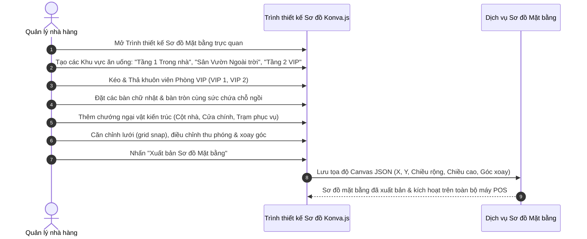
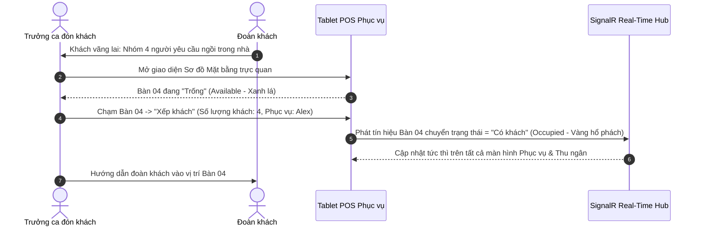
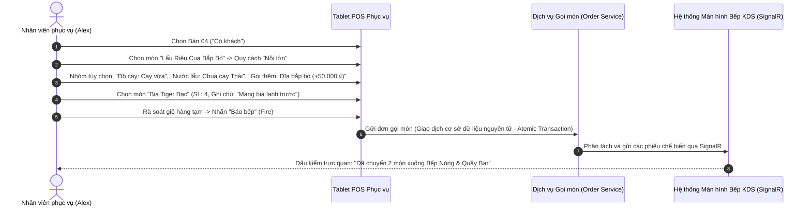
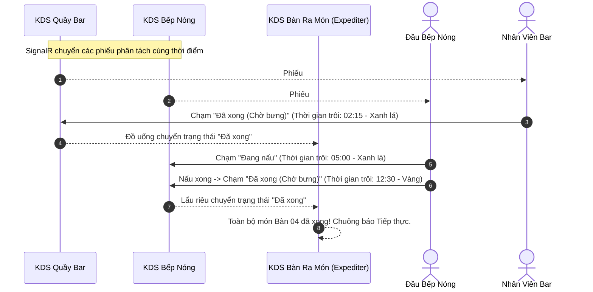
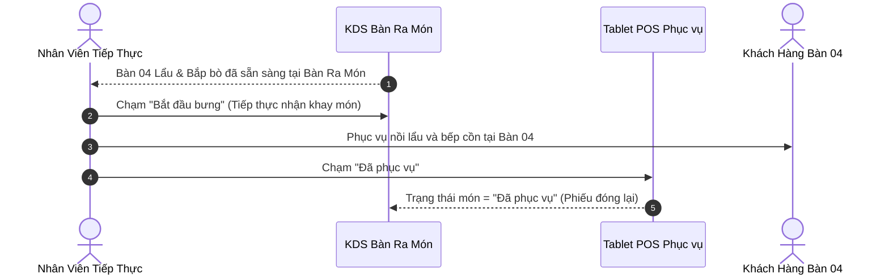
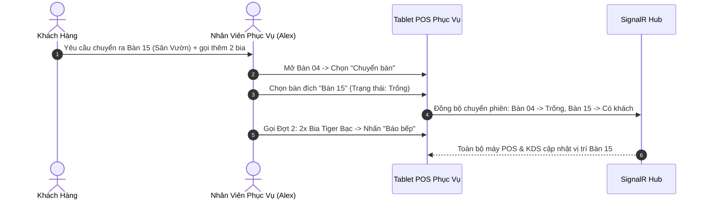

# Hành Trình Người Dùng Toàn Diện (User Journeys) — SmartRestaurant

- **Phiên bản tài liệu**: 1.0.0
- **Trạng thái tài liệu**: `CONFIRMED` (Đã được Chủ nhà hàng phê duyệt rõ ràng tại Task 02.6)
- **Tài liệu liên quan**: [PRD.md](./PRD.md), [BUSINESS-REQUIREMENTS.md](./BUSINESS-REQUIREMENTS.md), [Workflows/](./workflows/)

---

## Hành Trình 01 (UJ-01): Thiết Lập Nhà Hàng Ban Đầu & Cấu Hình Đa Chi Nhánh

- **Đối tượng chính (Persona)**: Quản trị viên hệ thống / Chủ chuỗi nhà hàng (System Admin / Franchise Owner)
- **Mục tiêu**: Cấu hình một chi nhánh nhà hàng độc lập với đầy đủ chính sách vận hành, hồ sơ thuế và tài khoản nhân sự.

```mermaid
sequenceDiagram
    autonumber
    actor Admin as Quản trị viên hệ thống
    participant Web as Cổng Web Quản trị
    participant Core as Dịch vụ Lõi Hệ thống

    Admin->>Web: Đăng nhập bằng tài khoản Quản trị viên hệ thống
    Admin->>Web: Tạo Chi nhánh "SmartRestaurant - Hoàn Kiếm Central"
    Admin->>Web: Thiết lập Tiền tệ vận hành (VND), VAT (8%), Phí dịch vụ mặc định (5%)
    Admin->>Web: Khởi tạo Tài khoản Nhân sự (Quản lý, Thu ngân, Phục vụ, Bếp)
    Web->>Core: Lưu cấu hình Chi nhánh và Tenant
    Core-->>Web: Xác nhận thành công; Chi nhánh sẵn sàng thiết kế sơ đồ mặt bằng
```

1. **Quản lý quyền truy cập**: Quản trị viên truy cập cổng thông tin Web Admin và tiến hành xác thực danh tính.
2. **Khởi tạo chi nhánh**: Quản trị viên nhập thông tin chi nhánh: Tên, Địa chỉ thực tế, Số điện thoại, Giờ hoạt động, Mã số thuế, cùng Tiêu đề/Chân trang trên hóa đơn.
3. **Cấu hình tài chính**: Thiết lập thuế suất địa phương (VAT 8% hoặc 10%), định dạng hiển thị tiền tệ, và tỷ lệ phí phục vụ mặc định (ví dụ: 5%).
4. **Cấp phát tài khoản nhân sự**: Quản trị viên đăng ký các vai trò nhân viên cốt lõi, gán thông tin đăng nhập tạm thời và thiết lập mã PIN ủy quyền của cấp quản lý.

---

## Hành Trình 02 (UJ-02): Thiết Kế Mặt Bằng & Phòng/Bàn Trực Quan

- **Đối tượng chính (Persona)**: Quản lý nhà hàng (Restaurant Manager)
- **Mục tiêu**: Mô hình hóa trực quan bố cục không gian nhà hàng thành các khu vực, phòng ăn, phòng VIP, bàn ăn và các chướng ngại vật kiến trúc.



1. **Xác định khu vực**: Quản lý tạo các khu vực tổng thể: *Tầng 1 Trong nhà*, *Sân Vườn Ngoài trời*, và *Tầng 2 VIP*.
2. **Hình học trực quan**: Quản lý kéo thả các hình khối bàn ăn lên khung vẽ Konva.js:
   - Bàn 01 đến 08: Bàn chữ nhật 4 chỗ ngồi.
   - Bàn 09 đến 12: Bàn lẩu tròn 6 chỗ ngồi.
   - VIP 1: Phòng riêng khép kín với bàn tiệc cao cấp 12 chỗ ngồi.
3. **Độ chính xác không gian**: Quản lý thêm tường ngăn, cột trụ và lối đi để đảm bảo bản đồ kỹ thuật số phản ánh chính xác lối đi thực tế.
4. **Kích hoạt vận hành**: Quản lý nhấn "Xuất bản Sơ đồ Mặt bằng". Tọa độ được lưu trữ và phản ánh ngay lập tức trên máy tính bảng của nhân viên phục vụ cùng màn hình thu ngân qua SignalR.

---

## Hành Trình 03 (UJ-03): Điều Phối Bàn, Xếp Khách Vãng Lai & Quản Lý Đặt Bàn

- **Đối tượng chính (Persona)**: Trưởng ca / Nhân viên phục vụ (Floor Captain / Waiter)
- **Mục tiêu**: Đón tiếp khách hàng, kiểm tra tình trạng bàn trống, quản lý đặt chỗ trước và xếp chỗ cho khách vãng lai (walk-in).



1. **Đón tiếp khách hàng**: Trưởng ca chào đón đoàn gồm 4 khách.
2. **Kiểm tra trạng thái**: Trưởng ca mở sơ đồ mặt bằng trực quan. Bàn 04 đang hiển thị màu Xanh lá (`Trống`).
3. **Mở phiên phục vụ**: Trưởng ca chạm vào Bàn 04, chọn "Xếp khách", nhập số lượng khách (4 người) và gán nhân viên phục vụ Alex.
4. **Đồng bộ thời gian thực**: Bàn 04 lập tức chuyển sang màu Vàng hổ phách (`Có khách`). Đồng hồ bắt đầu đếm thời gian dùng bữa thực tế của phiên bàn.
5. **Đặc tả Phân hệ Đặt Bàn Trước (MOD-06 — MVP Optional theo OD-15: Phương án A)**: Tính năng Đặt bàn trước được vận hành dưới dạng phân hệ tùy chọn có thể bật/tắt 1 chạm qua cờ tính năng. Khi bật `MOD-06`, sơ đồ mặt bằng hiển thị danh sách đặt chỗ, đồng hồ đếm ngược giờ khách đến và khóa bàn đã giữ; khi tắt `MOD-06`, giao diện POS tự động ẩn toàn bộ nút đặt bàn, vận hành tinh gọn thuần túy khách vãng lai.

---

## Hành Trình 04 (UJ-04): Ghi Nhận Món Ăn Kèm Tùy Chọn & Báo Bếp

- **Đối tượng chính (Persona)**: Nhân viên phục vụ (Alex)
- **Mục tiêu**: Nhanh chóng tạo đơn gọi món cho khách với các nhóm tùy chọn (modifiers) phức tạp, ghi chú chế biến, và gửi lệnh xuống bếp qua giao diện tiếng Việt.



1. **Khởi tạo đơn gọi món**: Nhân viên phục vụ chạm vào Bàn 04 trên máy tính bảng để mở lưới gọi món cảm ứng bằng tiếng Việt.
2. **Lựa chọn món ăn & Tùy chọn đi kèm**:
   - Chạm vào món "Lẩu Riêu Cua Bắp Bò": chọn kích cỡ "Nồi lớn", Độ cay "Cay vừa", Nước lẩu Thái.
   - Thêm 1x Đĩa bắp bò (+50.000 ₫).
   - Chạm danh mục "Đồ uống": thêm 4x Bia Tiger Bạc cùng ghi chú "Mang bia lạnh trước".
3. **Rà soát & Báo bếp**: Nhân viên xác nhận lại danh sách món với thực khách và nhấn **"Báo bếp"**.
4. **Phân tách & Điều phối**: Hệ thống lưu giao dịch nguyên tử vào cơ sở dữ liệu và tự động phân tách các món thành từng phiếu chế biến riêng biệt gửi đến màn hình KDS tương ứng qua SignalR.

> [!NOTE] Điều Phối Xuống Bếp So Với Phục Vụ Trực Tiếp Tại Sảnh (DirectFOHPick)
> Theo PDR-012, đồ uống và các mặt hàng chế biến sẵn được cấu hình tuyến phục vụ riêng biệt:
> - **Điều phối trạm quầy Bar**: Các loại đồ uống pha chế phức tạp, bia tươi cần rót từ vòi hoặc cocktail đặc biệt được gửi trực tiếp đến màn hình KDS Quầy Bar.
> - **Phục vụ trực tiếp tại sảnh (DirectFOHPick)**: Các đồ uống đóng chai/lon đóng gói sẵn (ví dụ: nước lọc đóng chai, nước ngọt lon, hoặc bia ướp lạnh sẵn trong tủ mát tại khu vực ăn) có thể gắn nhãn cờ `DirectFOHPick`. Các món này được ghi nhận ngay vào hóa đơn bàn ăn nhưng bỏ qua hoàn toàn quy trình chuyển phiếu xuống KDS Bếp/Bar, giúp nhân viên phục vụ lấy ngay tại tủ phục vụ khách mà không gây tắc nghẽn màn hình của thợ pha chế.

---

## Hành Trình 05 (UJ-05): Chế Biến Tại Bếp & Phối Hợp Đa Trạm Chế Biến

- **Đối tượng chính (Persona)**: Đầu bếp Bếp Nóng & Nhân viên Pha chế Quầy Bar
- **Mục tiêu**: Nhận các phiếu chế biến đã phân tách, chế biến món theo đồng hồ SLA kiểm soát thời gian, và điều phối hoàn thành món ăn.



1. **Phiếu chế biến xuất hiện**: Màn hình Quầy Bar phát âm báo ting và hiện Phiếu #104-B (4 bia). Màn hình Bếp Nóng phát âm báo và hiển thị Phiếu #104-H (Lẩu & Bò).
2. **Xử lý tại quầy Bar**: Nhân viên pha chế lấy 4 ly bia ướp lạnh, chạm vào thẻ món trên màn hình để chuyển sang **"Đã xong (Chờ bưng)"**.
3. **Chế biến tại Bếp Nóng**: Đầu bếp chạm vào phiếu lẩu để đánh dấu **"Đang nấu"**. Đồng hồ hiển thị màu vàng khi chạm mốc 10 phút. Vào phút 12:30, đầu bếp hoàn thiện đĩa thịt bò và chạm **"Đã xong (Chờ bưng)"**.
4. **Cửa sổ Bàn Ra Món tổng thể (Expediter)**: Màn hình Bàn Ra Món nhấp nháy xanh lá: "Bàn 04 Đã Xong Đủ Món". Chuông thông báo nhân viên tiếp thực (runner) được kích hoạt.

---

## Hành Trình 06 (UJ-06): Bưng Món Ra Bàn & Điều Phối Tiếp Thực

- **Đối tượng chính (Persona)**: Nhân viên tiếp thực / Phục vụ bàn (Runner / Waiter)
- **Mục tiêu**: Nhận món ăn đã chế biến hoàn tất từ bàn ra món của bếp và bưng phục vụ tại Bàn 04.



1. **Thông báo tiếp thực**: Nhân viên tiếp thực nhận tín hiệu cảnh báo Bàn 04 tại Bàn Ra Món.
2. **Nhận khay món**: Nhân viên kiểm tra phiếu #104-H, đảm bảo nước dùng và thịt bò đúng theo tùy chọn khách yêu cầu (Nước lẩu Thái, Cay vừa).
3. **Bàn giao tại bàn**: Nhân viên phục vụ lẩu cho thực khách tại Bàn 04 kèm lời chào lịch sự: *"Em chúc quý khách dùng bữa ngon miệng!"*.
4. **Hoàn tất trạng thái**: Nhân viên phục vụ chạm **"Đã phục vụ"** trên máy tính bảng; phiếu chuyển vào lịch sử lưu trữ của phiên bàn.

---

## Hành Trình 07 (UJ-07): Gọi Bổ Sung Món & Chuyển Bàn Giữa Bữa Ăn

- **Đối tượng chính (Persona)**: Nhân viên phục vụ (Alex)
- **Mục tiêu**: Xử lý yêu cầu gọi thêm món và hỗ trợ khách đổi sang bàn ngoài sân vườn theo nguyện vọng hút thuốc.



1. **Yêu cầu chuyển bàn**: Thực khách đề nghị chuyển từ Bàn trong nhà 04 sang Bàn sân vườn 15.
2. **Thao tác chuyển vị trí**: Nhân viên chọn **"Chuyển bàn"** trên Bàn 04, chạm bàn đích là Bàn 15 (`Trống`).
3. **Chuyển giao phiên nguyên tử**: Toàn bộ phiên dùng bữa hiện hành, danh sách món chưa thanh toán và các phiếu KDS liên quan tự động chuyển sang Bàn 15. Bàn 04 đặt lại trạng thái về `Trống` (hoặc `Cần dọn dẹp`).
4. **Gọi bổ sung món**: Nhân viên thêm 2x Bia Tiger Bạc (Đợt 2) cho Bàn 15 và nhấn **"Báo bếp"** trực tiếp xuống quầy Bar.

### Kịch Bản Vận Hành: Hủy Gộp Bàn (Table Unmerge)
Căn cứ theo PDR-010, khi một cụm bàn trước đó đã gộp (ví dụ: Bàn 04 và Bàn 05 gộp lại phục vụ đoàn khách lớn) cần được tách riêng:
1. Trưởng ca hoặc Thu ngân chọn cụm bàn đã gộp và bắt đầu quy trình **"Hủy gộp bàn" (Unmerge Tables)**.
2. Hệ thống yêu cầu nhân viên phân bổ các món đang phục vụ và các hóa đơn con chưa thanh toán về từng bàn thành phần (Bàn 04 và Bàn 05).
3. Sau khi xác nhận, Bàn 05 được khôi phục thành phiên bàn độc lập (hoặc về trạng thái `Trống` nếu khách đã về), đồng thời toàn bộ phiếu bếp và nhật ký kiểm toán hóa đơn vẫn duy trì đầy đủ tính truy vết mà không làm mất mát dữ liệu.

---

## Hành Trình 08 (UJ-08): In Phiếu Tạm Tính, Tách Hóa Đơn & Thanh Toán Đa Kênh

- **Đối tượng chính (Persona)**: Thu ngân & Nhân viên phục vụ (Cashier & Waiter)
- **Mục tiêu**: Cung cấp phiếu tạm tính cho khách kiểm tra, tách hóa đơn cho 2 thực khách trả riêng, và xử lý thanh toán kết hợp Tiền mặt cùng VietQR.

```mermaid
sequenceDiagram
    autonumber
    actor Guest as Khách Hàng
    actor Waiter as Nhân Viên Phục Vụ
    actor Cashier as Thu Ngân
    participant Term as Máy Thu Ngân (POS)
    participant QR as Cổng VietQR Napas 24/7

    Guest->>Waiter: Yêu cầu thanh toán
    Waiter->>Term: Bàn 15 -> Nhấn "In phiếu tạm tính" (Bàn đổi sang màu Tím)
    Waiter->>Guest: Đưa phiếu tạm tính cho khách đối chiếu
    Guest->>Cashier: Khách muốn chia đôi hóa đơn trả tiền
    Cashier->>Term: Mở Bàn 15 -> Chọn "Chia đều (1/N)" -> Nhập 2 người
    Term-->>Cashier: Phần 1 = 600.000 ₫; Phần 2 = 600.000 ₫
    Cashier->>Term: Thu Phần 1 bằng TIỀN MẶT (Nhận 600.000 ₫)
    Cashier->>Term: Thu Phần 2 bằng CHUYỂN KHOẢN VIETQR
    Term->>QR: Tạo mã VietQR động số tiền 600.000 ₫ kèm nội dung TT
    Guest->>QR: Quét mã QR bằng App ngân hàng -> Chuyển khoản thành công
    Term-->>Cashier: Hệ thống xác nhận: "Đã nhận 600.000 ₫"! Hóa đơn hoàn tất.
    Term-->>Waiter: Bàn 15 đổi màu Cam ("Cần dọn dẹp")
```

1. **Khởi tạo tạm tính & Tính khả biên tập của hóa đơn chưa thu tiền**: Nhân viên kích hoạt **"In phiếu tạm tính"**. Bàn 15 chuyển sang màu Tím (`Đang thanh toán` / `BillingRequested`). Căn cứ theo PDR-009, hóa đơn chưa thanh toán vẫn hoàn toàn có thể chỉnh sửa; nếu khách gọi thêm đồ uống hoặc món tráng miệng trong lúc đang cầm phiếu tạm tính, nhân viên phục vụ vẫn có thể gọi thêm trực tiếp vào hóa đơn mở hiện tại (hành vi mặc định) hoặc chủ động mở một hóa đơn con mới, bảo toàn đầy đủ vết kiểm toán mà không hề khóa cứng phiên bàn.
2. **Yêu cầu tách hóa đơn**: Khách tiến tới quầy thu ngân đề nghị chia đôi 50/50 tổng số tiền 1.200.000 ₫.
3. **Thao tác tách trên hệ thống**: Thu ngân chạm **"Chia đều (1/N)" $\div$ 2**, tạo Phần 1 (600.000 ₫) và Phần 2 (600.000 ₫) kèm phân bổ tiền thuế và phí phục vụ tương ứng chính xác.
4. **Xử lý thu tiền**:
   - Khách A trả 600.000 ₫ Tiền mặt. Thu ngân nhập số tiền nhận; ngăn kéo đựng tiền tự động bật mở.
   - Khách B quét mã VietQR động hiển thị trên màn hình với số tiền 600.000 ₫ bằng ứng dụng ngân hàng.
5. **Đối soát & Giải phóng bàn**: Ngay khi thanh toán được hệ thống xác nhận, hóa đơn tài chính cuối cùng được in ra và Bàn 15 chuyển sang màu Cam (`Cần dọn dẹp`).

### Kịch Bản Vận Hành: Gọi Bổ Sung Món Khi Đang Có Nhiều Hóa Đơn Con / Hóa Đơn Chưa Thu Tiền
Căn cứ theo PDR-009, BR-RULE-06 và Quyết định của Chủ nhà hàng OD-13:
1. Bàn 15 đang trong một phiên phục vụ có nhiều hóa đơn con (ví dụ: Hóa đơn con 1 cho Khách A, Hóa đơn con 2 cho Khách B).
2. Khách A thanh toán Hóa đơn con 1 (600.000 ₫) bằng Tiền mặt. Hóa đơn con 1 chuyển sang trạng thái `Paid` và in biên lai riêng. Theo nguyên tắc bất biến tài chính nghiêm ngặt, **Hóa đơn con 1 đã thanh toán bị khóa vĩnh viễn, không được phép chỉnh sửa trực tiếp**.
3. Trong khi Hóa đơn con 2 vẫn đang mở và chưa thanh toán, thực khách quyết định gọi thêm 1 lượt đồ uống (2x Bia Tiger Bạc).
4. Phục vụ Alex mở Bàn 15 trên máy tính bảng. Phiên bàn **KHÔNG bị khóa**. Theo mặc định, các món gọi thêm mới được tự động gắn vào Hóa đơn con 2 đang mở, tự động tính toán lại tổng tiền và thuế tương ứng.
5. Ngoài ra, Alex có thể chủ động chọn mở một **Hóa đơn con 3** riêng biệt nếu khách yêu cầu tính tiền riêng cho lượt gọi đồ uống phát sinh này.
6. Bàn 15 tiếp tục duy trì trạng thái `Occupied` / `BillingRequested` và **bị chặn giải phóng bàn** cho đến khi tất cả các hóa đơn con (Hóa đơn con 2 và Hóa đơn con 3 nếu có) đã hoàn tất thanh toán và toàn bộ đồ uống đã được xác nhận `Served`.
7. Mọi thao tác đều lưu lại nhật ký kiểm toán bất biến gắn liền mã món, mốc thời gian, mã nhân viên phục vụ và việc phân bổ hóa đơn con.

### Kịch Bản Vận Hành: Xử Lý VietQR Đến Muộn & Đưa Vào Hàng Đợi Treo Đối Soát
Căn cứ theo PDR-008 và Quyết định của Chủ nhà hàng OD-04:
1. Khách B quét mã VietQR động để thanh toán hóa đơn 600.000 ₫.
2. Do độ trễ từ cổng chuyển mạch ngân hàng (Napas 24/7) hoặc nghẽn mạng viễn thông, webhook xác nhận thanh toán không đến trước hạn định cấu hình timeout (ví dụ: 2 phút).
3. Căn cứ PDR-008, thu ngân được phép chuyển phương thức sang **Dự phòng Tiền mặt (Cash Fallback)**. Thu ngân nhận 600.000 ₫ tiền mặt từ khách, đánh dấu hóa đơn là `Paid`, in biên lai và để khách rời đi. Yêu cầu thanh toán VietQR đang chờ xử lý được đánh dấu `CancelledByCashier / CashFallback`.
4. Ba phút sau, webhook ngân hàng gửi đến trễ, báo chuyển khoản thành công 600.000 ₫ cho giao dịch QR trước đó đã bị hủy.
5. **Chống trùng lặp & Điều chuyển vào sổ treo**: Hệ thống phát hiện hóa đơn liên quan đã được quyết toán xong bằng Tiền mặt. Số tiền 600.000 ₫ đến muộn bị nghiêm cấm ghi có trùng lặp vào hóa đơn. Thay vào đó, giao dịch được chuyển ngay vào **"Sổ Treo Đối Soát" (Suspense Reconciliation Queue)**.
6. **Cảnh báo âm thanh & hình ảnh tức thì**: Màn hình của Thu ngân và Quản lý lập tức nhận cảnh báo mức độ ưu tiên cao về giao dịch chuyển khoản muộn.
7. **Đối soát có kiểm soát (Nghiêm cấm tự động hoàn tiền)**: Căn cứ chính sách an toàn đã được xác nhận, hệ thống **TUYỆT ĐỐI KHÔNG tự động thực hiện hoàn tiền ngân hàng khi chưa có xác minh**. Giao dịch duy trì trạng thái treo trong Sổ Đối Soát. Quản lý nhà hàng đối chiếu thủ công thông tin chuyển khoản với mã tham chiếu ngân hàng và thực hiện quy trình xử lý thủ công theo thẩm quyền kèm ghi chú nguyên nhân bắt buộc.

---

## Hành Trình 09 (UJ-09): Hủy Món Sau Khi Đã Báo Bếp Kèm Phê Duyệt Của Quản Lý

- **Đối tượng chính (Persona)**: Nhân viên phục vụ & Quản lý nhà hàng (Waiter & Restaurant Manager)
- **Mục tiêu**: Hủy một món ăn sau khi đã gửi lệnh chế biến xuống bếp do khách nhầm lẫn, đồng thời ghi nhận hao hụt/hủy hỏng chính xác vào sổ theo dõi.

```mermaid
sequenceDiagram
    autonumber
    actor Waiter as Nhân viên phục vụ
    actor Mgr as Quản lý nhà hàng
    participant POS as Tablet POS Phục vụ
    participant KDS as KDS Bếp Nóng
    participant Core as Dịch vụ Kiểm toán & Kho (Audit & Inventory)

    Waiter->>POS: Bàn 15 -> Chọn "Thăn bò Úc" -> Nhấn "Hủy món"
    POS-->>Waiter: Cảnh báo: "Món đang nấu! Cần mã PIN Quản lý để hủy."
    Mgr->>POS: Nhập mã PIN 4 số + Chọn lý do: "Khách đổi ý sau khi báo bếp"
    POS->>KDS: Phát sự kiện Hủy món (Thẻ nhấp nháy ĐỎ + Chuông cảnh báo)
    KDS-->>POS: Đầu bếp bấm xác nhận dừng nấu
    POS->>Core: Xóa tiền món khỏi hóa đơn; Ghi nhận nguyên liệu vào Sổ Hủy Hỏng
    Core-->>POS: Cập nhật hóa đơn thành công; Lưu nhật ký giám sát
```

1. **Khởi phát yêu cầu hủy món**: Khách hàng phát hiện không ăn được thịt đỏ sau khi món ăn đã được gửi lệnh xuống bếp.
2. **Hàng rào bảo vệ an toàn**: Phục vụ thao tác hủy món. Hệ thống phát hiện món đã ở trạng thái `Đang nấu` và yêu cầu mã PIN ủy quyền của Quản lý.
3. **Can thiệp của Quản lý**: Quản lý có mặt xác thực tình hình, nhập mã PIN 4 số bảo mật và chọn lý do bắt buộc "Khách đổi ý sau khi báo bếp".
4. **Cảnh báo phía bếp**: Màn hình KDS Bếp Nóng nhấp nháy màu đỏ kèm âm thanh cảnh báo. Đầu bếp dỡ chảo khỏi bếp nấu.
5. **Hạch toán tổn thất**: Món ăn được xóa khỏi tổng tiền phải thanh toán của khách, nhưng nguyên vật liệu liên quan được ghi nhận vào `WasteLog` (Sổ theo dõi hủy/hỏng) của ca làm việc.

### Kịch Bản Vận Hành: Quy Trình Làm Lại Món (Remake Dish Do Lỗi Bếp)
Căn cứ theo PDR-015 và Quyết định của Chủ nhà hàng OD-12:
1. Khi một món đã nấu xong bị từ chối tại bàn ra món hoặc bị khách trả lại do lỗi chế biến của bếp (ví dụ: làm sai độ chín, nhầm vị nước lẩu, hoặc thức ăn bị nguội), nhân viên phục vụ hoặc quản lý kích hoạt thao tác **"Làm lại món" (Remake Dish)**.
2. Hệ thống gửi ngay phiếu làm lại ưu tiên cao nhất đến màn hình KDS của trạm chế biến chịu trách nhiệm.
3. Hóa đơn của khách được bảo vệ an toàn—tuyệt đối không thu tiền hai lần hoặc tính thêm phụ phí vào phiên bàn của khách.
4. Món ăn bị trả lại được ghi nhận vào `ScrapLoss` (Hao hụt hủy hỏng nội bộ) kèm bắt buộc theo dõi nguyên nhân gốc và phê duyệt mã PIN của quản lý.
5. *Ghi chú giao diện (UI)*: Giao diện hiển thị trực quan (ví dụ: thẻ màu tím hoặc biểu tượng nhãn riêng trên màn hình KDS) là đề xuất giao diện của AI và sẽ được hoàn thiện trong quá trình thiết kế frontend; các quy tắc nghiệp vụ cốt lõi và nguyên tắc bảo vệ tài chính vẫn là chuẩn mực pháp quy tối cao.

---

## Hành Trình 10 (UJ-10): Chốt Ca Làm Việc Của Thu Ngân & Cân Bằng Ngăn Kéo Tiền

- **Đối tượng chính (Persona)**: Thu ngân & Quản lý nhà hàng (Cashier & Restaurant Manager)
- **Mục tiêu**: Đối soát các chứng từ doanh thu thực tế so với tiền mặt trong két, phát hiện chênh lệch và lập Báo cáo chốt ca (Z-Report).

```mermaid
sequenceDiagram
    autonumber
    actor Cashier as Thu Ngân
    actor Mgr as Quản lý nhà hàng
    participant Term as Máy Thu Ngân (POS)
    participant Core as Dịch vụ Báo cáo Tài chính

    Cashier->>Term: Chọn "Chốt ca làm việc"
    Term-->>Cashier: Yêu cầu Kiểm kê tiền mù (Nhập số tờ từng mệnh giá)
    Cashier->>Term: Đếm tiền thực tế: 14.350.000 ₫
    Term->>Core: So sánh với số liệu hệ thống tính: 14.400.000 ₫
    Core-->>Term: Phát hiện chênh lệch: -50.000 ₫ (Thiếu tiền)
    Cashier->>Term: Nhập giải trình: "Thiếu tiền thối giờ cao điểm trưa"
    Mgr->>Term: Nhập mã PIN Quản lý phê duyệt chốt ca
    Term->>Core: Đóng ca; Khóa két ca làm việc
    Term-->>Cashier: In Báo cáo chốt ca Z-Report (Tiền mặt, Thẻ, VietQR, Chênh lệch)
```

1. **Bắt đầu đóng ca**: Thu ngân kết thúc ca làm việc 8 tiếng và nhấn **"Chốt ca làm việc"**.
2. **Kiểm kê tiền mù (Blind Drop Counting)**: Thu ngân đếm số tờ tiền mặt thực tế trong két theo từng mệnh giá (500k, 200k, 100k, 50k, 20k, 10k) mà không được xem trước số dư kỳ vọng trên hệ thống.
3. **Phân tích chênh lệch**: Hệ thống đối chiếu và công bố số tiền kỳ vọng: 14.400.000 ₫; tiền mặt thực đếm: 14.350.000 ₫; chênh lệch: -50.000 ₫ (Thiếu).
4. **Phê duyệt & Xuất Báo cáo Z (Xử lý chênh lệch khiếu nại hóa đơn đã thanh toán theo OD-14: Phương án A)**: Thu ngân nhập nội dung giải trình chênh lệch. Nếu trong ca có phát sinh khiếu nại sai sót hóa đơn đã đóng tiền (`OD-14`), Quản lý đối chiếu "Biên bản điều chỉnh sai lệch két giấy" ký tay, nhập mã lý do và mã hóa đơn gốc (`OriginalInvoiceId`) vào hệ thống để lưu vết kiểm toán vào thực thể `ShiftClosingVarianceLog`. Quản lý kiểm tra đối chiếu các cuống biên nhận thẻ ngân hàng, giao dịch VietQR và tiền mặt, sau đó xác nhận đóng ca bằng mã PIN.
5. **Quyết toán hoàn tất**: Báo cáo Z-Report được in bằng tiếng Việt, lưu trữ vĩnh viễn hồ sơ tài chính của ca làm việc vào hệ thống.
