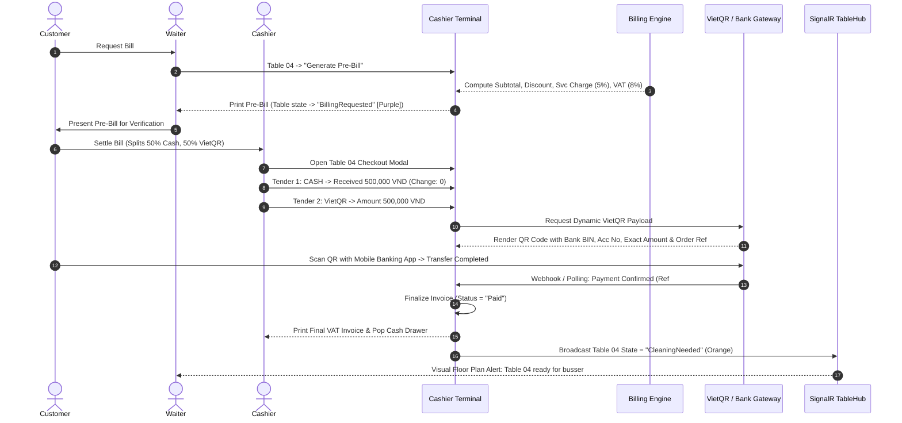
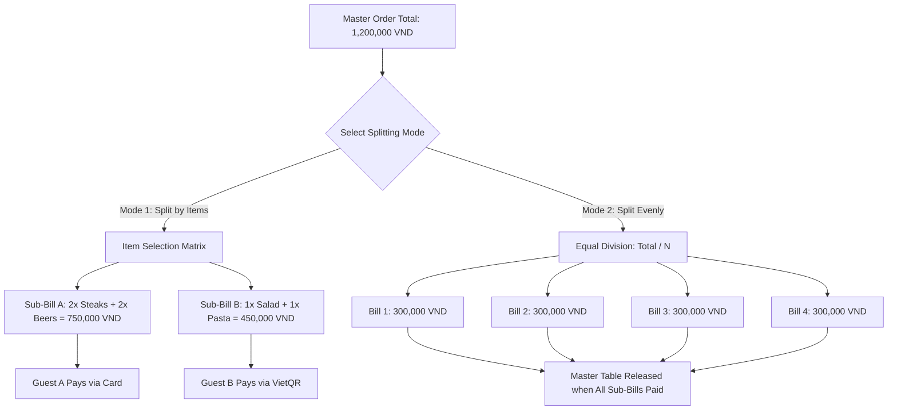

# Cashier, Billing & Payment Workflow — SmartRestaurant

- **Document Version**: 1.0.0
- **Document Status**: `PROPOSED`
- **Related Documents**: [PRD.md](../PRD.md), [BUSINESS-REQUIREMENTS.md](../BUSINESS-REQUIREMENTS.md), [MODULE-OVERVIEW.md](../MODULE-OVERVIEW.md)

---

## 1. End-to-End Billing & Payment Flow

---

## 2. Advanced Bill Splitting Operations

SmartRestaurant supports two operational bill splitting modes designed to eliminate cashier math errors during peak checkout rushes.

### 2.1. Mode A: Split by Selected Items (Tách Bill Theo Món)
1. Cashier selects **"Split by Items"** on the active table.
2. A dual-pane interface displays all line items on the left.
3. Cashier creates Sub-Bill 1 and moves selected items (e.g., 2x Steaks, 2x Beers) to Sub-Bill 1.
4. Remaining items stay on Sub-Bill 2 (or Sub-Bill 3).
5. The billing engine recalculates item-level discounts, order vouchers, service charges, and VAT independently and proportionally across each sub-bill.
6. Each sub-bill prints an independent invoice receipt and can be settled using different tenders.

### 2.2. Mode B: Split Evenly (Tách Bill Đều $1/N$)
1. Cashier selects **"Split Evenly"** and inputs guest count $N$ (e.g., 4 guests).
2. The system calculates:
   $$\text{Sub-Bill Amount} = \frac{\text{Total Payable Amount}}{N}$$
3. Any 1-Dong or 1,000-VND rounding remainder is absorbed into the final sub-bill to guarantee that the sum of sub-bills matches the master invoice total exactly:
   $$\sum_{i=1}^{N} \text{SubBill}_i = \text{MasterTotal}$$
4. The cashier collects payment for each portion sequentially until the master balance reaches zero.

### 2.3. Operational Guard: Multi-Bill Sessions Without Table Freezing (PDR-009)
- Splitting a bill distributes line items across multiple sub-bills without locking the table.
- Waiters can continue adding dishes or firing rounds to the active table session. Newly added items must be explicitly assigned to an open, unpaid sub-bill (or a newly created sub-bill); the system never assigns items arbitrarily.
- **Cancellation of Split**: Cashier can cancel the split and re-consolidate items only if NO sub-bill has incurred any payment.
- **Table Release**: The physical table is released to `CleaningNeeded` only when 100% of sub-bills are settled (`Paid`) and all items have reached terminal service states (`Served` or cancelled with waste audit).

### 2.4. Room & Area Surcharge Calculation (PDR-011)
- When tables are in a private VIP room or specific area with configured surcharges:
  - System applies configured percentage (% of subtotal) or flat fee as a distinct, transparent line item on provisional checks and invoices.
  - Surcharge values are snapshotted at bill creation; transferring tables does not recalculate surcharges retroactively for previously ordered items.
- Note on Corporate Accounts: Full corporate credit/receivables (Ký nợ / Công nợ B2B) is deferred to v1.2+; MVP enforces complete settlement via Cash, Card, or VietQR.

---

## 3. Shift Management & Cash Drawer Balancing Workflow

To prevent employee theft, cash shortages, and accounting errors, SmartRestaurant enforces a rigorous shift control lifecycle.

```mermaid
stateDiagram-v2
    [*] --> ShiftClosed: Previous Shift Finalized

    ShiftClosed --> ShiftOpen: Cashier Enters Opening Float (e.g., 2,000,000 VND)
    ShiftOpen --> ActiveShift: Drawer Unlocked; Ready for Service

    ActiveShift --> ActiveShift: Cash Sales Added to Drawer
    ActiveShift --> ActiveShift: Mid-Shift Cash Drop to Manager Safe

    ActiveShift --> ShiftClosing: Cashier Initiates "Close Shift"
    ShiftClosing --> BlindCount: Cashier Performs Blind Cash Count (Notes)
    BlindCount --> DiscrepancyReview: System Reveals Variance (Expected vs Actual)

    DiscrepancyReview --> ShiftClosed: Manager Enters PIN to Authorize & Print Z-Report
```

### Shift Operational Rules:
1. **Blind Drop Count**: When closing a shift, the cashier is never shown the system's expected cash total. The cashier must physically count and input the quantity of each currency denomination (500k, 200k, 100k, 50k, 20k, 10k).
2. **Discrepancy Calculation**:
   $$\text{Discrepancy} = \text{Actual Cash Counted} - (\text{Opening Float} + \text{Cash Sales} - \text{Cash Drops})$$
3. **Manager Approval**: Any variance exceeding a configurable threshold (e.g., $\pm 20,000$ VND) requires an explanatory note from the cashier and mandatory approval from the Restaurant Manager via PIN override before the Z-Report prints and the drawer locks.

---

## 4. Concurrency & Payment Exception Scenarios

| Exception Scenario | Risk Description | System Resolution & Safeguards |
| :--- | :--- | :--- |
| **Concurrent Settlement & Item Fire**: Cashier processes checkout while a server tries to fire another round of desserts from Table 04. | Unpaid items left on the table after checkout. | **Checkout State Lock**: When the cashier opens the payment modal, Table 04 enters `BillingRequested` status. The POS blocks servers from firing new items. If guests demand more food, the cashier must cancel the payment modal, reverting the table to `Occupied`. |
| **Double QR / Delayed Webhook (PDR-008)**: Customer pays Cash because QR timed out, then bank webhook arrives 3 minutes later. | Customer double-charged (Cash + Bank Transfer). | **Suspense Ledger & Anti-Duplicate Match**: Switching tender to Cash cancels the active QR token. When the late webhook arrives, funds route to a "Giao dịch treo đối soát" (Suspense Queue) with instant alerts to Cashier and Manager. Bank transaction ID and payment ref prevent duplicate crediting. No automatic unverified refunds; governed manual reconciliation workflow applies. |
| **Partial Tender Failure**: Guest pays 500k Cash, but their credit card is declined for the remaining 700k balance. | Incomplete transaction state. | **Multi-Tender Ledger**: Cashier records 500,000 VND Cash as confirmed. Outstanding balance reflects 700,000 VND. The invoice remains open (`PartiallyPaid`). The guest can provide an alternate card or switch to VietQR transfer to settle the remaining balance. The initial 500,000 VND remains locked in the cash ledger. |
| **Invoice Void After Settlement**: Cashier accidentally bills Table 04 instead of Table 05 and notices the mistake after closing the check. | Corrupted sales and tax reports. | **Supervisor Void & Re-Open**: A cashier cannot void a paid invoice. Only the Restaurant Manager (via PIN override) can void a completed transaction. Voiding reverses the accounting entry, logs the supervisor's ID, logs the reason, re-opens the original table session, and prints a formal Void Credit Slip. |
