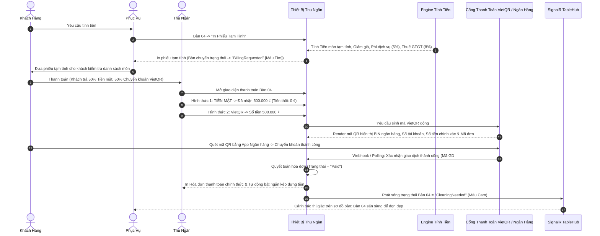
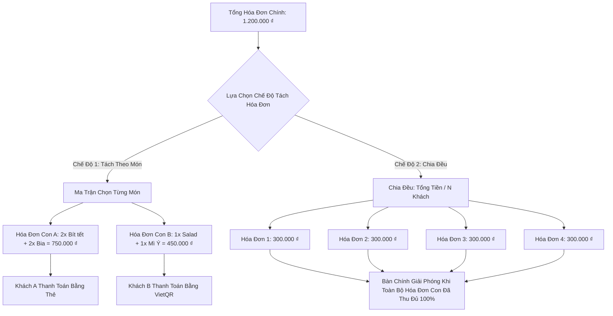

# Quy Trình Vận Hành Thu Ngân, Tính Tiền & Thanh Toán — SmartRestaurant
## (Cashier, Billing & Payment Workflow)

- **Phiên Bản Tài Liệu**: 1.0.0
- **Trạng Thái Tài Liệu**: `PROPOSED`
- **Tài Liệu Liên Quan**: [PRD.md](../PRD.md), [BUSINESS-REQUIREMENTS.md](../../99-archive/stage-1-history/superseded-documents/BUSINESS-REQUIREMENTS.md), [MODULE-OVERVIEW.md](../../99-archive/stage-1-history/superseded-documents/MODULE-OVERVIEW.md)

---

## 1. Luồng Tính Tiền & Thanh Toán Toàn Trình (End-to-End Billing & Payment Flow)

---

## 2. Các Nghiệp Vụ Tách Hóa Đơn Nâng Cao (Advanced Bill Splitting Operations)

SmartRestaurant hỗ trợ 2 chế độ tách hóa đơn vận hành thực tế nhằm triệt tiêu hoàn toàn các lỗi tính nhẩm của thu ngân trong giờ cao điểm thanh toán.

### 2.1. Chế Độ A: Tách Hóa Đơn Theo Từng Món Được Chọn (Split by Selected Items)
1. Thu ngân chọn chức năng **"Tách theo món"** trên bàn đang phục vụ.
2. Giao diện hai khung hiển thị danh sách toàn bộ món ăn của bàn bên trái.
3. Thu ngân tạo Hóa đơn con 1 và chuyển các món được chỉ định (ví dụ: 2x Bít tết, 2x Bia) sang Hóa đơn con 1.
4. Các món còn lại nằm trên Hóa đơn con 2 (hoặc tiếp tục tạo Hóa đơn con 3).
5. Engine tính tiền tự động phân bổ và tính toán lại chiết khấu theo món, voucher toàn đơn, phí dịch vụ và thuế GTGT một cách độc lập và tương ứng theo tỷ lệ trên từng hóa đơn con.
6. Mỗi hóa đơn con in ra một phiếu thanh toán riêng và có thể được quyết toán bằng các hình thức thanh toán khác nhau.

### 2.2. Chế Độ B: Chia Đều Hóa Đơn Theo Đầu Người ($1/N$) (Split Evenly)
1. Thu ngân chọn chức năng **"Chia đều (1/N)"** và nhập số lượng người $N$ (ví dụ: 4 khách).
2. Hệ thống tính toán:
   $$\text{Số tiền mỗi hóa đơn con} = \frac{\text{Tổng tiền thanh toán}}{N}$$
3. Mọi phần lẻ phát sinh do làm tròn 1 đồng hoặc 1.000 đồng được dồn vào hóa đơn con cuối cùng để đảm bảo tổng số tiền các hóa đơn con bằng chính xác 100% tổng tiền hóa đơn gốc:
   $$\sum_{i=1}^{N} \text{HóaĐơnCon}_i = \text{TổngHóaĐơnGốc}$$
4. Thu ngân lần lượt thu tiền cho từng phần chia cho đến khi số dư hóa đơn tổng về đúng 0 ₫.

### 2.3. Quy Tắc Vận Hành: Phiên Bàn Đa Hóa Đơn Không Đóng Băng Bàn (PDR-009)
- Thao tác tách hóa đơn phân bổ các dòng món vào nhiều hóa đơn con mà không khóa chặn phiên bàn.
- Nhân viên phục vụ tiếp tục gọi thêm món ăn hoặc đồ uống vào phiên bàn đang hoạt động. Món mới gọi thêm bắt buộc phải được chỉ định rõ vào một hóa đơn con chưa thanh toán đang mở (hoặc tạo một hóa đơn con mới); hệ thống tuyệt đối không tự ý gán món tùy tiện.
- **Hủy tách hóa đơn**: Thu ngân chỉ có thể hủy thao tác tách và gom các món lại thành một hóa đơn tổng duy nhất nếu CHƯA CÓ bất kỳ hóa đơn con nào phát sinh thanh toán.
- **Giải phóng bàn**: Bàn vật lý chỉ được giải phóng sang trạng thái `Cần dọn dẹp` khi 100% hóa đơn con đã được thanh toán hoàn tất (`Paid`) và toàn bộ món ăn đã đạt trạng thái phục vụ cuối cùng (`Đã phục vụ` hoặc đã hủy có ghi sổ hao phí).

### 2.4. Tính Toán Phụ Thu Phòng VIP & Khu Vực (PDR-011)
- Khi bàn ăn nằm trong phòng VIP riêng hoặc khu vực có cấu hình phụ thu:
  - Hệ thống áp dụng tỷ lệ % cấu hình (% tiền món) hoặc số tiền cố định thành một dòng phụ thu riêng biệt, minh bạch trên phiếu tạm tính và hóa đơn.
  - Giá trị phụ thu được chốt số liệu tại thời điểm tạo hóa đơn; thao tác chuyển bàn không tính toán lại hồi tố các món đã dùng trước đó.
- Lưu ý về Ký nợ: Tính năng quản lý công nợ khách hàng doanh nghiệp (Ký nợ / Công nợ B2B) được hoãn sang phiên bản v1.2+; MVP bắt buộc thanh toán dứt điểm qua Tiền mặt, Thẻ ngân hàng hoặc Chuyển khoản VietQR.

---

## 3. Vận Hành Ca Kíp & Quy Trình Cân Đối Két Tiền Mặt (Shift Management & Cash Drawer)

Nhằm ngăn chặn thất thoát tiền mặt, nhầm lẫn tiền thối và sai sót kế toán, SmartRestaurant áp dụng chu trình kiểm soát ca kíp chặt chẽ.

```mermaid
stateDiagram-v2
    [*] --> ShiftClosed: Ca làm việc trước đã hoàn tất

    ShiftClosed --> ShiftOpen: Thu ngân nhập Tiền mặt đầu ca (Ví dụ: 2.000.000 ₫)
    ShiftOpen --> ActiveShift: Mở két tiền; Sẵn sàng phục vụ

    ActiveShift --> ActiveShift: Tiền bán hàng mặt tích lũy vào két
    ActiveShift --> ActiveShift: Rút bớt tiền giữa ca nộp két an toàn quản lý

    ActiveShift --> ShiftClosing: Thu ngân kích hoạt "Chốt ca"
    ShiftClosing --> BlindCount: Thu ngân thực hiện kiểm tiền mù (Đếm số tờ từng mệnh giá)
    BlindCount --> DiscrepancyReview: Hệ thống đối soát hiển thị chênh lệch (Thực tế vs Máy tính)

    DiscrepancyReview --> ShiftClosed: Quản lý nhập mã PIN duyệt & In báo cáo Z-Report
```

### Các Quy Tắc Vận Hành Ca Kíp:
1. **Kiểm Tiền Mù (Blind Drop Count)**: Khi chốt ca, thu ngân hoàn toàn không được biết số tiền mặt hệ thống đang tính toán là bao nhiêu. Thu ngân bắt buộc phải đếm thực tế và nhập chi tiết số lượng tờ của từng mệnh giá tiền (500k, 200k, 100k, 50k, 20k, 10k).
2. **Công Thức Tính Chênh Lệch Tiền Mặt**:
   $$\text{Chênh lệch tiền mặt} = \text{Tiền thực tế đếm được} - (\text{Tiền mặt đầu ca} + \text{Doanh thu tiền mặt trong ca} - \text{Tiền rút giữa ca})$$
3. **Phê Duyệt Của Quản Lý**: Mọi khoản sai lệch vượt quá ngưỡng cho phép cấu hình (ví dụ: $\pm 20.000$ ₫) đều bắt buộc thu ngân phải nhập ghi chú giải trình và Quản lý Nhà Hàng phải nhập mã PIN ủy quyền phê duyệt trước khi báo cáo Z-Report được in ra và két tiền được khóa.

---

## 4. Xử Lý Tình Huống Xung Đột Đồng Thời & Ngoại Lệ Thanh Toán

| Tình Huống Ngoại Lệ | Mô Tả Rủi Ro | Giải Pháp Hệ Thống & Cơ Chế Bảo Vệ |
| :--- | :--- | :--- |
| **Bắn Món Cùng Lúc Thu Ngân Đang Quyết Toán (PDR-009)**: Thu ngân đang xử lý thanh toán / phiếu tạm tính trong khi phục vụ bắn thêm đồ uống/tráng miệng từ Bàn 04. | Nguy cơ thất thoát món mới gọi hoặc làm tê liệt phục vụ bàn. | **Hóa Đơn Chưa Thanh Toán Cho Phép Sửa & Mặc Định Nối Tiếp**: Khi bàn ở trạng thái `BillingRequested`, hóa đơn chưa thanh toán vẫn ở chế độ cho phép sửa. Món mới bắn bếp mặc định nối tiếp vào hóa đơn chưa thanh toán (tính lại tổng tiền động kèm lưu vết kiểm toán đầy đủ), hoặc phục vụ có thể chọn tách hẳn sang một hóa đơn con mới. Nghiêm cấm tuyệt đối việc sửa đổi trực tiếp các hóa đơn đã thu tiền xong. |
| **Thu Tiền Mặt Trùng Lặp Khi Webhook QR Đến Muộn (PDR-008)**: Khách vội trả tiền mặt vì quét mã QR bị timeout, sau đó 3 phút webhook ngân hàng báo tiền đã vào tài khoản. | Khách bị thu tiền 2 lần (Vừa trả Tiền mặt vừa bị trừ tiền Ngân hàng). | **Hàng Đợi Tiền Treo Đối Soát & Chống Trùng Lặp**: Khi chuyển phương thức sang Tiền mặt, mã QR đang mở bị hủy hiệu lực. Khi webhook ngân hàng về muộn, số tiền được điều hướng tự động vào "Giao dịch treo đối soát" (Suspense Queue) kèm chuông báo thị giác/âm thanh tức thì cho Thu ngân và Quản lý. Mã giao dịch ngân hàng và mã tham chiếu ngăn chặn việc ghi có 2 lần. Không tự ý hoàn tiền khi chưa kiểm chứng; áp dụng quy trình đối soát thủ công có thẩm quyền. |
| **Lỗi Thanh Toán Từng Phần Trong Multi-Tender**: Khách trả trước 500.000 ₫ tiền mặt, nhưng quẹt thẻ ngân hàng cho số tiền 700.000 ₫ còn lại bị từ chối thẻ. | Trạng thái giao dịch bị dở dang, rủi ro hạch toán. | **Sổ Cái Thanh Toán Đa Kênh**: Thu ngân xác nhận số tiền 500.000 ₫ tiền mặt đã vào két. Dư nợ còn lại hiển thị 700.000 ₫. Hóa đơn vẫn ở trạng thái mở (`PartiallyPaid` - Thanh toán một phần). Khách có thể đổi thẻ khác hoặc chuyển sang quét mã VietQR để hoàn tất số tiền còn lại. Số tiền 500.000 ₫ tiền mặt thu trước đó bị khóa cứng an toàn trong sổ quỹ. |
| **Khiếu Nại Hóa Đơn Sau Khi Đã Thanh Toán**: Thu ngân tính nhầm tiền Bàn 04 sang Bàn 05 và phát hiện sai sót sau khi đã bấm hoàn tất hóa đơn. | Sai lệch báo cáo doanh thu và thuế kế toán. | **Tính Bất Biến Của Hóa Đơn Đã Thanh Toán & Chính Sách Đã Phê Chuẩn (OD-14 / OQ-09: Phương án A)**: Hóa đơn đã thanh toán (`IsSettled = true`) là bất biến tuyệt đối trên POS và CSDL trong MVP; nghiêm cấm việc trực tiếp sửa đổi hoặc mở lại hóa đơn đã đóng. Khi có sai sót thực tế, Thu ngân và Quản lý thực hiện hoàn tiền mặt thủ công ngoài quầy kèm lập "Biên bản điều chỉnh sai lệch két giấy" ký tay; hệ thống ghi nhận khoản tiền chênh lệch vào thực thể `ShiftClosingVarianceLog` khi chốt ca kiểm tiền mù có lưu vết kiểm toán đầy đủ; hoãn chức năng sinh bút toán `CreditNote` số hóa sang phiên bản v1.1. |
