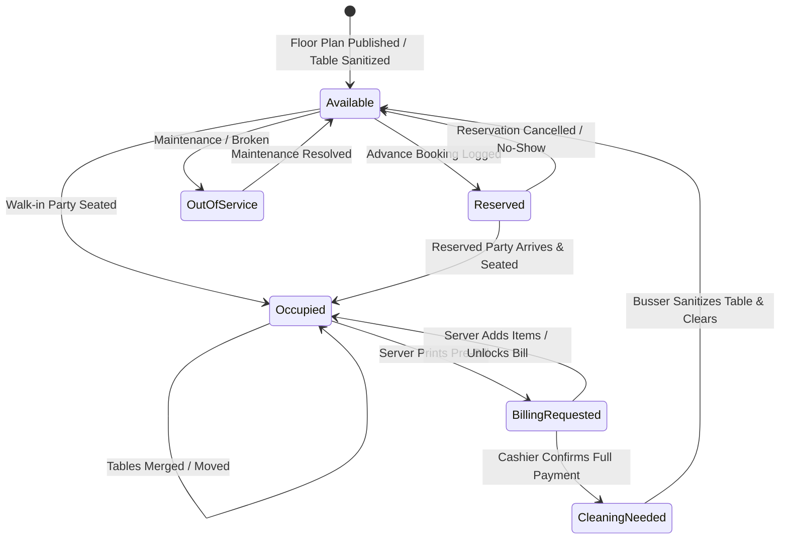
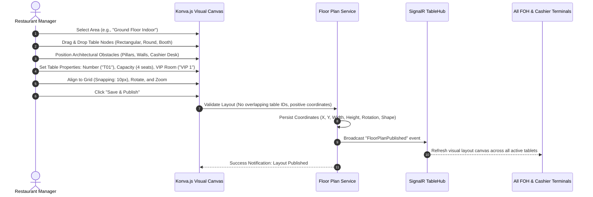

# Floor Plan & Table Management Workflow — SmartRestaurant

- **Document Version**: 1.0.0
- **Document Status**: `PROPOSED`
- **Related Documents**: [PRD.md](../PRD.md), [BUSINESS-REQUIREMENTS.md](../BUSINESS-REQUIREMENTS.md), [MODULE-OVERVIEW.md](../MODULE-OVERVIEW.md)

---

## 1. Table Operational Lifecycle & State Transitions

The table lifecycle is the foundational anchor for all front-of-house operations. Tables transition through mutually exclusive operational states with strict validation gates.

### Table State Operational Matrix

| Table State | Color Badge | System Behaviors & Restrictions | Authorized Roles |
| :--- | :--- | :--- | :--- |
| **Available** | Green / Neutral | Unoccupied table; ready for immediate walk-in or reservation assignment. | Host, Waiter, Manager |
| **Reserved** | Blue | Table locked for upcoming guest party; shows guest name and arrival countdown. | Host, Manager |
| **Occupied** | Amber / Yellow | Guests seated; active `DiningSession` bound; touch ordering unlocked. | Waiter, Host, Cashier |
| **BillingRequested**| Purple | Pre-bill printed; checkout underway; ordering locked to prevent bill drift. | Cashier, Waiter |
| **CleaningNeeded** | Orange | Invoice fully settled; guests departed; busser notification triggered. | Busser, Waiter, Cashier |
| **OutOfService** | Gray | Physical defect or closed dining section; ordering disabled. | Manager |

---

## 2. Interactive Floor Plan Designer Workflow

---

## 3. Advanced Table Operations

### 3.1. Operation A: Table Move (Chuyển Bàn)
- **Business Context**: Guests request to move from Table 04 (indoor) to Table 15 (outdoor garden) mid-meal.
- **Workflow**:
  1. Waiter taps Table 04 on tablet $\rightarrow$ selects **"Move Table"**.
  2. System highlights all currently `Available` tables. Table 15 is selected.
  3. **Validation Guard**: Target Table 15 must be `Available`. If Table 15 has an active session, the operation is blocked.
  4. System executes atomic database update:
     - Updates `DiningSession.CurrentTableId = Table 15`.
     - Updates all active KDS tickets: `TableLocation = Table 15`.
     - Sets Table 04 $\rightarrow$ `Available` (or `CleaningNeeded`).
     - Sets Table 15 $\rightarrow$ `Occupied`.
  5. SignalR broadcasts `TableMovedEvent(From: T04, To: T15)` to all POS terminals and KDS screens.

### 3.2. Operation B: Table Merge & Unmerge (Gộp & Hủy Gộp Bàn)
- **Business Context**: Two separate parties (or a large walk-in group) sit across Table 08 and Table 09 and wish to dine together under a single check.
- **Workflow**:
  1. Waiter taps Table 08 $\rightarrow$ selects **"Merge Tables"**.
  2. Waiter taps Table 09.
  3. System prompts: "Merge Table 09 into Table 08 (Primary Table)?".
  4. Upon confirmation:
     - Table 08 becomes the `PrimaryTable`. Table 09 becomes a `LinkedChildTable`.
     - If Table 09 already had open order items, they are moved to Table 08's active order.
     - Both Table 08 and Table 09 display a visual **"Linked" chain icon** on the floor plan.
     - Table 09 cannot be separately billed or assigned to walk-in guests until unmerged.
  5. Master bill settlement on Table 08 automatically releases both Table 08 and Table 09 to `CleaningNeeded`.

#### 3.2.1. Table Unmerge Workflow (Hủy Gộp Bàn - PDR-010):
- **Trigger**: Party at Table 09 decides to depart early or staff made an accidental merge.
- **Rules & Execution**:
  1. Cashier or Manager selects Table 08 $\rightarrow$ taps **"Hủy gộp bàn" (Unmerge)** $\rightarrow$ selects Table 09 to detach.
  2. If orders have already been placed under the merged session:
     - UI presents line item selector: Manager checks dishes belonging to Table 09.
     - System migrates selected items into a new, independent `TableSession` for Table 09.
     - **Preserve Kitchen History**: Unmerging NEVER re-fires tickets or duplicates KDS orders. All item preparation states (`Cooking`, `ReadyToServe`, `Served`) are strictly preserved.
  3. If no dishes had been ordered: Table 09 detaches immediately back to `Available`.
  4. Table 09 can now be independently billed, settled, and released without affecting Table 08.

### 3.3. Operation C: Whole Room / Area Booking & Shared Room Lifecycle (PDR-013)
- **Business Context**: A VIP customer books "VIP Suite 1" (which contains Table V1, Table V2, Table V3) for a private banquet, or multiple unrelated parties share tables in the same dining hall.
- **Workflow & Rules**:
  1. **Default State**: Tables inside a shared room function completely independently by default with their own guest sessions.
  2. **Entire Room Booking ("Bao Trọn Phòng")**: Manager selects "VIP Suite 1" $\rightarrow$ **"Book Entire Room"**.
     - System locks all child tables simultaneously (`Reserved` or `Occupied`) under the master booking.
     - External walk-in seating is strictly blocked for all tables in that room.
  3. **Release Lifecycle**: When the banquet concludes, individual tables within the room must have 100% of their bills settled and all ordered items served before being synchronously released to `CleaningNeeded` and subsequently `Available`.

---

## 4. Concurrency & Consistency Risk Mitigation

| Risk Scenario | Technical & Operational Mitigation |
| :--- | :--- |
| **Simultaneous Table Seating**: Two hostesses attempt to seat different walk-in parties at Table 04 at the exact same second. | **Optimistic Concurrency Control (`RowVersion`)**: The first transaction succeeds and transitions the table to `Occupied`. The second transaction fails with `TableAlreadyOccupiedException`, prompting the second hostess: "Table 04 was just seated by Hostess Sarah. Please choose another table." |
| **Table Move during Active Kitchen Fire**: Waiter moves Table 04 to Table 15 at the exact instant the kitchen marks a dish `ReadyToServe`. | **Atomic Transaction Boundary**: The table move updates the session record in a single transaction. The KDS event references `DiningSessionId`. Even if the runner looks at the physical chit, the KDS screen and runner tablet dynamically reflect the updated Table 15 location. |
| **Premature Seating on Dirty Table**: Hostess seats guests on a table before bussers finish sanitizing. | **Business Rule Block**: Tables in `CleaningNeeded` status cannot be opened for a new session until a busser or server taps "Mark Cleaned", transitioning the node back to `Available` (Green). |
