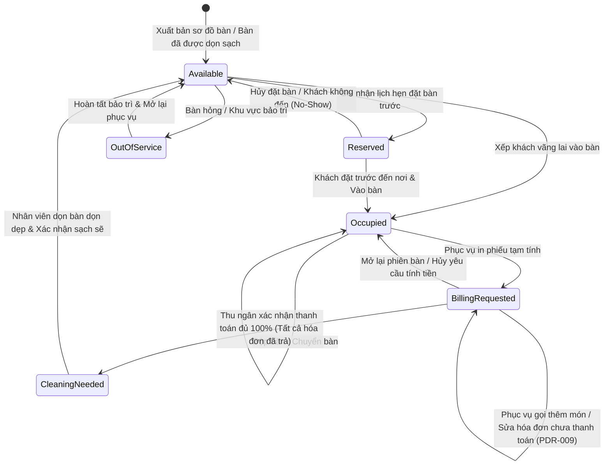
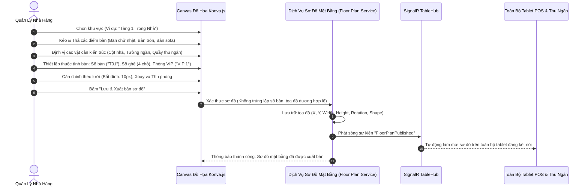

# Quy Trình Sơ Đồ Mặt Bằng & Quản Lý Bàn Ăn — SmartRestaurant
## (Floor Plan & Table Management Workflow)

- **Phiên Bản Tài Liệu**: 1.0.0
- **Trạng Thái Tài Liệu**: `PROPOSED`
- **Tài Liệu Liên Quan**: [PRD.md](../PRD.md), [BUSINESS-REQUIREMENTS.md](../BUSINESS-REQUIREMENTS.md), [MODULE-OVERVIEW.md](../MODULE-OVERVIEW.md)

---

## 1. Vòng Đời Vận Hành Bàn Ăn & Các Bước Chuyển Trạng Thái (Table Operational Lifecycle)

Vòng đời của bàn ăn là điểm neo nền tảng cho toàn bộ hoạt động tiền sảnh của nhà hàng. Các bàn ăn chuyển đổi giữa các trạng thái vận hành loại trừ lẫn nhau với các cổng kiểm soát xác thực nghiêm ngặt.

---

### Ma Trận Vận Hành Các Trạng Thái Bàn

| Trạng Thái Bàn | Huy Hiệu Màu Sắc | Hành Vi Hệ Thống & Ràng Buộc Vận Hành | Vai Trò Được Phép |
| :--- | :--- | :--- | :--- |
| **Trống (Available)** | Xanh lá / Trung tính | Bàn sạch sẽ, không có khách; sẵn sàng đón khách vãng lai hoặc gán lịch đặt bàn trước. | Tiếp tân, Phục vụ, Quản lý |
| **Đã đặt trước (Reserved)** | Xanh dương | Bàn bị khóa chờ đón đoàn khách hẹn trước; hiển thị tên khách và đồng hồ đếm ngược giờ đến. | Tiếp tân, Quản lý |
| **Có khách (Occupied)** | Vàng hổ phách | Khách đang ngồi ăn; liên kết phiên ăn uống `DiningSession`; mở khóa giao diện gọi món. | Phục vụ, Tiếp tân, Thu ngân |
| **Đang thanh toán (BillingRequested)**| Màu tím | Đã in phiếu tạm tính; quầy đang thu tiền; hóa đơn chưa thanh toán vẫn cho phép chỉnh sửa (PDR-009 / BR-RULE-06); món mới gọi thêm mặc định vào hóa đơn mở hoặc tạo hóa đơn con mới. | Thu ngân, Phục vụ |
| **Cần dọn dẹp (CleaningNeeded)** | Màu cam | Hóa đơn đã quyết toán 100%; khách đã rời đi; phát thông báo chuông cho nhân viên dọn bàn. | Nhân viên dọn bàn, Phục vụ, Thu ngân |
| **Ngừng phục vụ (OutOfService)** | Màu xám | Bàn bị hỏng cơ học hoặc khu vực đóng cửa bảo trì; vô hiệu hóa chức năng gọi món. | Quản lý nhà hàng |

---

## 2. Quy Trình Vận Hành Trình Thiết Kế Sơ Đồ Mặt Bằng Tương Tác (Floor Plan Designer)

---

## 3. Các Thao Tác Nghiệp Vụ Bàn Nâng Cao (Advanced Table Operations)

### 3.1. Thao Tác A: Chuyển Bàn (Table Move)
- **Bối cảnh nghiệp vụ**: Khách yêu cầu chuyển từ Bàn 04 (trong nhà) sang Bàn 15 (sân vườn ngoài trời) giữa bữa ăn.
- **Quy trình vận hành**:
  1. Phục vụ chạm chọn Bàn 04 trên máy tính bảng $\rightarrow$ chọn thao tác **"Chuyển bàn"**.
  2. Hệ thống làm nổi bật toàn bộ các bàn đang ở trạng thái `Trống` (Available). Bàn 15 được chọn.
  3. **Cổng kiểm soát xác thực**: Bàn đích (Bàn 15) bắt buộc phải đang ở trạng thái `Trống`. Nếu Bàn 15 đang có khách, thao tác bị chặn đứng ngay lập tức.
  4. Hệ thống thực thi giao dịch cập nhật cơ sở dữ liệu nguyên tử:
     - Cập nhật `DiningSession.CurrentTableId = Bàn 15`.
     - Cập nhật vị trí số bàn trên toàn bộ các thẻ KDS đang hoạt động: `TableLocation = Bàn 15`.
     - Chuyển Bàn 04 $\rightarrow$ `Trống` (hoặc `Cần dọn dẹp`).
     - Chuyển Bàn 15 $\rightarrow$ `Có khách`.
  5. SignalR phát sóng sự kiện `TableMovedEvent(From: T04, To: T15)` tới toàn bộ các thiết bị POS và màn hình KDS.

---

### 3.2. Thao Tác B: Gộp Bàn & Hủy Gộp Bàn (Table Merge & Unmerge)
- **Bối cảnh nghiệp vụ**: Hai đoàn khách riêng biệt (hoặc một nhóm khách đông) ngồi ghép giữa Bàn 08 và Bàn 09 và muốn dùng chung một đơn tính tiền.
- **Quy trình vận hành**:
  1. Phục vụ chạm chọn Bàn 08 $\rightarrow$ chọn thao tác **"Gộp bàn"**.
  2. Phục vụ chạm chọn Bàn 09.
  3. Hệ thống hiển thị hộp thoại xác nhận: "Gộp Bàn 09 vào Bàn 08 (Bàn chính)?".
  4. Sau khi xác nhận:
     - Bàn 08 trở thành **Bàn chính (Primary Table)**. Bàn 09 trở thành **Bàn phụ / Bàn ghép (Linked Child Table)**.
     - Nếu Bàn 09 trước đó đã có món, các món được gom chuyển vào đơn chung của Bàn 08.
     - Cả Bàn 08 và Bàn 09 hiển thị biểu tượng **"Mắt xích liên kết"** trên sơ đồ bàn.
     - Bàn 09 không thể bị thanh toán riêng lẻ hoặc xếp khách mới cho đến khi thực hiện thao tác hủy gộp.
  5. Khi thanh toán hóa đơn tổng trên Bàn 08, cả Bàn 08 và Bàn 09 tự động giải phóng sang trạng thái `Cần dọn dẹp`.

#### 3.2.1. Quy Trình Hủy Gộp Bàn (Table Unmerge — PDR-010):
- **Điều kiện kích hoạt**: Khách tại Bàn 09 muốn về trước hoặc nhân viên bấm nhầm gộp bàn.
- **Quy tắc & Thực thi**:
  1. Thu ngân hoặc Quản lý chọn Bàn 08 $\rightarrow$ bấm **"Hủy gộp bàn" (Unmerge)** $\rightarrow$ chọn Bàn 09 để tách ra.
  2. Nếu đơn gộp đã có món ăn:
     - Giao diện hiển thị danh sách món: Quản lý tích chọn các món thuộc về Bàn 09.
     - Hệ thống chuyển các món đã chọn sang một `TableSession` độc lập mới cho Bàn 09.
     - **Bảo toàn lịch sử bếp**: Hủy gộp bàn TUYỆT ĐỐI KHÔNG BẮN LẠI ĐƠN XUỐNG BẾP. Toàn bộ trạng thái chế biến (`Đang nấu`, `Đã xong - Chờ bưng`, `Đã phục vụ`) được bảo toàn nguyên vẹn.
  3. Nếu chưa gọi món nào: Bàn 09 tách ra và trở về trạng thái `Trống` ngay lập tức.
  4. Bàn 09 lúc này có thể được tính tiền, quyết toán và giải phóng độc lập mà không ảnh hưởng tới Bàn 08.

---

### 3.3. Thao Tác C: Đặt Bao Trọn Phòng Ăn & Vòng Đời Phòng Chung (Whole Room Booking — PDR-013)
- **Bối cảnh nghiệp vụ**: Khách VIP đặt trọn "Phòng VIP 1" (chứa các Bàn V1, V2, V3) để tổ chức tiệc riêng tư, hoặc nhiều đoàn khách vãng lai ngồi chung các bàn lẻ trong cùng một sảnh tiệc.
- **Quy trình & Các quy tắc bắt buộc**:
  1. **Trạng thái mặc định**: Các bàn ăn bên trong một phòng chung hoạt động hoàn toàn độc lập với các phiên phục vụ riêng biệt.
  2. **Bao trọn phòng ("Book Entire Room")**: Quản lý chọn "Phòng VIP 1" $\rightarrow$ **"Bao trọn phòng"**.
     - Hệ thống đồng thời khóa toàn bộ các bàn con bên trong (`Đã đặt trước` hoặc `Có khách`) theo đơn đặt tiệc chính.
     - Khách vãng lai từ bên ngoài bị chặn hoàn toàn không thể xếp chỗ vào các bàn trong phòng này.
  3. **Vòng đời giải phóng**: Khi tiệc kết thúc, toàn bộ các bàn con trong phòng phải được thanh toán 100% hóa đơn và phục vụ xong toàn bộ món trước khi được đồng bộ giải phóng sang `Cần dọn dẹp` và sau đó trở về `Trống`.

---

## 4. Kiểm Soát Xung Đột Đồng Thời & Giảm Thiểu Rủi Ro (Concurrency Risk Mitigation)

| Tình Huống Xung Đột Rủi Ro | Giải Pháp Kỹ Thuật & Nghiệp Vụ Chuẩn Hóa |
| :--- | :--- |
| **Hai Tiếp Tân Cùng Xếp Bàn Cùng Lúc**: Hai nhân viên tiếp tân cùng xếp hai đoàn khách khác nhau vào Bàn 04 tại đúng một tích tắc. | **Kiểm Soát Đồng Thời Lạc Quan (`RowVersion`)**: Giao dịch thứ nhất thành công và chuyển bàn sang `Occupied`. Giao dịch thứ hai thất bại với lỗi `TableAlreadyOccupiedException`, hiển thị thông báo: "Bàn 04 vừa được Tiếp tân Lan xếp chỗ. Vui lòng chọn bàn khác." |
| **Chuyển Bàn Khi Bếp Vừa Bấm Xong Món**: Phục vụ chuyển Bàn 04 sang Bàn 15 đúng thời điểm đầu bếp bấm `ReadyToServe` trên KDS. | **Ranh Giới Giao Dịch Nguyên Tử**: Thao tác chuyển bàn cập nhật bản ghi phiên bàn trong một giao dịch duy nhất. Sự kiện KDS tham chiếu theo `DiningSessionId`. Dù nhân viên tiếp thực nhìn vào phiếu giấy cũ thì trên màn hình KDS và tablet tiếp thực đã cập nhật tức thì vị trí mới tại Bàn 15. |
| **Xếp Khách Vào Bàn Chưa Dọn Dẹp**: Tiếp tân xếp khách mới vào bàn khi nhân viên dọn bàn chưa vệ sinh xong. | **Chặn Bằng Quy Tắc Nghiệp Vụ**: Bàn đang ở trạng thái `CleaningNeeded` không thể mở phiên phục vụ mới cho đến khi nhân viên dọn bàn chạm xác nhận "Đã dọn xong", đưa điểm bàn trở về màu xanh lá (`Available`). |
