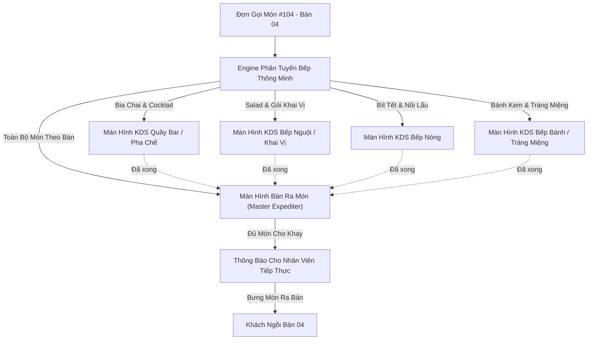
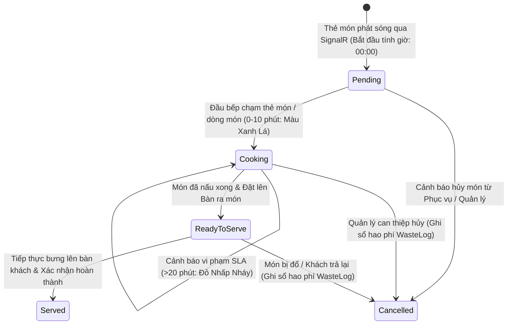

# Quy Trình Phân Tuyến Bếp & Vận Hành Màn Hình Bếp Số (KDS) — SmartRestaurant
## (Kitchen Routing & KDS Operational Workflow)

- **Phiên Bản Tài Liệu**: 1.0.0
- **Trạng Thái Tài Liệu**: `PROPOSED`
- **Tài Liệu Liên Quan**: [PRD.md](../PRD.md), [ORDER-WORKFLOW.md](./ORDER-WORKFLOW.md), [MODULE-OVERVIEW.md](../../99-archive/stage-1-history/superseded-documents/MODULE-OVERVIEW.md)

---

## 1. Kiến Trúc Phân Tuyến & Bóc Tách Đơn Đa Trạm (Multi-Station Ticket Decomposition)

Một đơn gọi món duy nhất của khách chứa hỗn hợp đồ uống, món khai vị nguội, món chính nóng và đồ tráng miệng sẽ tự động được bóc tách thành các phiếu chế biến riêng biệt gửi đến từng bộ phận bếp chuyên trách.

---

## 2. Vi Vòng Đời Thẻ Món KDS & Các Bước Chuyển Trạng Thái (KDS Ticket Lifecycle)

Mỗi thẻ phiếu bếp bao gồm các dòng món ăn con tiến triển tuần tự qua 4 trạng thái vận hành được định nghĩa rõ ràng.

---

## 3. Các Kịch Bản Phối Hợp Nhà Bếp Thực Tế (Critical Kitchen Scenarios)

### 3.1. Kịch Bản 1: Các Món Ăn Có Thời Gian Chế Biến Chênh Lệch Lớn
- **Bài toán thực tế**: Bàn 04 gọi một đĩa *Salad Hy Lạp* (Thời gian làm: 3 phút) và một phần *Bít tết Tomahawk* (Thời gian nướng: 22 phút). Nếu làm đĩa salad ngay, đĩa salad sẽ nằm nguội dưới đèn giữ nhiệt suốt 19 phút để đợi bít tết.
- **Giải pháp hệ thống**:
  1. **Màn Hình Bàn Ra Món (Expediter)** tự động liên kết thời gian chế biến dự kiến giữa các món.
  2. KDS Bếp Nguội hiển thị nhãn **"Giữ nhịp / Chờ tín hiệu"** hoặc Trưởng tiếp thực bấm "Tạm giữ món nguội cho đến khi bếp nóng bắt đầu nấu".
  3. Khi Bếp Nóng bấm `Đang nấu` trên miếng Tomahawk, SignalR tự động phát cảnh báo sang Bếp Nguội: **"Bắt đầu làm Salad cho Bàn 04 ngay"**, bảo đảm hai món cùng hoàn thành trong khung thời gian chênh lệch dưới 2 phút.

---

### 3.2. Kịch Bản 2: Hoàn Thành Từng Phần & Phục Vụ Theo Nhịp Đợt Món
- **Bài toán thực tế**: Quầy bar làm xong đồ uống trong 2 phút, khai vị xong trong 6 phút, nhưng nồi lẩu mất 15 phút.
- **Quy trình vận hành**:
  1. **Xác nhận xong độc lập theo từng trạm**:
     - Nhân viên pha chế bấm `Đã xong (Chờ bưng)` trên 4 cốc bia.
     - KDS Quầy Bar xóa thẻ đồ uống hoàn thành.
     - Trên **Màn Hình Tiếp Thực Tổng**, biểu tượng đồ uống chuyển sang màu xanh lá sáng (`Đã xong`), trong khi biểu tượng nồi lẩu vẫn giữ màu vàng hổ phách (`Đang nấu`).
  2. **Tiếp thực bưng trước đồ uống**:
     - Nhân viên bưng món có thể lấy ngay đồ uống bưng ra cho khách mà không phải chờ nồi lẩu.
     - Tiếp thực bấm "Đã bưng đồ uống" trên máy tính bảng $\rightarrow$ trạng thái đồ uống chuyển sang `Đã phục vụ`.
     - Màn hình tiếp thực cập nhật: Đồ uống `Đã phục vụ`, Nồi lẩu `Đang nấu`.

---

### 3.3. Kịch Bản 3: Đơn Ưu Tiên Gấp Cho Khách VIP / Đợi Quá Lâu (Rush Order)
- **Bài toán thực tế**: Bàn 02 (Phòng VIP) đã đợi 25 phút do sự cố trạm nướng; khách bắt đầu sốt ruột.
- **Quy trình vận hành**:
  1. Trưởng ca phục vụ mở Bàn 02 trên POS $\rightarrow$ bấm **"Ưu tiên gấp / Báo làm gấp"**.
  2. SignalR phát sóng sự kiện `RushOrderEvent` tới KDS Bếp Nóng và KDS Tiếp Thực.
  3. Thẻ món Bàn 02 ngay lập tức nhảy lên **vị trí đầu tiên bên trái** của hàng đợi KDS, bao quanh bởi **viền đỏ rung nhấp nháy** kèm âm thanh chuông báo kép.
  4. Đầu bếp ngay lập tức ưu tiên chế biến Bàn 02 trước các đơn hàng thông thường khác.

---

### 3.4. Kịch Bản 4: Khách Hủy Món Khi Đang Nấu Dở
- **Bài toán thực tế**: Khách đổi ý hủy món Bít tết sau khi bếp đã nấu được 8 phút.
- **Quy trình vận hành**:
  1. Quản lý nhập mã PIN trên POS để duyệt hủy món.
  2. SignalR phát sóng sự kiện hủy món tức thì tới KDS Bếp Nóng.
  3. Món bít tết trên thẻ KDS **nhấp nháy đỏ kèm vạch gạch ngang chữ** và âm thanh cảnh báo: *"Món ăn đã bị hủy"*.
  4. Đầu bếp chạm vào thẻ để xác nhận dừng nấu; món biến mất khỏi hàng đợi hoạt động.
  5. Phần nguyên liệu thăn bò được tự động ghi nhận vào bảng `WasteLog` để hạch toán chi phí hao hụt nhà bếp.

---

### 3.5. Kịch Bản 5: Làm Lại Món Do Lỗi Nhà Bếp (Remake Dish — PDR-015 / REV-11)
- **Bài toán thực tế**: Món ăn bị khách từ chối tại bàn do lỗi nấu nướng (cháy, mặn, nhầm yêu cầu dị ứng).
- **Quy trình vận hành & Ràng buộc nghiệp vụ**:
  1. Phục vụ gửi yêu cầu Làm Lại Món kèm mã PIN Quản lý ủy quyền và mã lý do cụ thể.
  2. Hệ thống ghi nhận đầy đủ: Người yêu cầu (requester), Quản lý duyệt PIN, Mốc thời gian (timestamp), Lý do làm lại và Bộ phận bếp chịu trách nhiệm (department).
  3. Một **Phiếu Chế Biến Ưu Tiên Cao** xuất hiện ngay đầu hàng đợi tại trạm bếp (Đề xuất giao diện: Thẻ nổi bật màu tím / cảnh báo nhấp nháy là gợi ý UI của AI, không phải yêu cầu bắt buộc nếu chưa có phê duyệt của Owner).
  4. Tiêu đề thẻ hiển thị: **"LÀM LẠI DO LỖI BẾP"** kèm chi tiết lỗi nổi bật (ví dụ: "Cháy khét - Đổi đĩa mới").
  5. Món ăn được nấu lại khẩn trương mà **tuyệt đối không thu thêm tiền của khách hàng** (giữ nguyên tổng tiền hóa đơn).
  6. Suất ăn lỗi bị loại bỏ được tự động ghi nhận vào **Sổ Hao Phí Nhà Bếp (`WasteLog` / ScrapLoss)** để hạch toán thất thoát nguyên liệu theo quy tắc nghiệp vụ đã phê duyệt.

---

### 3.6. Kịch Bản 6: Phân Tuyến Trực Tiếp Tại Quầy FOH (Direct FOH — PDR-012 / REV-08)
- Bia lon, nước ngọt đóng chai và khăn lạnh được cấu hình cờ lấy trực tiếp tại tiền sảnh (`DirectFOHPick: true`) sẽ được phục vụ trực tiếp tại khu vực khách, **bỏ qua hoàn toàn hàng đợi pha chế của Bar KDS** theo quyết định `REV-08`.
- Nhân viên phục vụ lấy đồ trực tiếp từ tủ mát khu vực ăn uống, giảm tải cho nhân viên pha chế quầy bar trong giờ cao điểm.
- **Tính toàn vẹn nghiệp vụ**: Món `DirectFOHPick` vẫn được ghi nhận đầy đủ và nhất quán trong luồng gọi món (order), ghi nhận doanh thu (revenue), quản lý tồn kho (inventory) và tính tiền thanh toán (payment); tuyệt đối không tạo ra mâu thuẫn với quyết định `D2` về thời điểm trừ tồn kho.

---

## 4. Cơ Chế Dự Phòng Phần Cứng: In Nhiệt Phiếu Bếp ESC/POS (Hardware Fallback)

Căn cứ quyết định `OQ-02` (Phương án A đã được Chủ Dự Án phê duyệt chính thức):
- **Cấu hình mặc định Paperless KDS-first**: Tham số `AutoPrintOnFire` tại các trạm bếp được thiết lập mặc định là **TẮT** (`AutoPrintOnFire: false`), ưu tiên luồng vận hành số hóa hiện đại trên màn hình KDS và loại bỏ hoàn toàn lãng phí giấy in nhiệt.
- **Phương án dự phòng phần cứng tin cậy**:
  - Nếu một màn hình KDS bị mất nguồn điện, đứt mạng nội bộ hoặc hỏng cảm ứng, hệ thống kích hoạt **Chế Độ Dự Phòng Phần Cứng (Hardware Fallback Mode)**: máy tính bảng phục vụ phát hiện màn hình KDS trạm bếp bị ngắt kết nối và tự động chuyển hướng lệnh in sang **máy in nhiệt nhà bếp ESC/POS** qua cổng IP mạng nội bộ (Port 9100).
  - Đầu bếp có thể chủ động bấm nút "In lại phiếu" trên giao diện KDS khi cần phiếu giấy kẹp vào đĩa mang ra bàn.
  - Khi màn hình KDS khởi động lại và kết nối lại SignalR, hệ thống tự động tải lại các thẻ món chưa phục vụ và tiếp tục vận hành số hóa bình thường mà không bị thất lạc bất kỳ đơn món nào.
