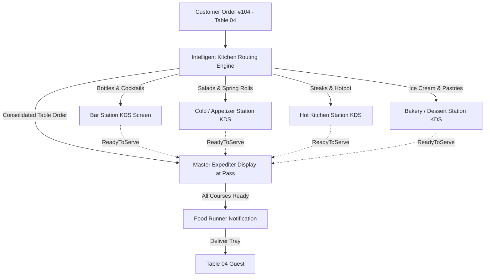
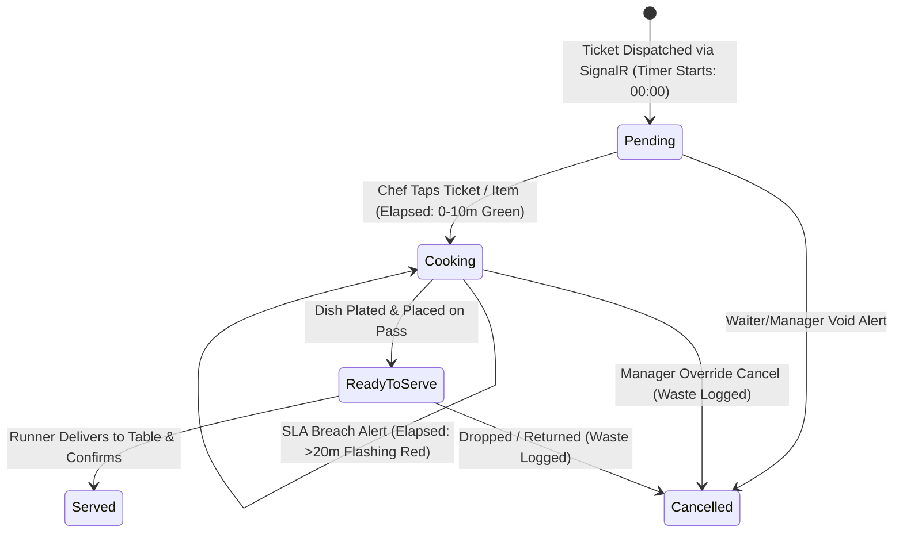

# Kitchen Routing & KDS Operational Workflow — SmartRestaurant

- **Document Version**: 1.0.0
- **Document Status**: `PROPOSED`
- **Related Documents**: [PRD.md](../PRD.md), [ORDER-WORKFLOW.md](./ORDER-WORKFLOW.md), [MODULE-OVERVIEW.md](../MODULE-OVERVIEW.md)

---

## 1. Multi-Station Ticket Decomposition & Routing Architecture

A single customer order containing a mix of beverages, cold appetizers, hot entrees, and desserts is automatically decomposed into station-specific preparation tickets.

---

## 2. KDS Ticket Micro-Lifecycle & Operational Transitions

Each kitchen ticket card consists of individual items that progress through four well-defined operational states.

---

## 3. Critical Kitchen Scenarios & Operational Coordination

### 3.1. Scenario 1: Dishes with Drastically Different Preparation Times
- **Problem**: Table 04 orders a *Greek Salad* (Prep time: 3 mins) and a *Tomahawk Ribeye Steak* (Prep time: 22 mins). If the salad is prepared immediately, it will sit under heat lamps and wilt for 19 minutes while waiting for the steak.
- **System Solution**:
  1. The **Master Expediter Display** correlates item target prep durations.
  2. The Cold Station KDS can mark items with a **"Pace / Delayed Fire"** indicator or the Expediter taps "Hold Cold Course until Hot Course is Cooking".
  3. When Hot Kitchen taps `Cooking` on the Tomahawk, an automatic SignalR alert fires to the Cold Station: **"Fire Salad for Table 04 Now"**, synchronizing dish completion within a 2-minute serving window.

---

### 3.2. Scenario 2: Partial Completion & Multi-Course Pacing
- **Problem**: The bar prepares drinks in 2 minutes, appetizers finish in 6 minutes, but main hotpot takes 15 minutes.
- **Workflow**:
  1. **Independent Station Completion**:
     - Bartender taps `ReadyToServe` on the 4 beers.
     - The Bar KDS clears the drink ticket card.
     - On the **Master Expediter Screen**, the drink icons turn bright green (`Ready`), while the Hotpot icon remains amber (`Cooking`).
  2. **Runner Partial Pickup**:
     - FOH runner can pick up drinks immediately without waiting for the hotpot.
     - Runner taps "Deliver Drinks" on tablet $\rightarrow$ drink status becomes `Served`.
     - The Expediter screen updates: Drinks `Served`, Hotpot `Cooking`.

---

### 3.3. Scenario 3: Rush / VIP High-Priority Escalation
- **Problem**: Table 02 (VIP Room) has been waiting 25 minutes due to a grill delay; guests are getting impatient.
- **Workflow**:
  1. Floor Captain opens Table 02 on tablet POS $\rightarrow$ taps **"Escalate / Mark Rush"**.
  2. SignalR dispatches `RushOrderEvent` to Hot Kitchen and Expediter KDS.
  3. The Table 02 ticket immediately moves to the **far left (first position)** of the KDS queue, surrounded by a **vibrating red border** and sounding an audible double-beep alarm.
  4. Chefs immediately prioritize Table 02 over standard FIFO tickets.

---

### 3.4. Scenario 4: Item Cancellation While Actively Cooking
- **Problem**: Customer cancels their Steak 8 minutes into cooking.
- **Workflow**:
  1. Manager enters PIN on POS to authorize cancellation.
  2. SignalR broadcasts cancellation event to Hot Kitchen KDS.
  3. The steak item on the ticket card **flashes bright red with a strikethrough** and an audio alert: *"Order Item Cancelled"*.
  4. Chef taps the card to acknowledge the cancellation; the item disappears from the active queue.
  5. The raw steak is automatically written off to the kitchen `WasteLog` table as scrap loss.

---

### 3.5. Scenario 5: Remake Dish for Culinary Errors (PDR-015)
- **Problem**: Dish rejected at table due to kitchen mistake (burnt, too salty, wrong allergy preparation).
- **Workflow**:
  1. Server submits Remake action with Manager PIN and reason code.
  2. A dedicated high-priority **Purple Remake Card** surfaces at the head of the prep queue on the responsible KDS station.
  3. Header displays: **"LÀM LẠI DO LỖI BẾP"** with prominent error detail (e.g., "Cháy khét - Đổi đĩa mới").
  4. Dish is remade without customer surcharge; scrap is automatically recorded to the kitchen Waste Register.

---

### 3.6. Scenario 6: Direct FOH Service Bypass (PDR-012)
- Canned beer, bottled soft drinks, and packaged items bypass the Bar KDS preparation queue completely.
- FOH staff dispense directly from dining area chillers, preventing Bar KDS station clutter.

---

## 4. Hardware Fallback: ESC/POS Thermal Kitchen Printing

While SmartRestaurant prioritizes 100% digital, paperless KDS screens, physical restaurant reality requires resilient fallbacks:
- If a KDS screen loses power, network connectivity, or suffers touchscreen hardware failure, the system supports a **Hardware Fallback Mode**:
  - The waiter tablet detects the KDS node is offline and automatically redirects print jobs to a networked **ESC/POS thermal kitchen printer** over IP port 9100.
  - When the screen re-boots and reconnects to SignalR, it re-fetches active unserved tickets and resumes digital operation without ticket loss.
