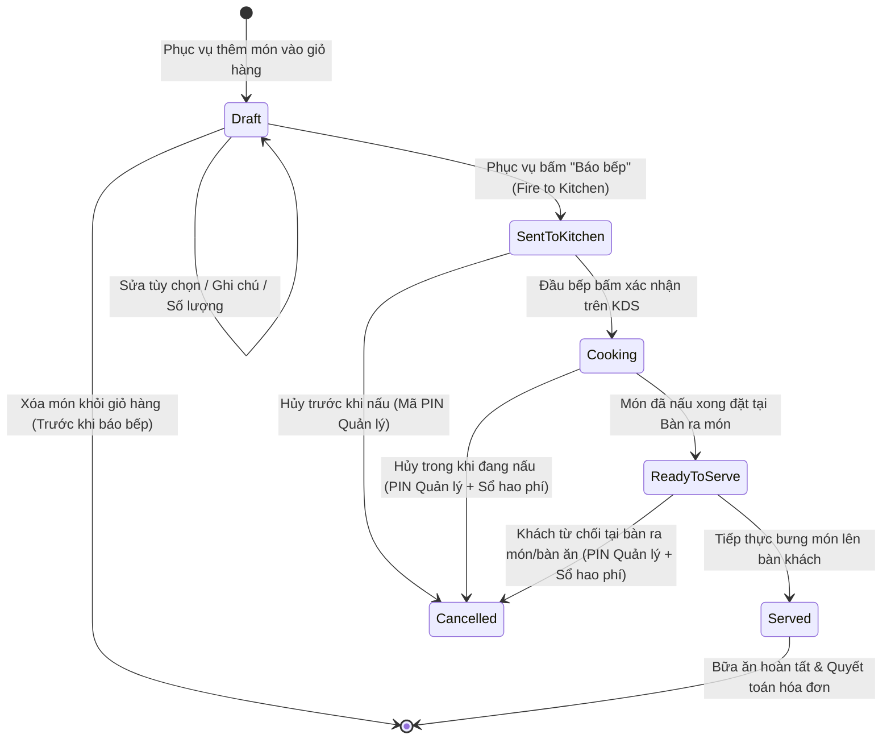
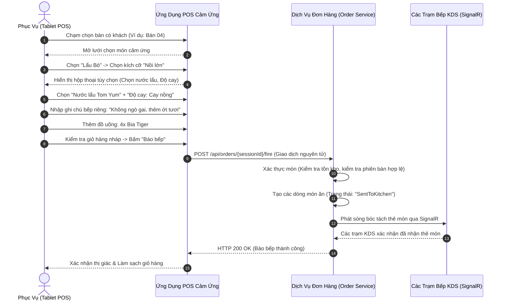
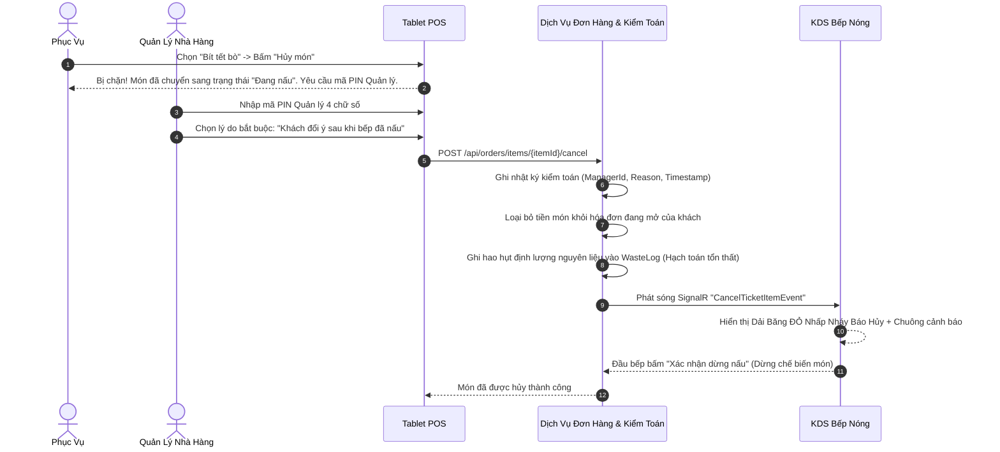

# Quy Trình Vận Hành POS & Quản Lý Đơn Gọi Món — SmartRestaurant
## (POS & Order Management Workflow)

- **Phiên Bản Tài Liệu**: 1.0.0
- **Trạng Thái Tài Liệu**: `PROPOSED`
- **Tài Liệu Liên Quan**: [PRD.md](../PRD.md), [BUSINESS-REQUIREMENTS.md](../../99-archive/stage-1-history/superseded-documents/BUSINESS-REQUIREMENTS.md), [KITCHEN-WORKFLOW.md](./KITCHEN-WORKFLOW.md)

---

## 1. Vòng Đời Đơn Hàng & Các Bước Chuyển Trạng Thái (Order Lifecycle & State Transitions)

Một đơn hàng đại diện cho giao dịch thương mại của một lượt khách ăn uống. Trong khi đơn hàng tổng thể tiến triển từ `Mở` (Open) sang `Đã in tạm tính` (Billed) rồi `Đã thanh toán` (Paid), từng món ăn con bên trong mang các vi trạng thái riêng để phối hợp nhịp nhàng giữa chế biến nhà bếp và phục vụ bàn.

---

## 2. Các Quy Trình Nghiệp Vụ Gọi Món Chính (Main Order Workflows)

### 2.1. Luồng Tiêu Chuẩn: Tiếp Nhận Gọi Món Lần Đầu & Bắn Đơn Xuống Bếp (Initial Order Capture & Dispatch)

---

### 2.2. Gọi Món Tăng Dần: Gọi Thêm Các Đợt Món Sau Lần Báo Bếp Đầu Tiên (Incremental Rounds)
- **Bối cảnh nghiệp vụ**: Khách dùng xong đợt đồ uống và khai vị đầu tiên, sau đó tiếp tục gọi thêm một đợt bia và đĩa thịt nhúng lẩu thêm.
- **Quy trình vận hành**:
  1. Phục vụ chạm chọn Bàn 04 $\rightarrow$ các món đã báo bếp trước đó hiển thị đầy đủ kèm trạng thái chế biến hiện tại (`Đang nấu`, `Đã xong - Chờ bưng`, hoặc `Đã phục vụ`).
  2. Phục vụ thêm 2x Bia Tiger và 1x Đĩa Ba chỉ bò Mỹ vào giỏ hàng.
  3. Phục vụ bấm **"Báo bếp Đợt 2"**.
  4. Hệ thống ghi nhận các món mới này dưới mã đợt gọi `RoundNumber = 2`.
  5. Các món mới được gắn dấu ấn thời gian mới và bắn về KDS Quầy Bar và KDS Bếp Nóng mà không làm ảnh hưởng đến trạng thái hay đồng hồ đếm thời gian của các món thuộc Đợt 1.

---

### 2.3. Luồng Ngoại Lệ: Hủy Món Sau Khi Đã Báo Bếp & Quản Lý Can Thiệp (Post-Fire Cancellation)
- **Bối cảnh nghiệp vụ**: Khách hàng đổi ý muốn hủy một món ăn sau khi đơn đã được bắn xuống bếp được 5 phút.

---

### 2.4. Quy Trình Làm Lại Món Do Lỗi Nhà Bếp (Remake Dish — PDR-015)
- **Bối cảnh nghiệp vụ**: Món ăn phục vụ lên bàn bị lỗi (cháy khét, quá mặn, có dị vật, nguội lạnh) do lỗi của bếp hoặc quầy pha chế; khách hàng từ chối nhận món và yêu cầu làm lại đĩa mới.
- **Quy trình & Các quy tắc bắt buộc**:
  1. Phục vụ chạm vào món ăn trên POS $\rightarrow$ chọn thao tác **"Làm lại món" (Remake Dish)**.
  2. Giao diện yêu cầu nhập mã PIN Quản lý ủy quyền và phân loại lỗi bắt buộc:
     - `Lỗi chế biến` (Cháy, khét, mặn, sống, nguội)
     - `Dị vật trong món`
     - `Nhầm món / Sai ghi chú dị ứng`
  3. **Bất biến hóa đơn**: Hóa đơn của khách TUYỆT ĐỐI KHÔNG TÍNH TIỀN 2 LẦN; số lượng và tiền món trên hóa đơn của khách giữ nguyên không đổi.
  4. **Thẻ KDS nhà bếp**: Hệ thống sinh thẻ KDS màu tím ưu tiên cao: **"LÀM LẠI DO LỖI BẾP"** kèm mã lý do hiển thị rõ ràng.
  5. **Kế toán & Tồn kho**: Hệ thống tự động ghi món lỗi vào bảng `WasteLog` để tính chi phí tổn thất nhà bếp và thực hiện giữ kho bổ sung cho phần nguyên liệu làm lại.

### 2.5. Phân Tuyến Đồ Uống Lấy Ngay Tại Tiền Sảnh FOH (Direct FOH Routing — PDR-012)
- Đồ uống đóng chai/lon sẵn (bia lon, nước ngọt đóng chai) được đánh dấu cờ `ServiceRouting = DirectFOHPick` sẽ bỏ qua hàng đợi pha chế của Bar KDS khi báo bếp.
- Món chuyển ngay lập tức sang trạng thái `Đã xong (Chờ bưng) / Đã xuất tủ` để nhân viên phục vụ lấy trực tiếp từ tủ mát tiền sảnh bưng cho khách, đồng thời vẫn bảo đảm tính tiền đầy đủ và khóa giữ kho thành phẩm.

---

## 3. Kiểm Soát Đồng Thời & Toàn Vẹn Dữ Liệu Khi Tải Cao Điểm (Concurrency & Data Consistency)

| Tình Huống Xung Đột Đồng Thời | Rủi Ro Vận Hành Tiềm Tàng | Giải Pháp Kiến Trúc & Nghiệp Vụ Chuẩn Hóa |
| :--- | :--- | :--- |
| **Nhiều Phục Vụ Cùng Gọi Món Cho Một Bàn**: Hai nhân viên phục vụ đứng ở hai đầu bàn tiệc lớn (Bàn 12) cùng thao tác thêm món vào giỏ hàng tại cùng thời điểm. | Ghi đè mất món ăn hoặc sinh trùng lặp các đợt gọi món xung đột. | **Gọi Món Đồng Thời Không Khóa Bàn (PDR-014)**: Phục vụ không bao giờ bị khóa chặn khỏi bàn đang hoạt động. Thiết bị tạo nháp cục bộ và gửi các lệnh nối thêm không làm hỏng dữ liệu. Nếu hai phục vụ cùng sửa một dòng món, hệ thống phát hiện xung đột và cảnh báo kèm trạng thái mới nhất. Khóa bất biến client/server ngăn chặn gửi đơn trùng. *(Cơ chế kỹ thuật cụ thể do Solution Architect quyết định trong Stage 2)*. |
| **Món Được Đặt Đúng Lúc Bếp Báo Hết Món (86)**: Phục vụ vừa chọn món "Cá hồi nướng" vào giỏ hàng đúng tích tắc Bếp trưởng bấm "Tạm hết món" (86) trên màn hình bếp. | Bếp nhận được đơn của một món mà nhà bếp không còn nguyên liệu để nấu. | **Cổng Xác Thực Ngay Trước Khi Báo Bếp**: Khi phục vụ chạm nút "Báo bếp", backend kiểm tra lại ngay lập tức trạng thái khả dụng của món ăn trước khi xác nhận giao dịch. Nếu món vừa hết, giao dịch bị hủy và trả về lỗi: `ItemUnavailableException: "Món Cá hồi nướng vừa được nhà bếp báo tạm hết hàng."` |
| **Bắn Thêm Món Vào Bàn Đang In Phiếu Tính Tiền**: Phục vụ bắn thêm đồ uống trong lúc thu ngân đang nhận tiền phiếu tạm tính tại quầy. | Lệch hóa đơn: khách trả số tiền cũ rồi về; nhà hàng chịu thất thoát tiền các món đồ uống vừa gọi thêm. | **Hóa Đơn Chưa Thanh Toán Cho Phép Sửa & Phân Tuyến Động (PDR-009 / BR-RULE-06)**: Bàn ở trạng thái `BillingRequested` giữ hóa đơn chưa thanh toán ở chế độ cho phép sửa. Món mới gọi thêm mặc định nối tiếp vào hóa đơn chưa thanh toán (cập nhật số tiền động kèm lưu vết kiểm toán), hoặc nhân viên có thể chọn phân tuyến sang một hóa đơn con mới lập. Bàn không bị đóng băng, nhưng hóa đơn đã thu tiền xong thì không thể sửa trực tiếp. |
