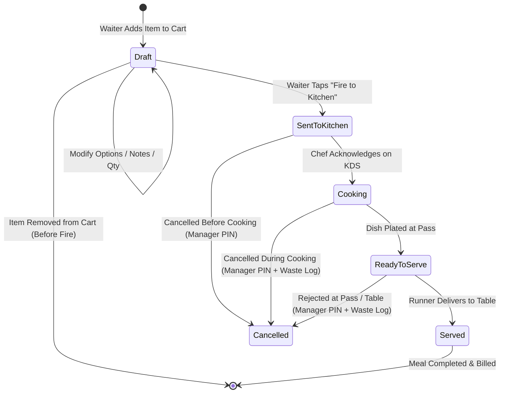
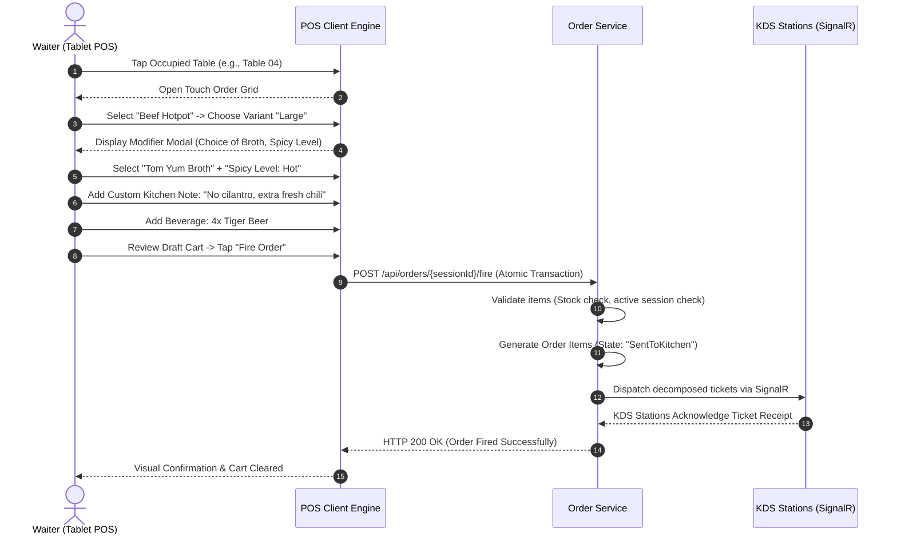
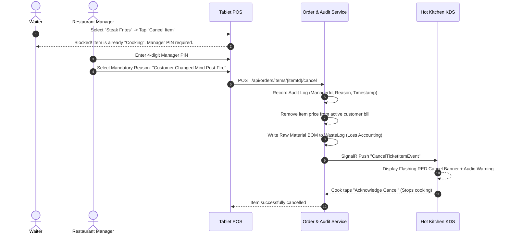

# POS & Order Management Workflow — SmartRestaurant

- **Document Version**: 1.0.0
- **Document Status**: `PROPOSED`
- **Related Documents**: [PRD.md](../PRD.md), [BUSINESS-REQUIREMENTS.md](../BUSINESS-REQUIREMENTS.md), [KITCHEN-WORKFLOW.md](./KITCHEN-WORKFLOW.md)

---

## 1. End-to-End Order Lifecycle & State Transitions

An order represents the commercial transaction of a dining session. While the master order progresses from `Open` to `Billed` to `Paid`, individual line items carry their own micro-states to coordinate kitchen preparation and service.

---

## 2. Main Order Workflows

### 2.1. Normal Flow: Initial Order Capture & Kitchen Dispatch

---

### 2.2. Incremental Rounds: Additional Orders Post-Initial Fire
- **Business Context**: Guests finish their first round of drinks and appetizers, then order another round of beers and hotpot refill platters.
- **Workflow**:
  1. Waiter taps Table 04 $\rightarrow$ previously fired items are displayed with their current prep status (`Cooking`, `ReadyToServe`, or `Served`).
  2. Waiter adds 2x Tiger Beers and 1x US Beef Plate to the cart.
  3. Waiter taps **"Fire Round 2"**.
  4. System registers these new items under `RoundNumber = 2`.
  5. The new items receive new ticket timestamps and dispatch to the Bar and Hot Kitchen KDS screens without affecting the status or elapsed timers of Round 1 items.

---

### 2.3. Exceptional Flow: Post-Fire Dish Cancellation & Manager Override
- **Business Context**: Customer changes their mind about an ordered dish 5 minutes after it was fired to the kitchen.

---

### 2.3. Remake Dish Workflow for Kitchen Errors (Làm Lại Món - PDR-015)
- **Business Context**: Food served is defective (burnt, over-salted, foreign object, cold) due to kitchen or bar error; guest rejects dish and requests a replacement.
- **Workflow & Rules**:
  1. Waiter taps dish $\rightarrow$ selects **"Làm lại món" (Remake Dish)**.
  2. UI requires Manager PIN authorization and mandatory error categorization:
     - `Lỗi chế biến` (Cháy, khét, mặn, sống, nguội)
     - `Dị vật trong món`
     - `Nhầm món / Sai ghi chú dị ứng`
  3. **Bill Invariant**: Customer bill is NOT charged twice; line item quantity and subtotal on the guest invoice remain unchanged.
  4. **KDS Ticket**: System generates high-priority purple KDS card: **"LÀM LẠI DO LỖI BẾP"** with reason code displayed.
  5. **Accounting & Inventory**: System logs defective dish into `WasteLog` table as kitchen loss and reserves inventory for replacement portion.

### 2.4. Direct FOH Beverage Routing (Đồ Uống Phục Vụ Ngay - PDR-012)
- Packaged beverages (canned beer, bottled soft drinks) marked with `ServiceRouting = DirectFOHPick` bypass the Bar KDS queue upon order firing.
- Transition immediately to `ReadyToServe / Dispensed` for instant waiter retrieval at dining floor refrigerators while remaining fully accounted for in billing and inventory reservation.

---

## 3. Concurrency & High-Volume Data Consistency

| Concurrency Scenario | Potential Hazard | Architectural & Product Solution |
| :--- | :--- | :--- |
| **Simultaneous Waiter Ordering**: Two servers standing at opposite ends of a large banquet table (Table 12) add items to the cart simultaneously. | Overwriting line items or generating conflicting rounds. | **Non-Blocking Shared Ordering (PDR-014)**: Waiters are never locked out of active tables. Systems draft locally and submit non-destructive increments. If two servers modify the same line item, conflict detection prompts with current state. Client/server idempotency keys prevent double submissions. (Technical mechanism delegated to Stage 2 Solution Architecture). |
| **Item Ordered While Being 86-ed**: Waiter adds "Grilled Salmon" to cart at the exact second the Chef marks it "86-ed" (out of stock) on the kitchen terminal. | Kitchen receives an order for an ingredient they do not possess. | **Pre-Fire Validation Gate**: When the server taps "Fire to Kitchen", the backend re-validates item availability immediately before committing the transaction. If 86-ed, the transaction aborts with `ItemUnavailableException: "Grilled Salmon was just marked 86-ed by Kitchen."` |
| **Firing Order on Table Being Checked Out**: Server fires additional drinks while cashier is already taking money for the pre-bill. | Bill drift: guest pays old amount and leaves; restaurant absorbs the cost of newly fired drinks. | **Multi-Bill Target Routing (PDR-009)**: If the table has an open sub-bill being settled, new items must be explicitly assigned to an unpaid sub-bill or a newly created sub-bill. Tables are never frozen completely. |
